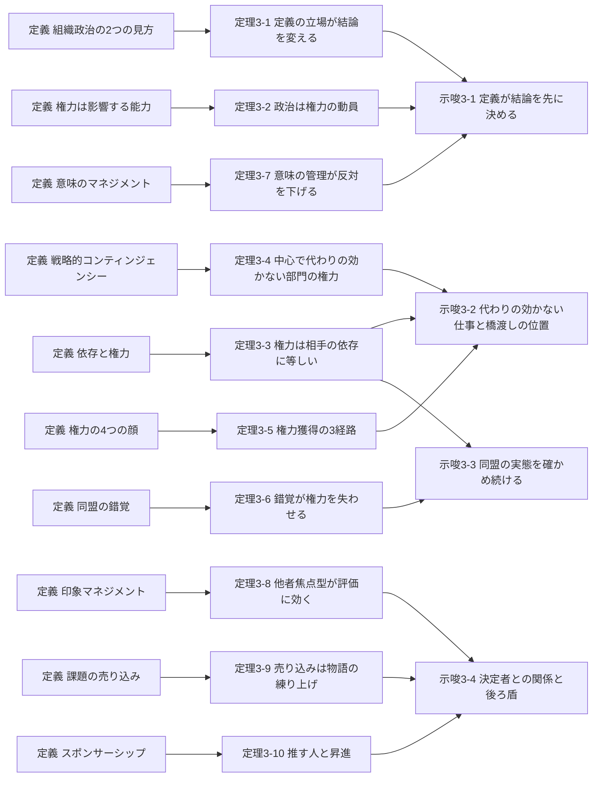

# 第3章 そもそも社内政治とは？ — 定義・定理・示唆

> 木村琢磨『社内政治の科学』（2025）の目次の見出しを「論点の枠」として使い、本文を読んだ論文だけを根拠に定理を立てました。本の内容は書いていません。著者の定義は、著者の公開記事から出典付きで紹介します。レビューの中で紹介されているだけの原典は、名指しせず「レビューによる整理」として扱います。

## この章の問い

社内政治とは何か。それは権力とどう関係するか。なぜ「意味（解釈）」を動かすことが政治になるのか。

目次の見出し（第2〜4節）は次のとおりです。

- 第2節 社内政治の定義: なぜ定義が重要か / 古典的研究における定義 / 対立、そして意味のマネジメントへ / 本書での社内政治の定義
- 第3節 社内政治と権力: 権力とは / 権力の行使・使用としての政治 / 権力獲得のための社内政治
- 第4節 社内政治と意味のマネジメント: 意味形成理論 / 意味のマネジメントとしての政治 / 印象マネジメントとしての政治 / 部下や企画を売り込む

## 1. 概念の定義

| 概念 | 定義（言い換え） | 出典 | 読んだ箇所 |
|------|------------------|------|------------|
| 社内政治（著者の公開記事の定義） | 利害の不一致や対立があるときに、正式なルートではない方法で、他者や組織に影響を与えようとする行動。小さな影響（相手の気分を少し良くするなど）も含む | 幻冬舎 GOLD ONLINE の著者記事 | 「社内政治は『対立する場面で非公式に影響を与える』こと」の節 |
| 組織政治の 2 つの見方 | ①組織が認めない目的や手段で自己利益を追う、正統でない行動とみる見方。②良くも悪くもない、組織に本来備わる現象とみる見方。②では、権力と対立、複数の正統な視点の交渉が中心になる | Silvester 2008（レビュー） | 著者稿 pp. 4–6「Organizations as Political Arenas」、Table 1（10 個の定義） |
| 政治の知覚（perceptions of politics） | 観察者が、他者の行動の裏に自己利益の動機を読み取って「政治的だ」と判断する主観的な状態。行動そのものではなく、動機の推測を含む | Silvester 2008 | 著者稿 pp. 6–12「Perceptions of Politics」「A Critical Evaluation」 |
| 組織政治の 5 次元 | 関係の構築と利用、評判の構築、意思決定への影響、資源の統制、コミュニケーション経路（うわさ話など）の利用。肯定・否定の両面を含めるために作られた測定の枠組み | Landells & Albrecht 2019, Frontiers in Psychology 10 | Introduction、「Definitions and Measures of Organizational Politics」、Materials and Methods |
| 権力（Dahl） | A が B に、B が本来しないことをさせられる程度。基盤（使える資源）、手段、量（確率で表す）、範囲（B の反応の種類）の 4 つで記述する | Dahl 1957, Behavioral Science 2(3) | pp. 202–203（定義と 4 要素の節） |
| 依存（dependence） | A の B への依存は、B が仲介する目標への A の動機づけの投資に比例し、その目標を B 以外から得られる程度に反比例する | Emerson 1962, ASR 27(1) | p. 32「The Power-Dependence Relation」 |
| 権力（Emerson） | A が B の抵抗を潜在的に乗り越えられる量。常に観察されるわけではない潜在力。A の B への権力は B の A への依存に等しい | Emerson 1962 | pp. 32–33 |
| 権力（Magee & Galinsky） | 社会関係の中で、価値ある資源を非対称に統制していること。価値は主観的に決まる。尊敬や賞賛を指す地位（status）とは区別する | Magee & Galinsky 2008, Academy of Management Annals 2(1) | pp. 361–362「Definition of Social Power」 |
| 政治（Fleming & Spicer の作業定義） | 権力を動員して、人々の関係や財の配分を組み替える活動。権力はそのために他者に影響する能力 | Fleming & Spicer 2014（レビュー） | 著者稿 pp. 1–2（序論） |
| 権力の 4 つの顔 | 強制（直接の行使）、操作（議題と参加者の管理）、支配（選好や価値観の形成）、主体化（自己認識の形成）。前 2 つは一時的、後 2 つは制度に組み込まれた形 | Fleming & Spicer 2014 | 著者稿 pp. 2–5「Four Faces of Organizational Power」、Table One |
| 戦略的コンティンジェンシー（部門の権力の基盤） | ある部門の活動が、他の部門の活動に必要な条件を左右すること。基盤は 3 つ。不確実性への対処、中心性（活動が組織全体とどれだけ結びつくか）、代替可能性（その機能を他部門が肩代わりできる程度。低いほど権力が増す） | Crawford 1997, College & Research Libraries（1997 年 3 月号） | pp. 145–147（序論、Integrated Model）、p. 149（変数の定義） |
| 同盟の錯覚（illusions of alliance） | 他者との同盟の強さを、実際より強く見積もること | Brion 2010（博士論文） | 要旨、Chapter 1「Introduction」 |
| 意味のマネジメント | 言語・物語・枠組み・儀式・象徴を使い、組織の行動を正当化し、理解と合意をつくること | Rindova & Srinivas 2017（レビュー） | 著者稿 pp. 1–2, 6 |
| 意味形成（sensemaking）と意味付与（sensegiving） | 意味形成は出来事の意味を解釈して枠組みをつくること。意味付与は、その解釈やビジョンを他者に伝え、受け入れさせて行動させること | Rindova & Srinivas 2017（レビュー） | 著者稿 pp. 3, 7 |
| 印象マネジメント（impression management） | 他者からどう見られるかを左右しようとする、目標のある行動。意識的か無意識か、偽りか本物かは問わない。自分の有能さを示す自己焦点型（自己宣伝など）と、好意を得る他者焦点型（取り入り、意見同調、好意の提供など）に分ける | Peck & Levashina 2017, Frontiers in Psychology 8 | Introduction、Theoretical background、Methods の変数定義 |
| 職場外の取り入り | 部下が上司に対し、職場の外で行う取り入り。贈り物、季節のあいさつ、上司の私的な用事への気配りなど | Sun et al. 2021, Frontiers in Psychology 12 | Introduction、Theory and Hypothesis |
| 課題の売り込み（issue selling） | 決定権のない人が、ある課題が組織にとって戦略的に重要だと決定者に納得させる過程。従来は「包装（packaging）」と「売り込み（selling）」の 2 段で整理されてきた | Vacquier, Garreau & Dameron 2024（文献レビューの節） | pp. 19–21「Literature review」 |
| スポンサーシップ（sponsorship） | 権力や影響力を持つ人が、その立場を使って特定の同僚を積極的に推し、昇進の機会を与えること。能力開発を助けるメンタリングとは区別される | Schwartz, Williams & Feldman 2024（スコーピング・レビュー） | Results（定義の 3 要素）、Discussion |

## 2. 定理

### 定理 3-1: 組織政治の定義は「組織が認めない自己利益の追求」とみる立場と「中立で組織に本来備わる現象」とみる立場に分かれ、どちらを採るかで測定の仕方と「政治は有害か」という結論が変わる

- **内容**: Silvester は、心理学の主な定義 10 個を表にまとめた。そのほぼすべてが、他者を犠牲にした自己利益の追求に触れている。この否定的な定義に沿って作られた知覚の質問紙は、自分の利益にならない政治行動を思わせる項目が中心である。そのため、政治とストレスの関連が出やすい。一方、中立の立場では、政治は曖昧な場面で合意をつくり、意味形成を助ける働きも持つとされる。Landells & Albrecht は、肯定と否定の両面を含めるために 5 次元の測定を作った。
- **根拠**: Silvester（2008, International Review of Industrial and Organizational Psychology 23 所収）。City Research Online の著者稿 pp. 4–6「Organizations as Political Arenas」、pp. 10–12「Perceptions of Politics: A Critical Evaluation」、Table 1。レビュー。Landells & Albrecht（2019, Frontiers in Psychology 10: 1612）。Introduction と「Definitions and Measures of Organizational Politics」。実証（オーストラリアの従業員、N=303 と N=353 の横断調査）。
- **条件・限界**: 測定の偏りが結論を左右しうるという指摘は、レビューによる議論である。定義を変えると結論がどれだけ変わるかを直接比べた研究ではない。Landells & Albrecht の結果でも、政治の知覚はストレスと結びつき、意味ある仕事との関連は弱かった。

### 定理 3-2: 権力は他者に影響する能力であり、政治はその権力を動員して関係や資源配分を組み替える活動である

- **内容**: Fleming & Spicer は、権力と政治がよく混同されると指摘し、両者を区別する。権力は他者に影響する能力（資源）で、政治はそれを動員する活動である。政治を「陰口や裏取引」とみる否定的な見方は一面的で、権力は良い成果も生みうると述べる。
- **根拠**: Fleming & Spicer（2014, Academy of Management Annals 8(1)）。City Research Online の著者稿 pp. 1–3（序論）と「Four Faces of Organizational Power」の節。研究の種類はレビュー（理論・概念の整理）。
- **条件・限界**: 作業定義であり、実証で検証された命題ではない。定理 3-1 のとおり、研究者の間で定義の合意はない。

### 定理 3-3: A の B に対する権力は B の A への依存に等しく、その依存は B が A を通して得たい目標への関心が強いほど大きく、代わりの入手先が多いほど小さい

- **内容**: Emerson は、権力を人の属性ではなく関係の性質とみる。権力の差は不安定で、弱い側による「均衡化」を引き起こす。均衡化の型は 4 つある。目標への関心を下げる、代わりの関係を開拓する、強い側に地位を与える、連合を組む、である。Magee & Galinsky も同じ依存の考え方で権力を定義する。そのうえで、肩書きが低い人でも、上司が頼る専門性を持てば権力を持ちうると述べる。
- **根拠**: Emerson（1962, ASR 27(1): 31–41）。pp. 32–33（定義と Pab=Dba）、pp. 34–35（均衡化の 4 型）、pp. 35–39（各型の節）。理論的命題（小集団研究からの例示あり）。Magee & Galinsky（2008）。pp. 361–362。レビュー。
- **条件・限界**: 依存の 2 変数がどう組み合わさるかは経験的な問題として残されている（Emerson p. 32）。比例・反比例は方向だけを示す命題である。

### 定理 3-4: 組織の中心的な使命に深く結びつき、他部門が頼る不確実性に対処し、代わりが効きにくい部門は、公式の地位以上の権力を持つ

- **内容**: Fleming & Spicer のレビューは、次の知見を整理している。唯一の不確実性を握る保守担当が強い力を持った工場の事例、不確実性への対処が部門の権力と結びついた調査、希少で中心的な資源（外部研究費など）の統制が権力の源になった大学の研究である。Crawford は、この戦略的コンティンジェンシー理論を米国の教養系大学の図書館で検証した。権力の基盤の変数は、権力の変数（予算の割合、職員数、知覚された権力）の分散の 76% を説明した。とくに知覚された中心性は、知覚された権力と強く結びついた（負荷量 0.95 と 0.99）。代替可能性の変数は、権力の変数との結びつきが弱かった。
- **根拠**: Fleming & Spicer（2014）。著者稿 pp. 9–10「Coercion 'In' Organizations」、pp. 12–13「Manipulation 'In' Organizations」。レビュー（原典は事例研究・質問紙調査）。Crawford（1997, College & Research Libraries, March 1997: 145–155）。Methodology、Table 1、Table 2、Limitations。実証（縦断。1981–82 年度と 1989–90 年度の 2 時点。米国の教養系大学 487 校に質問紙を送り、416 校が回答。公的統計と組み合わせ、正準相関で分析）。
- **条件・限界**: Crawford の中心性と権力は、どちらも図書館長本人の知覚で測っている。そのため、両者の強い関連は同じ回答者の評定であることで膨らんでいる可能性がある。著者自身も、相関を因果として扱っている点と、一つの種類の大学に限られる点を限界に挙げている。権力を「希少資源の統制」だけで測ると他の源泉を見落とすと、Fleming & Spicer は注意している。

### 定理 3-5: 権力は、個人の特性、集団の利益への貢献、ネットワーク上の位置という 3 つの経路で獲得され、権力を持つ人の心理は権力を自己強化する方向にも弱める方向にも働く

- **内容**: Brion は博士論文の文献レビューで、権力獲得の研究を 3 つに分ける。①人口学的特性と性格（外向性、支配性、自信過剰、自己モニタリングなど）。②機能（集団の課題に役立つ有能さや、集団の利益のために行動すること）。集団のために貢献した人ほど影響力を得たという実験も紹介する。③構造（ネットワーク上の位置）。構造的空隙（つながりのない人々の間）を橋渡しする位置や媒介中心性は、情報の利益と権力をもたらす。逆にその位置を築けないことは、権力を失いやすくする。Magee & Galinsky も、権力を持つ人の自信や行動しやすさが権力の維持・拡大に働く一方、それを弱める力もあると整理している。
- **根拠**: Brion（2010, UC Berkeley 博士論文）。Chapter 1「Power Acquisition」（Demographics and Personality、Functional、Structural）pp. 3–5、「Power Loss」の Endogenous: Structural Factors pp. 6–7。レビュー。Magee & Galinsky（2008）pp. 365–379（自己強化の節、「Forces of Hierarchy Attenuation」の冒頭）。レビュー。
- **条件・限界**: どちらもレビューによる整理で、3 経路の相対的な強さは比べていない。研究の多くは実験室や小集団、または経営者を対象にしている。

### 定理 3-6: 権力を持つ人ほど他者との同盟の強さを過大に見積もり、その錯覚が強い権力者ほど相手から同盟相手と感じられなくなって、連合から外され、得る資源が減る

- **内容**: Brion は 4 つの研究で検証した。研究 1 では、自分を権力があるとみる学生ほど、長期のプロジェクト班で同盟を過大に見積もった（r=0.25）。研究 2 では、権力を感じさせる操作をした人が、低権力や統制の条件より同盟を強く見積もった。研究 3 では、3 者の連合形成の交渉で、高権力役が同盟を過大に見積もった。その錯覚が強いほど最終の連合から外され（ロジスティック回帰 β=1.26）、得点が少なかった。この効果は、相手が感じる同盟の強さを介していた。研究 4 で錯覚を操作すると、過大評価条件の高権力役は 37.5% が連合から外された。過小評価条件では 6.7% だった。
- **根拠**: Brion（2010）。Chapter 2–3（Method と Results and Discussion、Experiment 1–4）、Chapter 4「Limitations」。実験（米国西海岸の大学の経営学部生。研究 1 は 115 名、研究 2 は 53 名、研究 3 は 147 名、研究 4 は 93 名）。
- **条件・限界**: 対象は学生で、研究 3・4 は 1 時間ほどの実験課題である。権力は実験者が理由なく割り当てたもので、正統性のある権力とは異なりうると著者自身が述べている。

### 定理 3-7: 言語・物語・象徴による意味のマネジメントは、組織内の反対や対立を下げて行動を動員し、とくに戦略変更のような曖昧な局面で重要になる

- **内容**: Rindova & Srinivas のレビューは、管理を 2 つの水準で整理する。実質の決定は外部制約と権力依存関係で決まる。一方、象徴の水準では、政治的な言語と象徴的行為が決定を正当化する。意味のマネジメントは、反対と対立を下げ、外部からの監視も和らげる。レビューが紹介する大学の戦略変更の事例では、トップがまず出来事の意味を解釈し、次にビジョンを広めて関係者に受け入れさせていた。変化が曖昧さと利害の違いを目立たせるとき、指導者に共有された説明をつくる必要が生じるとも整理している。
- **根拠**: Rindova & Srinivas（2017, The Oxford Handbook of Management 所収）。著者のプレプリント pp. 1–3（序論、Understanding Meaning）、pp. 6–7（Managing Meaning Internally and Externally、Organizational and Strategic Change）。レビュー（原典は事例・エスノグラフィーが中心）。Fleming & Spicer（2014）p. 3 では、選好そのものを形づくる「支配」の顔として、同種の働きを権力に含めている。Silvester（2008）pp. 5–6 も、中立の立場では政治が曖昧な場面で合意をつくり、意味形成の働きを持つとする。
- **条件・限界**: すべてレビューによる整理で、原典は本文を読んでいない。原典の多くは単一組織の質的研究である。

### 定理 3-8: 他者焦点型の印象マネジメント（取り入りなど）は評価者の業績評価や人事判断を高め、その効果は評価者本人との関係の質を介して生じる

- **内容**: Peck & Levashina のメタ分析（複数研究の統合）では、業績評価では他者焦点型だけが有意だった（k=4、補正相関 0.25）。自己焦点型の業績評価への効果は有意ではなかった（k=6、0.18）。面接では自己焦点型の効果が大きく（k=20、0.24）、相手が評価者本人のとき効果が大きかった（0.27）。第三者の評価者では有意でなかった（0.11）。Sun らは中国の製造業で、職場外の取り入りが上司による昇進可能性の評価（β=0.43）と賞与配分（β=0.29）を高めることを示した。この効果は、上司との関係の質（LMX）を介していた。意思決定への参加には効かなかった。上司が中庸思考（偏らずバランスを重んじる考え方）が強いと、LMX を介した効果は消えた。
- **根拠**: Peck & Levashina（2017, Frontiers in Psychology 8: 201）。Introduction、Theoretical background、Methods、Results（Table 2、Table 6）、Discussion、Limitations。メタ分析。1990〜2015 年の 9 誌から 18 本、効果量 42、N=8,635。Sun et al.（2021, Frontiers in Psychology 12: 636756）。Materials and Methods、Data Analysis and Results（Table 1–3、Figure 2–4）、Limitations。実証（中国の製造業 4 社、上司と部下 252 組、1 か月の時間差調査）。
- **条件・限界**: 業績評価のメタ分析の研究数は少ない（k=4〜6）。評価の向上であって、実際の成果の向上ではない。Sun らの取り入りと LMX は部下の自己報告で、対象は中国の 4 社に限られる。

### 定理 3-9: 課題の売り込みは、非公式な場で物語の断片を関係者と少しずつ練り上げる段階と、公式の場で一貫した物語として示す段階からなり、その移行には利害の結合・戦略的な枠付け・具体例による例証が要る

- **内容**: Vacquier らによれば、従来の研究は、売り手が合理的・直線的に「包装」して「売り込む」と考えていた。この研究は、課題が戦略的かどうかは関係者の意味づけでつくられるとみる。中間管理職は、まず近い関係の人と口頭で断片を交換する。次に経営会議などで一つの物語として示す。関係者の利害を一つの物語に結び、「一つの声」で語れる連合をつくることが、物語の一貫性を高めた。ただし利害の結合は必要条件であって十分条件ではなく、戦略的な枠付けと例証が加わる必要があった。
- **根拠**: Vacquier, Garreau & Dameron（2024, M@n@gement 27(1): 19–37）。Literature review、Methods、Results（「The incremental elaboration of the narrative」「Strategic framing」「Illustrating」「Interpreting the narrative as a strategic issue」）、Discussion。質的研究（事例）。フランスの多様な業種・規模の企業の中間管理職 42 名への回顧的な半構造化面接。
- **条件・限界**: 回顧的な面接で、売り手の視点だけである。面接は大学院生が実施した。成功と失敗の比較で因果を示したものではない。

### 定理 3-10: 権力を持つ上位者が特定の人を積極的に推すスポンサーシップは、昇進や指導的地位への到達と結びつくと多くの研究で報告されているが、その証拠は横断研究と質的研究が中心で、女性は推される機会を得にくいと報告されることが多い

- **内容**: Schwartz らは、医学部教員を対象とした 16 本の研究をスコーピング・レビュー（研究の範囲を地図のように整理するレビュー）で集めた。研究間で、定義の 3 要素（昇進の機会の提供、推す側が権力を持つこと、積極的な推薦）はおおむね一致していた。10 本が、スポンサーシップが昇進と結びつくと報告した。たとえば、スポンサーシップを受けた人は研究費の獲得や学部長・部門長への就任などの成功と有意に結びついていた。量的研究では、男女差の結果がまちまちだった。質的研究のほとんどは、女性が推される機会を得にくいと報告していた。
- **根拠**: Schwartz, Williams & Feldman（2024, Journal of General Internal Medicine 39(3): 470–480）。Methods、Results（定義、昇進との関係、ジェンダーと公平性）、Discussion、Limitations。スコーピング・レビュー（PubMed・Embase・Web of Science、1973 年〜2023 年 7 月、16 本。量的 5、質的 8、混合 3）。
- **条件・限界**: 対象は米国中心の医学部教員である。量的研究のほとんどは横断か回顧で、成果の指標もばらばらである。著者らは証拠を予備的と評価している。スポンサーシップは非公式に行われるため、追跡しにくい。

## 3. 示唆

以下は論文の主張ではなく、定理を組み合わせて導いたものです。

### 示唆 3-1: 社内政治をどう定義するかは中立な前置きではなく、何を政治として数え、政治を有害とみるかどうかを先に決めてしまう

- **組み合わせ**: 定理 3-1 + 定理 3-2 + 定理 3-7
- **導出**: 定理 3-1 では、否定的な定義に沿った測定が、政治と悪い結果の関連を出やすくしていた。定理 3-2 と定理 3-7 の広い定義では、権力の動員や意味の管理も政治に含まれ、それは合意づくりにも使われる。どちらの定義を採るかで、同じ行動が「政治」に入るかどうか、入ったときに有害とみなされるかが変わる。
- **追加の前提**: なし
- **注意**: 定理 3-1 は主にレビューの議論で、定義を変えて結論を比べた研究ではない。

### 示唆 3-2: 社内で権力を得るには、組織の中心的な仕事や他者が頼る不確実性への対処を代わりの効かない形で担うことと、つながりのない人々の間をつなぐ位置に立つことが筋道になる

- **組み合わせ**: 定理 3-3 + 定理 3-4 + 定理 3-5
- **導出**: 定理 3-3 では、権力は相手の依存の大きさで決まり、依存は代わりが少ないほど大きい。定理 3-4 では、中心的で不確実性に対処する部門が権力を持っていた。定理 3-5 では、ネットワーク上で人々を橋渡しする位置も権力をもたらす。3 つは同じ構造を示す。「相手にとって重要で、他から得にくい」ものを握ることが権力の源泉になる。
- **追加の前提**: 部門単位の知見（定理 3-4）が、個人単位にも同じ向きで当てはまること。
- **注意**: 定理 3-4 の実証では代替可能性の効果は弱く、中心性と権力はどちらも同じ回答者の知覚で測られていた。定理 3-5 はレビューによる整理である。

### 示唆 3-3: 権力を持つ側は、自分の支持基盤を実際より強く見積もりがちで、弱い側の連合形成によって権力を失いうるため、同盟の実態を確かめ続けることが権力の維持に必要になる

- **組み合わせ**: 定理 3-3 + 定理 3-6
- **導出**: 定理 3-3 では、権力差は弱い側の均衡化を引き起こし、その一つが連合の形成である。定理 3-6 では、権力者は同盟を過大に見積もり、その錯覚が強いほど相手の支持を失って連合から外された。合わせると、権力者が連合を組まれて権力を失う経路の一つは、自分の同盟を見誤ることである。
- **追加の前提**: なし
- **注意**: 定理 3-6 は学生の短い実験課題による。組織の中で長く続く関係に、同じ大きさで当てはまるかは分からない。

### 示唆 3-4: 部下や企画を売り込むときは、決定者や評価者本人との関係を通じて働きかけ、関係者の利害を一つの物語に結ぶことが通りやすさを高めうるが、推す側に権力があることが前提になる

- **組み合わせ**: 定理 3-8 + 定理 3-9 + 定理 3-10
- **導出**: 定理 3-8 では、評価者本人との関係を築く行動が業績評価や昇進の判断に効き、その効果は関係の質を介していた。定理 3-9 では、企画が戦略的と認められる過程で、利害の結合と連合が物語の説得力を高めた。定理 3-10 では、権力を持つ人が積極的に推すことが昇進と結びついていた。どれも、自分の能力を示すことより、決定者との関係と、力のある後ろ盾や連合を通じた働きかけが効く点で共通する。
- **追加の前提**: 業績評価・昇進の判断（定理 3-8）と医学部の昇進（定理 3-10）の知見が、一般企業での企画の承認や部下の推薦にも同じ向きで当てはまること。
- **注意**: 定理 3-8 は評価の向上で成果の向上ではない。定理 3-9 は売り手側の回顧のみ。定理 3-10 の証拠は予備的で、推される機会は性別で偏りうる。

## 4. 読んだ文献

| 文献 | 本文の入手先 | 読んだ範囲 |
|------|--------------|------------|
| Silvester 2008 The Good, the Bad and the Ugly: Politics and Politicians at Work | City Research Online の著者稿 | pp. 1–12（序論、政治の 2 つの見方、政治の知覚とその批判的評価）、Table 1 |
| Landells & Albrecht 2019 Perceived Organizational Politics, Engagement, and Stress | PMC のオープンアクセス版 | 序論〜結果（定義と測定の節、方法、主要な係数）。末尾の約 2 万字は未読 |
| Dahl 1957 The Concept of Power | UNC の授業用 PDF | pp. 201–203（序論、定義、4 要素） |
| Emerson 1962 Power-Dependence Relations | UMSL の授業用 PDF（JSTOR 版） | pp. 31–39（定義、Pab=Dba、コスト削減、均衡化の 4 型） |
| Magee & Galinsky 2008 Social Hierarchy | MIT の授業用 PDF | 要旨、pp. 361–362（権力の定義）、pp. 365–379（自己強化の節と弱める力の節の冒頭） |
| Fleming & Spicer 2014 Power in Management and Organization Science | City Research Online の著者稿 | pp. 1–5（序論、4 つの顔）、pp. 9–13（強制と操作の「In」の節） |
| Crawford 1997 Information As a Strategic Contingency | College & Research Libraries のオープンアクセス版 | 全文（pp. 145–155。序論、モデル、方法、Table 1–2、限界、結論） |
| Brion 2010 How Power is Lost: Illusions of Alliance Among the Powerful | eScholarship（UC Berkeley 博士論文） | 要旨、Chapter 1（権力獲得と喪失のレビュー）、Chapter 2–3 の方法と結果、Chapter 4 の限界 |
| Rindova & Srinivas 2017 Managing Meaning—Culture | 著者のプレプリント PDF | pp. 1–7（序論、意味の理解、内部と外部の意味のマネジメント、戦略変更） |
| Peck & Levashina 2017 Impression Management and Interview and Job Performance Ratings | Frontiers のオープンアクセス版 | 本文のほぼ全体（序論〜限界、Table 2、Table 6）。末尾の約 8,000 字は未読 |
| Sun et al. 2021 Upward Ingratiation Outside the Workplace and Supervisor's Human Resource Decisions | PMC のオープンアクセス版 | 序論〜限界（方法、結果、Table 1–3）。末尾の約 1.8 万字は未読 |
| Vacquier, Garreau & Dameron 2024 The Construction of A Strategic Issue | M@n@gement のオープンアクセス版 | 要旨、序論、文献レビュー、方法、結果の主要部、考察の見出し |
| Schwartz, Williams & Feldman 2024 Does Sponsorship Promote Equity in Career Advancement in Academic Medicine? | PMC のオープンアクセス版 | 全文（方法、結果、考察、限界） |
| 著者記事（幻冬舎 GOLD ONLINE） | 公開記事 | 定義の節（3 ページ目） |

## Sources

- [幻冬舎 GOLD ONLINE 著者記事（社内政治の定義）](https://gentosha-go.com/articles/-/73725?page=3)
- [Silvester 2008 著者稿（City Research Online）](https://openaccess.city.ac.uk/id/eprint/11828/1/Silvester%20(2008)%20%20Politics%20and%20Politicians%20at%20Work.pdf)
- [Landells & Albrecht 2019 Frontiers in Psychology（PMC）](https://pmc.ncbi.nlm.nih.gov/articles/PMC6635907)
- [Dahl 1957 The Concept of Power](https://fbaum.unc.edu/teaching/articles/Dahl_Power_1957.pdf)
- [Emerson 1962 Power-Dependence Relations](https://umsl.edu/%7Ekeelr/3210/resources/emerson_power_depend.pdf)
- [Magee & Galinsky 2008 Social Hierarchy](https://web.mit.edu/curhan/www/docs/Articles/15341_Readings/Power/Magee,%20J.%20C.,%20&%20Galinsky,%20A.%20D.%20(2008).%20Social%20hierarchy-%20The%20self%E2%80%90reinforcing%20nature%20of%20power%20and%20status..pdf)
- [Fleming & Spicer 2014 著者稿（City Research Online）](https://openaccess.city.ac.uk/id/eprint/8236/4/Annals%20accepted.pdf)
- [Crawford 1997 College & Research Libraries](https://distantreader.org/stacks/journals/crl/crl-15115.pdf)
- [Brion 2010 博士論文（eScholarship）](https://escholarship.org/content/qt5xq3z06x/qt5xq3z06x.pdf)
- [Rindova & Srinivas 2017 Managing Meaning プレプリント](https://santoshbs.github.io/files/RindovaSrinivas_2017_ManagingMeaning_PreprintVersion.pdf)
- [Peck & Levashina 2017 Frontiers in Psychology](https://www.frontiersin.org/journals/psychology/articles/10.3389/fpsyg.2017.00201/full)
- [Sun et al. 2021 Frontiers in Psychology（PMC）](https://pmc.ncbi.nlm.nih.gov/articles/PMC8187586/)
- [Vacquier, Garreau & Dameron 2024 M@n@gement](https://management-aims.com/index.php/mgmt/article/download/5778/17006)
- [Schwartz, Williams & Feldman 2024 J Gen Intern Med（PMC）](https://pmc.ncbi.nlm.nih.gov/articles/PMC10897109/)
