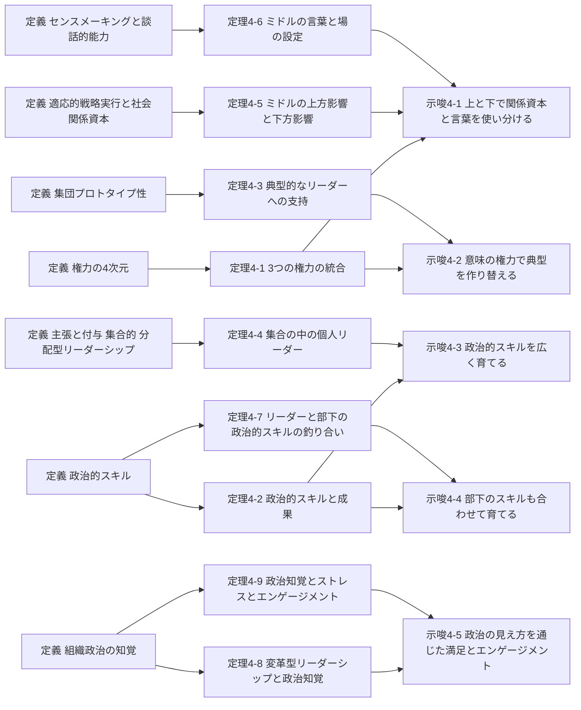

# 第4章 リーダーシップとしての社内政治 — 定義・定理・示唆

## この章の問い

リーダーシップはなぜ政治と切り離せないのか。組織変革やミドルマネジャーの仕事の中で、政治はどう働くのか。この 2 つに、論文の本文から言えることだけで答える。

木村琢磨『社内政治の科学』（2025）の目次の見出しは、論点の枠としてだけ使う。本の中身には触れない。

- 第1節 そもそもリーダーシップとは？（定義 / マネジメントとの関係 / 研究の変遷）
- 第2節 なぜ政治的リーダーシップが必要か？（よくあるリーダーシップ論の問題点 / 政治と切り離せないリーダーシップ / アイデンティティ変革の重要性）
- 第3節 変革のための社内政治（組織変革のモデル / 組織変革モデルと政治 / 組織変革のための政治的リーダーシップ / リーダーシップを「分配」する）
- 第4節 ミドルマネジャーの政治的リーダーシップ（ミドルの役割 / 部門マネジャーとしての利害調整と資源獲得 / 社内政治と部下のモチベーション）

## 1. 概念の定義

| 概念 | 定義（言い換え） | 出典 | 読んだ箇所 |
|---|---|---|---|
| リーダーシップ | 集団の目標を達成するために、他者の関与を引き出して動かす影響の過程。強制的な権力行使とは区別される | Hogg 2001, PSPR | 「Leadership, Influence, and Power」節（p.194） |
| マネジャーとリーダー | マネジャーは対立する意見の釣り合いを取り、選択肢を絞って妥協点に導く。リーダーは新しい選択肢を開き、人を引きつけるイメージを示す。リーダーシップには、権力を使って他者の考えと行動に影響することが避けられない | Zaleznik 1977, HBR（2004 年再掲版） | 序論、「Attitudes Toward Goals」「Conceptions of Work」節 |
| リーダーシップとマネジメントの関係の 3 つの立場 | (1) 両者は同じもの、(2) 別物だが補い合い、どちらも必要（リーダーシップは変化を、マネジメントは期日と予算どおりの達成を担う）、(3) 気質からして根本的に違う、の 3 つ。Hunt は、リーダーシップをマネジメントの一部とみなし、両方が必要だが同じ人が担うとは限らないとする。区別が要るかは問いの目的で決めるべきだと論じる | Bedeian & Hunt 2006, Leadership Quarterly | Abstract、Letter 1、Letter 2 の「Relationship of Leadership to Management」節と Table 1、「Back to Basics」節 |
| 権力と政治 | 権力は結果に影響する力。政治は行動に移された権力。ここでは中立の意味で使う | Hardy 1996, BJM | Introduction |
| 権力の 4 次元 | 資源の権力（情報・予算・報酬など相手が頼るものを使う）、プロセスの権力（議題や手続きを操作する）、意味の権力（物事を正当・必然と思わせる）、システムの権力（誰も疑わない価値・文化・構造に埋め込まれた力） | Hardy 1996, BJM | 「The First Dimension」〜「The Fourth Dimension」節 |
| 政治的スキル | 職場で他者をよく理解し、その理解を使って、自分や組織の目標に役立つように他者を動かす能力。社会的洞察力・対人影響力・ネットワーク構築力・誠実さの見え方の 4 次元からなる | Ferris et al. 2007, JOM | 「Definition and Construct Specification」「Dimensionality of Political Skill」節（pp.291–293） |
| 集団プロトタイプ性 | その人が、集団らしさの典型（プロトタイプ）にどれだけ近いか。同一視が強い集団では、典型に近い人が影響力を持ちやすい | Hogg 2001, PSPR | 要旨、「Prototypicality」節、「Tests of the Social Identity Theory of Leadership」節（pp.190–191） |
| リーダー・アイデンティティの主張と付与 | 自分がリーダーだと名乗る（主張）ことと、周りがその人をリーダーと認める（付与）こと。リーダーシップは両者がそろって成り立つ。Empson らはこの枠組みで調査を設計している | Empson, Langley & Sergi 2023, Organization Studies | Introduction、「Data collection」節（pp.202, 207） |
| 集合的リーダーシップ | リーダーシップを一人の英雄に帰さず、公式・非公式の立場にいる複数の人の協働として見る考え方 | Empson, Langley & Sergi 2023, Organization Studies | Introduction（p.202） |
| 分配型リーダーシップ | 個人のリーダーから、協働と責任の共有という集合的な実践へ焦点を移す考え方。レビューした 111 本の中に 29 の定義があり、共有型・参加型・民主型リーダーシップと重なる | Zaghmout & Harrison 2025, Strategy & Leadership | 「RQ1: What is Distributed Leadership?」節、Table II |
| 「3 段階の変革」（CATS） | 解凍 → 変革 → 再凍結という変革モデル。Lewin の基礎理論とされてきたが、Cummings らの検討では、Lewin 自身はモデルとして展開しておらず、死後に後の著者が形にしたもの | Cummings, Bridgman & Brown 2016, Human Relations | 著者稿の Abstract、「Dubious assumptions」「Recovering new frontiers」節 |
| ミドルの適応的戦略実行 | ミドルが計画された戦略を現場に合わせて調整する行動。上方への影響（代替案を上層部に売り込む）と、下方への影響（現場の柔軟な試行を促す）からなる。Ahearne らが先行研究の役割類型をもとに整理したもの | Ahearne, Lam & Kraus 2014, SMJ | 「Theoretical Background」節（pp.69–70） |
| 評判型・情報型の社会関係資本 | 評判型は、経営層や同僚の相談ネットワークの中で「詳しい人」として頼られる度合い。情報型は、自分の地域ネットワークの外にある情報に手が届く度合い | Ahearne, Lam & Kraus 2014, SMJ | 「Theoretical Background」節、Figure 1 |
| 戦略的センスメーキングと談話的能力 | センスメーキングは、変わりつつある状況の意味を自分と他者のために作り直す社会的な過程。談話的能力（discursive competence）は、その文脈で意味があり、人を引き込むメッセージを作って伝える力。「会話を演じる」（言葉と話の運び）と「場を設定する」（誰をいつどの場に集めるか）の 2 つの活動からなる | Rouleau & Balogun 2011, JMS | Introduction、「Middle Managers and Strategic Sensemaking」節、Methods（Figure 1）、Discussion（Figure 2） |
| 組織政治の知覚（POP） | 職場で自己利益のための政治的行動がどれだけ広がっていると感じるか。Kimura 2012 は組織レベルの知覚を既存の尺度で測った。Landells & Albrecht 2019 は、関係・評判・意思決定と資源の支配・意思決定への影響・うわさなどの伝達経路の 5 次元で、職場の政治風土の知覚を測った | Kimura 2012, IJBSAM / Landells & Albrecht 2019, Frontiers in Psychology | Kimura: Introduction、Method（尺度の説明）。Landells: Introduction、Materials and Methods |

## 2. 定理

### 定理 4-1: 戦略変革は、資源・プロセス・意味の 3 つの権力をまとめて使い、既存システムの権力に対抗したときに実現し、どれか 1 つだけでは定着しない

- **内容**: 資源の権力だけだと、報酬や罰を出し続けないと行動が続かない。プロセスの権力だけだと、既存の規範に合う変化しか残らない。意味の権力だけだと、具体的な行動を狙って変えられない。Hardy が引くカナダの自動車工場の事例では、コンサルタントが参加型の委員会（プロセスの権力）だけを使い、2 年たっても変化は起きなかった。尊敬される管理者が新しいやり方を実践して「良い管理者」の意味が変わり、報酬（資源）と委員会（プロセス）が後押ししたとき、変化が実現した。
- **根拠**: Hardy, C.（1996, British Journal of Management）。著者稿（University of Melbourne リポジトリ）の「Mobilizing Power for Strategic Action: An Example」「Targeting Power for Strategic Action: An Example」「Conclusions」節を読んだ。理論論文で、他の研究者が記述した二次事例 2 件を使って説明している（米系自動車メーカーのカナダ工場、英国の電球メーカー。後者では従業員 6,000 人が 1,600 人になったが、管理職の抵抗はほとんどなかった）。事例の内容は Hardy（1996）による紹介として扱う。理論的命題として扱う。
- **条件・限界**: 事例は他の研究者の記述を使った例示で、検証のためのデータではない。著者は「偉大なリーダー」に頼る変革論も批判しており、カリスマとビジョンは話の一部にすぎないとしている（Conclusions）。

### 定理 4-2: リーダーの政治的スキルは、チームの成績やリーダー有効性の評価を予測し、周囲から認められたリーダーの影響力が業績につながるかどうかを左右する

- **内容**: Ferris et al. 2007 のレビューによる整理では、児童福祉チームの研究で、担当件数や経験などを統制しても、リーダーの政治的スキルがチーム成績の分散を有意に説明した。別の研究では、リーダー有効性の評価を予測した。Shaughnessy et al. 2017 では、同僚からインフォーマル・リーダーと認められた人の業績が高かったのは、政治的スキルが高い場合だけだった（平均以下では有意な関係なし）。
- **根拠**: (1) Ferris et al.（2007, Journal of Management）。「Political skill main effects on performance and reputation」（p.308）、「Group-Level Processes」〜「Effects of Political Skill on Groups and Organizations」（pp.310–313）を読んだ。Ferris et al. 2007（レビュー）による整理で、個々の原典は読んでいない。(2) Shaughnessy, Treadway, Breland & Perrewé（2017, Journal of Leadership & Organizational Studies 24(1)）。「Sample and Procedure」「Results」節と Table 2（p.89）を読んだ。実証研究で、米国の精神保健施設の職員を 3 か月の間隔を置いて調べた（分析対象 40 人）。インフォーマル・リーダーは組織全体のネットワークの合意で測った。
- **条件・限界**: Ferris のレビューは、部下の信頼や満足が高まる経路を「主張されている」と書いており、チーム成績の研究でも媒介する経路は測られていないと述べる（p.313）。Shaughnessy の研究は 1 施設・40 人と小さい。

### 定理 4-3: 集団への同一視が強いほど、メンバーは集団の典型に近い人をリーダーとして支持し、有効だと評価する（同一視が弱いと、典型性の効果は小さい）

- **内容**: 集団らしさが際立つ条件では、典型的なリーダーが非典型的なリーダーより有効と評価された。際立たない条件では差がなかった。集団の結束が強まるほど、一般的な「リーダーらしさ」の型より典型性のほうが支持を左右した。典型的なリーダーは集団の規範を体現しているので、権力を行使しなくても影響力を持つ。一方、リーダーと部下の地位の差が広がると、典型性による影響は弱まり、権力を使った支配に移りやすい（この点は未検証の理論的命題）。
- **根拠**: Hogg, M. A.（2001, Personality and Social Psychology Review）。「Tests of the Social Identity Theory of Leadership」（pp.190–191）、「Leadership, Influence, and Power」（p.194）、Concluding Comments を読んだ。理論論文で、自身の研究室の研究をまとめて報告している。2×2×2 の実験（学生 184 人）、オーストラリアのアウトドア研修集団（13 集団・143 人・3 週間）のフィールド研究、最小集団の実験 2 件（82 人、164 人）。
- **条件・限界**: 主な証拠は実験室と短期の集団で、企業組織での検証ではない。権力と地位の差に関する部分は、著者自身が未検証としている。

### 定理 4-4: 集合的リーダーシップの物語が強い組織でも、個人はリーダーとしてのアイデンティティを主張しており、集合を体現する個人リーダーを立てることで、集合にリーダーシップを認めている

- **内容**: 「誰がリーダーか」への答えは「全員」から「誰もいない」まで分かれた。個人の語りには、起業家・社内起業家・奉仕者・アバター・演者・挑戦者・賢者といった複数のリーダー像があった。集合的リーダーシップを支持する人も、集合を代わりに体現する個人（アバター）を作り、それを通じて抽象的な集合にリーダーシップを付与していた。著者らは、集合を重んじる組織でもリーダーシップを神聖視する傾向が続くと述べている。
- **根拠**: Empson, Langley & Sergi（2023, Organization Studies 44(2)、2022 年オンライン公開）。著者稿（Warwick リポジトリ）の Abstract、「Research Design and Methodology」（pp.206–207）、「Organizational Narrative of Collective Leadership」、Table 1 前後を読んだ。質的な事例研究で、国際的な専門サービス企業 1 社（パートナー制、専門職 400 人、40 か国）を対象に、34 人に約 90 分の面接を行った。
- **条件・限界**: 利益の均等配分など、集合を重んじる極端な事例 1 社の研究。普通の階層型企業にそのまま当てはまるとは限らない。分配型リーダーシップの研究全体を見ても、Zaghmout & Harrison 2025 の系統的レビュー（2002〜2022 年の 111 本）では、8 割超が学校・大学を対象にし、医療は 7%、製造業は 3% にとどまる。横断研究が多く、階層型モデルとの関係や組織の変化への適応は十分に調べられていない（「RQ3」節の Empirical gap と Theoretical gap を読んだ）。

### 定理 4-5: ミドルの上方影響は評判型の社会関係資本が高いほど事業成果を高め、下方影響は情報型の社会関係資本が高いほど事業成果を高める（上方影響は、やりすぎると成果が下がる逆 U 字）

- **内容**: 代替案の推進（上方影響）と成果の関係は逆 U 字だった。その効果は、経営層の相談ネットワークで頼られるミドルほど強かった。現場の適応の促進（下方影響）は成果と直線的な正の関係で、地域ネットワークの外とつながるミドルほど効果が強かった。上司の管轄が広いと、上方影響の効果は弱まった。
- **根拠**: Ahearne, Lam & Kraus（2014, Strategic Management Journal 35）。「Research Method: Sample and research context」と「Results」節、Table 2 を読んだ。実証研究で、米国 Fortune 500 企業の最大事業部（業務用洗浄・衛生）を対象に、営業部長 43 人と営業マネジャー 285 人を調べた。成果は会社記録の客観指標（ノルマ達成率・売上成長・新規顧客）を使った。
- **条件・限界**: 1 社の営業組織の研究。ミドルは中間層の下の方（地区営業マネジャー）にあたる。下方影響の逆 U 字の仮説は支持されなかった。

### 定理 4-6: 公式の権限が乏しいミドルが変革への支持を広げられるのは、相手の利害に合う言葉で会話を運び、適切な相手と場を選んで協力関係を組み、組織の暗黙のルールと力関係の知識を使えるときである（理論的命題）

- **内容**: ミドルは上層部のような公式の権限を持たないため、上だけでなく横と下にも影響を与える必要がある。事例のミドルは、組織の言葉（たとえば利益重視の会社では「マージン」や「コスト」）を使って相手の関心に結びつけ、会議に専門家を配置するなど会話の運びを演出した。あわせて、誰に声をかけ、誰を集め、どの媒体と場を使うかを決め、将来使える人脈や「協力者」としての自己像も作っていた。著者らはここから 4 つの命題を立てた。相手の関心に合う言葉と合図を即興で使えるほど、協力関係を組んで動かせるほど、組織のルールと社会文化的な約束事を深く知り使えるほど、相手との権力・地位の差を踏まえて自分を位置づけられるほど、ミドルの意味づけは影響力を持ちやすい。
- **根拠**: Rouleau, L. & Balogun, J.（2011, Journal of Management Studies 48(5), pp.953–983）。Lancaster 大学リポジトリの本文で、Introduction、「Middle Managers and Strategic Sensemaking」、Methods、2 組織の事例、Discussion（Proposition 1〜4 と Figure 2）、Conclusion を読んだ。質的研究（理論の精緻化）で、2 つの研究プロジェクトのデータから、ミドル 4 人の事例を作った。カナダの公共放送 Radio-Canada の組織再編に関わったミドル 2 人（職業人生の語り）と、英国に本社を置く多国籍エンジニアリング企業で事業部横断の変革を担ったミドル 2 人（面接とフォーカス・グループ）。
- **条件・限界**: 命題は 4 人の事例から導いたもので、検証はされていない。著者らも、より多くのミドルでの検証が必要だとしている（Conclusion）。データは別の目的で集められたものの再分析である。

### 定理 4-7: リーダーと部下の政治的スキルがともに高いとき部下の職務満足は高く、リーダーのスキルが部下を上回るずれは満足を下げ、職務満足は生活満足と情緒的コミットメントへの効果を部分的に媒介するが、業績への効果は媒介しない

- **内容**: リーダーと部下の政治的スキルが高い水準でそろうと、低い水準でそろうときより職務満足が高かった。スキルがずれる場合、リーダーが部下を上回るほうが、部下がリーダーを上回るより職務満足の落ち込みが大きかった。職務満足は、スキルの組み合わせが生活満足と組織への情緒的コミットメントに与える効果を部分的に媒介したが、上司評価の業績については媒介しなかった。
- **根拠**: Wang, C.-H. & McChamp, M.（2019, Economic Research-Ekonomska Istraživanja 32(1), pp.824–849、CC BY 4.0）。オープンアクセス版の Abstract、「4.1 Data and sample」「4.2 Measures」「6. Results」（Table 5、Table 6）、「7. Discussion」「7.3 Limitations and future research」を読んだ。実証研究で、台湾のチェーン型ティードリンク店（5 チェーン）の店長と従業員の 305 組を、3 か月の間隔を置いて 2 時点で調べた（1 時点目に双方の政治的スキル、2 時点目に職務満足・生活満足・コミットメント・業績）。多項式回帰と応答曲面分析を使った。
- **条件・限界**: 若い従業員が多い特殊な業種の研究で、著者らも一般化に限界があるとしている。中間管理層をはさむ関係は扱っていない。

### 定理 4-8: 日本企業の従業員では、トップの変革型リーダーシップが強いと感じられるほど組織政治の知覚が低く、組織政治の知覚が高いほど職務満足が低い傾向がある（後者の関係は弱い）

- **内容**: 構造方程式モデルで、トップの変革型リーダーシップは組織レベルの政治知覚と負の関係（標準化係数 −0.205, p<0.01）にあった。政治知覚は職務満足と負の関係（−0.119, p<0.10）にあった。政治知覚と市場志向には関係が見られなかった。
- **根拠**: Kimura, T.（2012, International Journal of Business Science and Applied Management 7(1), pp.29–42）。オープンアクセス版の「4 Results」「4.2 Hypotheses Testing」、Figure 2、「5.4 Limitations」を読んだ。実証研究（横断調査）で、日本企業の正社員 200 人を対象にした。
- **条件・限界**: 1 時点・同じ回答者のデータなので、因果は言えない。著者も、政治知覚の尺度の信頼性が低い（α=0.61、4 項目中 2 項目を削除）ことを限界に挙げている。

### 定理 4-9: 職場の政治の知覚はストレスを高め、仕事の有意味感を下げ、その 2 つを経由してワーク・エンゲージメントを下げる（政治知覚からエンゲージメントへの直接の効果は見られない）

- **内容**: 2 つの標本で、政治知覚はストレスと有意な正の関係にあった。政治知覚とエンゲージメントの関係は直接には有意でなく、ストレス経由（間接効果 β=−0.30）と有意味感経由（β=−0.11）の間接効果を通じて表れた（間接効果の合計 β=−0.319）。ストレスからエンゲージメントへの経路を外すと、直接の効果（β=−0.260）が現れた。政治の 5 次元とストレスの相関は 0.45〜0.57、エンゲージメントとの相関は −0.26〜−0.41 だった（Table 3）。著者らの先行研究の整理では、政治知覚とストレスのメタ分析上の相関は ρ=0.45 と報告されている。
- **根拠**: Landells, E. M. & Albrecht, S. L.（2019, Frontiers in Psychology 10, 1612）。オープンアクセス版の Introduction、Materials and Methods、Results（Measurement Models と構造モデル）、Table 3、Discussion を読んだ。実証研究（横断調査）で、オーストラリアの従業員を中心とする 2 標本（雪だるま式の標本 303 人、大規模な政府機関の職員 353 人）を調べた。メタ分析の値は、Landells & Albrecht（2019）による整理として扱う。
- **条件・限界**: 横断・自己報告のデータなので、因果は言えない。主に公共部門のオーストラリアの標本である。職場内で知覚の一致度が低く、政治を「風土」として扱う考え方は支持されなかった。

## 3. 示唆

ここに書くのは、論文の主張ではなく、定理を組み合わせて導いたものである。

### 示唆 4-1: 変革を進めるミドルは、上と下で使う関係資本を分け、どちらでも相手に合う言葉と場を選ぶ必要がある

- **組み合わせ**: 定理 4-1 + 定理 4-5 + 定理 4-6
- **導出**: 定理 4-1 によれば、変革は 1 種類の権力だけでは定着しない。定理 4-5 によれば、上方への影響は経営層の中での評判が、下方への影響は外部の情報へのアクセスが効果を左右する。定理 4-6 によれば、公式の権限に乏しいミドルは、相手の利害に合う言葉と、相手と場の選び方で支持を集める。したがって、ミドルが変革を担うには、上には評判を使って代替案を通し、下には外の情報を使って試行を促し、そのどちらでも言葉と場を相手に合わせることが筋が通る。
- **追加の前提**: Ahearne らの「上方影響・下方影響」と Rouleau & Balogun の「会話を演じる・場を設定する」を、Hardy の「意味・資源・プロセスの権力」の使い方の一部として読み替えられること。
- **注意**: 定理 4-5 は 1 社の営業組織、定理 4-6 は 4 人の事例から導いた未検証の命題、定理 4-1 は二次事例による例示であり、一般化には限界がある。

### 示唆 4-2: アイデンティティの変革は、「意味の権力」を使って集団の典型を作り替える働きとして理解できる

- **組み合わせ**: 定理 4-1 + 定理 4-3
- **導出**: 定理 4-3 によれば、同一視が強い集団では、典型に近い人が権力を使わずに影響力を持つ。定理 4-1 の工場の事例では、尊敬される管理者の実践によって「良い管理者」の意味が変わったときに変革が進んだ。2 つを合わせると、変革のリーダーシップには、集団の典型そのものを作り替え、新しい典型に近い人の影響力を高める働きがあると考えられる。
- **追加の前提**: Hardy の言う「良い管理者の意味」が、Hogg の言う集団プロトタイプに相当すること。
- **注意**: 定理 4-3 の証拠は主に実験室と短期の集団、定理 4-1 は例示的な事例であり、組織での検証はない。

### 示唆 4-3: リーダーシップは周りから認められて成り立つので、政治的スキルを育てる対象は正式な管理職に限らないほうがよい

- **組み合わせ**: 定理 4-2 + 定理 4-4
- **導出**: 定理 4-4 によれば、肩書きと関係なく多くの人がリーダーとしてのアイデンティティを主張し、周りも個人や集合にリーダーシップを認めている。定理 4-2 によれば、認められたリーダーの影響力が業績につながるのは、政治的スキルが高い場合である。したがって、リーダーシップを分配する組織ほど、政治的スキルを正式な管理職以外にも育てる理由がある。
- **追加の前提**: 政治的スキルは訓練や経験で伸ばせる部分があること（Ferris et al. 2007 の p.292 でそう論じられているが、効果を検証した研究は本章では読んでいない）。
- **注意**: 定理 4-2 の Shaughnessy らの研究は 40 人と小さく、定理 4-4 は特殊な 1 社の事例である。定理 4-4 の条件に書いたとおり、分配型リーダーシップの研究は教育分野に偏っており、企業での効果は確かめられていない。

### 示唆 4-4: 政治的スキルの育成は、リーダーだけでなく部下も対象にしたほうが、部下の満足を損ないにくい

- **組み合わせ**: 定理 4-2 + 定理 4-7
- **導出**: 定理 4-2 によれば、リーダーの政治的スキルはチーム成績やリーダー有効性の評価を予測する。定理 4-7 によれば、部下の職務満足は、リーダーと部下のスキルがともに高いときに高く、リーダーだけが上回るずれでは下がる。したがって、リーダーの政治的スキルだけを伸ばすと、成績には役立っても部下の満足を下げる組み合わせを生むおそれがあり、部下のスキルも合わせて伸ばすほうが両立しやすい。
- **追加の前提**: 政治的スキルは訓練で伸ばせること（示唆 4-3 と同じ前提）。リーダーのスキル向上が、部下とのずれを広げる形で起こりうること。
- **注意**: 定理 4-7 は台湾の 1 業種の研究で、業績への媒介は見られなかった。定理 4-2 の部下への効果は、レビューの中でも検証が不十分とされている。

### 示唆 4-5: トップのリーダーシップは、部下の目に政治がどう映るかを通じて、満足だけでなくストレスとエンゲージメントにも影響しうる

- **組み合わせ**: 定理 4-8 + 定理 4-9
- **導出**: 定理 4-8 によれば、トップの変革型リーダーシップは政治知覚の低さと結びつき、政治知覚は職務満足と負の関係にある。定理 4-9 によれば、政治知覚はストレスを高め、有意味感を下げ、それを通じてエンゲージメントを下げる。2 つをつなぐと、トップのリーダーシップが政治知覚を下げるなら、満足の低下だけでなく、ストレスを経由したエンゲージメントの低下も弱められる可能性がある。
- **追加の前提**: Kimura の組織レベルの政治知覚と、Landells & Albrecht の政治風土の知覚が、ほぼ同じものを測っていること。日本とオーストラリアの標本で関係の向きが同じであること。
- **注意**: 定理 4-8 と定理 4-9 はどちらも横断データで、因果は言えない。定理 4-8 の政治知覚と満足の関係は弱い（p<0.10）。トップのリーダーシップからストレスやエンゲージメントへの経路を、1 つの研究で調べたものは本章では読んでいない。

## 4. 扱えなかった論点

- リーダーシップのロマンス（組織の成果をリーダーに帰属させすぎる傾向）: 本文を読める資料が見つからなかった。
- 政治的リーダーシップ理論（リーダーの政治的行動を中心に置いた理論モデル）: 本文を読める資料が見つからなかった。
- 管理職が経験し知覚する組織政治の調査: 本文を読める資料が見つからなかった。
- ミドルが変革の中で担う感情面の働き（部下の感情の扱い）: 本文を読める資料が見つからなかった。

## 5. 読んだ文献

| 文献 | 本文の入手先 | 読んだ範囲 |
|---|---|---|
| Hardy 1996, BJM 7(S1) | University of Melbourne Minerva Access の著者稿 PDF | 全文（Introduction〜Conclusions） |
| Ferris et al. 2007, JOM 33(3) | crforum.co.uk 掲載の出版社版 PDF | pp.290–293、pp.308–313 |
| Hogg 2001, PSPR 5(3) | NYU Wagner 掲載の出版社版 PDF | 要旨、pp.190–191、pp.193–194、Concluding Comments |
| Empson, Langley & Sergi 2023, Organization Studies 44(2) | Warwick WRAP の著者稿 PDF | Abstract、Introduction、Research Design、事例の前半、Table 1 |
| Ahearne, Lam & Kraus 2014, SMJ 35 | Duke 大学の授業ページ掲載の出版社版 PDF | Abstract、Theoretical Background、仮説、Research Method、Results |
| Kimura 2012, IJBSAM 7(1) | 学術誌サイトの OA 版 PDF（CC BY 4.0） | 全文（Results と Limitations を中心に） |
| Shaughnessy et al. 2017, JLOS 24(1) | LMU ミュンヘン epub の PDF | Abstract、Sample and Procedure、Results、Table 2、Limitations |
| Cummings, Bridgman & Brown 2016, Human Relations 69(1) | Victoria University of Wellington の著者稿（docx） | Abstract、Dubious assumptions、Recovering new frontiers |
| Zaleznik 1977, HBR（2004 年再掲） | Columbia 大学 Ombuds Office 掲載の PDF | 序論、目標と仕事観の節（定義にだけ使用） |
| Bedeian & Hunt 2006, Leadership Quarterly 17 | LSU の著者ページ掲載の出版社版 PDF | Abstract、Letter 1、Letter 2 の第 1〜4 節と Table 1（定義にだけ使用） |
| Rouleau & Balogun 2011, JMS 48(5) | Lancaster 大学 EPrints の PDF | 全文（Introduction〜Conclusion、Figure 1・2） |
| Wang & McChamp 2019, Economic Research-Ekonomska Istraživanja 32(1) | Hrčak 掲載の OA 版 PDF（CC BY 4.0） | Abstract、Methodology、Results（Table 5・6）、Discussion、Limitations |
| Landells & Albrecht 2019, Frontiers in Psychology 10 | Frontiers の OA 版（HTML） | Introduction、Materials and Methods、Results、Table 3、Discussion |
| Zaghmout & Harrison 2025, Strategy & Leadership 53(3) | York St John 大学 RaY の著者稿 PDF | Abstract、Methodology、RQ1〜RQ3、Study Limitations、Conclusion |

## Sources

- [Hardy 1996, Understanding power（著者稿 PDF, University of Melbourne）](https://minerva-access.unimelb.edu.au/server/api/core/bitstreams/b0541d59-081e-55ad-a9e9-e5708729fd1c/content)
- [Ferris et al. 2007, Political Skill in Organizations（PDF）](https://www.crforum.co.uk/wp-content/uploads/2017/06/Political-Skill-in-Organizations.pdf)
- [Hogg 2001, A Social Identity Theory of Leadership（PDF, NYU Wagner）](https://wagner.nyu.edu/files/leadership/Personality_and_Social_Psychology_Review-_A_Social_Identity_Theory_of_Leadership_1.pdf)
- [Empson, Langley & Sergi 2023, When Everyone and No One is a Leader（著者稿 PDF, Warwick）](https://wrap.warwick.ac.uk/169768/7/WRAP-when-everyone-and-no-one-is-a-leader-constructing-individual-leadership-identities-Langley-2022.pdf)
- [Ahearne, Lam & Kraus 2014, Performance impact of middle managers' adaptive strategy implementation（PDF）](https://people.duke.edu/~moorman/Marketing-Strategy-Seminar-2015/Session%2012/Ahearne,%20Lam,%20Kraus.pdf)
- [Kimura 2012, Transformational leadership and job satisfaction（OA PDF）](https://www.business-and-management.org/library/2012/7_1--29-42-Kimura.pdf)
- [Shaughnessy et al. 2017, Informal Leadership Status and Individual Performance（PDF, LMU）](https://epub.ub.uni-muenchen.de/55028/1/1548051816657983.pdf)
- [Cummings, Bridgman & Brown 2016, Unfreezing change as three steps（著者稿, VUW）](https://openaccess.wgtn.ac.nz/articles/journal_contribution/Unfreezing_change_as_three_steps_Rethinking_Kurt_Lewin_s_legacy_for_change_management/12735971)
- [Zaleznik, Managers and Leaders: Are They Different?（PDF, Columbia Ombuds）](https://ombuds.columbia.edu/sites/default/files/content/pics/30%20Anniv/Managers%20and%20Leaders_%20Are%20They%20Different_.pdf)
- [Bedeian & Hunt 2006, Academic amnesia and vestigial assumptions of our forefathers（PDF, LSU）](https://faculty.lsu.edu/bedeian/files/academic-amnesia-and-vestigial-assumptions-of-our-forefathers.pdf)
- [Rouleau & Balogun 2011, Middle Managers, Strategic Sensemaking, and Discursive Competence（PDF, Lancaster EPrints）](https://eprints.lancs.ac.uk/id/eprint/51519/1/10.pdf)
- [Wang & McChamp 2019, Looking at both sides of leader and follower political skill on work outcomes（OA PDF, Hrčak）](https://hrcak.srce.hr/file/332541)
- [Landells & Albrecht 2019, Perceived Organizational Politics, Engagement, and Stress（Frontiers in Psychology）](https://www.frontiersin.org/articles/10.3389/fpsyg.2019.01612/full)
- [Zaghmout & Harrison 2025, Distributed Leadership: A Systematic Literature Review（著者稿 PDF, York St John）](https://ray.yorksj.ac.uk/id/eprint/11719/1/sl-10-2024-0119.pdf)
