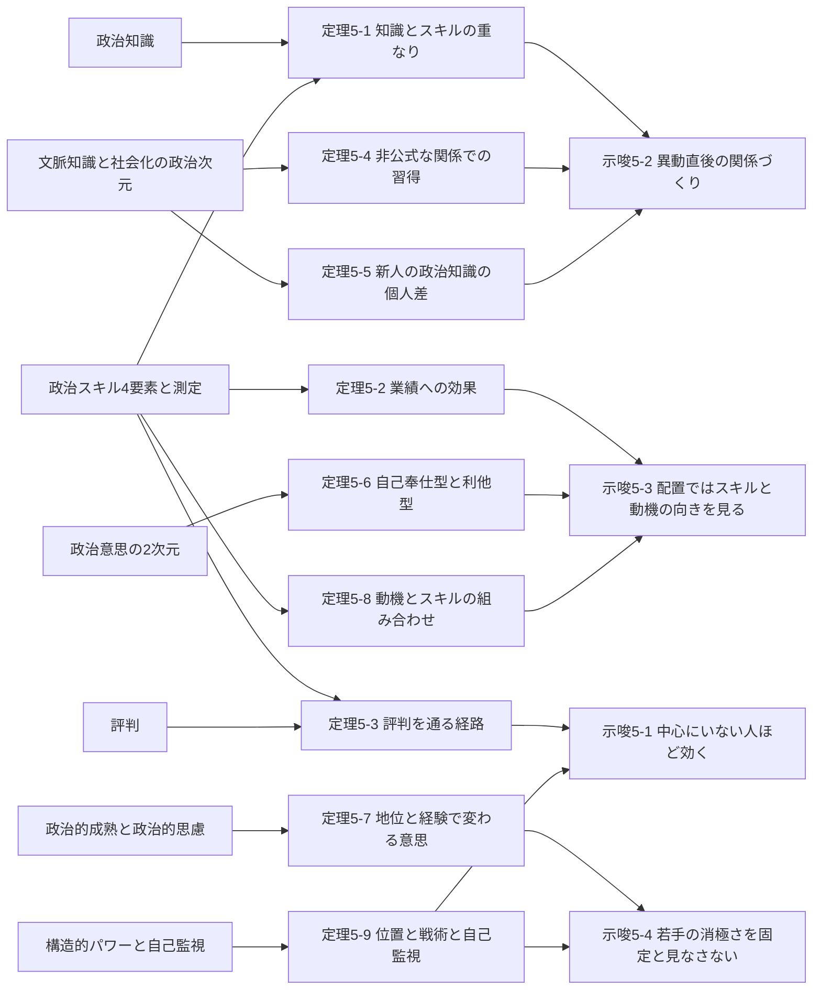

# 第5章 ビジネスパーソンに必要な政治力 — 定義・定理・示唆

本ファイルは、木村琢磨『社内政治の科学』（2025）第5章の目次の見出しを「論点の枠」として使い、論文の本文を読んでまとめたものです。本の本文は読んでいません。本の内容については書きません。

## この章の問い

社内政治で成果を出す個人の力は、どんな要素から成り、何が成果を左右するのか。知識・スキル・意思・パワーのそれぞれが、どう身につき、どう成果につながるのかを問います。

目次の見出し:

- 第1節 政治知識: 政治知識とは / 正当性に関する理解 / 文脈知識
- 第2節 政治スキル: 社内政治のスキルとは / 4つの要素 / 開発法
- 第3節 政治準備性: 形成 / 政治意思 / 政治的思慮と政治準備性
- 第4節 政治的パワー: とは / 基盤 / 決める個人的要因

「政治準備性」「政治的思慮」は、学術用語としては確認できていません。本書での意味も未確認です。本ファイルでは、近い学術概念である political will（政治意思）、political prudence（政治的思慮）、political maturation（政治的成熟）で定義します。これらの定義は、本文を読んだレビューと博士論文によるもので、本書の定義と同じとは限りません。

## 1. 概念の定義

| 概念 | 定義（言い換え） | 出典 | 読んだ箇所 |
|---|---|---|---|
| 政治知識（political savvy / 政治的理解） | 組織で物事が実際にどう動くか、誰が影響力を持つか、人の行動の裏の動機は何かについての理解 | Ferris et al. 2007, JOM | pp.293–294「Construct Validity」の Other social competencies |
| 組織社会化の「政治」次元 | 新人が組織になじむ過程で学ぶ内容のうち、公式の役割とは別の、個人や部署の間の非公式な権力関係と影響力のある人についての知識。新人適応の「近い成果」とされ、昇進などの遠い成果につながると考えられている。測定は「組織の政治をよく理解していない」「最も影響力のある人を知っている」などの 5 項目 | Swid 2024, Journal of Organizational Psychology 24(2) | pp.27–31 序論、「Political Knowledge of the Organization as an Adjustment Outcome」、Measures |
| 政治的学習と sense-making | 政治的学習は、権力のありかや使われ方など「政治の地形」についての知識を、経験を通じて長期記憶に蓄えること。sense-making は、出来事が起きるたびに意識的に理解しようとする反応的な過程。両者を合わせて政治的専門性と呼ぶ | Silvester & Wyatt 2018, SAGE Handbook | 著者稿 pp.19–20「Political Cognition」 |
| 政治の正当性 | 政治行動の定義の多くは、政治を「組織が公認していない」目的や手段による影響とする。こう定義すると、公式の人事制度の外にある活動として政治が位置づけられ、政治を「正当でない」と呼ぶこと自体が統制の仕組みとして働く | Silvester & Wyatt 2018 | 著者稿 pp.9–12「A Question of Legitimacy」と Table 8.1 |
| 文脈知識 | 仕事経験やメンタリングで得る、その職場に固有の知識。職場には手がかりや暗黙知が多すぎるため、重要なものを選び出す仕組みが要る | Ferris et al. 2007 | pp.314–315「Practical Implications」 |
| 政治スキル（political skill） | 職場で他者を的確に理解し、その理解を使って、自分または組織の目標が進むように他者を動かす能力。性格による安定した部分と、訓練や経験で変わる部分がある | Ferris et al. 2007 | pp.291–292「Definition and Construct Specification」 |
| 政治スキルの4要素 | 社会的洞察力（他者と状況を正しく読む）、対人影響力（相手と状況に合わせて行動を調整し望む反応を引き出す）、ネットワーク構築力（多様な人脈と連合を作る）、見かけの誠実さ（裏の動機がないと他者に見える）。4つは相関するが別の構成概念 | Ferris et al. 2007 | pp.292–293「Dimensionality of Political Skill」 |
| 政治スキルの測定 | 4 次元 18 項目の自己報告尺度（PSI: Political Skill Inventory）が最も広く使われる。4 次元の上に 1 つの高次因子があり、次元別にも合計点でも使える。米国・中国・ドイツ・ロシア・トルコの 5 か国で構造はほぼ同じだが、間接的な話し方の文化では社会的洞察力とネットワーク構築力が高めに出る | Blickle, Frieder & Ferris 2018（レビュー）による整理 | PDF の Page 3–4 of 28（測定の節） |
| 政治意思（political will） | 政治的な目標を追うために、自分の資源やエネルギーを使おうとする意欲。政治行動の前提条件。初期の研究は、権力欲求・達成欲求・内発的動機づけ・マキャベリアニズムを代わりの指標にしていた | Montgomery 2022（博士論文のレビュー章）による整理。Silvester & Wyatt 2018 にも同じ趣旨の定義 | Montgomery 2.2.3（pp.41–44）。Silvester & Wyatt 著者稿 pp.18–19「Political Motivation」 |
| 自己奉仕型と利他型の政治意思 | 政治意思の尺度研究で見つかった 2 つの次元。自己奉仕型（self-serving）は自分の道具的な利益を求める意欲。利他型（benevolent）は集団や他者の利益を求める意欲。利他型が本当に利他的なのか、互恵的なのかは争われている | Montgomery 2022（レビュー章）による整理 | 2.4.1「The Political Will Scale」（pp.60–63）と Figure 2.3 |
| 政治的思慮（political prudence） | 政治意思が行動になる前に、結果の望ましさ、他の手段の有無、成功の見込みを見積もり、意思を抑えたり向きを変えたりする評価の働き。理論上の提案で、定義はまだゆるい。実証研究は主に、倫理的な行動を促す徳として扱ってきた | Montgomery 2022（レビュー章）による整理 | 2.3「A Social Cognitive Perspective」（pp.50–51） |
| 政治的成熟（political maturation） | 政治への意欲と構えがキャリアを通じて変わる過程。民間企業のリーダーの面接研究では「素朴と発見」「対処と忍耐」「活用と熟達」の 3 段階が示された。政治を機能的か、倫理的か、感情的にどうかという 3 つの見方も変わる | Montgomery 2022（レビュー章）による整理 | 2.4.2「Attitudinal Dimensions」（pp.63–65） |
| 政治的効果性 | 職場の政治環境をうまく渡り、パワーを得て、他者を動かし、政治的目標を達成する能力 | Silvester & Wyatt 2018 | 著者稿 pp.16–17「A Model of Political Effectiveness」と Figure 8.1 |
| 政治的パワーの基盤 | 古典的な 5 つの基盤: 報酬、強制、正当（地位による）、準拠（相手が一体化したいと思う）、専門（知識があると見なされる） | Zinko et al. 2007, RPHRM による整理 | pp.188–189「Power」の節 |
| 構造的パワー | ネットワーク上の位置（中心性、他者の間をつなぐ位置、支配連合への紐帯）から生じる潜在的なパワー | Brass & Krackhardt 2012（レビュー章） | pp.355–356 序論、p.358 付近の中心性、p.363「Ties to Powerful Alters」 |
| 自己監視（self-monitoring） | 場面が求める振る舞いに合わせて自分の見せ方を調整する傾向。高い人は場面ごとに柔軟に振る舞い、低い人は自分の態度に沿って一貫して振る舞う | Kilduff & Buengeler 2019（レビュー章） | 著者稿 pp.160–163「Self-Monitoring Theory」「The Relevance of Self-Monitoring」 |
| 評判 | 他者がある個人について持つ、合意された集合的な認識。時間をかけて形成される | Zinko et al. 2007 | 要旨と pp.187–189 |

## 2. 定理

### 定理 5-1: 政治知識は政治スキルと中程度に重なり、特に社会的洞察力と強く結びつく

- **内容**: 社会化尺度の「政治」次元で測る政治的理解は、政治スキル全体と r = .47、社会的洞察力とは r = .60 で相関した。政治スキルは感情知能とも r = .53 で重なるが、同一ではない。政治知識は、政治スキルのうち「読む」成分に最も近い。
- **根拠**: Ferris et al. 2007（Journal of Management 33(3)）による整理。読んだ箇所は pp.293–294「Construct Validity of Political Skill」。研究の種類は、尺度開発時の相関研究のレビュー。
- **条件・限界**: 相関は同一時点の自己報告どうしで、因果の向きは分からない。サンプルの国や業種は本文の該当箇所に記載がなく、確認していない。

### 定理 5-2: 政治スキルは知能と性格を統制しても業績を予測するが、その強さは仕事の対人的な要求によって大きく変わる

- **内容**: レビューが紹介するメタ分析では、政治スキルと課題業績の関係は ρ = .26、文脈的業績（協力・援助など）とは ρ = .38 だった。ただし、95% の信用区間が課題業績で −.07〜.52、文脈的業績で −.05〜.71 と 0 をまたぎ、研究間のばらつきが大きい。メタ回帰では、一般知能と Big Five を統制しても課題業績を予測した。仕事が社会的なやりとりを多く求めるほど、関係は強くなった。
- **根拠**: Blickle, Frieder & Ferris 2018（SAGE Handbook of IWO Psychology の章）による整理。読んだ箇所は「Political Skill as a Predictor of Performance」（PDF の Page 6–7 of 28）。研究の種類はメタ分析と単独研究のレビュー。
- **条件・限界**: 平均効果は中程度で、状況次第では効果がほぼ消える。数値はレビュー経由で、メタ分析そのものの本文は読んでいない。

### 定理 5-3: 政治スキルが業績とキャリアに効く経路の一部は、評判の形成を通る

- **内容**: レビューが紹介する研究では、政治スキルと業績の関係を評判が完全に媒介した。メタ回帰でも、評判と自己効力感が媒介した。1 年間の縦断研究では、ある時点の政治スキルが 1 年後の収入・職位・キャリア満足を予測し、評判が職位とキャリア満足への関係を媒介した。
- **根拠**: Blickle, Frieder & Ferris 2018 による整理（「Political Skill as a Predictor of Performance」と「Political Skill and Career Success」の節、Page 7–8, 10 of 28）。Ferris et al. 2007 pp.308–309 も、2 研究で政治スキルと評判の相関（r = .35, .40）を紹介。研究の種類は実証研究とメタ分析のレビュー。
- **条件・限界**: 評判のほかに自己効力感や個人の主導性など別の経路もある。個々の研究の対象国と人数は、レビューの記述からは確認していない。日本での検証も確認していない。

### 定理 5-4: 政治知識と政治スキルは、公式研修より、メンターや上司との非公式な関係を通じて身につきやすい

- **内容**: レビューが紹介する新人社会化の縦断研究では、政治知識は非公式な関係でよく育ち、公式研修は役割の明確さを高めた。別の研究では、メンタリング行動がネットワーク構築力を高め、その関係を政治の理解が媒介した。Ferris et al. 2007 は、メンターが大量の文脈情報から重要なものを選び出すと論じる（理論的命題）。
- **根拠**: Silvester & Wyatt 2018 著者稿 pp.26–28（開発と社会化の節）による整理。Blickle, Frieder & Ferris 2018「Antecedents of Political Skill」（Page 6 of 28）による整理。Ferris et al. 2007 pp.298–299「Developmental experiences」と pp.314–315。研究の種類は縦断・横断の実証研究のレビューと理論。
- **条件・限界**: 政治スキル研修そのものの効果検証は少ない（Silvester & Wyatt 2018 p.27）。公式のメンター制度は、公式メンターが目立つぶん政治行動を勧めにくく、効果が弱い可能性がある（同 p.28）。

### 定理 5-5: 新人が入社後半年で身につける政治知識には性格による個人差があり、開放性と誠実性が高い新人ほど多く、外向性は関係しない

- **内容**: 入社 1 か月以内に Big Five を測り、6 か月後に組織の政治知識を測った。性別・経験・学歴・組織などを統制した階層的回帰で、開放性（β = .34）と誠実性（β = .32）は政治知識を正に予測した。外向性は予測しなかった（β = .04）。著者は、外向的な人は権力には関心があっても、政治の知識を求めるとは限らないと解釈する。
- **根拠**: Swid 2024（Journal of Organizational Psychology 24(2)）。読んだ箇所は pp.30–33 の Participants、Timing、Measures、Findings、Table 1、Limitations。研究の種類は実証（縦断調査）。対象はバーレーンの 7 組織（製造・航空・医療・軍・通信・金融・教育）の新入社員で、初期 439 人、時点 1 は 272 人、時点 2 は 180 人。
- **条件・限界**: 自己報告で、1 か国だけのデータ。報告に不整合がある。神経症傾向は本文で「正の関係」とされるが、表の係数は −.22 である。誠実性は表に行がなく、本文の値しか確認できない。このため、神経症傾向の向きは定理に入れていない。

### 定理 5-6: 政治意思は自己奉仕型と利他型の 2 次元に分かれ、前者は権力・達成の欲求と、後者は親和欲求・内発的動機づけと結びつくが、利他型が本当に利他的かは確かめられていない

- **内容**: 米国の学生、ギリシャの卒業生、運輸業の従業員など複数の標本で作られた政治意思尺度では、2 因子構造が最もよく当てはまった。自己奉仕型は権力欲求・達成欲求と強く関係し、親和欲求とは関係しなかった。利他型は親和欲求・内発的動機づけと関係し、権力欲求とは関係しなかった。その後の検証研究では、自己奉仕型は権力志向や職位・収入と関係したが、利他型は他者評定と一致せず、利他性とも結びつかなかった。利他型の一部の項目は、自分の労働条件の改善などを含み、他者への善意を測っていないとの批判がある。
- **根拠**: Montgomery 2022（Kent 大学の博士論文）第 2 章のレビューによる整理。読んだ箇所は 2.2.3（pp.41–44）と 2.4.1（pp.60–63）、Figure 2.3。研究の種類は尺度開発・検証研究のレビュー。
- **条件・限界**: 数値（相関の大きさ）はレビューに書かれておらず、確認していない。著者自身も、2 次元が同時に高くなりうるのか、利他型が互恵的なのかは未解決とする。

### 定理 5-7: 政治意思は固定した特性ではなく、地位と経験が上がるにつれ、防御から積極へ、課題の達成から全体の戦略へ、リスク回避からリスクを扱える方向へ変わる

- **内容**: 英国の地方自治体の職員 30 人（若手・中堅・幹部 各 10 人）の面接では、若手は身を守るため、目立たず反抗的と見られないように動いた。中堅は戦う場面を選び、状況ごとにリスクを見積もり、自分やチームの利益を求めた。幹部は組織全体の戦略のために、リスクを受け入れて文脈そのものを動かそうとした。責任が増えるほど、他者のための（利他型の）動機も増えた。民間企業のリーダーの面接研究も、政治への構えが素朴な段階から熟達の段階へ移ると報告している（レビューによる整理）。ただし民間企業では若手が政治を非機能的・非倫理的と見たのに対し、自治体では若手でも政治を機能的と見ており、変わり方は組織の文脈によって違った。
- **根拠**: Montgomery 2022。読んだ箇所は 3.2.3 Sampling Strategy と Table 3.2（pp.92–95）、4A.3–4A.4 の中堅職員の分析（p.132）、4A.7「Summary of Officers' Political Will」と Figure 4A.1（pp.145–150）、2.4.2 の政治的成熟のレビュー（pp.63–65）。研究の種類は質的研究（半構造化面接、テンプレート分析）。対象は英国の地方自治体の職員 30 人と議員 30 人のうち、職員の分析。
- **条件・限界**: 同じ人を追った縦断研究ではなく、地位の異なる人の比較である。変化が経験による成長なのか、地位に就く人の選抜によるのかは分からない。中堅の状況ごとのリスク評価は、政治的思慮の考え方に近いと著者は述べるが、思慮を測ってはいない。

### 定理 5-8: 出世や協調の動機は、政治スキルが高いときにだけ高い業績や昇進可能性の評価につながる

- **内容**: レビューが紹介する複数の研究では、「上に行きたい」動機と「うまくやりたい」動機のそれぞれと政治スキルの交互作用が、上司評定の協力と昇進可能性を最もよく予測した。外向性が高く政治スキルも高い自動車販売員は、他の組み合わせより多く売った。Silvester & Wyatt のモデルも、動機と文脈が政治行動への傾向を決め、社会的効果性（政治スキル）が行動の成果を左右するとする（理論的命題）。境界をまたぐ役割や変革推進者は、より高い政治的能力を要するとされる。
- **根拠**: Blickle, Frieder & Ferris 2018 による整理（「Political Skill as Moderator of the Employee Characteristics–Job Performance Relationship」、Page 8–9 of 28）。Silvester & Wyatt 2018 著者稿 pp.16–22 と Figure 8.1。研究の種類は実証研究のレビューと理論。
- **条件・限界**: ここでの「動機」は性格（誠実性・協調性・外向性）や動機の尺度で測られており、政治意思の尺度そのものではない。政治意思の尺度と政治スキルの交互作用は、本文で確認できていない。

### 定理 5-9: 他者が認めるパワーはネットワーク上の位置と影響戦術の双方から生じ、中心的な位置ほど戦術の重要性は下がり、人と人の間をつなぐ位置には自己監視の高い人が就きやすい

- **内容**: レビューが紹介する組織内の研究では、ネットワーク中心性と影響戦術（主張、取り入り、交換、上位者への訴え、合理的説得、連合形成）が、どちらもパワーの認知と関係した。中心性が高いほど、戦術の重要性は下がった。経営幹部の支配連合への紐帯は、非管理職のパワーと昇進に関係した。別のレビューによると、ハイテク企業の研究で、自己監視の高い人は他者の間をつなぐ位置（媒介中心性の高い位置）に就きやすく、在籍が長いほど中心に移った。自己監視の低い人にはこの傾向がなかった。138 のネットワーク標本のメタ分析でも、自己監視は道具的・表出的の両方のネットワークで仲介位置を予測し、Big Five より関連が強かった。
- **根拠**: Brass & Krackhardt 2012（Politics in Organizations 第12章）による整理。読んだ箇所は pp.355–356 序論、p.363「Ties to Powerful Alters」、p.364「Building Powerful Networks」。Kilduff & Buengeler 2019（Social Networks at Work 第8章の著者稿）による整理。読んだ箇所は pp.163–171（「The Relevance of Self-Monitoring」「Vision Advantage」「Segregated Social Worlds」「Brokerage」「The Social Networks of Leadership」）。研究の種類は組織内ネットワークの実証研究とメタ分析のレビュー。
- **条件・限界**: 原典の対象組織や人数は、レビューの記述からは一部しか確認していない。パワーは関係的・状況的で、測っているのは「他者からの認知」である。自己監視の高い人は、仲間内の閉じた集団では信頼を失いやすいという指摘もある（Kilduff & Buengeler p.165）。

## 3. 示唆

以下は論文の主張ではなく、上の定理を組み合わせた導出です。

### 示唆 5-1: ネットワークの中心にいない人ほど、政治スキルと評判づくりの効き目が大きい可能性がある

- **組み合わせ**: 定理 5-3 + 定理 5-9
- **導出**: 定理 5-9 では、中心性が低いほど影響戦術の重要性が高い。定理 5-3 では、政治スキルは評判を通じて成果につながる。中心でない人にとって、戦術をうまく実行する政治スキルと、その結果としての評判が、構造上の不利を補う主な手段になると導ける。
- **追加の前提**: 若手や新任者は中心性が低いことが多い。
- **注意**: 定理 5-9 は「パワーの認知」についての結果で、業績や昇進まで同じ形で成り立つかは確認していない。

### 示唆 5-2: 異動や転職の直後は、上司やメンターとの非公式な関係を早く作ることが、政治知識を取り戻す近道になるが、その速さには個人差がある

- **組み合わせ**: 定理 5-1 + 定理 5-4 + 定理 5-5
- **導出**: 定理 5-4 では、政治知識は文脈に固有で、非公式な関係を通じて育つ。定理 5-1 では、政治知識は政治スキルの「読む」成分と強く重なる。新しい職場では読む力の土台となる知識が不足するため、それを運ぶ非公式な関係づくりを優先すべきと導ける。定理 5-5 から、開放性や誠実性の低い人ほど、この獲得が遅れやすく、意識的な支援が要ると導ける。
- **追加の前提**: 文脈知識は職場が変わると大部分が使えなくなる。
- **注意**: 定理 5-4 と 5-5 の根拠は新人の研究で、経験者の異動にそのまま当てはまるかは未確認。定理 5-5 は 1 か国の研究で、報告に不整合もある。

### 示唆 5-3: 境界をまたぐ役割や変革の役割に人を就けるときは、政治スキルだけでなく、その人を動かす動機の向きも見る必要がある

- **組み合わせ**: 定理 5-2 + 定理 5-6 + 定理 5-8
- **導出**: 定理 5-2 では、政治スキルの業績効果は対人的な要求が大きい仕事で強い。定理 5-8 では、動機はスキルがあって初めて成果になり、スキルがなければ動機は成果に結びつかない。定理 5-6 では、政治意思には自己奉仕型と利他型があり、結びつく欲求が違う。したがって、こうした役割では、スキルと動機の両方を見たうえで、その動機が自分のためか集団のためかも確かめるべきと導ける。
- **追加の前提**: 変革の役割では、集団のための動機のほうが周囲の協力を得やすい。この前提は定理にはない。
- **注意**: 定理 5-8 の「動機」は政治意思の尺度で測ったものではない。定理 5-6 のとおり、利他型の測り方には疑問が出ている。

### 示唆 5-4: 若手が政治に消極的に見えても、それを固定した特性と見なさず、地位と経験の変化を前提に育成と評価を考えるべきである

- **組み合わせ**: 定理 5-7 + 定理 5-9
- **導出**: 定理 5-7 では、若手の政治意思は身を守る方向に偏るが、地位と経験が上がると積極的になり、他者のための動機も増える。定理 5-9 では、自己監視の高い人は在籍が長くなるほど中心的な位置に移る。どちらも、政治への構えと位置がある一時点では決まらないことを示す。このため、若手の一時点の消極さで政治的な素質を判断すると、後の伸びを見落とすと導ける。
- **追加の前提**: 組織が若手の政治的な素質を早い時点で評価し、配置に使っている。
- **注意**: 定理 5-7 は横断比較の質的研究で、同じ人が変わることは示していない。変わり方は組織の文脈で違う。

## 4. 扱えなかった論点

- 政治意思の尺度そのものと政治スキルの交互作用の大きさ: 本文を読める資料が見つからなかった。
- 政治的思慮を測定した実証研究（政治意思と行動の関係を思慮が調整するか）: 本文を読める資料が見つからなかった。

## 5. 読んだ文献

| 文献 | 本文の入手先 | 読んだ範囲 |
|---|---|---|
| Ferris, Treadway, Perrewé, Brouer, Douglas & Lux 2007, Political skill in organizations, JOM 33(3) | crforum.co.uk の PDF | pp.291–299（定義、4要素、構成概念妥当性、先行要因、Figure 1、開発経験）、pp.308–309、pp.314–315 |
| Silvester & Wyatt 2018, Political effectiveness at work, SAGE Handbook | City Research Online の著者稿 | 著者稿 pp.9–12（正当性）、pp.16–22（モデル、文脈、動機、認知、行動、社会的効果性）、pp.26–28（開発） |
| Blickle, Frieder & Ferris 2018, Political skill, SAGE Handbook of IWO Psychology Vol.1 | Bonn 大学の PDF | Page 3–11 of 28（測定、先行要因、業績の予測、特性と業績の関係の調整、印象管理、キャリア成功） |
| Montgomery 2022, Political Will in Political Work, Kent 大学博士論文 | Kent Academic Repository の PDF | 2.2.3（pp.41–44）、2.3（pp.50–51）、2.4.1–2.4.2（pp.60–65）、3.2.3 と Table 3.2（pp.92–95）、p.132、4A.7–4A.8（pp.145–151） |
| Swid 2024, Unveiling the power play: How newcomers' traits shape political acumen within organizations, Journal of Organizational Psychology 24(2) | articlegateway.com の PDF | pp.27–34 全体（序論、文献レビュー、方法、Table 1、結論、限界） |
| Kilduff & Buengeler 2019, Self-monitoring: A personality theory for network research, Social Networks at Work 第8章 | UCL Discovery の著者稿 | pp.155–172（序論から「Trust, Brokerage, and Leadership」の冒頭まで） |
| Brass & Krackhardt 2012, Power, politics, and social networks in organizations, Politics in Organizations 第12章 | CMU 教員ページの PDF | pp.355–356、中心性の節、pp.363–365 |
| Zinko, Ferris, Blass & Laird 2007, Toward a theory of reputation in organizations, RPHRM 26 | ECU 教員ページの PDF | 要旨、政治スキルと評判の節、pp.187–189（Power） |
| Anderson, John, Keltner & Kring 2001, Who attains social status?, JPSP 81(1) | Berkeley 研究室の PDF | 要旨、Study 1–3 の参加者と Table 2。学生集団の研究で組織の結果ではないため、定理には使っていない |
| Dai & Fang 2023, Does inclusive leadership affect the organizational socialization of newcomers?, Frontiers in Psychology 14 | Frontiers の全文 | 方法、結果、限界。社会化の政治次元を別尺度で測り、表の略号の重複など報告の不備があるため、定理には使っていない |

## Sources

- [Ferris et al. 2007 Political Skill in Organizations（PDF）](https://www.crforum.co.uk/wp-content/uploads/2017/06/Political-Skill-in-Organizations.pdf)
- [Silvester & Wyatt 2018 Political Effectiveness at Work（City Research Online 著者稿）](https://openaccess.city.ac.uk/id/eprint/18174/8/Silvester%20%2B%20Wyatt%20%282018%29%20Political%20Effectiveness%20-%20for%20CRO.pdf)
- [Blickle, Frieder & Ferris 2018 Political Skill（Bonn 大学 PDF）](https://www.psychologie.uni-bonn.de/de/institut/abteilungen/arbeits-organisations-und-wirtschaftspsychologie/uploads-fuer-die-allgemeine-i/forschung/blickle-frieder-ferris-2018.pdf)
- [Montgomery 2022 Political Will in Political Work（Kent Academic Repository）](https://kar.kent.ac.uk/102205/1/203PoliticalWillInPoliticalWork_JoelMontgomery2023PDFFINAL.pdf)
- [Swid 2024 Unveiling the Power Play（Journal of Organizational Psychology PDF）](https://articlegateway.com/index.php/JOP/article/download/7016/6626)
- [Kilduff & Buengeler 2019 Self-Monitoring: A Personality Theory for Network Research（UCL Discovery 著者稿）](https://discovery.ucl.ac.uk/id/eprint/10084131/1/kilduff%20buengeler.pdf)
- [Brass & Krackhardt 2012 Power, Politics, and Social Networks in Organizations（CMU PDF）](https://www.heinz.cmu.edu/faculty-research/profiles/krackhardt-davidm/_files/2012polinorgs.pdf)
- [Zinko et al. 2007 Toward a Theory of Reputation in Organizations（PDF）](https://myweb.ecu.edu/furnerc/zpubs/chapter/1.pdf)
- [Anderson et al. 2001 Who Attains Social Status?（Berkeley PDF）](https://esilab.berkeley.edu/wp-content/uploads/2017/12/Anderson-John-Keltner-Kring.pdf)
- [Dai & Fang 2023 Inclusive Leadership and Organizational Socialization（Frontiers）](https://www.frontiersin.org/journals/psychology/articles/10.3389/fpsyg.2023.1138101/full)
