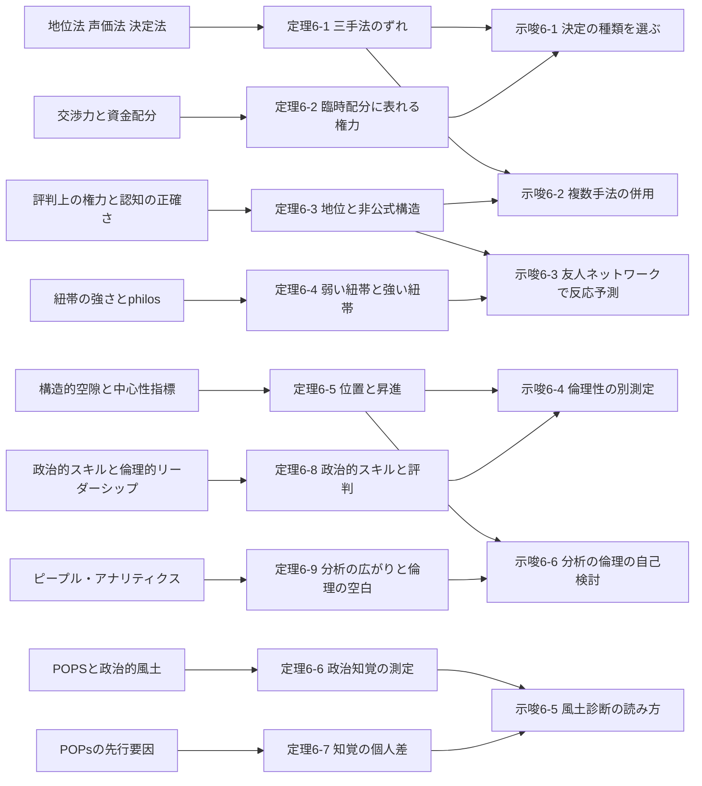

# 第6章 社内政治を分析する — 定義・定理・示唆

## この章の問い

社内の権力・ネットワーク・政治的風土・政治的人材は、どう測れるのか。測った結果から何が言えるのか。

目次の見出し（論点の枠としてだけ使う）:

- 第1節 変革時の政治的反応の予測: ポジション分析 / 評判分析 / 意思決定分析
- 第2節 派閥やコネを分析する: ネットワーク分析 / 今からできるネットワーク分析 / 強い紐帯と弱い紐帯 / 構造的空隙
- 第3節 社内の政治的風土を分析する: 組織内政治の知覚の診断 / 政治的風土の診断 / 政治の原因分析
- 第4節 「政治的リーダー」の発掘: タレント・アセスメント / タレント・アナリティクス / 倫理性のアセスメント

注記: 第1節の 3 つの分析が、地域権力構造研究の 3 手法（地位法・声価法・決定法）を指すかどうかは未確認。本ファイルでは、この 3 手法を定義・定理の対象として扱う。

## 1. 概念の定義

| 概念 | 定義（言い換え） | 出典 | 読んだ箇所 |
|---|---|---|---|
| 地位法（positional method） | 公式の地位にある人を権力者とみなす方法。各領域の主要組織の長を洗い出し、領域をまたいで同じ人が上位にいるかを見る | Angeles 1973 による整理 | 序論 pp.166-167、第 II 節 pp.170-173 |
| 声価法（reputational method） | 権力は表に出ないと仮定し、「誰が影響力を持つか」を人に指名させて評判で権力者を特定する方法。エリート論の研究で使われた | Angeles 1973 による整理 | 序論 p.166、第 I 節 pp.168-170 |
| 決定法（decision-making method） | 実際の争点を選び、その決定過程に参加し結果を左右した人を権力者とする方法。多元論の研究で使われた | Angeles 1973 による整理 | 序論 p.167、第 III 節 pp.173-176 |
| 交渉力としての権力（決定結果から見る権力） | 部門の長が本社に対して持つ影響力。Glaser らは在職年数・技術系学位・本社所在国の国籍で測り、資金の配分結果との関係を見た | Glaser, Lopez-de-Silanes & Sautner 2008 | 4.2「The Measurement of Managerial Power」pp.14-15 |
| 評判上の権力（reputational power） | 組織の成員が互いを「どれだけ影響力があるか」で評定した値。Krackhardt は 2 つの評定（potency と charisma）を合成した | Krackhardt 1990 | Results「Reliability of Dependent Variables」pp.353-354 |
| ネットワークの認知の正確さ（cognitive accuracy） | 本人が描いた「誰が誰に助言を求めるか」の図と、当事者双方が認めた実際のつながりとの一致度 | Krackhardt 1990; Krackhardt 1992 | 1990: pp.342-343, Table 1; 1992: pp.222-223 |
| 媒介中心性（betweenness centrality） | ある人が他の 2 人を結ぶ最短経路の上にどれだけ乗っているか。情報の流れを止めたり選んだりできる位置を表す | Krackhardt 1990; Krackhardt 1992 | 1990: p.352; 1992: p.223 |
| 入次数・k-shell（ネットワークの中心性指標） | 入次数は自分に向かうつながりの数（例: 自分の業務ファイルに反応した同僚の数）。k-shell は、ネットワークの中核にどれだけ深く入っているかを示す指標 | Yuan et al. 2015 | Section 2-3、Table 1 |
| 3 つの非公式ネットワーク | 助言（技術的な問題で誰に頼るか）、信頼（微妙な政治的情報を誰と共有するか）、コミュニケーション（日常的に誰と仕事の話をするか） | Krackhardt & Hanson 1993 | pp.105-106「The Steps of Network Analysis」 |
| 紐帯の強さ（tie strength） | 一緒に過ごす時間、感情の強さ、親密さ（打ち明け合い）、互いの手助けの組み合わせ | Granovetter 1973 | 「The Strength of Ties」p.1361 |
| ブリッジ（bridge）・局所ブリッジ | 2 点を結ぶ唯一の経路（ブリッジ）、または他の経路よりずっと短い経路（局所ブリッジ） | Granovetter 1973 | pp.1364-1365, Fig.1-2 |
| philos（強い紐帯の一種） | 相互作用があり、好意があり、長い付き合いの歴史がある関係。信頼の土台になる | Krackhardt 1992 | 「A Philos Relationship」pp.218-219 |
| 構造的空隙（structural hole）と仲介 | 互いにつながっていない集団の間のすき間。そこをまたぐ人（ブローカー）は異なる集団の情報に触れられる | Burt 2004 | 序論 pp.349-353、「Supply Chain」節 p.359 |
| ネットワーク制約（network constraint） | 本人の話し相手どうしが互いに密につながっている度合い。高いほど空隙をまたいでいない | Burt 2004 | p.359 と注 6 |
| 組織内政治の知覚（POPs）と POPS | 職場で自己利益のための行動がどの程度起きていると本人が感じるか。原版 POPS は「一般的な政治的行動」「波風を立てずに出世」「昇給・昇進」の 3 下位尺度、12 項目とされる | Nye & Witt 1992 | 序論 p.1、Method「Measures」p.2 |
| 改訂版 POPS（短縮版） | POPS の改訂版。読んだ資料の説明では「一般的な政治的行動」「波風を立てずに出世」「昇給・昇進」の 3 次元で、Çınar Altıntaş は 13 項目（6・5・2 項目）と記述している。項目数の記述は資料により異なる（Stergiopoulou 2014 は 12 項目と記述） | Çınar Altıntaş 2017; Stergiopoulou 2014 | Çınar Altıntaş: 2 節と 3.1 節 pp.3-4; Stergiopoulou: Chapter 6 の測定 pp.263-264 |
| 政治的風土（political climate） | 政治を職場で共有された知覚として捉える考え方。Landells & Albrecht の尺度は「関係の構築と利用」「個人の評判の構築」「意思決定・資源の支配」「意思決定への影響」「伝達経路の利用（うわさ等）」の 5 次元 | Landells & Albrecht 2019 | Introduction、Materials and Methods（項目開発） |
| POPs の先行要因 | 政治の知覚を高めると考えられる要因。Lee の整理では、組織要因（集権化・公式化・階層・統制範囲）、職務・環境要因（自律性・フィードバック・昇進機会など）、個人要因の 3 群に分かれる | Lee 1998 による整理 | Chapter I「Predictors of Organizational Politics」pp.8-13, Figure 1 |
| 政治的スキル（political skill） | 職場で他者を理解し、その知識で他者を動かす力。PSI（18 項目）は社会的洞察力・対人影響力・ネットワーク構築力・誠実さの見え方の 4 次元 | Blickle et al. 2012; Kückelhaus, Meurs & Blickle 2024 | 2012: Method「Political skill」; 2024: 3. Method |
| 倫理的リーダーシップ | 個人の行動と対人関係で規範的に適切な振る舞いを示し、双方向の対話や強化、意思決定を通じて部下にもそれを促すこと。測定は部下評定の 10 項目尺度（ELS） | Brown, Treviño & Harrison 2005 | 定義の節 p.120、Table 2-3 |
| ピープル・アナリティクス（PA） | 従業員の属性・行動・業績のデータを、情報システム・可視化・予測分析で扱いやすく、解釈でき、行動に移せる形にすること。HR アナリティクス、ワークフォース・アナリティクス、タレント・アナリティクスなどの語とほぼ同じ意味で使われている | Tursunbayeva, Di Lauro & Pagliari 2018 | 1. Introduction p.224、4.1「Terminological trends」 |

## 2. 定理

### 定理 6-1: 地位法・声価法・決定法は、同じ地域でも同じ人々を権力者として取り出さず、重なりは部分的にとどまる。

- **内容**: Angeles は 1 つの町で 3 手法を同時に使った。声価法で選ばれた 29 人のうち、決定法で選んだ 3 つの争点の決定に関わったのは 44.8% だった。彼らは決定参加者全体の 29% にすぎず、残り 71% は評判リストにいない人だった。地位法では、評判上の指導者は 4 つの制度領域に散らばるが、すべてを支配してはいなかった。著者は、各手法がそれぞれ前提とする「指導者像」に結果が引っ張られると結論している。
- **根拠**: Angeles, V. S. M. (1973, Asian Studies 11(1))。序論 pp.165-167、第 I〜III 節 pp.168-176、Table I-VII、結論。実証（事例）。フィリピン Rizal 州 Morong 町。市民 282 人中 276 人に指名式質問紙、公的役職者リスト（1946-1969 年）、企業役員名簿、3 争点の参加者 48 人。声価法・決定法の由来となった古典研究の説明も、この論文の整理による。
- **条件・限界**: 1 つの小さな町の事例で、統計的検定は相関のみ。声価法は事情通パネルではなく一般市民に指名させる変形版。著者は、争いが表に出ず調停で処理される地域では決定法の適用自体が疑わしいと述べている。企業組織への一般化は確認されていない。

### 定理 6-2: 大企業の中では、部門長の交渉力は制度化された事前の資本配分計画には表れず、計画外の臨時資金の配分に表れる。

- **内容**: Glaser らは欧州の大企業 1 社の内部管理会計データを使った。事前の配分計画（計画上の設備投資）は、収益性や成長機会の指標とは関係したが、部門長の交渉力の指標とは関係しなかった。一方、本社が持ち株を売って得た予期しない資金（キャッシュ・ウィンドフォール）は、事業単位の四半期投資率を 0.0089 から 0.0136 へ約 53% 押し上げた。この増加は、在職年数が中央値より長い部門長の事業単位で 0.013 大きく、これは平時の平均投資率の約 146% にあたった。著者は、交渉力の指標が能力の代わりになっている可能性を、計画配分や将来業績との関係がないことから退けている。
- **根拠**: Glaser, M., Lopez-de-Silanes, F. & Sautner, Z. (2008, University of Mannheim ディスカッションペーパー, 2008 年 12 月版)。要旨、序論 pp.4-5、3.1-3.2 節、4.2 節 pp.14-15、5 節 pp.15-16、6.2 節 pp.18-20（Table 8-9）、7.2 節と 7.4 節 pp.22-23、8 節 Conclusion。実証（単一企業の月次パネル）。欧州に本社を置く従業員 10 万人超の企業、5 部門・22 事業単位・部門長 13 人。実績データ 2001-2006 年、計画データ 2002-2006 年。
- **条件・限界**: 1 社のデータで、著者自身が一般化の限界を認めている。交渉力は在職年数・学位・国籍という代理指標で、本人の影響力を直接測ってはいない。交渉力の強い部門の投資が成長機会に反応しにくいという結果（7.4 節）は、表に示されていない分析による。

### 定理 6-3: 小さな企業の中では、成員の評判による権力評定は強く一致し、その差は公式の地位で 4 割強、友人ネットワークの中心性と助言ネットワークの認知の正確さでさらに説明される。

- **内容**: 36 人の企業で、評判上の権力（2 つの評定）の信頼性は α = .96 と .99 だった。公式の地位だけで評判上の権力の分散の 43% を説明した。そこに友人ネットワークの中心性を加えると説明力が上がった（助言ネットワークの中心性は公式の地位と重なり、独自の寄与はなかった）。さらに助言ネットワークを正確に把握していることが 8.2% を追加で説明した。友人ネットワークの認知の正確さは関係がなかった。
- **根拠**: Krackhardt, D. (1990, Administrative Science Quarterly 35)。Results pp.353-355、Table 1-3（階層的回帰）、Discussion と Caveats pp.356-357。実証（単一組織の横断データ）。米国の起業型企業 1 社、36 人（分析 N = 33）。
- **条件・限界**: 1 社・小規模・横断データで因果は言えない。著者自身、小さな会社では皆が互いをよく知るため構造上の有利さが出にくかった可能性を挙げている。日常業務の文脈での結果であり、危機時には友人ネットワークの理解のほうが効くかもしれないと著者は推測している（推測にとどまる）。

### 定理 6-4: 新しい情報の伝達では弱い紐帯が橋渡しの役を担うが、組織の大きな変化をめぐる影響力は、好意と長い付き合いを伴う強い紐帯（philos）の上で決まる。

- **内容**: Granovetter は、強い紐帯が 2 本ある三者のうち残り 1 本が欠ける形は起こりにくいと仮定した。そこから、強い紐帯はブリッジになりにくく、ブリッジはすべて弱い紐帯だと論じた（"all bridges are weak ties"）。転職者調査では、知人経由で職を得た人のうち、その知人と「よく」会っていたのは 16.7%、「時々」55.6%、「まれに」27.8% だった。一方 Krackhardt 1992 は、同じ 36 人企業での組合結成運動を追った。助言ネットワークの中心者は友人ネットワークの中心者と一致しなかった。組合側は友人ネットワークの周辺にいた熱心な支持者を前面に出し、友人ネットワークの中心にいた人を取り込まなかった。選挙は 12 対 3 で組合が負けた。
- **根拠**: Granovetter, M. (1973, American Journal of Sociology 78)。「The Strength of Ties」p.1361、「Weak Ties in Diffusion Processes」pp.1363-1366、「Weak Ties in Egocentric Networks」pp.1370-1372。理論的命題と小規模調査（米国 Boston 郊外の専門・技術・管理職の転職者、面接標本 N = 54）。Krackhardt, D. (1992, Nohria & Eccles 編 Networks and Organizations, 第 8 章)。「Theory」pp.216-219、事例の記述 pp.221-236、Table 8-1・8-2、Figure 8-4。事例研究。米国の情報システム企業 1 社（36 人）。
- **条件・限界**: Granovetter の前半は理論的命題で、ブリッジの命題は「強い三者の欠けた形が起きない」という仮定に依存する。転職データは接触頻度だけで強さを測った小標本。Krackhardt 1992 は 1 社 1 事例で、影響の経路は聞き取りに基づく解釈。弱い紐帯が変化を促す場面もあり、両者を比較した検定ではない。

### 定理 6-5: 社内ネットワークで中心にいる人、または構造的空隙をまたぐ人ほど、昇進・給与・評価で報われやすい。

- **内容**: Burt は米国大手電機メーカーのサプライチェーン管理職 673 人を調べた。ネットワーク制約が低い人ほど、職位などを統制しても給与が同僚より高く、評価や昇進も良かった。改善アイデアを 455 件集め、出所を伏せて 2 人の上級管理職に価値を評定させた。空隙をまたぐ人のアイデアほど価値が高く評定された。給与への効果は職位が高いほど強かった。Yuan らは、中国の IT 企業 1 社の全従業員 104 人について、社内プラットフォームの業務上のやり取り（業務ネットワーク）とフォロー関係（社交ネットワーク）を記録した。昇進した 12 人は、入次数・出次数・k-shell のどれでも昇進しなかった人より高い値を示した。業務ネットワークのほうが昇進との関係が強く、業務ネットワークの入次数が最も強い指標だった。
- **根拠**: Burt, R. S. (2004, American Journal of Sociology 110(2))。「Supply Chain in a Large Electronics Company」pp.359-、ネットワーク制約の定義（注 6）、Table 1（給与・評価）、アイデア評価の手続き pp.375-376（注 15）、「Conclusions and Discussion」p.386。実証（単一企業の調査 + 人事記録）。米国、管理職 673 人（ネットワーク回答 455 人、回答率 68%）。Yuan, J. et al. (2015, arXiv:1502.04184v2)。Section 1-3、Table 1、Figure 1（AUC）、Section 4 の冒頭。実証（単一企業の行動記録データ）。中国、従業員 104 人（2013 年末まで、昇進 12 人・退職 25 人）。
- **条件・限界**: どちらも 1 社の横断データで、位置が昇進を生むのか、昇進が位置を生むのかは区別できない。Burt のアイデアの評価者は 2 人で、職位と評定者の疲れの影響が混ざると著者自身が注で認めている。Yuan らは査読前の原稿で、AUC の値は図でしか示されず、昇進者は 12 人と少ない。

### 定理 6-6: POPS で測った組織内政治の知覚は、版や標本によって因子構造が揺れ、1 因子にもまとまり、組織からの支援の知覚の裏返しに近く、職場で共有された風土としての一致も確認されにくい。

- **内容**: Nye & Witt は連邦政府職員 1,297 人で原版 POPS を分析し、3 因子構造を再現できず 1 因子と判断した。POPS は組織的支援の知覚（SPOS）と r = −.85 だった。Çınar Altıntaş は改訂版 POPS（短縮版 13 項目）をトルコの従業員 199 人で検証した。探索的因子分析は 3 因子（説明率 54.9%）を出したが、項目のまとまり方は原版の 3 次元の割り当てと一致せず、第 3 因子の α は .574 だった。2 項目を除くと、1 因子モデル（CFI = .992、RMSEA = .02）も 3 因子モデル（CFI = .988、RMSEA = .03）も適合した。Erol はトルコの大学教員 277 人で 31 項目版を検証し、3 因子・21 項目の構造（CFI = .95、RMSEA = .050）を得た。Witt 1992 では、政治の知覚は職務満足と r = −.62 で、意思決定への参加が多い人では満足度の低下が小さかった。Landells & Albrecht 2019 は 5 次元の新尺度で、政治の知覚がストレスを通じてエンゲージメントを下げることを示したが、部署内の一致度は基準に届かなかった。
- **根拠**: Nye, L. G. & Witt, L. A. (1992, FAA 技術報告 DOT/FAA/AM-92/10)。Method、Results and Discussion、Table 1-4。実証。米国連邦航空局職員 1,297 人。Çınar Altıntaş, F. (2017, İşletme Araştırmaları Dergisi 9(2))。2 節、3.1 節、3.3.2 節（Table 3-4、Figure 1-3）、4 節 Results。実証（横断、因子分析）。トルコ Bursa、複数業種の従業員 199 人。Erol, E. (2015, International Journal of Assessment Tools in Education 2(1))。英文要約（Method、Findings、Conclusion）、トルコ語本文の因子分析の節（Çizelge 2 など）。実証（横断、因子分析）。トルコの国立大学教育学部の教員 277 人。Witt, L. A. (1992, FAA 技術報告 DOT/FAA/AM-92/17)。Results、Discussion、Table 3-4、Figure 1。実証。同職員 1,083 人。Landells, E. M. & Albrecht, S. L. (2019, Frontiers in Psychology 10:1612)。Materials and Methods、Results、Discussion。実証（横断・自己報告、SEM）。オーストラリア、標本 1 N = 303、標本 2 N = 353（政府機関）。
- **条件・限界**: いずれも横断の自己報告で、共通方法バイアスが残る。トルコの 2 研究は翻訳版で、適合は項目の削除や誤差の相関の追加の後に得られた。Çınar Altıntaş 自身、標準的な尺度として使うには改良が必要だと述べている。改訂版の項目数の記述は資料により異なる。

### 定理 6-7: 組織内政治の知覚の高さは、本人の性格特性（マキャベリアニズム・ダークトライアド・神経症傾向）や、上司層との目標の一致度によって一部説明される。

- **内容**: Lee は米国ハワイの 5 組織の従業員で、マキャベリアニズムの高い群が低い群より政治を多く知覚することを示した（平均 89.96 対 81.32、t(81) = 2.30, p < .05）。セルフ・モニタリングと否定的感情傾向では差がなかった。Baloch らは中国のホテル業従業員 149 人で、サイコパシー（β = .29）、ナルシシズム（β = .32）、マキャベリアニズム（β = .27）がそれぞれ政治の知覚を予測することを示した。Stergiopoulou はギリシャの大手銀行 2 行の従業員で、外向性が低いほど（β = −.23）、神経症傾向が高いほど（β = .18）政治の知覚が高いことを示し、性格特性の追加説明力は ΔR² = .10 だった。Witt & Nye は FAA の職員 991 人で、一般職員と上司層の目標の一致度を測り、一致度は政治の知覚の分散を ΔR² = .048 説明した（仮説は、一致が高いほど政治の知覚が低いというもの）。
- **根拠**: Lee, H. (1998, Emporia State University 修士論文)。要旨、Chapter II の測定 pp.32-33、Chapter III Results pp.37-39、Table 1。実証（t 検定、中央値分割）。米国ハワイ州 Honolulu の 5 組織、79 人（表の自由度では 83 人）。Baloch, M. A. et al. (2017, Frontiers in Psychology 8:1972)。Method、Results（Table 1-3）、Limitations。実証（横断・自己報告、PLS-SEM）。中国北京のホテル業、149 人。Stergiopoulou, E. (2014, Durham University 博士論文)。Chapter 6 の研究デザインと測定 pp.250, 263-264、Chapter 8 の仮説 1a-e の結果 pp.354-355（Table 28）。実証（2 時点の調査のうち第 1 時点）。ギリシャの大手銀行 2 行、分析 N = 236。Witt, L. A. & Nye, L. G. (1992, FAA 技術報告 DOT/FAA/AM-92/8)。要旨、Method、Results and Discussion pp.2-4、Table 2-3。実証（横断）。米国 FAA の Mike Monroney Aeronautical Center、一般職員 849 人・監督者 103 人・管理職 39 人。
- **条件・限界**: すべて横断データ（Stergiopoulou の性格特性と POPs も同じ時点）で、因果の向きは確定しない。Lee は小標本・中央値分割で効果は小さい。Baloch らのダークトライアド尺度は短縮版。Witt & Nye の一致度の方向は表の読み取りに頼る部分がある。集権化・公式化などの組織構造要因の効果は、読んだ資料では検証されていない。

### 定理 6-8: 同僚が評定した政治的スキルが高い人では、マキャベリアニズムの高さが評判と業績評価の低下につながらず、政治的スキルの効き方は職務の複雑さに左右される。

- **内容**: Kückelhaus らは、本人がマキャベリアニズムを自己評定し、同僚が政治的スキル・評判・業績を評定するデータを使った。政治的スキルが低い人では、マキャベリアニズムが高いほど評判が下がり、評判を通じて業績評価も下がった。政治的スキルが高い人ではこの関係が消えた。評判と業績評価の相関は r = .69 だった。Blickle らは、大学卒以上の専門職では、誠実性・学習志向・政治的スキル（自己評定）の 3 つがそろう人ほど上司の業績評価が高いことを示した。同じ交互作用は、非専門職の対照群では見られなかった。
- **根拠**: Kückelhaus, B. P., Meurs, J. A. & Blickle, G. (2024, Personality and Individual Differences 228)。3. Method、4. Results、Table 1-3、Discussion。実証（他者評定を含む横断データ）。ドイツ、対象者 550 人、同僚評定 1,127 件。Blickle, G. et al. (2012, Journal of Organizational Behavior, 著者稿)。Method「Procedure and participants」「Measures」、Results、Table 3、Figure 1。実証（上司・部下ペア、マルチレベル）。ドイツ西部、専門職 196 組、非専門職 96 人（対照群）。
- **条件・限界**: どちらも横断データ。Kückelhaus らの交互作用は小さい（β = .08、ΔR² は約 1%）。著者は、政治的スキルが悪い振る舞いを覆い隠す働きもしうると述べている。Blickle らの 3 者交互作用の追加説明力は 2%。倫理性そのものを測った研究ではない。

### 定理 6-9: ピープル・アナリティクスは人事のあらゆる目的に使われ、従業員どうしの関係やネットワークの分析へ広がっているが、約束される便益の実証は乏しく、倫理の検討はほとんどない。

- **内容**: Tursunbayeva らは、学術論文（Scopus で 58 本と比較用の 2 つの文献リスト）、Google の検索動向、提供企業のウェブサイト、オンライン講座を調べた。論文には採用・定着・業績評価など 7 つの目的がすべて現れ、さらに協働、多様性、人的リスク、組織間関係の 4 分類が加わった。著者は、個人から集団の相互作用やネットワークのデータへ重心が移っていると述べている。提供企業は従業員より雇用主の便益を強調し、約束された便益の証拠はほとんど見つからなかった。私的な SNS やメールの監視、昇進へのアルゴリズムの使用、同意のない人物像の推定といった倫理上の問題は、調べた資料ではほぼ扱われていなかった。
- **根拠**: Tursunbayeva, A., Di Lauro, S. & Pagliari, C. (2018, International Journal of Information Management 43)。1. Introduction p.224、2. Methods、3.2「People analytics in published academic research」（Table 1）、3.3（Table 2）、4.1・4.3・4.4、5. Conclusions。スコーピング・レビュー（混合法）。学術論文・検索動向・提供企業・オンライン講座。
- **条件・限界**: 2017 年時点の資料の地図で、効果の大きさを評価したレビューではない。提供企業の分析は Google の検索結果の 1 頁目に限られる。

## 3. 示唆

示唆は論文の主張ではなく、上の定理を組み合わせた導出である。

### 示唆 6-1: 決定法で社内の権力を測るなら、手続きが制度化された定例の決定より、裁量の余地がある臨時の配分を対象に選ぶほうが、権力の差が見えやすい。

- **組み合わせ**: 定理 6-1 + 定理 6-2
- **導出**: 定理 6-1 では、どの争点を選ぶかで決定法が取り出す人々は変わり、評判上の指導者とも部分的にしか重ならなかった。定理 6-2 では、同じ企業の中でも、事前の配分計画には交渉力が表れず、計画外の資金の配分には表れた。よって、決定結果から権力を読むときは、対象とする決定の種類によって「権力がない」という結論にも「ある」という結論にもなりうる。
- **追加の前提**: 欧州の 1 社で見られた計画配分と臨時配分の違いが、他の組織の他の決定（人事・予算）にも当てはまること。
- **注意**: 定理 6-2 は 1 社の資本配分のデータで、交渉力は代理指標で測られている。

### 示唆 6-2: 社内の権力者を特定するときは、公式の地位・評判・決定への関与（またはネットワーク）を重ねて使い、ずれた部分を調べる必要がある。

- **組み合わせ**: 定理 6-1 + 定理 6-3
- **導出**: 定理 6-1 では、3 手法の取り出す人々は部分的にしか重ならなかった。定理 6-3 では、組織内でも公式の地位が説明するのは評判上の権力の 4 割強で、残りは友人ネットワークの位置や組織理解に分かれていた。よって、どれか 1 つの方法だけでは、変革に反応する人の一部を見落とす。
- **追加の前提**: 地域社会で見られた手法間のずれが、企業組織でも同じように起こること。
- **注意**: どちらも単一事例・小規模の横断データ。ずれの大きさは組織ごとに違いうる。

### 示唆 6-3: 変革への政治的反応を予測するには、業務上の助言ネットワークより、好意と信頼に基づく友人ネットワークの中心者を把握するほうが役に立つ可能性が高い。

- **組み合わせ**: 定理 6-3 + 定理 6-4
- **導出**: 定理 6-3 では、助言ネットワークの中心性は公式の地位と重なり、独自に評判上の権力を説明したのは友人ネットワークの中心性だった。定理 6-4 では、組織の大きな変化をめぐる影響は philos の上で決まり、助言の中心者と友人の中心者は別人だった。したがって、変革時に誰が周囲の態度を動かすかは、組織図や助言関係ではなく友人・信頼関係から読む必要がある。
- **追加の前提**: 計画中の変革が、Krackhardt 1992 の組合運動と同じく「日常業務から外れた変化」であること。
- **注意**: 根拠は同じ 36 人企業の 2 本の研究に偏る。大規模組織での検証は読んだ範囲にない。

### 示唆 6-4: 「政治的リーダー」の候補を、ネットワーク上の位置や政治的スキルの高さだけで選ぶと、倫理面の問題を見逃しうるので、倫理性を別に測る必要がある。

- **組み合わせ**: 定理 6-5 + 定理 6-8
- **導出**: 定理 6-5 では、中心にいる人や空隙をまたぐ人は昇進・給与・評価で報われていた。定理 6-8 では、政治的スキルが高いとマキャベリアニズムが評判や業績評価に表れにくかった。つまり、ネットワーク上の位置や他者評価の高さは、本人の動機の良し悪しを区別しない。倫理的リーダーシップは部下評定で、隣接概念と区別して測れる（Brown, Treviño & Harrison 2005、Study 7）。
- **追加の前提**: 中心的な位置や仲介位置は、組織のためにも自己利益のためにも使えること（定理には含まれない）。
- **注意**: 定理 6-8 の交互作用は小さい。Brown らの尺度は部下評定に限られ、本人の内面の動機を直接測るものではない。

### 示唆 6-5: 政治的風土の診断では、組織全体の平均点を「政治の多さ」と読まず、回答者の性格特性や支援の知覚との重なり、部署ごとの差を確かめる必要がある。

- **組み合わせ**: 定理 6-6 + 定理 6-7
- **導出**: 定理 6-6 では、POPS の得点は因子構造が安定せず、支援の知覚の裏返しに近く、部署内でも一致しにくかった。定理 6-7 では、同じ職場でもマキャベリアニズムや神経症傾向が高い人ほど政治を多く知覚していた。よって、知覚の得点の差には、職場の実態の差だけでなく、誰が回答したかの差が混ざる。下位尺度ごとに原因を読み分ける前に、その尺度の構造を自組織のデータで確かめる必要もある。
- **追加の前提**: 診断の対象となる組織でも、性格特性と知覚の関係が読んだ研究と同程度にあること。
- **注意**: 定理 6-7 の効果は小さいものから中程度のものまであり、すべて横断データに基づく。組織構造要因の効果は読んだ資料で検証されていない。

### 示唆 6-6: ネットワーク指標を使ったタレント・アナリティクスは、昇進しやすい人の可視化には使えうるが、監視とアルゴリズムによる昇進判断の倫理を、導入する側が自ら検討する必要がある。

- **組み合わせ**: 定理 6-5 + 定理 6-9
- **導出**: 定理 6-5 では、社内プラットフォームの業務記録から作ったネットワークの入次数が、昇進と強く結びついていた。定理 6-9 では、ピープル・アナリティクスは関係やネットワークの分析へ広がる一方、監視や昇進判断の倫理はほとんど検討されていなかった。よって、行動記録から「影響力のある人」を割り出す仕組みは技術的には作れても、その使い方の歯止めは分析の提供者からは期待しにくい。
- **追加の前提**: 業務記録から作ったネットワーク指標が、他の組織でも昇進と同じように結びつくこと。
- **注意**: 定理 6-5 の行動記録データは 1 社 104 人の査読前原稿による。定理 6-9 は 2017 年時点の資料の地図である。

## 4. 扱えなかった論点

- 組織構造・職務の要因（集権化、公式化、フィードバック、昇進機会、自律性）が組織内政治の知覚を高めるかの実証: 本文を読める資料が見つからなかった。

## 5. 読んだ文献

| 文献 | 本文の入手先 | 読んだ範囲 |
|---|---|---|
| Angeles 1973, Asian Studies 11(1) | フィリピン大学 Asian Studies Journal アーカイブ（PDF） | 全文 pp.165-176 |
| Glaser, Lopez-de-Silanes & Sautner 2008, Mannheim ディスカッションペーパー | Mannheim 大学リポジトリ（MADOC） | 要旨、序論、3-8 節（Table 8-9 の説明を含む） |
| Krackhardt 1990, ASQ 35 | 著者の大学サイト（スキャン PDF） | pp.342-343、pp.352-357（方法の一部、Results、Discussion、Table 1-3） |
| Granovetter 1973, AJS 78 | 大学講義サイトの PDF（JSTOR 版） | pp.1360-1373（紐帯の強さ、拡散、自己中心ネットワーク、転職データ） |
| Krackhardt 1992, Networks and Organizations 第 8 章 | 著者の大学サイト（スキャン PDF） | pp.216-219、221-223、229-236 |
| Krackhardt & Hanson 1993, HBR 71(4) | 著者の大学サイト（スキャン PDF） | pp.104-107（ネットワーク分析の手順と事例の冒頭） |
| Burt 2004, AJS 110(2) | 大学講義サイトの PDF（JSTOR 版） | 序論、Supply Chain 節、給与・評価、アイデア評価、結論 |
| Yuan et al. 2015, arXiv:1502.04184 | arXiv | Section 1-4 の冒頭、Table 1、Figure 1 |
| Nye & Witt 1992, FAA AM-92/10 | FAA 公開技術報告 | 全文 |
| Witt 1992, FAA AM-92/17 | FAA 公開技術報告 | 序論、Results、Discussion |
| Witt & Nye 1992, FAA AM-92/8 | FAA 公開技術報告 | 全文 |
| Çınar Altıntaş 2017, İşletme Araştırmaları Dergisi 9(2) | 出版社 OA 版 | 全文 pp.1-13 |
| Erol 2015, IJATE 2(1) | DergiPark（出版社 OA 版） | 英文要約、方法、因子分析の結果、結論 |
| Landells & Albrecht 2019, Frontiers in Psychology | 出版社 OA 版 | 全文 |
| Lee 1998, Emporia State University 修士論文 | 大学リポジトリ | 要旨、Chapter I の先行要因の整理、Chapter II の測定、Chapter III Results、Table 1 |
| Baloch et al. 2017, Frontiers in Psychology 8:1972 | PMC（出版社 OA 版） | Method、Results、Table 1-3、Limitations |
| Stergiopoulou 2014, Durham University 博士論文 | Durham e-Theses | 要旨、Chapter 6 の研究デザインと測定、Chapter 8 の仮説 1a-e の結果（Table 28） |
| Blickle et al. 2012, JOB | 著者の大学サイト（著者稿） | Method、Measures、Results、Discussion 冒頭 |
| Kückelhaus, Meurs & Blickle 2024, PAID 228 | 著者の大学サイト（出版 PDF） | 要旨、Method、Results、Discussion |
| Brown, Treviño & Harrison 2005, OBHDP 97 | 大学講義サイトの PDF | 定義の節、Table 2-3、Study 7 の結果、Limitations |
| Tursunbayeva, Di Lauro & Pagliari 2018, IJIM 43 | Edinburgh 大学リポジトリ（出版社版、CC BY-NC-ND） | 1-5 節、Table 1-2 |

## Sources

- [Angeles 1973 (Asian Studies, PDF)](https://asj.upd.edu.ph/mediabox/archive/ASJ-11-01-1973/angeles-in%20search%20of%20leadership%20in%20morong%20rizal.pdf)
- [Glaser, Lopez-de-Silanes & Sautner 2008 (University of Mannheim, PDF)](https://ub-madoc.bib.uni-mannheim.de/2313/1/dp08_24.pdf)
- [Krackhardt 1990 (PDF)](https://www.andrew.cmu.edu/user/krack/documents/pubs/1990/1990%20Assessing%20the%20Political%20Landscape.pdf)
- [Granovetter 1973 (PDF)](https://www.cs.umd.edu/~golbeck/INST633o/granovetterTies.pdf)
- [Krackhardt 1992 (PDF)](https://www.andrew.cmu.edu/user/krack/documents/pubs/1992/1992%20The%20Strength%20of%20Strong%20Ties.pdf)
- [Krackhardt & Hanson 1993 (PDF)](https://www.andrew.cmu.edu/user/krack/documents/pubs/1993/1993%20Informal%20Networks.pdf)
- [Burt 2004 (PDF)](https://snap.stanford.edu/class/cs224w-readings/Burt04StructureHole.pdf)
- [Yuan et al. 2015 (arXiv)](https://arxiv.org/abs/1502.04184)
- [Nye & Witt 1992, FAA AM-92/10 (PDF)](https://www.faa.gov/sites/faa.gov/files/data_research/research/med_humanfacs/oamtechreports/AM92-10.pdf)
- [Witt 1992, FAA AM-92/17 (PDF)](https://www.faa.gov/sites/faa.gov/files/data_research/research/med_humanfacs/oamtechreports/AM92-17.pdf)
- [Witt & Nye 1992, FAA AM-92/8 (PDF)](https://www.faa.gov/sites/faa.gov/files/data_research/research/med_humanfacs/oamtechreports/AM92-08.pdf)
- [Çınar Altıntaş 2017 (İşletme Araştırmaları Dergisi)](https://www.isarder.org/index.php/isarder/article/view/397)
- [Erol 2015 (IJATE, PDF)](https://dergipark.org.tr/en/download/article-file/208029)
- [Landells & Albrecht 2019 (Frontiers in Psychology)](https://www.frontiersin.org/articles/10.3389/fpsyg.2019.01612/full)
- [Lee 1998 (Emporia State University)](https://dspacep01.emporia.edu/bitstream/handle/123456789/1406/Lee%201998.pdf?sequence=1)
- [Baloch et al. 2017 (PMC)](https://pmc.ncbi.nlm.nih.gov/articles/PMC5682558/)
- [Stergiopoulou 2014 (Durham e-Theses)](https://etheses.durham.ac.uk/id/eprint/10678/)
- [Blickle et al. 2012 (著者稿 PDF)](https://www.psychologie.uni-bonn.de/de/institut/abteilungen/arbeits-organisations-und-wirtschaftspsychologie/uploads-fuer-die-allgemeine-i/forschung/job1843.pdf)
- [Kückelhaus, Meurs & Blickle 2024 (PDF)](https://psychologie.uni-bonn.de/de/institut/abteilungen/arbeits-organisations-und-wirtschaftspsychologie/uploads-fuer-die-allgemeine-i/forschung/kueckelhaus-meurs-blickle-2024-paid.pdf)
- [Brown, Treviño & Harrison 2005 (PDF)](https://eclass.uoa.gr/modules/document/file.php/PSYCH252/%CE%97%CE%B8%CE%B9%CE%BA%CE%AE%20%CE%97%CE%B3%CE%B5%CF%83%CE%AF%CE%B1%201.pdf)
- [Tursunbayeva, Di Lauro & Pagliari 2018 (Edinburgh Research Explorer, PDF)](https://www.pure.ed.ac.uk/ws/files/75026826/Tursunbayeva_Pagliari_2018_People_analytics_A_scoping_review_of_conceptual_boundaries_and_value_propositions.pdf)
