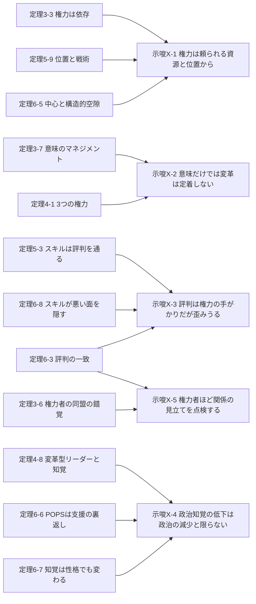

# 社内政治の論点別 定義・定理・示唆（改訂版） — インデックス

- **Type**: survey

## この調査の目的

社内政治について **「論文から何が言えるか」** を、論点ごとに次の 3 段でまとめることです。

1. **概念の定義**: その論点で使う概念を、論文の定義で決める
2. **定理**: 論文の結果・主張を 1 文の命題にしたもの
3. **示唆**: 定理を 2 つ以上組み合わせて導いたこと。どの定理を組み合わせたかと、足した前提を明記する

論点の枠には、木村琢磨『社内政治の科学 経営学の研究成果』（日本経済新聞出版, 2025）の目次（第3章第2節〜第6章）を使いました。**本の本文は読んでいません。** 本の内容についてはどこにも書いていません。目次は「どの論点を扱うか」を決めるためだけに使っています。

## 資料の扱い

- **本文を読んだ資料だけを使っています。** 定義・定理・示唆・出典のどこにも、本文を確認できなかった資料は出てきません。
- 有名な原典でも本文が読めない場合は、同じ論点に答える **本文の読める別の資料**（オープンアクセスの論文、大学リポジトリの著者稿、博士論文、公的機関の報告書など）で置き換えました。
- レビュー論文が紹介する原典の数値を使う場合も、出典は実際に読んだレビューにしています。
- 代わりの資料も見つからなかった論点は、各章の末尾に「扱えなかった論点」として名前だけ残しています。

## 改訂の経緯

| 版 | 内容 |
|----|------|
| [20261115_book_toc](../20261115-book-toc/index.md) | 目次の見出しごとに文献を並べた版。多くは要旨・二次資料での確認 |
| [20261115_book_propositions](../20261115-book-propositions/index.md) | 定義・定理・示唆の形にした版。定理は本文を読んだ論文に限ったが、本文未確認の資料も参考として挙げていた |
| **本版（v2）** | 本文未確認の資料をすべて除き、別の資料で置き換えた版。定理は 24 個から 37 個に増えた |

## 章ファイル

| ファイル | 問い | 本文を読んだ資料 | 定理 | 示唆 |
|---------|------|-----------------|------|------|
| [ch3.md](ch3.md) | 社内政治とは何か。権力とどう関係し、なぜ「意味」を動かすことが政治になるのか | 13 | 10 | 4 |
| [ch4.md](ch4.md) | リーダーシップはなぜ政治と切り離せないのか。変革やミドルの仕事で政治はどう働くのか | 14 | 9 | 5 |
| [ch5.md](ch5.md) | 社内政治で成果を出す個人の力は、どんな要素から成り、何が成果を左右するのか | 10 | 9 | 4 |
| [ch6.md](ch6.md) | 社内の権力・ネットワーク・政治的風土・政治的人材はどう測れ、測った結果から何が言えるのか | 21 | 9 | 6 |

資料数は章ごとの延べ数です（複数の章で使った資料は重複して数えています）。

## 章ごとの定理と示唆

### 第3章 定義・権力・意味

| 番号 | 定理 | 根拠（本文を読んだ資料） |
|------|------|------------------------|
| 3-1 | 定義は「組織が認めない自己利益の追求」とみる立場と「中立で組織に本来備わる現象」とみる立場に分かれ、どちらを採るかで測定の仕方と「政治は有害か」の結論が変わる | Silvester 2008（著者稿）、Landells & Albrecht 2019 |
| 3-2 | 権力は他者に影響する能力であり、政治はその権力を動員して関係や資源配分を組み替える活動である | Fleming & Spicer 2014（レビュー、著者稿） |
| 3-3 | A の B に対する権力は B の A への依存に等しい。依存は目標への関心が強いほど大きく、代わりの入手先が多いほど小さい | Emerson 1962（理論） |
| 3-4 | 組織の中心的な使命に結びつき、他部門が頼る不確実性に対処し、代わりが効きにくい部門は、公式の地位以上の権力を持つ | Fleming & Spicer 2014、Crawford 1997（米国の大学図書館 416 校） |
| 3-5 | 権力は、個人の特性、集団への貢献、ネットワーク上の位置の 3 経路で獲得される。権力者の心理は権力を強める方向にも弱める方向にも働く | Brion 2010（博士論文） |
| 3-6 | 権力を持つ人ほど同盟の強さを過大に見積もり、その錯覚が強い人ほど連合から外されて資源を失う | Brion 2010（実験 4 本） |
| 3-7 | 言語・物語・象徴による意味のマネジメントは、反対や対立を下げて行動を動員し、戦略変更のような曖昧な局面でとくに重要になる | Rindova & Srinivas 2017（レビュー） |
| 3-8 | 他者焦点型の印象マネジメント（取り入りなど）は業績評価や人事判断を高め、その効果は評価者との関係の質を介して生じる | Peck & Levashina 2017（メタ分析）、Sun et al. 2021 |
| 3-9 | 課題の売り込みは、非公式に物語を練り上げる段階と、公式に一貫した物語を示す段階から成る。移行には利害の結合・枠付け・具体例が要る | Vacquier et al. 2024（42 名の面接） |
| 3-10 | 上位者が特定の人を積極的に推すスポンサーシップは、昇進と結びつくと多く報告されている。ただし証拠は横断・質的研究が中心で、女性は推される機会を得にくい | Schwartz et al. 2024（スコーピング・レビュー） |

| 番号 | 示唆 | 組み合わせ |
|------|------|-----------|
| 3-1 | 社内政治をどう定義するかは中立な前置きではなく、何を政治と数え、政治を有害とみるかを先に決めてしまう | 3-1 + 3-2 + 3-7 |
| 3-2 | 権力を得る筋道は、組織の中心的な仕事や他者が頼る不確実性への対処を代わりの効かない形で担うことと、つながりのない人々の間をつなぐ位置に立つこと | 3-3 + 3-4 + 3-5 |
| 3-3 | 権力を持つ側は支持基盤を実際より強く見積もりがちで、弱い側の連合で権力を失いうる。権力の維持には同盟の実態を確かめ続けることが要る | 3-3 + 3-6 |
| 3-4 | 部下や企画を売り込むときは、決定者本人との関係を通じて働きかけ、関係者の利害を 1 つの物語に結ぶと通りやすくなりうる。ただし推す側に権力があることが前提 | 3-8 + 3-9 + 3-10 |

### 第4章 リーダーシップ

| 番号 | 定理 | 根拠（本文を読んだ資料） |
|------|------|------------------------|
| 4-1 | 戦略変革は、資源・プロセス・意味の 3 つの権力をまとめて使い、既存システムの権力に対抗したときに実現する。どれか 1 つでは定着しない | Hardy 1996（理論的命題、著者稿） |
| 4-2 | リーダーの政治的スキルは、チームの成績やリーダー有効性の評価を予測し、認められたリーダーの影響力が業績につながるかを左右する | Ferris et al. 2007（レビュー）、Shaughnessy et al. 2017 |
| 4-3 | 集団への同一視が強いほど、メンバーは集団の典型に近い人をリーダーとして支持し、有効だと評価する | Hogg 2001 |
| 4-4 | 集合的リーダーシップの物語が強い組織でも、個人はリーダーとしてのアイデンティティを主張し、集合を体現する個人リーダーを立てる | Empson et al. 2023（著者稿）、Zaghmout & Harrison 2025 |
| 4-5 | ミドルの上方影響は評判型、下方影響は情報型の社会関係資本が高いほど事業成果を高める。上方影響はやりすぎると成果が下がる | Ahearne et al. 2014（米国企業 328 人、客観成果） |
| 4-6 | 公式の権限が乏しいミドルが変革への支持を広げられるのは、相手の利害に合う言葉で会話を運び、適切な相手と場を選び、組織の暗黙のルールと力関係の知識を使えるとき（理論的命題） | Rouleau & Balogun 2011（著者稿） |
| 4-7 | リーダーと部下の政治的スキルがともに高いと部下の職務満足は高い。リーダーのスキルが部下を上回るずれは満足を下げる | Wang & McChamp 2019 |
| 4-8 | 日本企業の従業員では、トップの変革型リーダーシップが強いと感じるほど組織政治の知覚が低い。知覚が高いほど職務満足が低い（関係は弱い） | Kimura 2012（日本企業 200 人） |
| 4-9 | 職場の政治の知覚は、ストレスを高め仕事の有意味感を下げることを経由して、ワーク・エンゲージメントを下げる | Landells & Albrecht 2019（オーストラリア 2 標本） |

| 番号 | 示唆 | 組み合わせ |
|------|------|-----------|
| 4-1 | 変革を進めるミドルは、上と下で使う関係資本を分け、どちらでも相手に合う言葉と場を選ぶ必要がある | 4-1 + 4-5 + 4-6 |
| 4-2 | アイデンティティの変革は、「意味の権力」で集団の典型を作り替える働きとして理解できる | 4-1 + 4-3 |
| 4-3 | リーダーシップは周りから認められて成り立つので、政治的スキルを育てる対象を正式な管理職に限らないほうがよい | 4-2 + 4-4 |
| 4-4 | 政治的スキルの育成は、リーダーだけでなく部下も対象にしたほうが、部下の満足を損ないにくい | 4-2 + 4-7 |
| 4-5 | トップのリーダーシップは、部下に政治がどう映るかを通じて、満足だけでなくストレスとエンゲージメントにも影響しうる | 4-8 + 4-9 |

### 第5章 個人の政治力

| 番号 | 定理 | 根拠（本文を読んだ資料） |
|------|------|------------------------|
| 5-1 | 政治知識は政治スキルと中程度に重なり、とくに社会的洞察力と強く結びつく | Ferris et al. 2007（レビュー） |
| 5-2 | 政治スキルは知能と性格を統制しても業績を予測する。その強さは仕事の対人的な要求で大きく変わる | Blickle, Frieder & Ferris 2018（メタ分析の整理） |
| 5-3 | 政治スキルが業績とキャリアに効く経路の一部は、評判の形成を通る | Blickle, Frieder & Ferris 2018 |
| 5-4 | 政治知識と政治スキルは、公式研修より、メンターや上司との非公式な関係を通じて身につきやすい | Silvester & Wyatt 2018（著者稿）、Blickle et al. 2018、Ferris et al. 2007 |
| 5-5 | 新人が入社後半年で身につける政治知識には性格による個人差があり、開放性と誠実性が高いほど多く、外向性は関係しない | Swid 2024（縦断研究） |
| 5-6 | 政治意思は自己奉仕型と利他型の 2 次元に分かれ、前者は権力・達成の欲求、後者は親和欲求・内発的動機づけと結びつく。利他型が本当に利他的かは確かめられていない | Montgomery 2022（博士論文のレビュー章） |
| 5-7 | 政治意思は固定した特性ではなく、地位と経験が上がるにつれ、防御から積極へ、課題の達成から全体の戦略へ、リスク回避からリスクを扱える方向へ変わる | Montgomery 2022（面接研究） |
| 5-8 | 出世や協調の動機は、政治スキルが高いときにだけ、高い業績や昇進可能性の評価につながる | Blickle, Frieder & Ferris 2018 |
| 5-9 | 他者が認めるパワーはネットワーク上の位置と影響戦術の双方から生じ、中心的な位置ほど戦術の重要性は下がる。人と人をつなぐ位置には自己監視の高い人が就きやすい | Brass & Krackhardt 2012、Kilduff & Buengeler 2019（著者稿） |

| 番号 | 示唆 | 組み合わせ |
|------|------|-----------|
| 5-1 | ネットワークの中心にいない人ほど、政治スキルと評判づくりの効き目が大きい可能性がある | 5-3 + 5-9 |
| 5-2 | 異動や転職の直後は、上司やメンターとの非公式な関係を早く作ることが政治知識を取り戻す近道になるが、その速さには個人差がある | 5-1 + 5-4 + 5-5 |
| 5-3 | 境界をまたぐ役割や変革の役割に人を就けるときは、政治スキルだけでなく、その人を動かす動機の向きも見る必要がある | 5-2 + 5-6 + 5-8 |
| 5-4 | 若手が政治に消極的に見えても固定した特性と見なさず、地位と経験の変化を前提に育成と評価を考えるべき | 5-7 + 5-9 |

「政治準備性」「政治的思慮」は、本書での意味が未確認です。第5章では、近い学術概念（政治意思、政治的成熟、政治的思慮）で定義しています。

### 第6章 分析手法

| 番号 | 定理 | 根拠（本文を読んだ資料） |
|------|------|------------------------|
| 6-1 | 地位法・声価法・決定法は、同じ地域でも同じ人々を権力者として取り出さず、重なりは部分的にとどまる | Angeles 1973（フィリピンの町の事例） |
| 6-2 | 大企業の中では、部門長の交渉力は制度化された事前の資本配分計画には表れず、計画外の臨時資金の配分に表れる | Glaser et al. 2008（ディスカッションペーパー） |
| 6-3 | 小さな企業の中では、評判による権力評定は強く一致し、その差は公式の地位で 4 割強、友人ネットワークの中心性と助言ネットワークの認知の正確さでさらに説明される | Krackhardt 1990（1 社 33 人） |
| 6-4 | 新しい情報の伝達では弱い紐帯が橋渡しをするが、組織の大きな変化をめぐる影響力は、好意と長い付き合いを伴う強い紐帯の上で決まる | Granovetter 1973、Krackhardt 1992 |
| 6-5 | 社内ネットワークで中心にいる人、または構造的空隙をまたぐ人ほど、昇進・給与・評価で報われやすい | Burt 2004（管理職 673 人）、Yuan et al. 2015 |
| 6-6 | POPS で測った組織政治の知覚は、版や標本によって因子構造が揺れ、組織からの支援の知覚の裏返しに近く、職場で共有された風土としての一致も確認されにくい | Nye & Witt 1992、Witt 1992、Çınar Altıntaş 2017、Erol 2015、Landells & Albrecht 2019 |
| 6-7 | 組織政治の知覚の高さは、本人の性格特性（マキャベリアニズム・ダークトライアド・神経症傾向）や、上司層との目標の一致度で一部説明される | Lee 1998、Baloch et al. 2017、Stergiopoulou 2014、FAA 技術報告 AM-92/8 |
| 6-8 | 同僚が評定した政治的スキルが高い人では、マキャベリアニズムが高くても評判と業績評価が下がらない。政治的スキルの効き方は職務の複雑さに左右される | Kückelhaus et al. 2024、Blickle et al. 2012 |
| 6-9 | ピープル・アナリティクスは人事のあらゆる目的に使われ、関係やネットワークの分析へ広がっているが、便益の実証は乏しく、倫理の検討はほとんどない | Tursunbayeva et al. 2018（レビュー） |

| 番号 | 示唆 | 組み合わせ |
|------|------|-----------|
| 6-1 | 決定法で社内の権力を測るなら、制度化された定例の決定より、裁量の余地がある臨時の配分を対象に選ぶほうが権力の差が見えやすい | 6-1 + 6-2 |
| 6-2 | 社内の権力者を特定するときは、地位・評判・決定への関与（またはネットワーク）を重ねて使い、ずれた部分を調べる必要がある | 6-1 + 6-3 |
| 6-3 | 変革への政治的反応を予測するには、業務上の助言ネットワークより、好意と信頼に基づく友人ネットワークの中心者を把握するほうが役に立つ可能性が高い | 6-3 + 6-4 |
| 6-4 | 「政治的リーダー」の候補をネットワーク上の位置や政治的スキルだけで選ぶと倫理面の問題を見逃しうるので、倫理性を別に測る必要がある | 6-5 + 6-8 |
| 6-5 | 政治的風土の診断では、全体の平均点を「政治の多さ」と読まず、回答者の性格特性や支援の知覚との重なり、部署ごとの差を確かめる必要がある | 6-6 + 6-7 |
| 6-6 | ネットワーク指標を使ったタレント・アナリティクスは昇進しやすい人の可視化には使えうるが、監視とアルゴリズムによる昇進判断の倫理を、導入する側が自ら検討する必要がある | 6-5 + 6-9 |

## 章をまたぐ示唆

各章の定理を組み合わせて、さらに次のことが導けます。これも論文の主張ではなく、定理からの導出です。

### 示唆 X-1: 社内の権力は、他者に頼られる資源と、人と人をつなぐ位置の両方から生まれ、ネットワークのデータで見えるようになる

- **組み合わせ**: 定理 3-3 + 定理 5-9 + 定理 6-5
- **導出**: 権力は相手の依存に等しい（3-3）。個人のパワーはネットワーク上の位置からも生じる（5-9）。中心や構造的空隙をまたぐ位置にいる人は、昇進・給与・評価で報われやすい（6-5）。したがって、役職だけでなく「誰がどの資源と情報の通り道を握っているか」を見ると、権力の所在を把握しやすい。
- **追加の前提**: 構造的空隙をまたぐ位置にいると、他者がその人に情報を頼るようになり、依存が生まれること（定理 6-5 自体は依存を測っていない）。

### 示唆 X-2: 説明や物語で「意味」をそろえることは変革に必要だが、それだけでは変革は定着しない

- **組み合わせ**: 定理 3-7 + 定理 4-1
- **導出**: 意味のマネジメントは反対を下げて行動を動員する（3-7）。一方、変革は資源・プロセス・意味の 3 つの権力をまとめて使わないと定着しない（4-1）。したがって、説明や物語づくりは、予算・人事などの資源と、会議体・決裁経路などのプロセスへの働きかけと組み合わせる必要がある。
- **追加の前提**: なし（定理 4-1 は理論的命題で、二次事例 2 件で説明されたものである点に注意）。

### 示唆 X-3: 評判は権力の手がかりとして使えるが、政治的スキルの高い人の評判は実態より良く見えうるので、評判だけで人を評価しない

- **組み合わせ**: 定理 5-3 + 定理 6-3 + 定理 6-8
- **導出**: 政治スキルは評判を通じて業績やキャリアに効く（5-3）。社内の評判による権力評定は強く一致する（6-3）。しかし政治的スキルが高いと、マキャベリアニズムが高くても評判が下がらない（6-8）。したがって、評判は権力の所在を知るには役立つが、人の資質や倫理性の評価には別の測定を併用する必要がある。
- **追加の前提**: なし。

### 示唆 X-4: 組織政治の知覚の調査で数値が下がっても、政治的行動そのものが減ったとは限らない

- **組み合わせ**: 定理 4-8 + 定理 6-6 + 定理 6-7
- **導出**: トップの変革型リーダーシップが強いと組織政治の知覚は低い（4-8）。一方、POPS で測った知覚は、組織からの支援の知覚の裏返しに近い（6-6）。さらに知覚は、回答者の性格特性や上司層との目標の一致度でも変わる（6-7）。したがって、知覚の数値の変化は、支援の感じ方や回答者の構成の変化を反映している可能性があり、政治的行動の量の変化を示しているとは限らない。
- **追加の前提**: なし（定理 4-8 は日本企業 200 人の横断調査、6-6・6-7 は米国・オーストラリア・トルコなどの標本である点に注意）。

### 示唆 X-5: 権力を持つ人ほど、自分の人間関係の見立てを外部のデータで点検したほうがよい

- **組み合わせ**: 定理 3-6 + 定理 6-3
- **導出**: 権力を持つ人ほど、同盟の強さを過大に見積もり、その錯覚が強いと連合から外されて資源を失う（3-6）。一方、社内で権力があると評価される人は、助言ネットワークを正確に認知している傾向がある（6-3）。したがって、権力を保つうえでは、関係の認知の正確さが重要であり、権力を持つ人ほど、その見立てを周囲の声やネットワーク調査で確かめる意味が大きい。
- **追加の前提**: 同盟の強さの過大評価（3-6）は、ネットワークの認知の不正確さ（6-3）の一種であること。両者は別の研究で、別の測り方をしている。

## 扱えなかった論点

本文を読める資料が見つからず、定理にできなかった論点です。

| 章 | 論点 |
|----|------|
| 第4章 | リーダーシップのロマンス（組織の成果をリーダーに帰属させすぎる傾向） |
| 第4章 | 政治的リーダーシップ理論（リーダーの政治的行動を中心に置いた理論モデル） |
| 第4章 | 管理職が経験し知覚する組織政治の調査 |
| 第4章 | ミドルが変革の中で担う感情面の働き |
| 第5章 | 政治意思の尺度そのものと、政治スキルとの交互作用の大きさ |
| 第5章 | 政治的思慮を測定した実証研究 |
| 第6章 | 組織構造・職務の要因（集権化、公式化、フィードバック、昇進機会、自律性）が政治の知覚を高めるかの実証 |

第6章第1節の 3 分析（ポジション・評判・意思決定）が地位法・声価法・決定法を指すかは、本を読んでいないため未確認です。

## Sources

- [日経BOOKプラス「はじめに：『社内政治の科学 経営学の研究成果』」（目次画像）](https://bookplus.nikkei.com/atcl/column/032900009/102901088/)
- 各定理の出典は、各章ファイルの「読んだ文献」と Sources を参照
