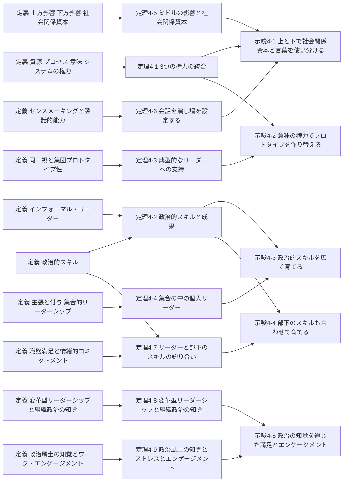

# 第4章 リーダーシップとしての社内政治 — 定義・定理・示唆

## この章の問い

リーダーシップは、なぜ権力と政治から切り離せないのか。戦略変革とミドルの仕事の中で、政治はどう働き、部下の態度にどう表れるのか。この 2 つに、本文を読めた論文から言えることだけで答える。

木村琢磨『社内政治の科学』（2025）の目次の見出しは、論点の枠としてだけ使う。本の中身には触れない。

- 第1節 そもそもリーダーシップとは？（定義 / マネジメントとの関係 / 研究の変遷）
- 第2節 なぜ政治的リーダーシップが必要か？（よくあるリーダーシップ論の問題点 / 政治と切り離せないリーダーシップ / アイデンティティ変革の重要性）
- 第3節 変革のための社内政治（組織変革のモデル / 組織変革モデルと政治 / 組織変革のための政治的リーダーシップ / リーダーシップを「分配」する）
- 第4節 ミドルマネジャーの政治的リーダーシップ（ミドルの役割 / 部門マネジャーとしての利害調整と資源獲得 / 社内政治と部下のモチベーション）

## 1. 定義

### 1.1 権力と政治に関する用語

- **権力（power）**: 結果に影響する力。ここでは良い・悪いの評価を含まない中立の意味で使う。[^d11]
- **政治（politics）**: 行動に移された権力。[^d12]
- **組織政治（organizational politics）**: 組織の中で、他者や組織の利益を顧みずに自己利益を進めようとする行動。この意味では否定的な言葉として使われる。[^d13]
- **戦略変革（strategic change）**: 組織が意図した戦略を、組織の人々の行動の一貫した型として実際に実現すること。[^d14]
- **資源の権力（power of resources）**: 情報・専門知識・予算・報酬と罰など、相手が頼る資源を使って行動を動かす権力。報酬や罰を出し続けないと、行動が続きにくい。[^d15]
- **プロセスの権力（power of processes）**: 意思決定の手続きや議題を操作して結果を左右する権力。変化に使うときは、新しい委員会を作って新しい議題や参加者を入れる。既存の規範や価値に合う行動しか定着しにくい。[^d16]
- **意味の権力（power of meaning）**: 象徴や説明を使い、物事を正当・合理的・避けられないと思わせる権力。根本的な変化につながりうるが、特定の行動だけを狙って変えるのは難しい。[^d17]
- **システムの権力（power of the system）**: 組織の価値・伝統・文化・構造の中に埋め込まれ、誰もが当たり前と受け入れている権力。現状を支えるので、ほかの権力で対抗しないと変化は起きにくい。[^d18]
- **3 段階の変革モデル（CATS）**: 解凍 → 変革 → 再凍結の 3 段階で変革を進めるとするモデル。Lewin の基礎理論とされてきたが、Cummings らは、Lewin 自身はこれを変革を担う人のためのモデルとして示しておらず、死後に他の著者が形にしたと論じる。[^d19]

### 1.2 リーダーシップと役割に関する用語

- **リーダーシップ（leadership）**: 集団の目標を達成するために、他者の関与を引き出して動かす影響の過程。相手に力ずくで従わせる過程とは区別される。[^d1]
- **リーダー（leader）**: リーダーシップを担う人。Zaleznik は、新しい選択肢を開き、人を引きつけるイメージを示して方向を作る人として描き、リーダーシップには権力を使って他者の考えと行動に影響することが避けられないとする。[^d2]
- **マネジャー（manager）**: 対立する利害を見積もり、選択肢を絞って妥協点に導くことで仕事を回す人。[^d3]
- **マネジメント（management）**: 計画・組織化・統制によって、組織が期日と予算どおりに目標を達成するようにする働き。[^d4]
- **リーダーシップとマネジメントの関係（3 つの立場）**: 両者を同じとみる立場、別物だが補い合いどちらも必要とみる立場、気質から根本的に違うとみる立場の 3 つ。Hunt は、リーダーシップをマネジメントの一部とみなし、両方が必要だが同じ人が担うとは限らないとする。[^d5]
- **トップ（top management）**: 組織の最上位にいて、組織全体の方向を示す経営者。Kimura 2012 では、回答者が自社の「トップ」の行動を評価した。[^d6]
- **ミドル（ミドルマネジャー, middle manager）**: 上から指示を受け、下に指示を出す中間の管理職。上級の管理者より日々の業務と現場に近いが、全体を見渡せる程度には現場から離れている。[^d7]
- **経営層（senior managers）**: ミドルの上にいて、ミドルを直接の部下に持つ上位の管理者。Ahearne らの事例では地域の営業本部長にあたる。[^d8]
- **部下（subordinates, followers）**: ある管理者やリーダーに直接報告し、その指示を受ける人。[^d9]
- **公式の権限（formal authority）**: 組織の役職に付いていて、指示や制裁を正式に出せる力。[^d10]

### 1.3 政治的スキルとリーダーの評価に関する用語

- **政治的スキル（political skill）**: 職場で他者をよく理解し、その理解を使って、自分や組織の目標に役立つように他者を動かす能力。他者を鋭く観察する力、相手と状況に合わせて働きかける力、多様な人脈を作る力、下心がないと見える力の 4 つの面からなる。訓練・練習・経験で伸ばせる部分があるとされる。[^d20]
- **リーダー有効性（leader effectiveness）**: 周りの人が、そのリーダーをどれだけ有効なリーダーだと評価するか。[^d21]
- **チーム成績（team performance）**: チームが担う仕事の成果を表す指標。Ferris らが紹介する児童福祉の研究では、子どもを法的に確定した生活の場（養子縁組など）に移せた割合を使った。[^d22]
- **インフォーマル・リーダー（informal leader）**: 組織から正式にリーダーの地位を与えられていないが、同僚からリーダーと認められている人。Shaughnessy らは、職員一人ひとりに自分の人間関係の中のリーダーを挙げてもらい、その一致の度合いで測った。[^d23]
- **個人の業績（job performance）**: 上司が評価した、その人が割り当てられた仕事をどれだけ果たしているか。[^d24]

### 1.4 集団とリーダー・アイデンティティに関する用語

- **社会的アイデンティティ（social identity）**: 自分がある集団に属しているという認識と、その所属に伴う感情や価値の意味からなる、自己のとらえ方の一部。[^d25]
- **集団への同一視（group identification）**: 自分をその集団の一員として強くとらえている度合い。[^d26]
- **集団の顕現性（group salience）**: 集団の一員であることが、その場で強く意識されている度合い。[^d27]
- **プロトタイプ（prototype）**: ある集団を特徴づけ、他の集団と区別する態度・感情・行動の特徴のまとまり。集団らしさの典型で、文脈に応じて変わる。[^d28]
- **集団プロトタイプ性（group prototypicality）**: その人が、集団のプロトタイプにどれだけ近いか。[^d29]
- **リーダー・スキーマ（leader schema）**: 「リーダーとはこういう人だ」という、特定の集団によらない一般的なリーダー像。[^d30]
- **地位の差（status differentiation）**: リーダーと部下のあいだで地位が分かれ、上下の区別がはっきりすること。[^d31]
- **リーダー・アイデンティティ（leadership identity）**: 自分や他者を「リーダーである」とみなす自己像・他者像。[^d32]
- **主張（claiming）**: 自分がリーダーだと名乗り、そう振る舞うこと。[^d33]
- **付与（granting）**: 周りの人が、ある人（や集団）をリーダーとして認めること。リーダーシップの主張は、付与されて初めて意味を持つとされる。[^d34]
- **集合的リーダーシップ（collective leadership）**: リーダーシップを一人の英雄に帰さず、公式・非公式の立場にいる複数の人の協働として見る考え方。[^d35]
- **組織の物語（organizational narrative）**: ある組織の中で広く共有され、そこで起きることに意味を与える語り。[^d36]
- **アバター（avatar）**: Empson らが見いだしたリーダー像の 1 つ。抽象的な集合を、メンバーに代わって体現する個人のリーダー。[^d37]
- **分配型リーダーシップ（distributed leadership）**: 個人のリーダーから、協働と責任の共有という集合的な実践へ焦点を移す考え方。共有型・参加型・民主型のリーダーシップと重なる。[^d38]

### 1.5 ミドルの戦略行動に関する用語

- **適応的戦略実行（adaptive strategy implementation）**: 計画された戦略を、現場の状況に合わせて調整するよう提案し、受け入れ、取り込むミドルの行動。上と下の 2 つの向きへの影響（次の 2 項目）からなる。[^d39]
- **上方影響（upward influence）**: ミドルが、計画とは別の戦略案を経営層に売り込むこと。[^d40]
- **下方影響（downward influence）**: ミドルが、現場で部下が状況に合わせて柔軟にやり方を変えられるよう後押しすること。[^d41]
- **相談ネットワーク（advice network）**: 誰が誰に仕事上の助言を求めるかでつながる、組織内の非公式な人間関係の網。[^d42]
- **社会関係資本（social capital）**: 非公式な人間関係の網を通じて手に入り、目標の達成に使える情報・評判・支援などの資源。[^d43]
- **評判型の社会関係資本（reputational social capital）**: 経営層とミドル全体の相談ネットワークの中で、「詳しい人」として頼られる度合い。[^d44]
- **情報型の社会関係資本（informational social capital）**: 同じ経営層の下にいるミドルの集まり（地域）の外にある情報に、どれだけ手が届くか。[^d45]
- **管轄の広さ（span of control）**: 一人の管理者に直接報告する部下の数。[^d46]
- **事業成果（business unit performance）**: ミドルが受け持つ単位の業績。Ahearne らは、ノルマ達成率・売上の前年比成長・新規顧客の割合を会社の記録から取り、平均した。[^d47]
- **戦略的センスメーキング（strategic sensemaking）**: 変わりつつある組織の状況について、自分と他者のために意味を作り、作り直す社会的な過程。[^d48]
- **談話的能力（discursive competence）**: その場の文脈で意味があり、人を引き込むメッセージを、知識を使って作り、伝える能力。[^d49]
- **会話を演じる（performing the conversation）**: 相手ごとに言うことを選び、ふさわしい言葉でメッセージを作り、会話の運び全体を即興も交えて進めること。[^d50]
- **場を設定する（setting the scene）**: 誰に声をかけ、誰を集め、誰を使って影響するかを決め、会う手段と場を整えること。[^d51]

### 1.6 部下の態度と政治の知覚に関する用語

- **職務満足（job satisfaction）**: 自分の仕事と職場環境に対する、主観的なとらえ方と反応。[^d52]
- **生活満足（life satisfaction）**: 自分の人生全体が理想に近く、望むものを得られていると感じる度合い。[^d53]
- **情緒的コミットメント（affective commitment）**: 組織への感情的なつながりと同一視によって、その組織に属し続けたいと思う気持ち。[^d54]
- **変革型リーダーシップ（transformational leadership）**: 集団や組織への関心を高め、自信を持たせ、部下の関心を目の前の必要から達成と成長へ移していくリーダーシップ。ビジョンを示す、集団目標の受け入れを促す、などの行動からなる。報酬との交換で部下の目先の必要を満たす取引型リーダーシップと対比される。[^d55]
- **市場志向（market orientation）**: 顧客にとって優れた価値を生む行動を、組織全体で最も効果的に生み出す組織文化。[^d56]
- **組織政治の知覚（perceptions of organizational politics, POP）**: 職場で自己利益のための政治的な行動がどれだけ広がっていると感じるか。客観的な状態ではなく、本人の受け止め方として扱う。[^d57]
- **組織レベルの政治知覚（organization-level POP）**: 自分の作業集団ではなく、組織全体について感じる組織政治の知覚。[^d58]
- **政治風土の知覚（perceived political climate）**: 個人の体験ではなく、組織全体で人間関係・評判・意思決定・資源・伝達経路（うわさなど）が自己利益のために使われ乱用されていると感じる度合い。Landells & Albrecht はこの 5 つを政治の次元として測った。[^d59]
- **ストレス（stress, strain）**: 仕事の負荷の結果として本人に表れる心身の消耗。Landells & Albrecht が使った測り方は、正確にはこの意味（strain）をとらえる。[^d60]
- **仕事の有意味感（work meaningfulness）**: 自分の仕事が価値があり、役に立ち、大切なものだと感じること。[^d61]
- **ワーク・エンゲージメント（work engagement）**: 活力・熱意・没頭を特徴とする、仕事に関わる前向きで充実した心の状態。[^d62]

### 1.7 研究方法と統計の用語

- **理論論文（theoretical paper）**: 新しいデータを集めず、先行研究や事例をもとに概念や命題を組み立てる論文。[^d63]
- **命題（proposition）**: 理論から導かれ、今後の検証を待つ主張。[^d63]
- **仮説（hypothesis）**: 研究の前に立て、データで支持されるかを確かめる予測。[^d63]
- **実証研究（empirical study）**: データを集めて、仮説や関係を確かめる研究。[^d63]
- **質的研究（qualitative study）**: 面接や観察などの言葉のデータを解釈して、意味や過程を明らかにする研究。[^d63]
- **事例研究（case study）**: 1 つまたは少数の組織・人を深く調べる研究。[^d63]
- **二次事例（secondary case）**: 他の研究者がすでに記述した事例を、例として借りて使うもの。[^d63]
- **実験（experiment）**: 条件を研究者が操作し、その影響を比べる研究。[^d63]
- **最小集団実験（minimal group experiment）**: 実験のためにその場で作った、ほとんど中身のない集団を使う実験。[^d63]
- **フィールド研究（field study）**: 実験室ではなく、現実の集団や組織の中でデータを集める研究。[^d63]
- **標本（sample）**: 調査の対象として実際にデータを集めた人の集まり。[^d63]
- **雪だるま式標本（snowball sample）**: 回答者に次の回答者を紹介してもらって広げていく集め方。[^d63]
- **横断研究（cross-sectional study）**: 1 時点のデータだけを使う研究。変数の時間的な前後が分からないので、因果は言えない。[^d63]
- **時間差調査（time-lagged design）**: 原因側と結果側の変数を、間隔を置いた別の時点で測る調査。[^d63]
- **縦断研究（longitudinal study）**: 同じ対象を長い期間にわたって繰り返し測る研究。[^d63]
- **自己報告（self-report）**: 回答者が自分自身について答えたデータ。[^d63]
- **尺度（scale）**: ある概念を測るための、複数の質問項目のまとまり。[^d63]
- **信頼性係数 α（Cronbach's alpha）**: 尺度の項目がどれだけ一貫して同じものを測っているかを示す値。0.7 前後以上が望ましいとされることが多い。[^d63]
- **レビュー論文（review）**: 多くの先行研究を集めて整理し、分かっていることをまとめる論文。[^d63]
- **系統的レビュー（systematic review）**: 決めた手順で文献を探し、選び、整理するレビュー。[^d63]
- **メタ分析（meta-analysis）**: 多くの研究の結果を統計的に統合して、平均的な効果の大きさを求める方法。[^d63]
- **相関（correlation）**: 2 つの変数が一緒に増減する度合い。−1 から 1 の値で表す。[^d63]
- **標準偏差（standard deviation, SD）**: 値が平均からどれだけ散らばっているかを示す値。[^d63]
- **統計的に有意（statistically significant）**: 観察された関係が偶然だけでは起きにくいと判断できること。p 値（偶然でこの程度の結果が出る確率）が 0.05 未満なら有意とすることが多く、0.10 未満は弱い傾向として扱われる。[^d63]
- **統制（control）**: 関係を調べるときに、他の変数の影響を取り除いて比べること。[^d63]
- **分散を説明する（account for variance）**: ある変数が、結果の値のばらつきの一部を説明すること。[^d63]
- **調整（moderation）**: ある変数の水準によって、別の 2 つの変数の関係の強さや向きが変わること。[^d63]
- **交互作用（interaction）**: 2 つの変数の組み合わせが、それぞれの単独の効果とは別の効果を持つこと。調整は、統計的には交互作用として調べる。[^d63]
- **媒介（mediation）**: ある変数の効果が、間に入る別の変数を経由して結果に伝わること。[^d63]
- **部分媒介（partial mediation）**: 効果の一部だけが間の変数を経由し、残りは直接に伝わること。[^d63]
- **間接効果（indirect effect）**: 間の変数を経由して伝わる効果の大きさ。[^d63]
- **逆 U 字（inverted U-shape）**: ある変数が増えると結果は初め良くなるが、ある点を超えると悪くなる関係。[^d63]
- **構造方程式モデリング（structural equation modeling, SEM）**: 複数の変数のあいだの経路をまとめて推定する統計手法。[^d63]
- **標準化係数（standardized coefficient, β）**: 単位の違いをそろえた、変数間の関係の強さ。[^d63]
- **多項式回帰と応答曲面分析（polynomial regression and response surface analysis）**: 2 つの変数の一致・不一致が結果にどう効くかを、2 乗の項を含む回帰で推定し、立体の曲面として読む方法。[^d64]
- **一致度（interrater agreement）**: 同じ組織の人たちの答えがどれだけそろっているかを示す値。そろっていれば、その知覚を組織で共有された風土として扱える。[^d65]
- **因果（causality）**: 一方が原因となって他方を変える関係。相関があるだけでは言えない。[^d63]

## 2. 定理

### 定理 4-1: 戦略変革は、資源・プロセス・意味の権力をまとめて使ってシステムの権力に対抗したときに実現し、どれか 1 つだけでは定着しない（理論的命題）

- 内容: 資源の権力だけでは、報酬や罰を出し続けないと行動が続かない。プロセスの権力だけでは、既存の規範に合う変化しか残らない。意味の権力だけでは、特定の行動を狙って変えられない。[^t4-1] Hardy が引くカナダの自動車工場の二次事例では、参加型の委員会（プロセスの権力）だけを使った 2 年間は変化が起きず、尊敬される管理者の実践で「良い管理者」の意味が変わり、報酬（資源の権力）と委員会（プロセスの権力）がそれを支えたときに戦略変革が実現した。[^t4-1a]
- 研究の種類と対象: 理論論文で、他の研究者が記述した二次事例 2 件（米系自動車メーカーのカナダ工場、英国の電球メーカー）で命題を例示している。
- 条件・限界: 事例は例示であり、命題を検証したデータではない。Hardy は、カリスマとビジョンを持つ「偉大なリーダー」に頼る変革論は、話の一部しか見ていないと批判している。[^t4-1b]

### 定理 4-2: リーダーの政治的スキルはチーム成績とリーダー有効性を予測し、インフォーマル・リーダーとして認められることが個人の業績につながるかどうかを左右する

- 内容: Ferris らのレビュー論文によると、児童福祉のチームの研究では、担当件数や経験などを統制しても、リーダーの政治的スキルがチーム成績の分散の有意な部分を説明した。別の研究では、リーダーの政治的スキルがリーダー有効性の評価を予測した。[^t4-2] Shaughnessy らの研究では、インフォーマル・リーダーとして認められていることと個人の業績の正の関係は、政治的スキルが平均より 1 標準偏差高い人でだけ有意で、平均の人や低い人では有意でなかった。[^t4-2a]
- 研究の種類と対象: (1) レビュー論文による原典研究の紹介（原典は読んでいない）。(2) 米国北西部の居住型の精神保健施設の職員を対象にした実証研究で、3 か月の間隔を置いた時間差調査（分析対象 40 人）。
- 条件・限界: Ferris らは、児童福祉の研究でも、部下の信頼などを経由する経路は実際には測られていないと述べている。Shaughnessy らの研究は 1 施設・40 人と小さい。[^t4-2b]

### 定理 4-3: 集団への同一視が強いほど、メンバーは集団プロトタイプ性の高い人をリーダーとして支持し、リーダー有効性を高く評価する

- 内容: 集団の顕現性が高い条件では、集団プロトタイプ性の高いリーダーが低いリーダーより有効と評価され、顕現性が低い条件では差がなかった。結束が強く同一視が強い集団ほど、リーダー・スキーマより集団プロトタイプ性のほうが支持を左右した。[^t4-3] Hogg は、集団プロトタイプ性の高いリーダーは集団の規範を体現しているので、権力を行使しなくても影響力を持つと論じる。一方、地位の差が広がると、プロトタイプに基づく影響が効かなくなり、権力による支配に移りやすいとする（この部分は未検証）。[^t4-3a]
- 研究の種類と対象: 理論論文で、著者の研究室の研究をまとめている。2×2×2 の実験（学生 184 人）、オーストラリアのアウトドア研修集団のフィールド研究（13 集団・143 人・3 週間）、最小集団実験 2 件（82 人、164 人）。
- 条件・限界: 主な証拠は実験室と短期の集団で、企業組織での検証ではない。Hogg 自身も、直接の検証の多くは短期の実験室集団で自然に現れたリーダーを扱い、プロトタイプを 1 つの次元だけで操作していたと述べる。[^t4-3b]

### 定理 4-4: 集合的リーダーシップの組織の物語が強い組織でも、個人はリーダー・アイデンティティを主張し、集合を体現するアバターを立てることで、集合にリーダーシップを付与している

- 内容: 「この会社のリーダーは誰か」への答えは、「全員」から「誰もいない」まで分かれた。個人の語りからは、起業家・社内起業家・奉仕者・アバター・演者・挑戦者・賢者の 7 つのリーダー像が見いだされた。[^t4-4] 集合的リーダーシップを支持する人も、アバターを作り、それを通じて抽象的な集合にリーダーシップを付与していた。著者らは、集合を重んじる組織でも、リーダーシップを神聖視する傾向が続くと述べる。[^t4-4a]
- 研究の種類と対象: 質的な事例研究で、共同経営者（パートナー）が所有する国際的な専門サービス企業 1 社（専門職 400 人、40 か国）の 34 人に、約 90 分の面接を行った。
- 条件・限界: 持ち分を全パートナーで均等に持ち、利益を在籍年数に応じて分けるなど、集合を重んじる極端な事例 1 社の研究で、普通の階層型の企業にそのまま当てはまるとは限らない。[^t4-4b] 分配型リーダーシップの系統的レビュー（2002〜2022 年の 111 本）でも、8 割超が学校・大学を対象にし、医療は 7%、製造業は 3% にとどまる。横断研究が多く、階層型の組織との関係も十分に調べられていない。[^t4-4c]

### 定理 4-5: ミドルの上方影響は評判型の社会関係資本が高いほど事業成果を高め、下方影響は情報型の社会関係資本が高いほど事業成果を高める（上方影響と事業成果の関係は逆 U 字）

- 内容: 上方影響と事業成果の関係は逆 U 字で、下方影響と事業成果の関係は直線的な正の関係だった。[^t4-5] 経営層とミドルの相談ネットワークで頼られるミドルほど、上方影響による成果の伸びが大きかった。地域の外の情報に手が届くミドルほど、下方影響による成果の伸びが大きかった。経営層の管轄が広いと、上方影響による成果の伸びは小さくなった。[^t4-5a]
- 研究の種類と対象: 米国の Fortune 500 企業の最大事業部（業務用の洗浄・衛生）の経営層 43 人とミドル 285 人を対象にした実証研究で、事業成果には会社記録の客観的な指標を使った。[^t4-5b]
- 条件・限界: 1 社の営業組織の研究で、ミドルは中間層の下の方（地区営業マネジャー）にあたる。下方影響も逆 U 字になるという仮説は支持されなかった。

### 定理 4-6: 公式の権限が乏しいミドルの戦略的センスメーキングは、相手の関心に合う言葉で会話を演じ、適切な相手と場を選んで場を設定し、組織のルールと力関係の知識を使えるときに影響力を持ちやすい（理論的命題）

- 内容: ミドルは経営層のような公式の権限を持たないため、上だけでなく横と下にも影響を与える必要がある。[^t4-6] 事例のミドルは、利益を重んじる会社では「マージン」「コスト」といった組織の言葉を使い、会議に専門家を置くなどして会話を演じた。誰に声をかけ、誰を集め、どの媒体と場を使うかを選んで場を設定し、将来使える人脈や協力者としての自己像も作っていた。[^t4-6a] 著者らはここから、相手の関心に合う言葉と合図を予想して即興で使える、協力関係を見つけ集めて動かせる、組織のルールと暗黙の約束事を深く知って使える、相手との権力・地位の差を踏まえて自分を位置づけられる、ほど影響力を持ちやすい、という 4 つの命題を立てた。[^t4-6b]
- 研究の種類と対象: 理論を精緻化する質的研究で、2 つの研究プロジェクトのデータから、カナダの公共放送 Radio-Canada の再編に関わったミドル 2 人と、英国に本社を置く多国籍エンジニアリング企業のミドル 2 人の事例を作った。
- 条件・限界: 命題は 4 人の事例から導いたもので、検証されていない。著者らも、より多くのミドルでの検証が必要だとしている。データは別の目的で集めたものの再分析である。[^t4-6c]

### 定理 4-7: リーダーと部下の政治的スキルがともに高いとき部下の職務満足は高く、リーダーが部下を上回るずれは満足を大きく下げる。職務満足は、生活満足と情緒的コミットメントへの効果を部分的に媒介するが、個人の業績への効果は媒介しない

- 内容: 政治的スキルが高い水準でそろう組み合わせは、低い水準でそろう組み合わせより、部下の職務満足が高かった。[^t4-7] スキルがずれる場合、リーダーが部下を上回るときのほうが、職務満足・生活満足・情緒的コミットメントの落ち込みが大きかった。[^t4-7a] 職務満足は、スキルの組み合わせが生活満足と情緒的コミットメントに与える効果を部分的に媒介したが、個人の業績については媒介しなかった。[^t4-7b]
- 研究の種類と対象: 台湾のチェーン型ティードリンク店 5 チェーンの店長と従業員の 305 組を、3 か月の間隔を置いた時間差調査で調べた実証研究で、多項式回帰と応答曲面分析を使った。
- 条件・限界: 若い従業員が多い特殊な業種の研究である。著者らも、リーダーと部下のあいだにミドルの層をはさむ関係は扱っておらず、今後の課題だとしている。[^t4-7c]

### 定理 4-8: 日本企業の従業員では、トップの変革型リーダーシップが強いと感じられるほど組織レベルの政治知覚が低く、組織レベルの政治知覚が高いほど職務満足が低い（後者の関係は弱い）

- 内容: 構造方程式モデリングで、トップの変革型リーダーシップは組織レベルの政治知覚と負の関係（標準化係数 −0.205、p<0.01）にあり、組織レベルの政治知覚は職務満足と負の関係（−0.119、p<0.10）にあった。組織レベルの政治知覚と市場志向には関係が見られなかった（0.018、p=0.71）。[^t4-8]
- 研究の種類と対象: オンライン調査会社の登録者から選んだ、日本企業の正社員 200 人（勤続 2 年以上）を対象にした横断研究。[^t4-8a]
- 条件・限界: 1 時点・同じ回答者のデータで、因果は言えない。組織レベルの政治知覚の尺度は信頼性係数 α が 0.61 と低く、4 項目のうち 2 項目を分析から外している。[^t4-8b]

### 定理 4-9: 政治風土の知覚はストレスを高め、仕事の有意味感を下げ、その 2 つを経由してワーク・エンゲージメントを下げる（政治風土の知覚からワーク・エンゲージメントへの直接の効果は見られない）

- 内容: 政治風土の知覚は、ストレスと直接の正の関係にあった。ワーク・エンゲージメントとの直接の関係は有意でなかったが、ストレス経由（間接効果の標準化係数 −0.30）と有意味感経由（−0.11）の間接効果は有意で、両方を合わせた間接効果は −0.319 だった。ストレスからワーク・エンゲージメントへの経路を外すと、直接の関係（−0.260）が有意になった。[^t4-9] 政治の 5 次元とストレスの相関は 0.45〜0.57、ワーク・エンゲージメントとの相関は −0.26〜−0.41 で、著者らが引くメタ分析では組織政治の知覚とストレスの相関は 0.45 と報告されている。[^t4-9a]
- 研究の種類と対象: オーストラリアの従業員を中心とする 2 標本（雪だるま式標本 303 人、大規模な政府機関の職員 353 人）の横断研究。
- 条件・限界: 横断の自己報告データで、因果は言えない。主に公共部門の標本である。同じ組織の中で知覚の一致度は低く、政治を組織で共有された風土として扱う考えは支持されなかった。[^t4-9b]

## 3. 示唆

ここに書くのは、論文の主張ではなく、定理を組み合わせて導いたものである。

### 示唆 4-1: 戦略変革を担うミドルは、上方影響には評判型、下方影響には情報型の社会関係資本を使い分け、どちらでも相手に合わせて会話を演じ、場を設定する必要がある

- 組み合わせ: 定理 4-1 + 定理 4-5 + 定理 4-6
- 導出: 定理 4-1 によれば、戦略変革は 1 種類の権力だけでは定着しない。定理 4-5 によれば、上方影響の効果は評判型の社会関係資本に、下方影響の効果は情報型の社会関係資本に左右される。定理 4-6 によれば、公式の権限が乏しいミドルは、会話を演じ、場を設定することで支持を集める。したがって、ミドルが戦略変革を担うには、上には評判を使って別の戦略案を通し、下には外の情報を使って現場の調整を促し、そのどちらでも言葉と場を相手に合わせるのが筋が通る。
- 追加の前提: 上方影響・下方影響と、会話を演じる・場を設定するを、意味・資源・プロセスの権力の使い方の一部とみなせること。定理 4-5 は 1 社の営業組織、定理 4-6 は 4 人の事例からの未検証の命題、定理 4-1 は二次事例による例示であり、他の組織にも当てはまること。

### 示唆 4-2: 戦略変革のリーダーシップは、意味の権力を使って集団のプロトタイプを作り替える働きとして理解できる

- 組み合わせ: 定理 4-1 + 定理 4-3
- 導出: 定理 4-3 によれば、集団への同一視が強い集団では、集団プロトタイプ性の高い人が権力を行使しなくても影響力を持つ。定理 4-1 の工場の事例では、尊敬される管理者の実践で「良い管理者」の意味が変わったときに戦略変革が進んだ。2 つを合わせると、戦略変革のリーダーシップには、集団のプロトタイプそのものを作り替え、新しいプロトタイプに近い人の影響力を高める働きがあると考えられる。
- 追加の前提: Hardy の言う「良い管理者」の意味が、Hogg の言うプロトタイプに相当すること。定理 4-3 の主な証拠は実験室と短期の集団、定理 4-1 は例示の事例であり、企業組織でも同じ仕組みが働くこと。

### 示唆 4-3: リーダーシップは付与されて成り立つので、政治的スキルを育てる対象は公式の権限を持つ人に限らないほうがよい

- 組み合わせ: 定理 4-2 + 定理 4-4
- 導出: 定理 4-4 によれば、公式の権限と関係なく多くの人がリーダー・アイデンティティを主張し、周りも個人や集合にリーダーシップを付与している。定理 4-2 によれば、インフォーマル・リーダーとして認められることが個人の業績につながるのは、政治的スキルが高い場合である。したがって、リーダーシップを分配する組織ほど、公式の権限を持つ人以外にも政治的スキルを育てる理由がある。
- 追加の前提: 政治的スキルは訓練や経験で伸ばせること（Ferris らはそう論じるが、育成の効果を検証した研究は本章では読んでいない）。定理 4-2 の Shaughnessy らの研究は 40 人、定理 4-4 は特殊な 1 社であり、分配型リーダーシップの研究は教育分野に偏っているので、企業でも同じ関係が成り立つこと。

### 示唆 4-4: 政治的スキルの育成は、リーダーだけでなく部下も対象にしたほうが、部下の職務満足を損ないにくい

- 組み合わせ: 定理 4-2 + 定理 4-7
- 導出: 定理 4-2 によれば、リーダーの政治的スキルはチーム成績とリーダー有効性を予測する。定理 4-7 によれば、部下の職務満足は、リーダーと部下の政治的スキルがともに高いときに高く、リーダーだけが上回るずれでは大きく下がる。したがって、リーダーの政治的スキルだけを伸ばすと、チーム成績には役立っても部下の職務満足を下げる組み合わせを生むおそれがあり、部下のスキルも合わせて伸ばすほうが両立しやすい。
- 追加の前提: 政治的スキルは訓練で伸ばせること（示唆 4-3 と同じ前提）。リーダーのスキルの向上が、部下とのずれを広げる形で起こりうること。台湾の 1 業種で見られた関係が、他の職場にも当てはまること。

### 示唆 4-5: トップの変革型リーダーシップは、組織政治の知覚を通じて、職務満足だけでなくストレスとワーク・エンゲージメントにも影響しうる

- 組み合わせ: 定理 4-8 + 定理 4-9
- 導出: 定理 4-8 によれば、トップの変革型リーダーシップは組織レベルの政治知覚の低さと結びつき、組織レベルの政治知覚は職務満足と負の関係にある。定理 4-9 によれば、政治風土の知覚はストレスを高め、仕事の有意味感を下げ、それを通じてワーク・エンゲージメントを下げる。2 つをつなぐと、トップの変革型リーダーシップが組織政治の知覚を下げるなら、職務満足の低下だけでなく、ストレスを経由したワーク・エンゲージメントの低下も弱められる可能性がある。
- 追加の前提: Kimura の組織レベルの政治知覚と、Landells & Albrecht の政治風土の知覚が、ほぼ同じものを測っていること。日本とオーストラリアの標本で関係の向きが同じであること。どちらの定理も横断研究で因果は言えず、トップのリーダーシップからストレスやワーク・エンゲージメントまでを 1 つの研究で調べたものは本章では読んでいない。

## 4. 扱えなかった論点

- リーダーシップのロマンス（組織の成果をリーダーに帰属させすぎる傾向）: 本文を読める資料が見つからなかった。
- 政治的リーダーシップ理論（リーダーの政治的行動を中心に置いた理論モデル）: 本文を読める資料が見つからなかった。
- 管理職が経験し知覚する組織政治の調査: 本文を読める資料が見つからなかった。
- ミドルが変革の中で担う感情面の働き（部下の感情の扱い）: 本文を読める資料が見つからなかった。

## 参考文献

| 番号 | 文献（著者, 年, タイトル, 誌名・巻号） | 本文の入手先 URL | ライセンス |
|---|---|---|---|
| 1 | Hardy, C., 1996, Understanding power: Bringing about strategic change, British Journal of Management 7(S1), S3–S16 | https://minerva-access.unimelb.edu.au/server/api/core/bitstreams/b0541d59-081e-55ad-a9e9-e5708729fd1c/content | 著者稿（著作権は出版社など） |
| 2 | Zaleznik, A., 2004（初出 1977）, Managers and Leaders: Are They Different?, Harvard Business Review 82(1) | https://ombuds.columbia.edu/sites/default/files/content/pics/30%20Anniv/Managers%20and%20Leaders_%20Are%20They%20Different_.pdf | 不明 |
| 3 | Bedeian, A. G. & Hunt, J. G., 2006, Academic amnesia and vestigial assumptions of our forefathers, The Leadership Quarterly 17(2), 190–205 | https://faculty.lsu.edu/bedeian/files/academic-amnesia-and-vestigial-assumptions-of-our-forefathers.pdf | 不明 |
| 4 | Cummings, S., Bridgman, T. & Brown, K. G., 2016, Unfreezing change as three steps: Rethinking Kurt Lewin's legacy for change management, Human Relations 69(1), 33–60 | https://openaccess.wgtn.ac.nz/articles/journal_contribution/Unfreezing_change_as_three_steps_Rethinking_Kurt_Lewin_s_legacy_for_change_management/12735971 | 著者稿（著作権は出版社など） |
| 5 | Ferris, G. R., Treadway, D. C., Perrewé, P. L., Brouer, R. L., Douglas, C. & Lux, S., 2007, Political Skill in Organizations, Journal of Management 33(3), 290–320 | https://www.crforum.co.uk/wp-content/uploads/2017/06/Political-Skill-in-Organizations.pdf | 不明 |
| 6 | Shaughnessy, B. A., Treadway, D. C., Breland, J. W. & Perrewé, P. L., 2017, Informal Leadership Status and Individual Performance: The Roles of Political Skill and Political Will, Journal of Leadership & Organizational Studies 24(1), 83–94 | https://epub.ub.uni-muenchen.de/55028/1/1548051816657983.pdf | 不明 |
| 7 | Hogg, M. A., 2001, A Social Identity Theory of Leadership, Personality and Social Psychology Review 5(3), 184–200 | https://wagner.nyu.edu/files/leadership/Personality_and_Social_Psychology_Review-_A_Social_Identity_Theory_of_Leadership_1.pdf | 不明 |
| 8 | Empson, L., Langley, A. & Sergi, V., 2023, When Everyone and No One is a Leader: Constructing individual leadership identities while sustaining an organizational narrative of collective leadership, Organization Studies 44(2), 201–227 | https://wrap.warwick.ac.uk/169768/7/WRAP-when-everyone-and-no-one-is-a-leader-constructing-individual-leadership-identities-Langley-2022.pdf | 不明 |
| 9 | Zaghmout, B. & Harrison, C., 2025, Distributed Leadership: A Systematic Literature Review, Strategy & Leadership 53(3), 299–320 | https://ray.yorksj.ac.uk/id/eprint/11719/1/sl-10-2024-0119.pdf | 著者稿（著作権は出版社など） |
| 10 | Ahearne, M., Lam, S. K. & Kraus, F., 2014, Performance impact of middle managers' adaptive strategy implementation: The role of social capital, Strategic Management Journal 35(1), 68–87 | https://people.duke.edu/~moorman/Marketing-Strategy-Seminar-2015/Session%2012/Ahearne,%20Lam,%20Kraus.pdf | 不明 |
| 11 | Rouleau, L. & Balogun, J., 2011, Middle Managers, Strategic Sensemaking, and Discursive Competence, Journal of Management Studies 48(5), 953–983 | https://eprints.lancs.ac.uk/id/eprint/51519/1/10.pdf | 不明 |
| 12 | Wang, C.-H. & McChamp, M., 2019, Looking at both sides of leader and follower political skill on work outcomes: the mediating role of job satisfaction, Economic Research-Ekonomska Istraživanja 32(1), 824–849 | https://hrcak.srce.hr/file/332541 | CC BY |
| 13 | Kimura, T., 2012, Transformational leadership and job satisfaction: The mediating effects of perceptions of politics and market orientation in the Japanese context, International Journal of Business Science and Applied Management 7(1), 29–42 | https://www.business-and-management.org/library/2012/7_1--29-42-Kimura.pdf | 不明 |
| 14 | Landells, E. M. & Albrecht, S. L., 2019, Perceived Organizational Politics, Engagement, and Stress: The Mediating Influence of Meaningful Work, Frontiers in Psychology 10, 1612 | https://www.frontiersin.org/articles/10.3389/fpsyg.2019.01612/full | CC BY |

## 脚注

[^d1]: Hogg (2001), A Social Identity Theory of Leadership, p. 194, 「Leadership, Influence, and Power」節 第1段落。抜き出し: 「enlists and mobilizes the involvement of others in the attainment of collective goals」。要旨: リーダーシップは、他者に対して権力を行使する強制の過程ではない、と続けている。
[^d2]: Zaleznik (2004 再掲), Managers and Leaders, PDF p. 2, 序論の段落、および PDF p. 8, 「Conceptions of Work」節 後半の段落。抜き出し: 「inevitably requires using power to influence the thoughts and actions」。要旨: マネジャーが選択肢を絞るのに対し、リーダーは長年の問題に新しい取り組み方を持ち込んで論点を新しい選択肢へ開き、人を高揚させるイメージに考えを乗せてから選択肢を形にする。
[^d3]: Zaleznik (2004 再掲), Managers and Leaders, PDF p. 6, 「Conceptions of Work」節 第1段落、および PDF p. 8, 同節 後半の段落。要旨: マネジャーは、対立する利害を計算し、論争になる問題をいつ表に出すかを計画し、緊張を和らげて仕事の過程を進める。権力の釣り合いを、対立する価値のあいだの妥協として受け入れられる解へ動かそうとし、選択肢を絞る。
[^d4]: Bedeian & Hunt (2006), Academic amnesia, p. 194, Table 1（Kotter・Bass・Quinn の行、および Drucker の行）。要旨: リーダーシップの主な働きは建設的・適応的な変化を生むことで、マネジメントの主な働きは組織が期日と予算どおりに目標を達成するようにすることだとする立場が示され、計画・組織化・統制というマネジメントの機能がリーダーの仕事の重要な部分だとする立場も並べられている。
[^d5]: Bedeian & Hunt (2006), Academic amnesia, p. 194, Letter 2 の Table 1 の前の段落と Table 1、および p. 196, Letter 2 の第2の論点の段落。要旨: 両者の違いについての考え方は、違いなし（同じ）、補い合う（別物だが両方必要）、まったく違う、まで幅がある。Hunt は、区別が必要な問いでは、リーダーシップをより広いマネジメントの一部とみなし、管理者は通常、両方の活動が果たされるよう責任を持つとする。
[^d6]: Kimura (2012), Transformational leadership and job satisfaction, p. 34, 「3.2 Measures」の「Transformational leadership behaviours」の段落。要旨: トップの変革型リーダーシップを、Podsakoff et al. (1990) の尺度の 9 項目で測り、質問はいずれも「わが社のトップは…」という形だった。
[^d7]: Ahearne, Lam & Kraus (2014), Performance impact of middle managers' adaptive strategy implementation, p. 68, Introduction 第1段落。抜き出し: 「managers who give and receive direction」。要旨: ミドルは上級管理者より日々の業務・顧客・現場の従業員に近いが、全体像が見える程度には現場から離れている、と続けている。
[^d8]: Ahearne, Lam & Kraus (2014), p. 70, 「Middle managers' social networks」節 第1段落と Figure 1。要旨: 経営層の例は地域の営業本部長、ミドルの例は地区営業マネジャー、その部下の例は営業担当者で、地域ネットワークは特定の経営層に直接報告するミドルからなる。
[^d9]: Ahearne, Lam & Kraus (2014), p. 70, 「Middle managers' social networks」節 第1段落。要旨: 事業単位ネットワークは、特定のミドルに直接報告する部下（営業担当者など）からなり、ミドルの役割の相手は上司・同僚・部下の 3 つである。
[^d10]: Rouleau & Balogun (2011), Middle Managers, Strategic Sensemaking, and Discursive Competence, p. 954, Introduction 第2段落、および p. 956, 「Middle Managers and Strategic Sensemaking」節 後半の段落。要旨: ミドルは上の立場の人が持つ公式の役職上の権限を欠くため、上だけでなく横と下にも影響を与える必要がある。説得や制裁の他の手段も乏しく、意味づけの力に頼りやすい。
[^d11]: Hardy (1996), Understanding power, 著者稿 PDF p. 3, Introduction 第2段落。要旨: 権力は「他者を支配する力」という否定的な意味で受け取られ、研究が遠ざけられてきたので、ここでは意図的に中立の言葉で、結果に影響する力と定義する。
[^d12]: Hardy (1996), Understanding power, 著者稿 PDF p. 3, Introduction 第2段落。抜き出し: 「while politics is power in action」。
[^d13]: Landells & Albrecht (2019), Perceived Organizational Politics, Engagement, and Stress, Introduction の「Definitions and Measures of Organizational Politics」第1段落。抜き出し: 「Kacmar and Baron (1999) similarly argued that organizational politics "involves actions by individuals that are directed toward the goal of furthering their own self-interests without regard for the well-being of others or their organization" (p. 4).」（CC BY）
[^d14]: Hardy (1996), Understanding power, 著者稿 PDF p. 5–6, 「Strategic Action: Realizing Strategic Intent」節 第1–2段落。要旨: 戦略を計画ではなく、時間を通じた行動と決定の一貫した流れとしてとらえ、戦略的行動を、意図した戦略が行動の型に変わって実現することと定義する。
[^d15]: Hardy (1996), Understanding power, 著者稿 PDF p. 12–13, 「The First Dimension: the power of resources」節 第3段落。要旨: 情報・専門知識・信用・上層部への接近・資金・報酬と制裁など、他者が依存する資源を使って行動を引き出す。行動修正に近く、望む行動を続けさせるにはアメとムチを出し続ける必要があり、強制が過ぎると反発を招く。
[^d16]: Hardy (1996), Understanding power, 著者稿 PDF p. 13–14, 「The Second Dimension: the power of processes」節 第2–3段落。要旨: 意思決定の手続きと政治的な慣行を使い、議題を「安全な」問いに限ったり参加を制限したりして結果を左右する。新しい委員会や議題で変化にも使えるが、根底の規範や価値と合う行動しか長続きしない。
[^d17]: Hardy (1996), Understanding power, 著者稿 PDF p. 14–15, 「The Third Dimension: the power of meaning」節 第1・3段落。要旨: 認識や好みを形づくり、象徴や説明を使って、望む戦略に正当で合理的で望ましい（あるいは避けられない）という意味を与える。最も広く効くが、特定の行動の変化を狙うのは難しい。
[^d18]: Hardy (1996), Understanding power, 著者稿 PDF p. 15–16, 「The Fourth Dimension: the power of the system」節 第1段落。要旨: 組織の価値・伝統・文化・構造を無意識に受け入れることの中にある権力で、対抗する力がなければ変化につながりにくい。管理者は、他の 3 つの権力をこの権力に対して使う必要がある。
[^d19]: Cummings, Bridgman & Brown (2016), Unfreezing change as three steps, 著者稿 Abstract、および「Dubious assumptions」節 第12段落。要旨: 解凍・変革・再凍結の「3 段階の変革」は変革管理の基礎とされてきたが、Lewin の書いたものと後の紹介を比べると、Lewin はそのようなモデルを展開しておらず、モデルは死後に形を取った。Lewin は自分の考えを、変革を担う人が使うモデルだとは述べていない。
[^d20]: Ferris et al. (2007), Political Skill in Organizations, p. 291, 「Definition and Construct Specification」節 第1段落、および p. 292, 第1段落と「Dimensionality of Political Skill」節 第1段落。抜き出し: 「the ability to effectively understand others at work」。要旨: 定義はこの理解を使って自分や組織の目標を高めるよう他者に影響すること、と続く。4 次元は social astuteness, interpersonal influence, networking ability, apparent sincerity で、状況に由来する部分は訓練・練習・経験で伸ばせると論じる。
[^d21]: Hogg (2001), A Social Identity Theory of Leadership, p. 191, 「Tests of the Social Identity Theory of Leadership」節 第2段落。要旨: Hains らの実験では、集団への同一視と、知覚されたリーダー有効性（10 項目）を測った。
[^d22]: Ferris et al. (2007), Political Skill in Organizations, p. 313, 第3段落。要旨: Ahearn et al. (2004) は州の児童福祉チームの成績を、子どもを養子縁組・後見・実親への復帰といった法的に確定した生活の場に移せた割合で測った。
[^d23]: Shaughnessy et al. (2017), Informal Leadership Status and Individual Performance, p. 83, Abstract、および p. 85, 第2段落。要旨: 組織がリーダーの地位を正式に与えない状況で、同僚からリーダーと認められることを、インフォーマル・リーダーの地位とする。各職員が自分のネットワークの中のインフォーマル・リーダーを挙げ、その合意で測った。
[^d24]: Wang & McChamp (2019), Looking at both sides of leader and follower political skill, p. 832, 「4.2 Measures」の「Follower task performance」の段落。抜き出し: 「Leaders' ratings of follower task performance were on a 7-item in-role behaviour scale (Williams and Anderson, 1991).」（CC BY 4.0）
[^d25]: Hogg (2001), A Social Identity Theory of Leadership, p. 186, 「Social Identity and Self-Categorization」節。要旨: Tajfel (1972) を引き、社会的アイデンティティを、ある社会集団に属しているという知識と、その所属が本人に持つ感情と価値の意味からなる自己概念の一部とする。
[^d26]: Hogg (2001), A Social Identity Theory of Leadership, p. 184, Abstract、および p. 191, 「Tests of the Social Identity Theory of Leadership」節 第1段落。要旨: 集団への同一視は自己カテゴリー化であり、人が集団に強く同一視するほど、リーダーの知覚・評価・支持はプロトタイプ性に左右されるようになる。
[^d27]: Hogg (2001), A Social Identity Theory of Leadership, p. 189, 「Prototypicality」節 第1段落、および p. 191, 第2段落。要旨: 集団の一員であることが心理的に際立つと、自分や他のメンバーをプロトタイプに照らして知覚するようになり、際立つほど効果が強い。実験では、この顕現性を高低の条件で操作した。
[^d28]: Hogg (2001), A Social Identity Theory of Leadership, p. 187, 「Self-Categorization, Prototypicality, and Depersonalization」節 第1段落。要旨: 人は社会を内集団と外集団に分けてプロトタイプとして表す。プロトタイプは、その集団を特徴づけて他と区別する態度・感情・行動の多次元のまとまりで、文脈に応じて作られ、変わる。
[^d29]: Hogg (2001), A Social Identity Theory of Leadership, p. 189, 「Prototypicality」節 第1–2段落。要旨: 集団が際立つと、メンバーはプロトタイプに合わせて考え行動するので、もともとプロトタイプに近い人ほど、他のメンバーに影響を与えているように見える。
[^d30]: Hogg (2001), A Social Identity Theory of Leadership, p. 186, 序論の段落、および p. 195, 「Some Caveats and Clarifications」節 第1段落。要旨: 特定の種類のリーダーに合う特徴（スキーマに合う特徴）を持つことと、集団のプロトタイプに近いことを区別する。状況や課題ごとのリーダー・スキーマには、有能さなどのリーダーらしい特徴が含まれる。
[^d31]: Hogg (2001), A Social Identity Theory of Leadership, p. 194, 「Leadership, Influence, and Power」節 第2段落。要旨: リーダーと部下のあいだの地位に基づく区別が強まると、両者の関係は事実上、集団と集団の関係になり、リーダーはもはや部下にとってプロトタイプ的でなくなる。
[^d32]: Empson, Langley & Sergi (2023), When Everyone and No One is a Leader, p. 201, Abstract、および p. 202, Introduction 第2–4段落。要旨: 集合的リーダーシップの物語が支配する組織で、個人がリーダーとしての自分のアイデンティティをどう作るかを問う。
[^d33]: Empson, Langley & Sergi (2023), p. 204, 先行研究の節。要旨: DeRue & Ashford (2010) は、リーダーとフォロワーのアイデンティティが「主張」と「付与」の繰り返しで絶えず交渉し直されると論じた。
[^d34]: Empson, Langley & Sergi (2023), p. 202, Introduction 第2段落、および p. 207, 「Data collection」節 第1段落。要旨: 個人のリーダーシップの主張は、フォロワーから付与されて初めて意味を持つとされる。調査では、まず会長に自分がリーダーと認める同僚（リーダー・アイデンティティを付与された人）を挙げてもらった。
[^d35]: Empson, Langley & Sergi (2023), p. 202, Introduction 第2段落。抜き出し: 「collaborations among multiple individuals in formal and informal leadership positions」。要旨: リーダーシップを個人の英雄の専有物とせず、集合的な参加を要するものとみる研究が増えている。
[^d36]: Empson, Langley & Sergi (2023), p. 225, 注 1。要旨: 物語は、個人・社会・組織の意味づけに意味を与える、時間を含んだ語りの構成物である。組織の物語は、特定の組織の文脈で広く行き渡った中間レベルの語りとみなせる。
[^d37]: Empson, Langley & Sergi (2023), p. 201, Abstract、および p. 208, 「Individual leadership identity narratives」の段落。要旨: 集合的リーダーシップを支持する人も、自分たちに代わって集合を体現する個人のリーダー（アバター型）を作り、それによって抽象的な集合にリーダーシップを付与する。この名前は、会社を「ボーグ」にたとえた面接者の発言にちなむ。
[^d38]: Zaghmout & Harrison (2025), Distributed Leadership, 著者稿 PDF p. 13（原稿 p. 11）, 「RQ1: What is Distributed Leadership?」節 第1段落。抜き出し: 「shifts focus from individual leaders to collective practices」。要旨: 協働と責任の共有を強調する考え方で、レビューした 111 本に 29 の定義があり、共有型・参加型・民主型のリーダーシップと重なることが多い。
[^d39]: Ahearne, Lam & Kraus (2014), p. 69, 「Theoretical Background」の「Middle managers' adaptive strategy implementation」節 第2段落。要旨: 適応的戦略実行を、事業単位のレベルで、計画された機能別戦略（マーケティング戦略など）を現場の状況に合わせて調整するよう提案し、受け入れ、取り込む、ミドルの上方・下方への影響と定義する。
[^d40]: Ahearne, Lam & Kraus (2014), p. 69, 同節 第2段落。要旨: 上方への戦略的影響は、代わりの戦略を経営層に売り込んで推進すること（championing alternatives）である。
[^d41]: Ahearne, Lam & Kraus (2014), p. 69, 同節 第2段落。要旨: 下方への戦略的影響は、現場での適応のしやすさを後押しすること（facilitating adaptability）である。
[^d42]: Ahearne, Lam & Kraus (2014), p. 70, 「Middle managers' social networks and social capital」節 第1段落、および p. 71, 「Middle managers' social capital」節 第2段落。要旨: 経営層と同僚のミドルが誰に助言を求めに行くかで、相談ネットワークの中での位置を測る。社会的ネットワークは非公式な構造とされる。
[^d43]: Ahearne, Lam & Kraus (2014), p. 71, 「Middle managers' social capital」節 第1段落。要旨: Kanter (1983) を引き、ミドルは情報・資源・支援の 3 つに頼って目標を達成するとし、社会的ネットワークを、ミドルが情報型と評判型の社会関係資本を築き、適応的戦略実行をより効果的にする非公式な構造と位置づける。
[^d44]: Ahearne, Lam & Kraus (2014), p. 70, 「Middle managers' social networks and social capital」節 第1段落。要旨: 評判型の社会関係資本は、経営層レベルの相談ネットワークの中で、経営層と同僚のミドルから「詳しい人」と見られている威信をとらえる。
[^d45]: Ahearne, Lam & Kraus (2014), p. 70, 同節 第1段落、および p. 71, 「Middle managers' social capital」節 第2段落。要旨: 情報型の社会関係資本は、地域の相談ネットワークの外にある情報にどれだけ手が届くかをとらえる。地域の外との結びつきから得た情報は、内側の結びつきより地域にとって価値が高くなりうる。
[^d46]: Ahearne, Lam & Kraus (2014), p. 70, 同節 第1段落、および p. 77, Measures の段落。要旨: ネットワークの大きさは、本部長やマネジャーに直接報告する部下の数で、管轄の広さをとらえる。
[^d47]: Ahearne, Lam & Kraus (2014), p. 77, Measures の段落。要旨: 事業成果は、ノルマに対する売上の割合、売上の前年比成長、顧客のうち新規顧客が占める割合の z 得点を平均したもので、会社の記録から得た客観的な指標である。
[^d48]: Rouleau & Balogun (2011), p. 955, 「Middle Managers and Strategic Sensemaking」節 第2段落。抜き出し: 「a social process of meaning construction and reconstruction」。要旨: 管理者が、変わりつつある組織の状況を自分と他者のために理解し、解釈し、意味を作る過程として、変革の研究では概念化されることが多い。
[^d49]: Rouleau & Balogun (2011), p. 971, Discussion 第1段落。要旨: 談話的能力とは、ミドルが自分の働く文脈の中で、意味があり、人を引き込み、説得力のあるメッセージを、知識を使って作り共有する能力である。言葉の巧みさを超える点を強調するため、談話的能力という語を使う。
[^d50]: Rouleau & Balogun (2011), p. 972–973, Figure 2 と Discussion 第3–4段落。要旨: 会話を演じるとは、相手ごとに何を言うかを知り、ふさわしい言葉を使い、メッセージを作って広め、会話の進め方を演出し、相手と関係を作ることで、台本どおりにはいかず即興を伴う。
[^d51]: Rouleau & Balogun (2011), p. 973, Discussion 第5–6段落。要旨: 場を設定するとは、変革の計画のまわりに人を集めて協力関係を作る力で、誰に連絡し、誰を集め、誰を使って影響するかの知識と、会議・電話・昼食など相手に届く手段と場を整えることを含む。
[^d52]: Wang & McChamp (2019), p. 829, 「3. The mediating role of job satisfaction」節 第1段落。抜き出し: 「Job satisfaction is a subjective conception and reaction to the work environment; this was first suggested by Hoppock, who defined job satisfaction as 'any combination of psychological, physiological, and environmental circumstances that causes a person truthfully to say, 'I am satisfied with my job'' (Hoppock, 1935, p. 47).」（CC BY 4.0）
[^d53]: Wang & McChamp (2019), p. 832, 「4.2 Measures」の「The Satisfaction with Life Scale」の段落。抜き出し: 「To measure life satisfaction, we adopted the 5-item scale from Diener, Emmons, Larsen, and Griffin (1985). A sample item is 'In most ways my life is close to my ideal' and 'So far I have gotten the important things I want in life' (α = .86).」（CC BY 4.0）
[^d54]: Wang & McChamp (2019), p. 829, 「3. The mediating role of job satisfaction」節 第1段落。抜き出し: 「Affective commitment refers to the emotional dependence of employees on the organisation, and their identification with and investment in it regarding both emotions and psychology; it also indicates their hard work, and willingness to continue to belong to the organisation.」（CC BY 4.0）
[^d55]: Kimura (2012), p. 30, 「2.1 Transformational Leadership」節 第1段落、および p. 31, 同節 第2段落。要旨: 取引型のリーダーは報酬を介した交換で部下の目先の必要を満たすのに対し、変革型のリーダーは集団や組織への意識と関心を高め、自信を持たせ、部下の関心を存在の必要から達成と成長へ移す。主な行動として、ビジョンの提示、集団目標の受け入れの促進などが挙げられる。
[^d56]: Kimura (2012), p. 32, 「2.3 Market Orientation」節 第1段落。要旨: Narver & Slater (1990) の定義を引き、市場志向を、顧客にとって優れた価値を生むのに必要な行動を最も効果的かつ効率的に生み出す組織文化とする。
[^d57]: Kimura (2012), p. 30, 「1 Introduction」第1段落、および p. 31, 「2.2 Perceptions of Organizational Politics (POPs)」節 第1段落。抜き出し: 「organizational politics are conceived of as a state of mind」。要旨: 本研究は組織政治を、短期・長期の自己利益を最大にするための行動という狭い意味でとらえ、POP の研究では、それを客観的な状態ではなく受け止め方として扱う。
[^d58]: Kimura (2012), p. 34–35, 「3.2 Measures」の「Perceptions of organizational politics」の段落。要旨: 従業員は自分の作業集団の政治と組織全体の政治を区別するので、本研究はトップのリーダーシップや組織全体の市場志向に合わせて、Maslyn & Fedor (1998) の 4 項目で組織レベルの POP を測った。
[^d59]: Landells & Albrecht (2019), Introduction の「Definitions and Measures of Organizational Politics」第1段落、および Abstract。抜き出し: 「Consistent with most existing measures of organizational politics, the Landells and Albrecht (2016) measure is focused on employee perceptions of the organizational political climate as opposed to personal experiences of politics.」（CC BY）要旨: 尺度は、人間関係・評判・意思決定・資源・伝達経路の使用と乱用についての一般的な知覚に焦点を当てる。
[^d60]: Landells & Albrecht (2019), Introduction の「Individual Stress」節 第1段落 末尾。抜き出し: 「As such, although the authors of the 'stress' scale used in the study referred to their construct as 'stress,' the measure more accurately reflects what researchers generally refer to as strain.」（CC BY）
[^d61]: Landells & Albrecht (2019), Introduction の「Work Meaningfulness」節 第1段落。抜き出し: 「Work meaningfulness refers to employees feeling that the work they do is worthwhile, useful, and valuable (Kahn, 1990).」（CC BY）
[^d62]: Landells & Albrecht (2019), Introduction の「Employee Engagement」節 第1段落。抜き出し: 「Engagement is often defined as a "positive, fulfilling, work-related state of mind that is characterized by vigor, dedication and absorption" (Schaufeli et al., 2002, p. 74).」（CC BY）
[^d63]: 一般的な統計・研究方法の用法（筆者の説明）。特定の論文の定義には依らない。
[^d64]: Wang & McChamp (2019), p. 833, 「5. Analyses」の「Cross-level polynomial regression」の段落。抜き出し: 「In order to test congruence and incongruence effects (Hypotheses 1–3), we used cross-level polynomial regressions and response surface modelling (Edwards & Cable, 2009; Edwards & Parry, 1993).」（CC BY 4.0）
[^d65]: Landells & Albrecht (2019), Results の「Measurement Models」第3段落、および Discussion 第6段落。抜き出し: 「The rWG(J) statistics (James et al., 1993), ranging from 0.44 to 0.62, indicate only low to moderate levels of agreement for the politics subscales in the Sample 2 data.」（CC BY）
[^t4-1]: Hardy (1996), Understanding power, 著者稿 PDF p. 16–17, 「Mobilizing Power for Strategic Action: An Example」節 第1段落。要旨: 戦略的行動はふつう 3 つの権力すべての動員にかかっている。資源だけでは資源を出し続けないと行動が続かず、プロセスだけでは既存の規範と価値に合う変化しか残らず、意味だけでは特定の行動を狙えない。3 つを調整して統合した戦略で、管理者は戦略変革を起こせる。
[^t4-1a]: Hardy (1996), 著者稿 PDF p. 17–20, 同節 第2–6段落（Westley 1990 の事例）。抜き出し: 「when the power of resources, processes, and meaning converged」。要旨: コンサルタントは参加型の管理委員会だけを使い、新しい行動は報われず、2 年の会合のあとも変化はなかった。のちに尊敬される管理者たちが新しいスタイルを取り入れて「良い」管理者の意味を変え、品質と新しいスタイルへの報酬と委員会がそれを支えたとき、望んだ戦略変革が実現した。
[^t4-1b]: Hardy (1996), 著者稿 PDF p. 24–25, 「Conclusions」節 第4段落。要旨: 「偉大な人物」型の戦略論は、カリスマとビジョンを持つ偉大なリーダーを見つけるという単純化に陥り、リーダーが取る多くの目立たない行動を見落としている。カリスマとビジョンは話の一部にすぎない。
[^t4-2]: Ferris et al. (2007), Political Skill in Organizations, p. 308, 「Political skill main effects on performance and reputation」の段落、および p. 313, 第3段落。要旨: Ahearn et al. (2004) はリーダーの政治的スキルがチーム成績を正に予測することを、Douglas & Ammeter (2004) はリーダー有効性の評価の有意な予測因子であることを見いだした。児童福祉の研究では、平均担当件数・子どもの平均年齢・チームの措置数・メンバーと上司の経験・チームのエンパワーメントを統制しても、リーダーの政治的スキルがチーム成績の分散の有意な部分を説明した。
[^t4-2a]: Shaughnessy et al. (2017), Informal Leadership Status and Individual Performance, p. 88, Results 節、および p. 89, Table 2。要旨: インフォーマル・リーダーであることの業績への直接の効果は、政治的スキルが平均より 1 標準偏差高い水準で有意（0.26）だったが、低い水準（−0.05）と平均の水準（0.10）では有意でなかった。
[^t4-2b]: Ferris et al. (2007), p. 313, 第3段落、および Shaughnessy et al. (2017), p. 87, 「Sample and Procedure」節 第1段落と p. 91, 「Strengths and Limitations」節 第2段落。要旨: 児童福祉の研究では、間をつなぐ経路は実際には測られていなかった。Shaughnessy らの分析対象は、完全なリーダーのネットワークを答えた 40 人で、全員が他の全員を評価する必要があったため、標本の大きさは回答者の疲れを反映しているかもしれないと著者らは述べる。
[^t4-3]: Hogg (2001), A Social Identity Theory of Leadership, p. 191–192, 「Tests of the Social Identity Theory of Leadership」節 第1–4段落。要旨: 集団の顕現性が高い条件では、参加者は集団に強く同一視し、プロトタイプ的なリーダーを非プロトタイプ的なリーダーよりずっと有効だと評価したが、低い条件では差がなかった。結束が強く同一視が強い集団ほど、リーダー・スキーマの影響は小さく、集団プロトタイプ性の影響は大きくなった。
[^t4-3a]: Hogg (2001), p. 194, 「Leadership, Influence, and Power」節 第1–4段落。要旨: プロトタイプ的なリーダーは集団の規範を体現しているので、影響力を持つのに権力を行使する必要がない。地位の差が強まると、プロトタイプに基づく影響は効かなくなり、リーダーは権力の行使で影響力を得るようになる。この分析は、まだ正式には検証されていないと著者は述べる。
[^t4-3b]: Hogg (2001), p. 195, 「Some Caveats and Clarifications」節 第1段落。要旨: 理論の直接の検証の多くは、統制された実験条件で、短期の実験室集団に現れたリーダーを扱っており、プロトタイプを 1 次元の構成概念として操作していた。
[^t4-4]: Empson, Langley & Sergi (2023), When Everyone and No One is a Leader, p. 208, Table 1、および p. 208–209, 「Individual leadership identity narratives」の段落と Figure 1。要旨: 「会社のリーダーは誰か」への答えは「ほぼ全員」「パートナー 200 人」から「CEO だけ」「誰も導かれていない」まで分かれた。2 つの次元を組み合わせて、7 つのリーダー・アイデンティティの原型（起業家・社内起業家・奉仕者・アバター・演者・挑戦者・賢者）を見いだした。
[^t4-4a]: Empson, Langley & Sergi (2023), p. 201, Abstract、および p. 223, Discussion の段落。要旨: 集合的リーダーシップに傾倒する人も、集合を体現する個人のリーダー（アバター）を作り、それによって抽象的な集合にリーダーシップを付与する。アバターの構築は、英雄的なリーダーシップの物語が神聖視され続けていることを示し、それは仲間内から長を選ぶ同僚のあいだでも同じである。
[^t4-4b]: Empson, Langley & Sergi (2023), p. 206–207, 「Research Design and Methodology」の「Research context」と「Data collection」節。要旨: 対象の会社は極端な事例として浮かび上がった。専門職 400 人（パートナー 200 人）、40 か国に拠点を持ち、持ち分は全パートナーで均等、利益は在籍年数に応じて分ける。第一著者が雪だるま式に 34 件の面接を行い、面接は約 90 分だった。
[^t4-4c]: Zaghmout & Harrison (2025), Distributed Leadership, 著者稿 PDF p. 3, Abstract、および PDF p. 18（原稿 p. 15–16）, 「RQ3」節の「Empirical gap」第1–2段落と「Theoretical gap」第1段落。要旨: 2002〜2022 年の査読付き 111 本を分析した。8 割超が学校と大学を対象とし、医療は 7%、製造業は 3% にとどまる。横断研究が多く、縦断研究がない。分配型リーダーシップと従来の階層型のモデルとの関係も十分に調べられていない。
[^t4-5]: Ahearne, Lam & Kraus (2014), p. 80, Results の主効果の段落。要旨: 現場の適応の後押し（下方影響）は事業成果に直線的な正の効果だけを持ち（γ = 0.173, p < 0.01）、逆 U 字の仮説 1 は支持されなかった。代わりの戦略の推進（上方影響）は事業成果に曲線の効果を持ち（1 次の項 0.231、2 次の項 −0.086、ともに p < 0.01）、仮説 2 を支持した。
[^t4-5a]: Ahearne, Lam & Kraus (2014), p. 80, Results の「Moderating effects」の段落。要旨: 下方影響と地域の外とのつながり（E-I 指数）の交互作用は正（0.145, p < 0.01）で仮説 3 を支持した。上方影響と経営層ネットワークでの中心性の交互作用は正（0.144, p < 0.05）で仮説 5 を支持した。経営層の地域ネットワークが大きいと、上方影響による成果の伸びは弱まった（−0.135, p < 0.01）。
[^t4-5b]: Ahearne, Lam & Kraus (2014), p. 69, Introduction の「The purpose of this study」の段落、p. 76, 「Research Method: Sample and research context」節 第1段落、および p. 77, Measures の段落。要旨: Fortune 500 企業のうち業務用の洗浄・衛生産業で事業を営む会社の最大事業部から、経営層 43 人と中間層の下の方のミドル 285 人の多層の調査データと、会社記録の客観的な成果データを集めた。
[^t4-6]: Rouleau & Balogun (2011), p. 954, Introduction 第2段落。要旨: ミドルは上の立場の人が持つ公式の役職上の権限を欠く特別な立場にあり、上だけでなく横と下にも影響を与える必要がある。
[^t4-6a]: Rouleau & Balogun (2011), p. 967, Engco の事例（William）の段落、および p. 972–973, Discussion 第3–6段落と Figure 2。要旨: William は「収益」「コスト」「マージン」などの語を使い、会社の「金の人たち」という性格に訴えた。聴衆の中に専門家を置いて機会をとらえて発言させるなど、会話の運びを演出した。場の設定には、誰を狙い誰を使うか、誰を集めるか、どの媒体・形式・場を使うか、将来使える会話とネットワークを作ること、売り手や協力者としての自己像を作ることが含まれる。
[^t4-6b]: Rouleau & Balogun (2011), p. 973–974, Discussion の Proposition 1–4。要旨: ミドルの戦略的センスメーキングは、(1) 相手の関心につながる言葉と社会的な合図を予想し即興で使えるとき、(2) 相手の関心につながる形式と場を通じて関係する協力関係を見つけ集めて動かせるとき、(3) 組織のルールと他者が従う社会文化的な約束事の深い知識を持ち使えるとき、(4) 他者との権力・地位・状況の違いを意識して自分を象徴的に位置づけられるとき、影響力を持ちやすい。
[^t4-6c]: Rouleau & Balogun (2011), p. 957, Methods 第1–2段落、および p. 977, Conclusion 第2段落。要旨: データはもともと別の研究プロジェクトのために集めたもので、4 人のミドルの物語を事例にした。今後は談話的能力の概念を理論的に進め、より多くのミドルで枠組みを検証する必要があると述べる。
[^t4-7]: Wang & McChamp (2019), p. 837, 「6. Results」の仮説 1 の段落と Table 5。抜き出し: 「The concave curvature along the F = –L line indicates that job satisfaction is higher when a follower's political skill is aligned with his/her leader's.」（CC BY 4.0）要旨: 高い水準でそろう組み合わせのほうが、低い水準でそろう組み合わせより職務満足が高く、仮説 1 は支持された。
[^t4-7a]: Wang & McChamp (2019), p. 824, Abstract。抜き出し: 「Furthermore, this study has also discovered incongruence effects: when leaders' political skills are higher than those of their followers, the degree of decline in job satisfaction, life satisfaction, and affective commitment is greater than the size of difference between the political skills of leaders and followers.」（CC BY 4.0）
[^t4-7b]: Wang & McChamp (2019), p. 839, 「6. Results」の媒介の段落と p. 840, Table 6。抜き出し: 「Taking both the direct and indirect effects into consideration, these results show that job satisfaction partially mediated the combined effects of leader–-follower political skill on followers' life satisfaction (supporting Hypothesis 3a), affective commitment (supporting Hypothesis 3b), but not job performance (rejecting Hypothesis 3c).」（CC BY 4.0）
[^t4-7c]: Wang & McChamp (2019), p. 831–832, 「4.1 Data and sample」節、および p. 845–846, 「Limitations and future research」節 第1–2段落と第4段落。抜き出し: 「Thus, we recommend future research to be conducted considering middle management tiers, and to be supplemented with discussions related to member network relationships.」（CC BY 4.0）要旨: 5 チェーンの店長と従業員で、1 時点目に双方の政治的スキル、3 か月後に職務満足などを測り、有効回答は 305 組。従業員の 72.8% が 30 歳以下で、著者らはこの業種が若い世代のものだと述べる。
[^t4-8]: Kimura (2012), p. 36, 「4.2 Hypotheses Testing」節 第1–2段落と Figure 2。要旨: Figure 2 の数値は標準化係数である。トップの変革型リーダーシップは組織レベルの POP と負の関係（−0.205, p < 0.01）、組織レベルの POP は職務満足と負の関係（−0.119, p < 0.10）で、仮説 1・2 は支持された。組織レベルの POP と市場志向には関係がなく（0.018, p = 0.71）、仮説 4 は支持されなかった。
[^t4-8a]: Kimura (2012), p. 34, 「3.1 Sample and Procedure」節 第1段落。要旨: 民間の調査会社のオンライン調査の登録者から、正社員で勤続 2 年以上などの条件を満たす人を選び、200 人の回答を得た。
[^t4-8b]: Kimura (2012), p. 35, 「3.3 Factor analysis」節 第1段落、および p. 38, 「Limitations」節 第1–2段落。要旨: 同じ回答者の横断データに基づき、相関だけを調べたので因果関係は見ていない。POP の尺度は α が 0.61 と望ましい水準より低く、4 項目のうち 2 項目は因子負荷が低いため分析から外した。
[^t4-9]: Landells & Albrecht (2019), Results の構造モデルの段落（Figure 2 の前）。抜き出し: 「Although the relationship between the higher order politics factor and engagement was not significant, it is noteworthy that if the path from stress to engagement was deleted, the parameter from politics to engagement became significant (β = -0.260, p < 0.001).」（CC BY）要旨: 政治から有意味感とストレスを通じたエンゲージメントへの間接効果は −0.319、うち有意味感経由は −0.11、ストレス経由は −0.30 で、いずれも有意だった。
[^t4-9a]: Landells & Albrecht (2019), Results の Table 3、および Introduction の「Individual Stress」節 第1段落。抜き出し: 「Miller et al. (2008) meta-analysis, drawing from 24 independent samples and approximately 9000 participants, showed a mean corrected correlation of p = 0.45 between organizational politics and stress.」（CC BY。p は原文の表記のまま）要旨: Table 3 では、政治の 5 つの下位尺度とストレスの相関は 2 標本で 0.45〜0.57、エンゲージメントとの相関は −0.26〜−0.41 だった。
[^t4-9b]: Landells & Albrecht (2019), Materials and Methods の「Participants and Procedure」第2–3段落、および Discussion 第6段落と第8段落。抜き出し: 「Contrary to expectations, and the limited number of studies that have reported shared perceptions of organizational politics (e.g., Vashdi et al., 2013), the findings did not support the conceptualization of politics as a climate level construct in the Sample 2 data.」（CC BY）要旨: データは 1 時点の自己報告で、横断研究なので因果は解釈できない。2 つの標本は主にオーストラリアの公的機関や官民の組織の従業員である。
