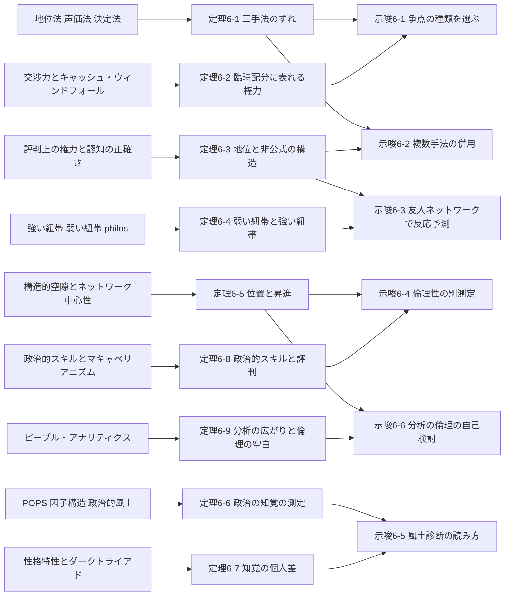

# 第6章 社内政治を分析する — 定義・定理・示唆

## この章の問い

社内の権力、社会ネットワーク、政治的風土、政治的スキルは、どう測れるのか。測った結果から何が言えるのか。本の本文は読んでいないので、下の目次の見出しを論点の枠として使い、論文の本文で答えます。

目次の見出し:

- 第1節 変革時の政治的反応の予測: ポジション分析 / 評判分析 / 意思決定分析
- 第2節 派閥やコネを分析する: ネットワーク分析 / 今からできるネットワーク分析 / 強い紐帯と弱い紐帯 / 構造的空隙
- 第3節 社内の政治的風土を分析する: 組織内政治の知覚の診断 / 政治的風土の診断 / 政治の原因分析
- 第4節 「政治的リーダー」の発掘: タレント・アセスメント / タレント・アナリティクス / 倫理性のアセスメント

注記: 第1節の 3 つの分析（ポジション分析・評判分析・意思決定分析）が、地域権力構造研究の 3 手法（地位法・声価法・決定法、1.3 で定義）を指すかどうかは、本の本文で確認できていない（未確認）。本ファイルでは、見出しとの対応を仮定せず、この 3 手法そのものを定義・定理の対象とする。

## 1. 定義

### 1.1 研究方法と統計の用語

- **事例研究**: 1 つの組織や地域など、少数の対象を詳しく調べる研究。[^d0]
- **横断研究と 2 時点調査**: 横断研究は 1 時点だけで測る研究。2 時点調査は同じ人を時間をおいて 2 回測る研究（縦断研究の一種）。[^d0]
- **自己報告と他者評定**: 自己報告は本人が質問紙で自分や職場について答える測り方。他者評定は同僚・上司・部下など本人以外が評定する測り方。[^d0]
- **共通方法バイアス**: 同じ人が同じ時に同じ方法で答えたために、変数どうしの関係が見かけ上強く出ること。[^d0]
- **代理指標（proxy）**: 直接測れない性質の代わりに使う、関係があると考えられる別の測定値。[^d0]
- **相関係数（r）**: 2 つの量が一緒に増減する程度を −1〜1 で表す値。[^d0]
- **回帰分析と標準化係数（β）**: 回帰分析は、ある変数（目的変数）を他の変数で説明・予測する分析。β は各変数の効きの強さを、単位をそろえて表した値。[^d0]
- **説明率（R²）と追加の説明率（ΔR²）**: R² は目的変数のばらつき（分散）のうち、モデルで説明できた割合。ΔR² は、変数を追加したときに増えた R²。[^d0]
- **階層的回帰**: 統制したい変数を先に入れ、関心のある変数を後から段階的に加えて、ΔR² を見る回帰分析。[^d1]
- **統計的に有意（p 値）**: 結果が偶然だけで出たとは考えにくいこと。p 値が小さい（例: p < .05）ほどその判断が強い。[^d0]
- **調整と交互作用**: A と C の関係の強さが第 3 の変数 B の値によって変わること（調整）。統計的には A と B の掛け合わせ（交互作用）の効果として調べる。[^d0]
- **媒介**: A が B を通じて C に影響すること。B を媒介変数という。[^d0]
- **t 検定と中央値分割**: 中央値分割は、得点の中央値で人を高群と低群に分けること。t 検定は 2 群の平均の差が統計的に有意かを調べる方法。[^d2]
- **信頼性係数（クロンバックの α）**: 複数の項目や評定者の回答がどれだけ一致しているかを 0〜1 で表す値。高いほど一致している。[^d1]
- **因子分析（探索的・確認的）**: 多くの項目への回答の背後にある少数の共通の要因（因子）を取り出す分析。探索的因子分析は因子の数とまとまりをデータから探す。確認的因子分析は、あらかじめ決めた因子のまとまりがデータに合うかを確かめる。[^d0]
- **因子構造**: ある尺度の項目が、いくつの因子に、どの組み合わせでまとまるかという形。尺度の作者が想定した因子構造が、別の標本でも再現されるかが尺度の妥当性の手がかりになる。[^d3]
- **適合度指標（CFI・RMSEA）**: 確認的因子分析などで、モデルがデータに合う程度を示す値。CFI は 1 に近いほど、RMSEA は 0 に近いほど適合が良い。Çınar Altıntaş は基準として RMSEA < .05、CFI > .90 を挙げる。[^d4]
- **構造方程式モデリング（SEM）**: 因子分析と回帰分析を組み合わせ、複数の変数の間の関係を同時に推定する方法。PLS-SEM はその一種。[^d0]
- **マルチレベル分析**: 上司ごと・職場ごとのように、データが階層になっていることを考慮する分析。[^d0]
- **一致度指標（rWG(J)）**: 同じ集団に属する人どうしの回答がどれだけ一致しているかを示す値。高い一致は、知覚が集団で「共有されている」ことの根拠になる。[^d5]
- **AUC**: 2 群（例: 昇進した人としなかった人）から 1 人ずつ無作為に選んだとき、ある指標の値が前者で高い確率。0.5 なら関係なし、0.5 を超えるほど関係が強い。[^d6]
- **パネル分析**: 同じ対象（例: 事業単位）を、時間を追って繰り返し観測したデータの分析。[^d0]
- **混合法**: 数値のデータと言葉のデータ（文書など）を組み合わせて調べる方法。[^d0]
- **対照群**: 比べるために置く、条件の異なる人の集まり。[^d0]
- **スコーピング・レビュー**: ある分野の文献や情報源を広く集め、何が・どこまで研究されているかの地図を作るレビュー。効果の大きさを統計的にまとめるものではない。[^d0]
- **査読前原稿（プレプリント）**: 学術誌の査読を経る前に公開された論文原稿。[^d0]

### 1.2 権力と社内の地位に関する用語

- **権力（power）**: 人が他の人を、自分や物事に関して行動させる能力。個人の属性というより、人と人の関係の体系として見る。[^d7]
- **公式の地位（formal position）**: 組織図や役職で決まる上下の位置。[^d8]
- **本社と部門長（headquarters / Division CEO）**: 本社は企業全体の資金配分を決める中枢。部門長は、複数の事業単位を束ねる部門（division）の長。[^d9]
- **事業単位（business unit）**: 部門の下にある、投資や業績を個別に管理される事業のまとまり。[^d9]
- **交渉力（bargaining power）**: 部門長が本社の最高経営者に対して持つ影響力。Glaser らは、社内の在職年数、工学系の学位、本社所在国の国籍という 3 つの代理指標で測った。[^d10]
- **事前の資本配分計画**: 企業が年次の計画で、事業単位ごとの設備投資などをあらかじめ決めた配分。[^d11]
- **キャッシュ・ウィンドフォール（cash windfall）**: 本社が他社の持ち株を売って得た、計画に含まれない予期しない資金。Glaser らの企業には、この資金を配分する制度化された手続きがなかった。[^d12]

### 1.3 権力を持つ人を特定する 3 手法

- **争点（issue）**: 地域や組織で、決定が求められる具体的な問題。決定法の出発点になる。[^d13]
- **地位法（positional method）**: 公式の地位にある人を権力を持つ人とみなす方法。関連する領域を決め、各領域で権力が行使される地位を特定し、ある領域の上位者が他の領域でも上位にいるかを調べる。地位を持たずに決定を左右する人は取り出せない。[^d14]
- **声価法（reputational method）**: 権力は表に出ず直接測りにくいと仮定し、「誰が影響力を持つか」を人々に指名させ、その評判で権力を持つ人を特定する方法。[^d15]
- **決定法（decision-making method）**: 実際の争点をいくつか選び、その決定過程に参加し結果を左右した人を権力を持つ人とする方法。少数の決定に限られやすい。[^d16]
- **制度領域と評判上の指導者**: 制度領域は、Angeles が地位法で調べた地域社会の分野（政府、企業、教育、社会・市民・宗教の団体）。評判上の指導者は、声価法で一定数以上の指名を受けた人。[^d56]
- **評判上の権力（reputational power）**: 組織の成員が互いを「どれだけ影響力があるか」で評定した値。Krackhardt は、物事を成し遂げる力（potency）と人を引きつける力（charisma）の 2 つの評定を合成した。[^d17]

### 1.4 社会ネットワークに関する用語

- **社会ネットワークと紐帯（tie）**: 社会ネットワークは、人（点）と人どうしの関係（線）の集まり。その線 1 本 1 本を紐帯という。[^d0]
- **ネットワーク分析（社内）**: 従業員への質問紙で「誰と仕事の話をするか」「誰を信頼するか」「誰に技術的な助言を求めるか」を集め、双方が認めた関係だけを残して地図にする方法。[^d18]
- **助言ネットワーク・信頼ネットワーク・コミュニケーション・ネットワーク**: 助言ネットワークは、問題解決や技術情報で誰が誰に頼るかの関係。信頼ネットワークは、微妙な政治的情報を共有し、互いを支え合う関係。コミュニケーション・ネットワークは、仕事の話を日常的にする関係。[^d19]
- **友人ネットワーク**: 日常業務とは必ずしも結びつかない、感情的・社会的な結びつきの関係。変化の時期の信頼に影響しうる。[^d20]
- **業務ネットワークと社交ネットワーク**: Yuan らの用語。業務ネットワークは、社内プラットフォーム上で同僚の業務ファイルや業務ブログに反応・ダウンロードした記録の関係。社交ネットワークは、同じプラットフォーム上のフォロー関係。[^d21]
- **ネットワーク中心性（centrality）**: ネットワークの中で、ある人がどれだけ「中心」にいるかを表す指標の総称。代表的なものに次数中心性・近接中心性・媒介中心性がある。[^d22]
- **次数（入次数・出次数）**: 次数はある人につながる線の数。向きのある関係では、自分に向かう線の数を入次数、自分から出る線の数を出次数という。[^d23]
- **媒介中心性（betweenness centrality）**: ある人が、他の 2 人を結ぶ最短経路の上にどれだけ乗っているか。高い人は、ネットワークの一部から他の部分への情報の流れを止めたり選んだりできる。[^d24]
- **k-shell 指標**: 全員が k 本以上の線を持つ最大の部分ネットワークにその人が属する、最大の k。高いほどネットワークの中核にいる。[^d23]
- **ネットワークの認知の正確さ（cognitive accuracy）**: 本人が思い描く「誰が誰とつながっているか」の図が、基準となる実際のネットワークにどれだけ近いか。[^d25]
- **紐帯の強さ（tie strength）**: 一緒に過ごす時間、感情の強さ、親密さ（打ち明け合い）、互いの手助けの組み合わせ。[^d26]
- **強い紐帯・弱い紐帯（strong ties / weak ties）**: 紐帯の強さが高い関係を強い紐帯、低い関係を弱い紐帯という。Granovetter の転職調査では、接触の頻度を強さの目安とした。[^d27]
- **philos（強い紐帯の一種）**: Krackhardt が定めた関係で、①相互作用がある、②好意がある、③長い付き合いの時間がある、の 3 条件を満たすもの。これらが信頼の材料になる。Granovetter の強い紐帯にあたる。[^d28]
- **ブリッジ・局所ブリッジ（bridge / local bridge）**: ブリッジは、2 点を結ぶ唯一の経路となる線。局所ブリッジは、唯一ではないが他の経路よりずっと短い経路となる線。[^d29]
- **構造的空隙（structural hole）**: 人は自分の集団の中の活動に集中するため、集団と集団の間の情報の流れに生じる「すき間」。意見や行動は集団の間より集団の中で似通う。[^d30]
- **仲介（brokerage）とブローカー**: 構造的空隙をまたいで、異なる集団の人とつながること。そうする人をブローカーと呼ぶ。ブローカーは多様な情報に早く触れ、集団の間で情報を翻訳できる。[^d31]
- **ネットワーク制約（network constraint）**: 本人の話し相手どうしが互いに直接よく話す（密な）か、1 人の中心人物を通じてつながる（階層的な）ほど高くなる指標。高いほど構造的空隙をまたいでいない。[^d32]
- **組合の認証選挙**: 米国で、従業員が労働組合を交渉の代表として認めるかを決める選挙。Krackhardt 1992 の事例の対象。[^d33]

### 1.5 組織政治と政治的風土に関する用語

- **組織政治（organizational politics）**: 組織や他者の利益を顧みず、自分の利益を進めようとする個人の行動。[^d34]
- **組織政治の知覚（POPs, perceptions of organizational politics）**: 職場でそうした自己利益の行動がどの程度起きているかについての、本人の主観的な評価。見る人によって変わりうる。[^d35]
- **POPS（Perceptions of Organizational Politics Scale）**: Kacmar と Ferris（1991）が作った POPs の尺度。最初の版は 31 項目・5 次元で、Nye & Witt が分析した版は 12 項目・3 下位尺度（「一般的な政治的行動」「波風を立てずに出世」「昇給・昇進」）である。[^d36]
- **下位尺度**: 1 つの尺度の中の、特定の次元を測る項目のまとまり。[^d0]
- **改訂版 POPS（短縮版）**: Kacmar と Carlson（1997）による POPS の改訂版。「一般的な政治的行動」「波風を立てずに出世」「昇給・昇進」の 3 次元。項目数の記述は資料で異なる（Çınar Altıntaş は 13 項目、Stergiopoulou は 12 項目と記述）。[^d37]
- **政治的風土（political climate）**: 組織の政治を、個人の体験ではなく、職場で共有された知覚として捉える見方。Landells & Albrecht の尺度は「関係の構築と利用」「個人の評判の構築」「意思決定と資源の支配」「意思決定への影響」「伝達経路の利用（うわさ等）」の 5 次元から始め、最終的に関係・伝達・評判・決定・資源の 5 因子各 3 項目にまとめた。[^d38]
- **組織的支援の知覚（SPOS で測るもの）**: 組織が自分の幸福を気にかけ、努力を評価していると従業員が感じる程度。SPOS はその尺度。[^d39]
- **職務満足**: 自分の仕事に満足している程度。[^d0]
- **意思決定への参加（PDM）**: 部下が自分に関わる決定に、選択や発言の形で関与する程度。[^d40]
- **一般職員・監督者・管理職と目標の一致度**: Witt & Nye の用語。一般職員は監督の役割を持たない職員、監督者・管理職はその上の層。目標の一致度は、組織の目標の重要度についての評定が、本人と上の層（または同僚）でどれだけ一致するか。[^d41]
- **ストレス・エンゲージメント・仕事の有意味感**: ストレスは仕事による心身の負担（厳密には strain）。エンゲージメントは、活力・献身・没頭を特徴とする、仕事への前向きで充実した心理状態。仕事の有意味感は、自分の仕事が価値ある目的に役立っていると感じる程度。[^d42]
- **POPs の先行要因**: POPs を高めると考えられる要因。Lee の整理（Ferris らのモデルによる）では、組織要因（集権化・公式化・階層上の位置・統制範囲）、職務・環境要因、個人要因に分かれる。集権化は権力と統制が上層に集まる程度、公式化は規則や手続きが明文化されている程度。[^d43]

### 1.6 個人の特性に関する用語

- **性格特性とビッグファイブ**: 性格特性は、状況をこえて比較的安定した行動や感じ方の傾向。ビッグファイブは、外向性・協調性・誠実性・神経症傾向・開放性の 5 つで性格をとらえる枠組み。[^d44]
- **外向性**: 社交的で話好き、活動的な傾向。[^d44]
- **神経症傾向**: 怒り・不安・いらだちなどの否定的な感情を、さまざまな場面で経験しやすい傾向。[^d45]
- **誠実性と学習志向**: 誠実性は、信頼でき、計画的で、粘り強く、達成を目指す傾向（ビッグファイブの 1 つ）。学習志向は、新しい知識や技能を進んで身につけようとする傾向で、開放性に近い。[^d46]
- **セルフ・モニタリングと否定的感情傾向**: セルフ・モニタリングは、社会的な手がかりに敏感で、それに合わせて自分の振る舞いや見せ方を変える傾向。否定的感情傾向は、緊張・恐れなどの否定的な感情や自己像を持ちやすい、気分に関わる性格特性。[^d57]
- **マキャベリアニズム（Machiavellianism）**: 目的のためなら手段を選ばない傾向を持つ性格特性。他者を操って自分の思いどおりにしようとする傾向として測られる。[^d47]
- **ダークトライアド（Dark Triad）**: 3 つの好ましくない性格特性、サイコパシー・ナルシシズム・マキャベリアニズムの総称。サイコパシーは責任感や良心の呵責の欠如と衝動性、ナルシシズムは他者からの称賛を求め共感に欠ける傾向。[^d48]
- **政治的スキル（political skill）**: 職場で他者を効果的に理解し、その知識を使って、自分や組織の目的を高めるように他者を動かす能力。[^d49]
- **PSI（Political Skill Inventory）**: 政治的スキルの 18 項目の尺度。社会的洞察力・対人影響力・ネットワーク構築力・誠実さの見え方の 4 次元からなる。[^d50]
- **仕事上の評判と業績評価**: 仕事上の評判は、同僚がその人をどう見ているか。業績評価は、上司や同僚がその人の職務遂行を評定した値。[^d51]
- **専門職**: Blickle らの用語。高等教育を受けた人が就く、認知的・対人的に複雑な仕事（国際標準職業分類 ISCO-88 の大分類 2）。[^d52]
- **倫理的リーダーシップ（ethical leadership）と ELS**: 個人の行動と対人関係で規範的に適切な振る舞いを示し、双方向の対話・強化・意思決定を通じて部下にもそれを促すこと。ELS は部下がこれを評定する 10 項目の尺度で、変革型リーダーシップの「理想化された影響（行動）」を統制しても、上司の有効性などの結果を独自に予測した。[^d53]

### 1.7 人事データ分析に関する用語

- **ピープル・アナリティクス（PA, people analytics）**: 従業員の属性・行動・業績のデータを、情報システム・可視化・予測分析を使って、扱いやすく、解釈でき、行動に移せる形にすること。[^d54]
- **タレント・アナリティクス**: PA とほぼ同じ意味で使われる関連語の 1 つ（他に HR アナリティクス、ワークフォース・アナリティクスなど）。実際には研究者も提供企業もこれらの語を区別せずに使っている。[^d55]

## 2. 定理

### 定理 6-1: 地位法・声価法・決定法は、同じ地域でも同じ人々を権力を持つ人として取り出さず、重なりは部分的にとどまる。

- 内容: Angeles は 1 つの町で 3 手法を同時に使った。声価法で選ばれた 29 人のうち、3 つの争点の決定過程に関わったのは 44.82% で、彼らは決定の参加者 48 人の 29% にすぎず、残り 71% は評判のリストにいない人だった。[^t6-1-1a] 地位法では、評判上の指導者は 4 つの制度領域に散らばるが、すべての領域を支配してはおらず、役職者の名簿からは評判のリストにない名前も出た。[^t6-1-1b] 著者は、3 手法はそれぞれ別の「指導者」の考え方を取り出すと結論した。[^t6-1-1c]
- 研究の種類と対象: 事例研究。フィリピン Rizal 州 Morong 町で、一般市民 282 人中 276 人の回答による声価法、組織・役職者の名簿による地位法、3 争点の参加者の追跡による決定法を併用した。[^t6-1-1d]
- 条件・限界: 1 つの小さな町の事例で、声価法は事情通ではなく一般市民に指名させる変形版である。著者は、争いが表に出ず有力者の調停で処理される地域では、決定法の適用自体が疑わしいと述べる。[^t6-1-1c] 企業組織への一般化は確かめられていない。

### 定理 6-2: 大企業の中では、部門長の交渉力は事前の資本配分計画には表れず、計画外のキャッシュ・ウィンドフォールの配分に表れる。

- 内容: Glaser らは、欧州の大企業 1 社の内部の計画データと実績データを使った。事前の資本配分計画は交渉力でゆがんでいなかった。一方、交渉力の強い部門長ほど、キャッシュ・ウィンドフォールの多くを自分の事業単位の投資に回した。[^t6-2-1a] ウィンドフォールは平均的な事業単位の四半期投資率を 0.0089 から 0.0136 へ（53%）押し上げ、在職年数で交渉力を測ると、その増加は交渉力の強い部門長の事業単位で 0.0130 大きかった（ウィンドフォールのない四半期の平均投資率の 146% にあたる）。[^t6-2-1b] 交渉力の指標と将来の事業単位の業績には関係がなく、著者は指標が能力の代わりになっている可能性を退けた。[^t6-2-1b]
- 研究の種類と対象: 単一企業の内部データによるパネル分析。本社が欧州にある 5 部門・22 事業単位の企業で、対象期間中の部門長 13 人。[^t6-2-1c]
- 条件・限界: 1 社のデータである。交渉力は在職年数・学位・国籍という代理指標で、本人の影響力を直接測ってはいない。[^t6-2-1c]

### 定理 6-3: 小さな企業の中では、評判上の権力の評定は成員の間で強く一致し、その差は公式の地位で 4 割強、友人ネットワークの中心性と助言ネットワークの認知の正確さでさらに説明される。

- 内容: 36 人の企業で、評判上の権力の 2 つの評定の信頼性係数は α = .96 と .99 だった。階層的回帰で、公式の地位は評判上の権力の分散の 43% を説明した。助言・友人ネットワークの中心性を加えると 17% 増えたが、有意だったのは友人ネットワークの中心性だけだった。さらに認知の正確さを加えると 8.2% 増え、有意だったのは助言ネットワークの認知の正確さだけだった。[^t6-3-1a] 助言ネットワークの中心性は公式の地位と相関していた（r = .57）が、友人ネットワークの中心性は相関していなかった（r = .16）。[^t6-3-1b]
- 研究の種類と対象: 単一組織の横断研究。米国の情報システムの販売・設置を行う小企業 1 社（Silicon Systems と仮称）の 36 人（質問紙の回答 33 人）。[^t6-3-1c]
- 条件・限界: 横断研究で因果は言えない、と著者自身が述べる。[^t6-3-1d] 著者は、小さな会社では皆が互いをよく知るため構造上の有利さが出にくかった可能性を挙げる。また、日常業務の文脈での結果であり、危機では友人ネットワークの理解のほうが効くかもしれないとするが、推測にとどまると明記している。[^t6-3-1e]

### 定理 6-4: 新しい情報の伝達では弱い紐帯がブリッジの役を担うが、組織の大きな変化をめぐる影響力は、philos の上で決まる。

- 内容: Granovetter は、強い紐帯 2 本を持つ三者で残り 1 本が欠ける形は起こりにくいと仮定し、そこから強い紐帯はブリッジになりにくく、ブリッジはすべて弱い紐帯だと論じた。[^t6-4-1a] 転職者調査では、知人経由で職を得た人のうち、当時その知人と「よく」会っていたのは 16.7%、「時々」55.6%、「まれに」27.8% だった。[^t6-4-1b] 一方 Krackhardt 1992 は、定理 6-3 と同じ企業での組合の認証選挙を追った。助言ネットワークの中心者は友人ネットワークの中心者と一致しなかった。[^t6-4-1c] 組合は、友人ネットワークの周辺にいた熱心な支持者を代表に立て、選挙は 12 対 3 で組合が負けた。聞き取りでは、この失敗の大きな理由は影響力のない人を代表に選んだことだとされた。[^t6-4-1d]
- 研究の種類と対象: Granovetter は理論的命題と小規模調査（米国 Boston 郊外の専門職・技術職・管理職の転職者の無作為標本のうち、知人経由で職を得た N = 54）。Krackhardt 1992 は事例研究（36 人の企業）。[^t6-4-1b] [^t6-4-1e]
- 条件・限界: Granovetter のブリッジの命題は「強い三者の欠けた形は起きない」という仮定に依存し、転職データは接触頻度だけで強さを測った小標本である。[^t6-4-1a] Krackhardt 1992 は 1 社 1 事例で、影響の経路は聞き取りに基づく解釈である。著者は、変化が日常業務から外れ信頼を要するときに、友人の結びつきが鍵になると理論づけている。[^t6-4-1f]

### 定理 6-5: 社内ネットワークで中心にいる人、または構造的空隙をまたぐ人ほど、昇進・給与・評価で報われやすい。

- 内容: Burt は米国の大手電機メーカーのサプライチェーン管理職を調べ、話し合いのネットワークで構造的空隙をまたぐ人ほど、給与・評価・昇進・良いアイデアに恵まれていたと報告した。[^t6-5-1a] 給与と仲介の関係は職位が高いほど強かった。[^t6-5-1b] 改善のアイデア 455 件を出所を伏せて 2 人の上級管理職に評定させると、空隙をまたぐ人のアイデアほど価値が高く評定された。[^t6-5-1c] Yuan らは、中国の IT 企業 1 社の全従業員 104 人について業務ネットワークと社交ネットワークを作り、昇進した 12 人は入次数・出次数・k-shell 指標のいずれでも高い値を示すことを AUC で示した。業務ネットワークのほうが昇進と強く関係し、業務ネットワークの入次数が最も重要な指標だった。[^t6-5-2]
- 研究の種類と対象: Burt は単一企業の調査と人事記録による横断研究（管理職 673 人、ネットワーク設問の回答 455 人・68%）。[^t6-5-1d] Yuan らは単一企業の行動記録データの分析（2013 年末までの 104 人、退職 25 人・昇進 12 人）。[^t6-5-2]
- 条件・限界: どちらも 1 社の横断データで、位置が昇進を生むのか、昇進が位置を生むのかは区別できない。Burt は、関係は因果ではありえず、ネットワークは行動の文脈にすぎないと自ら述べる。[^t6-5-1e] Burt のアイデアの評定者は 2 人で、455 件の評定は負担が大きかったと注で認めている。[^t6-5-1c] Yuan らは査読前原稿で、昇進者は 12 人と少ない。[^t6-5-2]

### 定理 6-6: POPS で測った組織政治の知覚は、版や標本によって因子構造が揺れて 1 因子にもまとまり、組織的支援の知覚の裏返しに近く、職場で共有された政治的風土としての一致も確認されにくい。

- 内容: Nye & Witt は連邦政府職員 1,297 人で 12 項目の POPS を分析し、作者の 3 因子構造を再現できず 1 因子と判断した。POPS は SPOS と r = −.85 で、職務満足など他の態度との相関の大きさも SPOS とほぼ同じだった。[^t6-6-1a] [^t6-6-1b] Çınar Altıntaş は改訂版 POPS（13 項目）をトルコの従業員 199 人で調べた。探索的因子分析は 3 因子（説明率 54.9%）を出したが、第 3 因子の α は .574 だった。[^t6-6-2a] 2 項目を除くと、1 因子モデル（CFI = .992、RMSEA = .02）も 3 因子モデル（CFI = .988、RMSEA = .03）も適合した。[^t6-6-2b] Erol は 31 項目版をトルコの大学教員 277 人で調べ、作者の 5 次元ではなく 3 因子・21 項目の構造（CFI = .95、RMSEA = .050）を得た。[^t6-6-3] Witt 1992 では POPs は職務満足と r = −.62 で、PDM の多い人では POPs が高くても職務満足が保たれた。[^t6-6-4] Landells & Albrecht は 5 次元の新尺度で、組織政治の知覚がストレスを直接高め、ストレスと仕事の有意味感を通じてエンゲージメントを間接に下げることを示した。[^t6-6-5a] しかし大きな政府機関の標本では、rWG(J) が 0.44〜0.62 で、政治的風土として共有されているとは言えなかった。[^t6-6-5b]
- 研究の種類と対象: いずれも横断研究の自己報告。米国連邦航空局（FAA）職員 1,297 人と 1,083 人、トルコの複数業種の従業員 199 人、トルコの大学の教育学部の教員 277 人、オーストラリアの 2 標本（N = 303 と、政府機関の N = 353）。[^t6-6-1a] [^t6-6-2c] [^t6-6-3] [^t6-6-4] [^t6-6-5c]
- 条件・限界: Landells & Albrecht は 1 時点の自己報告で共通方法バイアスの可能性を認める。[^t6-6-5d] トルコの 2 研究は翻訳版で、適合は項目の削除や誤差の相関の追加の後に得られた。Çınar Altıntaş 自身、標準的な道具として使うには改良が必要だと述べる。[^t6-6-2d]

### 定理 6-7: 組織政治の知覚の高さは、本人の性格特性（マキャベリアニズム・ダークトライアド・外向性の低さ・神経症傾向）や、上の層との目標の一致度によって一部説明される。

- 内容: Lee は米国ハワイの 5 組織の従業員で、中央値分割したマキャベリアニズムの高群が低群より POPs が高いことを示した（平均 89.96 対 81.32、t(81) = 2.30、p < .05）。セルフ・モニタリングと否定的感情傾向では差がなかった。[^t6-7-1] Baloch らは中国のホテル業の従業員 149 人で、サイコパシー（β = 0.29）、ナルシシズム（β = 0.32）、マキャベリアニズム（β = 0.27）がそれぞれ POPS の得点を予測することを示した。[^t6-7-2a] Stergiopoulou はギリシャの大手銀行 2 行の従業員で、外向性が低いほど（β = −.23）、神経症傾向が高いほど（β = .18）POPs が高く、性格特性で説明率が 10% まで増えたと報告した。[^t6-7-3a] Witt & Nye は FAA の職員で、一般職員と監督者の目標の一致度が POPs の分散を ΔR² = .048 説明すると報告した（仮説は、一致が高いほど POPs が低いというもの）。[^t6-7-4a]
- 研究の種類と対象: Lee は修士論文の横断研究（Honolulu の 5 組織、83 人）。[^t6-7-1] Baloch らは横断研究の自己報告と PLS-SEM（149 人）。[^t6-7-2b] Stergiopoulou は博士論文の 2 時点調査の第 1 時点（ギリシャの大手銀行 2 行、分析 N = 236）。[^t6-7-3b] Witt & Nye は横断研究（FAA の一般職員 849 人・監督者 103 人・管理職 39 人）。[^t6-7-4b]
- 条件・限界: いずれも性格特性と POPs を同じ時点で測っており、因果の向きは確定しない。Lee は小標本・中央値分割である。Baloch らはダークトライアドを短縮版で測り、POPS は「一般的な政治的行動」の 6 項目だけを使った。[^t6-7-2b] Witt & Nye は横断データで共通方法バイアスの可能性を認める。[^t6-7-4b] 集権化・公式化などの組織要因の効果は、読んだ資料では検証されていない。

### 定理 6-8: 同僚の評定した政治的スキルが高い人では、マキャベリアニズムの高さが仕事上の評判と業績評価の低下につながらず、政治的スキルが業績に効くのは専門職のように認知的・対人的に複雑な仕事の場合である。

- 内容: Kückelhaus らは、本人がマキャベリアニズムを自己報告し、同僚が政治的スキル・仕事上の評判・業績を評定したデータを使った。政治的スキルが低い人では、マキャベリアニズムが高いほど評判が下がり、それが業績評価の低下につながった。政治的スキルが高い人ではこの不利益がなかった。[^t6-8-1a] 交互作用は β = 0.08 で、評判と業績評価の関係は β = 0.69 だった。[^t6-8-1b] Blickle らは、専門職では誠実性・学習志向・政治的スキル（自己報告）の 3 つがそろう人ほど上司の業績評価が高いことを示した。同じ交互作用は、非専門職の対照群では見られなかった。[^t6-8-2a]
- 研究の種類と対象: Kückelhaus らは他者評定を含む横断研究（対象者 550 人、同僚の評定 1,127 件）。[^t6-8-1c] Blickle らは上司と部下の組を使ったマルチレベル分析（ドイツ西部の専門職 196 組、非専門職 96 人の対照群）。[^t6-8-2b]
- 条件・限界: どちらも横断研究である。Kückelhaus らの交互作用の ΔR² は約 1% と小さく、著者は政治的スキルが悪い振る舞いを覆い隠す働きもしうると述べる。[^t6-8-1b] [^t6-8-1d] Blickle らの 3 つの交互作用の ΔR² は 2% である。[^t6-8-2c] 倫理性そのものを測った研究ではない。

### 定理 6-9: ピープル・アナリティクスは人事のさまざまな目的に使われ、従業員どうしの関係やネットワークの分析へ広がっているが、約束される便益の証拠は乏しく、倫理の検討はほとんどない。

- 内容: Tursunbayeva らの調べた学術論文では、業績評価や定着など既存の 7 つの目的に加え、従業員の協働・多様性・人的リスク・組織間関係の 4 分類が現れた。重心は個人から集団の相互作用やネットワークのデータへ移っていた。[^t6-9-1a] 提供企業の示す解決策と学術論文を突き合わせると、約束された便益の証拠はほとんど見つからなかった。[^t6-9-1b] 私的な SNS やメールの監視、採用や昇進でのアルゴリズムによる判断、実データからの人物像の推定といった倫理上の問題は、調べた資料ではほぼ扱われていなかった。[^t6-9-1c]
- 研究の種類と対象: スコーピング・レビュー（混合法）。2002 年以降の学術論文（Scopus で 58 本）、Google の検索動向、提供企業のウェブサイト、オンライン講座。[^t6-9-1d]
- 条件・限界: 資料の地図であり、効果の大きさを評価したレビューではない。2017 年ごろまでの資料に基づく。[^t6-9-1d]

## 3. 示唆

示唆は論文の主張ではなく、上の定理を組み合わせた導出である。

### 示唆 6-1: 決定法で社内の権力を測るなら、手続きが制度化された定例の決定より、裁量の余地がある臨時の配分を争点に選ぶほうが、権力の差が見えやすい。

- 組み合わせ: 定理 6-1 + 定理 6-2
- 導出: 定理 6-1 では、決定法が取り出す人々は評判上の指導者と部分的にしか重ならず、どの争点を選ぶかに結果が左右された。定理 6-2 では、同じ企業の中でも、事前の資本配分計画には交渉力が表れず、キャッシュ・ウィンドフォールの配分には表れた。よって、決定から権力を読むときは、選ぶ決定の種類によって「差がない」という結論にも「差がある」という結論にもなりうる。
- 追加の前提: 欧州の 1 社で見られた計画配分と臨時配分の違いが、他の組織の他の決定（人事・予算）にも当てはまること。

### 示唆 6-2: 社内の権力を持つ人を特定するときは、公式の地位・評判上の権力・決定への関与・ネットワーク中心性を重ねて使い、ずれた部分を調べる必要がある。

- 組み合わせ: 定理 6-1 + 定理 6-3
- 導出: 定理 6-1 では、3 手法の取り出す人々は部分的にしか重ならなかった。定理 6-3 では、企業の中でも公式の地位が説明するのは評判上の権力の 4 割強で、残りは友人ネットワークの中心性や助言ネットワークの認知の正確さに分かれていた。よって、どれか 1 つの方法だけでは、影響力を持つ人の一部を見落とす。
- 追加の前提: 地域社会で見られた手法間のずれが、企業組織でも同じように起こること。

### 示唆 6-3: 変革への政治的反応を予測するには、助言ネットワークより、友人ネットワーク（philos）の中心にいる人を把握するほうが役に立つ可能性が高い。

- 組み合わせ: 定理 6-3 + 定理 6-4
- 導出: 定理 6-3 では、助言ネットワークの中心性は公式の地位と重なり、評判上の権力を独自に説明したのは友人ネットワークの中心性だった。定理 6-4 では、組合の認証選挙という大きな変化をめぐる影響は philos の上で決まり、助言の中心者と友人の中心者は別人だった。したがって、変化の時期に誰が周囲の態度を動かすかは、組織図や助言関係だけでは読めない。
- 追加の前提: 予定している変革が、定理 6-4 の事例と同じく日常業務から外れ、信頼を要する変化であること。根拠が同じ 36 人企業の 2 本に偏っており、大きな組織でも成り立つこと。

### 示唆 6-4: 「政治的リーダー」の候補を、ネットワーク上の位置や政治的スキルの高さだけで選ぶと倫理面の問題を見逃しうるので、倫理的リーダーシップを別に測る必要がある。

- 組み合わせ: 定理 6-5 + 定理 6-8
- 導出: 定理 6-5 では、中心にいる人や構造的空隙をまたぐ人は昇進・給与・評価で報われていた。定理 6-8 では、政治的スキルが高いと、マキャベリアニズムの高さが仕事上の評判や業績評価に表れなかった。つまり、ネットワーク上の位置や他者評定の高さは、本人の動機の良し悪しを区別しない。
- 追加の前提: 中心的な位置や仲介の位置は、組織のためにも自己利益のためにも使えること（定理には含まれない）。部下の評定する ELS（1.6 の定義を参照）が、この区別に使えること。

### 示唆 6-5: 政治的風土の診断では、組織全体の POPS の平均点を「政治の多さ」と読まず、回答者の性格特性や組織的支援の知覚との重なり、部署ごとの差を確かめる必要がある。

- 組み合わせ: 定理 6-6 + 定理 6-7
- 導出: 定理 6-6 では、POPS の得点は因子構造が安定せず、組織的支援の知覚の裏返しに近く、組織の中で一致しにくかった。定理 6-7 では、同じ職場でもマキャベリアニズムや神経症傾向が高い人ほど政治を多く知覚していた。よって、知覚の得点の差には、職場の実態の差だけでなく、誰が回答したかの差が混ざる。下位尺度ごとに原因を読み分ける前に、その尺度の因子構造を自組織のデータで確かめる必要もある。
- 追加の前提: 診断の対象となる組織でも、性格特性と POPs の関係が読んだ研究と同じ程度にあること。

### 示唆 6-6: ネットワーク指標を使ったタレント・アナリティクスは、昇進しやすい人の可視化には使えうるが、監視とアルゴリズムによる昇進判断の倫理を、導入する側が自ら検討する必要がある。

- 組み合わせ: 定理 6-5 + 定理 6-9
- 導出: 定理 6-5 では、社内プラットフォームの記録から作った業務ネットワークの入次数が、昇進と最も強く結びついていた。定理 6-9 では、ピープル・アナリティクスは関係やネットワークの分析へ広がる一方、監視や昇進判断の倫理はほとんど検討されていなかった。よって、行動記録から影響力のある人を割り出す仕組みは技術的には作れても、その使い方の歯止めは提供する側からは期待しにくい。
- 追加の前提: 業務記録から作ったネットワーク指標が、他の組織でも昇進と同じように結びつくこと。

## 4. 扱えなかった論点

- 組織構造・職務の要因（集権化、公式化、フィードバック、昇進機会、自律性）が組織政治の知覚を高めるかの実証: 本文を読める資料が見つからなかった。

## 参考文献

| 番号 | 文献（著者, 年, タイトル, 誌名・巻号） | 本文の入手先 URL | ライセンス |
|---|---|---|---|
| 1 | Angeles, V. S. M. (1973). The search for community leadership in Morong, Rizal. Asian Studies, 11(1), 165–176. | <https://asj.upd.edu.ph/mediabox/archive/ASJ-11-01-1973/angeles-in%20search%20of%20leadership%20in%20morong%20rizal.pdf> | 不明 |
| 2 | Glaser, M., Lopez-de-Silanes, F., & Sautner, Z. (2008). Looking inside a conglomerate: Efficiency of internal capital allocation and managerial power within a firm. University of Mannheim discussion paper. | <https://ub-madoc.bib.uni-mannheim.de/2313/1/dp08_24.pdf> | 著者稿（著作権は出版社など） |
| 3 | Krackhardt, D. (1990). Assessing the political landscape: Structure, cognition, and power in organizations. Administrative Science Quarterly, 35(2), 342–369. | <https://www.andrew.cmu.edu/user/krack/documents/pubs/1990/1990%20Assessing%20the%20Political%20Landscape.pdf> | 著者稿（著作権は出版社など） |
| 4 | Granovetter, M. S. (1973). The strength of weak ties. American Journal of Sociology, 78(6), 1360–1380. | <https://www.cs.umd.edu/~golbeck/INST633o/granovetterTies.pdf> | 不明 |
| 5 | Krackhardt, D. (1992). The strength of strong ties: The importance of philos in organizations. In N. Nohria & R. G. Eccles (Eds.), Networks and Organizations (Ch. 8, pp. 216–239). | <https://www.andrew.cmu.edu/user/krack/documents/pubs/1992/1992%20The%20Strength%20of%20Strong%20Ties.pdf> | 著者稿（著作権は出版社など） |
| 6 | Krackhardt, D., & Hanson, J. R. (1993). Informal networks: The company behind the chart. Harvard Business Review, 71(4), 104–111. | <https://www.andrew.cmu.edu/user/krack/documents/pubs/1993/1993%20Informal%20Networks.pdf> | 著者稿（著作権は出版社など） |
| 7 | Burt, R. S. (2004). Structural holes and good ideas. American Journal of Sociology, 110(2), 349–399. | <https://snap.stanford.edu/class/cs224w-readings/Burt04StructureHole.pdf> | 不明 |
| 8 | Yuan, J., Zhang, Q.-M., Gao, J., Zhang, L., Wan, X.-S., Yu, X.-J., & Zhou, T. (2015). Promotion and resignation in employee networks. arXiv:1502.04184v2. | <https://arxiv.org/abs/1502.04184> | 著者稿（著作権は出版社など） |
| 9 | Nye, L. G., & Witt, L. A. (1992). Dimensionality and construct validity of the Perceptions of Organizational Politics Scale (POPS). FAA Office of Aviation Medicine, DOT/FAA/AM-92/10. | <https://www.faa.gov/sites/faa.gov/files/data_research/research/med_humanfacs/oamtechreports/AM92-10.pdf> | 公的報告書（パブリックドメイン） |
| 10 | Witt, L. A. (1992). Organizational politics, participation in decision-making, and job satisfaction. FAA Office of Aviation Medicine, DOT/FAA/AM-92/17. | <https://www.faa.gov/sites/faa.gov/files/data_research/research/med_humanfacs/oamtechreports/AM92-17.pdf> | 公的報告書（パブリックドメイン） |
| 11 | Witt, L. A., & Nye, L. G. (1992). Organizational goal congruence and job attitudes revisited. FAA Office of Aviation Medicine, DOT/FAA/AM-92/8. | <https://www.faa.gov/sites/faa.gov/files/data_research/research/med_humanfacs/oamtechreports/AM92-08.pdf> | 公的報告書（パブリックドメイン） |
| 12 | Çınar Altıntaş, F. (2017). A pilot study on validity of Turkish version of Organizational Politics Scale. İşletme Araştırmaları Dergisi, 9(2), 1–13. | <https://www.isarder.org/index.php/isarder/article/view/397> | 不明 |
| 13 | Erol, E. (2015). Perceptions of Organizational Politics Scale (POPS) questionnaire into Turkish: A validity and reliability study. International Journal of Assessment Tools in Education, 2(1), 58–78. | <https://dergipark.org.tr/en/download/article-file/208029> | 不明 |
| 14 | Landells, E. M., & Albrecht, S. L. (2019). Perceived organizational politics, engagement, and stress: The mediating influence of meaningful work. Frontiers in Psychology, 10, 1612. | <https://www.frontiersin.org/articles/10.3389/fpsyg.2019.01612/full> | CC BY |
| 15 | Lee, H. (1998). Machiavellianism, self-monitoring, and negative affectivity as predictors of organizational politics. Master's thesis, Emporia State University. | <https://dspacep01.emporia.edu/bitstream/handle/123456789/1406/Lee%201998.pdf?sequence=1> | 不明 |
| 16 | Baloch, M. A., Meng, F., Xu, Z., Cepeda-Carrion, I., Danish, & Bari, M. W. (2017). Dark Triad, perceptions of organizational politics and counterproductive work behaviors: The moderating effect of political skills. Frontiers in Psychology, 8, 1972. | <https://pmc.ncbi.nlm.nih.gov/articles/PMC5682558/> | CC BY |
| 17 | Stergiopoulou, E. (2014). Examining a model of antecedents and consequences of perceptions of organizational politics (POPS). Doctoral thesis, Durham University. | <https://etheses.durham.ac.uk/id/eprint/10678/> | 著者稿（著作権は出版社など） |
| 18 | Blickle, G., Meurs, J. A., Wihler, A., Ewen, C., Plies, A., & Günther, S. (2012). The interactive effects of conscientiousness, openness to experience, and political skill on job performance in complex jobs: The importance of context. Journal of Organizational Behavior. | <https://www.psychologie.uni-bonn.de/de/institut/abteilungen/arbeits-organisations-und-wirtschaftspsychologie/uploads-fuer-die-allgemeine-i/forschung/job1843.pdf> | 著者稿（著作権は出版社など） |
| 19 | Kückelhaus, B. P., Meurs, J. A., & Blickle, G. (2024). Machiavellianism, political skill, reputation, and job performance. Personality and Individual Differences, 228, 112728. | <https://psychologie.uni-bonn.de/de/institut/abteilungen/arbeits-organisations-und-wirtschaftspsychologie/uploads-fuer-die-allgemeine-i/forschung/kueckelhaus-meurs-blickle-2024-paid.pdf> | CC BY-NC |
| 20 | Brown, M. E., Treviño, L. K., & Harrison, D. A. (2005). Ethical leadership: A social learning perspective for construct development and testing. Organizational Behavior and Human Decision Processes, 97, 117–134. | <https://eclass.uoa.gr/modules/document/file.php/PSYCH252/%CE%97%CE%B8%CE%B9%CE%BA%CE%AE%20%CE%97%CE%B3%CE%B5%CF%83%CE%AF%CE%B1%201.pdf> | 不明 |
| 21 | Tursunbayeva, A., Di Lauro, S., & Pagliari, C. (2018). People analytics—A scoping review of conceptual boundaries and value propositions. International Journal of Information Management, 43, 224–247. | <https://www.pure.ed.ac.uk/ws/files/75026826/Tursunbayeva_Pagliari_2018_People_analytics_A_scoping_review_of_conceptual_boundaries_and_value_propositions.pdf> | CC BY-NC（CC BY-NC-ND 4.0） |

注: 番号 3・5・6 は著者の大学サイトのスキャン PDF、番号 4・7・20 は大学講義サイト上の出版社版の複製、番号 8 は arXiv の非独占配布ライセンス、番号 17 は博士論文（著作権は著者）。番号 19 の論文名は PDF の題を短く示した。

## 脚注

[^d0]: 一般的な用法（筆者の説明）。
[^d1]: Krackhardt (1990), Assessing the political landscape, p. 354, Results の信頼性の段落（クロンバックの α の説明）と同頁の階層的回帰の段落。要旨: α は関心のある変数（ここでは評判上の権力）についての全体的な一致の指標だと説明し、Table 3 を階層的回帰の縮約式として示す。
[^d2]: Lee (1998), Machiavellianism, self-monitoring, and negative affectivity, 要旨（Abstract）第 2〜3 段落と p. 39, Table 1。要旨: 参加者を中央値分割で高群・低群に分け、独立した標本の t 検定で POPs の平均を比べたと述べる。
[^d3]: Nye & Witt (1992), AM-92/10, 序論 第 4 段落（尺度の妥当性を示すには 3 因子解の再現が必要だとする部分）。抜き出し: 「To support the validity of the instrument, it would be necessary to replicate the 3-factor solution」（パブリックドメイン）。
[^d4]: Çınar Altıntaş (2017), A pilot study on validity of Turkish version, p. 6, 3.3 節の適合度基準の段落。要旨: RMSEA は .05 未満、CFI と GFI は .90 超、χ²/df は 3.0 未満を基準とする、と述べる。
[^d5]: Landells & Albrecht (2019), Perceived organizational politics, Results「Measurement Models」第 5 段落。抜き出し: 「The rWG(J) statistics (James et al., 1993), ranging from 0.44 to 0.62, indicate only low to moderate levels of agreement for the politics subscales in the Sample 2 data. The results therefore do not clearly support the 'shared' organizational level perceptions of organizational politics.」（CC BY 4.0）。
[^d6]: Yuan et al. (2015), Promotion and resignation in employee networks, Section 3, 第 2〜3 段落（AUC の定義と解釈）。要旨: AUC は、無作為に選んだ昇進者が非昇進者より指標の値が高い確率と解釈でき、指標と昇進が無関係なら約 0.5 になる、と説明する。
[^d7]: Angeles (1973), The search for community leadership, p. 167, 最終段落（用語の定義の段落）。要旨: 権力を、人が他の人を自分や物事に関して行動させる能力と定め、関係の体系として見ると述べる。
[^d8]: Angeles (1973), The search for community leadership, p. 166, 第 3 段落（地位法の説明）。抜き出し: 「formal authority is equated with leadership」。
[^d9]: Glaser, Lopez-de-Silanes & Sautner (2008), Looking inside a conglomerate, Abstract と 4.2 節「The Measurement of Managerial Power」第 1 段落（p. 14）。要旨: 企業は 5 部門・22 事業単位からなり、部門長（Division CEO）が本社の最高経営者に対して持つ交渉力を扱う、と述べる。
[^d10]: Glaser, Lopez-de-Silanes & Sautner (2008), Looking inside a conglomerate, 4.2 節 第 1〜3 段落（pp. 14–15）。要旨: 部門長 13 人について、在職年数（影響力と社内の人脈の代理）、工学系の学位（工学の伝統が強い企業のため）、本社所在国の国籍の 3 つで交渉力を測ると述べる。
[^d11]: Glaser, Lopez-de-Silanes & Sautner (2008), Looking inside a conglomerate, 5 節 第 1 段落（p. 15）。要旨: 年次の資本配分計画は、企業が意図した事前の配分決定を示すと述べる。
[^d12]: Glaser, Lopez-de-Silanes & Sautner (2008), Looking inside a conglomerate, 序論 p. 5 第 1 段落と 4.1 節の最終段落（p. 14）。要旨: ウィンドフォールは他社の持ち株の売却で生じ、事前の配分計画には含まれない。企業にはこの資金の配分の制度化された手続きがない、と述べる。
[^d13]: Angeles (1973), The search for community leadership, p. 167, 第 2 段落。要旨: 決定法では、地域の争点・問題・決定の組を選び、それを出発点に決定過程の参加者を探すと述べる。
[^d14]: Angeles (1973), The search for community leadership, p. 166, 第 3 段落と p. 167, 第 1 段落。要旨: 地位法は、権力の関連領域を示し、権力が行使される地位を特定し、ある領域の上位者が他の領域でも上位かを確かめる。公式の地位のない影響力者は漏れ、通常は他の手法の結果を検証する補助として使う、と述べる。
[^d15]: Angeles (1973), The search for community leadership, p. 166, 第 1 段落。要旨: 声価法は権力が舞台裏で行使されると仮定し、地域の事情通による指名の連続で指導者としての評判を評価する、と述べる。
[^d16]: Angeles (1973), The search for community leadership, p. 167, 第 2 段落。要旨: 決定法は、決定過程への積極的な参加を指導性とみなし、結果を左右した人をさらに面接する。少数の決定に限られやすいが、潜在的でなく実際の権力者を取り出すと支持者は主張する、と述べる。
[^d17]: Krackhardt (1990), Assessing the political landscape, p. 348, Method の権力の評定の段落と p. 354, Results の信頼性の段落。要旨: 全員に全従業員の charisma と potency（物事を成し遂げる力）を評定させ、2 つの相関が .63 と高いため主成分分析で 1 つの「全体的な権力」に合成した、と述べる。
[^d18]: Krackhardt & Hanson (1993), Informal networks, p. 106, 第 2〜3 段落と p. 107, 第 2 段落。要旨: 第 1 段階は従業員への質問紙で、誰と仕事の話をし、誰を信頼し、誰に技術的な助言を求めるかを聞く。第 2 段階で回答を突き合わせ、双方が認めない回答は割り引く、と述べる。
[^d19]: Krackhardt & Hanson (1993), Informal networks, p. 105, 第 2 段落（3 つのネットワークの箇条書き）。抜き出し: 「share delicate political information and back one another」。
[^d20]: Krackhardt (1990), Assessing the political landscape, p. 345, 第 1 段落。要旨: 助言ネットワークは業務の流れに基づく道具的なネットワーク、友人ネットワークは日常業務とは必ずしも結びつかないが、特に変化の時期の信頼に影響する感情的・社会的な結びつきだと述べる。
[^d21]: Yuan et al. (2015), Promotion and resignation in employee networks, Section 2「Data Description」第 1 段落。要旨: 業務上の行為（業務ブログの転載・コメント、業務タスクの割り当て・報告、業務ファイルのダウンロード）から業務ネットワークを、ツイッターに似たフォロー関係から社交ネットワークを作った、と述べる。
[^d22]: Krackhardt (1990), Assessing the political landscape, p. 351, 「Centrality」第 1〜3 段落。要旨: 中心性の代表的な 3 指標は次数・近接・媒介で、次数中心性はつながりの数、近接中心性は他の全員への平均距離の逆数と定義する。
[^d23]: Yuan et al. (2015), Promotion and resignation in employee networks, Section 3, 第 1 段落。要旨: 入次数はノードに向かうリンクの数、出次数は出ていくリンクの数。k-shell 指標は、全ノードの次数が k 以上となる最大の部分グラフに属する最大の k で、高いほど中心にいる、と定義する。
[^d24]: Krackhardt (1990), Assessing the political landscape, p. 351 第 2 段落と p. 352 第 1 段落。抜き出し: 「can block or control communication」。
[^d25]: Krackhardt (1990), Assessing the political landscape, p. 344, 第 2 段落。要旨: 認知の正確さには、基準となる「実際の」ネットワークと、各人の認知上の表象の 2 つが要る。正確さとは、本人の認知地図が基準にどれだけ近いかだ、と述べる。
[^d26]: Granovetter (1973), The strength of weak ties, p. 1361, 「The Strength of Ties」第 1 段落。要旨: 紐帯の強さを、時間の量・感情の強さ・親密さ（打ち明け合い）・互いの手助けの（おそらく線形の）組み合わせと定義する。
[^d27]: Granovetter (1973), The strength of weak ties, p. 1371, 第 2〜3 段落と注 15。要旨: 転職者に、職の情報を得た当時その知人とどのくらい会っていたかを聞き、それを紐帯の強さの尺度とした。これは定義の 4 要素の 1 つにしか対応しない、と注で述べる。
[^d28]: Krackhardt (1992), The strength of strong ties, pp. 218–219, 「A Philos Relationship」の節。要旨: philos を、相互作用・好意・時間の 3 つの必要十分条件で定義し、それらが信頼の材料になる。philos は Granovetter のいう強い紐帯にあたると推論してよい、と述べる。
[^d29]: Granovetter (1973), The strength of weak ties, p. 1364, 第 2 段落と p. 1365, 第 1 段落（Fig. 2）。要旨: ブリッジを 2 点の間の唯一の経路となる線、局所ブリッジを他の最短経路の長さ n（n > 2）で表される線と定義し、局所ブリッジは n が大きいほど重要になる、と述べる。
[^d30]: Burt (2004), Structural holes and good ideas, p. 353, 第 1 段落。抜き出し: 「more homogeneous within than between groups」。
[^d31]: Burt (2004), Structural holes and good ideas, p. 354, 第 1 段落。要旨: 集団の間の構造的空隙をまたぐネットワークを持つ人は、多様な情報に早く触れ、集団をまたいで情報を翻訳する経験を持つ。これが仲介の社会関係資本だ、と述べる。
[^d32]: Burt (2004), Structural holes and good ideas, p. 362, 第 2 段落と注 6。要旨: ネットワーク制約は話し合いのネットワークの大きさ・密度・階層性で変わる指標で、相手どうしが直接よく話すか、中心的な人物を通じて情報を共有すると高い。制約が高いほど空隙をまたいでいない、と述べる。
[^d33]: Krackhardt (1992), The strength of strong ties, p. 225, 最終段落（組合の認証運動の事例の導入）と p. 227, 第 1 段落。要旨: 全米労働関係委員会（NLRB）が全国労組の申請を受けて Silicon Systems での認証選挙を認めたこと、運動の 2 か月間の経緯を記述する。
[^d34]: Landells & Albrecht (2019), Perceived organizational politics, 「Definitions and Measures of Organizational Politics」第 1 段落。抜き出し: 「Kacmar and Baron (1999) similarly argued that organizational politics "involves actions by individuals that are directed toward the goal of furthering their own self-interests without regard for the well-being of others or their organization" (p. 4).」（CC BY 4.0）。
[^d35]: Çınar Altıntaş (2017), A pilot study on validity of Turkish version, p. 2, 2 節 第 1 段落。要旨: 政治の知覚は、政治的な行動を促す組織の運用や上司・同僚が作る枠組みについての主観的な解釈で、見る人の目の中にあり、人によって変わりうる、と述べる。
[^d36]: Nye & Witt (1992), AM-92/10, 序論 第 1 段落と Method「Measures」第 1 段落。抜き出し: 「Organizational political behavior was measured by the POPS, which has 12 items with responses presented on a 5-point, Likert-type scale」（パブリックドメイン）。31 項目・5 次元の最初の版については Erol (2015), POPS questionnaire into Turkish, p. 59, Method「Data Collection Tool」の段落による（要旨: 31 項目・5 下位次元の尺度だと述べる）。
[^d37]: Çınar Altıntaş (2017), A pilot study on validity of Turkish version, p. 3, 2 節 最終段落と p. 4, 3.1 節 第 1 段落。要旨: Kacmar と Carlson（1997）は 3 標本で 3 次元・13 項目のモデルを妥当とし、本研究はその短縮版（一般的な政治的行動 6・波風を立てずに出世 5・昇給と昇進 2 項目）を翻訳して使った、と述べる。Stergiopoulou (2014), Examining a model of antecedents, p. 263, 最終段落。要旨: Kacmar と Carlson（1997）の 12 項目の尺度で、3 次元を測ったと述べる。
[^d38]: Landells & Albrecht (2019), Perceived organizational politics, 「Definitions and Measures of Organizational Politics」第 1 段落（最終文）と Results「Measurement Models」第 3 段落・Table 2。抜き出し: 「Consistent with most existing measures of organizational politics, the Landells and Albrecht (2016) measure is focused on employee perceptions of the organizational political climate as opposed to personal experiences of politics.」（CC BY 4.0）。
[^d39]: Nye & Witt (1992), AM-92/10, 序論 第 2 段落。抜き出し: 「Survey of Perceived Organizational Support (SPOS), which measures employees' perceptions of the degree to which an organization is concerned about the well-being of employees and appreciates their efforts.」（パブリックドメイン）。
[^d40]: Witt (1992), AM-92/17, 序論の PDM の節（p. 2, 第 1〜2 段落）。要旨: 部下が決めるか、上司が部下の発言を聞いて決めるかなど、選択（choice）と発言（voice）の組み合わせで PDM の水準を区別する、と述べる。
[^d41]: Witt & Nye (1992), AM-92/8, 序論 第 3〜4 段落と Method の目標の測定の段落（pp. 1–2）。抜き出し: 「The former reflects agreement on goals between members at different levels in the organizational hierarchy, and the latter reflects agreement between an individual and all others within a single constituency.」（パブリックドメイン）。
[^d42]: Landells & Albrecht (2019), Perceived organizational politics, 「Individual Stress」最終部、「Employee Engagement」第 1 段落、「Work Meaningfulness」第 1 段落。抜き出し: 「Engagement is often defined as a "positive, fulfilling, work-related state of mind that is characterized by vigor, dedication and absorption" (Schaufeli et al., 2002, p. 74).」（CC BY 4.0）。
[^d43]: Lee (1998), Machiavellianism, self-monitoring, and negative affectivity, p. 9 Figure 1 の説明と p. 10「Predictors of Organizational Politics」第 1〜2 段落。要旨: Ferris ら（1989）のモデルに基づき、組織要因は集権化・公式化・階層上の位置・統制範囲の 4 変数からなり、集権化は権力と統制が上層に集中する程度だと説明する。
[^d44]: Stergiopoulou (2014), Examining a model of antecedents, pp. 83–84, ビッグファイブの段落。要旨: 性格特性はより安定した行動パターンを示し、ビッグファイブは最も包括的で広く受け入れられた分類で、外向性は社交的・話好き・活動的・野心的な特性で表される、と述べる。
[^d45]: Stergiopoulou (2014), Examining a model of antecedents, p. 95, 神経症傾向の段落。抜き出し: 「the extent to which one experiences negative emotions」。
[^d46]: Blickle et al. (2012), The interactive effects of conscientiousness, 要旨（Summary）。要旨: 誠実性は先行研究で最も基準関連妥当性が高かった広い性格因子で、学習志向は開放性に近い狭い構成概念だと述べる。誠実性の特性語は Stergiopoulou (2014), p. 84, ビッグファイブの段落（信頼できる・計画的・粘り強い・達成志向）による。
[^d47]: Lee (1998), Machiavellianism, self-monitoring, and negative affectivity, p. 17, 第 1 段落。抜き出し: 「do anything to succeed」。測定の項目例は Baloch et al. (2017), Method「The dark triad」の段落による（「I tend to manipulate others to get my way」、CC BY 4.0）。
[^d48]: Baloch et al. (2017), Dark Triad, perceptions of organizational politics, 「The effect of the dark triad on counterproductive work behavior」第 1 段落。抜き出し: 「The lack of accountability and impulsivity of psychopathy, the lack of empathy of narcissism, and the moral degeneration of Machiavellianism work as contributors to CWBs」（CC BY 4.0）。
[^d49]: Baloch et al. (2017), Dark Triad, perceptions of organizational politics, 「The moderating effect of political skills」第 1 段落。抜き出し: 「Political skill is defined as the "ability to effectively understand others at work and to use such knowledge to influence others to act in ways that enhance one's personal and/or organizational objectives" (Treadway et al., 2013).」（CC BY 4.0）。
[^d50]: Kückelhaus, Meurs & Blickle (2024), Machiavellianism, political skill, reputation, 3. Method, 測定の第 3 段落（p. 3）。抜き出し: 「We used the 18-item Political Skill Inventory (PSI; Ferris et al., 2005, 2008; Lvina et al., 2012) to assess other-rated (Hogan & Shelton, 1998) political skill, comprising social astuteness, interpersonal influence, networking ability, and apparent sincerity.」（CC BY-NC 4.0）。
[^d51]: Kückelhaus, Meurs & Blickle (2024), Machiavellianism, political skill, reputation, 2.1 節の評判を説明する段落（p. 2）。抜き出し: 「Work reputation concerns how coworkers view an individual, and it is a social factor that contributes to job performance evaluations」（CC BY-NC 4.0）。
[^d52]: Blickle et al. (2012), The interactive effects of conscientiousness, Method「Procedure and participants」第 1 段落（校正刷り PDF の p. 8）。要旨: 対象者は ISCO-88 の大分類 2（高等教育を持つ専門職）で、ドイツ西部の工業地域で働く人だと述べる。
[^d53]: Brown, Treviño & Harrison (2005), Ethical leadership, p. 120,「A constitutive definition of ethical leadership」第 1 段落と pp. 128–129, Study 7 の「Incremental prediction」の段落。抜き出し: 「normatively appropriate conduct through personal actions and interpersonal relationships」。要旨（Study 7）: ELS は変革型リーダーシップの理想化された影響（行動）を統制しても、上司の有効性・満足・努力・問題の報告意欲をまとめた基準を独自に予測した、と述べる。
[^d54]: Tursunbayeva, Di Lauro & Pagliari (2018), People analytics, p. 224, 1. Introduction 第 2 段落。抜き出し: 「by making data about employee attributes, behaviour and performance more accessible, interpretable and actionable (Pape, 2016). This includes the use of information systems, visualisation tools and predictive analytics, underpinned by employee profiling and performance data.」（CC BY-NC-ND 4.0）。
[^d55]: Tursunbayeva, Di Lauro & Pagliari (2018), People analytics, p. 230, 4.1「Terminological trends」第 1 段落。抜き出し: 「In practice, many of these terms are being used interchangeably, both by academics and vendors」（CC BY-NC-ND 4.0）。
[^d56]: Angeles (1973), The search for community leadership, p. 168, 第 2 段落（指名が 1 回だけの人を除き 2 回以上の人を指導者のリストに残した）と p. 173, 地位法の結果の要約（Table IV、4 つの制度領域）。要旨: 指名を 2 つ以上の活動で受けるか 2 人以上から受けた人を評判上の指導者とし、彼らが 4 つの制度領域にどう分布するかを調べたと述べる。
[^d57]: Lee (1998), Machiavellianism, self-monitoring, and negative affectivity, p. 22,「Self-Monitoring」第 1 段落と p. 25,「Negative Affectivity」第 1 段落。要旨: セルフ・モニタリングは社会的手がかりへの鋭い感受性と、それに応じて行動を変える能力だとし、否定的感情傾向は否定的な感情と自己概念を特徴とする気分の性格次元だと述べる。
[^t6-1-1a]: Angeles (1973), The search for community leadership, p. 174, 最終段落。要旨: 3 争点で 48 人の参加者が挙がり、うち 13 人が評判上の指導者だった。評判上の指導者 29 人の 44.82% が決定に関わり、彼らは参加者の 29% にすぎなかった、と述べる。
[^t6-1-1b]: Angeles (1973), The search for community leadership, p. 173, 地位法の結果の要約 第 1 項。要旨: 評判上の指導者 30 人は 4 つの制度領域に散らばるがすべてを支配せず、組織の役員・選挙で選ばれた役職者・企業のデータからは評判上の指導者以外の名前も出た、と述べる。
[^t6-1-1c]: Angeles (1973), The search for community leadership, p. 176, 第 1 段落と「CONCLUSION」第 1 段落。要旨: 争いが抑えられ有力者の調停で処理される町では決定法の適用に疑問があるとし、3 手法は 3 つの指導者の概念（評判・公式の権限・決定への参加）を取り出したと結論する。
[^t6-1-1d]: Angeles (1973), The search for community leadership, p. 168, 第 2 段落。要旨: 質問紙を多段抽出の市民標本 282 人に配り 276 人が回答した。権力が広く及ぶなら一般市民も知覚するという仮定で、事情通ではなく一般市民に配った、と述べる。
[^t6-2-1a]: Glaser, Lopez-de-Silanes & Sautner (2008), Looking inside a conglomerate, Abstract。抜き出し: 「planned allocations of capital are not distorted by bargaining power」。
[^t6-2-1b]: Glaser, Lopez-de-Silanes & Sautner (2008), Looking inside a conglomerate, 序論 p. 5, 第 2 段落と第 5 段落、p. 6 第 1 段落。要旨: ウィンドフォールは事業単位の四半期投資率を 0.0089 から 0.0136 へ 53% 高め、在職年数で測った交渉力の強い部門長の事業単位で 0.0130 大きかった（ウィンドフォールのない四半期の平均の 146%）。交渉力の指標と将来の業績に正の関係はなく、能力の代理ではないと述べる。
[^t6-2-1c]: Glaser, Lopez-de-Silanes & Sautner (2008), Looking inside a conglomerate, Abstract と 4.2 節 第 1 段落（p. 14）。要旨: 世界で事業を行い欧州に本社を置く 5 部門・22 事業単位の企業で、対象期間に在職した部門長 13 人について 3 つの交渉力の指標を作った、と述べる。
[^t6-3-1a]: Krackhardt (1990), Assessing the political landscape, p. 354, Results の第 2〜4 段落と p. 355, Table 3。要旨: charisma と potency の α は .96 と .99。公式の地位が全体的な権力の分散の 43% を説明し、2 つの中心性が 17% を加えたが有意なのは友人ネットワークの中心性だけ。認知の正確さが 8.2% を加え、有意なのは助言ネットワークの正確さだけだった、と述べる。
[^t6-3-1b]: Krackhardt (1990), Assessing the political landscape, p. 356, 第 2 段落。要旨: 助言の中心性と友人の中心性はどちらも権力と強く相関する（.45 と .51）が、助言の中心性は公式の権限と相関し（.57）、友人の中心性は相関しない（.16）と述べる。
[^t6-3-1c]: Krackhardt (1990), Assessing the political landscape, p. 347, Method「The Site」第 1 段落と p. 354（36 人の評定・33 人の回答）。要旨: 最先端の情報システムの販売・設置・保守を行う小さな起業型企業を Silicon Systems と仮称して調べたと述べる。
[^t6-3-1d]: Krackhardt (1990), Assessing the political landscape, p. 357,「Caveats and Limitations」第 1 段落。要旨: このような現場研究では、データから因果を推論できないと述べる。
[^t6-3-1e]: Krackhardt (1990), Assessing the political landscape, p. 356, 第 4 段落と p. 357, 第 1 段落。要旨: 会社が小さく皆が互いを知るため、中心性や地位が情報面の大きな有利さにならなかった可能性を挙げる。危機のような日常外の状況では友人ネットワークの理解のほうが権力を予測したかもしれないが、それは推測にすぎない、と述べる。
[^t6-4-1a]: Granovetter (1973), The strength of weak ties, pp. 1363–1364（Fig. 1 の三者の議論と「bridge」の段落）。抜き出し: 「all bridges are weak ties」。
[^t6-4-1b]: Granovetter (1973), The strength of weak ties, p. 1371, 第 2〜3 段落。要旨: Boston 郊外の専門・技術・管理職の最近の転職者の無作為標本で、知人経由で職を得た人のうち、当時知人と会っていたのは「よく」16.7%、「時々」55.6%、「まれに」27.8%（N = 54）で、弱い側に偏っていた、と述べる。
[^t6-4-1c]: Krackhardt (1992), The strength of strong ties, p. 234, 「DISCUSSION」第 1 段落。抜き出し: 「not the key actors in the friendship network」。
[^t6-4-1d]: Krackhardt (1992), The strength of strong ties, p. 233, 第 2〜3 段落、p. 234, 第 3 段落、p. 235, 最終段落。要旨: 組合は最も熱心な支持者 Hal を公然と代表に選んだが、彼は友人ネットワークの中心にいなかった。組合は認証選挙で 12 対 3 で敗れ、情報提供者によれば失敗の大きな部分は影響力のない人を代表に選んだことによる、と述べる。
[^t6-4-1e]: Krackhardt (1992), The strength of strong ties, p. 221, 第 1 段落。要旨: 事例の企業は 15 年で 3 人から 36 人に成長した小さな起業型企業（Silicon Systems）だと述べる。
[^t6-4-1f]: Krackhardt (1992), The strength of strong ties, p. 236, 第 2〜3 段落。要旨: 友人の結びつきは信頼を体現し、急激な変化や不確実性のもとで協力を生む。組合の運動は組織にとって大きな変化で、日常の業務の流れの知識を表す助言ネットワークより、信頼が過程を支配した、と述べる。
[^t6-5-1a]: Burt (2004), Structural holes and good ideas, p. 349, 要旨（Abstract）。要旨: 組織は構造的空隙に満ち、報酬・良い評価・昇進・良いアイデアは空隙をまたぐネットワークを持つ人に偏っていた、と述べる。
[^t6-5-1b]: Burt (2004), Structural holes and good ideas, p. 371, Table 1 の注。要旨: 給与とネットワーク制約の関係の傾きは職位が上がるほど大きく、上の職位ほど仲介と給与の結びつきが強い、と述べる。
[^t6-5-1c]: Burt (2004), Structural holes and good ideas, p. 377, 第 1〜2 段落と注 15。要旨: 調査で 455 件のアイデアが集まり、出所を伏せて 2 人の上級管理職が「うまく実行されたらどれだけの価値を生むか」を 5 段階で評定した。455 件の評定は大変な作業だった、と注で述べる。
[^t6-5-1d]: Burt (2004), Structural holes and good ideas, p. 359, 第 2 段落と p. 360, 第 1 段落。要旨: 2001 年に米国最大級の電機メーカーのサプライチェーンを担った管理職 673 人を調べ、455 人（68%）がネットワークの設問に回答した、と述べる。
[^t6-5-1e]: Burt (2004), Structural holes and good ideas, p. 354, 第 2 段落。要旨: 仲介と成果の関連は因果ではありえず、ネットワークは行動するのではなく行動の文脈だと述べる。
[^t6-5-2]: Yuan et al. (2015), Promotion and resignation in employee networks, Abstract、Section 2 第 1 段落、Section 3 第 3 段落（Fig. 1）。要旨: 2013 年末までの全従業員 104 人のうち退職 25 人・昇進 12 人。昇進者は 3 指標すべてで高く、業務ネットワークは社交ネットワークより昇進と強く関係し、業務ネットワークの入次数（業務ファイルに反応した同僚の数）が昇進の最も重要な指標だった、と述べる。
[^t6-6-1a]: Nye & Witt (1992), AM-92/10, Abstract。抜き出し: 「Principal components and confirmatory factor analyses failed to confirm the Kacmar and Ferris 3-factor solution. Rather, the results indicated that the POPS was unidimensional.」（パブリックドメイン）。
[^t6-6-1b]: Nye & Witt (1992), AM-92/10, Results and Discussion 第 2 段落（p. 3）。抜き出し: 「POPS and SPOS scores were strongly and inversely related (r = -.85)」（パブリックドメイン）。
[^t6-6-2a]: Çınar Altıntaş (2017), A pilot study on validity of Turkish version, p. 7, 3.3.2.2 節 第 1 段落。要旨: 探索的因子分析で 3 因子が全分散の 54.9% を説明し、第 1 因子 α = .800（5 項目）、第 2 因子 α = .756（5 項目）、第 3 因子 α = .574（3 項目）だった、と述べる。
[^t6-6-2b]: Çınar Altıntaş (2017), A pilot study on validity of Turkish version, p. 7, 第 1 段落（1 因子モデル）と p. 8, 第 1 段落（3 因子モデル）、Table 5。要旨: 項目 8・9 を除き誤差の共分散を考慮すると、1 因子モデルは CFI = .992・RMSEA = .02、3 因子モデルは CFI = .988・RMSEA = .03 で、どちらも許容範囲だった、と述べる。
[^t6-6-2c]: Çınar Altıntaş (2017), A pilot study on validity of Turkish version, Abstract。要旨: Bursa の様々な業種で働く管理職・非管理職の従業員 199 人を標本とした、と述べる。
[^t6-6-2d]: Çınar Altıntaş (2017), A pilot study on validity of Turkish version, p. 10, 4 節 Results 最終段落。要旨: トルコ語版を標準的な道具として使うには改良が必要で、文化に合った独自の尺度の開発が最も適切だ、と述べる。
[^t6-6-3]: Erol (2015), POPS questionnaire into Turkish, p. 58, Abstract と p. 59, 「Findings Related to the Validity of the POPS」第 1〜2 段落・「Conclusion and Comment」。要旨: 大学の教育学部の教員 277 人のデータで、探索的因子分析は 3 因子（11・6・5 項目、計 52.86%）を示し、1 項目を除いた確認的因子分析は CFI .95・RMSEA .050 で、21 項目の尺度として使えると結論する。
[^t6-6-4]: Witt (1992), AM-92/17, Abstract と RESULTS 第 2〜3 段落（Table 3、Figure 1）。抜き出し: 「As shown in Figure 1, among employees perceiving higher levels of organizational politics, job satisfaction was highest among those engaged in higher levels of PDM.」（パブリックドメイン）。r = −.62 と 1,083 人は同じ節と Abstract による。
[^t6-6-5a]: Landells & Albrecht (2019), Perceived organizational politics, Results「Measurement Models」第 7 段落と Discussion 第 2 段落。抜き出し: 「First, the results support previously reported direct effects of organizational politics on stress. Second, although oragnizational politics did not have a significant direct effect on engagement in either sample, politics were shown to have indirect effects on engagement through work meaningfulness and stress.」（CC BY 4.0）。
[^t6-6-5b]: Landells & Albrecht (2019), Perceived organizational politics, Discussion 第 6 段落。抜き出し: 「the findings did not support the conceptualization of politics as a climate level construct in the Sample 2 data. The statistical tests of agreement did not reach generally accepted standards.」（CC BY 4.0）。
[^t6-6-5c]: Landells & Albrecht (2019), Perceived organizational politics, Materials and Methods「Participants and Procedure」第 2〜3 段落。抜き出し: 「Sample 2 participants (N = 353) were employees of a large Australian government organization (2350 staff; 15% response rate).」（CC BY 4.0）。
[^t6-6-5d]: Landells & Albrecht (2019), Perceived organizational politics, Discussion 第 8 段落（限界の段落）。抜き出し: 「Given the data were self-reports taken at one point in time the possible influence of common method bias needs to be considered.」（CC BY 4.0）。
[^t6-7-1]: Lee (1998), Machiavellianism, self-monitoring, and negative affectivity, Abstract 第 3 段落、p. 32（Method の対象者）、p. 39, Table 1、p. 44, 第 1 段落。要旨: Honolulu の 5 組織の 83 人で、マキャベリアニズムの高群（M = 89.96）が低群（M = 81.32）より POPs が有意に高く（t(81) = 2.30、p < .05）、セルフ・モニタリングと否定的感情では差がなかった、と述べる。
[^t6-7-2a]: Baloch et al. (2017), Dark Triad, perceptions of organizational politics, Results「The structural model」と Table 3（Psyco → POPS 0.29、Narc → POPS 0.32、Mac → POPS 0.27、いずれも p < .001）。抜き出し: 「A sample of 149 participants was randomly selected.」（Abstract、CC BY 4.0）。
[^t6-7-2b]: Baloch et al. (2017), Dark Triad, perceptions of organizational politics, Method「Perceptions of organizational politics」の段落と「Limitations and future research」。抜き出し: 「Third, the study has used the Dirty Dozen scale of Jonason and Webster (2010) to measure the Dark Triad.」「Fourth, our study is based on cross-sectional research design」（CC BY 4.0）。POPS は一般的な政治的行動の 6 項目だったと Method に記される。
[^t6-7-3a]: Stergiopoulou (2014), Examining a model of antecedents, p. 354, 8.3 節 第 2 段落と p. 355, 第 1 段落・Table 28。要旨: 性格特性を加えるとモデルの説明率が 10% になり（ΔR² = .10）、外向性は β = −.23（p < .001）、神経症傾向は β = .18（p < .05）で POPS を予測し、協調性・誠実性・開放性は有意でなかった、と述べる。
[^t6-7-3b]: Stergiopoulou (2014), Examining a model of antecedents, p. 249–250（Data collection procedures）と p. 355, Table 28 の注（N = 236）。要旨: ギリシャで最大級の銀行 2 行で、第 1 回の本調査で性格特性と POPS を測り、第 2 回で結果変数を測った、と述べる。
[^t6-7-4a]: Witt & Nye (1992), AM-92/8, Results and Discussion の増分 R² の段落（pp. 3–4）。抜き出し: 「We performed similar analyses for each type of goal congruence and found effect sizes ranging from .017 for nonsupervisor-supervisor congruence scores with Hoppock job satisfaction scores to .048 for nonsupervisor-supervisor congruence scores with politics scores.」（パブリックドメイン）。仮説は序論の最終段落（p. 2）による。
[^t6-7-4b]: Witt & Nye (1992), AM-92/8, Abstract、Method の対象者の段落、Results and Discussion の限界の段落（pp. 2–4）。抜き出し: 「analyses were conducted on a sample of 849 nonsupervisors, 103 supervisors, and 39」「these data may be subject to common method variance」（パブリックドメイン）。
[^t6-8-1a]: Kückelhaus, Meurs & Blickle (2024), Machiavellianism, political skill, reputation, Abstract。抜き出し: 「Our results demonstrated that, (only) when lacking political skill, individuals high on Machiavellianism developed poorer reputations with coworkers that result in reduced job performance assessments.」（CC BY-NC 4.0）。
[^t6-8-1b]: Kückelhaus, Meurs & Blickle (2024), Machiavellianism, political skill, reputation, 4. Results 第 3〜4 段落（p. 3）と Table 2。抜き出し: 「we found the expected relation between reputation and job performance (β = 0.69, p < .001). The overall model explained 47.8 % of the variation in job performance, and delta R2 was about 1 %」（CC BY-NC 4.0）。交互作用 β = 0.08 は同節 第 3 段落による。
[^t6-8-1c]: Kückelhaus, Meurs & Blickle (2024), Machiavellianism, political skill, reputation, 3. Method 第 2 段落（p. 3）。抜き出し: 「The sample comprised 550 target participants, and each had at least one other rating by a coworker. In sum, there were 1127 coworker ratings」（CC BY-NC 4.0）。
[^t6-8-1d]: Kückelhaus, Meurs & Blickle (2024), Machiavellianism, political skill, reputation, 5. Discussion の理論的含意の段落（p. 4）。抜き出し: 「the self-control provided by strong political skill can be used to not only improve beneficial work outcomes, but also mask bad behavior at work」（CC BY-NC 4.0）。
[^t6-8-2a]: Blickle et al. (2012), The interactive effects of conscientiousness, Summary。要旨: 専門職の上司・部下の組では、非専門職の対照群とは違い、誠実性・学習志向・政治的スキルの 3 つの交互作用が上司評定の課題業績を予測し、3 つとも高い人が最も高い評定を得た、と述べる。
[^t6-8-2b]: Blickle et al. (2012), The interactive effects of conscientiousness, Method「Procedure and participants」第 3 段落（校正刷り PDF の p. 8）と「Political skill」の測定の段落（p. 10）。要旨: 使える回答は専門職 196 人と非専門職 96 人で、専門職では 196 組の上司・部下を照合した。政治的スキルは PSI のドイツ語版（18 項目）で測った、と述べる。
[^t6-8-2c]: Blickle et al. (2012), The interactive effects of conscientiousness, Results 第 3 段落（校正刷り PDF の p. 11）と Table 3。要旨: マルチレベル分析で 3 つの交互作用は有意（γ = .64、p < .05）で、2% の追加の分散（ΔR² = .02）を説明した、と述べる。
[^t6-9-1a]: Tursunbayeva, Di Lauro & Pagliari (2018), People analytics, p. 230, 4.3「Objectives of PA」第 1 段落。抜き出し: 「One example is the shift in emphasis from HR practices focused on individuals, to their interactions, affiliations and performance as groups, including the use of data on social and organisational networks.」（CC BY-NC-ND 4.0）。
[^t6-9-1b]: Tursunbayeva, Di Lauro & Pagliari (2018), People analytics, p. 230, 4.4「Business value offered by PA」第 1 段落。抜き出し: 「Cross-referencing vendors' stated solutions with the coded articles in our review revealed some overlap in vision and intentions, but little evidence of the benefits promised.」（CC BY-NC-ND 4.0）。
[^t6-9-1c]: Tursunbayeva, Di Lauro & Pagliari (2018), People analytics, pp. 231–232, 5「Conclusions, caveats and recommendations」の倫理の段落。抜き出し: 「Amongst the wide variety of sources examined, we noted a marked absence of ethical considerations in relation to PA practices, some of which are covert or reach beyond the boundaries of organisations themselves.」（CC BY-NC-ND 4.0）。
[^t6-9-1d]: Tursunbayeva, Di Lauro & Pagliari (2018), People analytics, p. 224, Abstract と p. 226, 3.2 節 第 1 段落。抜き出し: 「This mixed-method 'scoping review' mapped the emergence of the term People Analytics (PA), the value propositions offered by vendors of PA tools and services and the PA skillsets being sought by professionals.」（CC BY-NC-ND 4.0）。58 本の論文は 3.2 節による。
