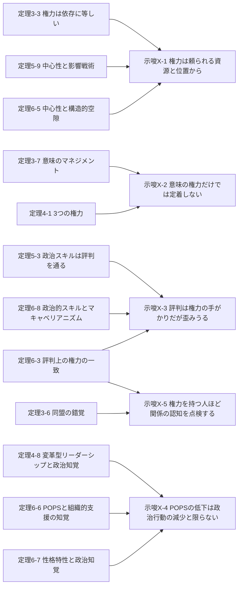

# 社内政治の論点別 定義・定理・示唆（第3版） — インデックス

- **Type**: survey

## この文書の目的と構成

社内政治について、論文から何が言えるかを、次の順で示します。

1. **定義**: この文書で使う用語を、論文の定義で決める。用語はすべてここで定義してから使う。
2. **定理**: 論文の結果・主張を 1 文の命題にしたもの。本文を読んだ論文だけを根拠にする。
3. **示唆**: 2 つ以上の定理を組み合わせて導いたこと。論文の主張ではなく、定理からの導出である。

論点の枠には、木村琢磨『社内政治の科学 経営学の研究成果』（日本経済新聞出版, 2025）の目次（第3章第2節〜第6章）を使いました。本の本文は読んでいません。目次は「どの論点を扱うか」を決めるためだけに使っています。

## 資料と脚注の扱い

- 定義と定理には脚注を付け、文献・頁と段落（分かる場合は行）・抜き出しを示しています。
- 抜き出しは、著作権のため資料のライセンスで扱いを分けています。CC BY などの公開ライセンスの論文と公的報告書は、英語原文を 1〜2 文そのまま抜き出しています。それ以外は、15 語未満の短い句か、「要旨:」として日本語の言い換えにしています。
- 本文を確認できなかった資料は使っていません。
- 統計などの一般的な用語で、特定の論文に依らない定義には「一般的な用法（筆者の説明）」という脚注を付けています。
- この index の定義と定理は、各章ファイルの記述と脚注をそのまま集めたものです。脚注番号は「章番号-元の番号」に付け替えています（例: 第3章の `d8` は `3-d8`）。

## 章ファイル

| ファイル | 問い | 定理 | 示唆 |
|---------|------|------|------|
| [ch3.md](ch3.md) | 社内政治とは何か。権力とどう関係し、なぜ意味を動かすことが政治になるのか | 10 | 4 |
| [ch4.md](ch4.md) | リーダーシップはなぜ政治と切り離せないのか。戦略変革やミドルの仕事で政治はどう働くのか | 9 | 5 |
| [ch5.md](ch5.md) | 社内政治で成果を出す個人の力は、どんな要素から成り、何が成果を左右するのか | 9 | 4 |
| [ch6.md](ch6.md) | 社内の権力・ネットワーク・政治的風土・政治的人材はどう測れ、測った結果から何が言えるのか | 9 | 6 |

各章ファイルでは、章の中で使う用語をすべて定義しています（第3章 79 語、第4章 99 語、第5章 76 語、第6章 83 語）。下の各章では、定理ごとに、まず定理を枠で示し、その下にその定理を読むのに必要な定義、さらにその下に説明を置いています。同じ章の中で一度定義した用語は「既出」として、どの定理の下で定義したかを示しています。

## 表記の違い

章ごとに、もとにした論文の用語に合わせているため、同じ概念に別の表記を使っている箇所があります。

| 表記 | 同じ概念を指す別表記 |
|------|---------------------|
| 政治スキル（第5章） | 政治的スキル（第4章・第6章） |
| ミドル（第4章） | 中間管理職（第3章） |
| パワー（第5章） | 権力（第3・4・6章） |
| 社内政治 | 組織政治（論文での呼び方。この文書では同じ現象を指す） |
| 組織政治の知覚（POP、第4章） | 組織政治の知覚（POPs、第6章） |

権力には論文ごとに複数の定義があります。第3章では Dahl・Emerson・Fleming & Spicer・Magee & Galinsky の定義を並べています。下の定義では、代表として第4章の定義と、依存に基づく Emerson の定義を載せています。

## 第3章 そもそも社内政治とは？（定義・権力・意味）

**この章の問い**: 社内政治とは何か。社内政治は権力とどう関係するか。なぜ意味のマネジメントが政治になるのか。

章ファイル（全用語の定義と参考文献）: [ch3.md](./ch3.md)

### 定理 3-1

> **定理 3-1**
>
> 組織政治の定義は否定的な見方と中立的な見方に分かれ、どちらを採るかで測定の仕方と「政治は有害か」という結論が変わる

**必要な定義**

- **レビュー（review）**: 既存の研究を集めて、知見を整理・比較する論文。新しいデータは集めない。[^3-d1]
- **横断研究（cross-sectional study）**: 1 時点のデータだけで変数の関連をみる研究。因果の向きは決められない。[^3-d1]
- **組織政治の否定的な見方**: 組織政治を、組織が認めない目的や手段で自己利益を追う、正統でない行動とみる見方。[^3-d9]
- **組織政治の中立的な見方**: 組織政治を、良くも悪くもない、組織に本来備わる現象とみる見方。権力と対立、複数の正統な視点の交渉が中心になる。[^3-d10]
- **政治の知覚（perceptions of politics）**: 観察者が、他者の行動の裏に自己利益の動機を読み取って「政治的だ」と判断する主観的な状態。行動そのものではなく、動機の推測を含む。[^3-d11]
- **組織政治の 5 次元**: 関係の構築と利用、個人の評判の構築、意思決定と資源の統制、意思決定への影響、コミュニケーション経路の利用。肯定・否定の両面を含めるために作られた測定の枠組み。[^3-d12]
- **政治（Fleming & Spicer の作業定義）**: 権力を動員して、人々の関係や財の配分を組み替える活動。[^3-d13]
- **意味形成（sensemaking）**: 手がかりと枠組みを結びつけて、出来事の意味を解釈すること。[^3-d28]

**説明**

- 内容: Silvester は心理学の主な定義 10 個を表にまとめた。そのほぼすべてが、他者を犠牲にした自己利益の追求に触れている。[^3-t3-1a] 否定的な見方に沿って作られた政治の知覚の質問紙は、自分の利益にならない行動を思わせる項目が中心で、政治とストレスの関連が出やすい。[^3-t3-1b] 中立的な見方では、政治は曖昧な場面で合意をつくり、意味形成を助ける働きも持つ。[^3-t3-1c] Landells & Albrecht は組織政治の 5 次元で測ったが、それでも政治の知覚はストレスと結びつき、意味ある仕事との関連は強くなかった。[^3-t3-1d]
- 研究の種類と対象: Silvester はレビュー。Landells & Albrecht はオーストラリアの従業員 2 標本（N=303、N=353）の横断研究。
- 条件・限界: 測定の偏りが結論を左右しうるという指摘はレビューの議論である。定義を変えると結論がどれだけ変わるかを直接比べた研究ではない。

### 定理 3-2

> **定理 3-2**
>
> 権力は他者に影響する能力であり、政治はその権力を動員して関係や財の配分を組み替える活動である

**必要な定義**

- **権力（Dahl の定義）**: A が B に、B が本来しないことをさせられる程度。基盤（使える資源）、手段、量（確率で表す）、範囲（B の反応の種類）の 4 つで記述する。[^3-d14]
- **権力（Fleming & Spicer の定義）**: 他者に影響する能力。目標を他者を通じて達成するための資源。[^3-d15]
- **依存（dependence）**: A の B への依存は、B が仲介する目標への A の関心（動機づけの投資）に比例し、その目標を B 以外から得られる程度に反比例する。[^3-d16]
- **権力（Emerson の定義）**: A が B の抵抗を潜在的に乗り越えられる量。常に観察されるわけではない潜在力。A の B への権力は B の A への依存に等しい。[^3-d17]
- **地位（status）**: 個人や集団が他者から尊敬・賞賛される程度。[^3-d19]
- **権力（Magee & Galinsky の定義）**: 社会関係の中で、価値ある資源を非対称に統制していること。価値は主観的に決まる。地位とは区別する。[^3-d20]
- 既出: レビュー（定理 3-1）、政治（定理 3-1）

**説明**

- 内容: Fleming & Spicer は、権力と政治がよく混同されると指摘し、両者を分ける。権力は他者に影響する能力で、政治はそれを動員する活動である。[^3-t3-2a] 権力を否定的にだけみるのは一面的で、権力は良い成果も生みうると述べる。[^3-t3-2b]
- 研究の種類と対象: レビュー（経営学・組織論の権力研究の整理）。
- 条件・限界: 作業定義であり、実証で検証された命題ではない。定理 3-1 のとおり、研究者の間で定義の合意はない。

### 定理 3-3

> **定理 3-3**
>
> A の B に対する権力は B の A への依存に等しく、その依存は B が A を通して得たい目標への関心が強いほど大きく、代わりの入手先が多いほど小さい

**必要な定義**

- **均衡化（balancing operation）**: 権力の差がある関係で、弱い側が差を縮める動き。目標への関心を下げる、代わりの関係を開拓する、強い側に地位を与える、連合を組む、の 4 つの型がある。[^3-d18]
- **連合（coalition）**: 複数の人が手を組み、共同で第三者に対する立場を強めること。[^3-d18]
- 既出: レビュー（定理 3-1）、権力（定理 3-2）、権力（定理 3-2）、依存（定理 3-2）、権力（定理 3-2）、地位（定理 3-2）、権力（定理 3-2）

**説明**

- 内容: Emerson は、権力を人の属性ではなく関係の性質とみる。[^3-t3-3a] 権力の差は不安定で、弱い側の均衡化を引き起こす。均衡化には 4 つの型があり、その一つが連合である。[^3-t3-3b] Magee & Galinsky も同じ依存の考え方で権力を定義する。そのうえで、肩書きが低い人でも、上司が頼る専門性を持てば権力を持ちうると述べる。[^3-t3-3c]
- 研究の種類と対象: Emerson は理論論文（小集団研究からの例示あり）。Magee & Galinsky はレビュー。
- 条件・限界: 依存を決める 2 つの変数がどう組み合わさるかは、経験的な問題として残されている。[^3-t3-3d] 比例・反比例は方向だけを示す命題である。

### 定理 3-4

> **定理 3-4**
>
> 組織の中心的な使命に深く結びつき、他部門が頼る不確実性に対処し、代わりが効きにくい部門は、公式の地位以上の権力を持つ

**必要な定義**

- **分散（variance）**: データのばらつきの大きさ。[^3-d4]
- **相関（correlation, r）**: 2 つの変数が一緒に増減する程度。-1〜1 の値をとる。因果は示さない。[^3-d4]
- **正準相関（canonical correlation）**: 変数の「束」どうし（例: 権力の基盤の変数群と権力の変数群）の結びつきの強さ。二乗した値は、束どうしが共有する分散の割合を表す。[^3-d4]
- **負荷量（loading）**: 正準相関などで、個々の変数が束の合成値とどれだけ強く結びつくかを示す値。[^3-d4]
- **同一回答者の評定による膨らみ（common method variance）**: 2 つの変数を同じ人が同じ方法で答えると、両者の関連が実際より強く出やすいこと。[^3-d4]
- **縦断研究（longitudinal study）**: 同じ対象を 2 時点以上で測り、変化をみる研究。[^3-d1]
- **部門（subunit）**: 組織の中の下位の単位。部・課・図書館のような機能のまとまり。[^3-d5]
- **不確実性（uncertainty）**: 将来の出来事についての情報が足りず、選択肢とその結果が予測できない状態。[^3-d5]
- **戦略的コンティンジェンシー（strategic contingency）**: ある部門の活動に必要な条件のうち、別の部門の活動によって左右されるもの。この理論では、部門の権力の基盤は、不確実性への対処、中心性、代替可能性の 3 つである。[^3-d5]
- **中心性（centrality）**: 部門の活動が組織全体の活動とどれだけ結びついているか。大学では、部門が大学の中心的な使命にどれだけ合うか。[^3-d24]
- **代替可能性（substitutability）**: 他の部門が同じ機能を代わりに果たせる程度。低いほど権力が増すとされる。[^3-d25]
- 既出: レビュー（定理 3-1）、権力（定理 3-2）、権力（定理 3-2）、依存（定理 3-2）、権力（定理 3-2）、地位（定理 3-2）、権力（定理 3-2）

**説明**

- 内容: Fleming & Spicer のレビューは次の知見を整理している。工場で唯一の不確実性を握る保守担当が強い権力を持った事例、不確実性への対処が部門の権力と結びついた調査、大学で希少で中心的な資源（外部研究費）の統制が権力の源になった研究である。[^3-t3-4a] Crawford は、戦略的コンティンジェンシーの理論を米国の教養系大学の図書館で検証した。権力の基盤の変数群と権力の変数群（予算の割合、職員数、知覚された権力）の第 1 正準相関は 0.87（二乗 0.76）だった。第 2 の組では、知覚された中心性（負荷量 0.95）と知覚された権力（負荷量 0.99）が強く結びついた。代替可能性の変数の負荷量は小さかった。[^3-t3-4b]
- 研究の種類と対象: Fleming & Spicer はレビュー（原典は事例研究と質問紙調査）。Crawford は縦断研究（1981–82 年度と 1989–90 年度の 2 時点）。米国の教養系大学 487 校の図書館長に質問紙を送り、416 校が回答した。
- 条件・限界: Crawford の中心性と権力は、どちらも図書館長本人の知覚で測っている。そのため、同一回答者の評定による膨らみがありうる。著者自身も、相関を因果として扱っている点と、一つの種類の大学に限られる点を限界に挙げている。[^3-t3-4c] Fleming & Spicer は、権力を希少資源の統制だけで測ると他の源泉を見落とすと注意している。[^3-t3-4a]

### 定理 3-5

> **定理 3-5**
>
> 権力は、個人の特性、集団の利益への貢献、ネットワーク上の位置という 3 つの経路で獲得され、権力を持つ人の心理は権力を強める方向にも弱める方向にも働く

**必要な定義**

- **媒介（mediation）**: X が Y に効く経路の途中に M があり、X → M → Y という形で効果が伝わること。M を媒介変数という。[^3-d4]
- **実験（experiment）**: 研究者が条件を割り当て（実験操作）、条件による結果の差をみる研究。[^3-d1]
- **人口学的特性（demographics）**: 性別・年齢・人種など、人の属性を表す特徴。[^3-d1]
- **構造的空隙（structural hole）**: 人間関係のネットワークで、互いにつながっていない人々の間にある隙間。[^3-d26]
- **媒介中心性（betweenness centrality）**: ネットワーク上で、他の人々どうしを結ぶ経路の途中にどれだけ位置するかを示す指標。[^3-d26]
- 既出: レビュー（定理 3-1）、部門（定理 3-4）、権力（定理 3-2）、権力（定理 3-2）、依存（定理 3-2）、権力（定理 3-2）、地位（定理 3-2）、権力（定理 3-2）、中心性（定理 3-4）

**説明**

- 内容: Brion は権力獲得の研究を 3 つに分ける。1 つ目は人口学的特性と性格である。2 つ目は機能で、集団の課題に役立つ有能さや、集団の利益のために行動することである。集団に貢献した人ほど影響力を得たという研究も紹介する。3 つ目は構造で、構造的空隙を橋渡しする位置や媒介中心性の高さが、情報の利益と権力をもたらす。[^3-t3-5a] 逆に、その位置を築けないことは権力を失いやすくする。[^3-t3-5b] Magee & Galinsky は、権力が持ち主の考え方と行動を変え、権力の維持と獲得に向かわせると整理する。同時に、その自己強化を弱める力もあると述べる。[^3-t3-5c]
- 研究の種類と対象: どちらもレビュー（Brion は博士論文の文献レビューの章）。
- 条件・限界: 3 経路の相対的な強さは比べていない。研究の多くは実験室や小集団、または経営者を対象にしている。

### 定理 3-6

> **定理 3-6**
>
> 権力を持つ人ほど同盟の錯覚が強く、その錯覚が強い人ほど相手から同盟相手と感じられなくなって、連合から外され、得る資源が減る

**必要な定義**

- **ロジスティック回帰（logistic regression）**: 「外されたかどうか」のような 2 値の結果が起こる確率を、他の変数で説明する回帰の方法。[^3-d4]
- **高権力役・低権力役**: 実験で参加者に割り当てる、交渉で強い立場と弱い立場の役。[^3-d27]
- **同盟（alliance）**: 他者との、互いに味方し合う結びつき。[^3-d27]
- **同盟の錯覚（illusions of alliance）**: 他者との同盟の強さを、実際より強く見積もること。[^3-d27]
- 既出: 媒介（定理 3-5）、実験（定理 3-5）、権力（定理 3-2）、権力（定理 3-2）、依存（定理 3-2）、権力（定理 3-2）、連合（定理 3-3）、地位（定理 3-2）、権力（定理 3-2）

**説明**

- 内容: 研究 1 では、自分に権力があるとみる学生ほど、長期のプロジェクト班で同盟の錯覚が強かった（r=0.25）。[^3-t3-6a] 研究 3 では、3 者で連合を組む交渉で、高権力役の同盟の錯覚が強いほど最終の連合から外された（ロジスティック回帰 β=1.26）。得点も少なかった。[^3-t3-6b] 得点への効果は、相手が感じる同盟の強さを媒介していた。[^3-t3-6c] 研究 4 で同盟の錯覚を実験操作すると、過大評価の条件では高権力役の 37.5% が連合から外された。過小評価の条件では 6.7% だった。[^3-t3-6d]
- 研究の種類と対象: 実験（米国西海岸の大学の経営学部生。研究 1 は 115 名、研究 2 は 53 名、研究 3 は 147 名、研究 4 は 93 名）。
- 条件・限界: 研究 3・4 は 1 時間ほどの実験課題である。権力の役は理由を示さずに割り当てたもので、正統性のある権力とは異なりうると著者自身が述べている。[^3-t3-6e]

### 定理 3-7

> **定理 3-7**
>
> 言語・物語・象徴による意味のマネジメントは、組織内の反対や対立を下げて行動を動員し、とくに戦略変更のような曖昧な局面で重要になる

**必要な定義**

- **質的研究（qualitative research）**: 数値ではなく、面接や観察の言葉をもとに過程や意味を分析する研究。[^3-d1]
- **エスノグラフィー（ethnography）**: 研究者が現場に長く入り込み、観察と聞き取りで集団の実態を記述する質的研究。[^3-d1]
- **意味付与（sensegiving）**: 自分の解釈やビジョンを他者に伝え、理解させ、受け入れさせて行動させること。[^3-d29]
- **意味のマネジメント（management of meaning）**: 言語・物語・枠組み・儀式・象徴を使い、組織の行動を正当化し、理解と合意をつくること。[^3-d30]
- **戦略変更（strategic change）**: 組織が戦略の方向を大きく変えること。[^3-d29]
- 既出: レビュー（定理 3-1）、権力（定理 3-2）、権力（定理 3-2）、依存（定理 3-2）、権力（定理 3-2）、地位（定理 3-2）、権力（定理 3-2）、意味形成（定理 3-1）

**説明**

- 内容: Rindova & Srinivas は、管理が 2 つの水準で進むという整理を紹介する。実質の水準では決定と成果が扱われ、象徴の水準では言語と象徴的な行為が決定を正当化する。[^3-t3-7a] 意味のマネジメントは、反対と対立を下げて行動を動員し、外部からの監視も和らげる。[^3-t3-7b] 戦略変更の始まりでは、トップがまず出来事の意味を解釈し（意味形成）、次にビジョンを広めて関係者に受け入れさせていた（意味付与）。変化が曖昧さと利害の違いを目立たせるとき、指導者には共有された説明をつくる必要が生じる。[^3-t3-7c] Fleming & Spicer も、選好そのものを形づくる働きを「支配」として権力に含めている。[^3-d23]
- 研究の種類と対象: レビュー（原典は事例研究とエスノグラフィーが中心）。
- 条件・限界: すべてレビューによる整理で、原典の本文は読んでいない。原典の多くは単一組織の質的研究である。

### 定理 3-8

> **定理 3-8**
>
> 他者焦点型の印象マネジメントは評価者の業績評価や人事判断を高め、職場外の取り入りの効果は LMX を媒介して生じる

**必要な定義**

- **メタ分析（meta-analysis）**: 複数の研究の結果を数値で統合し、平均的な効果の大きさを推定する方法。[^3-d3]
- **効果量（effect size）**: 研究で得られた効果の大きさを、研究間で比べられる形にした数値。相関などで表す。[^3-d3]
- **補正相関（corrected correlation）**: メタ分析で、測定の誤差などを補正して推定した相関。[^3-d3]
- **自己報告（self-report）**: 対象者本人が質問紙に答える測り方。[^3-d4]
- **時間差調査（time-lagged survey）**: 原因側と結果側の変数を、時間をずらして別々に測る調査。[^3-d1]
- **評価者（rater）**: 他者の業績や面接の出来を採点する人。[^3-d7]
- **人事判断**: 上司が部下について下す、昇進可能性の評価や賞与の配分などの判断。[^3-d1]
- **印象マネジメント（impression management）**: 他者からどう見られるかを左右しようとする、目標のある行動。意識的か無意識か、偽りか本物かは問わない。[^3-d31]
- **他者焦点型の印象マネジメント**: 相手の好意を得る戦術。取り入り、意見同調、好意の提供などを含む。[^3-d32]
- **取り入り（ingratiation）**: 相手に好かれるために、相手を持ち上げたり気を配ったりする行動。他者焦点型の代表である。[^3-d32]
- **職場外の取り入り**: 部下が上司に対し、職場の外で行う取り入り。休日の贈り物やあいさつ、上司の私的な用事への気配りなど。[^3-d33]
- **LMX（leader-member exchange）**: 上司と部下の間の交換関係の質。質が高い部下ほど多くの利点を得るとされる。[^3-d34]
- **中庸思考（Zhongyong thinking）**: 外の条件と内の欲求をどう統合するかについての、中国の伝統的な考え方の型。[^3-d34]
- 既出: 相関（定理 3-4）、媒介（定理 3-5）、同一回答者の評定による膨らみ（定理 3-4）

**説明**

- 内容: Peck & Levashina のメタ分析では、業績評価に対して他者焦点型は有意で（k=4、補正相関 0.25）、自己焦点型は有意でなかった（k=6、0.18）。面接評価では自己焦点型が有意だった（k=20、0.24）。[^3-t3-8a] 働きかけの相手が評価者本人のときは有意で（0.27）、評価者が観察者のときは有意でなかった（0.11）。[^3-t3-8b] Sun らは、職場外の取り入りが上司による昇進可能性の評価（β=0.43）と賞与配分（β=0.29）を高めることを示した。意思決定への参加には有意な効果がなかった。[^3-t3-8c] これらの効果は LMX を部分的に媒介していた。上司の中庸思考が強いと、LMX を媒介した効果は有意でなくなった（中庸思考による調整）。[^3-t3-8d]
- 研究の種類と対象: Peck & Levashina はメタ分析（1990〜2015 年の 9 誌から 18 本、効果量 42、N=8,635）。Sun らは時間差調査（中国の製造業 4 社、上司と部下 252 組、1 か月の時間差）。
- 条件・限界: 業績評価のメタ分析は研究数が少ない（k=4〜6）。評価の向上であって、実際の成果の向上ではない。Sun らの測定は自己報告で、同一回答者の評定による膨らみの可能性を著者らも認めている。[^3-t3-8e]

### 定理 3-9

> **定理 3-9**
>
> 課題の売り込みは、非公式な場で物語の断片を関係者と少しずつ練り上げる段階と、公式の場で一貫した物語として決定者に示す段階からなり、その移行には利害の結合・戦略的な枠付け・例証が要る

**必要な定義**

- **半構造化面接（semi-structured interview）**: 大まかな質問項目を決めたうえで、話の流れに応じて質問を変える面接。[^3-d1]
- **回顧的面接（retrospective interview）**: 終わった出来事を後から振り返って語ってもらう面接。[^3-d1]
- **中間管理職（middle manager）**: 経営トップより 1〜4 階層下の管理職。[^3-d6]
- **決定者（target）**: ある課題を採り上げるかを決める権限を持つ人。[^3-d6]
- **売り手（seller）**: 決定者に、ある課題が重要だと納得させようとする人。[^3-d6]
- **課題の売り込み（issue selling）**: 売り手が決定者に、ある課題が組織にとって戦略的に重要だと納得させる過程。従来は「包装」と「売り込み」の 2 段で整理されてきた。[^3-d6]
- **物語の断片（narrative fragments）**: 課題についての、まだまとまっていない部分的な語り。非公式の場で口頭で交わされる。[^3-d35]
- **利害の結合（associating interests）**: 関係者の利害を一つの物語に結び、関係者と同盟を組むこと。[^3-d36]
- **戦略的な枠付け（strategic framing）**: 課題を、売り手の周りの利害を超えて、組織の戦略的な活動に長期の影響を持つものとして語ること。[^3-d36]
- **例証（illustrating）**: 数字や顧客の声などの具体的な証拠で物語を裏づけること。[^3-d36]
- 既出: 質的研究（定理 3-7）、同盟（定理 3-6）

**説明**

- 内容: 従来の研究は、売り手が合理的・直線的に課題を「包装」して「売り込む」と考えていた。この研究は、課題が戦略的かどうかは関係者の意味づけでつくられるとみる。中間管理職は、まず近い関係の人と口頭で物語の断片を交換し、次に経営会議などで一つの物語として示す。[^3-t3-9a] 利害の結合で「一つの声」で語れる同盟をつくることが、物語の一貫性を高めた。ただし利害の結合は必要条件であって十分条件ではなく、戦略的な枠付けと例証が加わる必要があった。[^3-t3-9b]
- 研究の種類と対象: 質的研究。フランスの多様な業種・規模の組織の中間管理職 42 名への、回顧的な半構造化面接。
- 条件・限界: 回顧的面接で、売り手の視点だけである。面接は大学院の授業の一環で学生が実施した。[^3-t3-9c] 成功と失敗の比較で因果を示したものではない。

### 定理 3-10

> **定理 3-10**
>
> スポンサーシップは昇進や指導的地位への到達と結びつくと多くの研究で報告されているが、その証拠は横断研究と質的研究が中心で、女性は推される機会を得にくいと報告されることが多い

**必要な定義**

- **スコーピング・レビュー（scoping review）**: レビューの一種。ある主題の研究がどこまであるかを、地図を描くように幅広く整理する。効果の大きさの統合は目的にしない。[^3-d2]
- **スポンサーシップ（sponsorship）**: 権力や影響力を持つ人（推す側）が、その立場を使って特定の人（推される側）を積極的に推し、昇進の機会を与えること。[^3-d37]
- 既出: レビュー（定理 3-1）、横断研究（定理 3-1）、質的研究（定理 3-7）、部門（定理 3-4）、権力（定理 3-2）、権力（定理 3-2）、依存（定理 3-2）、権力（定理 3-2）、地位（定理 3-2）、権力（定理 3-2）

**説明**

- 内容: Schwartz らは医学部教員を対象とした 16 本の研究を集めた。研究間で、スポンサーシップの定義の 3 要素（昇進の機会の提供、推す側が権力を持つこと、積極的な推薦）はおおむね一致していた。[^3-d37] 10 本が、スポンサーシップが昇進と結びつくと報告した。昇進の指標には、大型研究費の獲得や学部長・部門長への就任などが含まれていた。[^3-t3-10a] 男女差を調べた量的研究の結果はまちまちだった。質的研究では、女性が推される機会を得にくいと報告されていた。[^3-t3-10b]
- 研究の種類と対象: スコーピング・レビュー（PubMed・Embase・Web of Science、過去 50 年、16 本。量的 5、質的 8、混合 3）。対象は米国中心の医学部教員。
- 条件・限界: 量的研究のほとんどは横断研究で、回顧的な質問が多い。スポンサーシップは非公式に行われるため、追跡しにくい。[^3-t3-10c]

### 第3章の示唆

示唆は論文の主張ではなく、定理を組み合わせて導いたものです。

#### 示唆 3-1

> **示唆 3-1**（定理 3-1 + 定理 3-2 + 定理 3-7）
>
> 社内政治をどう定義するかは中立な前置きではなく、何を政治として数え、政治を有害とみるかを先に決めてしまう

**必要な定義**

- **社内政治（著者の公開記事の定義）**: 利害の不一致や対立があるときに、正式なルートではない方法で、他者や組織に影響を与えようとする行動。相手の気分を少し良くするような小さな影響も含む。[^3-d8]
- 既出: 組織政治の否定的な見方（定理 3-1）、政治（定理 3-1）、権力（定理 3-2）、権力（定理 3-2）、依存（定理 3-2）、権力（定理 3-2）、地位（定理 3-2）、権力（定理 3-2）、意味のマネジメント（定理 3-7）

**導出**

- 導出: 定理 3-1 では、否定的な見方に沿った測定が、政治と悪い結果の関連を出やすくしていた。定理 3-2 と定理 3-7 の広い定義では、権力の動員や意味のマネジメントも政治に含まれ、それは合意づくりにも使われる。どちらの定義を採るかで、同じ行動が政治に入るか、入ったとき有害とみなされるかが変わる。
- 追加の前提: なし

#### 示唆 3-2

> **示唆 3-2**（定理 3-3 + 定理 3-4 + 定理 3-5）
>
> 社内で権力を得る筋道は、中心性が高く代替可能性が低い仕事や、他者が頼る不確実性への対処を担うことと、構造的空隙を橋渡しする位置に立つことである

**必要な定義**

- 既出: 部門（定理 3-4）、権力（定理 3-2）、権力（定理 3-2）、依存（定理 3-2）、権力（定理 3-2）、地位（定理 3-2）、権力（定理 3-2）、不確実性（定理 3-4）、中心性（定理 3-4）、代替可能性（定理 3-4）、構造的空隙（定理 3-5）

**導出**

- 導出: 定理 3-3 では、権力は相手の依存で決まり、依存は代わりが少ないほど大きい。定理 3-4 では、中心的で不確実性に対処する部門が権力を持っていた。定理 3-5 では、構造的空隙を橋渡しする位置も権力をもたらす。3 つはどれも、相手にとって重要で他から得にくいものを握ることが権力の源になるという同じ構造を示す。
- 追加の前提: 部門単位の知見（定理 3-4）が、個人単位にも同じ向きで当てはまること。

#### 示唆 3-3

> **示唆 3-3**（定理 3-3 + 定理 3-6）
>
> 権力を持つ側は同盟の錯覚に陥りやすく、弱い側の連合によって権力を失いうるため、同盟の実態を確かめ続けることが権力の維持に必要になる

**必要な定義**

- 既出: 実験（定理 3-5）、権力（定理 3-2）、権力（定理 3-2）、依存（定理 3-2）、権力（定理 3-2）、均衡化（定理 3-3）、連合（定理 3-3）、地位（定理 3-2）、権力（定理 3-2）、同盟（定理 3-6）、同盟の錯覚（定理 3-6）

**導出**

- 導出: 定理 3-3 では、権力の差は弱い側の均衡化を引き起こし、その一つが連合である。定理 3-6 では、権力を持つ人は同盟の錯覚に陥り、錯覚が強いほど相手の支持を失って連合から外された。合わせると、権力を持つ人が連合を組まれて権力を失う経路の一つは、自分の同盟を見誤ることである。
- 追加の前提: 学生の短い実験課題の結果（定理 3-6）が、組織の中で長く続く関係にも同じ向きで当てはまること。

#### 示唆 3-4

> **示唆 3-4**（定理 3-8 + 定理 3-9 + 定理 3-10）
>
> 部下や企画を売り込むときは、決定者や評価者本人との関係を通じて働きかけ、利害の結合で関係者を一つの物語にまとめることが通りやすさを高めうるが、推す側に権力があることが前提になる

**必要な定義**

- 既出: 媒介（定理 3-5）、部門（定理 3-4）、決定者（定理 3-9）、売り手（定理 3-9）、評価者（定理 3-8）、人事判断（定理 3-8）、組織政治の否定的な見方（定理 3-1）、組織政治の中立的な見方（定理 3-1）、政治（定理 3-1）、権力（定理 3-2）、権力（定理 3-2）、依存（定理 3-2）、権力（定理 3-2）、均衡化（定理 3-3）、地位（定理 3-2）、権力（定理 3-2）、不確実性（定理 3-4）、戦略的コンティンジェンシー（定理 3-4）、中心性（定理 3-4）、構造的空隙（定理 3-5）、媒介中心性（定理 3-5）、同盟（定理 3-6）、同盟の錯覚（定理 3-6）、意味のマネジメント（定理 3-7）、印象マネジメント（定理 3-8）、他者焦点型の印象マネジメント（定理 3-8）、LMX（定理 3-8）、課題の売り込み（定理 3-9）、利害の結合（定理 3-9）、スポンサーシップ（定理 3-10）

**導出**

- 導出: 定理 3-8 では、評価者本人に向けた他者焦点型の印象マネジメントが評価や人事判断に効き、その効果は LMX を媒介していた。定理 3-9 では、利害の結合と同盟が物語の説得力を高めた。定理 3-10 では、権力を持つ人が積極的に推すことが昇進と結びついていた。どれも、自分の能力を示すことより、決定者との関係と、力のある後ろ盾や同盟を通じた働きかけが効く点で共通する。
- 追加の前提: 業績評価・人事判断（定理 3-8）と医学部の昇進（定理 3-10）の知見が、一般企業での企画の承認や部下の推薦にも同じ向きで当てはまること。

## 第4章 リーダーシップとしての社内政治

**この章の問い**: リーダーシップは、なぜ権力と政治から切り離せないのか。戦略変革とミドルの仕事の中で、政治はどう働き、部下の態度にどう表れるのか。

章ファイル（全用語の定義と参考文献）: [ch4.md](./ch4.md)

### 定理 4-1

> **定理 4-1**
>
> 戦略変革は、資源・プロセス・意味の権力をまとめて使ってシステムの権力に対抗したときに実現し、どれか 1 つだけでは定着しない（理論的命題）

**必要な定義**

- **権力（power）**: 結果に影響する力。ここでは良い・悪いの評価を含まない中立の意味で使う。[^4-d11]
- **戦略変革（strategic change）**: 組織が意図した戦略を、組織の人々の行動の一貫した型として実際に実現すること。[^4-d14]
- **資源の権力（power of resources）**: 情報・専門知識・予算・報酬と罰など、相手が頼る資源を使って行動を動かす権力。報酬や罰を出し続けないと、行動が続きにくい。[^4-d15]
- **プロセスの権力（power of processes）**: 意思決定の手続きや議題を操作して結果を左右する権力。変化に使うときは、新しい委員会を作って新しい議題や参加者を入れる。既存の規範や価値に合う行動しか定着しにくい。[^4-d16]
- **意味の権力（power of meaning）**: 象徴や説明を使い、物事を正当・合理的・避けられないと思わせる権力。根本的な変化につながりうるが、特定の行動だけを狙って変えるのは難しい。[^4-d17]
- **システムの権力（power of the system）**: 組織の価値・伝統・文化・構造の中に埋め込まれ、誰もが当たり前と受け入れている権力。現状を支えるので、ほかの権力で対抗しないと変化は起きにくい。[^4-d18]
- **リーダーシップ（leadership）**: 集団の目標を達成するために、他者の関与を引き出して動かす影響の過程。相手に力ずくで従わせる過程とは区別される。[^4-d1]
- **リーダー（leader）**: リーダーシップを担う人。Zaleznik は、新しい選択肢を開き、人を引きつけるイメージを示して方向を作る人として描き、リーダーシップには権力を使って他者の考えと行動に影響することが避けられないとする。[^4-d2]
- **主張（claiming）**: 自分がリーダーだと名乗り、そう振る舞うこと。[^4-d33]
- **理論論文（theoretical paper）**: 新しいデータを集めず、先行研究や事例をもとに概念や命題を組み立てる論文。[^4-d63]
- **命題（proposition）**: 理論から導かれ、今後の検証を待つ主張。[^4-d63]
- **二次事例（secondary case）**: 他の研究者がすでに記述した事例を、例として借りて使うもの。[^4-d63]

**説明**

- 内容: 資源の権力だけでは、報酬や罰を出し続けないと行動が続かない。プロセスの権力だけでは、既存の規範に合う変化しか残らない。意味の権力だけでは、特定の行動を狙って変えられない。[^4-t4-1] Hardy が引くカナダの自動車工場の二次事例では、参加型の委員会（プロセスの権力）だけを使った 2 年間は変化が起きず、尊敬される管理者の実践で「良い管理者」の意味が変わり、報酬（資源の権力）と委員会（プロセスの権力）がそれを支えたときに戦略変革が実現した。[^4-t4-1a]
- 研究の種類と対象: 理論論文で、他の研究者が記述した二次事例 2 件（米系自動車メーカーのカナダ工場、英国の電球メーカー）で命題を例示している。
- 条件・限界: 事例は例示であり、命題を検証したデータではない。Hardy は、カリスマとビジョンを持つ「偉大なリーダー」に頼る変革論は、話の一部しか見ていないと批判している。[^4-t4-1b]

### 定理 4-2

> **定理 4-2**
>
> リーダーの政治的スキルはチーム成績とリーダー有効性を予測し、インフォーマル・リーダーとして認められることが個人の業績につながるかどうかを左右する

**必要な定義**

- **政治（politics）**: 行動に移された権力。[^4-d12]
- **部下（subordinates, followers）**: ある管理者やリーダーに直接報告し、その指示を受ける人。[^4-d9]
- **政治的スキル（political skill）**: 職場で他者をよく理解し、その理解を使って、自分や組織の目標に役立つように他者を動かす能力。他者を鋭く観察する力、相手と状況に合わせて働きかける力、多様な人脈を作る力、下心がないと見える力の 4 つの面からなる。訓練・練習・経験で伸ばせる部分があるとされる。[^4-d20]
- **リーダー有効性（leader effectiveness）**: 周りの人が、そのリーダーをどれだけ有効なリーダーだと評価するか。[^4-d21]
- **チーム成績（team performance）**: チームが担う仕事の成果を表す指標。Ferris らが紹介する児童福祉の研究では、子どもを法的に確定した生活の場（養子縁組など）に移せた割合を使った。[^4-d22]
- **インフォーマル・リーダー（informal leader）**: 組織から正式にリーダーの地位を与えられていないが、同僚からリーダーと認められている人。Shaughnessy らは、職員一人ひとりに自分の人間関係の中のリーダーを挙げてもらい、その一致の度合いで測った。[^4-d23]
- **個人の業績（job performance）**: 上司が評価した、その人が割り当てられた仕事をどれだけ果たしているか。[^4-d24]
- **仮説（hypothesis）**: 研究の前に立て、データで支持されるかを確かめる予測。[^4-d63]
- **実証研究（empirical study）**: データを集めて、仮説や関係を確かめる研究。[^4-d63]
- **時間差調査（time-lagged design）**: 原因側と結果側の変数を、間隔を置いた別の時点で測る調査。[^4-d63]
- **レビュー論文（review）**: 多くの先行研究を集めて整理し、分かっていることをまとめる論文。[^4-d63]
- **標準偏差（standard deviation, SD）**: 値が平均からどれだけ散らばっているかを示す値。[^4-d63]
- 既出: 権力（定理 4-1）、リーダーシップ（定理 4-1）、リーダー（定理 4-1）

**説明**

- 内容: Ferris らのレビュー論文によると、児童福祉のチームの研究では、担当件数や経験などを統制しても、リーダーの政治的スキルがチーム成績の分散の有意な部分を説明した。別の研究では、リーダーの政治的スキルがリーダー有効性の評価を予測した。[^4-t4-2] Shaughnessy らの研究では、インフォーマル・リーダーとして認められていることと個人の業績の正の関係は、政治的スキルが平均より 1 標準偏差高い人でだけ有意で、平均の人や低い人では有意でなかった。[^4-t4-2a]
- 研究の種類と対象: (1) レビュー論文による原典研究の紹介（原典は読んでいない）。(2) 米国北西部の居住型の精神保健施設の職員を対象にした実証研究で、3 か月の間隔を置いた時間差調査（分析対象 40 人）。
- 条件・限界: Ferris らは、児童福祉の研究でも、部下の信頼などを経由する経路は実際には測られていないと述べている。Shaughnessy らの研究は 1 施設・40 人と小さい。[^4-t4-2b]

### 定理 4-3

> **定理 4-3**
>
> 集団への同一視が強いほど、メンバーは集団プロトタイプ性の高い人をリーダーとして支持し、リーダー有効性を高く評価する

**必要な定義**

- **集団への同一視（group identification）**: 自分をその集団の一員として強くとらえている度合い。[^4-d26]
- **集団の顕現性（group salience）**: 集団の一員であることが、その場で強く意識されている度合い。[^4-d27]
- **プロトタイプ（prototype）**: ある集団を特徴づけ、他の集団と区別する態度・感情・行動の特徴のまとまり。集団らしさの典型で、文脈に応じて変わる。[^4-d28]
- **集団プロトタイプ性（group prototypicality）**: その人が、集団のプロトタイプにどれだけ近いか。[^4-d29]
- **リーダー・スキーマ（leader schema）**: 「リーダーとはこういう人だ」という、特定の集団によらない一般的なリーダー像。[^4-d30]
- **地位の差（status differentiation）**: リーダーと部下のあいだで地位が分かれ、上下の区別がはっきりすること。[^4-d31]
- **実験（experiment）**: 条件を研究者が操作し、その影響を比べる研究。[^4-d63]
- **最小集団実験（minimal group experiment）**: 実験のためにその場で作った、ほとんど中身のない集団を使う実験。[^4-d63]
- **フィールド研究（field study）**: 実験室ではなく、現実の集団や組織の中でデータを集める研究。[^4-d63]
- 既出: 権力（定理 4-1）、リーダーシップ（定理 4-1）、リーダー（定理 4-1）、部下（定理 4-2）、リーダー有効性（定理 4-2）、理論論文（定理 4-1）

**説明**

- 内容: 集団の顕現性が高い条件では、集団プロトタイプ性の高いリーダーが低いリーダーより有効と評価され、顕現性が低い条件では差がなかった。結束が強く同一視が強い集団ほど、リーダー・スキーマより集団プロトタイプ性のほうが支持を左右した。[^4-t4-3] Hogg は、集団プロトタイプ性の高いリーダーは集団の規範を体現しているので、権力を行使しなくても影響力を持つと論じる。一方、地位の差が広がると、プロトタイプに基づく影響が効かなくなり、権力による支配に移りやすいとする（この部分は未検証）。[^4-t4-3a]
- 研究の種類と対象: 理論論文で、著者の研究室の研究をまとめている。2×2×2 の実験（学生 184 人）、オーストラリアのアウトドア研修集団のフィールド研究（13 集団・143 人・3 週間）、最小集団実験 2 件（82 人、164 人）。
- 条件・限界: 主な証拠は実験室と短期の集団で、企業組織での検証ではない。Hogg 自身も、直接の検証の多くは短期の実験室集団で自然に現れたリーダーを扱い、プロトタイプを 1 つの次元だけで操作していたと述べる。[^4-t4-3b]

### 定理 4-4

> **定理 4-4**
>
> 集合的リーダーシップの組織の物語が強い組織でも、個人はリーダー・アイデンティティを主張し、集合を体現するアバターを立てることで、集合にリーダーシップを付与している

**必要な定義**

- **マネジメント（management）**: 計画・組織化・統制によって、組織が期日と予算どおりに目標を達成するようにする働き。[^4-d4]
- **リーダーシップとマネジメントの関係（3 つの立場）**: 両者を同じとみる立場、別物だが補い合いどちらも必要とみる立場、気質から根本的に違うとみる立場の 3 つ。Hunt は、リーダーシップをマネジメントの一部とみなし、両方が必要だが同じ人が担うとは限らないとする。[^4-d5]
- **リーダー・アイデンティティ（leadership identity）**: 自分や他者を「リーダーである」とみなす自己像・他者像。[^4-d32]
- **付与（granting）**: 周りの人が、ある人（や集団）をリーダーとして認めること。リーダーシップの主張は、付与されて初めて意味を持つとされる。[^4-d34]
- **集合的リーダーシップ（collective leadership）**: リーダーシップを一人の英雄に帰さず、公式・非公式の立場にいる複数の人の協働として見る考え方。[^4-d35]
- **組織の物語（organizational narrative）**: ある組織の中で広く共有され、そこで起きることに意味を与える語り。[^4-d36]
- **アバター（avatar）**: Empson らが見いだしたリーダー像の 1 つ。抽象的な集合を、メンバーに代わって体現する個人のリーダー。[^4-d37]
- **分配型リーダーシップ（distributed leadership）**: 個人のリーダーから、協働と責任の共有という集合的な実践へ焦点を移す考え方。共有型・参加型・民主型のリーダーシップと重なる。[^4-d38]
- **事例研究（case study）**: 1 つまたは少数の組織・人を深く調べる研究。[^4-d63]
- **横断研究（cross-sectional study）**: 1 時点のデータだけを使う研究。変数の時間的な前後が分からないので、因果は言えない。[^4-d63]
- **系統的レビュー（systematic review）**: 決めた手順で文献を探し、選び、整理するレビュー。[^4-d63]
- 既出: 権力（定理 4-1）、リーダーシップ（定理 4-1）、リーダー（定理 4-1）、主張（定理 4-1）

**説明**

- 内容: 「この会社のリーダーは誰か」への答えは、「全員」から「誰もいない」まで分かれた。個人の語りからは、起業家・社内起業家・奉仕者・アバター・演者・挑戦者・賢者の 7 つのリーダー像が見いだされた。[^4-t4-4] 集合的リーダーシップを支持する人も、アバターを作り、それを通じて抽象的な集合にリーダーシップを付与していた。著者らは、集合を重んじる組織でも、リーダーシップを神聖視する傾向が続くと述べる。[^4-t4-4a]
- 研究の種類と対象: 質的な事例研究で、共同経営者（パートナー）が所有する国際的な専門サービス企業 1 社（専門職 400 人、40 か国）の 34 人に、約 90 分の面接を行った。
- 条件・限界: 持ち分を全パートナーで均等に持ち、利益を在籍年数に応じて分けるなど、集合を重んじる極端な事例 1 社の研究で、普通の階層型の企業にそのまま当てはまるとは限らない。[^4-t4-4b] 分配型リーダーシップの系統的レビュー（2002〜2022 年の 111 本）でも、8 割超が学校・大学を対象にし、医療は 7%、製造業は 3% にとどまる。横断研究が多く、階層型の組織との関係も十分に調べられていない。[^4-t4-4c]

### 定理 4-5

> **定理 4-5**
>
> ミドルの上方影響は評判型の社会関係資本が高いほど事業成果を高め、下方影響は情報型の社会関係資本が高いほど事業成果を高める（上方影響と事業成果の関係は逆 U 字）

**必要な定義**

- **マネジャー（manager）**: 対立する利害を見積もり、選択肢を絞って妥協点に導くことで仕事を回す人。[^4-d3]
- **ミドル（ミドルマネジャー, middle manager）**: 上から指示を受け、下に指示を出す中間の管理職。上級の管理者より日々の業務と現場に近いが、全体を見渡せる程度には現場から離れている。[^4-d7]
- **経営層（senior managers）**: ミドルの上にいて、ミドルを直接の部下に持つ上位の管理者。Ahearne らの事例では地域の営業本部長にあたる。[^4-d8]
- **上方影響（upward influence）**: ミドルが、計画とは別の戦略案を経営層に売り込むこと。[^4-d40]
- **下方影響（downward influence）**: ミドルが、現場で部下が状況に合わせて柔軟にやり方を変えられるよう後押しすること。[^4-d41]
- **相談ネットワーク（advice network）**: 誰が誰に仕事上の助言を求めるかでつながる、組織内の非公式な人間関係の網。[^4-d42]
- **社会関係資本（social capital）**: 非公式な人間関係の網を通じて手に入り、目標の達成に使える情報・評判・支援などの資源。[^4-d43]
- **評判型の社会関係資本（reputational social capital）**: 経営層とミドル全体の相談ネットワークの中で、「詳しい人」として頼られる度合い。[^4-d44]
- **情報型の社会関係資本（informational social capital）**: 同じ経営層の下にいるミドルの集まり（地域）の外にある情報に、どれだけ手が届くか。[^4-d45]
- **事業成果（business unit performance）**: ミドルが受け持つ単位の業績。Ahearne らは、ノルマ達成率・売上の前年比成長・新規顧客の割合を会社の記録から取り、平均した。[^4-d47]
- **逆 U 字（inverted U-shape）**: ある変数が増えると結果は初め良くなるが、ある点を超えると悪くなる関係。[^4-d63]
- 既出: 権力（定理 4-1）、リーダーシップ（定理 4-1）、リーダー（定理 4-1）、部下（定理 4-2）、仮説（定理 4-2）、実証研究（定理 4-2）

**説明**

- 内容: 上方影響と事業成果の関係は逆 U 字で、下方影響と事業成果の関係は直線的な正の関係だった。[^4-t4-5] 経営層とミドルの相談ネットワークで頼られるミドルほど、上方影響による成果の伸びが大きかった。地域の外の情報に手が届くミドルほど、下方影響による成果の伸びが大きかった。経営層の管轄が広いと、上方影響による成果の伸びは小さくなった。[^4-t4-5a]
- 研究の種類と対象: 米国の Fortune 500 企業の最大事業部（業務用の洗浄・衛生）の経営層 43 人とミドル 285 人を対象にした実証研究で、事業成果には会社記録の客観的な指標を使った。[^4-t4-5b]
- 条件・限界: 1 社の営業組織の研究で、ミドルは中間層の下の方（地区営業マネジャー）にあたる。下方影響も逆 U 字になるという仮説は支持されなかった。

### 定理 4-6

> **定理 4-6**
>
> 公式の権限が乏しいミドルの戦略的センスメーキングは、相手の関心に合う言葉で会話を演じ、適切な相手と場を選んで場を設定し、組織のルールと力関係の知識を使えるときに影響力を持ちやすい（理論的命題）

**必要な定義**

- **公式の権限（formal authority）**: 組織の役職に付いていて、指示や制裁を正式に出せる力。[^4-d10]
- **戦略的センスメーキング（strategic sensemaking）**: 変わりつつある組織の状況について、自分と他者のために意味を作り、作り直す社会的な過程。[^4-d48]
- **会話を演じる（performing the conversation）**: 相手ごとに言うことを選び、ふさわしい言葉でメッセージを作り、会話の運び全体を即興も交えて進めること。[^4-d50]
- **場を設定する（setting the scene）**: 誰に声をかけ、誰を集め、誰を使って影響するかを決め、会う手段と場を整えること。[^4-d51]
- **質的研究（qualitative study）**: 面接や観察などの言葉のデータを解釈して、意味や過程を明らかにする研究。[^4-d63]
- 既出: 権力（定理 4-1）、リーダーシップ（定理 4-1）、リーダー（定理 4-1）、ミドル（定理 4-5）、経営層（定理 4-5）、部下（定理 4-2）、地位の差（定理 4-3）、主張（定理 4-1）、命題（定理 4-1）

**説明**

- 内容: ミドルは経営層のような公式の権限を持たないため、上だけでなく横と下にも影響を与える必要がある。[^4-t4-6] 事例のミドルは、利益を重んじる会社では「マージン」「コスト」といった組織の言葉を使い、会議に専門家を置くなどして会話を演じた。誰に声をかけ、誰を集め、どの媒体と場を使うかを選んで場を設定し、将来使える人脈や協力者としての自己像も作っていた。[^4-t4-6a] 著者らはここから、相手の関心に合う言葉と合図を予想して即興で使える、協力関係を見つけ集めて動かせる、組織のルールと暗黙の約束事を深く知って使える、相手との権力・地位の差を踏まえて自分を位置づけられる、ほど影響力を持ちやすい、という 4 つの命題を立てた。[^4-t4-6b]
- 研究の種類と対象: 理論を精緻化する質的研究で、2 つの研究プロジェクトのデータから、カナダの公共放送 Radio-Canada の再編に関わったミドル 2 人と、英国に本社を置く多国籍エンジニアリング企業のミドル 2 人の事例を作った。
- 条件・限界: 命題は 4 人の事例から導いたもので、検証されていない。著者らも、より多くのミドルでの検証が必要だとしている。データは別の目的で集めたものの再分析である。[^4-t4-6c]

### 定理 4-7

> **定理 4-7**
>
> リーダーと部下の政治的スキルがともに高いとき部下の職務満足は高く、リーダーが部下を上回るずれは満足を大きく下げる。職務満足は、生活満足と情緒的コミットメントへの効果を部分的に媒介するが、個人の業績への効果は媒介しない

**必要な定義**

- **職務満足（job satisfaction）**: 自分の仕事と職場環境に対する、主観的なとらえ方と反応。[^4-d52]
- **生活満足（life satisfaction）**: 自分の人生全体が理想に近く、望むものを得られていると感じる度合い。[^4-d53]
- **情緒的コミットメント（affective commitment）**: 組織への感情的なつながりと同一視によって、その組織に属し続けたいと思う気持ち。[^4-d54]
- **媒介（mediation）**: ある変数の効果が、間に入る別の変数を経由して結果に伝わること。[^4-d63]
- **多項式回帰と応答曲面分析（polynomial regression and response surface analysis）**: 2 つの変数の一致・不一致が結果にどう効くかを、2 乗の項を含む回帰で推定し、立体の曲面として読む方法。[^4-d64]
- 既出: 権力（定理 4-1）、政治（定理 4-2）、リーダーシップ（定理 4-1）、リーダー（定理 4-1）、ミドル（定理 4-5）、部下（定理 4-2）、政治的スキル（定理 4-2）、個人の業績（定理 4-2）、仮説（定理 4-2）、実証研究（定理 4-2）、時間差調査（定理 4-2）

**説明**

- 内容: 政治的スキルが高い水準でそろう組み合わせは、低い水準でそろう組み合わせより、部下の職務満足が高かった。[^4-t4-7] スキルがずれる場合、リーダーが部下を上回るときのほうが、職務満足・生活満足・情緒的コミットメントの落ち込みが大きかった。[^4-t4-7a] 職務満足は、スキルの組み合わせが生活満足と情緒的コミットメントに与える効果を部分的に媒介したが、個人の業績については媒介しなかった。[^4-t4-7b]
- 研究の種類と対象: 台湾のチェーン型ティードリンク店 5 チェーンの店長と従業員の 305 組を、3 か月の間隔を置いた時間差調査で調べた実証研究で、多項式回帰と応答曲面分析を使った。
- 条件・限界: 若い従業員が多い特殊な業種の研究である。著者らも、リーダーと部下のあいだにミドルの層をはさむ関係は扱っておらず、今後の課題だとしている。[^4-t4-7c]

### 定理 4-8

> **定理 4-8**
>
> 日本企業の従業員では、トップの変革型リーダーシップが強いと感じられるほど組織レベルの政治知覚が低く、組織レベルの政治知覚が高いほど職務満足が低い（後者の関係は弱い）

**必要な定義**

- **組織政治（organizational politics）**: 組織の中で、他者や組織の利益を顧みずに自己利益を進めようとする行動。この意味では否定的な言葉として使われる。[^4-d13]
- **トップ（top management）**: 組織の最上位にいて、組織全体の方向を示す経営者。Kimura 2012 では、回答者が自社の「トップ」の行動を評価した。[^4-d6]
- **変革型リーダーシップ（transformational leadership）**: 集団や組織への関心を高め、自信を持たせ、部下の関心を目の前の必要から達成と成長へ移していくリーダーシップ。ビジョンを示す、集団目標の受け入れを促す、などの行動からなる。報酬との交換で部下の目先の必要を満たす取引型リーダーシップと対比される。[^4-d55]
- **市場志向（market orientation）**: 顧客にとって優れた価値を生む行動を、組織全体で最も効果的に生み出す組織文化。[^4-d56]
- **組織政治の知覚（perceptions of organizational politics, POP）**: 職場で自己利益のための政治的な行動がどれだけ広がっていると感じるか。客観的な状態ではなく、本人の受け止め方として扱う。[^4-d57]
- **組織レベルの政治知覚（organization-level POP）**: 自分の作業集団ではなく、組織全体について感じる組織政治の知覚。[^4-d58]
- **尺度（scale）**: ある概念を測るための、複数の質問項目のまとまり。[^4-d63]
- **信頼性係数 α（Cronbach's alpha）**: 尺度の項目がどれだけ一貫して同じものを測っているかを示す値。0.7 前後以上が望ましいとされることが多い。[^4-d63]
- **相関（correlation）**: 2 つの変数が一緒に増減する度合い。−1 から 1 の値で表す。[^4-d63]
- **構造方程式モデリング（structural equation modeling, SEM）**: 複数の変数のあいだの経路をまとめて推定する統計手法。[^4-d63]
- **標準化係数（standardized coefficient, β）**: 単位の違いをそろえた、変数間の関係の強さ。[^4-d63]
- **因果（causality）**: 一方が原因となって他方を変える関係。相関があるだけでは言えない。[^4-d63]
- 既出: 権力（定理 4-1）、政治（定理 4-2）、リーダーシップ（定理 4-1）、リーダー（定理 4-1）、マネジメント（定理 4-4）、リーダーシップとマネジメントの関係（定理 4-4）、部下（定理 4-2）、職務満足（定理 4-7）、横断研究（定理 4-4）

**説明**

- 内容: 構造方程式モデリングで、トップの変革型リーダーシップは組織レベルの政治知覚と負の関係（標準化係数 −0.205、p<0.01）にあり、組織レベルの政治知覚は職務満足と負の関係（−0.119、p<0.10）にあった。組織レベルの政治知覚と市場志向には関係が見られなかった（0.018、p=0.71）。[^4-t4-8]
- 研究の種類と対象: オンライン調査会社の登録者から選んだ、日本企業の正社員 200 人（勤続 2 年以上）を対象にした横断研究。[^4-t4-8a]
- 条件・限界: 1 時点・同じ回答者のデータで、因果は言えない。組織レベルの政治知覚の尺度は信頼性係数 α が 0.61 と低く、4 項目のうち 2 項目を分析から外している。[^4-t4-8b]

### 定理 4-9

> **定理 4-9**
>
> 政治風土の知覚はストレスを高め、仕事の有意味感を下げ、その 2 つを経由してワーク・エンゲージメントを下げる（政治風土の知覚からワーク・エンゲージメントへの直接の効果は見られない）

**必要な定義**

- **政治風土の知覚（perceived political climate）**: 個人の体験ではなく、組織全体で人間関係・評判・意思決定・資源・伝達経路（うわさなど）が自己利益のために使われ乱用されていると感じる度合い。Landells & Albrecht はこの 5 つを政治の次元として測った。[^4-d59]
- **ストレス（stress, strain）**: 仕事の負荷の結果として本人に表れる心身の消耗。Landells & Albrecht が使った測り方は、正確にはこの意味（strain）をとらえる。[^4-d60]
- **仕事の有意味感（work meaningfulness）**: 自分の仕事が価値があり、役に立ち、大切なものだと感じること。[^4-d61]
- **ワーク・エンゲージメント（work engagement）**: 活力・熱意・没頭を特徴とする、仕事に関わる前向きで充実した心の状態。[^4-d62]
- **標本（sample）**: 調査の対象として実際にデータを集めた人の集まり。[^4-d63]
- **雪だるま式標本（snowball sample）**: 回答者に次の回答者を紹介してもらって広げていく集め方。[^4-d63]
- **自己報告（self-report）**: 回答者が自分自身について答えたデータ。[^4-d63]
- **メタ分析（meta-analysis）**: 多くの研究の結果を統計的に統合して、平均的な効果の大きさを求める方法。[^4-d63]
- **間接効果（indirect effect）**: 間の変数を経由して伝わる効果の大きさ。[^4-d63]
- **一致度（interrater agreement）**: 同じ組織の人たちの答えがどれだけそろっているかを示す値。そろっていれば、その知覚を組織で共有された風土として扱える。[^4-d65]
- 既出: 権力（定理 4-1）、政治（定理 4-2）、組織政治（定理 4-8）、資源の権力（定理 4-1）、組織政治の知覚（定理 4-8）、横断研究（定理 4-4）、相関（定理 4-8）、標準化係数（定理 4-8）、因果（定理 4-8）

**説明**

- 内容: 政治風土の知覚は、ストレスと直接の正の関係にあった。ワーク・エンゲージメントとの直接の関係は有意でなかったが、ストレス経由（間接効果の標準化係数 −0.30）と有意味感経由（−0.11）の間接効果は有意で、両方を合わせた間接効果は −0.319 だった。ストレスからワーク・エンゲージメントへの経路を外すと、直接の関係（−0.260）が有意になった。[^4-t4-9] 政治の 5 次元とストレスの相関は 0.45〜0.57、ワーク・エンゲージメントとの相関は −0.26〜−0.41 で、著者らが引くメタ分析では組織政治の知覚とストレスの相関は 0.45 と報告されている。[^4-t4-9a]
- 研究の種類と対象: オーストラリアの従業員を中心とする 2 標本（雪だるま式標本 303 人、大規模な政府機関の職員 353 人）の横断研究。
- 条件・限界: 横断の自己報告データで、因果は言えない。主に公共部門の標本である。同じ組織の中で知覚の一致度は低く、政治を組織で共有された風土として扱う考えは支持されなかった。[^4-t4-9b]

### 第4章の示唆

示唆は論文の主張ではなく、定理を組み合わせて導いたものです。

#### 示唆 4-1

> **示唆 4-1**（定理 4-1 + 定理 4-5 + 定理 4-6）
>
> 戦略変革を担うミドルは、上方影響には評判型、下方影響には情報型の社会関係資本を使い分け、どちらでも相手に合わせて会話を演じ、場を設定する必要がある

**必要な定義**

- 既出: 権力（定理 4-1）、戦略変革（定理 4-1）、資源の権力（定理 4-1）、プロセスの権力（定理 4-1）、リーダーシップ（定理 4-1）、リーダー（定理 4-1）、ミドル（定理 4-5）、経営層（定理 4-5）、部下（定理 4-2）、公式の権限（定理 4-6）、主張（定理 4-1）、上方影響（定理 4-5）、下方影響（定理 4-5）、相談ネットワーク（定理 4-5）、社会関係資本（定理 4-5）、評判型の社会関係資本（定理 4-5）、情報型の社会関係資本（定理 4-5）、会話を演じる（定理 4-6）、場を設定する（定理 4-6）、命題（定理 4-1）、二次事例（定理 4-1）

**導出**

- 導出: 定理 4-1 によれば、戦略変革は 1 種類の権力だけでは定着しない。定理 4-5 によれば、上方影響の効果は評判型の社会関係資本に、下方影響の効果は情報型の社会関係資本に左右される。定理 4-6 によれば、公式の権限が乏しいミドルは、会話を演じ、場を設定することで支持を集める。したがって、ミドルが戦略変革を担うには、上には評判を使って別の戦略案を通し、下には外の情報を使って現場の調整を促し、そのどちらでも言葉と場を相手に合わせるのが筋が通る。
- 追加の前提: 上方影響・下方影響と、会話を演じる・場を設定するを、意味・資源・プロセスの権力の使い方の一部とみなせること。定理 4-5 は 1 社の営業組織、定理 4-6 は 4 人の事例からの未検証の命題、定理 4-1 は二次事例による例示であり、他の組織にも当てはまること。

#### 示唆 4-2

> **示唆 4-2**（定理 4-1 + 定理 4-3）
>
> 戦略変革のリーダーシップは、意味の権力を使って集団のプロトタイプを作り替える働きとして理解できる

**必要な定義**

- 既出: 権力（定理 4-1）、戦略変革（定理 4-1）、意味の権力（定理 4-1）、リーダーシップ（定理 4-1）、リーダー（定理 4-1）、マネジメント（定理 4-4）、リーダーシップとマネジメントの関係（定理 4-4）、集団への同一視（定理 4-3）、プロトタイプ（定理 4-3）、集団プロトタイプ性（定理 4-3）、実験（定理 4-3）

**導出**

- 導出: 定理 4-3 によれば、集団への同一視が強い集団では、集団プロトタイプ性の高い人が権力を行使しなくても影響力を持つ。定理 4-1 の工場の事例では、尊敬される管理者の実践で「良い管理者」の意味が変わったときに戦略変革が進んだ。2 つを合わせると、戦略変革のリーダーシップには、集団のプロトタイプそのものを作り替え、新しいプロトタイプに近い人の影響力を高める働きがあると考えられる。
- 追加の前提: Hardy の言う「良い管理者」の意味が、Hogg の言うプロトタイプに相当すること。定理 4-3 の主な証拠は実験室と短期の集団、定理 4-1 は例示の事例であり、企業組織でも同じ仕組みが働くこと。

#### 示唆 4-3

> **示唆 4-3**（定理 4-2 + 定理 4-4）
>
> リーダーシップは付与されて成り立つので、政治的スキルを育てる対象は公式の権限を持つ人に限らないほうがよい

**必要な定義**

- 既出: 権力（定理 4-1）、政治（定理 4-2）、リーダーシップ（定理 4-1）、リーダー（定理 4-1）、マネジメント（定理 4-4）、リーダーシップとマネジメントの関係（定理 4-4）、公式の権限（定理 4-6）、政治的スキル（定理 4-2）、インフォーマル・リーダー（定理 4-2）、個人の業績（定理 4-2）、リーダー・アイデンティティ（定理 4-4）、主張（定理 4-1）、付与（定理 4-4）、分配型リーダーシップ（定理 4-4）

**導出**

- 導出: 定理 4-4 によれば、公式の権限と関係なく多くの人がリーダー・アイデンティティを主張し、周りも個人や集合にリーダーシップを付与している。定理 4-2 によれば、インフォーマル・リーダーとして認められることが個人の業績につながるのは、政治的スキルが高い場合である。したがって、リーダーシップを分配する組織ほど、公式の権限を持つ人以外にも政治的スキルを育てる理由がある。
- 追加の前提: 政治的スキルは訓練や経験で伸ばせること（Ferris らはそう論じるが、育成の効果を検証した研究は本章では読んでいない）。定理 4-2 の Shaughnessy らの研究は 40 人、定理 4-4 は特殊な 1 社であり、分配型リーダーシップの研究は教育分野に偏っているので、企業でも同じ関係が成り立つこと。

#### 示唆 4-4

> **示唆 4-4**（定理 4-2 + 定理 4-7）
>
> 政治的スキルの育成は、リーダーだけでなく部下も対象にしたほうが、部下の職務満足を損ないにくい

**必要な定義**

- 既出: 権力（定理 4-1）、政治（定理 4-2）、リーダーシップ（定理 4-1）、リーダー（定理 4-1）、部下（定理 4-2）、政治的スキル（定理 4-2）、リーダー有効性（定理 4-2）、チーム成績（定理 4-2）、職務満足（定理 4-7）

**導出**

- 導出: 定理 4-2 によれば、リーダーの政治的スキルはチーム成績とリーダー有効性を予測する。定理 4-7 によれば、部下の職務満足は、リーダーと部下の政治的スキルがともに高いときに高く、リーダーだけが上回るずれでは大きく下がる。したがって、リーダーの政治的スキルだけを伸ばすと、チーム成績には役立っても部下の職務満足を下げる組み合わせを生むおそれがあり、部下のスキルも合わせて伸ばすほうが両立しやすい。
- 追加の前提: 政治的スキルは訓練で伸ばせること（示唆 4-3 と同じ前提）。リーダーのスキルの向上が、部下とのずれを広げる形で起こりうること。台湾の 1 業種で見られた関係が、他の職場にも当てはまること。

#### 示唆 4-5

> **示唆 4-5**（定理 4-8 + 定理 4-9）
>
> トップの変革型リーダーシップは、組織政治の知覚を通じて、職務満足だけでなくストレスとワーク・エンゲージメントにも影響しうる

**必要な定義**

- **談話的能力（discursive competence）**: その場の文脈で意味があり、人を引き込むメッセージを、知識を使って作り、伝える能力。[^4-d49]
- 既出: 権力（定理 4-1）、政治（定理 4-2）、組織政治（定理 4-8）、資源の権力（定理 4-1）、意味の権力（定理 4-1）、システムの権力（定理 4-1）、リーダーシップ（定理 4-1）、リーダー（定理 4-1）、マネジメント（定理 4-4）、リーダーシップとマネジメントの関係（定理 4-4）、トップ（定理 4-8）、ミドル（定理 4-5）、経営層（定理 4-5）、部下（定理 4-2）、政治的スキル（定理 4-2）、インフォーマル・リーダー（定理 4-2）、プロトタイプ（定理 4-3）、集団プロトタイプ性（定理 4-3）、集合的リーダーシップ（定理 4-4）、上方影響（定理 4-5）、下方影響（定理 4-5）、社会関係資本（定理 4-5）、会話を演じる（定理 4-6）、場を設定する（定理 4-6）、職務満足（定理 4-7）、情緒的コミットメント（定理 4-7）、変革型リーダーシップ（定理 4-8）、組織政治の知覚（定理 4-8）、組織レベルの政治知覚（定理 4-8）、政治風土の知覚（定理 4-9）、ストレス（定理 4-9）、仕事の有意味感（定理 4-9）、ワーク・エンゲージメント（定理 4-9）、標本（定理 4-9）、横断研究（定理 4-4）、相関（定理 4-8）、因果（定理 4-8）

**導出**

- 導出: 定理 4-8 によれば、トップの変革型リーダーシップは組織レベルの政治知覚の低さと結びつき、組織レベルの政治知覚は職務満足と負の関係にある。定理 4-9 によれば、政治風土の知覚はストレスを高め、仕事の有意味感を下げ、それを通じてワーク・エンゲージメントを下げる。2 つをつなぐと、トップの変革型リーダーシップが組織政治の知覚を下げるなら、職務満足の低下だけでなく、ストレスを経由したワーク・エンゲージメントの低下も弱められる可能性がある。
- 追加の前提: Kimura の組織レベルの政治知覚と、Landells & Albrecht の政治風土の知覚が、ほぼ同じものを測っていること。日本とオーストラリアの標本で関係の向きが同じであること。どちらの定理も横断研究で因果は言えず、トップのリーダーシップからストレスやワーク・エンゲージメントまでを 1 つの研究で調べたものは本章では読んでいない。

## 第5章 ビジネスパーソンに必要な政治力

**この章の問い**: 社内政治で成果を上げる個人の力は、政治知識・政治スキル・政治意思・パワーからどう成り立つのか。それぞれはどう身につき、どう成果につながるのか。

章ファイル（全用語の定義と参考文献）: [ch5.md](./ch5.md)

### 定理 5-1

> **定理 5-1**
>
> 政治知識は政治スキルと中程度に重なり、特に社会的洞察力と強く結びつく

**必要な定義**

- **レビュー**: 既存の研究をまとめて整理した文献。本ファイルで「レビューによる整理」と書くときは、原典ではなくレビューの記述で確認したことを示す。[^5-d52]
- **尺度**: ある性質を、複数の質問項目への回答の合計などで測る道具。[^5-d52]
- **自己報告**: 本人が質問紙に答えて自分のことを報告する測り方。[^5-d52]
- **調整と交互作用**: A と C の関係の強さが、第 3 の変数 B の値によって変わること（調整）。統計的には A と B の掛け合わせ（交互作用）の効果として調べる。[^5-d52]
- **新人（newcomer）**: 組織に新しく採用されたばかりの人。[^5-d6]
- **組織社会化（organizational socialization）**: 新人が新しい組織になじみ、どう振る舞えばよいか、環境に合っているかを学んでいく過程。[^5-d7]
- **政治知識（political knowledge / political savvy）**: 組織で物事が実際にどう動くか、誰が最も影響力を持つか、人の行動の裏の動機は何か、についての理解。[^5-d13]
- **組織社会化の政治次元**: 組織社会化で新人が学ぶ内容のうち、政治知識にあたる部分。Chao らの尺度の 5 項目（「組織の政治をよく理解していない」「最も影響力のある人を知っている」など）で測る。[^5-d14]
- **政治スキル（political skill）**: 職場で他者を的確に理解し、その理解を使って、自分または組織の目標が進むように他者を動かす能力。性格による安定した部分と、訓練や経験で変わる部分がある。[^5-d19]
- **社会的洞察力（social astuteness）**: 他者と社会的なやりとりを正しく読み取り、自分と他者の行動を的確に解釈する力。政治スキルの次元の 1 つ。[^5-d20]
- **ネットワーク構築力（networking ability）**: 多様な人脈を見つけて育て、連合を作る力。政治スキルの次元の 1 つ。[^5-d22]
- **PSI（Political Skill Inventory）**: 政治スキルを 4 次元 18 項目で測る自己報告の尺度。次元別にも合計点でも使える。米国・中国・ドイツ・ロシア・トルコの回答で構造はほぼ同じだが、間接的な話し方の文化では社会的洞察力とネットワーク構築力が高めに出た。[^5-d25]
- **感情知能（emotional intelligence）**: 感情を正しく知覚・表現し、理解し、調整する能力。[^5-d27]

**説明**

- 内容: 組織社会化の政治次元で測る政治知識は、PSI で測る政治スキル全体と r = .47、社会的洞察力とは r = .60 で相関した。政治スキルは感情知能とも r = .53 で重なるが、同一ではない。政治知識は、政治スキルのうち「読む」成分である社会的洞察力に最も近い。[^5-t5-1]
- 研究の種類と対象: 尺度開発時の相関研究を紹介したレビュー（Ferris et al. 2007 による整理）。
- 条件・限界: 相関は同じ時点の自己報告どうしで、因果の向きは分からない。サンプルの国や業種は該当箇所に書かれておらず、確認していない。

### 定理 5-2

> **定理 5-2**
>
> 政治スキルは一般知能と Big Five を統制しても業績を予測するが、その強さは仕事の対人的な要求によって大きく変わる

**必要な定義**

- **実証研究**: データを集めて仮説を確かめる研究。[^5-d52]
- **統制**: 他の変数の影響を分析で取り除くこと。[^5-d52]
- **メタ分析とメタ回帰**: メタ分析は複数の研究の結果を統計的にまとめる方法。メタ回帰は、研究間の結果の違いを研究の特徴で説明する分析。[^5-d52]
- **Big Five**: 性格を 5 つの特性で表す枠組み。開放性（美的感受性と想像力の豊かさ）、誠実性（意志が強く、注意深い）、外向性（話し好きで人付き合いを楽しむ）、協調性（寛容で協力的）、神経症傾向（不安や気分の波が大きい）。[^5-d51]
- **一般知能（GMA: general mental ability）**: 学習や推論など、さまざまな知的課題に共通して働く能力。[^5-d52]
- **課題業績と文脈的業績（task / contextual performance）**: 課題業績は職務そのものの出来。文脈的業績は協力・援助・思いやりなど、職場を支える行動の出来。[^5-d54]
- 既出: レビュー（定理 5-1）、政治スキル（定理 5-1）

**説明**

- 内容: メタ分析では、政治スキルと課題業績の関係は ρ = .26、文脈的業績とは ρ = .38 だった。ただし 95% 信用区間は課題業績で −.07〜.52、文脈的業績で −.05〜.71 と 0 をまたぎ、研究間のばらつきが大きい。メタ回帰では、一般知能と Big Five を統制しても課題業績を予測した。仕事が社会的・対人的なやりとりを多く求めるほど、関係は強くなった。[^5-t5-2]
- 研究の種類と対象: メタ分析と単独の実証研究を紹介したレビュー（Blickle, Frieder & Ferris 2018 による整理）。
- 条件・限界: 平均的な効果は中程度で、状況によっては効果がほぼ消える。数値はレビュー経由で、メタ分析そのものの本文は読んでいない。

### 定理 5-3

> **定理 5-3**
>
> 政治スキルが業績とキャリア成功に効く経路の一部は、評判の形成を通る

**必要な定義**

- **媒介**: A が B を通じて C に影響すること。B を媒介変数という。B ですべて説明できるとき「完全に媒介」という。[^5-d52]
- **縦断研究と横断研究**: 縦断研究は同じ人を時間をおいて何度か測る研究。横断研究は 1 時点だけで測る研究。[^5-d52]
- **評判（reputation）**: 他者がある個人について持つ、おおむね合意された集合的な認識。本人の行動に影響され、時間をかけて形成され、その人の今後の行動についての不確かさを減らす。[^5-d41]
- **自己効力感（self-efficacy）**: 自分はうまくやれるという本人の信念。[^5-d52]
- **個人の主導性（personal initiative）**: 自分から先回りして動き、目標に向けて行動する一連の行動。[^5-d53]
- **キャリア成功（career success）**: 収入・職位などの客観的な成功と、キャリア満足などの主観的な成功。[^5-d55]
- 既出: 実証研究（定理 5-2）、レビュー（定理 5-1）、メタ分析とメタ回帰（定理 5-2）、政治スキル（定理 5-1）、課題業績と文脈的業績（定理 5-2）

**説明**

- 内容: ある研究では、政治スキルと業績の関係を評判が完全に媒介した。メタ回帰でも、評判と自己効力感が媒介した。1 年間の縦断研究では、ある時点の政治スキルが 1 年後の収入・職位・キャリア満足を予測し、評判が職位とキャリア満足への関係を媒介した。別の 2 研究では、政治スキルと評判の相関は r = .35 と .40 だった。[^5-t5-3a] [^5-t5-3b]
- 研究の種類と対象: 実証研究とメタ分析を紹介したレビュー（Blickle, Frieder & Ferris 2018 と Ferris et al. 2007 による整理）。
- 条件・限界: 評判のほかに、自己効力感や個人の主導性など別の経路もある。個々の研究の対象国と人数は、レビューの記述からは確認していない。日本での検証も確認していない。

### 定理 5-4

> **定理 5-4**
>
> 政治知識と政治スキルは、公式の研修より、メンターや上司との非公式な関係を通じて身につきやすい

**必要な定義**

- **理論的命題**: データで確かめる前の、理論から立てた主張。[^5-d52]
- **政治行動（political behavior）**: 他者に影響を与えて自分や集団の目的を達成しようとする行動。研究上の定義の多くは、組織が公認していない目的や手段による影響として定める。[^5-d2]
- **メンター・メンタリング（mentor / mentoring）**: 経験のある人（メンター）が、相手の手本となり、職場で起きたやりとりを一緒に振り返ることで、職場環境の理解と対人的な力を育てる関係。[^5-d8]
- **公式メンタリングと非公式メンタリング**: 公式メンタリングは組織がメンターと相手を割り当てる仕組み。非公式メンタリングは互いの一体感などから自然にできる関係。[^5-d9]
- **文脈知識（contextually specific knowledge）**: 仕事経験やメンタリングで得る、その職場に固有の知識。職場には手がかりや暗黙知が多すぎるため、重要なものを選び出す仕組みが要る。[^5-d15]
- 既出: 実証研究（定理 5-2）、レビュー（定理 5-1）、媒介（定理 5-3）、縦断研究と横断研究（定理 5-3）、新人（定理 5-1）、組織社会化（定理 5-1）、政治知識（定理 5-1）、政治スキル（定理 5-1）、ネットワーク構築力（定理 5-1）

**説明**

- 内容: 新人の組織社会化の縦断研究では、政治知識は非公式な関係を通じてよく育ち、公式の研修は役割の明確さを高めた。別の研究では、メンタリング行動がネットワーク構築力を高め、その関係を政治の理解が媒介した。Ferris et al. 2007 は、メンターが大量の文脈知識から重要なものを選び出し、政治スキルを育てると論じる（理論的命題）。[^5-t5-4a] [^5-t5-4b] [^5-t5-4c]
- 研究の種類と対象: 縦断研究を含む実証研究のレビューと、理論的命題（Silvester & Wyatt 2018、Blickle, Frieder & Ferris 2018、Ferris et al. 2007 による整理）。
- 条件・限界: 政治スキルの研修を取り入れた組織は少なく、その効果の証拠は限られる。公式メンタリングのメンターは目立つぶん、正当でないと見られうる政治行動を勧めにくく、効果が弱い可能性がある。[^5-t5-4d]

### 定理 5-5

> **定理 5-5**
>
> 新人が入社後半年で身につける政治知識には性格による個人差があり、開放性と誠実性が高い新人ほど多く、外向性は関係しない

**必要な定義**

- **階層的回帰と標準化係数（β）**: 階層的回帰は、統制する変数を先に入れ、関心のある変数を後から加えて、追加の説明力を見る回帰分析。β はそのときの変数の効きの強さを、単位をそろえて表した値。[^5-d56]
- **パワー（power）**: 他者の行動や資源の流れを左右できる力。関係的・状況的なものだが、誰がパワーを持つかについての周囲の認知（パワーの認知）が重要で、研究では多くの場合この認知を測る。本ファイルでは見出しの「政治的パワー」もこの意味で読む（本書での意味は未確認）。[^5-d4]
- 既出: 実証研究（定理 5-2）、自己報告（定理 5-1）、統制（定理 5-2）、縦断研究と横断研究（定理 5-3）、新人（定理 5-1）、政治知識（定理 5-1）、Big Five（定理 5-2）、課題業績と文脈的業績（定理 5-2）

**説明**

- 内容: 入社 1 か月以内に Big Five を測り、その 6 か月後に政治知識を測った。性別・経験・学歴・組織などを統制した階層的回帰で、開放性（β = .34）と誠実性（β = .32）は政治知識を正に予測した。外向性は予測しなかった（β = .04）。著者は、外向的な人はパワーには関心があっても、政治知識を求めるとは限らないと解釈する。[^5-t5-5]
- 研究の種類と対象: 実証研究（縦断研究、自己報告）。対象はバーレーンの 7 組織（製造・航空・医療・軍・通信・金融とコンサルティング・教育）の新人で、当初 439 人、時点 1 は 272 人、時点 2 は 180 人。
- 条件・限界: 自己報告で、1 か国だけのデータ。報告に不整合がある。神経症傾向は本文で「正の関係」とされるが、表の係数は −.22 である。誠実性は表に行がなく、本文の値しか確認できない。本文には結果の変数を「課題業績」と書いた箇所もある。このため、神経症傾向の向きは定理に入れていない。

### 定理 5-6

> **定理 5-6**
>
> 政治意思は自己奉仕型と利他型の 2 次元に分かれ、前者は権力欲求・達成欲求と、後者は親和欲求・内発的動機づけと結びつくが、利他型が本当に利他的かは確かめられていない

**必要な定義**

- **標本（sample）**: 研究のためにデータを集めた人の集まり。[^5-d52]
- **因子分析と因子**: 多くの項目への回答の背後にある少数の共通の要因（因子）を取り出す分析。[^5-d52]
- **政治意思（political will）**: 政治的な目標を追うために、自分のエネルギーや資源を使おうとする意欲。政治行動の前提条件とされる。[^5-d28]
- **権力欲求（need for power）**: 他者に影響を与え、その行動や感情を動かしたいという欲求。[^5-d29]
- **達成欲求（need for achievement）**: 難しい課題で成功したいという欲求。[^5-d30]
- **親和欲求（need for affiliation）**: 他者と親しい関係を持ちたいという欲求。[^5-d31]
- **内発的動機づけ（intrinsic motivation）**: 新しい挑戦や成長、有能さの発揮を、それ自体が報酬であるかのように求める傾向。[^5-d32]
- **自己奉仕型の政治意思（self-serving political will）**: 政治意思のうち、自分の道具的な利益を求める意欲。[^5-d34]
- **利他型の政治意思（benevolent political will）**: 政治意思のうち、集団や他者の利益を求める意欲。本当に利他的なのか、見返りを期待する互恵的なものなのかは争われている。[^5-d35]
- 既出: 実証研究（定理 5-2）、レビュー（定理 5-1）、尺度（定理 5-1）、政治行動（定理 5-4）

**説明**

- 内容: 米国の学生、ギリシャの卒業生、運輸業の従業員という複数の標本で作られた政治意思の尺度では、2 因子の構造が最もよく当てはまった。自己奉仕型の政治意思は権力欲求・達成欲求と強く関係し、親和欲求とは関係しなかった。利他型の政治意思は親和欲求・内発的動機づけと強く関係し、権力欲求とは関係しなかった。その後の研究では、利他型の 2 項目（自分の労働条件の改善など）は他者への善意と関係しない可能性が指摘され、利他型と利他性の間にも関連が見つからなかった。[^5-t5-6a] [^5-t5-6b]
- 研究の種類と対象: 尺度開発と検証の実証研究を紹介したレビュー（Montgomery 2022 の第 2 章による整理）。
- 条件・限界: 相関の大きさはレビューに書かれておらず、確認していない。2 次元が同時に高くなりうるのか、利他型が互恵的なのかは未解決とされる。

### 定理 5-7

> **定理 5-7**
>
> 政治意思は固定した特性ではなく、地位と経験が上がるにつれ、防御から積極へ、課題の達成から全体の戦略へ、リスク回避からリスクを扱える方向へ変わる

**必要な定義**

- **質的研究**: 面接記録などの言葉のデータを、数値にせずに解釈する研究。[^5-d52]
- **半構造化面接**: 質問の大枠を決めておき、相手の話に応じて質問を変えて聞く面接。[^5-d57]
- **テンプレート分析（template analysis）**: 面接記録などを、階層的なコードの表（テンプレート）を作りながら整理する主題分析の一種。[^5-d57]
- **若手・中堅・幹部（junior / mid-level / senior）**: 組織の階層の下位・中位・上位にいる人。Montgomery（2022）では、チームの管理責任を持つ管理職の入口の層、部門の長などの中間層、上級経営チームの層を指す。[^5-d10]
- **政治的思慮（political prudence）**: 政治意思が行動になる前に、結果の望ましさ、他の手段の有無、成功の見込みを見積もり、意思を抑えたり向きを変えたりする評価の働き。Kapoutsis による理論上の提案で、定義はまだゆるい。本書の見出しの「政治的思慮」と同じ意味かは未確認。[^5-d37]
- **政治的成熟（political maturation）**: 政治への意欲と構えが、キャリアを通じて変わっていく過程。民間企業のリーダーの面接研究では「素朴と発見」「対処と忍耐」「活用と熟達」の 3 段階が示された。[^5-d38]
- 既出: 縦断研究と横断研究（定理 5-3）、政治行動（定理 5-4）、政治意思（定理 5-6）、利他型の政治意思（定理 5-6）

**説明**

- 内容: 英国の地方自治体の職員 30 人（若手・中堅・幹部 各 10 人）の面接では、若手は身を守るため、目立たず反抗的と見られないように動いた。中堅は戦う場面を選び、場合ごとにリスクを見積もり、自分やチームの利益を求めた。幹部は自治体全体の戦略のために、リスクを受け入れて状況そのものを動かそうとした。管理の責任が増えるほど、他者のための（利他型の）政治意思も増えた。民間企業のリーダーの面接研究も、政治的成熟が素朴な段階から熟達の段階へ進むと報告している。ただし民間企業では若手が政治を非機能的・非倫理的と見たのに対し、自治体では若手でも政治を機能的と見ており、変わり方は組織の文脈で違った。[^5-t5-7a] [^5-t5-7b] [^5-t5-7c]
- 研究の種類と対象: 質的研究（半構造化面接、テンプレート分析）。対象は英国の地方自治体の職員 30 人と議員 30 人のうち、職員の分析（Montgomery 2022）。
- 条件・限界: 同じ人を追った縦断研究ではなく、地位の違う人の比較である。変化が経験による成長なのか、その地位に就く人の選抜によるのかは分からない。中堅の場合ごとのリスク評価は政治的思慮の考え方に近いと著者は述べるが、政治的思慮を測ってはいない。

### 定理 5-8

> **定理 5-8**
>
> 出世や協調の動機は、政治スキルが高いときにだけ、高い業績や昇進可能性の評価につながる

**必要な定義**

- **政治的効果性（political effectiveness）**: 職場の政治環境をうまく渡り、パワーを得て、他者を動かし、政治的な目標を達成する能力。[^5-d5]
- **境界をまたぐ役割（boundary-spanning role）**: 組織の部署や組織の外との境界で、異なる集団や期待の間をつなぐ役割。[^5-d11]
- **変革推進者（change agent）**: 組織の変化を進める役割の人。複数の集団、対立する利害、流動的な環境を扱う必要がある。[^5-d12]
- **社会的効果性（social effectiveness）**: 相手の必要に敏感で、相手に合わせて反応を変える力の総称。政治スキルのほか、場面に合わせて自分の見せ方を変える傾向や共感なども含む。[^5-d26]
- **出世の動機と協調の動機（get ahead / get along）**: 出世の動機は地位・パワー・資源を得たいという動機。協調の動機は支えられ、受け入れられ、孤立しないでいたいという動機。[^5-d39]
- **上司評定**: 上司が部下の業績や特性を評価した点数。[^5-d52]
- **昇進可能性（promotability）**: 昇進にふさわしいと評価者が見る程度。[^5-d52]
- 既出: 実証研究（定理 5-2）、理論的命題（定理 5-4）、レビュー（定理 5-1）、尺度（定理 5-1）、調整と交互作用（定理 5-1）、政治行動（定理 5-4）、パワー（定理 5-5）、政治スキル（定理 5-1）、政治意思（定理 5-6）、課題業績と文脈的業績（定理 5-2）

**説明**

- 内容: 複数の研究で、出世の動機・協調の動機のそれぞれと政治スキルの交互作用が、上司評定の協力と昇進可能性を他のどの組み合わせよりもよく予測した。外向性（出世の動機の指標）が高く政治スキルも高い自動車販売員は、他の組み合わせより多く売った。Silvester & Wyatt のモデルも、動機と組織の文脈が政治行動への傾向を決め、政治スキルなどの社会的効果性が政治行動の成果を左右するとする（理論的命題）。境界をまたぐ役割や変革推進者は、政治的効果性をより強く求められるとされる。[^5-t5-8a] [^5-t5-8b]
- 研究の種類と対象: 実証研究のレビューと理論的命題（Blickle, Frieder & Ferris 2018、Silvester & Wyatt 2018 による整理）。
- 条件・限界: ここでの動機は性格（誠実性・協調性・外向性）や動機の尺度で測られており、政治意思の尺度そのものではない。政治意思の尺度と政治スキルの交互作用は、本文で確認できていない。

### 定理 5-9

> **定理 5-9**
>
> パワーの認知はネットワーク中心性と影響戦術の双方から生じ、中心性が高いほど影響戦術の重要性は下がり、仲介位置には自己監視の高い人が就きやすい

**必要な定義**

- **ネットワーク中心性（network centrality）**: ネットワークの中でどれだけ中心的な位置にいるか。最も単純には、関係を持つ相手の数（次数中心性）で測る。[^5-d43]
- **構造的空隙と仲介位置（structural hole / brokerage）**: 互いにつながっていない相手どうしの間に立つ位置。情報の流れを制御でき、重複しない情報を得られる。この位置に立つことを仲介という。[^5-d44]
- **媒介中心性（betweenness centrality）**: 他の人どうしをつなぐ経路の上に、どれだけ位置しているかで測る中心性。ネットワーク全体で見た構造的空隙の指標。[^5-d45]
- **支配連合（dominant coalition）**: 組織の中で意思決定を握る経営幹部の集まり。[^5-d47]
- **影響戦術（political tactics）**: 他者を動かすために使う行動。ここでは主張（強く求める）、取り入り（好かれようとする）、交換（見返りを示す）、上位者への訴え、合理的説得（理由と事実で説く）、連合形成（味方を集める）の 6 つ。[^5-d48]
- **道具的ネットワークと表出的ネットワーク（instrumental / expressive network）**: 道具的ネットワークは仕事上の助言や情報のやりとりの関係。表出的ネットワークは友人関係や感情的な支えの関係。[^5-d49]
- **自己監視（self-monitoring）**: 場面が求める人物像に合わせて自分の見せ方を調整する傾向。高い人は場面ごとに柔軟に振る舞い、低い人は自分の態度や価値に沿って一貫して振る舞う。[^5-d50]
- 既出: 実証研究（定理 5-2）、レビュー（定理 5-1）、標本（定理 5-6）、媒介（定理 5-3）、調整と交互作用（定理 5-1）、メタ分析とメタ回帰（定理 5-2）、パワー（定理 5-5）、若手・中堅・幹部（定理 5-7）、Big Five（定理 5-2）

**説明**

- 内容: 組織内の研究で、ネットワーク中心性と影響戦術は、どちらもパワーの認知と関係した。中心性が高いほど、影響戦術の重要性は下がった。支配連合への紐帯は、管理職でない従業員のパワーと昇進に関係した。ハイテク企業の研究では、自己監視の高い人は媒介中心性の高い位置に就きやすく、在籍が長いほど中心に移った。自己監視の低い人にはこの傾向がなかった。138 のネットワーク標本のメタ分析でも、自己監視は道具的ネットワークと表出的ネットワークの両方で仲介位置を予測し、Big Five より仲介位置の理解に役立った。[^5-t5-9a] [^5-t5-9b] [^5-t5-9c]
- 研究の種類と対象: 組織内ネットワークの実証研究とメタ分析を紹介したレビュー（Brass & Krackhardt 2012、Kilduff & Buengeler 2019 による整理）。
- 条件・限界: 原典の対象組織や人数は、レビューの記述からは一部しか確認していない。測っているのはパワーの認知である。自己監視の低い人は、仲の良い閉じた集団の中では信頼を得やすいという指摘もある。[^5-t5-9d]

### 第5章の示唆

示唆は論文の主張ではなく、定理を組み合わせて導いたものです。

#### 示唆 5-1

> **示唆 5-1**（定理 5-3 + 定理 5-9）
>
> ネットワーク中心性の低い人ほど、政治スキルと評判づくりの効き目が大きい可能性がある

**必要な定義**

- **構造的パワー**: 人の資質や戦術ではなく、ネットワーク上の位置（中心性など）から生じる潜在的なパワー。[^5-d46]
- 既出: パワー（定理 5-5）、若手・中堅・幹部（定理 5-7）、政治スキル（定理 5-1）、評判（定理 5-3）、ネットワーク中心性（定理 5-9）、影響戦術（定理 5-9）、課題業績と文脈的業績（定理 5-2）、キャリア成功（定理 5-3）

**導出**

- 導出: 定理 5-9 では、中心性が低いほど影響戦術の重要性が高い。定理 5-3 では、政治スキルは評判を通じて業績やキャリア成功につながる。中心性の低い人にとっては、影響戦術をうまく使う政治スキルと、その結果としての評判が、構造的パワーの不足を補う主な手段になると導ける。
- 追加の前提: 若手や異動直後の人は中心性が低いことが多い。また、定理 5-9 はパワーの認知についての結果で、業績やキャリア成功でも同じ形で成り立つと仮定している。

#### 示唆 5-2

> **示唆 5-2**（定理 5-1 + 定理 5-4 + 定理 5-5）
>
> 異動や転職の直後は、上司やメンターとの非公式な関係を早く作ることが政治知識を取り戻す近道になるが、その速さには個人差がある

**必要な定義**

- 既出: 新人（定理 5-1）、メンター・メンタリング（定理 5-4）、政治知識（定理 5-1）、文脈知識（定理 5-4）、政治スキル（定理 5-1）、社会的洞察力（定理 5-1）

**導出**

- 導出: 定理 5-4 では、政治知識は非公式な関係を通じて育つ。定理 5-1 では、政治知識は社会的洞察力と強く重なる。新しい職場では読む力の土台となる政治知識が不足するため、それを運ぶ非公式な関係づくりを優先すべきと導ける。定理 5-5 から、開放性や誠実性の低い人ほど政治知識の獲得が遅れやすく、意識的な支援が要ると導ける。
- 追加の前提: 文脈知識の大部分は、職場が変わると使えなくなる。新人についての定理 5-4 と 5-5 が、経験者の異動にも当てはまる。

#### 示唆 5-3

> **示唆 5-3**（定理 5-2 + 定理 5-6 + 定理 5-8）
>
> 境界をまたぐ役割や変革推進者に人を就けるときは、政治スキルだけでなく、その人の政治意思の向きも見る必要がある

**必要な定義**

- 既出: 政治行動（定理 5-4）、境界をまたぐ役割（定理 5-8）、変革推進者（定理 5-8）、政治スキル（定理 5-1）、政治意思（定理 5-6）、自己奉仕型の政治意思（定理 5-6）、利他型の政治意思（定理 5-6）、課題業績と文脈的業績（定理 5-2）

**導出**

- 導出: 定理 5-2 では、政治スキルの業績への効果は対人的な要求が大きい仕事で強い。定理 5-8 では、動機は政治スキルがあって初めて成果につながる。定理 5-6 では、政治意思には自己奉仕型と利他型があり、結びつく欲求が違う。したがって、こうした役割では政治スキルと動機の両方を見たうえで、その動機が自分のためか集団のためかも確かめるべきと導ける。
- 追加の前提: 変革の役割では、利他型の政治意思のほうが周りの協力を得やすい（定理にはない前提）。定理 5-8 の動機の結果が、政治意思にも当てはまる。

#### 示唆 5-4

> **示唆 5-4**（定理 5-7 + 定理 5-9）
>
> 若手が政治に消極的に見えても、それを固定した特性と見なさず、地位と経験の変化を前提に育成と評価を考えるべきである

**必要な定義**

- 既出: 尺度（定理 5-1）、自己報告（定理 5-1）、調整と交互作用（定理 5-1）、政治行動（定理 5-4）、パワー（定理 5-5）、新人（定理 5-1）、若手・中堅・幹部（定理 5-7）、政治知識（定理 5-1）、文脈知識（定理 5-4）、政治スキル（定理 5-1）、社会的洞察力（定理 5-1）、ネットワーク構築力（定理 5-1）、PSI（定理 5-1）、政治意思（定理 5-6）、自己奉仕型の政治意思（定理 5-6）、利他型の政治意思（定理 5-6）、政治的思慮（定理 5-7）、政治的成熟（定理 5-7）、出世の動機と協調の動機（定理 5-8）、評判（定理 5-3）、構造的空隙と仲介位置（定理 5-9）、影響戦術（定理 5-9）、自己監視（定理 5-9）、Big Five（定理 5-2）、課題業績と文脈的業績（定理 5-2）

**導出**

- 導出: 定理 5-7 では、若手の政治意思は身を守る方向に偏るが、地位と経験が上がると積極的になり、利他型の政治意思も増える。定理 5-9 では、自己監視の高い人は在籍が長いほど中心的な位置に移る。どちらも、政治への構えとネットワーク上の位置が、ある 1 時点では決まらないことを示す。このため、若手の 1 時点の消極さで政治的な素質を判断すると、後の伸びを見落とすと導ける。
- 追加の前提: 組織が若手の政治的な素質を早い時点で評価し、配置に使っている。地位の違う人の比較である定理 5-7 の結果が、同じ人の変化にも当てはまる。

## 第6章 社内政治を分析する

**この章の問い**: 社内の権力、社会ネットワーク、政治的風土、政治的スキルは、どう測れるのか。測った結果から何が言えるのか。

章ファイル（全用語の定義と参考文献）: [ch6.md](./ch6.md)

### 定理 6-1

> **定理 6-1**
>
> 地位法・声価法・決定法は、同じ地域でも同じ人々を権力を持つ人として取り出さず、重なりは部分的にとどまる。

**必要な定義**

- **事例研究**: 1 つの組織や地域など、少数の対象を詳しく調べる研究。[^6-d0]
- **権力（power）**: 人が他の人を、自分や物事に関して行動させる能力。個人の属性というより、人と人の関係の体系として見る。[^6-d7]
- **公式の地位（formal position）**: 組織図や役職で決まる上下の位置。[^6-d8]
- **争点（issue）**: 地域や組織で、決定が求められる具体的な問題。決定法の出発点になる。[^6-d13]
- **地位法（positional method）**: 公式の地位にある人を権力を持つ人とみなす方法。関連する領域を決め、各領域で権力が行使される地位を特定し、ある領域の上位者が他の領域でも上位にいるかを調べる。地位を持たずに決定を左右する人は取り出せない。[^6-d14]
- **声価法（reputational method）**: 権力は表に出ず直接測りにくいと仮定し、「誰が影響力を持つか」を人々に指名させ、その評判で権力を持つ人を特定する方法。[^6-d15]
- **決定法（decision-making method）**: 実際の争点をいくつか選び、その決定過程に参加し結果を左右した人を権力を持つ人とする方法。少数の決定に限られやすい。[^6-d16]
- **制度領域と評判上の指導者**: 制度領域は、Angeles が地位法で調べた地域社会の分野（政府、企業、教育、社会・市民・宗教の団体）。評判上の指導者は、声価法で一定数以上の指名を受けた人。[^6-d56]

**説明**

- 内容: Angeles は 1 つの町で 3 手法を同時に使った。声価法で選ばれた 29 人のうち、3 つの争点の決定過程に関わったのは 44.82% で、彼らは決定の参加者 48 人の 29% にすぎず、残り 71% は評判のリストにいない人だった。[^6-t6-1-1a] 地位法では、評判上の指導者は 4 つの制度領域に散らばるが、すべての領域を支配してはおらず、役職者の名簿からは評判のリストにない名前も出た。[^6-t6-1-1b] 著者は、3 手法はそれぞれ別の「指導者」の考え方を取り出すと結論した。[^6-t6-1-1c]
- 研究の種類と対象: 事例研究。フィリピン Rizal 州 Morong 町で、一般市民 282 人中 276 人の回答による声価法、組織・役職者の名簿による地位法、3 争点の参加者の追跡による決定法を併用した。[^6-t6-1-1d]
- 条件・限界: 1 つの小さな町の事例で、声価法は事情通ではなく一般市民に指名させる変形版である。著者は、争いが表に出ず有力者の調停で処理される地域では、決定法の適用自体が疑わしいと述べる。[^6-t6-1-1c] 企業組織への一般化は確かめられていない。

### 定理 6-2

> **定理 6-2**
>
> 大企業の中では、部門長の交渉力は事前の資本配分計画には表れず、計画外のキャッシュ・ウィンドフォールの配分に表れる。

**必要な定義**

- **代理指標（proxy）**: 直接測れない性質の代わりに使う、関係があると考えられる別の測定値。[^6-d0]
- **パネル分析**: 同じ対象（例: 事業単位）を、時間を追って繰り返し観測したデータの分析。[^6-d0]
- **本社と部門長（headquarters / Division CEO）**: 本社は企業全体の資金配分を決める中枢。部門長は、複数の事業単位を束ねる部門（division）の長。[^6-d9]
- **事業単位（business unit）**: 部門の下にある、投資や業績を個別に管理される事業のまとまり。[^6-d9]
- **交渉力（bargaining power）**: 部門長が本社の最高経営者に対して持つ影響力。Glaser らは、社内の在職年数、工学系の学位、本社所在国の国籍という 3 つの代理指標で測った。[^6-d10]
- **事前の資本配分計画**: 企業が年次の計画で、事業単位ごとの設備投資などをあらかじめ決めた配分。[^6-d11]
- **キャッシュ・ウィンドフォール（cash windfall）**: 本社が他社の持ち株を売って得た、計画に含まれない予期しない資金。Glaser らの企業には、この資金を配分する制度化された手続きがなかった。[^6-d12]

**説明**

- 内容: Glaser らは、欧州の大企業 1 社の内部の計画データと実績データを使った。事前の資本配分計画は交渉力でゆがんでいなかった。一方、交渉力の強い部門長ほど、キャッシュ・ウィンドフォールの多くを自分の事業単位の投資に回した。[^6-t6-2-1a] ウィンドフォールは平均的な事業単位の四半期投資率を 0.0089 から 0.0136 へ（53%）押し上げ、在職年数で交渉力を測ると、その増加は交渉力の強い部門長の事業単位で 0.0130 大きかった（ウィンドフォールのない四半期の平均投資率の 146% にあたる）。[^6-t6-2-1b] 交渉力の指標と将来の事業単位の業績には関係がなく、著者は指標が能力の代わりになっている可能性を退けた。[^6-t6-2-1b]
- 研究の種類と対象: 単一企業の内部データによるパネル分析。本社が欧州にある 5 部門・22 事業単位の企業で、対象期間中の部門長 13 人。[^6-t6-2-1c]
- 条件・限界: 1 社のデータである。交渉力は在職年数・学位・国籍という代理指標で、本人の影響力を直接測ってはいない。[^6-t6-2-1c]

### 定理 6-3

> **定理 6-3**
>
> 小さな企業の中では、評判上の権力の評定は成員の間で強く一致し、その差は公式の地位で 4 割強、友人ネットワークの中心性と助言ネットワークの認知の正確さでさらに説明される。

**必要な定義**

- **横断研究と 2 時点調査**: 横断研究は 1 時点だけで測る研究。2 時点調査は同じ人を時間をおいて 2 回測る研究（縦断研究の一種）。[^6-d0]
- **回帰分析と標準化係数（β）**: 回帰分析は、ある変数（目的変数）を他の変数で説明・予測する分析。β は各変数の効きの強さを、単位をそろえて表した値。[^6-d0]
- **階層的回帰**: 統制したい変数を先に入れ、関心のある変数を後から段階的に加えて、ΔR² を見る回帰分析。[^6-d1]
- **信頼性係数（クロンバックの α）**: 複数の項目や評定者の回答がどれだけ一致しているかを 0〜1 で表す値。高いほど一致している。[^6-d1]
- **評判上の権力（reputational power）**: 組織の成員が互いを「どれだけ影響力があるか」で評定した値。Krackhardt は、物事を成し遂げる力（potency）と人を引きつける力（charisma）の 2 つの評定を合成した。[^6-d17]
- **助言ネットワーク・信頼ネットワーク・コミュニケーション・ネットワーク**: 助言ネットワークは、問題解決や技術情報で誰が誰に頼るかの関係。信頼ネットワークは、微妙な政治的情報を共有し、互いを支え合う関係。コミュニケーション・ネットワークは、仕事の話を日常的にする関係。[^6-d19]
- **友人ネットワーク**: 日常業務とは必ずしも結びつかない、感情的・社会的な結びつきの関係。変化の時期の信頼に影響しうる。[^6-d20]
- **ネットワークの認知の正確さ（cognitive accuracy）**: 本人が思い描く「誰が誰とつながっているか」の図が、基準となる実際のネットワークにどれだけ近いか。[^6-d25]
- 既出: 権力（定理 6-1）、公式の地位（定理 6-1）

**説明**

- 内容: 36 人の企業で、評判上の権力の 2 つの評定の信頼性係数は α = .96 と .99 だった。階層的回帰で、公式の地位は評判上の権力の分散の 43% を説明した。助言・友人ネットワークの中心性を加えると 17% 増えたが、有意だったのは友人ネットワークの中心性だけだった。さらに認知の正確さを加えると 8.2% 増え、有意だったのは助言ネットワークの認知の正確さだけだった。[^6-t6-3-1a] 助言ネットワークの中心性は公式の地位と相関していた（r = .57）が、友人ネットワークの中心性は相関していなかった（r = .16）。[^6-t6-3-1b]
- 研究の種類と対象: 単一組織の横断研究。米国の情報システムの販売・設置を行う小企業 1 社（Silicon Systems と仮称）の 36 人（質問紙の回答 33 人）。[^6-t6-3-1c]
- 条件・限界: 横断研究で因果は言えない、と著者自身が述べる。[^6-t6-3-1d] 著者は、小さな会社では皆が互いをよく知るため構造上の有利さが出にくかった可能性を挙げる。また、日常業務の文脈での結果であり、危機では友人ネットワークの理解のほうが効くかもしれないとするが、推測にとどまると明記している。[^6-t6-3-1e]

### 定理 6-4

> **定理 6-4**
>
> 新しい情報の伝達では弱い紐帯がブリッジの役を担うが、組織の大きな変化をめぐる影響力は、philos の上で決まる。

**必要な定義**

- **社会ネットワークと紐帯（tie）**: 社会ネットワークは、人（点）と人どうしの関係（線）の集まり。その線 1 本 1 本を紐帯という。[^6-d0]
- **紐帯の強さ（tie strength）**: 一緒に過ごす時間、感情の強さ、親密さ（打ち明け合い）、互いの手助けの組み合わせ。[^6-d26]
- **強い紐帯・弱い紐帯（strong ties / weak ties）**: 紐帯の強さが高い関係を強い紐帯、低い関係を弱い紐帯という。Granovetter の転職調査では、接触の頻度を強さの目安とした。[^6-d27]
- **philos（強い紐帯の一種）**: Krackhardt が定めた関係で、①相互作用がある、②好意がある、③長い付き合いの時間がある、の 3 条件を満たすもの。これらが信頼の材料になる。Granovetter の強い紐帯にあたる。[^6-d28]
- **ブリッジ・局所ブリッジ（bridge / local bridge）**: ブリッジは、2 点を結ぶ唯一の経路となる線。局所ブリッジは、唯一ではないが他の経路よりずっと短い経路となる線。[^6-d29]
- **組合の認証選挙**: 米国で、従業員が労働組合を交渉の代表として認めるかを決める選挙。Krackhardt 1992 の事例の対象。[^6-d33]
- **一般職員・監督者・管理職と目標の一致度**: Witt & Nye の用語。一般職員は監督の役割を持たない職員、監督者・管理職はその上の層。目標の一致度は、組織の目標の重要度についての評定が、本人と上の層（または同僚）でどれだけ一致するか。[^6-d41]
- **専門職**: Blickle らの用語。高等教育を受けた人が就く、認知的・対人的に複雑な仕事（国際標準職業分類 ISCO-88 の大分類 2）。[^6-d52]
- 既出: 事例研究（定理 6-1）、助言ネットワーク・信頼ネットワーク・コミュニケーション・ネットワーク（定理 6-3）、友人ネットワーク（定理 6-3）

**説明**

- 内容: Granovetter は、強い紐帯 2 本を持つ三者で残り 1 本が欠ける形は起こりにくいと仮定し、そこから強い紐帯はブリッジになりにくく、ブリッジはすべて弱い紐帯だと論じた。[^6-t6-4-1a] 転職者調査では、知人経由で職を得た人のうち、当時その知人と「よく」会っていたのは 16.7%、「時々」55.6%、「まれに」27.8% だった。[^6-t6-4-1b] 一方 Krackhardt 1992 は、定理 6-3 と同じ企業での組合の認証選挙を追った。助言ネットワークの中心者は友人ネットワークの中心者と一致しなかった。[^6-t6-4-1c] 組合は、友人ネットワークの周辺にいた熱心な支持者を代表に立て、選挙は 12 対 3 で組合が負けた。聞き取りでは、この失敗の大きな理由は影響力のない人を代表に選んだことだとされた。[^6-t6-4-1d]
- 研究の種類と対象: Granovetter は理論的命題と小規模調査（米国 Boston 郊外の専門職・技術職・管理職の転職者の無作為標本のうち、知人経由で職を得た N = 54）。Krackhardt 1992 は事例研究（36 人の企業）。[^6-t6-4-1b] [^6-t6-4-1e]
- 条件・限界: Granovetter のブリッジの命題は「強い三者の欠けた形は起きない」という仮定に依存し、転職データは接触頻度だけで強さを測った小標本である。[^6-t6-4-1a] Krackhardt 1992 は 1 社 1 事例で、影響の経路は聞き取りに基づく解釈である。著者は、変化が日常業務から外れ信頼を要するときに、友人の結びつきが鍵になると理論づけている。[^6-t6-4-1f]

### 定理 6-5

> **定理 6-5**
>
> 社内ネットワークで中心にいる人、または構造的空隙をまたぐ人ほど、昇進・給与・評価で報われやすい。

**必要な定義**

- **AUC**: 2 群（例: 昇進した人としなかった人）から 1 人ずつ無作為に選んだとき、ある指標の値が前者で高い確率。0.5 なら関係なし、0.5 を超えるほど関係が強い。[^6-d6]
- **査読前原稿（プレプリント）**: 学術誌の査読を経る前に公開された論文原稿。[^6-d0]
- **業務ネットワークと社交ネットワーク**: Yuan らの用語。業務ネットワークは、社内プラットフォーム上で同僚の業務ファイルや業務ブログに反応・ダウンロードした記録の関係。社交ネットワークは、同じプラットフォーム上のフォロー関係。[^6-d21]
- **次数（入次数・出次数）**: 次数はある人につながる線の数。向きのある関係では、自分に向かう線の数を入次数、自分から出る線の数を出次数という。[^6-d23]
- **k-shell 指標**: 全員が k 本以上の線を持つ最大の部分ネットワークにその人が属する、最大の k。高いほどネットワークの中核にいる。[^6-d23]
- **構造的空隙（structural hole）**: 人は自分の集団の中の活動に集中するため、集団と集団の間の情報の流れに生じる「すき間」。意見や行動は集団の間より集団の中で似通う。[^6-d30]
- **仲介（brokerage）とブローカー**: 構造的空隙をまたいで、異なる集団の人とつながること。そうする人をブローカーと呼ぶ。ブローカーは多様な情報に早く触れ、集団の間で情報を翻訳できる。[^6-d31]
- 既出: 横断研究と 2 時点調査（定理 6-3）、一般職員・監督者・管理職と目標の一致度（定理 6-4）

**説明**

- 内容: Burt は米国の大手電機メーカーのサプライチェーン管理職を調べ、話し合いのネットワークで構造的空隙をまたぐ人ほど、給与・評価・昇進・良いアイデアに恵まれていたと報告した。[^6-t6-5-1a] 給与と仲介の関係は職位が高いほど強かった。[^6-t6-5-1b] 改善のアイデア 455 件を出所を伏せて 2 人の上級管理職に評定させると、空隙をまたぐ人のアイデアほど価値が高く評定された。[^6-t6-5-1c] Yuan らは、中国の IT 企業 1 社の全従業員 104 人について業務ネットワークと社交ネットワークを作り、昇進した 12 人は入次数・出次数・k-shell 指標のいずれでも高い値を示すことを AUC で示した。業務ネットワークのほうが昇進と強く関係し、業務ネットワークの入次数が最も重要な指標だった。[^6-t6-5-2]
- 研究の種類と対象: Burt は単一企業の調査と人事記録による横断研究（管理職 673 人、ネットワーク設問の回答 455 人・68%）。[^6-t6-5-1d] Yuan らは単一企業の行動記録データの分析（2013 年末までの 104 人、退職 25 人・昇進 12 人）。[^6-t6-5-2]
- 条件・限界: どちらも 1 社の横断データで、位置が昇進を生むのか、昇進が位置を生むのかは区別できない。Burt は、関係は因果ではありえず、ネットワークは行動の文脈にすぎないと自ら述べる。[^6-t6-5-1e] Burt のアイデアの評定者は 2 人で、455 件の評定は負担が大きかったと注で認めている。[^6-t6-5-1c] Yuan らは査読前原稿で、昇進者は 12 人と少ない。[^6-t6-5-2]

### 定理 6-6

> **定理 6-6**
>
> POPS で測った組織政治の知覚は、版や標本によって因子構造が揺れて 1 因子にもまとまり、組織的支援の知覚の裏返しに近く、職場で共有された政治的風土としての一致も確認されにくい。

**必要な定義**

- **自己報告と他者評定**: 自己報告は本人が質問紙で自分や職場について答える測り方。他者評定は同僚・上司・部下など本人以外が評定する測り方。[^6-d0]
- **共通方法バイアス**: 同じ人が同じ時に同じ方法で答えたために、変数どうしの関係が見かけ上強く出ること。[^6-d0]
- **説明率（R²）と追加の説明率（ΔR²）**: R² は目的変数のばらつき（分散）のうち、モデルで説明できた割合。ΔR² は、変数を追加したときに増えた R²。[^6-d0]
- **因子分析（探索的・確認的）**: 多くの項目への回答の背後にある少数の共通の要因（因子）を取り出す分析。探索的因子分析は因子の数とまとまりをデータから探す。確認的因子分析は、あらかじめ決めた因子のまとまりがデータに合うかを確かめる。[^6-d0]
- **因子構造**: ある尺度の項目が、いくつの因子に、どの組み合わせでまとまるかという形。尺度の作者が想定した因子構造が、別の標本でも再現されるかが尺度の妥当性の手がかりになる。[^6-d3]
- **組織政治（organizational politics）**: 組織や他者の利益を顧みず、自分の利益を進めようとする個人の行動。[^6-d34]
- **組織政治の知覚（POPs, perceptions of organizational politics）**: 職場でそうした自己利益の行動がどの程度起きているかについての、本人の主観的な評価。見る人によって変わりうる。[^6-d35]
- **POPS（Perceptions of Organizational Politics Scale）**: Kacmar と Ferris（1991）が作った POPs の尺度。最初の版は 31 項目・5 次元で、Nye & Witt が分析した版は 12 項目・3 下位尺度（「一般的な政治的行動」「波風を立てずに出世」「昇給・昇進」）である。[^6-d36]
- **改訂版 POPS（短縮版）**: Kacmar と Carlson（1997）による POPS の改訂版。「一般的な政治的行動」「波風を立てずに出世」「昇給・昇進」の 3 次元。項目数の記述は資料で異なる（Çınar Altıntaş は 13 項目、Stergiopoulou は 12 項目と記述）。[^6-d37]
- **政治的風土（political climate）**: 組織の政治を、個人の体験ではなく、職場で共有された知覚として捉える見方。Landells & Albrecht の尺度は「関係の構築と利用」「個人の評判の構築」「意思決定と資源の支配」「意思決定への影響」「伝達経路の利用（うわさ等）」の 5 次元から始め、最終的に関係・伝達・評判・決定・資源の 5 因子各 3 項目にまとめた。[^6-d38]
- **組織的支援の知覚（SPOS で測るもの）**: 組織が自分の幸福を気にかけ、努力を評価していると従業員が感じる程度。SPOS はその尺度。[^6-d39]
- **職務満足**: 自分の仕事に満足している程度。[^6-d0]
- **ストレス・エンゲージメント・仕事の有意味感**: ストレスは仕事による心身の負担（厳密には strain）。エンゲージメントは、活力・献身・没頭を特徴とする、仕事への前向きで充実した心理状態。仕事の有意味感は、自分の仕事が価値ある目的に役立っていると感じる程度。[^6-d42]
- 既出: 横断研究と 2 時点調査（定理 6-3）

**説明**

- 内容: Nye & Witt は連邦政府職員 1,297 人で 12 項目の POPS を分析し、作者の 3 因子構造を再現できず 1 因子と判断した。POPS は SPOS と r = −.85 で、職務満足など他の態度との相関の大きさも SPOS とほぼ同じだった。[^6-t6-6-1a] [^6-t6-6-1b] Çınar Altıntaş は改訂版 POPS（13 項目）をトルコの従業員 199 人で調べた。探索的因子分析は 3 因子（説明率 54.9%）を出したが、第 3 因子の α は .574 だった。[^6-t6-6-2a] 2 項目を除くと、1 因子モデル（CFI = .992、RMSEA = .02）も 3 因子モデル（CFI = .988、RMSEA = .03）も適合した。[^6-t6-6-2b] Erol は 31 項目版をトルコの大学教員 277 人で調べ、作者の 5 次元ではなく 3 因子・21 項目の構造（CFI = .95、RMSEA = .050）を得た。[^6-t6-6-3] Witt 1992 では POPs は職務満足と r = −.62 で、PDM の多い人では POPs が高くても職務満足が保たれた。[^6-t6-6-4] Landells & Albrecht は 5 次元の新尺度で、組織政治の知覚がストレスを直接高め、ストレスと仕事の有意味感を通じてエンゲージメントを間接に下げることを示した。[^6-t6-6-5a] しかし大きな政府機関の標本では、rWG(J) が 0.44〜0.62 で、政治的風土として共有されているとは言えなかった。[^6-t6-6-5b]
- 研究の種類と対象: いずれも横断研究の自己報告。米国連邦航空局（FAA）職員 1,297 人と 1,083 人、トルコの複数業種の従業員 199 人、トルコの大学の教育学部の教員 277 人、オーストラリアの 2 標本（N = 303 と、政府機関の N = 353）。[^6-t6-6-1a] [^6-t6-6-2c] [^6-t6-6-3] [^6-t6-6-4] [^6-t6-6-5c]
- 条件・限界: Landells & Albrecht は 1 時点の自己報告で共通方法バイアスの可能性を認める。[^6-t6-6-5d] トルコの 2 研究は翻訳版で、適合は項目の削除や誤差の相関の追加の後に得られた。Çınar Altıntaş 自身、標準的な道具として使うには改良が必要だと述べる。[^6-t6-6-2d]

### 定理 6-7

> **定理 6-7**
>
> 組織政治の知覚の高さは、本人の性格特性（マキャベリアニズム・ダークトライアド・外向性の低さ・神経症傾向）や、上の層との目標の一致度によって一部説明される。

**必要な定義**

- **統計的に有意（p 値）**: 結果が偶然だけで出たとは考えにくいこと。p 値が小さい（例: p < .05）ほどその判断が強い。[^6-d0]
- **t 検定と中央値分割**: 中央値分割は、得点の中央値で人を高群と低群に分けること。t 検定は 2 群の平均の差が統計的に有意かを調べる方法。[^6-d2]
- **性格特性とビッグファイブ**: 性格特性は、状況をこえて比較的安定した行動や感じ方の傾向。ビッグファイブは、外向性・協調性・誠実性・神経症傾向・開放性の 5 つで性格をとらえる枠組み。[^6-d44]
- **外向性**: 社交的で話好き、活動的な傾向。[^6-d44]
- **神経症傾向**: 怒り・不安・いらだちなどの否定的な感情を、さまざまな場面で経験しやすい傾向。[^6-d45]
- **セルフ・モニタリングと否定的感情傾向**: セルフ・モニタリングは、社会的な手がかりに敏感で、それに合わせて自分の振る舞いや見せ方を変える傾向。否定的感情傾向は、緊張・恐れなどの否定的な感情や自己像を持ちやすい、気分に関わる性格特性。[^6-d57]
- **マキャベリアニズム（Machiavellianism）**: 目的のためなら手段を選ばない傾向を持つ性格特性。他者を操って自分の思いどおりにしようとする傾向として測られる。[^6-d47]
- **ダークトライアド（Dark Triad）**: 3 つの好ましくない性格特性、サイコパシー・ナルシシズム・マキャベリアニズムの総称。サイコパシーは責任感や良心の呵責の欠如と衝動性、ナルシシズムは他者からの称賛を求め共感に欠ける傾向。[^6-d48]
- 既出: 横断研究と 2 時点調査（定理 6-3）、自己報告と他者評定（定理 6-6）、共通方法バイアス（定理 6-6）、説明率（定理 6-6）、組織政治（定理 6-6）、組織政治の知覚（定理 6-6）、POPS（定理 6-6）、一般職員・監督者・管理職と目標の一致度（定理 6-4）

**説明**

- 内容: Lee は米国ハワイの 5 組織の従業員で、中央値分割したマキャベリアニズムの高群が低群より POPs が高いことを示した（平均 89.96 対 81.32、t(81) = 2.30、p < .05）。セルフ・モニタリングと否定的感情傾向では差がなかった。[^6-t6-7-1] Baloch らは中国のホテル業の従業員 149 人で、サイコパシー（β = 0.29）、ナルシシズム（β = 0.32）、マキャベリアニズム（β = 0.27）がそれぞれ POPS の得点を予測することを示した。[^6-t6-7-2a] Stergiopoulou はギリシャの大手銀行 2 行の従業員で、外向性が低いほど（β = −.23）、神経症傾向が高いほど（β = .18）POPs が高く、性格特性で説明率が 10% まで増えたと報告した。[^6-t6-7-3a] Witt & Nye は FAA の職員で、一般職員と監督者の目標の一致度が POPs の分散を ΔR² = .048 説明すると報告した（仮説は、一致が高いほど POPs が低いというもの）。[^6-t6-7-4a]
- 研究の種類と対象: Lee は修士論文の横断研究（Honolulu の 5 組織、83 人）。[^6-t6-7-1] Baloch らは横断研究の自己報告と PLS-SEM（149 人）。[^6-t6-7-2b] Stergiopoulou は博士論文の 2 時点調査の第 1 時点（ギリシャの大手銀行 2 行、分析 N = 236）。[^6-t6-7-3b] Witt & Nye は横断研究（FAA の一般職員 849 人・監督者 103 人・管理職 39 人）。[^6-t6-7-4b]
- 条件・限界: いずれも性格特性と POPs を同じ時点で測っており、因果の向きは確定しない。Lee は小標本・中央値分割である。Baloch らはダークトライアドを短縮版で測り、POPS は「一般的な政治的行動」の 6 項目だけを使った。[^6-t6-7-2b] Witt & Nye は横断データで共通方法バイアスの可能性を認める。[^6-t6-7-4b] 集権化・公式化などの組織要因の効果は、読んだ資料では検証されていない。

### 定理 6-8

> **定理 6-8**
>
> 同僚の評定した政治的スキルが高い人では、マキャベリアニズムの高さが仕事上の評判と業績評価の低下につながらず、政治的スキルが業績に効くのは専門職のように認知的・対人的に複雑な仕事の場合である。

**必要な定義**

- **調整と交互作用**: A と C の関係の強さが第 3 の変数 B の値によって変わること（調整）。統計的には A と B の掛け合わせ（交互作用）の効果として調べる。[^6-d0]
- **マルチレベル分析**: 上司ごと・職場ごとのように、データが階層になっていることを考慮する分析。[^6-d0]
- **対照群**: 比べるために置く、条件の異なる人の集まり。[^6-d0]
- **誠実性と学習志向**: 誠実性は、信頼でき、計画的で、粘り強く、達成を目指す傾向（ビッグファイブの 1 つ）。学習志向は、新しい知識や技能を進んで身につけようとする傾向で、開放性に近い。[^6-d46]
- **政治的スキル（political skill）**: 職場で他者を効果的に理解し、その知識を使って、自分や組織の目的を高めるように他者を動かす能力。[^6-d49]
- **仕事上の評判と業績評価**: 仕事上の評判は、同僚がその人をどう見ているか。業績評価は、上司や同僚がその人の職務遂行を評定した値。[^6-d51]
- 既出: 横断研究と 2 時点調査（定理 6-3）、自己報告と他者評定（定理 6-6）、性格特性とビッグファイブ（定理 6-7）、マキャベリアニズム（定理 6-7）、専門職（定理 6-4）

**説明**

- 内容: Kückelhaus らは、本人がマキャベリアニズムを自己報告し、同僚が政治的スキル・仕事上の評判・業績を評定したデータを使った。政治的スキルが低い人では、マキャベリアニズムが高いほど評判が下がり、それが業績評価の低下につながった。政治的スキルが高い人ではこの不利益がなかった。[^6-t6-8-1a] 交互作用は β = 0.08 で、評判と業績評価の関係は β = 0.69 だった。[^6-t6-8-1b] Blickle らは、専門職では誠実性・学習志向・政治的スキル（自己報告）の 3 つがそろう人ほど上司の業績評価が高いことを示した。同じ交互作用は、非専門職の対照群では見られなかった。[^6-t6-8-2a]
- 研究の種類と対象: Kückelhaus らは他者評定を含む横断研究（対象者 550 人、同僚の評定 1,127 件）。[^6-t6-8-1c] Blickle らは上司と部下の組を使ったマルチレベル分析（ドイツ西部の専門職 196 組、非専門職 96 人の対照群）。[^6-t6-8-2b]
- 条件・限界: どちらも横断研究である。Kückelhaus らの交互作用の ΔR² は約 1% と小さく、著者は政治的スキルが悪い振る舞いを覆い隠す働きもしうると述べる。[^6-t6-8-1b] [^6-t6-8-1d] Blickle らの 3 つの交互作用の ΔR² は 2% である。[^6-t6-8-2c] 倫理性そのものを測った研究ではない。

### 定理 6-9

> **定理 6-9**
>
> ピープル・アナリティクスは人事のさまざまな目的に使われ、従業員どうしの関係やネットワークの分析へ広がっているが、約束される便益の証拠は乏しく、倫理の検討はほとんどない。

**必要な定義**

- **混合法**: 数値のデータと言葉のデータ（文書など）を組み合わせて調べる方法。[^6-d0]
- **スコーピング・レビュー**: ある分野の文献や情報源を広く集め、何が・どこまで研究されているかの地図を作るレビュー。効果の大きさを統計的にまとめるものではない。[^6-d0]
- **ピープル・アナリティクス（PA, people analytics）**: 従業員の属性・行動・業績のデータを、情報システム・可視化・予測分析を使って、扱いやすく、解釈でき、行動に移せる形にすること。[^6-d54]
- 既出: 仕事上の評判と業績評価（定理 6-8）

**説明**

- 内容: Tursunbayeva らの調べた学術論文では、業績評価や定着など既存の 7 つの目的に加え、従業員の協働・多様性・人的リスク・組織間関係の 4 分類が現れた。重心は個人から集団の相互作用やネットワークのデータへ移っていた。[^6-t6-9-1a] 提供企業の示す解決策と学術論文を突き合わせると、約束された便益の証拠はほとんど見つからなかった。[^6-t6-9-1b] 私的な SNS やメールの監視、採用や昇進でのアルゴリズムによる判断、実データからの人物像の推定といった倫理上の問題は、調べた資料ではほぼ扱われていなかった。[^6-t6-9-1c]
- 研究の種類と対象: スコーピング・レビュー（混合法）。2002 年以降の学術論文（Scopus で 58 本）、Google の検索動向、提供企業のウェブサイト、オンライン講座。[^6-t6-9-1d]
- 条件・限界: 資料の地図であり、効果の大きさを評価したレビューではない。2017 年ごろまでの資料に基づく。[^6-t6-9-1d]

### 第6章の示唆

示唆は論文の主張ではなく、定理を組み合わせて導いたものです。

#### 示唆 6-1

> **示唆 6-1**（定理 6-1 + 定理 6-2）
>
> 決定法で社内の権力を測るなら、手続きが制度化された定例の決定より、裁量の余地がある臨時の配分を争点に選ぶほうが、権力の差が見えやすい。

**必要な定義**

- 既出: 代理指標（定理 6-2）、権力（定理 6-1）、公式の地位（定理 6-1）、本社と部門長（定理 6-2）、事業単位（定理 6-2）、交渉力（定理 6-2）、事前の資本配分計画（定理 6-2）、キャッシュ・ウィンドフォール（定理 6-2）、争点（定理 6-1）、地位法（定理 6-1）、声価法（定理 6-1）、決定法（定理 6-1）、制度領域と評判上の指導者（定理 6-1）

**導出**

- 導出: 定理 6-1 では、決定法が取り出す人々は評判上の指導者と部分的にしか重ならず、どの争点を選ぶかに結果が左右された。定理 6-2 では、同じ企業の中でも、事前の資本配分計画には交渉力が表れず、キャッシュ・ウィンドフォールの配分には表れた。よって、決定から権力を読むときは、選ぶ決定の種類によって「差がない」という結論にも「差がある」という結論にもなりうる。
- 追加の前提: 欧州の 1 社で見られた計画配分と臨時配分の違いが、他の組織の他の決定（人事・予算）にも当てはまること。

#### 示唆 6-2

> **示唆 6-2**（定理 6-1 + 定理 6-3）
>
> 社内の権力を持つ人を特定するときは、公式の地位・評判上の権力・決定への関与・ネットワーク中心性を重ねて使い、ずれた部分を調べる必要がある。

**必要な定義**

- **媒介**: A が B を通じて C に影響すること。B を媒介変数という。[^6-d0]
- **ネットワーク中心性（centrality）**: ネットワークの中で、ある人がどれだけ「中心」にいるかを表す指標の総称。代表的なものに次数中心性・近接中心性・媒介中心性がある。[^6-d22]
- 既出: 権力（定理 6-1）、公式の地位（定理 6-1）、評判上の権力（定理 6-3）、助言ネットワーク・信頼ネットワーク・コミュニケーション・ネットワーク（定理 6-3）、友人ネットワーク（定理 6-3）、ネットワークの認知の正確さ（定理 6-3）

**導出**

- 導出: 定理 6-1 では、3 手法の取り出す人々は部分的にしか重ならなかった。定理 6-3 では、企業の中でも公式の地位が説明するのは評判上の権力の 4 割強で、残りは友人ネットワークの中心性や助言ネットワークの認知の正確さに分かれていた。よって、どれか 1 つの方法だけでは、影響力を持つ人の一部を見落とす。
- 追加の前提: 地域社会で見られた手法間のずれが、企業組織でも同じように起こること。

#### 示唆 6-3

> **示唆 6-3**（定理 6-3 + 定理 6-4）
>
> 変革への政治的反応を予測するには、助言ネットワークより、友人ネットワーク（philos）の中心にいる人を把握するほうが役に立つ可能性が高い。

**必要な定義**

- 既出: 権力（定理 6-1）、公式の地位（定理 6-1）、評判上の権力（定理 6-3）、社会ネットワークと紐帯（定理 6-4）、助言ネットワーク・信頼ネットワーク・コミュニケーション・ネットワーク（定理 6-3）、友人ネットワーク（定理 6-3）、紐帯の強さ（定理 6-4）、強い紐帯・弱い紐帯（定理 6-4）、philos（定理 6-4）、組合の認証選挙（定理 6-4）

**導出**

- 導出: 定理 6-3 では、助言ネットワークの中心性は公式の地位と重なり、評判上の権力を独自に説明したのは友人ネットワークの中心性だった。定理 6-4 では、組合の認証選挙という大きな変化をめぐる影響は philos の上で決まり、助言の中心者と友人の中心者は別人だった。したがって、変化の時期に誰が周囲の態度を動かすかは、組織図や助言関係だけでは読めない。
- 追加の前提: 予定している変革が、定理 6-4 の事例と同じく日常業務から外れ、信頼を要する変化であること。根拠が同じ 36 人企業の 2 本に偏っており、大きな組織でも成り立つこと。

#### 示唆 6-4

> **示唆 6-4**（定理 6-5 + 定理 6-8）
>
> 「政治的リーダー」の候補を、ネットワーク上の位置や政治的スキルの高さだけで選ぶと倫理面の問題を見逃しうるので、倫理的リーダーシップを別に測る必要がある。

**必要な定義**

- **倫理的リーダーシップ（ethical leadership）と ELS**: 個人の行動と対人関係で規範的に適切な振る舞いを示し、双方向の対話・強化・意思決定を通じて部下にもそれを促すこと。ELS は部下がこれを評定する 10 項目の尺度で、変革型リーダーシップの「理想化された影響（行動）」を統制しても、上司の有効性などの結果を独自に予測した。[^6-d53]
- 既出: 自己報告と他者評定（定理 6-6）、構造的空隙（定理 6-5）、仲介（定理 6-5）、性格特性とビッグファイブ（定理 6-7）、マキャベリアニズム（定理 6-7）、政治的スキル（定理 6-8）、仕事上の評判と業績評価（定理 6-8）

**導出**

- 導出: 定理 6-5 では、中心にいる人や構造的空隙をまたぐ人は昇進・給与・評価で報われていた。定理 6-8 では、政治的スキルが高いと、マキャベリアニズムの高さが仕事上の評判や業績評価に表れなかった。つまり、ネットワーク上の位置や他者評定の高さは、本人の動機の良し悪しを区別しない。
- 追加の前提: 中心的な位置や仲介の位置は、組織のためにも自己利益のためにも使えること（定理には含まれない）。部下の評定する ELS（1.6 の定義を参照）が、この区別に使えること。

#### 示唆 6-5

> **示唆 6-5**（定理 6-6 + 定理 6-7）
>
> 政治的風土の診断では、組織全体の POPS の平均点を「政治の多さ」と読まず、回答者の性格特性や組織的支援の知覚との重なり、部署ごとの差を確かめる必要がある。

**必要な定義**

- **下位尺度**: 1 つの尺度の中の、特定の次元を測る項目のまとまり。[^6-d0]
- 既出: 因子構造（定理 6-6）、POPS（定理 6-6）、政治的風土（定理 6-6）、組織的支援の知覚（定理 6-6）、性格特性とビッグファイブ（定理 6-7）、神経症傾向（定理 6-7）、マキャベリアニズム（定理 6-7）

**導出**

- 導出: 定理 6-6 では、POPS の得点は因子構造が安定せず、組織的支援の知覚の裏返しに近く、組織の中で一致しにくかった。定理 6-7 では、同じ職場でもマキャベリアニズムや神経症傾向が高い人ほど政治を多く知覚していた。よって、知覚の得点の差には、職場の実態の差だけでなく、誰が回答したかの差が混ざる。下位尺度ごとに原因を読み分ける前に、その尺度の因子構造を自組織のデータで確かめる必要もある。
- 追加の前提: 診断の対象となる組織でも、性格特性と POPs の関係が読んだ研究と同じ程度にあること。

#### 示唆 6-6

> **示唆 6-6**（定理 6-5 + 定理 6-9）
>
> ネットワーク指標を使ったタレント・アナリティクスは、昇進しやすい人の可視化には使えうるが、監視とアルゴリズムによる昇進判断の倫理を、導入する側が自ら検討する必要がある。

**必要な定義**

- **タレント・アナリティクス**: PA とほぼ同じ意味で使われる関連語の 1 つ（他に HR アナリティクス、ワークフォース・アナリティクスなど）。実際には研究者も提供企業もこれらの語を区別せずに使っている。[^6-d55]
- 既出: 代理指標（定理 6-2）、媒介（示唆 6-2）、因子構造（定理 6-6）、権力（定理 6-1）、公式の地位（定理 6-1）、本社と部門長（定理 6-2）、交渉力（定理 6-2）、キャッシュ・ウィンドフォール（定理 6-2）、争点（定理 6-1）、地位法（定理 6-1）、声価法（定理 6-1）、決定法（定理 6-1）、評判上の権力（定理 6-3）、社会ネットワークと紐帯（定理 6-4）、友人ネットワーク（定理 6-3）、業務ネットワークと社交ネットワーク（定理 6-5）、ネットワーク中心性（示唆 6-2）、次数（定理 6-5）、紐帯の強さ（定理 6-4）、強い紐帯・弱い紐帯（定理 6-4）、philos（定理 6-4）、構造的空隙（定理 6-5）、POPS（定理 6-6）、政治的風土（定理 6-6）、性格特性とビッグファイブ（定理 6-7）、マキャベリアニズム（定理 6-7）、ダークトライアド（定理 6-7）、政治的スキル（定理 6-8）、ピープル・アナリティクス（定理 6-9）

**導出**

- 導出: 定理 6-5 では、社内プラットフォームの記録から作った業務ネットワークの入次数が、昇進と最も強く結びついていた。定理 6-9 では、ピープル・アナリティクスは関係やネットワークの分析へ広がる一方、監視や昇進判断の倫理はほとんど検討されていなかった。よって、行動記録から影響力のある人を割り出す仕組みは技術的には作れても、その使い方の歯止めは提供する側からは期待しにくい。
- 追加の前提: 業務記録から作ったネットワーク指標が、他の組織でも昇進と同じように結びつくこと。

## 章をまたぐ示唆

各章の定理を組み合わせて、さらに次のことが導けます。使っている用語は、上の各章の定義にあります。

### 示唆 X-1

> **示唆 X-1**（定理 3-3 + 定理 5-9 + 定理 6-5）
>
> 社内の権力は、他者が依存する資源と、ネットワーク上の位置の両方から生まれるので、役職だけでなくネットワークのデータで所在を確かめる必要がある

**必要な定義**

- 既出: 権力、依存（第3章）／パワー、ネットワーク中心性、影響戦術（第5章）／構造的空隙、公式の地位（第6章）

**導出**

- 導出: 権力は相手の依存に等しい（定理 3-3）。パワーの認知はネットワーク中心性からも生じる（定理 5-9）。ネットワーク中心性が高い人や構造的空隙をまたぐ人は、昇進・給与・評価で報われやすい（定理 6-5）。したがって、公式の地位だけを見ていると、ネットワーク上の位置から生まれる権力を見落とす。
- 追加の前提: 構造的空隙をまたぐ位置にいる人には、他者が情報を依存するようになること。定理 6-5 自体は依存を測っていない。

### 示唆 X-2

> **示唆 X-2**（定理 3-7 + 定理 4-1）
>
> 意味のマネジメントは戦略変革に必要だが、それだけでは変革は定着しない

**必要な定義**

- 既出: 意味のマネジメント（第3章）／戦略変革、資源の権力、プロセスの権力、意味の権力（第4章）

**導出**

- 追加の前提: 定理 3-7 の意味のマネジメントは、定理 4-1 の意味の権力の使い方の 1 つであること。

### 示唆 X-3

> **示唆 X-3**（定理 5-3 + 定理 6-3 + 定理 6-8）
>
> 評判は権力の所在を知る手がかりになるが、政治的スキルの高い人の評判は資質を実際より良く見せうるので、評判だけで人を評価しない

**必要な定義**

- 既出: 政治スキル、評判、キャリア成功（第5章）／評判上の権力、政治的スキル、マキャベリアニズム、仕事上の評判と業績評価、倫理的リーダーシップ（第6章）

**導出**

- 導出: 政治スキルは評判の形成を通じて業績とキャリア成功に効く（定理 5-3）。評判上の権力の評定は成員の間で強く一致する（定理 6-3）。しかし政治的スキルが高い人では、マキャベリアニズムが高くても仕事上の評判と業績評価が下がらない（定理 6-8）。したがって、評判は権力の所在を知るには使えるが、人の倫理面の評価には倫理的リーダーシップなど別の測定を併用する必要がある。
- 追加の前提: 政治スキル（第5章）と政治的スキル（第6章）は同じ概念であること。

### 示唆 X-4

> **示唆 X-4**（定理 4-8 + 定理 6-6 + 定理 6-7）
>
> POPS で測った組織政治の知覚が下がっても、政治行動そのものが減ったとは限らない

**必要な定義**

- 既出: 変革型リーダーシップ、組織レベルの政治知覚、トップ（第4章）／組織政治の知覚、POPS、組織的支援の知覚、性格特性とビッグファイブ（第6章）

**導出**

- 導出: トップの変革型リーダーシップが強いと感じられるほど、組織レベルの政治知覚は低い（定理 4-8）。一方、POPS の得点は組織的支援の知覚の裏返しに近い（定理 6-6）。さらに組織政治の知覚は、回答者の性格特性でも一部説明される（定理 6-7）。したがって、POPS の得点の変化は、組織的支援の知覚や回答者の構成の変化を反映している可能性があり、政治行動の量の変化を示しているとは限らない。
- 追加の前提: 定理 4-8 の組織レベルの政治知覚と、定理 6-6・6-7 の組織政治の知覚が、同じ種類の尺度で測られていること。定理 4-8 は日本企業の横断研究、定理 6-6・6-7 は米国・オーストラリア・トルコなどの横断研究である点に注意。

### 示唆 X-5

> **示唆 X-5**（定理 3-6 + 定理 6-3）
>
> 権力を持つ人ほど、自分の同盟の見立てを、ネットワークのデータなど外部の情報で点検したほうがよい

**必要な定義**

- 既出: 同盟、同盟の錯覚、連合（第3章）／評判上の権力、助言ネットワーク、ネットワークの認知の正確さ（第6章）

**導出**

- 導出: 権力を持つ人ほど同盟の錯覚が強く、錯覚が強い人ほど連合から外されて得る資源が減る（定理 3-6）。一方、評判上の権力が高い人は、助言ネットワークのネットワークの認知の正確さが高い傾向がある（定理 6-3）。したがって、権力の維持には関係を正確に認知することが重要であり、権力を持つ人ほどその認知を点検する意味が大きい。
- 追加の前提: 同盟の錯覚（定理 3-6）は、ネットワークの認知の不正確さ（定理 6-3）の一種であること。両者は別の研究で、別の方法で測られている。

## 扱えなかった論点

本文を読める資料が見つからず、定理にできなかった論点です。

| 章 | 論点 |
|----|------|
| 第4章 | リーダーシップのロマンス（組織の成果をリーダーに帰属させすぎる傾向） |
| 第4章 | 政治的リーダーシップ理論 |
| 第4章 | 管理職が経験し知覚する組織政治の調査 |
| 第4章 | ミドルが戦略変革の中で担う感情面の働き |
| 第5章 | 政治意思の尺度そのものと、政治スキルとの交互作用の大きさ |
| 第5章 | 政治的思慮を測定した実証研究 |
| 第6章 | 組織構造・職務の要因が組織政治の知覚を高めるかの実証 |

第6章第1節の 3 分析（ポジション分析・評判分析・意思決定分析）が地位法・声価法・決定法を指すかは、本を読んでいないため未確認です。

## Sources

- [日経BOOKプラス「はじめに：『社内政治の科学 経営学の研究成果』」（目次画像）](https://bookplus.nikkei.com/atcl/column/032900009/102901088/)
- 各定義・定理の出典は脚注と、各章ファイルの参考文献を参照

## 脚注

[^3-d1]: 一般的な用法（筆者の説明）。
[^3-d9]: Silvester (2008), Politics and Politicians at Work, 著者稿 p. 4, 節「Organizations as Political Arenas」第 1 段落（「The 1970s and 1980s saw」で始まる段落）。抜き出し: 「view politics as an illegitimate aspect of organizational life」。要旨: この見方の中心は、組織や他の成員の利益より自己利益を優先することだとする。
[^3-d10]: Silvester (2008), 著者稿 pp. 5–6, 節「Organizations as Political Arenas」第 2〜3 段落（「In contrast, researchers in the second category」で始まる段落と次の段落）。抜き出し: 「a natural and endemic feature of organizational life」。要旨: この見方では権力と対立が中心概念で、複数の正統な視点のもとで共有された現実を交渉し続ける過程として政治をみる。
[^3-d11]: Silvester (2008), 著者稿 pp. 10–11, 節「Perceptions of Politics: A Critical Evaluation」第 2 段落（「Another problematic area」で始まる段落）。要旨: 政治の知覚の研究は他者の動機の主観的な判断に頼っており、観察者は行動を見たうえで、なぜそうしたかを推し量らなければならない。
[^3-d12]: Landells & Albrecht (2019), Perceived Organizational Politics, Engagement, and Stress, Introduction, 小節「Definitions and Measures of Organizational Politics」第 1 段落。抜き出し: 「proposed five dimensions of organizational politics that could encompass both positive and negative perspectives」「(1) building and using relationships, (2) building personal reputation」（CC BY 4.0）。要旨: 残りの次元は、意思決定と資源の統制、意思決定への影響、コミュニケーション経路の利用である。
[^3-d13]: Fleming & Spicer (2014), Power in Management and Organization Science, 著者稿 p. 2, 序論第 3 段落（「For the purposes of this paper」で始まる段落）。要旨: Arendt に従い、政治を、権力の動員によって人々の関係と財の配分を組み替える活動とする。
[^3-d28]: Rindova & Srinivas (2017), Managing Meaning—Culture, プレプリント p. 4, 第 1 段落（「First, we concur with Baumeister」で始まる段落）。要旨: Weick に依り、意味形成を手がかりと枠組みを結びつけて現在を意味づけることとして紹介する。
[^3-t3-1a]: Silvester (2008), 著者稿 p. 18, 「As we have seen, many definitions」を含む段落、および pp. 64–65, Table 1「Definitions of Political Behaviour」（定義 1〜10）。要旨: 政治の定義の多くは、他者を犠牲にして利己的にふるまうことに触れている。
[^3-t3-1b]: Silvester (2008), 著者稿 p. 11, 「Comparatively few researchers」で始まる段落。要旨: 政治の知覚の質問紙はほぼ例外なく政治の否定的な面に焦点を当てている。項目は回答者自身の利益にならない行動を暗に想定しており、そのため職場のストレスとの関連が出やすい。
[^3-t3-1c]: Silvester (2008), 著者稿 p. 5, 「In contrast, researchers in the second category」で始まる段落。要旨: 規則や手続きが不明確な場面では、政治活動が集団間の合意と共有された信念をつくり、変化の中で意味形成の働きを果たしうるとする。
[^3-t3-1d]: Landells & Albrecht (2019), Discussion 第 2 段落と第 4 段落。抜き出し: 「First, the results support previously reported direct effects of organizational politics on stress.」「It needs to be noted that although the influence of politics on meaning was significant, the association was not strong.」（CC BY 4.0）。
[^3-d14]: Dahl (1957), The Concept of Power, pp. 202–203, p. 202 右段最終段落から p. 203 左段第 1 段落、および p. 203 左段第 3 段落〜右段第 3 段落。抜き出し: 「do something that B would not otherwise do」。要旨: 権力の記述には、基盤（行為者が使える資源）、手段、量（確率で表す）、範囲（B の反応）の 4 つが必要だとする。
[^3-d15]: Fleming & Spicer (2014), 著者稿 p. 2, 序論第 3 段落。抜き出し: 「power is the capacity to influence other actors」。要旨: 権力は、共有された、または争われている目標を他者を通じて達成するための資源だとする。
[^3-d16]: Emerson (1962), Power-Dependence Relations, p. 32, 右段第 1〜2 段落（「Dependence (Dab)」の命題）。要旨: A の B への依存は、B が仲介する目標への A の動機づけの投資に比例し、A-B 関係の外でその目標を得られる程度に反比例する。
[^3-d17]: Emerson (1962), p. 32 右段第 4 段落（「Power (Pab)」の定義）〜 p. 33 左段第 3 段落。抜き出し: 「equal to, and based upon, the dependence of B upon A」。要旨: 権力は B の抵抗を潜在的に乗り越えられる量で、すべてのやりとりで観察されるわけではない潜在力だとする。
[^3-d19]: Magee & Galinsky (2008), Social Hierarchy, p. 359, 小節「Definition of Social Status」第 1 段落。要旨: 地位を、個人や集団が他者から尊敬・賞賛される程度と定義し、地位の序列は主に主観的だとする。
[^3-d20]: Magee & Galinsky (2008), pp. 361–362, 小節「Definition of Social Power」第 1 段落。抜き出し: 「asymmetric control over valued resources in social relations」。要旨: 非対称と関係を定義に入れるのは依存の差を捉えるためで、資源の価値は主観的に決まるとする。
[^3-t3-2a]: Fleming & Spicer (2014), 著者稿 p. 2, 序論第 1 段落（「The social sciences often conflate」で始まる段落）。要旨: 社会科学は権力と政治をしばしば混同するので、両者を分析上区別する必要がある。組織政治は今も陰口や裏取引のような行動と理解されがちだとする。
[^3-t3-2b]: Fleming & Spicer (2014), 著者稿 p. 3, 「A final point of clarification」で始まる段落。要旨: 権力を否定的にだけみるのは一面的で、権力は状況によって非常に肯定的な力にもなりうるとする。
[^3-d18]: Emerson (1962), p. 35, 右段第 1 段落（4 つの均衡化の型を述べる段落）。要旨: 均衡化の型は、弱い側の動機づけの撤退、代わりの関係の開拓、強い側への地位の付与、連合と集団の形成の 4 つである。
[^3-t3-3a]: Emerson (1962), p. 32, 左段第 1 段落。要旨: 権力は社会関係の性質であって、行為者の属性ではないとする。
[^3-t3-3b]: Emerson (1962), p. 34 の均衡な関係と不均衡な関係の節、p. 35 右段第 1 段落。要旨: 不均衡な関係は不安定で、弱い側による均衡化を促し、その 4 つ目の型は連合と集団の形成であるとする。
[^3-t3-3c]: Magee & Galinsky (2008), p. 361, 小節「Definition of Social Power」第 1 段落（Emerson の依存に依拠する部分）、pp. 361–362, 同小節第 2 段落。要旨: 権力の源泉には公式の序列と独立したものがあり、部下が上司の頼る技術的な専門性を持つ場合のように、肩書きの低い人が地位以上の権力を持つことがあるとする。
[^3-t3-3d]: Emerson (1962), p. 32, 右段第 1 段落（「Two variables appear to function jointly」で始まる段落）。要旨: 2 つの変数がどう組み合わさるかは経験的な問題なので、命題は関係の方向を示すにとどまるとする。
[^3-d4]: 一般的な用法（筆者の説明）。
[^3-d5]: Crawford (1997), Information As a Strategic Contingency, p. 146, 左段第 2 段落と右段第 2〜3 段落。要旨: 戦略的コンティンジェンシーを、ある部門の活動に必要で、別の部門の活動に左右される条件と定義する。部門の権力の基盤を不確実性への対処・代替可能性・中心性とし、不確実性を将来の出来事についての情報の不足と定義する。
[^3-d24]: Crawford (1997), p. 146, 右段第 3 段落。抜き出し: 「the degree to which its activities are interlinked into the system」。要旨: 大学研究では、中心性を部門が大学の中心的な使命にどれだけ合うかとして定義した例を紹介する。
[^3-d25]: Crawford (1997), p. 149, 左段「Substitutability referred to」で始まる段落。要旨: 代替可能性を、学内の他の部門が図書館と同様の機能を果たせる程度と定義する。
[^3-t3-4a]: Fleming & Spicer (2014), 著者稿 pp. 9–10, 節「Coercion 'In' Organizations」の「This insight was explored」で始まる段落から「Many other studies have confirmed」で始まる段落まで。要旨: たばこ工場で機械の稼働という唯一の不確実性を握る保守担当が強い力を持った民族誌、不確実性の統制が部門の権力を高めた Aston 研究、大学で希少で中心的な資源（外部研究費）の統制が部門の権力の源になった研究を紹介する。そのうえで、権力を希少資源の統制だけで定義・測定すると他の源泉を無視する危険があると述べる。
[^3-t3-4b]: Crawford (1997), p. 151, Table 2「Step Two」、p. 152, Results の左段第 2 段落〜右段第 1 段落。要旨: 権力の基盤を独立変数、権力の変数を従属変数とした分析で 3 つの正準相関が有意だった。第 1 は 0.87 で分散の 76% を説明し、第 2 の組では知覚された中心性（0.95）だけが高く負荷し、知覚された権力（0.99）と強く結びついた。代替可能性の 3 変数の負荷量は第 1・第 2 の組で 0.07 以下だった。
[^3-t3-4c]: Crawford (1997), p. 149, 右段「After pretesting」で始まる段落（487 校への送付、416 校の有効回答）、p. 148 右段（1981–82 年度と 1989–90 年度の 2 時点）、p. 153, 節「Limitations」第 1 段落と第 4 段落。要旨: 一つの種類の大学だけのデータであること、変数の関係が相関にすぎないのにモデルが因果を想定していることを限界に挙げる。
[^3-d26]: Brion (2010), How Power is Lost, Chapter 1, pp. 5–6, 小節「Structural」第 2 段落。要旨: 構造的空隙を橋渡しする位置は情報の利益と権力をもたらし、媒介中心性などのネットワークの特徴が権力獲得に寄与するとする。
[^3-t3-5a]: Brion (2010), Chapter 1, pp. 4–6, 節「Power Acquisition」の小節「Demographics and Personality」「Functional」「Structural」。要旨: 権力獲得の研究を、人口学的特性と性格、集団への貢献（有能さや集団の利益のための行動）、ネットワーク上の構造の 3 つに分ける。集団のために貢献した人ほど影響力を得たという研究を紹介する。
[^3-t3-5b]: Brion (2010), Chapter 1, p. 8, 小節「Endogenous: Structural Factors」の最終段落。要旨: 構造的空隙を橋渡しできない場合や、媒介中心性の高いネットワークを築けない場合に、権力を失いやすくなるとする。
[^3-t3-5c]: Magee & Galinsky (2008), p. 351, 要旨、p. 365, 節「The Self-Reinforcing Nature of Power and Status」冒頭、p. 379, 節「Forces of Hierarchy Attenuation」第 1 段落。要旨: 権力は持ち主の心理を変え、権力の維持と獲得につながるように考え行動させる。ただし自己強化が完全に働けば一人の勝者に行き着くはずだがそうならないので、序列を弱める力もあるとする。
[^3-d27]: Brion (2010), Chapter 1, p. 3, 序論の第 4 段落（「individuals may lose power is that they fail」を含む段落）。抜き出し: 「the overestimation of the strength of one’s alliances with others」。要旨: 同盟を形成・維持できないことが権力の喪失につながるとする。
[^3-t3-6a]: Brion (2010), Chapter 2, p. 21, 「Results and Discussion: Experiment 1」第 1 段落。要旨: 気質としての権力の感覚は、班内の同盟の錯覚と相関した（r(105)=0.251, p=0.010）。
[^3-t3-6b]: Brion (2010), Chapter 3, p. 27, Experiment 3 の Results の「Do powerholders」で始まる段落。要旨: 高権力役の同盟の錯覚は、連合からの除外の頻度を予測し（2 値ロジスティック回帰 β=1.26, p=0.01）、交渉の最終得点を下げた（β=-0.363, p=0.01）。
[^3-t3-6c]: Brion (2010), Chapter 3, pp. 27–28, Experiment 3 の媒介分析の段落。要旨: 低権力役が感じる同盟の強さを媒介変数に入れると、同盟の錯覚から最終得点への直接効果は有意でなくなり、間接効果は有意だった。
[^3-t3-6d]: Brion (2010), Chapter 3, p. 28（参加者 93 名）、p. 30, Experiment 4 の Results の「Do powerholders with illusions of alliance lose alliances?」で始まる段落。要旨: 高権力役が連合から外された割合は、過大評価の条件で 37.5%、過小評価の条件で 6.7% だった（Fisher の正確検定, p=0.05）。
[^3-t3-6e]: Brion (2010), Chapter 4, pp. 33–34, 限界の段落（「However, the short-term nature of the task」と「An additional limitation」で始まる段落）。要旨: 1 時間ほどの課題であること、権力の役を理由を示さず無作為に割り当てたこと、権力が正統化されているかで結果が変わりうることを限界に挙げる。
[^3-d29]: Rindova & Srinivas (2017), プレプリント p. 7, 小節「Organizational and Strategic Change」第 1 段落。要旨: 戦略変更の始まりでは、トップがまず出来事の意味を解釈し、次にビジョンを構築して広め、関係者が理解し受け入れ行動するよう働きかけるとする。
[^3-d30]: Rindova & Srinivas (2017), プレプリント p. 2, 第 2 段落（「This research has shown」で始まる段落）、p. 6, 節「Managing Meaning Internally and Externally」第 1 段落。要旨: 組織は信念の体系であり、管理者は言語・物語・枠組み・概念・儀式・視覚的イメージなどの象徴的手段で組織の行動を方向づける。意味のマネジメントにより、組織の活動は理解され合意されたものになるとする。
[^3-t3-7a]: Rindova & Srinivas (2017), プレプリント p. 2, 第 1 段落（「THE management of meaning」で始まる段落）。要旨: Pfeffer に依り、管理は実質の行為と成果の水準と、政治的な言語と象徴的行為が決定を正当化する象徴の水準の 2 つで進むと紹介する。
[^3-t3-7b]: Rindova & Srinivas (2017), プレプリント p. 6, 節「Managing Meaning Internally and Externally」第 1 段落。抜き出し: 「lower opposition and conflict, thereby mobilizing organizational action」。要旨: もう一つの働きとして、外部の聴衆による監視を減らすことを挙げる。
[^3-t3-7c]: Rindova & Srinivas (2017), プレプリント p. 7, 小節「Organizational and Strategic Change」第 1 段落。要旨: 戦略変更は意味をめぐる象徴的な争いを伴い、変化が多くの課題の曖昧さと関係者の利害の違いを目立たせるため、指導者に共有された説明をつくる必要が生じるとする。
[^3-d23]: Fleming & Spicer (2014), 著者稿 p. 5, 小節「Domination」第 1 段落、p. 6, 小節「Subjectification」第 1 段落。要旨: 支配は人々の選好・態度・政治的な見方を形づくる権力、主体化は自己認識・感情・アイデンティティを形づくる権力だとする。
[^3-d3]: 一般的な用法（筆者の説明）。本章では Peck & Levashina (2017) の Methods と Table 2 がこの用語を使う。
[^3-d7]: Peck & Levashina (2017), Impression Management and Interview and Job Performance Ratings, Results, Hypothesis 5a の段落。要旨: 評価者が印象マネジメントの相手本人である場合と、観察者である場合を区別して効果を比べる。
[^3-d31]: Peck & Levashina (2017), Introduction 第 1 段落。抜き出し: 「IM is defined as conscious or unconscious, deceptive or authentic, goal directed behavior.」（CC BY 4.0）。
[^3-d32]: Peck & Levashina (2017), Theoretical background 第 2 段落、Methods の小節「Description of variables」の印象マネジメントの項。抜き出し: 「Self-focused tactics involve the applicant trying to promote perceptions of competence」「Other-focused tactics included bargaining, favor rendering, appealing to higher authority, opinion conformity」（CC BY 4.0）。要旨: 取り入りは他者焦点型、自己宣伝は自己焦点型に分類されている。
[^3-d33]: Sun et al. (2021), Upward Ingratiation Outside the Workplace, Introduction, 「The above-mentioned inconsistent results」で始まる段落。抜き出し: 「presenting gifts and greetings on holidays and paying attention to the personal needs of supervisors」（CC BY 4.0）。
[^3-d34]: Sun et al. (2021), Introduction, 「The third objective」で始まる段落、Theory and Hypothesis, 小節「The Mediation Effect of LMX」。抜き出し: 「ZYT refers to the thinking mode of how to integrate external conditions with internal needs」「subordinates with high-quality LMX relationships with their supervisors gain a number of advantages and benefits」（CC BY 4.0）。
[^3-t3-8a]: Peck & Levashina (2017), Results 第 2 段落と Table 2。抜き出し: 「the relationship between self-focused tactics and performance ratings is not significant」「other-focused tactics have a stronger impact on performance ratings」（CC BY 4.0）。
[^3-t3-8b]: Peck & Levashina (2017), Results, Hypothesis 5a の段落。抜き出し: 「IM has a significant impact on ratings when the target of IM is also the rater of performance」「IM has no significant impact on ratings when the rater of performance is an observer」（CC BY 4.0）。
[^3-t3-8c]: Sun et al. (2021), Data Analysis and Results, 小節「Test of Hypotheses」第 1 段落。抜き出し: 「had a significant effect on chance of promotion (β = 0.43, p < 0.01)」「but there is no significant effect on participation in the decision-making」（CC BY 4.0）。
[^3-t3-8d]: Sun et al. (2021), Data Analysis and Results, 小節「Test of Hypotheses」第 2 段落と PROCESS Model 14 の段落。抜き出し: 「LMX played a partial mediation role in the relationship between ingratiation outside the workplace and bonus allocation, as well as in the relationship between ingratiation outside the workplace and chance of promotion」「However, at the higher levels of ZYT (i.e., +1 SD above the mean), the results were not significant for either chance of promotion [CI = (−0.15, 0.20)] or bonus allocation [CI = (−0.03, 0.11)].」（CC BY 4.0）。
[^3-t3-8e]: Sun et al. (2021), Data Analysis and Results, 小節「Confirmatory Factor Analysis and Common Method Bias Control」。抜き出し: 「Since all the measurement scales were self-reported, there may be a potential for common method variance (CMV) problems.」（CC BY 4.0）。
[^3-d6]: Vacquier, Garreau & Dameron (2024), The Construction of a Strategic Issue, p. 19, Abstract と序論第 1 段落、p. 22, Methods「Data collection」第 1 段落。抜き出し: 「For the past 30 years, the issue-selling movement has uncovered the vast repertoire of actions by which ‘sellers’ persuade a decision-maker that an issue is strategic.」（CC BY-NC 4.0）。要旨: 従来は包装と売り込みの 2 段で整理されてきたこと、売り手を説得の相手（target）と区別すること、面接対象の中間管理職は経営トップより 1〜4 階層下だったことを述べる。
[^3-d35]: Vacquier, Garreau & Dameron (2024), p. 20, 序論の「qualitative study based on 42 semistructured interviews」を含む段落。要旨: 課題はまず、非公式な場で関係者のネットワークと口頭で交わされる断片的な物語の形で存在するとする。
[^3-d36]: Vacquier, Garreau & Dameron (2024), pp. 30–31, Results の小節「Strategic framing」第 1 段落と小節「Illustrating」第 1 段落。抜き出し: 「the association of interests in a single, articulated narrative is a necessary, but not sufficient, condition for an issue to be perceived as strategic by the target in formal decision-making situations.」（CC BY-NC 4.0）。要旨: 戦略的な枠付けは課題を売り手の周りの利害を超えたものとして語ること、例証は数字や顧客の声などの証拠で物語を具体化することだとする。
[^3-t3-9a]: Vacquier, Garreau & Dameron (2024), p. 19, Abstract。抜き出し: 「we show this process starts with a phase of incremental elaboration, in which the seller informally shares narrative fragments with a network of actors, followed by a phase of interpretation, in which the seller formally presents his or her narrative to a decision-maker, coherently articulating previously collected narrative fragments.」（CC BY-NC 4.0）。
[^3-t3-9b]: Vacquier, Garreau & Dameron (2024), p. 30, Results の小節「Associating interests」最終段落と小節「Strategic framing」第 1 段落。要旨: 利害の結合は関係者との同盟をつくり、課題が「一つの声」で語られることで物語の一貫性と説得力が増す。ただし公式の場で戦略的と認められるには、利害の結合だけでは足りず、戦略的な枠付けと例証を組み合わせる必要があったとする。
[^3-t3-9c]: Vacquier, Garreau & Dameron (2024), p. 22, Methods の小節「Data collection」第 1〜3 段落。抜き出し: 「We have chosen to use exclusively retrospective interviews to address how a seller (seller) gives a strategic scope to a problem (issue) to convince his target.」（CC BY-NC 4.0）。要旨: 面接は研究修士課程の質的方法論の授業で学生が実施・録音・書き起こしたとする。
[^3-d2]: 一般的な用法（筆者の説明）。本章では Schwartz, Williams & Feldman (2024) がこの方法をとる。
[^3-d37]: Schwartz, Williams & Feldman (2024), Does Sponsorship Promote Equity, Introduction 第 2〜3 段落、Results の小節「Definition of Sponsorship」。抜き出し: 「Sponsorship is specifically focused on the provision of career advancement opportunities」「sponsorship requires the sponsor to hold a position of power or influence」（CC BY 4.0）。要旨: メンタリングは相手の能力開発に焦点があり、昇進そのものに向けたものではないと区別する。
[^3-t3-10a]: Schwartz, Williams & Feldman (2024), Results の小節「Effects of Sponsorship on Career Advancement」第 1 段落と Table 5。抜き出し: 「Ten studies reported that sponsorship was associated with career advancement, often as a critical component」（CC BY 4.0）。要旨: 昇進の指標には、大型研究費の獲得や学部長・部門長などへの就任が含まれていた。
[^3-t3-10b]: Schwartz, Williams & Feldman (2024), Results の小節「Gender Differences in Sponsorship」第 1〜2 段落。抜き出し: 「Of the qualitative studies in our review, women reported a lack of access to sponsorship.」（CC BY 4.0）。要旨: 男女差を報告した量的研究 4 本のうち、2 本は男性の方が推されやすく、1 本は差がなく、1 本は検出力が足りなかった。
[^3-t3-10c]: Schwartz, Williams & Feldman (2024), Results 第 2 段落（研究の内訳）と Limitations の段落。抜き出し: 「the others used cross-sectional, often retrospective surveys」（CC BY 4.0）。要旨: スポンサーシップは人目につかない場で行われることが多く、追跡と数量化が難しいとする。
[^3-d8]: 木村 (2026), 幻冬舎 GOLD ONLINE 記事 3 ページ目, 節「社内政治は『対立する場面で非公式に影響を与える』こと」第 1〜2 段落。抜き出し: 「利害の不一致や対立があるときに」。要旨: 正式なルートではない方法で他者や組織に影響を与えようとする行動を社内政治と定義し、相手を少し良い気分にさせるような小さな変化も影響に含めるとする。
[^4-d11]: Hardy (1996), Understanding power, 著者稿 PDF p. 3, Introduction 第2段落。要旨: 権力は「他者を支配する力」という否定的な意味で受け取られ、研究が遠ざけられてきたので、ここでは意図的に中立の言葉で、結果に影響する力と定義する。
[^4-d14]: Hardy (1996), Understanding power, 著者稿 PDF p. 5–6, 「Strategic Action: Realizing Strategic Intent」節 第1–2段落。要旨: 戦略を計画ではなく、時間を通じた行動と決定の一貫した流れとしてとらえ、戦略的行動を、意図した戦略が行動の型に変わって実現することと定義する。
[^4-d15]: Hardy (1996), Understanding power, 著者稿 PDF p. 12–13, 「The First Dimension: the power of resources」節 第3段落。要旨: 情報・専門知識・信用・上層部への接近・資金・報酬と制裁など、他者が依存する資源を使って行動を引き出す。行動修正に近く、望む行動を続けさせるにはアメとムチを出し続ける必要があり、強制が過ぎると反発を招く。
[^4-d16]: Hardy (1996), Understanding power, 著者稿 PDF p. 13–14, 「The Second Dimension: the power of processes」節 第2–3段落。要旨: 意思決定の手続きと政治的な慣行を使い、議題を「安全な」問いに限ったり参加を制限したりして結果を左右する。新しい委員会や議題で変化にも使えるが、根底の規範や価値と合う行動しか長続きしない。
[^4-d17]: Hardy (1996), Understanding power, 著者稿 PDF p. 14–15, 「The Third Dimension: the power of meaning」節 第1・3段落。要旨: 認識や好みを形づくり、象徴や説明を使って、望む戦略に正当で合理的で望ましい（あるいは避けられない）という意味を与える。最も広く効くが、特定の行動の変化を狙うのは難しい。
[^4-d18]: Hardy (1996), Understanding power, 著者稿 PDF p. 15–16, 「The Fourth Dimension: the power of the system」節 第1段落。要旨: 組織の価値・伝統・文化・構造を無意識に受け入れることの中にある権力で、対抗する力がなければ変化につながりにくい。管理者は、他の 3 つの権力をこの権力に対して使う必要がある。
[^4-d1]: Hogg (2001), A Social Identity Theory of Leadership, p. 194, 「Leadership, Influence, and Power」節 第1段落。抜き出し: 「enlists and mobilizes the involvement of others in the attainment of collective goals」。要旨: リーダーシップは、他者に対して権力を行使する強制の過程ではない、と続けている。
[^4-d2]: Zaleznik (2004 再掲), Managers and Leaders, PDF p. 2, 序論の段落、および PDF p. 8, 「Conceptions of Work」節 後半の段落。抜き出し: 「inevitably requires using power to influence the thoughts and actions」。要旨: マネジャーが選択肢を絞るのに対し、リーダーは長年の問題に新しい取り組み方を持ち込んで論点を新しい選択肢へ開き、人を高揚させるイメージに考えを乗せてから選択肢を形にする。
[^4-d33]: Empson, Langley & Sergi (2023), p. 204, 先行研究の節。要旨: DeRue & Ashford (2010) は、リーダーとフォロワーのアイデンティティが「主張」と「付与」の繰り返しで絶えず交渉し直されると論じた。
[^4-d63]: 一般的な統計・研究方法の用法（筆者の説明）。特定の論文の定義には依らない。
[^4-t4-1]: Hardy (1996), Understanding power, 著者稿 PDF p. 16–17, 「Mobilizing Power for Strategic Action: An Example」節 第1段落。要旨: 戦略的行動はふつう 3 つの権力すべての動員にかかっている。資源だけでは資源を出し続けないと行動が続かず、プロセスだけでは既存の規範と価値に合う変化しか残らず、意味だけでは特定の行動を狙えない。3 つを調整して統合した戦略で、管理者は戦略変革を起こせる。
[^4-t4-1a]: Hardy (1996), 著者稿 PDF p. 17–20, 同節 第2–6段落（Westley 1990 の事例）。抜き出し: 「when the power of resources, processes, and meaning converged」。要旨: コンサルタントは参加型の管理委員会だけを使い、新しい行動は報われず、2 年の会合のあとも変化はなかった。のちに尊敬される管理者たちが新しいスタイルを取り入れて「良い」管理者の意味を変え、品質と新しいスタイルへの報酬と委員会がそれを支えたとき、望んだ戦略変革が実現した。
[^4-t4-1b]: Hardy (1996), 著者稿 PDF p. 24–25, 「Conclusions」節 第4段落。要旨: 「偉大な人物」型の戦略論は、カリスマとビジョンを持つ偉大なリーダーを見つけるという単純化に陥り、リーダーが取る多くの目立たない行動を見落としている。カリスマとビジョンは話の一部にすぎない。
[^4-d12]: Hardy (1996), Understanding power, 著者稿 PDF p. 3, Introduction 第2段落。抜き出し: 「while politics is power in action」。
[^4-d9]: Ahearne, Lam & Kraus (2014), p. 70, 「Middle managers' social networks」節 第1段落。要旨: 事業単位ネットワークは、特定のミドルに直接報告する部下（営業担当者など）からなり、ミドルの役割の相手は上司・同僚・部下の 3 つである。
[^4-d20]: Ferris et al. (2007), Political Skill in Organizations, p. 291, 「Definition and Construct Specification」節 第1段落、および p. 292, 第1段落と「Dimensionality of Political Skill」節 第1段落。抜き出し: 「the ability to effectively understand others at work」。要旨: 定義はこの理解を使って自分や組織の目標を高めるよう他者に影響すること、と続く。4 次元は social astuteness, interpersonal influence, networking ability, apparent sincerity で、状況に由来する部分は訓練・練習・経験で伸ばせると論じる。
[^4-d21]: Hogg (2001), A Social Identity Theory of Leadership, p. 191, 「Tests of the Social Identity Theory of Leadership」節 第2段落。要旨: Hains らの実験では、集団への同一視と、知覚されたリーダー有効性（10 項目）を測った。
[^4-d22]: Ferris et al. (2007), Political Skill in Organizations, p. 313, 第3段落。要旨: Ahearn et al. (2004) は州の児童福祉チームの成績を、子どもを養子縁組・後見・実親への復帰といった法的に確定した生活の場に移せた割合で測った。
[^4-d23]: Shaughnessy et al. (2017), Informal Leadership Status and Individual Performance, p. 83, Abstract、および p. 85, 第2段落。要旨: 組織がリーダーの地位を正式に与えない状況で、同僚からリーダーと認められることを、インフォーマル・リーダーの地位とする。各職員が自分のネットワークの中のインフォーマル・リーダーを挙げ、その合意で測った。
[^4-d24]: Wang & McChamp (2019), Looking at both sides of leader and follower political skill, p. 832, 「4.2 Measures」の「Follower task performance」の段落。抜き出し: 「Leaders' ratings of follower task performance were on a 7-item in-role behaviour scale (Williams and Anderson, 1991).」（CC BY 4.0）
[^4-t4-2]: Ferris et al. (2007), Political Skill in Organizations, p. 308, 「Political skill main effects on performance and reputation」の段落、および p. 313, 第3段落。要旨: Ahearn et al. (2004) はリーダーの政治的スキルがチーム成績を正に予測することを、Douglas & Ammeter (2004) はリーダー有効性の評価の有意な予測因子であることを見いだした。児童福祉の研究では、平均担当件数・子どもの平均年齢・チームの措置数・メンバーと上司の経験・チームのエンパワーメントを統制しても、リーダーの政治的スキルがチーム成績の分散の有意な部分を説明した。
[^4-t4-2a]: Shaughnessy et al. (2017), Informal Leadership Status and Individual Performance, p. 88, Results 節、および p. 89, Table 2。要旨: インフォーマル・リーダーであることの業績への直接の効果は、政治的スキルが平均より 1 標準偏差高い水準で有意（0.26）だったが、低い水準（−0.05）と平均の水準（0.10）では有意でなかった。
[^4-t4-2b]: Ferris et al. (2007), p. 313, 第3段落、および Shaughnessy et al. (2017), p. 87, 「Sample and Procedure」節 第1段落と p. 91, 「Strengths and Limitations」節 第2段落。要旨: 児童福祉の研究では、間をつなぐ経路は実際には測られていなかった。Shaughnessy らの分析対象は、完全なリーダーのネットワークを答えた 40 人で、全員が他の全員を評価する必要があったため、標本の大きさは回答者の疲れを反映しているかもしれないと著者らは述べる。
[^4-d26]: Hogg (2001), A Social Identity Theory of Leadership, p. 184, Abstract、および p. 191, 「Tests of the Social Identity Theory of Leadership」節 第1段落。要旨: 集団への同一視は自己カテゴリー化であり、人が集団に強く同一視するほど、リーダーの知覚・評価・支持はプロトタイプ性に左右されるようになる。
[^4-d27]: Hogg (2001), A Social Identity Theory of Leadership, p. 189, 「Prototypicality」節 第1段落、および p. 191, 第2段落。要旨: 集団の一員であることが心理的に際立つと、自分や他のメンバーをプロトタイプに照らして知覚するようになり、際立つほど効果が強い。実験では、この顕現性を高低の条件で操作した。
[^4-d28]: Hogg (2001), A Social Identity Theory of Leadership, p. 187, 「Self-Categorization, Prototypicality, and Depersonalization」節 第1段落。要旨: 人は社会を内集団と外集団に分けてプロトタイプとして表す。プロトタイプは、その集団を特徴づけて他と区別する態度・感情・行動の多次元のまとまりで、文脈に応じて作られ、変わる。
[^4-d29]: Hogg (2001), A Social Identity Theory of Leadership, p. 189, 「Prototypicality」節 第1–2段落。要旨: 集団が際立つと、メンバーはプロトタイプに合わせて考え行動するので、もともとプロトタイプに近い人ほど、他のメンバーに影響を与えているように見える。
[^4-d30]: Hogg (2001), A Social Identity Theory of Leadership, p. 186, 序論の段落、および p. 195, 「Some Caveats and Clarifications」節 第1段落。要旨: 特定の種類のリーダーに合う特徴（スキーマに合う特徴）を持つことと、集団のプロトタイプに近いことを区別する。状況や課題ごとのリーダー・スキーマには、有能さなどのリーダーらしい特徴が含まれる。
[^4-d31]: Hogg (2001), A Social Identity Theory of Leadership, p. 194, 「Leadership, Influence, and Power」節 第2段落。要旨: リーダーと部下のあいだの地位に基づく区別が強まると、両者の関係は事実上、集団と集団の関係になり、リーダーはもはや部下にとってプロトタイプ的でなくなる。
[^4-t4-3]: Hogg (2001), A Social Identity Theory of Leadership, p. 191–192, 「Tests of the Social Identity Theory of Leadership」節 第1–4段落。要旨: 集団の顕現性が高い条件では、参加者は集団に強く同一視し、プロトタイプ的なリーダーを非プロトタイプ的なリーダーよりずっと有効だと評価したが、低い条件では差がなかった。結束が強く同一視が強い集団ほど、リーダー・スキーマの影響は小さく、集団プロトタイプ性の影響は大きくなった。
[^4-t4-3a]: Hogg (2001), p. 194, 「Leadership, Influence, and Power」節 第1–4段落。要旨: プロトタイプ的なリーダーは集団の規範を体現しているので、影響力を持つのに権力を行使する必要がない。地位の差が強まると、プロトタイプに基づく影響は効かなくなり、リーダーは権力の行使で影響力を得るようになる。この分析は、まだ正式には検証されていないと著者は述べる。
[^4-t4-3b]: Hogg (2001), p. 195, 「Some Caveats and Clarifications」節 第1段落。要旨: 理論の直接の検証の多くは、統制された実験条件で、短期の実験室集団に現れたリーダーを扱っており、プロトタイプを 1 次元の構成概念として操作していた。
[^4-d4]: Bedeian & Hunt (2006), Academic amnesia, p. 194, Table 1（Kotter・Bass・Quinn の行、および Drucker の行）。要旨: リーダーシップの主な働きは建設的・適応的な変化を生むことで、マネジメントの主な働きは組織が期日と予算どおりに目標を達成するようにすることだとする立場が示され、計画・組織化・統制というマネジメントの機能がリーダーの仕事の重要な部分だとする立場も並べられている。
[^4-d5]: Bedeian & Hunt (2006), Academic amnesia, p. 194, Letter 2 の Table 1 の前の段落と Table 1、および p. 196, Letter 2 の第2の論点の段落。要旨: 両者の違いについての考え方は、違いなし（同じ）、補い合う（別物だが両方必要）、まったく違う、まで幅がある。Hunt は、区別が必要な問いでは、リーダーシップをより広いマネジメントの一部とみなし、管理者は通常、両方の活動が果たされるよう責任を持つとする。
[^4-d32]: Empson, Langley & Sergi (2023), When Everyone and No One is a Leader, p. 201, Abstract、および p. 202, Introduction 第2–4段落。要旨: 集合的リーダーシップの物語が支配する組織で、個人がリーダーとしての自分のアイデンティティをどう作るかを問う。
[^4-d34]: Empson, Langley & Sergi (2023), p. 202, Introduction 第2段落、および p. 207, 「Data collection」節 第1段落。要旨: 個人のリーダーシップの主張は、フォロワーから付与されて初めて意味を持つとされる。調査では、まず会長に自分がリーダーと認める同僚（リーダー・アイデンティティを付与された人）を挙げてもらった。
[^4-d35]: Empson, Langley & Sergi (2023), p. 202, Introduction 第2段落。抜き出し: 「collaborations among multiple individuals in formal and informal leadership positions」。要旨: リーダーシップを個人の英雄の専有物とせず、集合的な参加を要するものとみる研究が増えている。
[^4-d36]: Empson, Langley & Sergi (2023), p. 225, 注 1。要旨: 物語は、個人・社会・組織の意味づけに意味を与える、時間を含んだ語りの構成物である。組織の物語は、特定の組織の文脈で広く行き渡った中間レベルの語りとみなせる。
[^4-d37]: Empson, Langley & Sergi (2023), p. 201, Abstract、および p. 208, 「Individual leadership identity narratives」の段落。要旨: 集合的リーダーシップを支持する人も、自分たちに代わって集合を体現する個人のリーダー（アバター型）を作り、それによって抽象的な集合にリーダーシップを付与する。この名前は、会社を「ボーグ」にたとえた面接者の発言にちなむ。
[^4-d38]: Zaghmout & Harrison (2025), Distributed Leadership, 著者稿 PDF p. 13（原稿 p. 11）, 「RQ1: What is Distributed Leadership?」節 第1段落。抜き出し: 「shifts focus from individual leaders to collective practices」。要旨: 協働と責任の共有を強調する考え方で、レビューした 111 本に 29 の定義があり、共有型・参加型・民主型のリーダーシップと重なることが多い。
[^4-t4-4]: Empson, Langley & Sergi (2023), When Everyone and No One is a Leader, p. 208, Table 1、および p. 208–209, 「Individual leadership identity narratives」の段落と Figure 1。要旨: 「会社のリーダーは誰か」への答えは「ほぼ全員」「パートナー 200 人」から「CEO だけ」「誰も導かれていない」まで分かれた。2 つの次元を組み合わせて、7 つのリーダー・アイデンティティの原型（起業家・社内起業家・奉仕者・アバター・演者・挑戦者・賢者）を見いだした。
[^4-t4-4a]: Empson, Langley & Sergi (2023), p. 201, Abstract、および p. 223, Discussion の段落。要旨: 集合的リーダーシップに傾倒する人も、集合を体現する個人のリーダー（アバター）を作り、それによって抽象的な集合にリーダーシップを付与する。アバターの構築は、英雄的なリーダーシップの物語が神聖視され続けていることを示し、それは仲間内から長を選ぶ同僚のあいだでも同じである。
[^4-t4-4b]: Empson, Langley & Sergi (2023), p. 206–207, 「Research Design and Methodology」の「Research context」と「Data collection」節。要旨: 対象の会社は極端な事例として浮かび上がった。専門職 400 人（パートナー 200 人）、40 か国に拠点を持ち、持ち分は全パートナーで均等、利益は在籍年数に応じて分ける。第一著者が雪だるま式に 34 件の面接を行い、面接は約 90 分だった。
[^4-t4-4c]: Zaghmout & Harrison (2025), Distributed Leadership, 著者稿 PDF p. 3, Abstract、および PDF p. 18（原稿 p. 15–16）, 「RQ3」節の「Empirical gap」第1–2段落と「Theoretical gap」第1段落。要旨: 2002〜2022 年の査読付き 111 本を分析した。8 割超が学校と大学を対象とし、医療は 7%、製造業は 3% にとどまる。横断研究が多く、縦断研究がない。分配型リーダーシップと従来の階層型のモデルとの関係も十分に調べられていない。
[^4-d3]: Zaleznik (2004 再掲), Managers and Leaders, PDF p. 6, 「Conceptions of Work」節 第1段落、および PDF p. 8, 同節 後半の段落。要旨: マネジャーは、対立する利害を計算し、論争になる問題をいつ表に出すかを計画し、緊張を和らげて仕事の過程を進める。権力の釣り合いを、対立する価値のあいだの妥協として受け入れられる解へ動かそうとし、選択肢を絞る。
[^4-d7]: Ahearne, Lam & Kraus (2014), Performance impact of middle managers' adaptive strategy implementation, p. 68, Introduction 第1段落。抜き出し: 「managers who give and receive direction」。要旨: ミドルは上級管理者より日々の業務・顧客・現場の従業員に近いが、全体像が見える程度には現場から離れている、と続けている。
[^4-d8]: Ahearne, Lam & Kraus (2014), p. 70, 「Middle managers' social networks」節 第1段落と Figure 1。要旨: 経営層の例は地域の営業本部長、ミドルの例は地区営業マネジャー、その部下の例は営業担当者で、地域ネットワークは特定の経営層に直接報告するミドルからなる。
[^4-d40]: Ahearne, Lam & Kraus (2014), p. 69, 同節 第2段落。要旨: 上方への戦略的影響は、代わりの戦略を経営層に売り込んで推進すること（championing alternatives）である。
[^4-d41]: Ahearne, Lam & Kraus (2014), p. 69, 同節 第2段落。要旨: 下方への戦略的影響は、現場での適応のしやすさを後押しすること（facilitating adaptability）である。
[^4-d42]: Ahearne, Lam & Kraus (2014), p. 70, 「Middle managers' social networks and social capital」節 第1段落、および p. 71, 「Middle managers' social capital」節 第2段落。要旨: 経営層と同僚のミドルが誰に助言を求めに行くかで、相談ネットワークの中での位置を測る。社会的ネットワークは非公式な構造とされる。
[^4-d43]: Ahearne, Lam & Kraus (2014), p. 71, 「Middle managers' social capital」節 第1段落。要旨: Kanter (1983) を引き、ミドルは情報・資源・支援の 3 つに頼って目標を達成するとし、社会的ネットワークを、ミドルが情報型と評判型の社会関係資本を築き、適応的戦略実行をより効果的にする非公式な構造と位置づける。
[^4-d44]: Ahearne, Lam & Kraus (2014), p. 70, 「Middle managers' social networks and social capital」節 第1段落。要旨: 評判型の社会関係資本は、経営層レベルの相談ネットワークの中で、経営層と同僚のミドルから「詳しい人」と見られている威信をとらえる。
[^4-d45]: Ahearne, Lam & Kraus (2014), p. 70, 同節 第1段落、および p. 71, 「Middle managers' social capital」節 第2段落。要旨: 情報型の社会関係資本は、地域の相談ネットワークの外にある情報にどれだけ手が届くかをとらえる。地域の外との結びつきから得た情報は、内側の結びつきより地域にとって価値が高くなりうる。
[^4-d47]: Ahearne, Lam & Kraus (2014), p. 77, Measures の段落。要旨: 事業成果は、ノルマに対する売上の割合、売上の前年比成長、顧客のうち新規顧客が占める割合の z 得点を平均したもので、会社の記録から得た客観的な指標である。
[^4-t4-5]: Ahearne, Lam & Kraus (2014), p. 80, Results の主効果の段落。要旨: 現場の適応の後押し（下方影響）は事業成果に直線的な正の効果だけを持ち（γ = 0.173, p < 0.01）、逆 U 字の仮説 1 は支持されなかった。代わりの戦略の推進（上方影響）は事業成果に曲線の効果を持ち（1 次の項 0.231、2 次の項 −0.086、ともに p < 0.01）、仮説 2 を支持した。
[^4-t4-5a]: Ahearne, Lam & Kraus (2014), p. 80, Results の「Moderating effects」の段落。要旨: 下方影響と地域の外とのつながり（E-I 指数）の交互作用は正（0.145, p < 0.01）で仮説 3 を支持した。上方影響と経営層ネットワークでの中心性の交互作用は正（0.144, p < 0.05）で仮説 5 を支持した。経営層の地域ネットワークが大きいと、上方影響による成果の伸びは弱まった（−0.135, p < 0.01）。
[^4-t4-5b]: Ahearne, Lam & Kraus (2014), p. 69, Introduction の「The purpose of this study」の段落、p. 76, 「Research Method: Sample and research context」節 第1段落、および p. 77, Measures の段落。要旨: Fortune 500 企業のうち業務用の洗浄・衛生産業で事業を営む会社の最大事業部から、経営層 43 人と中間層の下の方のミドル 285 人の多層の調査データと、会社記録の客観的な成果データを集めた。
[^4-d10]: Rouleau & Balogun (2011), Middle Managers, Strategic Sensemaking, and Discursive Competence, p. 954, Introduction 第2段落、および p. 956, 「Middle Managers and Strategic Sensemaking」節 後半の段落。要旨: ミドルは上の立場の人が持つ公式の役職上の権限を欠くため、上だけでなく横と下にも影響を与える必要がある。説得や制裁の他の手段も乏しく、意味づけの力に頼りやすい。
[^4-d48]: Rouleau & Balogun (2011), p. 955, 「Middle Managers and Strategic Sensemaking」節 第2段落。抜き出し: 「a social process of meaning construction and reconstruction」。要旨: 管理者が、変わりつつある組織の状況を自分と他者のために理解し、解釈し、意味を作る過程として、変革の研究では概念化されることが多い。
[^4-d50]: Rouleau & Balogun (2011), p. 972–973, Figure 2 と Discussion 第3–4段落。要旨: 会話を演じるとは、相手ごとに何を言うかを知り、ふさわしい言葉を使い、メッセージを作って広め、会話の進め方を演出し、相手と関係を作ることで、台本どおりにはいかず即興を伴う。
[^4-d51]: Rouleau & Balogun (2011), p. 973, Discussion 第5–6段落。要旨: 場を設定するとは、変革の計画のまわりに人を集めて協力関係を作る力で、誰に連絡し、誰を集め、誰を使って影響するかの知識と、会議・電話・昼食など相手に届く手段と場を整えることを含む。
[^4-t4-6]: Rouleau & Balogun (2011), p. 954, Introduction 第2段落。要旨: ミドルは上の立場の人が持つ公式の役職上の権限を欠く特別な立場にあり、上だけでなく横と下にも影響を与える必要がある。
[^4-t4-6a]: Rouleau & Balogun (2011), p. 967, Engco の事例（William）の段落、および p. 972–973, Discussion 第3–6段落と Figure 2。要旨: William は「収益」「コスト」「マージン」などの語を使い、会社の「金の人たち」という性格に訴えた。聴衆の中に専門家を置いて機会をとらえて発言させるなど、会話の運びを演出した。場の設定には、誰を狙い誰を使うか、誰を集めるか、どの媒体・形式・場を使うか、将来使える会話とネットワークを作ること、売り手や協力者としての自己像を作ることが含まれる。
[^4-t4-6b]: Rouleau & Balogun (2011), p. 973–974, Discussion の Proposition 1–4。要旨: ミドルの戦略的センスメーキングは、(1) 相手の関心につながる言葉と社会的な合図を予想し即興で使えるとき、(2) 相手の関心につながる形式と場を通じて関係する協力関係を見つけ集めて動かせるとき、(3) 組織のルールと他者が従う社会文化的な約束事の深い知識を持ち使えるとき、(4) 他者との権力・地位・状況の違いを意識して自分を象徴的に位置づけられるとき、影響力を持ちやすい。
[^4-t4-6c]: Rouleau & Balogun (2011), p. 957, Methods 第1–2段落、および p. 977, Conclusion 第2段落。要旨: データはもともと別の研究プロジェクトのために集めたもので、4 人のミドルの物語を事例にした。今後は談話的能力の概念を理論的に進め、より多くのミドルで枠組みを検証する必要があると述べる。
[^4-d52]: Wang & McChamp (2019), p. 829, 「3. The mediating role of job satisfaction」節 第1段落。抜き出し: 「Job satisfaction is a subjective conception and reaction to the work environment; this was first suggested by Hoppock, who defined job satisfaction as 'any combination of psychological, physiological, and environmental circumstances that causes a person truthfully to say, 'I am satisfied with my job'' (Hoppock, 1935, p. 47).」（CC BY 4.0）
[^4-d53]: Wang & McChamp (2019), p. 832, 「4.2 Measures」の「The Satisfaction with Life Scale」の段落。抜き出し: 「To measure life satisfaction, we adopted the 5-item scale from Diener, Emmons, Larsen, and Griffin (1985). A sample item is 'In most ways my life is close to my ideal' and 'So far I have gotten the important things I want in life' (α = .86).」（CC BY 4.0）
[^4-d54]: Wang & McChamp (2019), p. 829, 「3. The mediating role of job satisfaction」節 第1段落。抜き出し: 「Affective commitment refers to the emotional dependence of employees on the organisation, and their identification with and investment in it regarding both emotions and psychology; it also indicates their hard work, and willingness to continue to belong to the organisation.」（CC BY 4.0）
[^4-d64]: Wang & McChamp (2019), p. 833, 「5. Analyses」の「Cross-level polynomial regression」の段落。抜き出し: 「In order to test congruence and incongruence effects (Hypotheses 1–3), we used cross-level polynomial regressions and response surface modelling (Edwards & Cable, 2009; Edwards & Parry, 1993).」（CC BY 4.0）
[^4-t4-7]: Wang & McChamp (2019), p. 837, 「6. Results」の仮説 1 の段落と Table 5。抜き出し: 「The concave curvature along the F = –L line indicates that job satisfaction is higher when a follower's political skill is aligned with his/her leader's.」（CC BY 4.0）要旨: 高い水準でそろう組み合わせのほうが、低い水準でそろう組み合わせより職務満足が高く、仮説 1 は支持された。
[^4-t4-7a]: Wang & McChamp (2019), p. 824, Abstract。抜き出し: 「Furthermore, this study has also discovered incongruence effects: when leaders' political skills are higher than those of their followers, the degree of decline in job satisfaction, life satisfaction, and affective commitment is greater than the size of difference between the political skills of leaders and followers.」（CC BY 4.0）
[^4-t4-7b]: Wang & McChamp (2019), p. 839, 「6. Results」の媒介の段落と p. 840, Table 6。抜き出し: 「Taking both the direct and indirect effects into consideration, these results show that job satisfaction partially mediated the combined effects of leader–-follower political skill on followers' life satisfaction (supporting Hypothesis 3a), affective commitment (supporting Hypothesis 3b), but not job performance (rejecting Hypothesis 3c).」（CC BY 4.0）
[^4-t4-7c]: Wang & McChamp (2019), p. 831–832, 「4.1 Data and sample」節、および p. 845–846, 「Limitations and future research」節 第1–2段落と第4段落。抜き出し: 「Thus, we recommend future research to be conducted considering middle management tiers, and to be supplemented with discussions related to member network relationships.」（CC BY 4.0）要旨: 5 チェーンの店長と従業員で、1 時点目に双方の政治的スキル、3 か月後に職務満足などを測り、有効回答は 305 組。従業員の 72.8% が 30 歳以下で、著者らはこの業種が若い世代のものだと述べる。
[^4-d13]: Landells & Albrecht (2019), Perceived Organizational Politics, Engagement, and Stress, Introduction の「Definitions and Measures of Organizational Politics」第1段落。抜き出し: 「Kacmar and Baron (1999) similarly argued that organizational politics "involves actions by individuals that are directed toward the goal of furthering their own self-interests without regard for the well-being of others or their organization" (p. 4).」（CC BY）
[^4-d6]: Kimura (2012), Transformational leadership and job satisfaction, p. 34, 「3.2 Measures」の「Transformational leadership behaviours」の段落。要旨: トップの変革型リーダーシップを、Podsakoff et al. (1990) の尺度の 9 項目で測り、質問はいずれも「わが社のトップは…」という形だった。
[^4-d55]: Kimura (2012), p. 30, 「2.1 Transformational Leadership」節 第1段落、および p. 31, 同節 第2段落。要旨: 取引型のリーダーは報酬を介した交換で部下の目先の必要を満たすのに対し、変革型のリーダーは集団や組織への意識と関心を高め、自信を持たせ、部下の関心を存在の必要から達成と成長へ移す。主な行動として、ビジョンの提示、集団目標の受け入れの促進などが挙げられる。
[^4-d56]: Kimura (2012), p. 32, 「2.3 Market Orientation」節 第1段落。要旨: Narver & Slater (1990) の定義を引き、市場志向を、顧客にとって優れた価値を生むのに必要な行動を最も効果的かつ効率的に生み出す組織文化とする。
[^4-d57]: Kimura (2012), p. 30, 「1 Introduction」第1段落、および p. 31, 「2.2 Perceptions of Organizational Politics (POPs)」節 第1段落。抜き出し: 「organizational politics are conceived of as a state of mind」。要旨: 本研究は組織政治を、短期・長期の自己利益を最大にするための行動という狭い意味でとらえ、POP の研究では、それを客観的な状態ではなく受け止め方として扱う。
[^4-d58]: Kimura (2012), p. 34–35, 「3.2 Measures」の「Perceptions of organizational politics」の段落。要旨: 従業員は自分の作業集団の政治と組織全体の政治を区別するので、本研究はトップのリーダーシップや組織全体の市場志向に合わせて、Maslyn & Fedor (1998) の 4 項目で組織レベルの POP を測った。
[^4-t4-8]: Kimura (2012), p. 36, 「4.2 Hypotheses Testing」節 第1–2段落と Figure 2。要旨: Figure 2 の数値は標準化係数である。トップの変革型リーダーシップは組織レベルの POP と負の関係（−0.205, p < 0.01）、組織レベルの POP は職務満足と負の関係（−0.119, p < 0.10）で、仮説 1・2 は支持された。組織レベルの POP と市場志向には関係がなく（0.018, p = 0.71）、仮説 4 は支持されなかった。
[^4-t4-8a]: Kimura (2012), p. 34, 「3.1 Sample and Procedure」節 第1段落。要旨: 民間の調査会社のオンライン調査の登録者から、正社員で勤続 2 年以上などの条件を満たす人を選び、200 人の回答を得た。
[^4-t4-8b]: Kimura (2012), p. 35, 「3.3 Factor analysis」節 第1段落、および p. 38, 「Limitations」節 第1–2段落。要旨: 同じ回答者の横断データに基づき、相関だけを調べたので因果関係は見ていない。POP の尺度は α が 0.61 と望ましい水準より低く、4 項目のうち 2 項目は因子負荷が低いため分析から外した。
[^4-d59]: Landells & Albrecht (2019), Introduction の「Definitions and Measures of Organizational Politics」第1段落、および Abstract。抜き出し: 「Consistent with most existing measures of organizational politics, the Landells and Albrecht (2016) measure is focused on employee perceptions of the organizational political climate as opposed to personal experiences of politics.」（CC BY）要旨: 尺度は、人間関係・評判・意思決定・資源・伝達経路の使用と乱用についての一般的な知覚に焦点を当てる。
[^4-d60]: Landells & Albrecht (2019), Introduction の「Individual Stress」節 第1段落 末尾。抜き出し: 「As such, although the authors of the 'stress' scale used in the study referred to their construct as 'stress,' the measure more accurately reflects what researchers generally refer to as strain.」（CC BY）
[^4-d61]: Landells & Albrecht (2019), Introduction の「Work Meaningfulness」節 第1段落。抜き出し: 「Work meaningfulness refers to employees feeling that the work they do is worthwhile, useful, and valuable (Kahn, 1990).」（CC BY）
[^4-d62]: Landells & Albrecht (2019), Introduction の「Employee Engagement」節 第1段落。抜き出し: 「Engagement is often defined as a "positive, fulfilling, work-related state of mind that is characterized by vigor, dedication and absorption" (Schaufeli et al., 2002, p. 74).」（CC BY）
[^4-d65]: Landells & Albrecht (2019), Results の「Measurement Models」第3段落、および Discussion 第6段落。抜き出し: 「The rWG(J) statistics (James et al., 1993), ranging from 0.44 to 0.62, indicate only low to moderate levels of agreement for the politics subscales in the Sample 2 data.」（CC BY）
[^4-t4-9]: Landells & Albrecht (2019), Results の構造モデルの段落（Figure 2 の前）。抜き出し: 「Although the relationship between the higher order politics factor and engagement was not significant, it is noteworthy that if the path from stress to engagement was deleted, the parameter from politics to engagement became significant (β = -0.260, p < 0.001).」（CC BY）要旨: 政治から有意味感とストレスを通じたエンゲージメントへの間接効果は −0.319、うち有意味感経由は −0.11、ストレス経由は −0.30 で、いずれも有意だった。
[^4-t4-9a]: Landells & Albrecht (2019), Results の Table 3、および Introduction の「Individual Stress」節 第1段落。抜き出し: 「Miller et al. (2008) meta-analysis, drawing from 24 independent samples and approximately 9000 participants, showed a mean corrected correlation of p = 0.45 between organizational politics and stress.」（CC BY。p は原文の表記のまま）要旨: Table 3 では、政治の 5 つの下位尺度とストレスの相関は 2 標本で 0.45〜0.57、エンゲージメントとの相関は −0.26〜−0.41 だった。
[^4-t4-9b]: Landells & Albrecht (2019), Materials and Methods の「Participants and Procedure」第2–3段落、および Discussion 第6段落と第8段落。抜き出し: 「Contrary to expectations, and the limited number of studies that have reported shared perceptions of organizational politics (e.g., Vashdi et al., 2013), the findings did not support the conceptualization of politics as a climate level construct in the Sample 2 data.」（CC BY）要旨: データは 1 時点の自己報告で、横断研究なので因果は解釈できない。2 つの標本は主にオーストラリアの公的機関や官民の組織の従業員である。
[^4-d49]: Rouleau & Balogun (2011), p. 971, Discussion 第1段落。要旨: 談話的能力とは、ミドルが自分の働く文脈の中で、意味があり、人を引き込み、説得力のあるメッセージを、知識を使って作り共有する能力である。言葉の巧みさを超える点を強調するため、談話的能力という語を使う。
[^5-d52]: 一般的な用法（筆者の説明）。
[^5-d6]: Swid (2024), Unveiling the power play, p. 30,「Participants」第 1 段落。要旨: 研究の対象は 7 組織に最近採用された従業員で、全員が新規採用者であることを条件とした。
[^5-d7]: Swid (2024), Unveiling the power play, p. 27,「Introduction」第 1 段落。要旨: 新人の適応の成果を近い成果と遠い成果に分け、新人の主な関心はどう振る舞うか、新しい環境に合っているかにあると述べる。
[^5-d13]: Ferris et al. (2007), Political skill in organizations, p. 293, 第 5 段落。抜き出し: 「it is actually measuring political savvy or understanding」。要旨: 組織社会化の政治次元の項目は、物事が実際にどう動くか、誰が最も影響力を持つか、人の行動の裏の動機は何かの理解に焦点を当てている、と述べる。
[^5-d14]: Swid (2024), Unveiling the power play, p. 31,「Political Knowledge」第 1 段落。Ferris et al. (2007), Political skill in organizations, p. 293, 第 5 段落。要旨: 組織の政治知識は Chao et al. (1994) の 5 項目で測り、例として上の 2 項目を挙げる（Swid）。Chao らの組織社会化研究が政治の次元を見いだした（Ferris et al.）。
[^5-d19]: Ferris et al. (2007), Political skill in organizations, p. 291,「Definition and Construct Specification」第 1 段落と p. 292, 第 2 段落。抜き出し: 「the ability to effectively understand others at work」。要旨: 続けて、その理解を使い自分または組織の目標が進むように他者を動かすこと、と定義する。p. 292 では、性格による安定した部分と状況で変わる部分の両方があると述べる。
[^5-d20]: Ferris et al. (2007), Political skill in organizations, p. 292, 第 4 段落（Social astuteness）。要旨: 政治スキルの高い人は他者をよく観察し、社会的なやりとりを理解し、自分と他者の行動を正確に解釈する。
[^5-d22]: Ferris et al. (2007), Political skill in organizations, p. 292, 第 6 段落（Networking ability）。要旨: 多様な人脈とネットワークを見つけて育て、強い同盟や連合を作る力である。
[^5-d25]: Blickle, Frieder & Ferris (2018), Political skill, Page 4 of 28, 第 1 段落と Page 5 of 28, 第 1 段落。要旨: Ferris ら (2005) が 4 次元 18 項目の PSI を作り、次元別にも合計点でも使える。5 か国の回答で項目の負荷はおおむね同じで、間接的な話し方の文化（中国・トルコ）では社会的洞察力とネットワーク構築力が高かった。
[^5-d27]: Blickle, Frieder & Ferris (2018), Political skill, Page 6 of 28, 第 4 段落。要旨: Mayer と Salovey の定義を引き、感情を正確に知覚・評価・表現し、理解し、調整する能力として感情知能を説明する。
[^5-t5-1]: Ferris et al. (2007), Political skill in organizations, p. 293, 第 5・6 段落と p. 294, 第 2 段落。要旨: Ferris, Treadway ら (2005) では、政治スキルの合計点と政治知識の相関は r = .47、次元の中で最も強いのは社会的洞察力との r = .60 だった。政治スキルと感情知能の相関は r = .53 で、重なりは中程度だった。
[^5-d51]: Swid (2024), Unveiling the power play, p. 28,「Personality Traits as Antecedents of Political Knowledge」第 1 段落。要旨: Goldberg (1993) に基づき、5 つの特性をそれぞれ定義している。
[^5-d54]: Blickle, Frieder & Ferris (2018), Political skill, Page 8 of 28, 第 3 段落。要旨: 文脈的業績の例として組織市民行動と対人的促進（思いやり・協力・援助と見られる程度）を挙げる。課題業績の言い換えは一般的な用法（筆者の説明）。
[^5-t5-2]: Blickle, Frieder & Ferris (2018), Political skill, Page 8 of 28, 第 2・4 段落。抜き出し: 「varied widely as a function of intervening variables」。要旨: Munyon ら (2015) のメタ分析で ρ = .26（課題業績）と ρ = .38（文脈的業績）、信用区間は上の値。メタ回帰では一般知能と性格を超えて課題業績を予測し、仕事が社会的・対人的なやりとりを求めるほど関係が強かった。
[^5-d41]: Zinko et al. (2007), Toward a theory of reputation, p. 165, 第 1 段落と第 3 段落。抜き出し: 「a generally agreed upon, collective perception of an individual」。要旨: 本人の行動に影響され、すぐにではなく時間をかけて現れ、今後の行動についての曖昧さを減らす、と定義する。
[^5-d53]: Blickle, Frieder & Ferris (2018), Political skill, Page 9 of 28, 第 2 段落。要旨: 個人の主導性は、人間の主体性に根ざした、先取り的で行動志向の、目標に向けた一連の行動を指す。
[^5-d55]: Blickle, Frieder & Ferris (2018), Political skill, Page 11 of 28,「Political Skill and Career Success」第 2 段落。要旨: 客観的なキャリア成功（職位）と主観的なキャリア成功（キャリア満足）を区別する。
[^5-t5-3a]: Blickle, Frieder & Ferris (2018), Political skill, Page 8 of 28, 第 5 段落〜Page 9 of 28, 第 1 段落と Page 11 of 28,「Political Skill and Career Success」第 3 段落。要旨: Liu ら (2007) で評判が政治スキルと業績の関係を完全に媒介し、メタ回帰でも自己効力感と評判が媒介した。Blickle ら (2011) では時点 1 の政治スキルが 1 年後の収入・職位・キャリア満足を予測し、評判が職位とキャリア満足への関係を媒介した。
[^5-t5-3b]: Ferris et al. (2007), Political skill in organizations, p. 308, 第 6 段落〜p. 309, 第 1 段落。要旨: 政治スキルと評判の相関が 2 研究で r = .35 と .40 と報告され、2 研究で評判による完全な媒介が見つかった。
[^5-d2]: Silvester & Wyatt (2018), Political effectiveness at work, 著者稿 p. 10, 最終段落と Table 8.1（著者稿 pp. 42–43）。要旨: 政治行動の定義を表にまとめ、そのうち 6 つが政治行動を「正当でない」「組織が公認していない」影響として定義していると指摘する。
[^5-d8]: Ferris et al. (2007), Political skill in organizations, p. 299, 第 3・4 段落。要旨: 政治スキルの高いメンターの振る舞いを観察させ、やりとりを一緒に話し合うことで、相手は職場環境をより深く理解し、対人的な力を身につける、と述べる。
[^5-d9]: Silvester & Wyatt (2018), Political effectiveness at work, 著者稿 p. 28, 第 2 段落。要旨: 公式メンタリングはメンターと相手を割り当てる仕組みで、関係が自然にでき、互いの一体感に基づく非公式メンタリングより効果が低いとの議論を紹介する。
[^5-d15]: Ferris et al. (2007), Political skill in organizations, p. 314, 最終段落（「Practical Implications」第 1 段落）と p. 315, 第 1・2 段落。要旨: 政治スキルには、仕事経験やメンタリングで得る文脈に固有の知識が含まれる。職場には刺激・手がかり・暗黙知が多すぎるため、重要な情報を選び出す仕組みが要る。
[^5-t5-4a]: Silvester & Wyatt (2018), Political effectiveness at work, 著者稿 p. 27, 第 2 段落〜p. 28, 第 1 段落。要旨: Kammeyer-Mueller と Wanberg (2003) の縦断研究では、政治知識は非公式な関係でよく育ち、公式の研修は役割の明確さを高めた。上司は非公式な過程を説明し、自分のネットワークに新人を紹介できた。
[^5-t5-4b]: Blickle, Frieder & Ferris (2018), Political skill, Page 7 of 28, 第 2 段落。要旨: Blass ら (2007) は、メンタリング行動がネットワーク構築力を高め、その関係を政治の理解が媒介することを見いだした。
[^5-t5-4c]: Ferris et al. (2007), Political skill in organizations, p. 315, 第 1・2 段落。要旨: 経験のあるメンターの導きが重要な文脈情報を選び出し、経験と文脈知識が増えるにつれて政治スキルはいくらか高まると予想する。
[^5-t5-4d]: Silvester & Wyatt (2018), Political effectiveness at work, 著者稿 p. 27, 第 2 段落と p. 28, 第 2 段落〜p. 29, 第 1 段落。要旨: 政治スキル研修を取り入れた組織は比較的少なく、証拠は限られる。公式メンタリングのメンターは目立つため、正当でない・公認されていないと見られうる政治行動を勧めることにためらいがあるかもしれない。
[^5-d56]: Swid (2024), Unveiling the power play, p. 32,「Analysis」第 1 段落。要旨: 階層的回帰は、変数を入れる順番を研究者が決め、統制変数の影響を除いたうえで関心のある変数の追加の予測力を評価する方法だと説明する。β の言い換えは一般的な用法（筆者の説明）。
[^5-d4]: Brass & Krackhardt (2012), Power, politics, and social networks, p. 356, 第 2 段落と p. 358,「Network Centrality」第 2 段落。要旨: パワーは関係的・状況的だが、パワーの認知が重要で、多くの従業員は誰がパワーを持つかについて意見が一致する。中心的な人は資源の流れを制御し、他者はその人に依存する、と説明する。
[^5-t5-5]: Swid (2024), Unveiling the power play, p. 30,「Participants」第 1・2 段落と「Timing」第 1 段落、p. 31, 第 1 段落、p. 32,「Findings」第 1・2 段落と Table 1、p. 33,「Conclusion and Implications」第 1 段落。抜き出し: 「extraverted employees are interested in having political power」。要旨: 本文では誠実性 .32・開放性 .34・神経症傾向 −.22 を「正に予測」とし、外向性は .04 で支持されなかった。Table 1 には開放性・神経症傾向・外向性の行しかない。
[^5-d28]: Silvester & Wyatt (2018), Political effectiveness at work, 著者稿 p. 19, 最終段落〜p. 20, 第 1 段落（「Political Motivation」の節）。抜き出し: 「actor’s willingness to expend energy in pursuit of political goals」。要旨: Treadway ら (2005) の定義で、政治行動の不可欠な前提条件とされる。Montgomery (2022), pp. 36–37, Table 2.1 にも同じ定義が並ぶ。
[^5-d29]: Montgomery (2022), Political Will in Political Work, p. 41, 第 3 段落。要旨: 権力欲求は他者を統制し、支配し、影響を与えたいという動機で、Winter は他者の行動や感情に影響を与えたい欲求と定義した。
[^5-d30]: Montgomery (2022), Political Will in Political Work, p. 42, 最終段落。要旨: 達成欲求は、難しい課題で成功を収めようとする動機の強さを指す。
[^5-d31]: Montgomery (2022), Political Will in Political Work, p. 61, 第 1・2 段落（McClelland の欲求の 1 つとして登場）。定義の言い換えは一般的な用法（筆者の説明）。本文には親和欲求の定義文はない。
[^5-d32]: Montgomery (2022), Political Will in Political Work, p. 43, 第 2 段落。要旨: 内発的動機づけは、新しい挑戦を求め、成長し、有能さを示し、関心を追う生来の傾向で、それ自体が報酬になる。
[^5-d34]: Montgomery (2022), Political Will in Political Work, p. 61, 第 1 段落（2.4.1「The Political Will Scale」）。要旨: 自己奉仕型の次元は、道具的な利益を求める行為者として特徴づけられる。
[^5-d35]: Montgomery (2022), Political Will in Political Work, p. 61, 第 2 段落と p. 62, 第 2 段落〜p. 63, 第 1 段落。要旨: 利他型の次元は共通・集団の利益を求める動機をとらえる。ただし尺度の作者の定義は揺れており、互恵性と結びつける記述もあるため論争がある。
[^5-t5-6a]: Montgomery (2022), Political Will in Political Work, p. 60, 2.4.1 第 1 段落と p. 61, 第 1・2 段落（Figure 2.3）。要旨: Kapoutsis ら (2017) は米国の学部生、ギリシャの卒業生、運輸業の従業員の標本で尺度を作り、2 因子構造が最もよく当てはまった。自己奉仕型は達成欲求・権力欲求と密接に関係し親和欲求とは無関係、利他型は親和欲求・内発的動機づけと密接に関係し権力欲求とは無関係だった。
[^5-t5-6b]: Montgomery (2022), Political Will in Political Work, p. 62, 第 2 段落〜p. 63, 第 1 段落と p. 65, 第 2 段落。要旨: Blickle ら (2018) は利他型の 2 項目が他者への善意と無関係かもしれないと指摘し、利他型と利他性の関連も見いださなかった。次元の数と性質、利他型が無私か互恵的かは争われている。
[^5-d57]: Montgomery (2022), Political Will in Political Work, p. 97, 第 1 段落と p. 104, 3.3.2 第 1 段落。要旨: 面接は半構造化面接で行った。テンプレート分析は、階層的なコード化を重視する主題分析の一種である。半構造化面接の言い換えは一般的な用法（筆者の説明）。
[^5-d10]: Montgomery (2022), Political Will in Political Work, p. 93, 第 2・3 段落と p. 95, Table 3.2。要旨: 若手はチーム管理の責任を持つ新任の管理職、中堅は部門の長などの中間管理職、幹部は上級経営チームの成員として、地位で 3 層に分けた。
[^5-d37]: Montgomery (2022), Political Will in Political Work, p. 51, 第 2 段落（2.3「A Social Cognitive Perspective on Political Will」）。抜き出し: 「the construct remains very loosely defined」。要旨: Kapoutsis (2016) は、政治意思がリスクの評価、他の手段の検討、労力の見積もりで調整されるとし、期待理論の 3 要素で説明した。実証研究は主に倫理的な行動を促す徳として扱ってきた。本書の見出しとの対応は筆者は未確認。
[^5-d38]: Montgomery (2022), Political Will in Political Work, p. 64, 第 1・2 段落と p. 65, 第 1 段落（2.4.2「Attitudinal Dimensions」）。要旨: Doldor (2017) は 2 つの国際企業の 38 人のリーダーを地位で 3 層に分けて面接し、政治意思の成熟を 3 段階のモデルにまとめた。政治意思はキャリアを通じて成熟しうる、と述べる。
[^5-t5-7a]: Montgomery (2022), Political Will in Political Work, p. 93, 第 2 段落と p. 95, Table 3.2、p. 97, 第 1 段落、p. 104, 3.3.2 第 1 段落。要旨: 職員 30 人と議員 30 人の計 60 人を、それぞれ若手・中堅・幹部 各 10 人に分けて半構造化面接を行い、テンプレート分析で整理した。
[^5-t5-7b]: Montgomery (2022), Political Will in Political Work, p. 132, 第 1・2 段落と p. 133, 第 1 段落、p. 145, 4A.7 第 1 段落、p. 146, 4A.7.1、p. 148, 4A.7.2 第 1 段落、p. 149, 4A.7.3 第 1 段落〜p. 150, 第 1 段落。要旨: 若手は身を守るため目立たず反抗的と見られないよう動き、中堅は戦う場面を選び場合ごとにリスクを評価し、幹部はリスクを受け入れて文脈を形づくろうとした。地位と責任が増すほど他者のための動機が増えた。中堅のリスク評価は政治的思慮の考えに通じると著者は述べる。
[^5-t5-7c]: Montgomery (2022), Political Will in Political Work, p. 147, 第 1 段落と p. 64, 第 2 段落。要旨: Doldor (2017) の民間企業 2 社では、キャリアの初めに政治を非機能的・非倫理的と見る傾向があったが、地方自治体では若手でも政治を一貫して機能的と見ていた。
[^5-d5]: Silvester & Wyatt (2018), Political effectiveness at work, 著者稿 p. 17,「A Model of Political Effectiveness」第 1 段落。抜き出し: 「the ability to successfully navigate political environments at work」。
[^5-d11]: Silvester & Wyatt (2018), Political effectiveness at work, 著者稿 p. 19, 第 1 段落。Kilduff & Buengeler (2019), Self-monitoring, p. 163, 第 3 段落。要旨: 境界をまたぐ役割の人は政治活動を理解し関わることをより多く求められる（Silvester & Wyatt）。境界をまたぐ人は異なる場面と規範の期待の間を取り持つ（Kilduff & Buengeler）。
[^5-d12]: Silvester & Wyatt (2018), Political effectiveness at work, 著者稿 p. 19, 第 1 段落。要旨: 知識労働者、コンサルタント、変革推進者の役割は、複数の集団、対立する利害、流動的な環境を扱うため、より高い政治的能力を要する。
[^5-d26]: Silvester & Wyatt (2018), Political effectiveness at work, 著者稿 p. 22, 最終段落と p. 23, 第 1・2 段落（「Social Effectiveness」の節）。要旨: 政治行動の効果は、相手の必要に敏感で反応の変え方を知っているかに左右され、政治スキルを自己監視・共感などとともに社会的効果性の構成概念として挙げる。
[^5-d39]: Blickle, Frieder & Ferris (2018), Political skill, Page 9 of 28, 第 5 段落。要旨: 社会分析理論では、人には受け入れられ孤立しないでいたい欲求と、パワー・地位・資源を得たい欲求の 2 つの基本的な欲求がある。
[^5-t5-8a]: Blickle, Frieder & Ferris (2018), Political skill, Page 9 of 28, 第 5 段落〜Page 10 of 28, 第 3 段落。要旨: Blickle ら (2011) で、協調の動機 × 政治スキル、出世の動機 × 政治スキルの交互作用が上司評定の協力と昇進可能性を最もよく予測した。外向性と政治スキルがともに高い自動車販売員が最も多く売った（Blickle ら 2010）。
[^5-t5-8b]: Silvester & Wyatt (2018), Political effectiveness at work, 著者稿 p. 17, 第 1 段落、p. 19, 第 1 段落、p. 23, 第 2 段落。要旨: 政治的効果性はまず政治行動への傾向に依存し、それは組織と個人の要因に影響される。社会的効果性が政治行動の成果を調整すると提案する。境界をまたぐ役割や変革推進者はより高い政治的能力を要する。
[^5-d43]: Brass & Krackhardt (2012), Power, politics, and social networks, p. 358,「Network Centrality」第 1 段落と p. 359, 第 1 段落。要旨: 中心的な位置とパワーの関連は多くの場面で確かめられている。関係の数（ネットワークの大きさ）を次数中心性と呼ぶ。
[^5-d44]: Brass & Krackhardt (2012), Power, politics, and social networks, p. 359,「Structural Holes」第 1・2 段落。Kilduff & Buengeler (2019), Self-monitoring, p. 169,「Brokerage」第 1 段落。要旨: 互いにつながっていない相手と関係を持つことを構造的空隙と呼び、情報の流れの制御と重複しない情報の入手という利点がある（Brass & Krackhardt）。つながっていない集団の間を仲介する人は出世しやすい（Kilduff & Buengeler）。
[^5-d45]: Brass & Krackhardt (2012), Power, politics, and social networks, p. 360, 第 2 段落。要旨: ネットワーク全体で見た構造的空隙の指標（媒介中心性）が、組織のパワーと関連してきた。経路による言い換えは一般的な用法（筆者の説明）。
[^5-d47]: Brass & Krackhardt (2012), Power, politics, and social networks, p. 363,「Ties to Powerful Alters」第 1 段落。要旨: 組織の経営幹部の支配連合への紐帯を扱う。「意思決定を握る」という言い換えは一般的な用法（筆者の説明）。
[^5-d48]: Brass & Krackhardt (2012), Power, politics, and social networks, p. 364,「Building Powerful Networks」第 2 段落。要旨: 研究で使われた影響戦術として、主張、取り入り、交換、上位者への訴え、合理性、連合形成の 6 つを挙げる。各戦術の括弧内の説明は筆者の説明。
[^5-d49]: Kilduff & Buengeler (2019), Self-monitoring, p. 170, 第 3 段落（2 種類のネットワークとして登場）。各ネットワークの言い換えは一般的な用法（筆者の説明）。
[^5-d50]: Kilduff & Buengeler (2019), Self-monitoring, p. 160, 最終段落、p. 161, 第 3 段落、p. 163, 第 1 段落。抜き出し: 「the appropriate type of person called for in every situation」。要旨: 自己監視の高い人はどの場面でもその場にふさわしい人物を演じようとし、低い人は場面の要求に反応しにくく、自分の態度や傾向に沿って振る舞う。
[^5-t5-9a]: Brass & Krackhardt (2012), Power, politics, and social networks, p. 364,「Building Powerful Networks」第 2 段落。抜き出し: 「behavioral tactics decreased in importance as network centrality increased」。要旨: Brass と Burkhardt (1993) では、ネットワーク中心性と 6 つの影響戦術がどちらもパワーの認知と有意に関係し、互いの関係を部分的に媒介した。
[^5-t5-9b]: Brass & Krackhardt (2012), Power, politics, and social networks, p. 363,「Ties to Powerful Alters」第 1 段落。要旨: 組織の経営幹部の支配連合への紐帯が、管理職でない従業員のパワーと昇進に関係した（Brass 1984, 1985）。
[^5-t5-9c]: Kilduff & Buengeler (2019), Self-monitoring, p. 169,「Brokerage」第 1 段落と p. 170, 第 3 段落。要旨: ハイテク企業の研究で、自己監視の高い人は媒介中心性の高い位置を占め、在籍が長いほど組織のネットワークで中心に移ったが、低い人はそうではなかった。138 の標本のメタ分析で、自己監視は表出的・道具的の両ネットワークで仲介を予測し、Big Five と比べて特に重要だった。
[^5-t5-9d]: Kilduff & Buengeler (2019), Self-monitoring, p. 164, 第 2 段落。要旨: 自己監視の低い人は印象操作をしないため、開かれた一貫した態度が大事な結束の強い友人集団では、高い信頼を得るかもしれない。
[^5-d46]: Brass & Krackhardt (2012), Power, politics, and social networks, p. 355, 第 1 段落と p. 364,「Building Powerful Networks」第 2 段落。要旨: パワーを第一に構造的な現象とみなす立場をとり、ネットワーク上の位置（中心性）を潜在的なパワー（資源への接近）の指標として扱う。
[^6-d0]: 一般的な用法（筆者の説明）。
[^6-d7]: Angeles (1973), The search for community leadership, p. 167, 最終段落（用語の定義の段落）。要旨: 権力を、人が他の人を自分や物事に関して行動させる能力と定め、関係の体系として見ると述べる。
[^6-d8]: Angeles (1973), The search for community leadership, p. 166, 第 3 段落（地位法の説明）。抜き出し: 「formal authority is equated with leadership」。
[^6-d13]: Angeles (1973), The search for community leadership, p. 167, 第 2 段落。要旨: 決定法では、地域の争点・問題・決定の組を選び、それを出発点に決定過程の参加者を探すと述べる。
[^6-d14]: Angeles (1973), The search for community leadership, p. 166, 第 3 段落と p. 167, 第 1 段落。要旨: 地位法は、権力の関連領域を示し、権力が行使される地位を特定し、ある領域の上位者が他の領域でも上位かを確かめる。公式の地位のない影響力者は漏れ、通常は他の手法の結果を検証する補助として使う、と述べる。
[^6-d15]: Angeles (1973), The search for community leadership, p. 166, 第 1 段落。要旨: 声価法は権力が舞台裏で行使されると仮定し、地域の事情通による指名の連続で指導者としての評判を評価する、と述べる。
[^6-d16]: Angeles (1973), The search for community leadership, p. 167, 第 2 段落。要旨: 決定法は、決定過程への積極的な参加を指導性とみなし、結果を左右した人をさらに面接する。少数の決定に限られやすいが、潜在的でなく実際の権力者を取り出すと支持者は主張する、と述べる。
[^6-d56]: Angeles (1973), The search for community leadership, p. 168, 第 2 段落（指名が 1 回だけの人を除き 2 回以上の人を指導者のリストに残した）と p. 173, 地位法の結果の要約（Table IV、4 つの制度領域）。要旨: 指名を 2 つ以上の活動で受けるか 2 人以上から受けた人を評判上の指導者とし、彼らが 4 つの制度領域にどう分布するかを調べたと述べる。
[^6-t6-1-1a]: Angeles (1973), The search for community leadership, p. 174, 最終段落。要旨: 3 争点で 48 人の参加者が挙がり、うち 13 人が評判上の指導者だった。評判上の指導者 29 人の 44.82% が決定に関わり、彼らは参加者の 29% にすぎなかった、と述べる。
[^6-t6-1-1b]: Angeles (1973), The search for community leadership, p. 173, 地位法の結果の要約 第 1 項。要旨: 評判上の指導者 30 人は 4 つの制度領域に散らばるがすべてを支配せず、組織の役員・選挙で選ばれた役職者・企業のデータからは評判上の指導者以外の名前も出た、と述べる。
[^6-t6-1-1c]: Angeles (1973), The search for community leadership, p. 176, 第 1 段落と「CONCLUSION」第 1 段落。要旨: 争いが抑えられ有力者の調停で処理される町では決定法の適用に疑問があるとし、3 手法は 3 つの指導者の概念（評判・公式の権限・決定への参加）を取り出したと結論する。
[^6-t6-1-1d]: Angeles (1973), The search for community leadership, p. 168, 第 2 段落。要旨: 質問紙を多段抽出の市民標本 282 人に配り 276 人が回答した。権力が広く及ぶなら一般市民も知覚するという仮定で、事情通ではなく一般市民に配った、と述べる。
[^6-d9]: Glaser, Lopez-de-Silanes & Sautner (2008), Looking inside a conglomerate, Abstract と 4.2 節「The Measurement of Managerial Power」第 1 段落（p. 14）。要旨: 企業は 5 部門・22 事業単位からなり、部門長（Division CEO）が本社の最高経営者に対して持つ交渉力を扱う、と述べる。
[^6-d10]: Glaser, Lopez-de-Silanes & Sautner (2008), Looking inside a conglomerate, 4.2 節 第 1〜3 段落（pp. 14–15）。要旨: 部門長 13 人について、在職年数（影響力と社内の人脈の代理）、工学系の学位（工学の伝統が強い企業のため）、本社所在国の国籍の 3 つで交渉力を測ると述べる。
[^6-d11]: Glaser, Lopez-de-Silanes & Sautner (2008), Looking inside a conglomerate, 5 節 第 1 段落（p. 15）。要旨: 年次の資本配分計画は、企業が意図した事前の配分決定を示すと述べる。
[^6-d12]: Glaser, Lopez-de-Silanes & Sautner (2008), Looking inside a conglomerate, 序論 p. 5 第 1 段落と 4.1 節の最終段落（p. 14）。要旨: ウィンドフォールは他社の持ち株の売却で生じ、事前の配分計画には含まれない。企業にはこの資金の配分の制度化された手続きがない、と述べる。
[^6-t6-2-1a]: Glaser, Lopez-de-Silanes & Sautner (2008), Looking inside a conglomerate, Abstract。抜き出し: 「planned allocations of capital are not distorted by bargaining power」。
[^6-t6-2-1b]: Glaser, Lopez-de-Silanes & Sautner (2008), Looking inside a conglomerate, 序論 p. 5, 第 2 段落と第 5 段落、p. 6 第 1 段落。要旨: ウィンドフォールは事業単位の四半期投資率を 0.0089 から 0.0136 へ 53% 高め、在職年数で測った交渉力の強い部門長の事業単位で 0.0130 大きかった（ウィンドフォールのない四半期の平均の 146%）。交渉力の指標と将来の業績に正の関係はなく、能力の代理ではないと述べる。
[^6-t6-2-1c]: Glaser, Lopez-de-Silanes & Sautner (2008), Looking inside a conglomerate, Abstract と 4.2 節 第 1 段落（p. 14）。要旨: 世界で事業を行い欧州に本社を置く 5 部門・22 事業単位の企業で、対象期間に在職した部門長 13 人について 3 つの交渉力の指標を作った、と述べる。
[^6-d1]: Krackhardt (1990), Assessing the political landscape, p. 354, Results の信頼性の段落（クロンバックの α の説明）と同頁の階層的回帰の段落。要旨: α は関心のある変数（ここでは評判上の権力）についての全体的な一致の指標だと説明し、Table 3 を階層的回帰の縮約式として示す。
[^6-d17]: Krackhardt (1990), Assessing the political landscape, p. 348, Method の権力の評定の段落と p. 354, Results の信頼性の段落。要旨: 全員に全従業員の charisma と potency（物事を成し遂げる力）を評定させ、2 つの相関が .63 と高いため主成分分析で 1 つの「全体的な権力」に合成した、と述べる。
[^6-d19]: Krackhardt & Hanson (1993), Informal networks, p. 105, 第 2 段落（3 つのネットワークの箇条書き）。抜き出し: 「share delicate political information and back one another」。
[^6-d20]: Krackhardt (1990), Assessing the political landscape, p. 345, 第 1 段落。要旨: 助言ネットワークは業務の流れに基づく道具的なネットワーク、友人ネットワークは日常業務とは必ずしも結びつかないが、特に変化の時期の信頼に影響する感情的・社会的な結びつきだと述べる。
[^6-d25]: Krackhardt (1990), Assessing the political landscape, p. 344, 第 2 段落。要旨: 認知の正確さには、基準となる「実際の」ネットワークと、各人の認知上の表象の 2 つが要る。正確さとは、本人の認知地図が基準にどれだけ近いかだ、と述べる。
[^6-t6-3-1a]: Krackhardt (1990), Assessing the political landscape, p. 354, Results の第 2〜4 段落と p. 355, Table 3。要旨: charisma と potency の α は .96 と .99。公式の地位が全体的な権力の分散の 43% を説明し、2 つの中心性が 17% を加えたが有意なのは友人ネットワークの中心性だけ。認知の正確さが 8.2% を加え、有意なのは助言ネットワークの正確さだけだった、と述べる。
[^6-t6-3-1b]: Krackhardt (1990), Assessing the political landscape, p. 356, 第 2 段落。要旨: 助言の中心性と友人の中心性はどちらも権力と強く相関する（.45 と .51）が、助言の中心性は公式の権限と相関し（.57）、友人の中心性は相関しない（.16）と述べる。
[^6-t6-3-1c]: Krackhardt (1990), Assessing the political landscape, p. 347, Method「The Site」第 1 段落と p. 354（36 人の評定・33 人の回答）。要旨: 最先端の情報システムの販売・設置・保守を行う小さな起業型企業を Silicon Systems と仮称して調べたと述べる。
[^6-t6-3-1d]: Krackhardt (1990), Assessing the political landscape, p. 357,「Caveats and Limitations」第 1 段落。要旨: このような現場研究では、データから因果を推論できないと述べる。
[^6-t6-3-1e]: Krackhardt (1990), Assessing the political landscape, p. 356, 第 4 段落と p. 357, 第 1 段落。要旨: 会社が小さく皆が互いを知るため、中心性や地位が情報面の大きな有利さにならなかった可能性を挙げる。危機のような日常外の状況では友人ネットワークの理解のほうが権力を予測したかもしれないが、それは推測にすぎない、と述べる。
[^6-d26]: Granovetter (1973), The strength of weak ties, p. 1361, 「The Strength of Ties」第 1 段落。要旨: 紐帯の強さを、時間の量・感情の強さ・親密さ（打ち明け合い）・互いの手助けの（おそらく線形の）組み合わせと定義する。
[^6-d27]: Granovetter (1973), The strength of weak ties, p. 1371, 第 2〜3 段落と注 15。要旨: 転職者に、職の情報を得た当時その知人とどのくらい会っていたかを聞き、それを紐帯の強さの尺度とした。これは定義の 4 要素の 1 つにしか対応しない、と注で述べる。
[^6-d28]: Krackhardt (1992), The strength of strong ties, pp. 218–219, 「A Philos Relationship」の節。要旨: philos を、相互作用・好意・時間の 3 つの必要十分条件で定義し、それらが信頼の材料になる。philos は Granovetter のいう強い紐帯にあたると推論してよい、と述べる。
[^6-d29]: Granovetter (1973), The strength of weak ties, p. 1364, 第 2 段落と p. 1365, 第 1 段落（Fig. 2）。要旨: ブリッジを 2 点の間の唯一の経路となる線、局所ブリッジを他の最短経路の長さ n（n > 2）で表される線と定義し、局所ブリッジは n が大きいほど重要になる、と述べる。
[^6-d33]: Krackhardt (1992), The strength of strong ties, p. 225, 最終段落（組合の認証運動の事例の導入）と p. 227, 第 1 段落。要旨: 全米労働関係委員会（NLRB）が全国労組の申請を受けて Silicon Systems での認証選挙を認めたこと、運動の 2 か月間の経緯を記述する。
[^6-d41]: Witt & Nye (1992), AM-92/8, 序論 第 3〜4 段落と Method の目標の測定の段落（pp. 1–2）。抜き出し: 「The former reflects agreement on goals between members at different levels in the organizational hierarchy, and the latter reflects agreement between an individual and all others within a single constituency.」（パブリックドメイン）。
[^6-d52]: Blickle et al. (2012), The interactive effects of conscientiousness, Method「Procedure and participants」第 1 段落（校正刷り PDF の p. 8）。要旨: 対象者は ISCO-88 の大分類 2（高等教育を持つ専門職）で、ドイツ西部の工業地域で働く人だと述べる。
[^6-t6-4-1a]: Granovetter (1973), The strength of weak ties, pp. 1363–1364（Fig. 1 の三者の議論と「bridge」の段落）。抜き出し: 「all bridges are weak ties」。
[^6-t6-4-1b]: Granovetter (1973), The strength of weak ties, p. 1371, 第 2〜3 段落。要旨: Boston 郊外の専門・技術・管理職の最近の転職者の無作為標本で、知人経由で職を得た人のうち、当時知人と会っていたのは「よく」16.7%、「時々」55.6%、「まれに」27.8%（N = 54）で、弱い側に偏っていた、と述べる。
[^6-t6-4-1c]: Krackhardt (1992), The strength of strong ties, p. 234, 「DISCUSSION」第 1 段落。抜き出し: 「not the key actors in the friendship network」。
[^6-t6-4-1d]: Krackhardt (1992), The strength of strong ties, p. 233, 第 2〜3 段落、p. 234, 第 3 段落、p. 235, 最終段落。要旨: 組合は最も熱心な支持者 Hal を公然と代表に選んだが、彼は友人ネットワークの中心にいなかった。組合は認証選挙で 12 対 3 で敗れ、情報提供者によれば失敗の大きな部分は影響力のない人を代表に選んだことによる、と述べる。
[^6-t6-4-1e]: Krackhardt (1992), The strength of strong ties, p. 221, 第 1 段落。要旨: 事例の企業は 15 年で 3 人から 36 人に成長した小さな起業型企業（Silicon Systems）だと述べる。
[^6-t6-4-1f]: Krackhardt (1992), The strength of strong ties, p. 236, 第 2〜3 段落。要旨: 友人の結びつきは信頼を体現し、急激な変化や不確実性のもとで協力を生む。組合の運動は組織にとって大きな変化で、日常の業務の流れの知識を表す助言ネットワークより、信頼が過程を支配した、と述べる。
[^6-d6]: Yuan et al. (2015), Promotion and resignation in employee networks, Section 3, 第 2〜3 段落（AUC の定義と解釈）。要旨: AUC は、無作為に選んだ昇進者が非昇進者より指標の値が高い確率と解釈でき、指標と昇進が無関係なら約 0.5 になる、と説明する。
[^6-d21]: Yuan et al. (2015), Promotion and resignation in employee networks, Section 2「Data Description」第 1 段落。要旨: 業務上の行為（業務ブログの転載・コメント、業務タスクの割り当て・報告、業務ファイルのダウンロード）から業務ネットワークを、ツイッターに似たフォロー関係から社交ネットワークを作った、と述べる。
[^6-d23]: Yuan et al. (2015), Promotion and resignation in employee networks, Section 3, 第 1 段落。要旨: 入次数はノードに向かうリンクの数、出次数は出ていくリンクの数。k-shell 指標は、全ノードの次数が k 以上となる最大の部分グラフに属する最大の k で、高いほど中心にいる、と定義する。
[^6-d30]: Burt (2004), Structural holes and good ideas, p. 353, 第 1 段落。抜き出し: 「more homogeneous within than between groups」。
[^6-d31]: Burt (2004), Structural holes and good ideas, p. 354, 第 1 段落。要旨: 集団の間の構造的空隙をまたぐネットワークを持つ人は、多様な情報に早く触れ、集団をまたいで情報を翻訳する経験を持つ。これが仲介の社会関係資本だ、と述べる。
[^6-t6-5-1a]: Burt (2004), Structural holes and good ideas, p. 349, 要旨（Abstract）。要旨: 組織は構造的空隙に満ち、報酬・良い評価・昇進・良いアイデアは空隙をまたぐネットワークを持つ人に偏っていた、と述べる。
[^6-t6-5-1b]: Burt (2004), Structural holes and good ideas, p. 371, Table 1 の注。要旨: 給与とネットワーク制約の関係の傾きは職位が上がるほど大きく、上の職位ほど仲介と給与の結びつきが強い、と述べる。
[^6-t6-5-1c]: Burt (2004), Structural holes and good ideas, p. 377, 第 1〜2 段落と注 15。要旨: 調査で 455 件のアイデアが集まり、出所を伏せて 2 人の上級管理職が「うまく実行されたらどれだけの価値を生むか」を 5 段階で評定した。455 件の評定は大変な作業だった、と注で述べる。
[^6-t6-5-2]: Yuan et al. (2015), Promotion and resignation in employee networks, Abstract、Section 2 第 1 段落、Section 3 第 3 段落（Fig. 1）。要旨: 2013 年末までの全従業員 104 人のうち退職 25 人・昇進 12 人。昇進者は 3 指標すべてで高く、業務ネットワークは社交ネットワークより昇進と強く関係し、業務ネットワークの入次数（業務ファイルに反応した同僚の数）が昇進の最も重要な指標だった、と述べる。
[^6-t6-5-1d]: Burt (2004), Structural holes and good ideas, p. 359, 第 2 段落と p. 360, 第 1 段落。要旨: 2001 年に米国最大級の電機メーカーのサプライチェーンを担った管理職 673 人を調べ、455 人（68%）がネットワークの設問に回答した、と述べる。
[^6-t6-5-1e]: Burt (2004), Structural holes and good ideas, p. 354, 第 2 段落。要旨: 仲介と成果の関連は因果ではありえず、ネットワークは行動するのではなく行動の文脈だと述べる。
[^6-d3]: Nye & Witt (1992), AM-92/10, 序論 第 4 段落（尺度の妥当性を示すには 3 因子解の再現が必要だとする部分）。抜き出し: 「To support the validity of the instrument, it would be necessary to replicate the 3-factor solution」（パブリックドメイン）。
[^6-d34]: Landells & Albrecht (2019), Perceived organizational politics, 「Definitions and Measures of Organizational Politics」第 1 段落。抜き出し: 「Kacmar and Baron (1999) similarly argued that organizational politics "involves actions by individuals that are directed toward the goal of furthering their own self-interests without regard for the well-being of others or their organization" (p. 4).」（CC BY 4.0）。
[^6-d35]: Çınar Altıntaş (2017), A pilot study on validity of Turkish version, p. 2, 2 節 第 1 段落。要旨: 政治の知覚は、政治的な行動を促す組織の運用や上司・同僚が作る枠組みについての主観的な解釈で、見る人の目の中にあり、人によって変わりうる、と述べる。
[^6-d36]: Nye & Witt (1992), AM-92/10, 序論 第 1 段落と Method「Measures」第 1 段落。抜き出し: 「Organizational political behavior was measured by the POPS, which has 12 items with responses presented on a 5-point, Likert-type scale」（パブリックドメイン）。31 項目・5 次元の最初の版については Erol (2015), POPS questionnaire into Turkish, p. 59, Method「Data Collection Tool」の段落による（要旨: 31 項目・5 下位次元の尺度だと述べる）。
[^6-d37]: Çınar Altıntaş (2017), A pilot study on validity of Turkish version, p. 3, 2 節 最終段落と p. 4, 3.1 節 第 1 段落。要旨: Kacmar と Carlson（1997）は 3 標本で 3 次元・13 項目のモデルを妥当とし、本研究はその短縮版（一般的な政治的行動 6・波風を立てずに出世 5・昇給と昇進 2 項目）を翻訳して使った、と述べる。Stergiopoulou (2014), Examining a model of antecedents, p. 263, 最終段落。要旨: Kacmar と Carlson（1997）の 12 項目の尺度で、3 次元を測ったと述べる。
[^6-d38]: Landells & Albrecht (2019), Perceived organizational politics, 「Definitions and Measures of Organizational Politics」第 1 段落（最終文）と Results「Measurement Models」第 3 段落・Table 2。抜き出し: 「Consistent with most existing measures of organizational politics, the Landells and Albrecht (2016) measure is focused on employee perceptions of the organizational political climate as opposed to personal experiences of politics.」（CC BY 4.0）。
[^6-d39]: Nye & Witt (1992), AM-92/10, 序論 第 2 段落。抜き出し: 「Survey of Perceived Organizational Support (SPOS), which measures employees' perceptions of the degree to which an organization is concerned about the well-being of employees and appreciates their efforts.」（パブリックドメイン）。
[^6-d42]: Landells & Albrecht (2019), Perceived organizational politics, 「Individual Stress」最終部、「Employee Engagement」第 1 段落、「Work Meaningfulness」第 1 段落。抜き出し: 「Engagement is often defined as a "positive, fulfilling, work-related state of mind that is characterized by vigor, dedication and absorption" (Schaufeli et al., 2002, p. 74).」（CC BY 4.0）。
[^6-t6-6-1a]: Nye & Witt (1992), AM-92/10, Abstract。抜き出し: 「Principal components and confirmatory factor analyses failed to confirm the Kacmar and Ferris 3-factor solution. Rather, the results indicated that the POPS was unidimensional.」（パブリックドメイン）。
[^6-t6-6-1b]: Nye & Witt (1992), AM-92/10, Results and Discussion 第 2 段落（p. 3）。抜き出し: 「POPS and SPOS scores were strongly and inversely related (r = -.85)」（パブリックドメイン）。
[^6-t6-6-2a]: Çınar Altıntaş (2017), A pilot study on validity of Turkish version, p. 7, 3.3.2.2 節 第 1 段落。要旨: 探索的因子分析で 3 因子が全分散の 54.9% を説明し、第 1 因子 α = .800（5 項目）、第 2 因子 α = .756（5 項目）、第 3 因子 α = .574（3 項目）だった、と述べる。
[^6-t6-6-2b]: Çınar Altıntaş (2017), A pilot study on validity of Turkish version, p. 7, 第 1 段落（1 因子モデル）と p. 8, 第 1 段落（3 因子モデル）、Table 5。要旨: 項目 8・9 を除き誤差の共分散を考慮すると、1 因子モデルは CFI = .992・RMSEA = .02、3 因子モデルは CFI = .988・RMSEA = .03 で、どちらも許容範囲だった、と述べる。
[^6-t6-6-3]: Erol (2015), POPS questionnaire into Turkish, p. 58, Abstract と p. 59, 「Findings Related to the Validity of the POPS」第 1〜2 段落・「Conclusion and Comment」。要旨: 大学の教育学部の教員 277 人のデータで、探索的因子分析は 3 因子（11・6・5 項目、計 52.86%）を示し、1 項目を除いた確認的因子分析は CFI .95・RMSEA .050 で、21 項目の尺度として使えると結論する。
[^6-t6-6-4]: Witt (1992), AM-92/17, Abstract と RESULTS 第 2〜3 段落（Table 3、Figure 1）。抜き出し: 「As shown in Figure 1, among employees perceiving higher levels of organizational politics, job satisfaction was highest among those engaged in higher levels of PDM.」（パブリックドメイン）。r = −.62 と 1,083 人は同じ節と Abstract による。
[^6-t6-6-5a]: Landells & Albrecht (2019), Perceived organizational politics, Results「Measurement Models」第 7 段落と Discussion 第 2 段落。抜き出し: 「First, the results support previously reported direct effects of organizational politics on stress. Second, although oragnizational politics did not have a significant direct effect on engagement in either sample, politics were shown to have indirect effects on engagement through work meaningfulness and stress.」（CC BY 4.0）。
[^6-t6-6-5b]: Landells & Albrecht (2019), Perceived organizational politics, Discussion 第 6 段落。抜き出し: 「the findings did not support the conceptualization of politics as a climate level construct in the Sample 2 data. The statistical tests of agreement did not reach generally accepted standards.」（CC BY 4.0）。
[^6-t6-6-2c]: Çınar Altıntaş (2017), A pilot study on validity of Turkish version, Abstract。要旨: Bursa の様々な業種で働く管理職・非管理職の従業員 199 人を標本とした、と述べる。
[^6-t6-6-5c]: Landells & Albrecht (2019), Perceived organizational politics, Materials and Methods「Participants and Procedure」第 2〜3 段落。抜き出し: 「Sample 2 participants (N = 353) were employees of a large Australian government organization (2350 staff; 15% response rate).」（CC BY 4.0）。
[^6-t6-6-5d]: Landells & Albrecht (2019), Perceived organizational politics, Discussion 第 8 段落（限界の段落）。抜き出し: 「Given the data were self-reports taken at one point in time the possible influence of common method bias needs to be considered.」（CC BY 4.0）。
[^6-t6-6-2d]: Çınar Altıntaş (2017), A pilot study on validity of Turkish version, p. 10, 4 節 Results 最終段落。要旨: トルコ語版を標準的な道具として使うには改良が必要で、文化に合った独自の尺度の開発が最も適切だ、と述べる。
[^6-d2]: Lee (1998), Machiavellianism, self-monitoring, and negative affectivity, 要旨（Abstract）第 2〜3 段落と p. 39, Table 1。要旨: 参加者を中央値分割で高群・低群に分け、独立した標本の t 検定で POPs の平均を比べたと述べる。
[^6-d44]: Stergiopoulou (2014), Examining a model of antecedents, pp. 83–84, ビッグファイブの段落。要旨: 性格特性はより安定した行動パターンを示し、ビッグファイブは最も包括的で広く受け入れられた分類で、外向性は社交的・話好き・活動的・野心的な特性で表される、と述べる。
[^6-d45]: Stergiopoulou (2014), Examining a model of antecedents, p. 95, 神経症傾向の段落。抜き出し: 「the extent to which one experiences negative emotions」。
[^6-d57]: Lee (1998), Machiavellianism, self-monitoring, and negative affectivity, p. 22,「Self-Monitoring」第 1 段落と p. 25,「Negative Affectivity」第 1 段落。要旨: セルフ・モニタリングは社会的手がかりへの鋭い感受性と、それに応じて行動を変える能力だとし、否定的感情傾向は否定的な感情と自己概念を特徴とする気分の性格次元だと述べる。
[^6-d47]: Lee (1998), Machiavellianism, self-monitoring, and negative affectivity, p. 17, 第 1 段落。抜き出し: 「do anything to succeed」。測定の項目例は Baloch et al. (2017), Method「The dark triad」の段落による（「I tend to manipulate others to get my way」、CC BY 4.0）。
[^6-d48]: Baloch et al. (2017), Dark Triad, perceptions of organizational politics, 「The effect of the dark triad on counterproductive work behavior」第 1 段落。抜き出し: 「The lack of accountability and impulsivity of psychopathy, the lack of empathy of narcissism, and the moral degeneration of Machiavellianism work as contributors to CWBs」（CC BY 4.0）。
[^6-t6-7-1]: Lee (1998), Machiavellianism, self-monitoring, and negative affectivity, Abstract 第 3 段落、p. 32（Method の対象者）、p. 39, Table 1、p. 44, 第 1 段落。要旨: Honolulu の 5 組織の 83 人で、マキャベリアニズムの高群（M = 89.96）が低群（M = 81.32）より POPs が有意に高く（t(81) = 2.30、p < .05）、セルフ・モニタリングと否定的感情では差がなかった、と述べる。
[^6-t6-7-2a]: Baloch et al. (2017), Dark Triad, perceptions of organizational politics, Results「The structural model」と Table 3（Psyco → POPS 0.29、Narc → POPS 0.32、Mac → POPS 0.27、いずれも p < .001）。抜き出し: 「A sample of 149 participants was randomly selected.」（Abstract、CC BY 4.0）。
[^6-t6-7-3a]: Stergiopoulou (2014), Examining a model of antecedents, p. 354, 8.3 節 第 2 段落と p. 355, 第 1 段落・Table 28。要旨: 性格特性を加えるとモデルの説明率が 10% になり（ΔR² = .10）、外向性は β = −.23（p < .001）、神経症傾向は β = .18（p < .05）で POPS を予測し、協調性・誠実性・開放性は有意でなかった、と述べる。
[^6-t6-7-4a]: Witt & Nye (1992), AM-92/8, Results and Discussion の増分 R² の段落（pp. 3–4）。抜き出し: 「We performed similar analyses for each type of goal congruence and found effect sizes ranging from .017 for nonsupervisor-supervisor congruence scores with Hoppock job satisfaction scores to .048 for nonsupervisor-supervisor congruence scores with politics scores.」（パブリックドメイン）。仮説は序論の最終段落（p. 2）による。
[^6-t6-7-2b]: Baloch et al. (2017), Dark Triad, perceptions of organizational politics, Method「Perceptions of organizational politics」の段落と「Limitations and future research」。抜き出し: 「Third, the study has used the Dirty Dozen scale of Jonason and Webster (2010) to measure the Dark Triad.」「Fourth, our study is based on cross-sectional research design」（CC BY 4.0）。POPS は一般的な政治的行動の 6 項目だったと Method に記される。
[^6-t6-7-3b]: Stergiopoulou (2014), Examining a model of antecedents, p. 249–250（Data collection procedures）と p. 355, Table 28 の注（N = 236）。要旨: ギリシャで最大級の銀行 2 行で、第 1 回の本調査で性格特性と POPS を測り、第 2 回で結果変数を測った、と述べる。
[^6-t6-7-4b]: Witt & Nye (1992), AM-92/8, Abstract、Method の対象者の段落、Results and Discussion の限界の段落（pp. 2–4）。抜き出し: 「analyses were conducted on a sample of 849 nonsupervisors, 103 supervisors, and 39」「these data may be subject to common method variance」（パブリックドメイン）。
[^6-d46]: Blickle et al. (2012), The interactive effects of conscientiousness, 要旨（Summary）。要旨: 誠実性は先行研究で最も基準関連妥当性が高かった広い性格因子で、学習志向は開放性に近い狭い構成概念だと述べる。誠実性の特性語は Stergiopoulou (2014), p. 84, ビッグファイブの段落（信頼できる・計画的・粘り強い・達成志向）による。
[^6-d49]: Baloch et al. (2017), Dark Triad, perceptions of organizational politics, 「The moderating effect of political skills」第 1 段落。抜き出し: 「Political skill is defined as the "ability to effectively understand others at work and to use such knowledge to influence others to act in ways that enhance one's personal and/or organizational objectives" (Treadway et al., 2013).」（CC BY 4.0）。
[^6-d51]: Kückelhaus, Meurs & Blickle (2024), Machiavellianism, political skill, reputation, 2.1 節の評判を説明する段落（p. 2）。抜き出し: 「Work reputation concerns how coworkers view an individual, and it is a social factor that contributes to job performance evaluations」（CC BY-NC 4.0）。
[^6-t6-8-1a]: Kückelhaus, Meurs & Blickle (2024), Machiavellianism, political skill, reputation, Abstract。抜き出し: 「Our results demonstrated that, (only) when lacking political skill, individuals high on Machiavellianism developed poorer reputations with coworkers that result in reduced job performance assessments.」（CC BY-NC 4.0）。
[^6-t6-8-1b]: Kückelhaus, Meurs & Blickle (2024), Machiavellianism, political skill, reputation, 4. Results 第 3〜4 段落（p. 3）と Table 2。抜き出し: 「we found the expected relation between reputation and job performance (β = 0.69, p < .001). The overall model explained 47.8 % of the variation in job performance, and delta R2 was about 1 %」（CC BY-NC 4.0）。交互作用 β = 0.08 は同節 第 3 段落による。
[^6-t6-8-2a]: Blickle et al. (2012), The interactive effects of conscientiousness, Summary。要旨: 専門職の上司・部下の組では、非専門職の対照群とは違い、誠実性・学習志向・政治的スキルの 3 つの交互作用が上司評定の課題業績を予測し、3 つとも高い人が最も高い評定を得た、と述べる。
[^6-t6-8-1c]: Kückelhaus, Meurs & Blickle (2024), Machiavellianism, political skill, reputation, 3. Method 第 2 段落（p. 3）。抜き出し: 「The sample comprised 550 target participants, and each had at least one other rating by a coworker. In sum, there were 1127 coworker ratings」（CC BY-NC 4.0）。
[^6-t6-8-2b]: Blickle et al. (2012), The interactive effects of conscientiousness, Method「Procedure and participants」第 3 段落（校正刷り PDF の p. 8）と「Political skill」の測定の段落（p. 10）。要旨: 使える回答は専門職 196 人と非専門職 96 人で、専門職では 196 組の上司・部下を照合した。政治的スキルは PSI のドイツ語版（18 項目）で測った、と述べる。
[^6-t6-8-1d]: Kückelhaus, Meurs & Blickle (2024), Machiavellianism, political skill, reputation, 5. Discussion の理論的含意の段落（p. 4）。抜き出し: 「the self-control provided by strong political skill can be used to not only improve beneficial work outcomes, but also mask bad behavior at work」（CC BY-NC 4.0）。
[^6-t6-8-2c]: Blickle et al. (2012), The interactive effects of conscientiousness, Results 第 3 段落（校正刷り PDF の p. 11）と Table 3。要旨: マルチレベル分析で 3 つの交互作用は有意（γ = .64、p < .05）で、2% の追加の分散（ΔR² = .02）を説明した、と述べる。
[^6-d54]: Tursunbayeva, Di Lauro & Pagliari (2018), People analytics, p. 224, 1. Introduction 第 2 段落。抜き出し: 「by making data about employee attributes, behaviour and performance more accessible, interpretable and actionable (Pape, 2016). This includes the use of information systems, visualisation tools and predictive analytics, underpinned by employee profiling and performance data.」（CC BY-NC-ND 4.0）。
[^6-t6-9-1a]: Tursunbayeva, Di Lauro & Pagliari (2018), People analytics, p. 230, 4.3「Objectives of PA」第 1 段落。抜き出し: 「One example is the shift in emphasis from HR practices focused on individuals, to their interactions, affiliations and performance as groups, including the use of data on social and organisational networks.」（CC BY-NC-ND 4.0）。
[^6-t6-9-1b]: Tursunbayeva, Di Lauro & Pagliari (2018), People analytics, p. 230, 4.4「Business value offered by PA」第 1 段落。抜き出し: 「Cross-referencing vendors' stated solutions with the coded articles in our review revealed some overlap in vision and intentions, but little evidence of the benefits promised.」（CC BY-NC-ND 4.0）。
[^6-t6-9-1c]: Tursunbayeva, Di Lauro & Pagliari (2018), People analytics, pp. 231–232, 5「Conclusions, caveats and recommendations」の倫理の段落。抜き出し: 「Amongst the wide variety of sources examined, we noted a marked absence of ethical considerations in relation to PA practices, some of which are covert or reach beyond the boundaries of organisations themselves.」（CC BY-NC-ND 4.0）。
[^6-t6-9-1d]: Tursunbayeva, Di Lauro & Pagliari (2018), People analytics, p. 224, Abstract と p. 226, 3.2 節 第 1 段落。抜き出し: 「This mixed-method 'scoping review' mapped the emergence of the term People Analytics (PA), the value propositions offered by vendors of PA tools and services and the PA skillsets being sought by professionals.」（CC BY-NC-ND 4.0）。58 本の論文は 3.2 節による。
[^6-d22]: Krackhardt (1990), Assessing the political landscape, p. 351, 「Centrality」第 1〜3 段落。要旨: 中心性の代表的な 3 指標は次数・近接・媒介で、次数中心性はつながりの数、近接中心性は他の全員への平均距離の逆数と定義する。
[^6-d53]: Brown, Treviño & Harrison (2005), Ethical leadership, p. 120,「A constitutive definition of ethical leadership」第 1 段落と pp. 128–129, Study 7 の「Incremental prediction」の段落。抜き出し: 「normatively appropriate conduct through personal actions and interpersonal relationships」。要旨（Study 7）: ELS は変革型リーダーシップの理想化された影響（行動）を統制しても、上司の有効性・満足・努力・問題の報告意欲をまとめた基準を独自に予測した、と述べる。
[^6-d55]: Tursunbayeva, Di Lauro & Pagliari (2018), People analytics, p. 230, 4.1「Terminological trends」第 1 段落。抜き出し: 「In practice, many of these terms are being used interchangeably, both by academics and vendors」（CC BY-NC-ND 4.0）。
