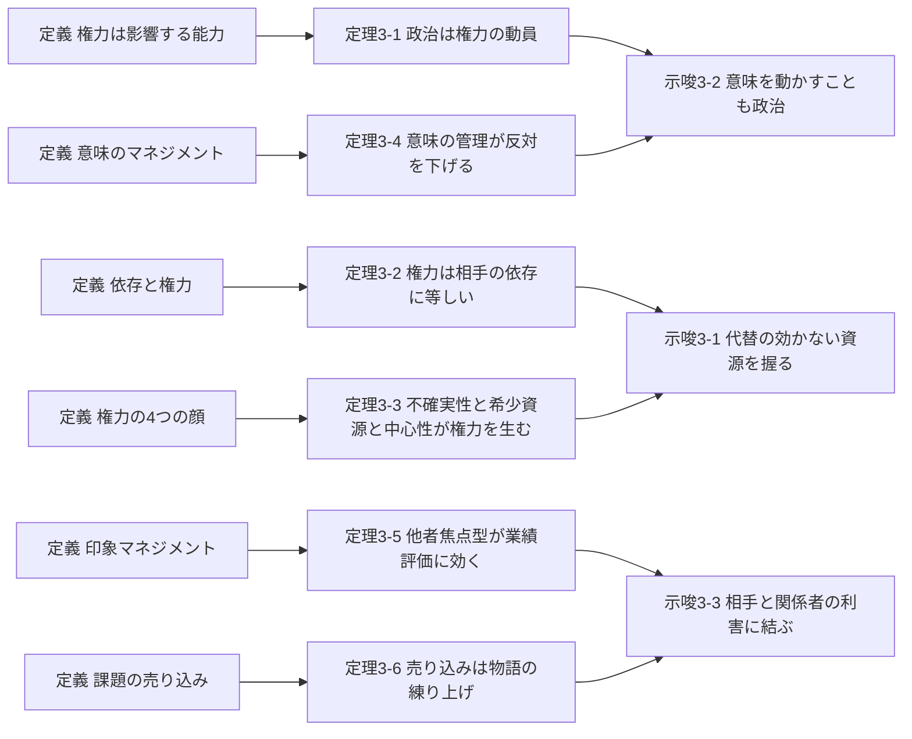

# 第3章 そもそも社内政治とは？ — 定義・定理・示唆

> 木村琢磨『社内政治の科学』（2025）の目次の見出しを「論点の枠」として使い、本文を読んだ論文だけを根拠に定理を立てました。本の内容は書いていません。著者の定義は、著者の公開記事から出典付きで紹介します。

## この章の問い

社内政治とは何か。それは権力とどう関係するか。なぜ「意味（解釈）」を動かすことが政治になるのか。

目次の見出し（第2〜4節）は次のとおりです。

- 第2節 社内政治の定義: なぜ定義が重要か / 古典的研究における定義 / 対立、そして意味のマネジメントへ / 本書での社内政治の定義
- 第3節 社内政治と権力: 権力とは / 権力の行使・使用としての政治 / 権力獲得のための社内政治
- 第4節 社内政治と意味のマネジメント: 意味形成理論 / 意味のマネジメントとしての政治 / 印象マネジメントとしての政治 / 部下や企画を売り込む

## 1. 概念の定義

| 概念 | 定義（言い換え） | 出典 | 読んだ箇所 |
|------|------------------|------|------------|
| 社内政治（著者の公開記事の定義） | 利害の不一致や対立があるときに、正式なルートではない方法で、他者や組織に影響を与えようとする行動。小さな影響（相手の気分を少し良くするなど）も含む | 幻冬舎 GOLD ONLINE の著者記事 | 「社内政治は『対立する場面で非公式に影響を与える』こと」の節 |
| 権力（Dahl） | A が B に、B が本来しないことをさせられる程度。基盤（使える資源）、手段、量（確率で表す）、範囲（B の反応の種類）の 4 つで記述する | Dahl 1957, Behavioral Science 2(3) | pp. 202–203（定義と 4 要素の節） |
| 依存（dependence） | A の B への依存は、B が仲介する目標への A の動機づけの投資に比例し、その目標を B 以外から得られる程度に反比例する | Emerson 1962, ASR 27(1) | p. 32「The Power-Dependence Relation」 |
| 権力（Emerson） | A が B の抵抗を潜在的に乗り越えられる量。常に観察されるわけではない潜在力。A の B への権力は B の A への依存に等しい | Emerson 1962 | pp. 32–33 |
| 権力（Magee & Galinsky） | 社会関係の中で、価値ある資源を非対称に統制していること。価値は主観的に決まる。尊敬や賞賛を指す地位（status）とは区別する | Magee & Galinsky 2008, Academy of Management Annals 2(1) | pp. 361–362「Definition of Social Power」 |
| 政治（Fleming & Spicer の作業定義） | 権力を動員して、人々の関係や財の配分を組み替える活動。権力はそのために他者に影響する能力 | Fleming & Spicer 2014（レビュー） | 著者稿 pp. 1–2（序論） |
| 権力の 4 つの顔 | 強制（直接の行使）、操作（議題と参加者の管理）、支配（選好や価値観の形成）、主体化（自己認識の形成）。前 2 つは一時的、後 2 つは制度に組み込まれた形 | Fleming & Spicer 2014 | 著者稿 pp. 2–5「Four Faces of Organizational Power」、Table One |
| 意味のマネジメント | 言語・物語・枠組み・儀式・象徴を使い、組織の行動を正当化し、理解と合意をつくること | Rindova & Srinivas 2017 による Pfeffer 1981 の整理（レビュー） | 著者稿 pp. 1–2, 6 |
| 意味形成（sensemaking）と意味付与（sensegiving） | 意味形成は出来事の意味を解釈して枠組みをつくること。意味付与は、その解釈やビジョンを他者に伝え、受け入れさせて行動させること | Rindova & Srinivas 2017 による Gioia & Chittipeddi 1991 と Maitlis & Christianson 2014 の整理 | 著者稿 pp. 3, 7 |
| 印象マネジメント（impression management） | 他者からどう見られるかを左右しようとする、目標のある行動。意識的か無意識か、偽りか本物かは問わない。自分の有能さを示す自己焦点型（自己宣伝など）と、好意を得る他者焦点型（取り入り、意見同調、好意の提供など）に分ける | Peck & Levashina 2017, Frontiers in Psychology 8 | Introduction、Theoretical background、Methods の変数定義 |
| 課題の売り込み（issue selling） | 決定権のない人が、ある課題が組織にとって戦略的に重要だと決定者に納得させる過程。「包装（packaging）」と「売り込み（selling）」の 2 段で整理されてきた | Vacquier, Garreau & Dameron 2024 による Dutton & Ashford 1993 の整理 | pp. 19–21「Literature review」 |

## 2. 定理

### 定理 3-1: 権力は他者に影響する能力であり、政治はその権力を動員して関係や資源配分を組み替える活動である

- **内容**: Fleming & Spicer は、権力と政治がよく混同されると指摘し、両者を区別する。権力は他者に影響する能力（資源）で、政治はそれを動員する活動である。政治を「陰口や裏取引」とみる否定的な見方は一面的で、権力は良い成果も生みうると述べる。
- **根拠**: Fleming & Spicer（2014, Academy of Management Annals 8(1)）。City Research Online の著者稿 pp. 1–3（序論）と「Four Faces of Organizational Power」の節。研究の種類はレビュー（理論・概念の整理）。
- **条件・限界**: 作業定義であり、実証で検証された命題ではない。研究者の間で定義の合意はない。

### 定理 3-2: A の B に対する権力は B の A への依存に等しく、その依存は B が A を通して得たい目標への関心が強いほど大きく、代わりの入手先が多いほど小さい

- **内容**: Emerson は、権力を人の属性ではなく関係の性質とみる。権力の差は不安定で、弱い側による「均衡化」を引き起こす。均衡化の型は 4 つある。目標への関心を下げる、代わりの関係を開拓する、強い側に地位を与える、連合を組む、である。Magee & Galinsky も同じ依存の考え方で権力を定義する。そのうえで、肩書きが低い人でも、上司が頼る専門性を持てば権力を持ちうると述べる。
- **根拠**: Emerson（1962, ASR 27(1): 31–41）。pp. 32–33（定義と Pab=Dba）、pp. 34–35（均衡化の 4 型）、pp. 35–39（各型の節）。理論的命題（小集団研究からの例示あり）。Magee & Galinsky（2008）。pp. 361–362。レビュー。
- **条件・限界**: 依存の 2 変数がどう組み合わさるかは経験的な問題として残されている（Emerson p. 32）。比例・反比例は方向だけを示す命題である。

### 定理 3-3: 他の部門が頼る不確実性や希少で中心的な資源を握る部門、またはネットワークの中心にいる主体は、公式の地位以上の権力を持つ

- **内容**: Fleming & Spicer は次の研究を整理している。Crozier のたばこ工場研究では、機械の保守担当が唯一の不確実性を握り、強い力を持った。Aston 研究（Hickson et al. 1971、Hinings et al. 1974）では、不確実性への対処が部門の権力と結びついた。Pfeffer & Salancik（1974）の大学研究では、外部研究費のように希少で中心的な資源の統制が権力の源になった。さらに、ネットワーク上の中心性や境界をまたぐ位置も、資源の量以上の影響力を生むとされる。
- **根拠**: Fleming & Spicer（2014）。著者稿 pp. 9–10「Coercion 'In' Organizations」、pp. 12–13「Manipulation 'In' Organizations」。レビュー（各原典は事例研究・質問紙調査。工場、大学、病院など）。Magee & Galinsky（2008）pp. 365–379。権力を持つ人の心理（自信、行動しやすさ、情報処理）が権力の維持・拡大に働くこと、ただし弱める力もあること（「Forces of Hierarchy Attenuation」）。レビュー。
- **条件・限界**: Hickson et al. 1971 などの原典は本文を読んでおらず、レビューによる整理である。権力を「希少資源の統制」だけで測ると、他の源泉を見落とすとレビュー自身が注意している。

### 定理 3-4: 言語・物語・象徴による意味のマネジメントは、組織内の反対や対立を下げて行動を動員し、とくに戦略変更のような曖昧な局面で重要になる

- **内容**: Rindova & Srinivas は Pfeffer（1981）を起点に整理する。管理には 2 つの水準がある。実質の決定は外部制約と権力依存関係で決まる。一方、象徴の水準では、政治的な言語と象徴的行為が決定を正当化する。意味のマネジメントは、反対と対立を下げ、外部からの監視も和らげる。Gioia & Chittipeddi（1991）は大学の戦略変更で、トップがまず出来事の意味を解釈し、次にビジョンを広めて関係者に受け入れさせる過程を示した。Maitlis & Lawrence（2007）は、変化が曖昧さと利害の違いを目立たせるとき、指導者に共有された説明をつくる必要が生じるとした。
- **根拠**: Rindova & Srinivas（2017, The Oxford Handbook of Management 所収）。著者のプレプリント pp. 1–3（序論、Understanding Meaning）、pp. 6–7（Managing Meaning Internally and Externally、Organizational and Strategic Change）。レビュー（原典は事例・エスノグラフィーが中心）。Fleming & Spicer（2014）p. 3 では、選好そのものを形づくる「支配」の顔として、同種の働きを権力に含めている。
- **条件・限界**: Gioia & Chittipeddi、Maitlis & Lawrence、Smircich & Morgan の原典は本文を読んでおらず、レビューによる整理である。原典の多くは単一組織の質的研究である。

### 定理 3-5: 他者焦点型の印象マネジメント（取り入りなど）は業績評価を高め、自己焦点型（自己宣伝など）は面接評価を高めるが業績評価への効果は確認されない

- **内容**: Peck & Levashina のメタ分析（複数研究の統合）では、面接では自己焦点型の効果が大きかった（k=20、補正相関 0.24）。業績評価では他者焦点型だけが有意だった（k=4、0.25）。自己焦点型の業績評価への効果は有意ではなかった（k=6、0.18）。面接では、印象マネジメントの相手が評価者本人のとき効果が大きく（0.27）、第三者の評価者では有意でなかった（0.11）。
- **根拠**: Peck & Levashina（2017, Frontiers in Psychology 8: 201）。Introduction、Theoretical background、Methods、Results（Table 2、Table 6）、Discussion、Limitations。メタ分析。1990〜2015 年の 9 誌から 18 本、効果量 42、N=8,635。
- **条件・限界**: 業績評価の研究は少なく（k=4〜6）、業績評価側の調整変数は分析できなかった。実験室の研究で効果が大きい。評価の向上であって、実際の成果の向上ではない。

### 定理 3-6: 課題の売り込みは、非公式な場で物語の断片を関係者と少しずつ練り上げる段階と、公式の場で一貫した物語として示す段階からなり、その移行には利害の結合・戦略的な枠付け・具体例による例証が要る

- **内容**: 従来は、売り手が合理的・直線的に「包装」して「売り込む」と考えられていた。この研究は、課題が戦略的かどうかは関係者の意味づけでつくられるとみる。中間管理職は、まず近い関係の人と口頭で断片を交換する。次に経営会議などで一つの物語として示す。関係者の利害を一つの物語に結び、「一つの声」で語れる連合をつくることが、物語の一貫性を高めた。ただし利害の結合は必要条件であって十分条件ではなく、戦略的な枠付けと例証が加わる必要があった。
- **根拠**: Vacquier, Garreau & Dameron（2024, M@n@gement 27(1): 19–37）。Literature review、Methods、Results（「The incremental elaboration of the narrative」「Strategic framing」「Illustrating」「Interpreting the narrative as a strategic issue」）、Discussion。質的研究（事例）。フランスの多様な業種・規模の企業の中間管理職 42 名への回顧的な半構造化面接。
- **条件・限界**: 回顧的な面接で、売り手の視点だけである。面接は大学院生が実施した。成功と失敗の比較で因果を示したものではない。

## 3. 示唆

以下は論文の主張ではなく、定理を組み合わせて導いたものです。

### 示唆 3-1: 社内で権力を得るには、他者が頼る資源や不確実性への対処を代わりの効かない形で握ることが筋道になり、権力の弱い側は代わりの入手先や連合をつくることで依存を下げられる

- **組み合わせ**: 定理 3-2 + 定理 3-3
- **導出**: 定理 3-2 では、権力は相手の依存の大きさで決まり、依存は代替が少ないほど大きい。定理 3-3 では、不確実性や希少資源を握る部門が権力を得ていた。両者は同じ構造を示す。「相手にとって重要で、代わりがない」ものを握ることが権力の源泉になる。逆に弱い側は、Emerson の均衡化（代わりの関係の開拓、連合形成）で権力差を縮められる。
- **追加の前提**: なし
- **注意**: 定理 3-2 は理論的命題で、定理 3-3 はレビューによる整理である。個人単位の社内政治にそのまま当てはまるかは、本文を読んだ範囲では確かめていない。

### 示唆 3-2: 「意味」を動かすことは、権力の行使の一つの形として政治に含まれ、表立った対立が起きる前に反対を減らす働きを持ちうる

- **組み合わせ**: 定理 3-1 + 定理 3-4
- **導出**: 定理 3-1 では、政治は権力を動員して関係や配分を組み替える活動である。そこでいう権力には、議題の管理（操作）や選好の形成（支配）も含まれる。定理 3-4 では、意味のマネジメントが反対と対立を下げて行動を動員する。この 2 つを合わせると、解釈を動かすことは配分を組み替える一つの経路になる。しかも対立を表に出さずに働きうる。
- **追加の前提**: なし
- **注意**: 著者の公開記事の定義は「利害の不一致や対立があるとき」を条件にしている。対立が表に出ない段階での意味の操作をどこまで含めるかは、定義の選び方で変わる。

### 示唆 3-3: 部下や企画を売り込むときは、決定者や評価者本人に向けて、関係者の利害を一つの物語に結びつけることが、通りやすさを高めうる

- **組み合わせ**: 定理 3-5 + 定理 3-6
- **導出**: 定理 3-5 では、相手との関係を築く他者焦点型の行動が業績評価に効いた。面接では、相手が評価者本人のとき効果が大きかった。定理 3-6 では、企画が戦略的と認められる過程で、利害の結合と連合が物語の説得力を高めた。どちらも、自分の能力を示すことより、相手や関係者の側に立つ働きかけが効く点で共通する。
- **追加の前提**: 面接・業績評価という評価場面の知見（定理 3-5）が、企画の承認という場面にも同じ向きで当てはまること。
- **注意**: 定理 3-5 の業績評価の研究は少ない。定理 3-6 は売り手側の回顧のみで、因果は示していない。

## 4. 本文未確認の関連研究

| 文献 | 関係 | 本文が読めなかった理由 |
|------|------|------------------------|
| Mayes & Allen 1977, AMR 2(4) | 古典的な定義（公認されない目的や手段による影響の管理） | UNL Digital Commons の PDF が 403 で取得できず |
| Drory & Romm 1990, Human Relations 43(11) | 定義のレビュー | オープンアクセス版が見つからず |
| Hickson et al. 1971, ASQ 16(2) | 戦略的コンティンジェンシー理論 | オープンアクセス版が見つからず。定理 3-3 はレビューで代替 |
| Salancik & Pfeffer 1977/1978, Organizational Dynamics | 権力の獲得と保持 | 本文が見つからず |
| Brass 1984, ASQ 29(4) | ネットワーク上の位置と影響力 | オープンアクセス版が見つからず |
| Gioia & Chittipeddi 1991, SMJ 12(6) | 意味形成と意味付与 | 出版社サイトが 403。定理 3-4 はレビューで代替 |
| Maitlis 2005, AMJ 48(1) | 意味形成の 4 つの型 | オープンアクセス版が見つからず |
| Smircich & Morgan 1982, JABS 18(3) | 意味のマネジメントとしてのリーダーシップ | 本文が見つからず。レビュー内の言及のみ |
| Bolino, Long & Turnley 2016, Annual Review of OPOB 3 | 印象マネジメントのレビュー | 出版社サイトが 403 |
| Higgins, Judge & Ferris 2003, JOB 24(1) | 影響戦術のメタ分析 | PDF の取得先が空ページを返した |
| Dutton & Ashford 1993, AMR 18(3) / Dutton et al. 2001, AMJ 44(4) | 課題の売り込み | PDF の取得先が空ページ、または未公開。定理 3-6 は後続研究で代替 |
| Seibert, Kraimer & Liden 2001, AMJ 44(2) / Ng et al. 2005, Personnel Psychology 58(2) | キャリア上の後ろ盾（sponsorship）とキャリア成功 | オープンアクセス版が見つからず |
| Anderson & Brion 2014, Annual Review of OPOB 1 | 権力の獲得・維持・喪失 | 出版社サイトが 403 |

## 5. 読んだ文献

| 文献 | 本文の入手先 | 読んだ範囲 |
|------|--------------|------------|
| Dahl 1957 The Concept of Power | UNC の授業用 PDF | pp. 201–203（序論、定義、4 要素） |
| Emerson 1962 Power-Dependence Relations | UMSL の授業用 PDF（JSTOR 版） | pp. 31–39（定義、Pab=Dba、コスト削減、均衡化の 4 型） |
| Magee & Galinsky 2008 Social Hierarchy | MIT の授業用 PDF | 要旨、pp. 361–362（権力の定義）、pp. 365–379（自己強化の節と弱める力の節の冒頭） |
| Fleming & Spicer 2014 Power in Management and Organization Science | City Research Online の著者稿 | pp. 1–5（序論、4 つの顔）、pp. 9–13（強制と操作の「In」の節） |
| Rindova & Srinivas 2017 Managing Meaning—Culture | 著者のプレプリント PDF | pp. 1–7（序論、意味の理解、内部と外部の意味のマネジメント、戦略変更） |
| Peck & Levashina 2017 Impression Management and Interview and Job Performance Ratings | Frontiers のオープンアクセス版 | 本文のほぼ全体（序論〜限界、Table 2、Table 6）。末尾の約 8,000 字は未読 |
| Vacquier, Garreau & Dameron 2024 The Construction of A Strategic Issue | M@n@gement のオープンアクセス版 | 要旨、序論、文献レビュー、方法、結果の主要部、考察の見出し |
| 著者記事（幻冬舎 GOLD ONLINE） | 公開記事 | 定義の節（3 ページ目） |

## Sources

- [幻冬舎 GOLD ONLINE 著者記事（社内政治の定義）](https://gentosha-go.com/articles/-/73725?page=3)
- [Dahl 1957 The Concept of Power](https://fbaum.unc.edu/teaching/articles/Dahl_Power_1957.pdf)
- [Emerson 1962 Power-Dependence Relations](https://umsl.edu/%7Ekeelr/3210/resources/emerson_power_depend.pdf)
- [Magee & Galinsky 2008 Social Hierarchy](https://web.mit.edu/curhan/www/docs/Articles/15341_Readings/Power/Magee,%20J.%20C.,%20&%20Galinsky,%20A.%20D.%20(2008).%20Social%20hierarchy-%20The%20self%E2%80%90reinforcing%20nature%20of%20power%20and%20status..pdf)
- [Fleming & Spicer 2014 著者稿（City Research Online）](https://openaccess.city.ac.uk/id/eprint/8236/4/Annals%20accepted.pdf)
- [Rindova & Srinivas 2017 Managing Meaning プレプリント](https://santoshbs.github.io/files/RindovaSrinivas_2017_ManagingMeaning_PreprintVersion.pdf)
- [Peck & Levashina 2017 Frontiers in Psychology](https://www.frontiersin.org/journals/psychology/articles/10.3389/fpsyg.2017.00201/full)
- [Vacquier, Garreau & Dameron 2024 M@n@gement](https://management-aims.com/index.php/mgmt/article/download/5778/17006)
- [Hickson 1989 Citation Classic（参考。定理の根拠には使っていない）](https://garfield.library.upenn.edu/classics1989/A1989AP52300001.pdf)
