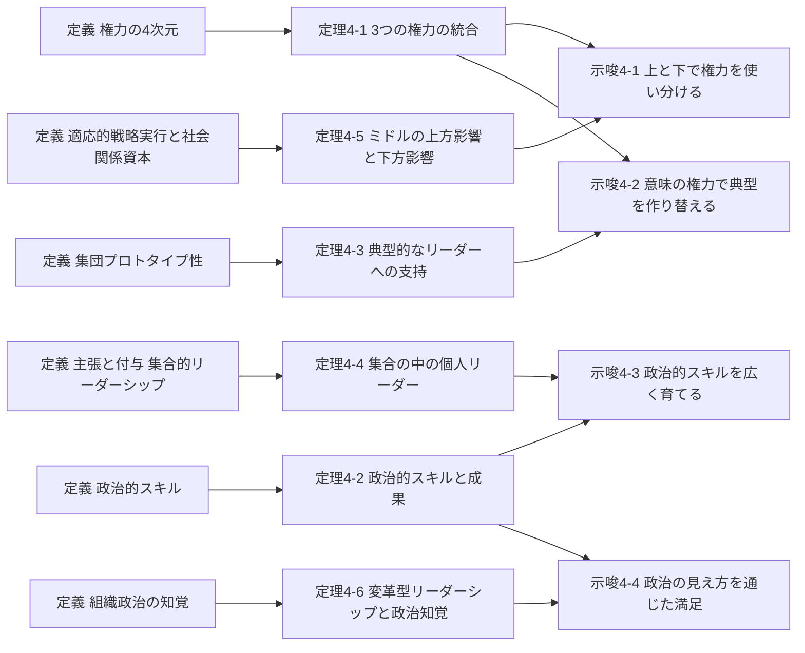

# 第4章 リーダーシップとしての社内政治 — 定義・定理・示唆

## この章の問い

リーダーシップはなぜ政治と切り離せないのか。組織変革やミドルマネジャーの仕事の中で、政治はどう働くのか。この 2 つに、論文の本文から言えることだけで答える。

木村琢磨『社内政治の科学』（2025）の目次の見出しは、論点の枠としてだけ使う。本の中身には触れない。

- 第1節 そもそもリーダーシップとは？（定義 / マネジメントとの関係 / 研究の変遷）
- 第2節 なぜ政治的リーダーシップが必要か？（よくあるリーダーシップ論の問題点 / 政治と切り離せないリーダーシップ / アイデンティティ変革の重要性）
- 第3節 変革のための社内政治（組織変革のモデル / 組織変革モデルと政治 / 組織変革のための政治的リーダーシップ / リーダーシップを「分配」する）
- 第4節 ミドルマネジャーの政治的リーダーシップ（ミドルの役割 / 部門マネジャーとしての利害調整と資源獲得 / 社内政治と部下のモチベーション）

## 1. 概念の定義

| 概念 | 定義（言い換え） | 出典 | 読んだ箇所 |
|---|---|---|---|
| リーダーシップ | 集団の目標を達成するために、他者の関与を引き出して動かす影響の過程。強制的な権力行使とは区別される | Hogg 2001, PSPR | 「Leadership, Influence, and Power」節（p.194） |
| マネジャーとリーダー | マネジャーは対立する意見の釣り合いを取り、選択肢を絞って妥協点に導く。リーダーは新しい選択肢を開き、人を引きつけるイメージを示す。リーダーシップには、権力を使って他者の考えと行動に影響することが避けられない | Zaleznik 1977, HBR（2004 年再掲版） | 序論、「Attitudes Toward Goals」「Conceptions of Work」節 |
| 権力と政治 | 権力は結果に影響する力。政治は行動に移された権力。ここでは中立の意味で使う | Hardy 1996, BJM | Introduction |
| 権力の 4 次元 | 資源の権力（情報・予算・報酬など相手が頼るものを使う）、プロセスの権力（議題や手続きを操作する）、意味の権力（物事を正当・必然と思わせる）、システムの権力（誰も疑わない価値・文化・構造に埋め込まれた力） | Hardy 1996, BJM | 「The First Dimension」〜「The Fourth Dimension」節、Table 1 への言及 |
| 政治的スキル | 職場で他者をよく理解し、その理解を使って、自分や組織の目標に役立つように他者を動かす能力。社会的洞察力・対人影響力・ネットワーク構築力・誠実さの見え方の 4 次元からなる | Ferris et al. 2007, JOM | 「Definition and Construct Specification」「Dimensionality of Political Skill」節（pp.291–293） |
| 集団プロトタイプ性 | その人が、集団らしさの典型（プロトタイプ）にどれだけ近いか。同一視が強い集団では、典型に近い人が影響力を持ちやすい | Hogg 2001, PSPR | 要旨、「Prototypicality」節、「Tests of the Social Identity Theory of Leadership」節（pp.190–191） |
| リーダー・アイデンティティの主張と付与 | 自分がリーダーだと名乗る（主張）ことと、周りがその人をリーダーと認める（付与）こと。リーダーシップは両者がそろって成り立つ。DeRue & Ashford 2010 の枠組みを、Empson らが調査の設計に使っている | Empson, Langley & Sergi 2023, Organization Studies | Introduction、「Data collection」節（pp.202, 207） |
| 集合的リーダーシップ | リーダーシップを一人の英雄に帰さず、公式・非公式の立場にいる複数の人の協働として見る考え方 | Empson, Langley & Sergi 2023, Organization Studies | Introduction（p.202） |
| 「3 段階の変革」（CATS） | 解凍 → 変革 → 再凍結という変革モデル。Lewin の基礎理論とされてきたが、Lewin 自身はモデルとして展開しておらず、死後に後の著者が形にしたもの | Cummings, Bridgman & Brown 2016, Human Relations | 著者稿の Abstract、「Dubious assumptions」「Recovering new frontiers」節 |
| ミドルの適応的戦略実行 | ミドルが計画された戦略を現場に合わせて調整する行動。上方への影響（代替案を上層部に売り込む）と、下方への影響（現場の柔軟な試行を促す）からなる。Floyd & Wooldridge の役割類型に基づく | Ahearne, Lam & Kraus 2014, SMJ | 「Theoretical Background」節（pp.69–70） |
| 評判型・情報型の社会関係資本 | 評判型は、経営層や同僚の相談ネットワークの中で「詳しい人」として頼られる度合い。情報型は、自分の地域ネットワークの外にある情報に手が届く度合い | Ahearne, Lam & Kraus 2014, SMJ | 「Theoretical Background」節、Figure 1 |
| 組織政治の知覚（POP） | 職場で自己利益のための政治的行動がどれだけ広がっていると感じるか。Kimura 2012 は組織レベルの知覚を Maslyn & Fedor 1998 の尺度で測った | Kimura 2012, IJBSAM | Introduction、Method（尺度の説明） |

## 2. 定理

### 定理 4-1: 戦略変革は、資源・プロセス・意味の 3 つの権力をまとめて使い、既存システムの権力に対抗したときに実現し、どれか 1 つだけでは定着しない

- **内容**: 資源の権力だけだと、報酬や罰を出し続けないと行動が続かない。プロセスの権力だけだと、既存の規範に合う変化しか残らない。意味の権力だけだと、具体的な行動を狙って変えられない。カナダの自動車工場では、コンサルタントが参加型の委員会（プロセスの権力）だけを使い、2 年たっても変化は起きなかった。尊敬される管理者が新しいやり方を実践して「良い管理者」の意味が変わり、報酬（資源）と委員会（プロセス）が後押ししたとき、変化が実現した。
- **根拠**: Hardy, C.（1996, British Journal of Management）。著者稿（University of Melbourne リポジトリ）の「Mobilizing Power for Strategic Action: An Example」「Targeting Power for Strategic Action: An Example」「Conclusions」節を読んだ。理論論文で、二次事例 2 件を使って説明している（Westley 1990 の米系自動車メーカーのカナダ工場、Roberts 1990 の英国電球メーカー ELB。ELB では従業員 6,000 人が 1,600 人になったが、管理職の抵抗はほとんどなかった）。理論的命題として扱う。
- **条件・限界**: 事例は他の研究者の記述を使った例示で、検証のためのデータではない。著者は「偉大なリーダー」に頼る変革論も批判しており、カリスマとビジョンは話の一部にすぎないとしている（Conclusions）。

### 定理 4-2: リーダーの政治的スキルは、チームの成績やリーダー有効性の評価を予測し、周囲から認められたリーダーの影響力が業績につながるかどうかを左右する

- **内容**: Ferris et al. 2007 のレビューによると、児童福祉チームの研究（Ahearn et al. 2004）では、担当件数や経験などを統制しても、リーダーの政治的スキルがチーム成績の分散を有意に説明した。Douglas & Ammeter 2004 では、リーダー有効性の評価を予測した。Shaughnessy et al. では、同僚からインフォーマル・リーダーと認められた人の業績が高かったのは、政治的スキルが高い場合だけだった（平均以下では有意な関係なし）。
- **根拠**: (1) Ferris et al.（2007, Journal of Management）。「Political skill main effects on performance and reputation」（p.308）、「Group-Level Processes」〜「Effects of Political Skill on Groups and Organizations」（pp.310–313）を読んだ。Ferris et al. 2007（レビュー）による整理。(2) Shaughnessy, Treadway, Breland & Perrewé（2017, Journal of Leadership & Organizational Studies 24(1)）。「Sample and Procedure」「Results」節と Table 2（p.89）を読んだ。実証研究で、米国の精神保健施設の職員を 3 か月の間隔を置いて調べた（分析対象 40 人）。インフォーマル・リーダーは組織全体のネットワークの合意で測った。
- **条件・限界**: Ferris のレビューは、部下の信頼や満足が高まる経路を「主張されている」と書いており、Ahearn 2004 でも媒介する経路は測っていない（p.313）。Shaughnessy の研究は 1 施設・40 人と小さい。

### 定理 4-3: 集団への同一視が強いほど、メンバーは集団の典型に近い人をリーダーとして支持し、有効だと評価する（同一視が弱いと、典型性の効果は小さい）

- **内容**: 集団らしさが際立つ条件では、典型的なリーダーが非典型的なリーダーより有効と評価された。際立たない条件では差がなかった。集団の結束が強まるほど、一般的な「リーダーらしさ」の型より典型性のほうが支持を左右した。典型的なリーダーは集団の規範を体現しているので、権力を行使しなくても影響力を持つ。一方、リーダーと部下の地位の差が広がると、典型性による影響は弱まり、権力を使った支配に移りやすい（この点は未検証の理論的命題）。
- **根拠**: Hogg, M. A.（2001, Personality and Social Psychology Review）。「Tests of the Social Identity Theory of Leadership」（pp.190–191）、「Leadership, Influence, and Power」（p.194）、Concluding Comments を読んだ。理論論文で、自身の研究室の研究をまとめて報告している。2×2×2 の実験（学生 184 人）、オーストラリアのアウトドア研修集団（13 集団・143 人・3 週間）のフィールド研究、最小集団の実験 2 件（82 人、164 人）。
- **条件・限界**: 主な証拠は実験室と短期の集団で、企業組織での検証ではない。権力と地位の差に関する部分は、著者自身が未検証としている。

### 定理 4-4: 集合的リーダーシップの物語が強い組織でも、個人はリーダーとしてのアイデンティティを主張しており、集合を体現する個人リーダーを立てることで、集合にリーダーシップを認めている

- **内容**: 「誰がリーダーか」への答えは「全員」から「誰もいない」まで分かれた。個人の語りには、起業家・社内起業家・奉仕者・アバター・演者・挑戦者・賢者といった複数のリーダー像があった。集合的リーダーシップを支持する人も、集合を代わりに体現する個人（アバター）を作り、それを通じて抽象的な集合にリーダーシップを付与していた。著者らは、集合を重んじる組織でもリーダーシップを神聖視する傾向が続くと述べている。
- **根拠**: Empson, Langley & Sergi（2023, Organization Studies 44(2)、2022 年オンライン公開）。著者稿（Warwick リポジトリ）の Abstract、「Research Design and Methodology」（pp.206–207）、「Organizational Narrative of Collective Leadership」、Table 1 前後を読んだ。質的な事例研究で、国際的な専門サービス企業 1 社（パートナー制、専門職 400 人、40 か国）を対象に、34 人に約 90 分の面接を行った。
- **条件・限界**: 利益の均等配分など、集合を重んじる極端な事例 1 社の研究。普通の階層型企業にそのまま当てはまるとは限らない。

### 定理 4-5: ミドルの上方影響は評判型の社会関係資本が高いほど事業成果を高め、下方影響は情報型の社会関係資本が高いほど事業成果を高める（上方影響は、やりすぎると成果が下がる逆 U 字）

- **内容**: 代替案の推進（上方影響）と成果の関係は逆 U 字だった。その効果は、経営層の相談ネットワークで頼られるミドルほど強かった。現場の適応の促進（下方影響）は成果と直線的な正の関係で、地域ネットワークの外とつながるミドルほど効果が強かった。上司の管轄が広いと、上方影響の効果は弱まった。
- **根拠**: Ahearne, Lam & Kraus（2014, Strategic Management Journal 35）。「Research Method: Sample and research context」と「Results」節、Table 2 を読んだ。実証研究で、米国 Fortune 500 企業の最大事業部（業務用洗浄・衛生）を対象に、営業部長 43 人と営業マネジャー 285 人を調べた。成果は会社記録の客観指標（ノルマ達成率・売上成長・新規顧客）を使った。
- **条件・限界**: 1 社の営業組織の研究。ミドルは中間層の下の方（地区営業マネジャー）にあたる。下方影響の逆 U 字の仮説は支持されなかった。

### 定理 4-6: 日本企業の従業員では、トップの変革型リーダーシップが強いと感じられるほど組織政治の知覚が低く、組織政治の知覚が高いほど職務満足が低い傾向がある（後者の関係は弱い）

- **内容**: 構造方程式モデルで、トップの変革型リーダーシップは組織レベルの政治知覚と負の関係（標準化係数 −0.205, p<0.01）にあった。政治知覚は職務満足と負の関係（−0.119, p<0.10）にあった。政治知覚と市場志向には関係が見られなかった。
- **根拠**: Kimura, T.（2012, International Journal of Business Science and Applied Management 7(1), pp.29–42）。オープンアクセス版の「4 Results」「4.2 Hypotheses Testing」、Figure 2、「5.4 Limitations」を読んだ。実証研究（横断調査）で、日本企業の正社員 200 人を対象にした。
- **条件・限界**: 1 時点・同じ回答者のデータなので、因果は言えない。著者も、政治知覚の尺度の信頼性が低い（α=0.61、4 項目中 2 項目を削除）ことを限界に挙げている。

## 3. 示唆

ここに書くのは、論文の主張ではなく、定理を組み合わせて導いたものである。

### 示唆 4-1: 変革を進めるミドルは、上と下で使う権力の種類と関係資本を分けて考える必要がある

- **組み合わせ**: 定理 4-1 + 定理 4-5
- **導出**: 定理 4-1 によれば、変革は 1 種類の権力だけでは定着しない。定理 4-5 によれば、上方への影響は経営層の中での評判が、下方への影響は外部の情報へのアクセスが効果を左右する。したがって、ミドルが変革を担うには、上には評判を使って代替案を正当なものとして通し、下には外の情報を使って試行を促すという使い分けが筋が通る。
- **追加の前提**: Ahearne らの「上方影響・下方影響」を、Hardy の「意味・資源・プロセスの権力」の使い方の一部として読み替えられること。
- **注意**: 定理 4-5 は 1 社の営業組織、定理 4-1 は二次事例による例示であり、両方とも一般化には限界がある。

### 示唆 4-2: アイデンティティの変革は、「意味の権力」を使って集団の典型を作り替える働きとして理解できる

- **組み合わせ**: 定理 4-1 + 定理 4-3
- **導出**: 定理 4-3 によれば、同一視が強い集団では、典型に近い人が権力を使わずに影響力を持つ。定理 4-1 の工場の事例では、尊敬される管理者の実践によって「良い管理者」の意味が変わったときに変革が進んだ。2 つを合わせると、変革のリーダーシップには、集団の典型そのものを作り替え、新しい典型に近い人の影響力を高める働きがあると考えられる。
- **追加の前提**: Hardy の言う「良い管理者の意味」が、Hogg の言う集団プロトタイプに相当すること。
- **注意**: 定理 4-3 の証拠は主に実験室と短期の集団、定理 4-1 は例示的な事例であり、組織での検証はない。

### 示唆 4-3: リーダーシップは周りから認められて成り立つので、政治的スキルを育てる対象は正式な管理職に限らないほうがよい

- **組み合わせ**: 定理 4-2 + 定理 4-4
- **導出**: 定理 4-4 によれば、肩書きと関係なく多くの人がリーダーとしてのアイデンティティを主張し、周りも個人や集合にリーダーシップを認めている。定理 4-2 によれば、認められたリーダーの影響力が業績につながるのは、政治的スキルが高い場合である。したがって、リーダーシップを分配する組織ほど、政治的スキルを正式な管理職以外にも育てる理由がある。
- **追加の前提**: 政治的スキルは訓練や経験で伸ばせる部分があること（Ferris et al. 2007 の p.292 でそう論じられているが、効果を検証した研究は本章では読んでいない）。
- **注意**: 定理 4-2 の Shaughnessy らの研究は 40 人と小さく、定理 4-4 は特殊な 1 社の事例である。

### 示唆 4-4: トップのリーダーシップは、部下の目に政治がどう映るかを通じて、満足に影響しうる

- **組み合わせ**: 定理 4-6 + 定理 4-2
- **導出**: 定理 4-6 によれば、トップの変革型リーダーシップは政治知覚の低さと結びつき、政治知覚は職務満足と負の関係にある。定理 4-2 のレビューでは、リーダーの政治的スキルが部下の信頼や満足を高めると論じられている。両方から、リーダーは政治的行動をなくすことよりも、部下に政治がどう見えるかを通じて満足に影響している可能性がある。
- **追加の前提**: 政治的スキルの高いリーダーの影響力は、部下に「私利のための政治」と受け取られにくいこと（本章で読んだ論文では検証されていない）。
- **注意**: 定理 4-6 は横断データで、関係は弱い（p<0.10）。定理 4-2 の部下への効果は、レビューの中でも検証が不十分とされている。

## 4. 本文未確認の関連研究

| 文献 | 関係 | 本文が読めなかった理由 |
|---|---|---|
| Meindl, Ehrlich & Dukerich 1985, ASQ | リーダーシップのロマンス。成果をリーダーに帰属させすぎる傾向（第2節） | JSTOR の有料版のみ。批判的な後続論文の PDF もログインが必要だった |
| Ammeter et al. 2002, Leadership Quarterly | 政治的リーダーシップ理論（第2節） | 出版社版のみ。OA 版は見つからなかった |
| Treadway et al. 2004, Leadership Quarterly | リーダーの政治的スキルと部下の反応（第4節） | 出版社版のみ。内容は Ferris et al. 2007 の要約でしか確認していない |
| Ellen, Ferris & Buckley 2013, Leadership Quarterly | リーダーによる政治的支援（第4節） | 出版社版のみ。会員限定のページしかなかった |
| Chang, Rosen & Levy 2009, AMJ / Bedi & Schat 2013 | 政治知覚と態度・ストレス・行動のメタ分析（第4節） | 出版社版のみ。ResearchGate は要旨だけだった |
| Huy 2002, ASQ | ミドルの感情のバランシング（第4節） | 見つかった PDF は大学の授業サイトにあり、ログインが必要だった |
| Floyd & Wooldridge 1992, SMJ / 1997, JMS | ミドルの戦略的役割の類型（第4節） | 出版社版のみ。類型は Ahearne et al. 2014 の本文での紹介を通じて確認した |
| Wooldridge, Schmid & Floyd 2008, JOM | ミドルと戦略プロセスのレビュー（第4節） | core.ac.uk が 403 を返した |
| Denis, Lamothe & Langley 2001, AMJ / Denis, Langley & Cazale 1996 | 多元的な組織での集合的リーダーシップと戦略変革（第3節） | 出版社版のみ。OA 版は見つからなかった |
| Gronn 2002, Leadership Quarterly | 分配型リーダーシップを分析単位とする提案（第3節） | 出版社版のみ |
| DeRue & Ashford 2010, AMR | リーダー・アイデンティティの主張と付与（第2節） | 候補の PDF の URL が 404 を返した。枠組みは Empson et al. 2023 での使われ方を通じて確認した |
| van Knippenberg & Hogg 2003, ROB | 組織リーダーシップの社会的アイデンティティ・モデル（第2節） | リポジトリと授業サイトがログインを求めた。代わりに Hogg 2001 の本文を読んだ |
| Buchanan 2008, BJM | 管理職の政治的行動の経験と知覚の調査（第3節） | Cranfield リポジトリが 403 を返した |
| Kotter 1990 / 1995, HBR | リーダーシップとマネジメントの区別、8 段階の変革（第1節・第3節） | HBR の有料版のみ |

## 5. 読んだ文献

| 文献 | 本文の入手先 | 読んだ範囲 |
|---|---|---|
| Hardy 1996, BJM 7(S1) | University of Melbourne Minerva Access の著者稿 PDF | 全文（Introduction〜Conclusions） |
| Ferris et al. 2007, JOM 33(3) | crforum.co.uk 掲載の出版社版 PDF | pp.290–293、pp.308–313 |
| Hogg 2001, PSPR 5(3) | NYU Wagner 掲載の出版社版 PDF | 要旨、pp.190–191、pp.193–194、Concluding Comments |
| Empson, Langley & Sergi 2023, Organization Studies 44(2) | Warwick WRAP の著者稿 PDF | Abstract、Introduction、Research Design、事例の前半、Table 1 |
| Ahearne, Lam & Kraus 2014, SMJ 35 | Duke 大学の授業ページ掲載の出版社版 PDF | Abstract、Theoretical Background、仮説、Research Method、Results |
| Kimura 2012, IJBSAM 7(1) | 学術誌サイトの OA 版 PDF（CC BY 4.0） | 全文（Results と Limitations を中心に） |
| Shaughnessy et al. 2017, JLOS 24(1) | LMU ミュンヘン epub の PDF | Abstract、Sample and Procedure、Results、Table 2、Limitations |
| Cummings, Bridgman & Brown 2016, Human Relations 69(1) | Victoria University of Wellington の著者稿（docx） | Abstract、Dubious assumptions、Recovering new frontiers |
| Zaleznik 1977, HBR（2004 年再掲） | Columbia 大学 Ombuds Office 掲載の PDF | 序論、目標と仕事観の節（定義にだけ使用） |

## Sources

- [Hardy 1996, Understanding power（著者稿 PDF, University of Melbourne）](https://minerva-access.unimelb.edu.au/server/api/core/bitstreams/b0541d59-081e-55ad-a9e9-e5708729fd1c/content)
- [Ferris et al. 2007, Political Skill in Organizations（PDF）](https://www.crforum.co.uk/wp-content/uploads/2017/06/Political-Skill-in-Organizations.pdf)
- [Hogg 2001, A Social Identity Theory of Leadership（PDF, NYU Wagner）](https://wagner.nyu.edu/files/leadership/Personality_and_Social_Psychology_Review-_A_Social_Identity_Theory_of_Leadership_1.pdf)
- [Empson, Langley & Sergi 2023, When Everyone and No One is a Leader（著者稿 PDF, Warwick）](https://wrap.warwick.ac.uk/169768/7/WRAP-when-everyone-and-no-one-is-a-leader-constructing-individual-leadership-identities-Langley-2022.pdf)
- [Ahearne, Lam & Kraus 2014, Performance impact of middle managers' adaptive strategy implementation（PDF）](https://people.duke.edu/~moorman/Marketing-Strategy-Seminar-2015/Session%2012/Ahearne,%20Lam,%20Kraus.pdf)
- [Kimura 2012, Transformational leadership and job satisfaction（OA PDF）](https://www.business-and-management.org/library/2012/7_1--29-42-Kimura.pdf)
- [Shaughnessy et al. 2017, Informal Leadership Status and Individual Performance（PDF, LMU）](https://epub.ub.uni-muenchen.de/55028/1/1548051816657983.pdf)
- [Cummings, Bridgman & Brown 2016, Unfreezing change as three steps（著者稿, VUW）](https://openaccess.wgtn.ac.nz/articles/journal_contribution/Unfreezing_change_as_three_steps_Rethinking_Kurt_Lewin_s_legacy_for_change_management/12735971)
- [Zaleznik, Managers and Leaders: Are They Different?（PDF, Columbia Ombuds）](https://ombuds.columbia.edu/sites/default/files/content/pics/30%20Anniv/Managers%20and%20Leaders_%20Are%20They%20Different_.pdf)
- [Chang, Rosen & Levy 2009（書誌, EconBiz）](https://www.econbiz.de/Record/the-relationship-between-perceptions-of-organizational-politics-and-employee-attitudes-strain-and-behavior-a-meta-analytic-examination/10003890918)
- [Denis, Lamothe & Langley 2001（書誌, ALNAP）](https://library.alnap.org/node/55609)
- [Buchanan 2008（Cranfield リポジトリ）](https://dspace.lib.cranfield.ac.uk/items/9fa695ff-e4b1-4304-9e86-d1eafaac1f5e)
- [Wooldridge, Schmid & Floyd 2008（St. Gallen リポジトリ）](https://www.alexandria.unisg.ch/id/eprint/40092)
- [Huy 2002（INSEAD 書誌）](https://www.insead.edu/faculty-research/publications/journal-articles/emotional-balancing-organizational-continuity-and)
