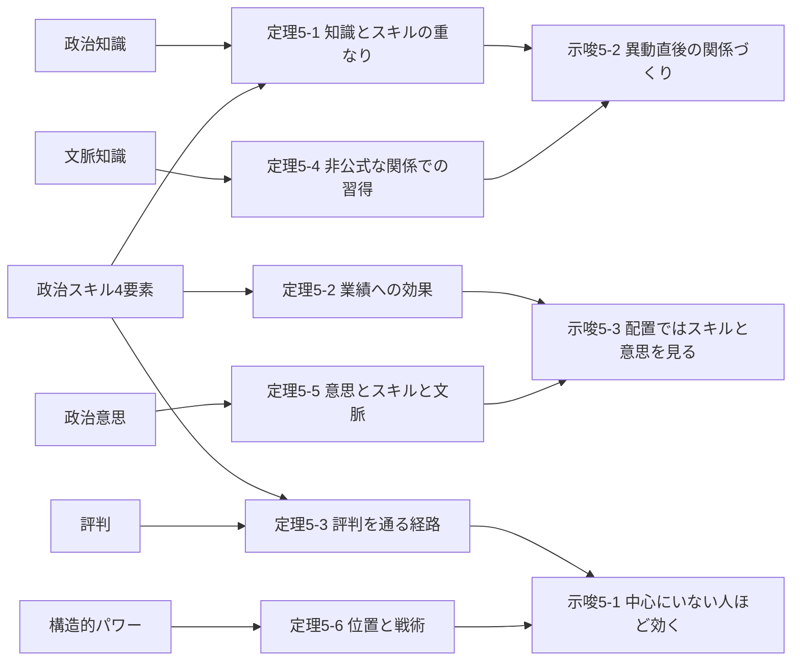

# 第5章 ビジネスパーソンに必要な政治力 — 定義・定理・示唆

本ファイルは、木村琢磨『社内政治の科学』（2025）第5章の目次の見出しを「論点の枠」として使い、論文の本文を読んでまとめたものです。本の本文は読んでいません。本の内容については書きません。

## この章の問い

社内政治で成果を出す個人の力は、どんな要素から成り、何が成果を左右するのか。知識・スキル・意思・パワーのそれぞれが、どう身につき、どう成果につながるのかを問います。

目次の見出し:

- 第1節 政治知識: 政治知識とは / 正当性に関する理解 / 文脈知識
- 第2節 政治スキル: 社内政治のスキルとは / 4つの要素 / 開発法
- 第3節 政治準備性: 形成 / 政治意思 / 政治的思慮と政治準備性
- 第4節 政治的パワー: とは / 基盤 / 決める個人的要因

「政治準備性」「政治的思慮」は、学術用語としては確認できていません。本書での意味も未確認です。本ファイルでは、近い学術概念である political will（政治意思）、political prudence（政治的思慮）、political maturation（政治的成熟）で定義します。

## 1. 概念の定義

| 概念 | 定義（言い換え） | 出典 | 読んだ箇所 |
|---|---|---|---|
| 政治知識（political savvy / 政治的理解） | 組織で物事が実際にどう動くか、誰が影響力を持つか、人の行動の裏の動機は何かについての理解。Chao et al. 1994 の組織社会化尺度の「政治」次元は、項目内容から見てこの理解を測っている | Ferris et al. 2007, JOM | pp.293–294「Construct Validity」の Other social competencies |
| 政治的学習と sense-making | 政治的学習は、権力のありかや使われ方など「政治の地形」についての知識を、経験を通じて長期記憶に蓄えること。sense-making は、出来事が起きるたびに意識的に理解しようとする反応的な過程。両者を合わせて政治的専門性と呼ぶ | Silvester & Wyatt 2018, SAGE Handbook | 著者稿 pp.19–20「Political Cognition」 |
| 政治の正当性 | 政治行動の定義の多くは、政治を「組織が公認していない」目的や手段による影響とする。こう定義すると、公式の人事制度の外にある活動として政治が位置づけられ、政治を「正当でない」と呼ぶこと自体が統制の仕組みとして働く | Silvester & Wyatt 2018 | 著者稿 pp.9–12「A Question of Legitimacy」と Table 8.1 |
| 文脈知識 | 仕事経験やメンタリングで得る、その職場に固有の知識。職場には手がかりや暗黙知が多すぎるため、重要なものを選び出す仕組みが要る | Ferris et al. 2007 | pp.314–315「Practical Implications」 |
| 政治スキル（political skill） | 職場で他者を的確に理解し、その理解を使って、自分または組織の目標が進むように他者を動かす能力。性格による安定した部分と、訓練や経験で変わる部分がある | Ferris et al. 2007（Ferris et al. 2005 の定義を引用） | pp.291–292「Definition and Construct Specification」 |
| 政治スキルの4要素 | 社会的洞察力（他者と状況を正しく読む）、対人影響力（相手と状況に合わせて行動を調整し望む反応を引き出す）、ネットワーク構築力（多様な人脈と連合を作る）、見かけの誠実さ（裏の動機がないと他者に見える）。4つは相関するが別の構成概念 | Ferris et al. 2007 | pp.292–293「Dimensionality of Political Skill」 |
| 政治意思（political will） | 政治的な目標を追うためにエネルギーを使おうとする意欲。政治行動の前提条件。Silvester & Wyatt は、権力を求める「傾向」（心理的特性）と、権力を求める「理由」（価値・欲求・目標）に分けて扱う | Treadway et al. 2005, JOB の定義を Silvester & Wyatt 2018 が引用 | 著者稿 pp.18–19「Political Motivation」 |
| 政治的効果性 | 職場の政治環境をうまく渡り、パワーを得て、他者を動かし、政治的目標を達成する能力 | Silvester & Wyatt 2018 | 著者稿 pp.16–17「A Model of Political Effectiveness」と Figure 8.1 |
| 政治的思慮（political prudence） | 政治意思が政治行動になるときに、自分を律する性格上の徳。利他的な意思を選び、自己奉仕的な意思を避ける方向に働く | Amah 2022, Journal of Business Ethics | 要旨のみ。本文未確認のため定理には使わない |
| 政治的成熟（political maturation） | 政治への意欲と能力が時間とともに育つ過程。3 段階のモデルで、目に見える行動だけでなく考え方や認知スクリプトの変化を含む | Doldor 2017, British Journal of Management | 要旨のみ。本文未確認のため定理には使わない |
| 政治的パワーの基盤 | French & Raven 1959 の5つの基盤: 報酬、強制、正当（地位による）、準拠（相手が一体化したいと思う）、専門（知識があると見なされる） | Zinko et al. 2007, RPHRM | pp.188–189「Power」の節 |
| 構造的パワー | ネットワーク上の位置（中心性、他者の間をつなぐ位置、支配連合への紐帯）から生じる潜在的なパワー | Brass & Krackhardt 2012（レビュー章） | pp.355–356 序論、p.358 付近の中心性、p.363「Ties to Powerful Alters」 |
| 評判 | 他者がある個人について持つ、合意された集合的な認識。時間をかけて形成される | Zinko et al. 2007 | 要旨と pp.187–189 |

## 2. 定理

### 定理 5-1: 政治知識は政治スキルと中程度に重なり、特に社会的洞察力と強く結びつく

- **内容**: Chao et al. 1994 の「政治」次元で測る政治的理解は、政治スキル全体と r = .47、社会的洞察力とは r = .60 で相関した。政治スキルは感情知能とも r = .53 で重なるが、同一ではない。政治知識は、政治スキルのうち「読む」成分に最も近い。
- **根拠**: Ferris et al. 2007（Journal of Management 33(3)）による整理。原データは Ferris et al. 2005 の PSI 開発研究。読んだ箇所は pp.293–294「Construct Validity of Political Skill」。研究の種類は実証（相関研究）のレビュー。
- **条件・限界**: 相関は同一時点の自己報告どうしで、因果の向きは分からない。サンプルの国や業種は本文の該当箇所に記載がなく、確認していない。

### 定理 5-2: 政治スキルは知能と性格を統制しても業績を予測するが、その強さは仕事の対人的な要求によって大きく変わる

- **内容**: Munyon et al. 2015 のメタ分析では、政治スキルと課題業績の関係は ρ = .26、文脈的業績（協力・援助など）とは ρ = .38 だった。ただし信用区間が 0 をまたぐほど研究間のばらつきが大きい。メタ回帰では、一般知能と Big Five を統制しても課題業績を予測した。仕事が社会的なやりとりを多く求めるほど、関係は強くなった。
- **根拠**: Blickle, Frieder & Ferris 2018（SAGE Handbook of IWO Psychology の章）による整理。読んだ箇所は「Political Skill as a Predictor of Performance」（PDF の Page 7–8 of 28）。元はメタ分析（Munyon et al. 2015; Bing et al. 2011）。
- **条件・限界**: 平均効果は中程度で、状況次第では効果がほぼ消える。メタ分析の原論文の本文は読んでいない。

### 定理 5-3: 政治スキルが業績とキャリアに効く経路の一部は、評判の形成を通る

- **内容**: Liu et al. 2007 では、政治スキルと業績の関係を評判が完全に媒介した。Munyon et al. 2015 のメタ回帰でも、評判と自己効力感が媒介した。Blickle et al. 2011 の縦断研究では、ある時点の政治スキルが 1 年後の収入・職位・キャリア満足を予測し、評判が職位とキャリア満足への関係を媒介した。
- **根拠**: Blickle, Frieder & Ferris 2018 による整理（「Political Skill as a Predictor of Performance」と「Political Skill and Career Success」の節）。Ferris et al. 2007 pp.308–309 も、2 研究で政治スキルと評判の相関（r = .35, .40）を紹介。研究の種類は実証研究とメタ分析のレビュー。
- **条件・限界**: 評判のほかに自己効力感や個人の主導性など別の経路もある。個々の研究の対象国と人数は、レビューの記述からは確認していない。日本での検証も確認していない。

### 定理 5-4: 政治知識と政治スキルは、公式研修より、メンターや上司との非公式な関係を通じて身につきやすい

- **内容**: Kammeyer-Mueller & Wanberg 2003 の新人社会化の縦断研究では、政治知識は非公式な関係でよく育ち、公式研修は役割の明確さを高めた。Blass et al. 2007 では、メンタリング行動がネットワーク構築力を高め、その関係を政治の理解が媒介した。Ferris et al. 2007 は、メンターが大量の文脈情報から重要なものを選び出すと論じる（理論的命題）。
- **根拠**: Silvester & Wyatt 2018 著者稿 pp.26–28（開発と社会化の節）による整理。Blickle, Frieder & Ferris 2018「Antecedents of Political Skill」（Page 5–6 of 28）による整理。Ferris et al. 2007 pp.298–299「Developmental experiences」と pp.314–315。研究の種類は縦断・横断の実証研究のレビューと理論。
- **条件・限界**: 政治スキル研修そのものの効果検証は少ない（Silvester & Wyatt 2018 p.27）。公式のメンター制度は、公式メンターが目立つぶん政治行動を勧めにくく、効果が弱い可能性がある（同 p.28）。

### 定理 5-5: 政治的効果性には政治意思と政治スキルの両方が要り、どれだけ要るかは組織の文脈と役割で決まる（理論的命題）

- **内容**: Silvester & Wyatt のモデルでは、組織の文脈と個人の要因が政治行動への傾向を決め、それが sense-making と政治的学習を通じて行動の選択に影響し、社会的効果性（政治スキル）が行動の成果を調整する。曖昧さが大きく公式化が弱い組織ほど政治活動が多い。境界をまたぐ役割や変革推進者は、より高い政治的能力を要する。実証面では、Treadway et al. 2005 が内発的動機づけと達成欲求が政治行動と正に関係することを示した。
- **根拠**: Silvester & Wyatt 2018 著者稿 pp.16–22（「A Model of Political Effectiveness」から「Social Effectiveness」まで）と Figure 8.1。モデル全体は理論的命題。文脈と動機の部分は、先行の実証研究の整理を含む。
- **条件・限界**: モデル全体の実証検証はまだない。政治意思を測る尺度（Kapoutsis et al. 2017）の本文は読んでいない。

### 定理 5-6: 他者が認める個人のパワーは、ネットワーク上の位置と影響戦術の双方から独立に生じ、位置が中心的になるほど戦術の重要性は下がる

- **内容**: Brass & Burkhardt 1993 では、ネットワーク中心性と影響戦術（主張、取り入り、交換、上位者への訴え、合理的説得、連合形成）が、どちらもパワーの認知と有意に関係した。互いが互いの効果を部分的に媒介した。中心性が高いほど、戦術の重要性は下がった。Brass 1984 では、経営幹部の支配連合への紐帯が、非管理職のパワーと昇進に関係した。
- **根拠**: Brass & Krackhardt 2012（Ferris & Treadway 編 Politics in Organizations 第12章）による整理。読んだ箇所は pp.355–356 序論、p.363「Ties to Powerful Alters」、p.364「Building Powerful Networks」。研究の種類は組織内ネットワークの実証研究のレビュー。
- **条件・限界**: 原典の対象組織や人数は、この章の記述からは確認していない。パワーは関係的・状況的で、測っているのは「他者からの認知」である。

## 3. 示唆

以下は論文の主張ではなく、上の定理を組み合わせた導出です。

### 示唆 5-1: ネットワークの中心にいない人ほど、政治スキルと評判づくりの効き目が大きい可能性がある

- **組み合わせ**: 定理 5-3 + 定理 5-6
- **導出**: 定理 5-6 では、中心性が低いほど影響戦術の重要性が高い。定理 5-3 では、政治スキルは評判を通じて成果につながる。中心でない人にとって、戦術をうまく実行する政治スキルと、その結果としての評判が、構造上の不利を補う主な手段になると導ける。
- **追加の前提**: 若手や新任者は中心性が低いことが多い。
- **注意**: 定理 5-6 は「パワーの認知」についての結果で、業績や昇進まで同じ形で成り立つかは確認していない。

### 示唆 5-2: 異動や転職の直後は、上司やメンターとの非公式な関係を早く作ることが、政治知識を取り戻す近道になる

- **組み合わせ**: 定理 5-1 + 定理 5-4
- **導出**: 定理 5-4 では、政治知識は文脈に固有で、非公式な関係を通じて育つ。定理 5-1 では、政治知識は政治スキルの「読む」成分と強く重なる。新しい職場では読む力の土台となる知識が不足するため、それを運ぶ非公式な関係づくりを優先すべきと導ける。
- **追加の前提**: 文脈知識は職場が変わると大部分が使えなくなる。
- **注意**: 定理 5-4 の根拠には新人社会化の研究が含まれ、経験者の異動にそのまま当てはまるかは未確認。

### 示唆 5-3: 境界をまたぐ役割や変革の役割に人を就けるときは、政治スキルだけでなく政治意思も見る必要がある

- **組み合わせ**: 定理 5-2 + 定理 5-5
- **導出**: 定理 5-2 では、政治スキルの業績効果は対人的な要求が大きい仕事で強い。定理 5-5 では、そうした役割は高い政治的能力を要し、さらにスキルは意思がなければ行動にならない。したがって、こうした役割では、スキルと意思の両方がそろう人のほうが成果を出しやすいと導ける。
- **追加の前提**: 政治意思は個人差があり、事前に把握できる。
- **注意**: 定理 5-5 は理論的命題で、意思とスキルの組み合わせ効果の大きさは本文で確認できていない。

## 4. 本文未確認の関連研究

| 文献 | 関係 | 本文が読めなかった理由 |
|---|---|---|
| Ferris et al. 2005, JOM（PSI の開発） | 政治スキルの定義と18項目尺度 | 本文の OA 版が見つからず。定義と相関は Ferris et al. 2007 の本文で確認 |
| Munyon et al. 2015, Personnel Psychology | 政治スキルと成果のメタ分析 | OA 版が見つからず。数値は Blickle et al. 2018 の本文で確認 |
| Bing et al. 2011, JOB | 課題・文脈業績のメタ分析 | OA 版が見つからず |
| Treadway et al. 2005, JOB | 政治意思の定義と先行要因（N = 193） | OA 版が見つからず。定義は Silvester & Wyatt 2018 の引用で確認 |
| Kapoutsis et al. 2017, JOM | 政治意思尺度（自己奉仕型・利他型） | OA 版が見つからず |
| Blickle, Schütte & Wihler 2018, JVB | 政治意思尺度の検証、キャリア成功 | core.ac.uk と Exeter リポジトリがボット確認画面を返し、取得できず |
| Doldor 2017, BJM と Doldor 2011 博士論文 | 政治的成熟の3段階 | core.ac.uk と Cranfield リポジトリが取得を拒否 |
| Amah 2022, Journal of Business Ethics | 政治的思慮が意思と行動の関係を調整 | 有料。要旨のみ確認 |
| Chao et al. 1994, JAP | 社会化の「政治」次元 | 本文未取得。項目内容は Ferris et al. 2007 の記述で確認 |
| Brass 1984, ASQ / Brass & Burkhardt 1993, AMJ | 構造的位置と戦術とパワー | 本文未取得。結果は Brass & Krackhardt 2012 の本文で確認 |
| Mehra, Kilduff & Brass 2001, ASQ | 自己監視とネットワーク上の位置 | 本文未取得 |

## 5. 読んだ文献

| 文献 | 本文の入手先 | 読んだ範囲 |
|---|---|---|
| Ferris, Treadway, Perrewé, Brouer, Douglas & Lux 2007, Political skill in organizations, JOM 33(3) | crforum.co.uk の PDF | pp.291–299（定義、4要素、構成概念妥当性、先行要因、Figure 1、開発経験）、pp.308–309、pp.314–315 |
| Silvester & Wyatt 2018, Political effectiveness at work, SAGE Handbook | City Research Online の著者稿 | 著者稿 pp.9–12（正当性）、pp.16–22（モデル、文脈、動機、認知、行動、社会的効果性）、pp.26–28（開発） |
| Blickle, Frieder & Ferris 2018, Political skill, SAGE Handbook of IWO Psychology Vol.1 | Bonn 大学の PDF | 測定、先行要因、業績の予測、キャリア成功、実務への含意の節 |
| Brass & Krackhardt 2012, Power, politics, and social networks in organizations, Politics in Organizations 第12章 | CMU 教員ページの PDF | pp.355–356、中心性の節、pp.363–365 |
| Zinko, Ferris, Blass & Laird 2007, Toward a theory of reputation in organizations, RPHRM 26 | ECU 教員ページの PDF | 要旨、政治スキルと評判の節、pp.187–189（Power） |
| Anderson, John, Keltner & Kring 2001, Who attains social status?, JPSP 81(1) | Berkeley 研究室の PDF | 要旨、Study 1–3 の参加者と Table 2。学生集団の研究で組織の結果ではないため、定理には使っていない |

## Sources

- [Ferris et al. 2007 Political Skill in Organizations（PDF）](https://www.crforum.co.uk/wp-content/uploads/2017/06/Political-Skill-in-Organizations.pdf)
- [Silvester & Wyatt 2018 Political Effectiveness at Work（City Research Online 著者稿）](https://openaccess.city.ac.uk/id/eprint/18174/8/Silvester%20%2B%20Wyatt%20%282018%29%20Political%20Effectiveness%20-%20for%20CRO.pdf)
- [Blickle, Frieder & Ferris 2018 Political Skill（Bonn 大学 PDF）](https://www.psychologie.uni-bonn.de/de/institut/abteilungen/arbeits-organisations-und-wirtschaftspsychologie/uploads-fuer-die-allgemeine-i/forschung/blickle-frieder-ferris-2018.pdf)
- [Brass & Krackhardt 2012 Power, Politics, and Social Networks in Organizations（CMU PDF）](https://www.heinz.cmu.edu/faculty-research/profiles/krackhardt-davidm/_files/2012polinorgs.pdf)
- [Zinko et al. 2007 Toward a Theory of Reputation in Organizations（PDF）](https://myweb.ecu.edu/furnerc/zpubs/chapter/1.pdf)
- [Anderson et al. 2001 Who Attains Social Status?（Berkeley PDF）](https://esilab.berkeley.edu/wp-content/uploads/2017/12/Anderson-John-Keltner-Kring.pdf)
- [Amah 2022 The Role of Political Prudence and Political Skill（IDEAS/RePEc）](https://ideas.repec.org/a/kap/jbuset/v176y2022i2d10.1007_s10551-020-04696-x.html)
- [Doldor 2017 From Politically Naïve to Politically Mature（MetaTOC）](https://metatoc.com/papers/100809-from-politically-naive-to-politically-mature-conceptualizing-leaders-political-maturation-journey)
- [Doldor 2011 博士論文（Cranfield CERES）](https://dspace.lib.cranfield.ac.uk/handle/1826/9410)
- [Kapoutsis et al. 2017（EconBiz）](https://econbiz.de/Record/measuring-political-will-in-organizations-theoretical-construct-development-and-empirical-validation-kapoutsis-ilias/10011731518)
- [Blickle, Schütte & Wihler 2018（Exeter ORE）](https://ore.exeter.ac.uk/repository/handle/10871/122021)
- [Treadway et al. 2005（BVB カタログ）](https://bvbvf1.bib-bvb.de/vufind/PrimoRecord/cdi_proquest_miscellaneous_57187887)
- [Munyon et al. 2015（EconBiz）](https://www.econbiz.de/Record/political-skill-and-work-outcomes-a-theoretical-extension-meta-analytic-investigation-and-agenda-for-the-future/10010520728)
