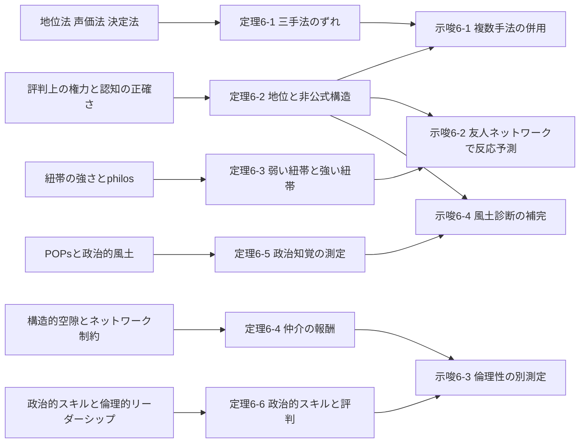

# 第6章 社内政治を分析する — 定義・定理・示唆

## この章の問い

社内の権力・ネットワーク・政治的風土・政治的人材は、どう測れるのか。測った結果から何が言えるのか。

目次の見出し（論点の枠としてだけ使う）:

- 第1節 変革時の政治的反応の予測: ポジション分析 / 評判分析 / 意思決定分析
- 第2節 派閥やコネを分析する: ネットワーク分析 / 今からできるネットワーク分析 / 強い紐帯と弱い紐帯 / 構造的空隙
- 第3節 社内の政治的風土を分析する: 組織内政治の知覚の診断 / 政治的風土の診断 / 政治の原因分析
- 第4節 「政治的リーダー」の発掘: タレント・アセスメント / タレント・アナリティクス / 倫理性のアセスメント

注記: 第1節の 3 つの分析が、地域権力構造研究の 3 手法（地位法・声価法・決定法）を指すかどうかは未確認。本ファイルでは、この 3 手法を定義・定理の対象として扱う。

## 1. 概念の定義

| 概念 | 定義（言い換え） | 出典 | 読んだ箇所 |
|---|---|---|---|
| 地位法（positional method） | 公式の地位にある人を権力者とみなす方法。各領域の主要組織の長を洗い出し、領域をまたいで同じ人が上位にいるかを見る | Angeles 1973 | 序論 pp.166-167、第 II 節 pp.170-173 |
| 声価法（reputational method） | 権力は表に出ないと仮定し、「誰が影響力を持つか」を人に指名させて評判で権力者を特定する方法。Hunter 1953 が使った | Angeles 1973 | 序論 p.166、第 I 節 pp.168-170 |
| 決定法（decision-making method） | 実際の争点を選び、その決定過程に参加し結果を左右した人を権力者とする方法。多元論者（Dahl ら）が使った | Angeles 1973 | 序論 p.167、第 III 節 pp.173-176 |
| 評判上の権力（reputational power） | 組織の成員が互いを「どれだけ影響力があるか」で評定した値。Krackhardt は 2 つの評定（potency と charisma）を合成した | Krackhardt 1990 | Results「Reliability of Dependent Variables」pp.353-354 |
| ネットワークの認知の正確さ（cognitive accuracy） | 本人が描いた「誰が誰に助言を求めるか」の図と、当事者双方が認めた実際のつながりとの一致度 | Krackhardt 1990; Krackhardt 1992 | 1990: pp.342-343, Table 1; 1992: pp.222-223 |
| 媒介中心性（betweenness centrality） | ある人が他の 2 人を結ぶ最短経路の上にどれだけ乗っているか。情報の流れを止めたり選んだりできる位置を表す | Krackhardt 1990; Krackhardt 1992 | 1990: p.352; 1992: p.223 |
| 3 つの非公式ネットワーク | 助言（技術的な問題で誰に頼るか）、信頼（微妙な政治的情報を誰と共有するか）、コミュニケーション（日常的に誰と仕事の話をするか） | Krackhardt & Hanson 1993 | pp.105-106「The Steps of Network Analysis」 |
| 紐帯の強さ（tie strength） | 一緒に過ごす時間、感情の強さ、親密さ（打ち明け合い）、互いの手助けの組み合わせ | Granovetter 1973 | 「The Strength of Ties」p.1361 |
| ブリッジ（bridge）・局所ブリッジ | 2 点を結ぶ唯一の経路（ブリッジ）、または他の経路よりずっと短い経路（局所ブリッジ） | Granovetter 1973 | pp.1364-1365, Fig.1-2 |
| philos（強い紐帯の一種） | 相互作用があり、好意があり、長い付き合いの歴史がある関係。信頼の土台になる | Krackhardt 1992 | 「A Philos Relationship」pp.218-219 |
| 構造的空隙（structural hole）と仲介 | 互いにつながっていない集団の間のすき間。そこをまたぐ人（ブローカー）は異なる集団の情報に触れられる | Burt 2004 | 序論 pp.349-353、「Supply Chain」節 p.359 |
| ネットワーク制約（network constraint） | 本人の話し相手どうしが互いに密につながっている度合い。高いほど空隙をまたいでいない | Burt 2004 | p.359 と注 6 |
| 組織内政治の知覚（POPs）と POPS | 職場で自己利益のための行動がどの程度起きていると本人が感じるか。Kacmar & Ferris 1991 の尺度 POPS は「一般的な政治的行動」「波風を立てずに出世」「昇給・昇進」の 3 下位尺度、12 項目 | Nye & Witt 1992（POPS の説明部分） | 序論 p.1、Method「Measures」p.2 |
| 政治的風土（political climate） | 政治を職場で共有された知覚として捉える考え方。Landells & Albrecht の尺度は「関係の構築と利用」「個人の評判の構築」「意思決定・資源の支配」「意思決定への影響」「伝達経路の利用（うわさ等）」の 5 次元 | Landells & Albrecht 2019 | Introduction、Materials and Methods（項目開発） |
| POPs の先行要因モデル | Ferris, Russ & Fandt 1989 のモデル。組織要因（集権化・公式化・階層・統制範囲）、職務・環境要因（自律性・フィードバック・昇進機会など）、個人要因が政治の知覚を高める | Lee 1998（修士論文）による整理 | Chapter I「Predictors of Organizational Politics」pp.8-13, Figure 1 |
| 政治的スキル（political skill） | 職場で他者を理解し、その知識で他者を動かす力。PSI（18 項目）は社会的洞察力・対人影響力・ネットワーク構築力・誠実さの見え方の 4 次元 | Blickle et al. 2012; Kückelhaus, Meurs & Blickle 2024 | 2012: Method「Political skill」; 2024: 3. Method |
| 倫理的リーダーシップ | 個人の行動と対人関係で規範的に適切な振る舞いを示し、双方向の対話や強化、意思決定を通じて部下にもそれを促すこと。測定は部下評定の 10 項目尺度（ELS） | Brown, Treviño & Harrison 2005 | 定義の節 p.120、Table 2-3 |

## 2. 定理

### 定理 6-1: 地位法・声価法・決定法は、同じ地域でも同じ人々を権力者として取り出さず、重なりは部分的にとどまる。

- **内容**: Angeles は 1 つの町で 3 手法を同時に使った。声価法で選ばれた 29 人のうち、決定法で選んだ 3 つの争点の決定に関わったのは 44.8% だった。彼らは決定参加者全体の 29% にすぎず、残り 71% は評判リストにいない人だった。地位法では、評判上の指導者は 4 つの制度領域に散らばるが、すべてを支配してはいなかった。著者は、各手法がそれぞれ前提とする「指導者像」に結果が引っ張られると結論している。
- **根拠**: Angeles, V. S. M. (1973, Asian Studies 11(1))。序論 pp.165-167、第 I〜III 節 pp.168-176、Table I-VII、結論。実証（事例）。フィリピン Rizal 州 Morong 町。市民 282 人中 276 人に指名式質問紙、公的役職者リスト（1946-1969 年）、企業役員名簿、3 争点の参加者 48 人。
- **条件・限界**: 1 つの小さな町の事例で、統計的検定は相関のみ。声価法は Hunter 型の「事情通パネル」ではなく一般市民に指名させる変形版。著者は、争いが表に出ず調停で処理される地域では決定法の適用自体が疑わしいと述べている。企業組織への一般化は確認されていない。

### 定理 6-2: 小さな企業の中では、成員の評判による権力評定は強く一致し、その差は公式の地位で 4 割強、友人ネットワークの中心性と助言ネットワークの認知の正確さでさらに説明される。

- **内容**: 36 人の企業で、評判上の権力（2 つの評定）の信頼性は α = .96 と .99 だった。公式の地位だけで評判上の権力の分散の 43% を説明した。そこに友人ネットワークの中心性を加えると説明力が上がった（助言ネットワークの中心性は公式の地位と重なり、独自の寄与はなかった）。さらに助言ネットワークを正確に把握していることが 8.2% を追加で説明した。友人ネットワークの認知の正確さは関係がなかった。
- **根拠**: Krackhardt, D. (1990, Administrative Science Quarterly 35)。Results pp.353-355、Table 1-3（階層的回帰）、Discussion と Caveats pp.356-357。実証（単一組織の横断データ）。米国の起業型企業 1 社、36 人（分析 N = 33）。
- **条件・限界**: 1 社・小規模・横断データで因果は言えない。著者自身、小さな会社では皆が互いをよく知るため構造上の有利さが出にくかった可能性を挙げている。日常業務の文脈での結果であり、危機時には友人ネットワークの理解のほうが効くかもしれないと著者は推測している（推測にとどまる）。

### 定理 6-3: 新しい情報の伝達では弱い紐帯が橋渡しの役を担うが、組織の大きな変化をめぐる影響力は、好意と長い付き合いを伴う強い紐帯（philos）の上で決まる。

- **内容**: Granovetter は、強い紐帯が 2 本ある三者のうち残り 1 本が欠ける形は起こりにくいと仮定した。そこから、強い紐帯はブリッジになりにくく、ブリッジはすべて弱い紐帯だと論じた（"all bridges are weak ties"）。転職者調査では、知人経由で職を得た人のうち、その知人と「よく」会っていたのは 16.7%、「時々」55.6%、「まれに」27.8% だった。一方 Krackhardt 1992 は、同じ 36 人企業での組合結成運動を追った。助言ネットワークの中心者は友人ネットワークの中心者と一致しなかった。組合側は友人ネットワークの周辺にいた熱心な支持者を前面に出し、友人ネットワークの中心にいた人を取り込まなかった。選挙は 12 対 3 で組合が負けた。
- **根拠**: Granovetter, M. (1973, American Journal of Sociology 78)。「The Strength of Ties」p.1361、「Weak Ties in Diffusion Processes」pp.1363-1366、「Weak Ties in Egocentric Networks」pp.1370-1372。理論的命題と小規模調査（米国 Boston 郊外の専門・技術・管理職の転職者、面接標本 N = 54）。Krackhardt, D. (1992, Nohria & Eccles 編 Networks and Organizations, 第 8 章)。「Theory」pp.216-219、事例の記述 pp.221-236、Table 8-1・8-2、Figure 8-4。事例研究。米国の情報システム企業 1 社（36 人）。
- **条件・限界**: Granovetter の前半は理論的命題で、ブリッジの命題は「強い三者の欠けた形が起きない」という仮定に依存する。転職データは接触頻度だけで強さを測った小標本。Krackhardt 1992 は 1 社 1 事例で、影響の経路は聞き取りに基づく解釈。弱い紐帯が変化を促す場面もあり、両者を比較した検定ではない。

### 定理 6-4: 大企業の管理職では、構造的空隙をまたぐ（ネットワーク制約が低い）人ほど、給与・評価・昇進が良く、出したアイデアが上級者から高く評価されやすい。

- **内容**: Burt は米国大手電機メーカーのサプライチェーン管理職 673 人を調べた。ネットワーク制約が低い人ほど、職位などを統制しても給与が同僚より高く、評価や昇進も良かった。改善アイデアを 455 件集め、出所を伏せて 2 人の上級管理職に価値を評定させた。空隙をまたぐ人のアイデアほど価値が高く評定され、両者に却下されにくかった。給与への効果は職位が高いほど強かった。
- **根拠**: Burt, R. S. (2004, American Journal of Sociology 110(2))。「Supply Chain in a Large Electronics Company」pp.359-、ネットワーク制約の定義（注 6）、Table 1（給与・評価）、アイデア評価の手続き pp.375-376（注 15）、「Conclusions and Discussion」p.386。実証（単一企業の調査 + 人事記録）。米国、管理職 673 人（ネットワーク回答 455 人、回答率 68%）。
- **条件・限界**: 1 社の横断データが中心。アイデアの評価者は 2 人で、職位と評定者の疲れの影響が混ざると著者自身が注で認めている。中心性と仲介の区別には時系列データが必要と著者は述べている。下位職位では給与効果が弱い。

### 定理 6-5: POPS で測った組織内政治の知覚は、3 下位尺度に分かれず、組織からの支援の知覚の裏返しに近い一つの否定的評価としてまとまりやすく、職場で共有された風土としての一致も確認されにくい。

- **内容**: Nye & Witt は連邦政府職員 1,297 人で POPS を分析し、3 因子構造を再現できず 1 因子と判断した。POPS は組織的支援の知覚（SPOS）と r = −.85 で、職務満足などとの相関も SPOS と同程度だった。Witt 1992 では、政治の知覚は職務満足と r = −.62 だった。意思決定への参加が多い人では、政治の知覚が高くても満足度の低下が小さかった。Landells & Albrecht 2019 は 5 次元の新尺度で、政治の知覚がストレスを通じてエンゲージメントを下げることを示した。ただし、部署内の一致度は基準に届かず、政治を風土（集団レベル）として扱う根拠は得られなかった。
- **根拠**: Nye, L. G. & Witt, L. A. (1992, FAA 技術報告 DOT/FAA/AM-92/10)。Method、Results and Discussion、Table 1-4。実証。米国連邦航空局職員 1,297 人。Witt, L. A. (1992, FAA 技術報告 DOT/FAA/AM-92/17)。Results、Discussion、Table 3-4、Figure 1。実証。同職員 1,083 人。Landells, E. M. & Albrecht, S. L. (2019, Frontiers in Psychology 10:1612)。Materials and Methods、Results、Discussion。実証（横断・自己報告、SEM）。オーストラリア、標本 1 N = 303、標本 2 N = 353（政府機関）。
- **条件・限界**: いずれも横断の自己報告で、共通方法バイアスが残る。Nye & Witt と Witt は同じ公的組織の職員で、POPS 原版（12 項目）を一部修正して使った。改訂版 POPS（Kacmar & Carlson 1997）の本文は読めていない。Landells & Albrecht は、一致しない理由として部署内の下位風土や組織レベルでの一致度の低さを挙げている。

### 定理 6-6: 同僚が評定した政治的スキルが高い人では、マキャベリアニズムの高さが評判と業績評価の低下につながらず、政治的スキルの効き方は職務の複雑さに左右される。

- **内容**: Kückelhaus らは、本人がマキャベリアニズムを自己評定し、同僚が政治的スキル・評判・業績を評定するデータを使った。政治的スキルが低い人では、マキャベリアニズムが高いほど評判が下がり、評判を通じて業績評価も下がった。政治的スキルが高い人ではこの関係が消えた。評判と業績評価の相関は r = .69 だった。Blickle らは、大学卒以上の専門職では、誠実性・学習志向・政治的スキル（自己評定）の 3 つがそろう人ほど上司の業績評価が高いことを示した。同じ交互作用は、非専門職の対照群では見られなかった。
- **根拠**: Kückelhaus, B. P., Meurs, J. A. & Blickle, G. (2024, Personality and Individual Differences 228)。3. Method、4. Results、Table 1-3、Discussion。実証（他者評定を含む横断データ）。ドイツ、対象者 550 人、同僚評定 1,127 件。Blickle, G. et al. (2012, Journal of Organizational Behavior, 著者稿)。Method「Procedure and participants」「Measures」、Results、Table 3、Figure 1。実証（上司・部下ペア、マルチレベル）。ドイツ西部、専門職 196 組、非専門職 96 人（対照群）。
- **条件・限界**: どちらも横断データ。Kückelhaus らの交互作用は小さい（β = .08、ΔR² は約 1%）。著者は、政治的スキルが悪い振る舞いを覆い隠す働きもしうると述べている。Blickle らの 3 者交互作用の追加説明力は 2%。倫理性そのものを測った研究ではない。

## 3. 示唆

示唆は論文の主張ではなく、上の定理を組み合わせた導出である。

### 示唆 6-1: 社内の権力者を特定するときは、公式の地位・評判・決定への関与（またはネットワーク）を重ねて使い、ずれた部分を調べる必要がある。

- **組み合わせ**: 定理 6-1 + 定理 6-2
- **導出**: 定理 6-1 では、3 手法の取り出す人々は部分的にしか重ならなかった。定理 6-2 では、組織内でも公式の地位が説明するのは評判上の権力の 4 割強で、残りは友人ネットワークの位置や組織理解に分かれていた。よって、どれか 1 つの方法だけでは、変革に反応する人の一部を見落とす。
- **追加の前提**: 地域社会で見られた手法間のずれが、企業組織でも同じように起こること。
- **注意**: どちらも単一事例・小規模の横断データ。ずれの大きさは組織ごとに違いうる。

### 示唆 6-2: 変革への政治的反応を予測するには、業務上の助言ネットワークより、好意と信頼に基づく友人ネットワークの中心者を把握するほうが役に立つ可能性が高い。

- **組み合わせ**: 定理 6-2 + 定理 6-3
- **導出**: 定理 6-2 では、助言ネットワークの中心性は公式の地位と重なり、独自に評判上の権力を説明したのは友人ネットワークの中心性だった。定理 6-3 では、組織の大きな変化をめぐる影響は philos の上で決まり、助言の中心者と友人の中心者は別人だった。したがって、変革時に誰が周囲の態度を動かすかは、組織図や助言関係ではなく友人・信頼関係から読む必要がある。
- **追加の前提**: 計画中の変革が、Krackhardt 1992 の組合運動と同じく「日常業務から外れた変化」であること。
- **注意**: 根拠は同じ 36 人企業の 2 本の研究に偏る。大規模組織での検証は読んだ範囲にない。

### 示唆 6-3: 「政治的リーダー」の候補を探すとき、仲介位置や政治的スキルの高さだけで選ぶと、倫理面の問題を見逃しうるので、倫理性を別に測る必要がある。

- **組み合わせ**: 定理 6-4 + 定理 6-6
- **導出**: 定理 6-4 では、空隙をまたぐ人は給与・評価・アイデア評価で報われていた。定理 6-6 では、政治的スキルが高いとマキャベリアニズムが評判や業績評価に表れにくかった。つまり、ネットワーク上の位置や他者評価の高さは、本人の動機の良し悪しを区別しない。倫理的リーダーシップは部下評定で、隣接概念と区別して測れる（Brown, Treviño & Harrison 2005、Study 7）。
- **追加の前提**: 仲介位置は、組織のためにも自己利益のためにも使えること（定理には含まれない）。
- **注意**: 定理 6-6 の交互作用は小さい。Brown らの尺度は部下評定に限られ、本人の内面の動機を直接測るものではない。

### 示唆 6-4: 政治的風土の診断は、組織全体の平均点だけで判断せず、部署単位の差と、支援の知覚との重なりを確かめ、ネットワークなど構造のデータで補う必要がある。

- **組み合わせ**: 定理 6-5 + 定理 6-2
- **導出**: 定理 6-5 では、政治の知覚は支援の知覚の裏返しに近く、部署内でも一致しにくかった。定理 6-2 では、同じ組織でも人によって組織の把握の正確さが違い、それが権力と結びついていた。よって、知覚の得点は「政治が多い」ことより「組織を否定的に見ている」ことを映す部分があり、誰がどこから見ているかを構造データで確かめる必要がある。
- **追加の前提**: 知覚の調査とネットワーク調査を同じ組織で実施できること。
- **注意**: 定理 6-5 は横断の自己報告研究に基づく。一致度の低さは組織レベルの指標の性質による面もある。

## 4. 本文未確認の関連研究

| 文献 | 関係 | 本文が読めなかった理由 |
|---|---|---|
| Hunter 1953, Community Power Structure | 声価法の原典 | 書籍で本文の OA 版が見つからない。Angeles 1973 の説明で代替 |
| Dahl 1961, Who Governs? | 決定法・多元論の原典 | 書籍で本文の OA 版が見つからない。Angeles 1973 の説明で代替 |
| Salancik & Pfeffer 1974, ASQ 19(4) | 大学の予算配分と部門の権力（決定結果からの権力測定） | JSTOR のみ。OA 版が見つからない |
| Brass 1984, ASQ 29 | 新聞社の非管理職 140 人で、ネットワーク中心性が影響力の評定・昇進と関係 | OA 版が見つからない。Krackhardt 1990 に引用があるのみ |
| Kacmar & Carlson 1997, Journal of Management 23(5) | 改訂版 POPS（15 項目）の妥当化 | 出版社版のみ。Scribd の転載は出所不明のため使わない |
| Ferris, Russ & Fandt 1989 | POPs の先行要因・結果・調整変数のモデル | 書籍の章で OA 版がない。Lee 1998 の整理で代替 |
| Ferris & Kacmar 1992, Journal of Management 18 | 集権化・フィードバックなど先行要因の検証 | OA 版が見つからない |
| Atinc et al. 2010, Journal of Managerial Issues 22 | POPs の先行要因のメタ分析 | OA 版が見つからない（大学リポジトリはアクセス拒否） |
| Hochwarter et al. 2020, Journal of Management 46(6) | POPs 研究のレビュー | リポジトリに全文がなく出版社版のみ |
| Marler & Boudreau 2017, IJHRM 28(1) | HR アナリティクスの定義と導入の実証レビュー | OA 版が見つからない。タレント・アナリティクスは定理にしていない |

## 5. 読んだ文献

| 文献 | 本文の入手先 | 読んだ範囲 |
|---|---|---|
| Angeles 1973, Asian Studies 11(1) | フィリピン大学 Asian Studies Journal アーカイブ（PDF） | 全文 pp.165-176 |
| Krackhardt 1990, ASQ 35 | 著者の大学サイト（スキャン PDF） | pp.342-343、pp.352-357（方法の一部、Results、Discussion、Table 1-3） |
| Granovetter 1973, AJS 78 | 大学講義サイトの PDF（JSTOR 版） | pp.1360-1373（紐帯の強さ、拡散、自己中心ネットワーク、転職データ） |
| Krackhardt 1992, Networks and Organizations 第 8 章 | 著者の大学サイト（スキャン PDF） | pp.216-219、221-223、229-236 |
| Krackhardt & Hanson 1993, HBR 71(4) | 著者の大学サイト（スキャン PDF） | pp.104-107（ネットワーク分析の手順と事例の冒頭） |
| Burt 2004, AJS 110(2) | 大学講義サイトの PDF（JSTOR 版） | 序論、Supply Chain 節、給与・評価、アイデア評価、結論 |
| Nye & Witt 1992, FAA AM-92/10 | FAA 公開技術報告 | 全文 |
| Witt 1992, FAA AM-92/17 | FAA 公開技術報告 | 序論、Results、Discussion |
| Landells & Albrecht 2019, Frontiers in Psychology | 出版社 OA 版 | 全文 |
| Lee 1998, Emporia State University 修士論文 | 大学リポジトリ | 要旨、Chapter I の先行要因の整理、Chapter III Results、Table 1 |
| Blickle et al. 2012, JOB | 著者の大学サイト（著者稿） | Method、Measures、Results、Discussion 冒頭 |
| Kückelhaus, Meurs & Blickle 2024, PAID 228 | 著者の大学サイト（出版 PDF） | 要旨、Method、Results、Discussion |
| Brown, Treviño & Harrison 2005, OBHDP 97 | 大学講義サイトの PDF | 定義の節、Table 2-3、Study 7 の結果、Limitations |

## Sources

- [Angeles 1973 (Asian Studies, PDF)](https://asj.upd.edu.ph/mediabox/archive/ASJ-11-01-1973/angeles-in%20search%20of%20leadership%20in%20morong%20rizal.pdf)
- [Krackhardt 1990 (PDF)](https://www.andrew.cmu.edu/user/krack/documents/pubs/1990/1990%20Assessing%20the%20Political%20Landscape.pdf)
- [Granovetter 1973 (PDF)](https://www.cs.umd.edu/~golbeck/INST633o/granovetterTies.pdf)
- [Krackhardt 1992 (PDF)](https://www.andrew.cmu.edu/user/krack/documents/pubs/1992/1992%20The%20Strength%20of%20Strong%20Ties.pdf)
- [Krackhardt & Hanson 1993 (PDF)](https://www.andrew.cmu.edu/user/krack/documents/pubs/1993/1993%20Informal%20Networks.pdf)
- [Burt 2004 (PDF)](https://snap.stanford.edu/class/cs224w-readings/Burt04StructureHole.pdf)
- [Nye & Witt 1992, FAA AM-92/10 (PDF)](https://www.faa.gov/sites/faa.gov/files/data_research/research/med_humanfacs/oamtechreports/AM92-10.pdf)
- [Witt 1992, FAA AM-92/17 (PDF)](https://www.faa.gov/sites/faa.gov/files/data_research/research/med_humanfacs/oamtechreports/AM92-17.pdf)
- [Landells & Albrecht 2019 (Frontiers in Psychology)](https://www.frontiersin.org/articles/10.3389/fpsyg.2019.01612/full)
- [Lee 1998 (Emporia State University)](https://dspacep01.emporia.edu/bitstream/handle/123456789/1406/Lee%201998.pdf?sequence=1)
- [Blickle et al. 2012 (著者稿 PDF)](https://www.psychologie.uni-bonn.de/de/institut/abteilungen/arbeits-organisations-und-wirtschaftspsychologie/uploads-fuer-die-allgemeine-i/forschung/job1843.pdf)
- [Kückelhaus, Meurs & Blickle 2024 (PDF)](https://psychologie.uni-bonn.de/de/institut/abteilungen/arbeits-organisations-und-wirtschaftspsychologie/uploads-fuer-die-allgemeine-i/forschung/kueckelhaus-meurs-blickle-2024-paid.pdf)
- [Brown, Treviño & Harrison 2005 (PDF)](https://eclass.uoa.gr/modules/document/file.php/PSYCH252/%CE%97%CE%B8%CE%B9%CE%BA%CE%AE%20%CE%97%CE%B3%CE%B5%CF%83%CE%AF%CE%B1%201.pdf)
- [Salancik & Pfeffer 1974 の書誌（Scilit）](https://scilit.com/publications/3a87bb6bed832869ab0aafc11eddb811)
- [Kacmar & Carlson 1997 の書誌](https://data.zhenzhi.com/details/1/895060381)
- [Atinc et al. 2010 の書誌（EconBiz）](https://www.econbiz.de/Record/perceptions-of-organizational-politics-a-meta-analysis-of-theoretical-antecedents/10009884003)
- [Hochwarter et al. 2020（Boise State ScholarWorks）](https://scholarworks.boisestate.edu/manage_facpubs/130)
- [Marler & Boudreau 2017 の書誌（EconBiz）](https://econbiz.de/Record/an-evidence-based-review-of-hr-analytics-marler-janet/10011747448)
