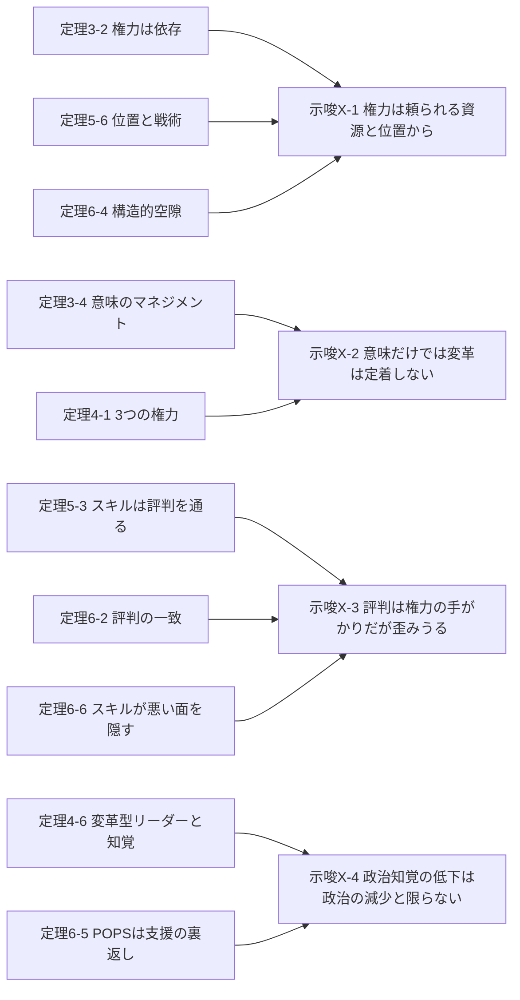

# 社内政治の論点別 定義・定理・示唆 — インデックス

- **Type**: survey

## この調査の目的

社内政治について **「論文から何が言えるか」** を、論点ごとに次の 3 段でまとめることです。

1. **概念の定義**: その論点で使う概念を、論文の定義で決める
2. **定理**: 論文の結果・主張を 1 文の命題にしたもの。**本文を読んだ論文だけ** を根拠にする
3. **示唆**: 定理を 2 つ以上組み合わせて導いたこと。どの定理を組み合わせたかと、足した前提を明記する

論点の枠には、木村琢磨『社内政治の科学 経営学の研究成果』（日本経済新聞出版, 2025）の目次（第3章第2節〜第6章）を使いました。**本の本文は読んでいません。** 本の内容についてはどこにも書いていません。目次は「どの論点を扱うか」を決めるためだけに使っています。

## 何をしたか

| 手順 | 内容 |
|------|------|
| 1 | 本の目次を、[日経BOOKプラスの紹介ページ](https://bookplus.nikkei.com/atcl/column/032900009/102901088/) の目次画像から読み取った |
| 2 | 章ごとに「この章が答える問い」を立てた |
| 3 | 問いに関係する論文の本文を探して読んだ（4 章で計 34 本） |
| 4 | 本文で確認できた結果だけを定理にした。各定理に、読んだ箇所（頁・節・表）、研究の種類、対象を付けた |
| 5 | 本文が取れなかった重要な研究は、定理にせず「本文未確認の関連研究」に回した |
| 6 | 定理を組み合わせて示唆を導いた |

**前回版（[20261115_book_toc](../20261115-book-toc/index.md)）との違い**: 前回は見出しごとに文献を並べただけで、多くの文献は要旨や他の論文の引用でしか確認していませんでした。今回は根拠を本文で読んだ論文に限り、結論を定理と示唆の形にまとめています。

## 章ファイル

| ファイル | 問い | 本文を読んだ論文 | 定理 | 示唆 |
|---------|------|-----------------|------|------|
| [ch3.md](ch3.md) | 社内政治とは何か。権力とどう関係し、なぜ「意味」を動かすことが政治になるのか | 7 本 | 6 | 3 |
| [ch4.md](ch4.md) | リーダーシップはなぜ政治と切り離せないのか。変革やミドルの仕事で政治はどう働くのか | 9 本 | 6 | 4 |
| [ch5.md](ch5.md) | 社内政治で成果を出す個人の力は、どんな要素から成り、何が成果を左右するのか | 5 本 | 6 | 3 |
| [ch6.md](ch6.md) | 社内の権力・ネットワーク・政治的風土・政治的人材はどう測れ、測った結果から何が言えるのか | 13 本 | 6 | 4 |

## 章ごとの定理と示唆

### 第3章 定義・権力・意味

| 番号 | 定理 | 根拠（本文） |
|------|------|-------------|
| 3-1 | 権力は他者に影響する能力であり、政治はその権力を動員して関係や資源配分を組み替える活動である | Fleming & Spicer 2014（レビュー） |
| 3-2 | A の B に対する権力は B の A への依存に等しい。依存は、目標への関心が強いほど大きく、代わりの入手先が多いほど小さい | Emerson 1962（理論）、Magee & Galinsky 2008 |
| 3-3 | 他部門が頼る不確実性や希少な資源を握る部門、ネットワークの中心にいる主体は、公式の地位以上の権力を持つ | Fleming & Spicer 2014、Magee & Galinsky 2008（レビュー） |
| 3-4 | 言語・物語・象徴による意味のマネジメントは、反対や対立を下げて行動を動員し、戦略変更のような曖昧な局面でとくに重要になる | Rindova & Srinivas 2017（レビュー） |
| 3-5 | 他者焦点型の印象マネジメント（取り入りなど）は業績評価を高める。自己焦点型（自己宣伝など）は面接評価を高めるが、業績評価への効果は確認されない | Peck & Levashina 2017（メタ分析） |
| 3-6 | 課題の売り込みは、非公式に物語を練り上げる段階と、公式に一貫した物語を示す段階から成る。移行には利害の結合・枠付け・具体例が要る | Vacquier et al. 2024（42 名の面接） |

| 番号 | 示唆 | 組み合わせ |
|------|------|-----------|
| 3-1 | 権力を得る筋道は、他者が頼る資源や不確実性への対処を、代わりが効かない形で握ること。弱い側は、代わりの入手先や連合をつくって依存を下げられる | 3-2 + 3-3 |
| 3-2 | 「意味」を動かすことも権力の行使の一形態であり、表立った対立の前に反対を減らす働きを持ちうる | 3-1 + 3-4 |
| 3-3 | 部下や企画を売り込むときは、決定者に向けて関係者の利害を 1 つの物語に結びつけると通りやすくなりうる（評価場面の知見が承認場面にも当てはまる、という前提つき） | 3-5 + 3-6 |

### 第4章 リーダーシップ

| 番号 | 定理 | 根拠（本文） |
|------|------|-------------|
| 4-1 | 戦略変革は、資源・プロセス・意味の 3 つの権力をまとめて使い、既存システムの権力に対抗したときに実現する。どれか 1 つだけでは定着しない | Hardy 1996（理論的命題） |
| 4-2 | リーダーの政治的スキルは、チームの成績やリーダー有効性の評価を予測し、認められたリーダーの影響力が業績につながるかを左右する | Ferris et al. 2007（レビュー）、Shaughnessy et al. 2017 |
| 4-3 | 集団への同一視が強いほど、メンバーは集団の典型に近い人をリーダーとして支持し、有効だと評価する | Hogg 2001（実験・フィールド研究のまとめ） |
| 4-4 | 集合的リーダーシップの物語が強い組織でも、個人はリーダーとしてのアイデンティティを主張し、集合を体現する個人リーダーを立てる | Empson et al. 2023（34 人の面接） |
| 4-5 | ミドルの上方影響は評判型の社会関係資本が高いほど、下方影響は情報型の社会関係資本が高いほど事業成果を高める。上方影響はやりすぎると成果が下がる | Ahearne et al. 2014（米国企業 328 人、客観成果） |
| 4-6 | 日本企業の従業員では、トップの変革型リーダーシップが強いと感じるほど組織政治の知覚が低い。知覚が高いほど職務満足が低い（関係は弱い） | Kimura 2012（日本企業 200 人、横断調査） |

| 番号 | 示唆 | 組み合わせ |
|------|------|-----------|
| 4-1 | 変革を進めるミドルは、上と下で使う権力の種類と関係資本を分けて考える必要がある | 4-1 + 4-5 |
| 4-2 | アイデンティティの変革は、「意味の権力」で集団の典型を作り替える働きとして理解できる | 4-1 + 4-3 |
| 4-3 | リーダーシップは周りから認められて成り立つので、政治的スキルを育てる対象を正式な管理職に限らないほうがよい | 4-2 + 4-4 |
| 4-4 | トップのリーダーシップは、部下に政治がどう映るかを通じて満足に影響しうる（未検証の前提に依るため弱い示唆） | 4-6 + 4-2 |

### 第5章 個人の政治力

| 番号 | 定理 | 根拠（本文） |
|------|------|-------------|
| 5-1 | 政治知識は政治スキルと中程度に重なり、とくに社会的洞察力と強く結びつく | Ferris et al. 2007（レビュー） |
| 5-2 | 政治スキルは知能と性格を統制しても業績を予測する。その強さは仕事の対人的な要求で大きく変わる | Blickle, Frieder & Ferris 2018 によるメタ分析の整理 |
| 5-3 | 政治スキルが業績とキャリアに効く経路の一部は、評判の形成を通る | Blickle et al. 2018、Ferris et al. 2007 |
| 5-4 | 政治知識と政治スキルは、公式研修より、メンターや上司との非公式な関係を通じて身につきやすい | Silvester & Wyatt 2018、Blickle et al. 2018、Ferris et al. 2007 |
| 5-5 | 政治的効果性には政治意思と政治スキルの両方が要り、どれだけ要るかは組織の文脈と役割で決まる | Silvester & Wyatt 2018（理論的命題） |
| 5-6 | 他者が認める個人のパワーは、ネットワーク上の位置と影響戦術の双方から生じる。位置が中心的になるほど戦術の重要性は下がる | Brass & Krackhardt 2012 による整理 |

| 番号 | 示唆 | 組み合わせ |
|------|------|-----------|
| 5-1 | ネットワークの中心にいない人ほど、政治スキルと評判づくりの効き目が大きい可能性がある | 5-3 + 5-6 |
| 5-2 | 異動や転職の直後は、上司やメンターとの非公式な関係を早く作ることが、政治知識を取り戻す近道になる | 5-1 + 5-4 |
| 5-3 | 境界をまたぐ役割や変革の役割に人を就けるときは、政治スキルだけでなく政治意思も見る必要がある | 5-2 + 5-5 |

「政治準備性」「政治的思慮」は学術用語として確認できず、本文で読める論文も見つからなかったため、定理にしていません。

### 第6章 分析手法

| 番号 | 定理 | 根拠（本文） |
|------|------|-------------|
| 6-1 | 地位法・声価法・決定法は、同じ地域でも同じ人々を権力者として取り出さず、重なりは部分的にとどまる | Angeles 1973（フィリピンの町の事例） |
| 6-2 | 小さな企業の中では、評判による権力評定は強く一致する。その差は公式の地位で 4 割強、友人ネットワークの中心性と助言ネットワークの認知の正確さでさらに説明される | Krackhardt 1990（1 社 33 人） |
| 6-3 | 新しい情報の伝達では弱い紐帯が橋渡しをするが、組織の大きな変化をめぐる影響力は、好意と長い付き合いを伴う強い紐帯の上で決まる | Granovetter 1973、Krackhardt 1992（1 社 36 人） |
| 6-4 | 大企業の管理職では、構造的空隙をまたぐ人ほど給与・評価・昇進が良く、アイデアが上級者から高く評価されやすい | Burt 2004（管理職 673 人） |
| 6-5 | POPS で測った組織政治の知覚は 3 下位尺度に分かれず、組織からの支援の知覚の裏返しに近い 1 つの否定的評価にまとまりやすい。職場で共有された風土としての一致も確認されにくい | Nye & Witt 1992、Witt 1992、Landells & Albrecht 2019 |
| 6-6 | 同僚が評定した政治的スキルが高い人では、マキャベリアニズムが高くても評判と業績評価が下がらない。政治的スキルの効き方は職務の複雑さに左右される | Kückelhaus et al. 2024、Blickle et al. 2012 |

| 番号 | 示唆 | 組み合わせ |
|------|------|-----------|
| 6-1 | 社内の権力者を特定するときは、地位・評判・決定への関与（またはネットワーク）を重ねて使い、ずれた部分を調べる必要がある | 6-1 + 6-2 |
| 6-2 | 変革への政治的反応を予測するには、業務上の助言ネットワークより、好意と信頼に基づく友人ネットワークの中心者を把握するほうが役に立つ可能性が高い | 6-2 + 6-3 |
| 6-3 | 「政治的リーダー」の候補を仲介位置や政治的スキルだけで選ぶと倫理面の問題を見逃しうるので、倫理性を別に測る必要がある | 6-4 + 6-6 |
| 6-4 | 政治的風土の診断は、組織全体の平均点だけで判断せず、部署単位の差と支援の知覚との重なりを確かめ、ネットワークなど構造のデータで補う必要がある | 6-5 + 6-2 |

## 章をまたぐ示唆

各章の定理を組み合わせて、さらに次のことが導けます。これも論文の主張ではなく、定理からの導出です。

### 示唆 X-1: 社内の権力は、他者に頼られる資源と、人と人をつなぐ位置の両方から生まれ、ネットワークのデータで見えるようになる

- **組み合わせ**: 定理 3-2 + 定理 5-6 + 定理 6-4
- **導出**: 権力は相手の依存に等しい（3-2）。個人のパワーはネットワーク上の位置からも生じる（5-6）。構造的空隙をまたぐ人は給与・評価・昇進で有利になる（6-4）。したがって、役職だけでなく「誰がどの資源と情報の通り道を握っているか」を見ると、権力の所在を把握しやすい。
- **追加の前提**: 構造的空隙をまたぐ位置にいると、他者がその人に情報を頼るようになり、依存が生まれること（定理 6-4 自体は依存を測っていない）。

### 示唆 X-2: 説明や物語で「意味」をそろえることは変革に必要だが、それだけでは変革は定着しない

- **組み合わせ**: 定理 3-4 + 定理 4-1
- **導出**: 意味のマネジメントは反対を下げて行動を動員する（3-4）。一方、変革は資源・プロセス・意味の 3 つの権力をまとめて使わないと定着しない（4-1）。したがって、説明や物語づくりは、予算・人事などの資源と、会議体・決裁経路などのプロセスへの働きかけと組み合わせる必要がある。
- **追加の前提**: なし（定理 4-1 は理論的命題で、二次事例 2 件で説明されたものである点に注意）。

### 示唆 X-3: 評判は権力の手がかりとして使えるが、政治的スキルの高い人の評判は実態より良く見えうるので、評判だけで人を評価しない

- **組み合わせ**: 定理 5-3 + 定理 6-2 + 定理 6-6
- **導出**: 政治スキルは評判を通じて業績やキャリアに効く（5-3）。社内の評判による権力評定は強く一致する（6-2）。しかし政治的スキルが高いと、マキャベリアニズムが高くても評判が下がらない（6-6）。したがって、評判は権力の所在を知るには役立つが、人の資質や倫理性の評価には別の測定を併用する必要がある。
- **追加の前提**: なし。

### 示唆 X-4: 組織政治の知覚の調査で数値が下がっても、政治的行動そのものが減ったとは限らない

- **組み合わせ**: 定理 4-6 + 定理 6-5
- **導出**: トップの変革型リーダーシップが強いと組織政治の知覚は低い（4-6）。一方、POPS で測った知覚は、組織からの支援の知覚の裏返しに近い 1 つの否定的評価になりやすい（6-5）。したがって、リーダーシップや支援の改善で知覚の数値が下がっても、それは支援の感じ方の改善を反映しているだけで、政治的行動の量の変化を示しているとは限らない。
- **追加の前提**: なし（定理 4-6 は日本企業 200 人の横断調査、定理 6-5 は米国連邦航空局職員とオーストラリアの標本である点に注意）。

## 確かめられなかったこと

| 論点 | 状況 | 章 |
|------|------|----|
| 古典的な定義（Mayes & Allen 1977、Drory & Romm 1990 など） | 本文が取れず、定理にしていない | 第3章 |
| 部下のモチベーションと上司の政治 | Treadway 2004、Ellen 2013、Chang 2009 の本文が取れず、根拠は日本の横断調査 1 本だけ | 第4章 |
| ミドルの戦略的役割、分配型リーダーシップ | Floyd & Wooldridge、Huy 2002、Gronn 2002、Denis 2001 の本文が取れなかった | 第4章 |
| 政治準備性・政治的思慮、政治意思の下位次元 | 学術用語として確認できず、Doldor 2017・Kapoutsis 2017 の本文も取れなかった | 第5章 |
| 政治知覚の原因（集権化など）の実証 | POP の先行要因のメタ分析の本文が取れなかった | 第6章 |
| タレント・アナリティクス | Marler & Boudreau 2017 の本文が取れなかった | 第6章 |
| 第6章第1節の 3 分析 | 地位法・声価法・決定法を指すかは、本を読んでいないため未確認 | 第6章 |

## Sources

- [日経BOOKプラス「はじめに：『社内政治の科学 経営学の研究成果』」（目次画像）](https://bookplus.nikkei.com/atcl/column/032900009/102901088/)
- 各定理の出典は、各章ファイルの「読んだ文献」と Sources を参照
