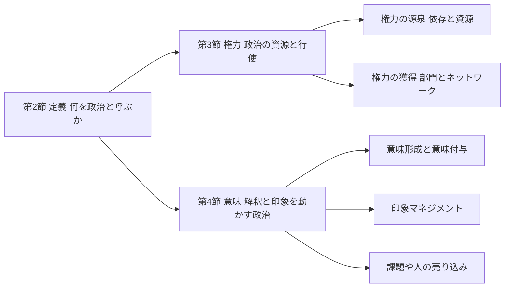
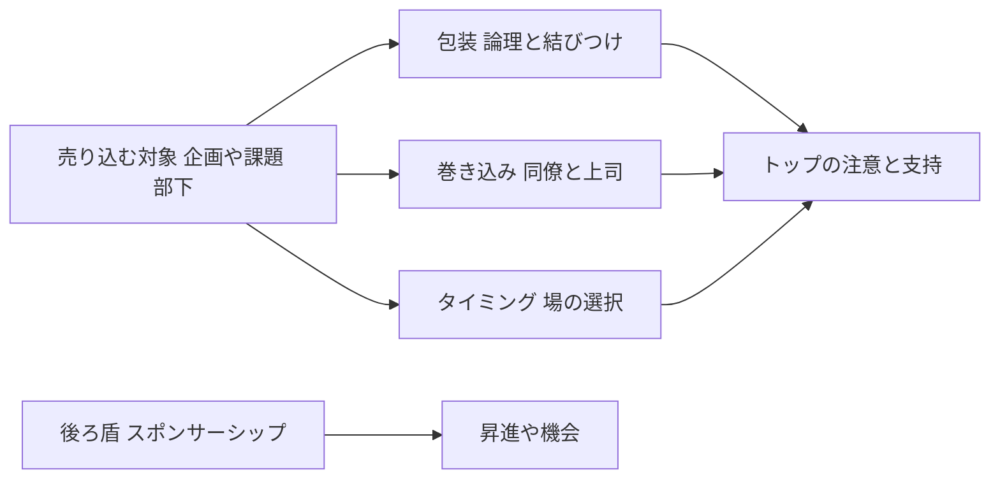

# 第3章 そもそも社内政治とは？（第2〜4節） — 学術的根拠と実務への含意

> この文書は、木村琢磨『社内政治の科学』（日本経済新聞出版, 2025）の **目次の見出しだけ** を手がかりに、対応する学術文献を調べてまとめたものです。本書の本文は読んでいません。「本書がこう書いている」という記述はありません（著者の公開記事で確認できた定義だけは、出典付きで紹介します）。
>
> 各出典には **確認経路**（本文 / 要旨 / 二次資料 / 未確認）と **証拠の強さ**（メタ分析 / 複数の実証 / 単一の実証 / 理論・概念 / 事例）を付けています。

## この章で扱う論点

| 目次の見出し | 対応する学術概念 | 主要文献 |
|-------------|-----------------|---------|
| 第2節 なぜ定義が重要か？ | 定義の不一致、構成概念の明確化 | Drory & Romm 1990、Mayes & Allen 1977 |
| 第2節 古典的研究における定義 | 非公認の影響、自己利益、役割外行動、非正当性 | Mayes & Allen 1977、Allen et al. 1979、Gandz & Murray 1980、Pfeffer 1981、Farrell & Petersen 1982、Mintzberg 1983 |
| 第2節 対立、そして意味のマネジメントへ | 不確実性・対立下の権力行使、象徴的行為、意味のマネジメント | Pfeffer 1981（Power in Organizations / Management as Symbolic Action）、Pettigrew 1977、Smircich & Morgan 1982 |
| 第2節 本書での社内政治の定義 | 著者の公開記事での定義 | 幻冬舎 GOLD ONLINE の著者記事 |
| 第3節 権力とは | 権力の定義、権力依存、権力の基盤 | Dahl 1957、Emerson 1962、French & Raven 1959、Magee & Galinsky 2008 |
| 第3節 権力の行使・使用としての政治 | 「権力は能力、政治はその行使」 | Pfeffer 1981 |
| 第3節 権力獲得のための社内政治 | 部門の権力（戦略的コンティンジェンシー）、ネットワーク上の位置、権力の獲得・維持・喪失 | Hickson et al. 1971、Salancik & Pfeffer 1977、Brass 1984、Anderson & Brion 2014 |
| 第4節 意味形成理論 | sensemaking（意味形成） | Weick 1995、Maitlis 2005 |
| 第4節 意味のマネジメントとしての政治 | sensegiving（意味付与）、象徴的行為 | Gioia & Chittipeddi 1991、Maitlis 2005、Pfeffer 1981 |
| 第4節 印象マネジメントとしての政治 | impression management（印象管理）、5 戦術 | Jones & Pittman 1982、Bolino & Turnley 1999、Bolino et al. 2008、Bolino, Long & Turnley 2016、Higgins et al. 2003 |
| 第4節 部下や企画を売り込む | issue selling（課題の売り込み）、career sponsorship（キャリア上の後ろ盾） | Dutton & Ashford 1993、Dutton et al. 2001、Seibert et al. 2001、Ng et al. 2005 |

## 第2節 社内政治の定義

### なぜ定義が重要か？

#### 学術的な根拠と定義

- **定義に合意がない**: Drory & Romm（1990）は、組織政治（organizational politics, OP）のさまざまな定義をレビューし、定義の要素が今後の研究にどう影響するかを論じた。統一の定義そのものは示していない（後続研究がそう指摘している）。
- **線引きの難しさ**: Mayes & Allen（1977）は、定義に「自己利益」を入れると、自分の評価を上げるために普通に良い仕事をすることまで政治に入ってしまう、と批判した（既存 run の整理による。原典本文は未取得）。
- 定義をどう取るかで、**何を測り、何を良い・悪いと評価するか** が変わる。下の表は、定義を分ける主な要素である。

| 要素 | 含めると起きること | 根拠 |
|------|------------------|------|
| 影響力の行使 | ほぼすべての定義の必要条件 | 各定義の比較（二次資料） |
| 自己利益 | 政治がネガティブな概念になる | Allen et al. 1979、Mayes & Allen 1977 の批判 |
| 非公認・非正当 | 公式の権限行使と区別できる | Mayes & Allen 1977、Mintzberg 1983 |
| 対立・不確実性 | 政治が起きる **条件** を定義に含められる | Pfeffer 1981 |
| 役割外 | 通常の職務と区別できる | Farrell & Petersen 1982 |

| 出典 | 確認 | 証拠の強さ |
|------|------|-----------|
| Drory & Romm 1990, Human Relations 43(11) | 要旨（一部）+ 二次資料 | 理論・概念（レビュー） |
| Mayes & Allen 1977, AMR 2(4) | 二次資料 | 理論・概念 |

#### 実務への含意（論文の主張）

該当文献は実務的含意を明示していない（Drory & Romm 1990 の要旨は、定義の要素を **今後の研究** への含意として論じるとしている）。

#### 推論（最小限）

推論: 社内で「政治的だ」という言葉を使うとき、人によって指す範囲が違う可能性が高い。議論の前に「非公式な調整全般」か「私利のための裏工作」かをそろえると、話がかみ合いやすい。

### 古典的研究における定義

#### 学術的な根拠と定義

| 定義者 | 定義の要旨（言い換え） | 系統 | 確認 | 証拠の強さ |
|-------|----------------------|------|------|-----------|
| Mayes & Allen 1977 | 組織が公認しない目的、または公認された目的を公認されない手段で達成するための「影響力の管理」 | 非公認型 | 二次資料 | 理論・概念 |
| Allen et al. 1979 | 自分や自集団の利益を高める・守るための意図的な影響行為 | 自己利益型 | 二次資料 | 未確認 |
| Gandz & Murray 1980 | 職場政治を、人が利己的な目的の追求として **知覚する状態** として扱った | 知覚型 | 要旨 + 二次資料 | 単一の実証（管理者調査） |
| Pfeffer 1981 | 選択に不確実さや意見の対立があるとき、望む結果を得るために権力や資源を獲得・育成・使用する活動 | 広義・権力の行使型 | 二次資料（OpenStax 教科書） | 理論・概念 |
| Farrell & Petersen 1982 | 組織上の役割として求められていないが、組織内の利害の配分に影響する（しようとする）活動 | 役割外型 | 二次資料 | 理論・概念 |
| Mintzberg 1983 | 非公式で、偏狭で、たいてい分断的で、何より技術的な意味で正当でない行動 | 非正当型 | 二次資料 | 理論・概念 |

Mayes & Allen（1977）の枠組みは、目的と手段の 2 軸で政治を区別する（二次資料経由）。

| | 目的が公認 | 目的が非公認 |
|---|-----------|-------------|
| **手段が公認** | 政治ではない | 政治 |
| **手段が非公認** | 政治 | 政治 |

Gandz & Murray（1980, AMJ）は、管理者に職場政治の経験を尋ねた。二次資料では「回答者の 9 割前後が自組織に政治があると答えた」と紹介されている。ただし紹介する文献によって数字が異なる（93% と 90%）。また、人事方針・採用・懲戒の手続きは、最も政治的でない決定として順位づけられたと報告されている（二次資料）。

#### 実務への含意（論文の主張）

- Gandz & Murray（1980）: 二次資料によれば、多くの管理者が「成功するには政治に関わる必要がある」と答えた。ただし、これは回答者の **知覚** の報告であり、論文が処方を述べたものかは未確認。
- 他の古典的定義論は、実務的含意を明示していない（確認できた範囲）。

#### 推論（最小限）

推論: 同じ行動（例: 会議前の個別説明）でも、Pfeffer の定義なら政治、Mayes & Allen の定義なら手段が公認されていれば政治ではない。どの定義に立つかで、評価が逆転しうる。

### 対立、そして意味のマネジメントへ

#### 学術的な根拠と定義

古典的定義の多くは「対立する利害のあいだで、誰が何を得るか」に注目した。これに対し、政治を **人々の解釈や正当性を形づくる活動** として見る流れがある。

| 論者 | 主張の要旨（言い換え） | 確認 | 証拠の強さ |
|------|----------------------|------|-----------|
| Pfeffer 1981（Power in Organizations） | 政治は不確実性・対立のもとでの権力の使用。権力は静止した能力、政治はその動いている姿 | 二次資料（OpenStax） | 理論・概念 |
| Pfeffer 1981（Management as Symbolic Action, ROB 3） | 経営の分析は 2 つの水準で行う。実質の水準では、決定は外部の制約と権力依存で決まる。象徴の水準では、政治的な言葉と象徴的行為が、決定を正当化し合理化する | 二次資料（Rindova & Srinivas 2017 が原文を引用） | 理論・概念 |
| Pettigrew 1977（ISMO 7） | 戦略形成を政治過程として捉えた。後続文献は、組織の資源配分に対して要求を出し、それを正当化する活動として政治行動を扱ったと紹介している | 二次資料 | 理論・概念 |
| Pettigrew 1985 | 戦略形成を「意味のマネジメントとしての政治」と特徴づけた | 二次資料（Sminia 2005） | 事例（ICI の縦断事例研究） |
| Smircich & Morgan 1982（JABS 18(3)） | リーダーシップを、他者の現実を枠づけ定義しようとする「意味のマネジメント」として捉えた | 二次資料 | 理論・概念 |

**注意**: 「意味のマネジメントとしての政治」という表現は、二次資料（Sminia 2005）では Pettigrew の **1985 年** の著作に帰属されている。依頼で挙がった Pettigrew 1977 にこの表現があるかは、本文を確認できなかった。

#### 実務への含意（論文の主張）

- Pfeffer（1981, Management as Symbolic Action）: Rindova & Srinivas（2017）によれば、この論文は意味のマネジメントを **経営者の中核的な仕事** と位置づけた。組織内のまとまりを作り、外部との対立を扱う手段として論じたという。
- Pettigrew 1977 / Smircich & Morgan 1982: 実務的含意は本文未確認のため不明。

#### 推論（最小限）

推論: 社内政治を「資源の取り合い」だけで見ると、説明の仕方・言葉の選び方で決定の受け止め方が変わる面を見落とす。

### 本書での社内政治の定義

#### 学術的な根拠と定義

本書の本文は読めないため、**著者が公開記事で述べた定義** だけを紹介する。

| 出典 | 著者が述べた定義の要素 | 確認 |
|------|---------------------|------|
| 幻冬舎 GOLD ONLINE（著者記事、「社内政治」の定義とはなにか？の節） | ①利害の不一致や対立があるときに、②正式なルートではない方法で、③他者や組織に影響を与えようとする行動 | 本文（記事） |
| 同上 | 「影響」は広く、何らかの変化を起こすことを指す。相手の気分を少し良くする、不安を和らげる、といった小さな変化も含む | 本文（記事） |
| 日経BP（著者インタビュー） | 根回し、気配り、暗黙の了解、キーパーソンとの非公式なネットワークづくりも社内政治の一部。前向きな社内政治は、信頼・共感・正当性に基づくリーダーシップの一種 | 本文（記事） |

この 3 要素を古典的定義と並べると、次のように対応する（対応づけは筆者による整理）。

| 著者の要素 | 近い古典的定義 |
|-----------|--------------|
| 利害の不一致や対立があるとき | Pfeffer 1981 の「不確実性・対立」条件 |
| 正式なルートではない方法 | Mayes & Allen 1977 の「非公認の手段」、Mintzberg 1983 の「非公式」 |
| 影響を与えようとする行動（自己利益を要件にしない） | Pfeffer 1981 の価値中立な定義 |

#### 実務への含意（論文の主張）

著者記事は、根回しなどによって衝突が避けられ、合意形成が円滑になる面があると紹介している（PRESIDENT Online、GOLD ONLINE）。これは学術論文ではなく、著者の解説記事である。

#### 推論（最小限）

推論: この定義は「自己利益」を要件にしないため、組織のための根回しも含む。自分の行動が政治にあたるかより、どの手段がどの場面で許容されるかを考える方が役に立つ。

## 第3節 社内政治と権力

### 権力とは

#### 学術的な根拠と定義

| 文献 | 定義・主張（言い換え） | 確認 | 証拠の強さ |
|------|---------------------|------|-----------|
| Dahl 1957（Behavioral Science 2） | A が、B がそうしなければしなかったことを B にさせられる程度が、A の B に対する権力。権力は人と人の **関係**。基盤・手段・量・範囲で記述する | 本文 | 理論・概念 |
| Emerson 1962（ASR 27(1)） | A の B に対する権力は、B の A への依存に等しい（Pab=Dba）。依存は、B が A から得るものの重要さと、代わりの入手先の少なさで決まる | 本文（依存の 2 要因は二次資料でも確認） | 理論・概念 |
| French & Raven 1959 | 権力の基盤は 報酬・強制・正当・準拠・専門 の 5 つ。Raven 1965 が情報を加えたとされる（Raven 自身の後年の説明とは食い違いがある） | 二次資料 | 理論・概念 |
| Magee & Galinsky 2008（AoM Annals 2） | 権力を "asymmetric control over valued resources in social relations" と定義。ステータス（他者からの尊敬）と区別する | 本文 | 理論・概念（レビュー） |

Emerson（1962）は、力の不均衡を和らげる **4 つの均衡化操作** を論理的に導いた（本文で確認）。

| 操作 | 内容（言い換え） |
|------|----------------|
| 動機の撤退 | 弱い側が、相手から得るものへの関心を下げる |
| ネットワークの拡大 | 弱い側が、代わりの入手先を育てる |
| ステータスの付与 | 弱い側が、相手に地位や承認を与えて相手の依存を作る |
| 連合の形成 | 弱い側どうしが組んで、集団として対抗する |

Magee & Galinsky（2008）は、権力は資源ごとに決まり、公式の階層と一致しないことがあると述べる。例として、上司は部下の昇進を左右できるが、部下は上司が頼る技術的専門性を持ちうる、と挙げている（本文）。

#### 実務への含意（論文の主張）

- Magee & Galinsky（2008）: 地位を上げるための競争は、努力して専門性を示す方向に向かえば組織に益がある。一方、報酬が最上位に偏ると、妨害やルール違反など有害な手段が使われることがある、と述べる（本文）。
- Dahl 1957 / Emerson 1962 / French & Raven 1959: 該当文献は実務的含意を明示していない（理論論文）。

#### 推論（最小限）

推論: 自分の権力を考えるときは、肩書きより「誰が自分の持つ何に頼っているか、代わりはあるか」を見る方が実態に近い。

### 権力の行使・使用としての政治

#### 学術的な根拠と定義

- Pfeffer（1981）は、権力を **影響を及ぼす潜在的な能力**、政治を **その能力を築き使う活動** と区別した。OpenStax の教科書は、Pfeffer の言葉として「権力は静止した系の性質、政治は "power in action"（動いている権力）の研究」と紹介している（二次資料）。
- この区別では、権力は持っているだけでは政治にならない。不確実さや対立のある選択の場面で使われたとき、政治になる。

| 出典 | 確認 | 証拠の強さ |
|------|------|-----------|
| Pfeffer 1981, Power in Organizations | 二次資料（OpenStax） | 理論・概念 |
| Pfeffer 1992, Managing with Power | 未確認（本調査では本文・要旨を確認していない） | — |

#### 実務への含意（論文の主張）

Pfeffer 1981 の実務的含意は、本調査では原典で確認できていない。Pfeffer 1992（Managing with Power）は実務家向けに権力の使い方を論じた本とされるが、内容は未確認。

#### 推論（最小限）

なし。

### 権力獲得のための社内政治

#### 学術的な根拠と定義

| 文献 | 主張（言い換え） | 確認 | 証拠の強さ |
|------|----------------|------|-----------|
| Hickson et al. 1971（ASQ 16(2)） | 部門の権力は、①不確実性に対処する能力、②代わりがきかないこと、③仕事の流れの中心にいること、で決まる（戦略的コンティンジェンシー理論）。3 条件はそれぞれ必要条件 | 二次資料 | 理論・概念（後に複数の実証で検証） |
| Salancik & Pfeffer 1977（Organizational Dynamics 5(3)） | 組織にとって最も重要な不確実性・資源を扱う部門が権力を得る。権力は制度化されると、組織への有用性を超えて残る | 二次資料 | 理論・概念 + 事例 |
| Brass 1984（ASQ 29） | 新聞社の非管理職 140 人を調べ、ネットワーク上の中心性（アクセスと統制）が、他者から見た影響力や昇進と関係することを示した | 二次資料 | 単一の実証 |
| Anderson & Brion 2014（Annual Review of OPOB 1） | 権力を時間の中で展開する過程として捉え、獲得・維持・喪失を区別して研究をまとめた。維持と喪失については結果が食い違う研究がある | 二次資料（IESE の解説） | 理論・概念（レビュー） |
| Magee & Galinsky 2008 | 権力とステータスは、それを持つ人の考え方や行動を変え、さらに権力・ステータスを得やすくする（自己強化） | 本文 | 理論・概念（レビュー） |

| 権力の源泉 | 個人レベル | 部門レベル |
|-----------|-----------|-----------|
| 依存される資源 | Emerson 1962、Magee & Galinsky 2008 | Salancik & Pfeffer 1977 |
| 不確実性への対処 | — | Hickson et al. 1971 |
| 代わりのきかなさ | Magee & Galinsky 2008（重要で代替不能な手順の担い手） | Hickson et al. 1971 |
| ネットワーク上の位置 | Brass 1984 | Hickson et al. 1971（中心性） |

#### 実務への含意（論文の主張）

- Salancik & Pfeffer（1977）: 二次資料によれば、政治は組織を現実に合わせ続ける正当な手段でありうる。一方、権力が権限や規則として制度化されると、組織が現実から切り離される、と論じた。
- Magee & Galinsky（2008）: 資源をめぐる部門間の争いは、組織全体の利益に貢献しないことが多い、と述べる（本文）。
- Brass 1984 / Anderson & Brion 2014: 実務的含意は本調査では確認できていない（IESE の解説は「権力の予測要因 4 つ、維持要因 5 つ、喪失の兆候 6 つ」と件数だけを示しており、中身は未確認）。

#### 推論（最小限）

推論: 権力を得る正攻法は、組織の重要な不確実性を引き受け、代わりのきかない役割を持ち、仕事の流れの中心に入ることである。ただし、得た権力が役割の変化後も残ると、組織の害になりうる点に注意が要る。

### 流派による見方の違い（第3節）

| 見方 | 権力の所在 | 代表文献 |
|------|-----------|---------|
| 関係・依存の見方 | 二者間の依存関係 | Dahl 1957、Emerson 1962 |
| 基盤の見方 | 個人が持つ資源の種類 | French & Raven 1959 |
| 構造の見方 | 部門の役割、ネットワーク上の位置 | Hickson et al. 1971、Brass 1984 |
| 心理・過程の見方 | 権力が人を変え、自己強化する | Magee & Galinsky 2008、Anderson & Brion 2014 |

## 第4節 社内政治と意味のマネジメント

### 意味形成理論

#### 学術的な根拠と定義

- **sensemaking（意味形成）**: 人が、あいまいで予想外の出来事に意味を与え、行動できる状態にする過程。Weick（1995）は意味形成の 7 つの特性を挙げた（二次資料で確認）。

| 特性 | 内容（言い換え） |
|------|----------------|
| アイデンティティに根ざす | 自分が何者かという感覚が解釈を左右する |
| 回顧的 | 起きたことを振り返って意味づける |
| 行為による環境の創出（enactment） | 自分の行動が、解釈する環境そのものを作る |
| 社会的 | 他者とのやりとりの中で行われる |
| 継続的 | 始まりも終わりもなく続く |
| 抽出された手がかり | 一部の手がかりを足がかりにする |
| 正確さより納得性 | もっともらしさで動く |

- Maitlis（2005, AMJ 48(1)）は、複数の組織を縦断的に調べ（対象の詳細は未確認）、組織の意味形成が 4 つの形をとることを示した。形を分けるのは、リーダーと利害関係者がどれだけ **意味付与（sensegiving）** を行うかである（要旨 + 二次資料）。

| | 利害関係者の意味付与が多い | 少ない |
|---|------------------------|-------|
| **リーダーの意味付与が多い** | 導かれた（guided） | 制限された（restricted） |
| **少ない** | 断片化した（fragmented） | 最小限の（minimal） |

| 出典 | 確認 | 証拠の強さ |
|------|------|-----------|
| Weick 1995, Sensemaking in Organizations | 二次資料 | 理論・概念 |
| Maitlis 2005, AMJ | 要旨 + 二次資料（2×2 の対応は二次資料の解釈） | 単一の実証（質的・縦断） |
| Maitlis & Christianson 2014, AoM Annals | 未確認（本文を取得できず） | 理論・概念（レビュー） |

#### 実務への含意（論文の主張）

- Weick 1995: 二次資料によれば、Weick は正確さへの過度なこだわりは実務上あまり役に立たないと論じた。
- Maitlis 2005: 要旨の範囲では、形によって得られる解釈と行動の一貫性が異なると報告されているが、実務的処方の記述は確認できていない。

#### 推論（最小限）

推論: 組織の出来事の「意味」は事実だけでは決まらず、誰がどれだけ説明に関わるかで変わる。ここに政治が入り込む余地がある。

### 意味のマネジメントとしての政治

#### 学術的な根拠と定義

- **sensegiving（意味付与）**: Gioia & Chittipeddi（1991, SMJ 12(6)）が提示した概念。他者の意味形成や意味の構築に働きかけ、望ましい組織の現実の定義へ導こうとする過程（二次資料が原文 p.442 を引用）。
- 同論文は、米国の大規模な公立大学で新任のトップ（CEO にあたる学長）が戦略変革を始めた 1 年目を民族誌的に調べた。過程は **構想 → 合図 → 再構想 → 活性化** の 4 段階をたどり、意味形成と意味付与が交互に起きた（要旨 + 二次資料）。
- Pfeffer（1981, Management as Symbolic Action）は、政治的な言葉と象徴的行為が決定を正当化・合理化する、と論じた（二次資料）。

| 出典 | 確認 | 証拠の強さ |
|------|------|-----------|
| Gioia & Chittipeddi 1991 | 要旨 + 二次資料 | 単一の実証（民族誌・事例） |
| Pfeffer 1981, ROB 3 | 二次資料 | 理論・概念 |
| Maitlis 2005 | 要旨 + 二次資料 | 単一の実証 |

#### 実務への含意（論文の主張）

- Gioia & Chittipeddi（1991）: 戦略変革を始めるときの CEO の主な役割は、意味形成と意味付与という概念で最もよく理解できる、と述べる（要旨）。
- Maitlis（2005）: 利害関係者もリーダーと同じく意味付与を行う。つまり意味をめぐる働きかけはトップだけのものではない（要旨）。

#### 推論（最小限）

推論: 変革や新方針を通すとき、決定そのものより先に「これは何の問題か」という解釈をそろえる働きかけが効く可能性がある。逆に、解釈の押しつけは反発の種にもなりうる。

### 印象マネジメントとしての政治

#### 学術的な根拠と定義

- **impression management（印象管理）**: 他者が自分をどう見るかに影響を与えようとする行動。
- Jones & Pittman（1982）は、戦略的な自己呈示を 5 つに分類した（二次資料）。Bolino & Turnley（1999, ORM 2(2)）は、この分類に基づく職場の尺度を 5 つの研究で作り、分類を支持する結果を得た（二次資料）。

| 戦術 | 目指す印象 | 代表的な行動 |
|------|-----------|-------------|
| 取り入り（ingratiation） | 好ましい人 | お世辞、好意を示す、相手の意見に合わせる |
| 自己宣伝（self-promotion） | 有能な人 | 成果や能力を示す |
| 模範（exemplification） | 献身的な人 | 遅くまで働く、熱心さを見せる |
| 威嚇（intimidation） | 怖い人 | 圧力をかける |
| 哀願（supplication） | 助けが必要な人 | 弱さを見せて助けを引き出す |

- Bolino et al.（2008, JOM 34(6)）は、1988 年以降の印象管理研究を個人・集団・組織の多層でレビューし、定義と分類の明確化を求めた（二次資料）。
- Bolino, Long & Turnley（2016, Annual Review of OPOB 3）は、定義・種類・動機、取り入りと自己宣伝の効果、性別・文化・測定の問題をレビューした（要旨）。
- **効果の証拠**: Higgins, Judge & Ferris（2003, JOB）のメタ分析は、取り入りと合理的説得が仕事の成果（業績評価など）に正の効果を持つと報告した。自己宣伝については、先行研究の結果が食い違っていた（要旨 + 二次資料）。

| 出典 | 確認 | 証拠の強さ |
|------|------|-----------|
| Jones & Pittman 1982 | 二次資料 | 理論・概念 |
| Bolino & Turnley 1999 | 二次資料 | 複数の実証（尺度開発 5 研究） |
| Bolino et al. 2008 | 二次資料 | 理論・概念（レビュー） |
| Bolino, Long & Turnley 2016 | 要旨 | 理論・概念（レビュー） |
| Higgins, Judge & Ferris 2003 | 要旨 + 二次資料 | メタ分析 |

#### 実務への含意（論文の主張）

- Bolino, Long & Turnley（2016）: 要旨によれば、未解決の問いとあわせて実務的含意を論じている。ただし中身は本文未確認。
- Higgins et al.（2003）: 影響戦術の効果は、状況や成果の種類によって変わる、としている（要旨）。
- Jones & Pittman 1982 / Bolino & Turnley 1999: 該当文献の実務的含意は確認できていない。

#### 推論（最小限）

推論: 印象管理は日常的で、効果のある戦術もある。ただし効果は状況次第なので、「どの相手に、どの場面で」を外すと逆効果になりうる。

### 部下や企画を売り込む

#### 学術的な根拠と定義

- **issue selling（課題の売り込み）**: Dutton & Ashford（1993, AMR 18(3)）が提示した概念。組織の業績に関わる出来事や動向に、他者（特にトップ）が注意を向け、理解するよう働きかける過程。主にミドル・マネジャーが行う行動として論じた（二次資料）。トップの注意の配分を説明するうえで中心的な過程だと位置づけた（要旨）。
- Dutton et al.（2001, AMJ 44(4)）は、82 件の管理者の売り込み事例を分析した。重要な「手（moves）」として、**包装（packaging）・巻き込み（involvement）・タイミング** を特定した。管理者はこれを実行する際に、3 種類の文脈知識を使っていた（要旨。3 種類の中身は未確認）。

| 手の種類 | 内容（言い換え） | 確認 |
|---------|----------------|------|
| 包装 | 事業計画の論理で示す、他の目標と結びつける | 二次資料 |
| 巻き込み | 同僚や上司を、公式・非公式の手続きで巻き込む | 二次資料 |
| 過程・タイミング | いつ、どの場で出すかを選ぶ | 要旨 |

- **人を売り込む（後ろ盾・スポンサーシップ）**: Seibert, Kraimer & Liden（2001, AMJ 44(2)）は 448 人の調査で、ネットワーク上の社会的資源がキャリアの成功（昇進・給与・満足）に効くのは、情報へのアクセス・資源へのアクセス・**キャリアの後ろ盾（career sponsorship）** を通じてのみであることを示した（要旨）。
- Ng et al.（2005, Personnel Psychology 58(2)）のメタ分析は、組織からの後ろ盾（上司の支援など）が、客観的な成功（給与・昇進）より主観的な成功（キャリア満足）とより強く関係すると報告した。キャリアを説明するには、本人の実力で勝ち上がる見方（競争移動）と、引き上げられる見方（後援移動）の両方が必要だと結論した（要旨 + 二次資料）。

| 出典 | 確認 | 証拠の強さ |
|------|------|-----------|
| Dutton & Ashford 1993 | 要旨 + 二次資料 | 理論・概念 |
| Dutton et al. 2001 | 要旨 + 二次資料 | 単一の実証（質的、82 事例） |
| Seibert, Kraimer & Liden 2001 | 要旨 | 単一の実証（448 人） |
| Ng et al. 2005 | 要旨 + 二次資料 | メタ分析 |

#### 実務への含意（論文の主張）

- Dutton et al.（2001）: 管理者は、売り込みの手を通じて組織変革のミクロな過程を能動的に形づくっている、と結論した（要旨）。
- Ng et al.（2005）: 主観的な予測要因と主観的な成功の関係が強いのは、共通方法バイアス（同じ回答者が両方を答えることによるゆがみ）の影響かもしれない、と注意している（要旨）。これは研究上の注意で、実務的処方ではない。
- Seibert et al. 2001: 実務的含意は本調査では確認できていない。

#### 推論（最小限）

推論: 企画を通すには、内容の良さに加えて「どう包み、誰を巻き込み、いつ出すか」が効く。部下を推すことは、その部下にとって重要な後ろ盾になりうる。

### 流派による見方の違い（第4節）

| 見方 | 政治の焦点 | 代表文献 |
|------|-----------|---------|
| 象徴・正当化の見方 | 決定を正当化する言葉と象徴 | Pfeffer 1981、Pettigrew 1985 |
| 解釈の見方 | 何が起きているかの意味づけ | Weick 1995、Gioia & Chittipeddi 1991、Maitlis 2005 |
| 自己呈示の見方 | 自分がどう見られるか | Jones & Pittman 1982、Bolino 系の研究 |
| 上方への影響の見方 | トップの注意と支持の獲得 | Dutton & Ashford 1993、Dutton et al. 2001 |

## 未確認の点

- **本書の内容**: 本書の本文は読んでいない。各節で本書が何を論じているかは不明。「本書での定義」は著者の公開記事（GOLD ONLINE）の定義で代用した。
- **Pettigrew 1977 と「意味のマネジメント」**: 1977 年論文にこの表現があるかは未確認。二次資料（Sminia 2005）はこの表現を 1985 年の著作に帰属させている。
- **古典的定義の原文**: Mayes & Allen 1977、Allen et al. 1979、Farrell & Petersen 1982、Mintzberg 1983、Pfeffer 1981 の定義文は、すべて二次資料経由。
- **Gandz & Murray 1980 の数字**: 「政治があると答えた割合」は資料によって 93% と 90% に分かれる。
- **French & Raven の情報勢力**: 1959 年の原典に含まれるか、1965 年の追加かで資料が食い違う。
- **Anderson & Brion 2014 の中身**: 獲得・維持・喪失の具体的な要因は未確認（本文・要旨とも取得できず）。
- **Pfeffer 1992、Maitlis & Christianson 2014、Bolino 2016 の実務的含意**: 本文を取得できず未確認。
- **Dutton et al. 2001 の各「手」の定義の詳細**: 要旨と二次資料の範囲のみ。

## 主要文献

| 文献 | 種別 | 年 | この章での使いどころ | 確認 |
|------|------|----|------------------|------|
| Mayes & Allen, Toward a Definition of Organizational Politics, AMR | 論文 | 1977 | 非公認の目的・手段による定義 | 二次資料 |
| Pettigrew, Strategy Formulation as a Political Process, ISMO | 論文 | 1977 | 戦略形成を政治過程と見る | 二次資料 |
| Allen et al., Organizational Politics, California Management Review | 論文 | 1979 | 自己利益型の定義 | 二次資料 |
| Gandz & Murray, The Experience of Workplace Politics, AMJ | 論文 | 1980 | 知覚としての政治、普及度 | 要旨 + 二次資料 |
| Pfeffer, Power in Organizations | 書籍 | 1981 | 権力と政治の区別、広義の定義 | 二次資料 |
| Pfeffer, Management as Symbolic Action, ROB | 論文 | 1981 | 象徴的行為・意味のマネジメント | 二次資料（原文引用あり） |
| Farrell & Petersen, Patterns of Political Behavior in Organizations, AMR | 論文 | 1982 | 役割外の定義 | 二次資料 |
| Smircich & Morgan, Leadership: The Management of Meaning, JABS | 論文 | 1982 | 意味のマネジメントとしてのリーダーシップ | 二次資料 |
| Mintzberg, Power In and Around Organizations | 書籍 | 1983 | 非正当型の定義 | 二次資料 |
| Drory & Romm, The Definition of Organizational Politics: A Review, Human Relations | 論文 | 1990 | 定義の不一致 | 要旨（一部）+ 二次資料 |
| Dahl, The Concept of Power, Behavioral Science | 論文 | 1957 | 権力の古典的定義 | 本文 |
| French & Raven, The Bases of Social Power | 書籍章 | 1959 | 権力の基盤 | 二次資料 |
| Emerson, Power-Dependence Relations, ASR | 論文 | 1962 | 権力依存、均衡化操作 | 本文 |
| Hickson et al., A Strategic Contingencies' Theory of Intraorganizational Power, ASQ | 論文 | 1971 | 部門の権力 | 二次資料 |
| Salancik & Pfeffer, Who Gets Power and How They Hold On to It, Organizational Dynamics | 論文 | 1977 | 部門の権力と制度化 | 二次資料 |
| Brass, Being in the Right Place, ASQ | 論文 | 1984 | ネットワーク上の位置と影響力 | 二次資料 |
| Magee & Galinsky, Social Hierarchy, AoM Annals | 論文 | 2008 | 権力とステータスの定義、自己強化 | 本文 |
| Anderson & Brion, Perspectives on Power in Organizations, Annual Review of OPOB | 論文 | 2014 | 権力の獲得・維持・喪失 | 二次資料 |
| Weick, Sensemaking in Organizations | 書籍 | 1995 | 意味形成の 7 特性 | 二次資料 |
| Gioia & Chittipeddi, Sensemaking and Sensegiving in Strategic Change Initiation, SMJ | 論文 | 1991 | 意味付与の定義 | 要旨 + 二次資料 |
| Maitlis, The Social Processes of Organizational Sensemaking, AMJ | 論文 | 2005 | 意味形成の 4 形態 | 要旨 + 二次資料 |
| Jones & Pittman, Toward a General Theory of Strategic Self-Presentation | 書籍章 | 1982 | 印象管理の 5 戦術 | 二次資料 |
| Bolino & Turnley, Measuring Impression Management in Organizations, ORM | 論文 | 1999 | 5 戦術の尺度 | 二次資料 |
| Bolino, Kacmar, Turnley & Gilstrap, A Multi-Level Review of Impression Management, JOM | 論文 | 2008 | 多層レビュー | 二次資料 |
| Bolino, Long & Turnley, Impression Management in Organizations, Annual Review of OPOB | 論文 | 2016 | 印象管理のレビュー | 要旨 |
| Higgins, Judge & Ferris, Influence Tactics and Work Outcomes, JOB | 論文 | 2003 | 印象管理・影響戦術の効果 | 要旨 + 二次資料 |
| Dutton & Ashford, Selling Issues to Top Management, AMR | 論文 | 1993 | 課題の売り込み | 要旨 + 二次資料 |
| Dutton, Ashford, O'Neill & Lawrence, Moves That Matter, AMJ | 論文 | 2001 | 売り込みの手 | 要旨 + 二次資料 |
| Seibert, Kraimer & Liden, A Social Capital Theory of Career Success, AMJ | 論文 | 2001 | キャリアの後ろ盾 | 要旨 |
| Ng, Eby, Sorensen & Feldman, Predictors of Objective and Subjective Career Success, Personnel Psychology | 論文 | 2005 | 後ろ盾とキャリア成功のメタ分析 | 要旨 + 二次資料 |

## Sources

- [幻冬舎 GOLD ONLINE「社内政治」の定義とはなにか？（著者記事）](https://gentosha-go.com/articles/-/73725?page=3)
- [幻冬舎 GOLD ONLINE 著者記事](https://gentosha-go.com/articles/-/73717)
- [日経BP 著者インタビュー](https://bookplus.nikkei.com/atcl/column/101000304/030600024/)
- [PRESIDENT Online 著者記事（根回し）](https://president.jp/articles/-/105819)
- [OpenStax Organizational Behavior 13.3 Political Behavior in Organizations](https://openstax.org/books/organizational-behavior/pages/13-3-political-behavior-in-organizations)
- [Rindova & Srinivas 2017 Managing Meaning プレプリント](https://santoshbs.github.io/files/RindovaSrinivas_2017_ManagingMeaning_PreprintVersion.pdf)
- [Sminia 2005（Pettigrew の意味のマネジメントへの言及）](https://strathprints.strath.ac.uk/44053/1/Sminia_2005_.pdf)
- [Smircich & Morgan 1982 SAGE](https://journals.sagepub.com/doi/10.1177/002188638201800303)
- [Drory & Romm 1990 BGU](https://cris.bgu.ac.il/en/publications/the-definition-of-organizational-politics-a-review/)
- [Gandz & Murray 1980 Scilit](https://scilit.com/publications/269ef2d3f9728f49b6693f35fabc883e)
- [Dahl 1957 The Concept of Power PDF](https://fbaum.unc.edu/teaching/articles/Dahl_Power_1957.pdf)
- [Emerson 1962 Power-Dependence Relations PDF](https://umsl.edu/%7Ekeelr/3210/resources/emerson_power_depend.pdf)
- [SAGE Encyclopedia Power-Dependence Relations](https://sk.sagepub.com/ency/edvol/embed/socialtheory/chpt/powerdependence-relations)
- [French and Raven's bases of power（Wikipedia）](https://en.wikipedia.org/wiki/French_and_Raven%27s_bases_of_power)
- [Magee & Galinsky 2008 PDF](https://web.mit.edu/curhan/www/docs/Articles/15341_Readings/Power/Magee,%20J.%20C.,%20&%20Galinsky,%20A.%20D.%20(2008).%20Social%20hierarchy-%20The%20self%E2%80%90reinforcing%20nature%20of%20power%20and%20status..pdf)
- [Hickson et al. 1971 SAGE Encyclopedia Strategic Contingencies Theory](https://sk.sagepub.com/ency/edvol/embed/encyclopedia-of-management-theory/chpt/strategic-contingencies-theory)
- [Salancik & Pfeffer 1977 Wikipedia（Gerald R. Salancik）](https://en.wikipedia.org/wiki/Gerald_R._Salancik)
- [Brass 1984 Talking About Organizations](https://www.talkingaboutorganizations.com/61-power-influence-in-organizations-dan-brass/)
- [Anderson & Brion 2014 IESE Insight](https://www.iese.edu/insight/articles/power-at-work/)
- [Weick 1995 Sensemaking（Wikipedia）](https://en.wikipedia.org/wiki/Sensemaking)
- [Gioia & Chittipeddi 1991 IDEAS/RePEc](https://ideas.repec.org/a/bla/stratm/v12y1991i6p433-448.html)
- [Gioia & Chittipeddi 1991 AcaWiki](https://acawiki.org/Sensemaking_and_sensegiving_in_strategic_change_initiation)
- [Maitlis 2005 要旨](https://academicnewsletter.sufe.edu.cn/info/362260)
- [Theory of Organizational Sensemaking（theorizeit）](https://is.theorizeit.org/wiki/Theory_of_Organizational_Sensemaking)
- [Jones & Pittman / Bolino & Turnley 1999 関連（Redalyc）](https://www.redalyc.org/journal/3589/358971648009/html/)
- [Bolino, Long & Turnley 2016 Synapse Social](https://synapsesocial.com/papers/W2154746903)
- [Bolino et al. 2008 EconBiz](https://www.econbiz.de/Record/a-multi-level-review-of-impression-management-motives-and-behaviors/10008232988)
- [Higgins, Judge & Ferris 2003 Zendy](https://zendy.io/title/10.1002/job.181)
- [Dutton & Ashford 1993 BibBase](https://bibbase.org/network/publication/dutton-ashford-sellingissuestotopmanagement-1993)
- [Dutton et al. 2001 要旨](https://academicnewsletter.sufe.edu.cn/info/362966)
- [Jane Dutton Issue Selling](https://sites.google.com/umich.edu/janedutton/areas-of-expertise/issue-selling-and-issue-management)
- [Seibert, Kraimer & Liden 2001 要旨](https://academicnewsletter.sufe.edu.cn/info/363056)
- [Ng et al. 2005](https://stafforini.com/works/ng-2005-predictors-objective-subjective/)
