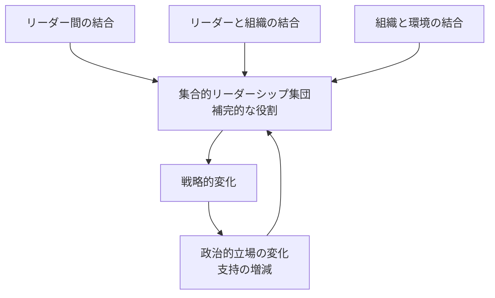
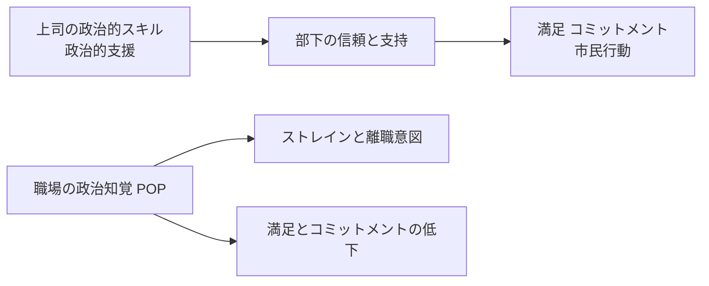

# 第4章 リーダーシップとしての社内政治 — 学術的根拠と実務への含意

本ファイルは、木村琢磨『社内政治の科学』（2025）第4章の目次の見出しだけを手がかりに、各論点に対応する学術文献を調べてまとめたものです。本の本文は読んでいません。中身はすべて学術文献から書いています。「本書がこう述べている」という記述は含みません。

凡例:

- **確認**: 本文 = 論文本文を読んで確認 / 要旨 = 要旨（抄録）で確認 / 二次資料 = 他の論文・書評・解説経由 / 未確認 = 内容を確認できていない
- **証拠**: メタ分析 / 複数の実証 / 単一の実証 / 理論・概念 / 事例

## この章で扱う論点

| 目次の見出し | 対応する学術概念 | 主要文献 |
|---|---|---|
| 1-1 リーダーシップの定義 | 影響過程としてのリーダーシップ | Yukl（教科書） |
| 1-2 リーダーシップとマネジメントとの関係 | 変化への対処と複雑性への対処 | Kotter 1990, Zaleznik 1977 |
| 1-3 リーダーシップ研究の変遷 | 特性 → 行動 → 状況適合 → 変革型・カリスマ → 関係・共有・アイデンティティ | Dinh et al. 2014 |
| 2-1 よくあるリーダーシップ論の問題点 | リーダーシップのロマンス、権力の看過、英雄的リーダー像への批判 | Meindl et al. 1985, Pfeffer 1977, Hardy 1996, Collinson 2014/2018 |
| 2-2 政治と切り離せないリーダーシップ | 政治的リーダーシップ理論、リーダーの政治的スキル | Ammeter et al. 2002, Ferris et al. 2007, Munyon et al. 2015 |
| 2-3 アイデンティティ変革の重要性 | 社会的アイデンティティ型リーダーシップ、リーダー・アイデンティティの主張と承認、組織アイデンティティの変化（本書での意味は未確認） | van Knippenberg & Hogg 2003, Haslam, Reicher & Platow 2011, DeRue & Ashford 2010, Gioia et al. 2000 |
| 3-1 組織変革のモデル | 3 段階モデル、8 段階モデル | Lewin（Cummings et al. 2016 の再検討）, Kotter 1995 |
| 3-2 組織変革モデルと政治 | 変革における権力の 3 次元＋システム権力、変革担当者の政治 | Hardy 1996, Buchanan & Badham 1999/2008, Buchanan 2008 |
| 3-3 組織変革のための政治的リーダーシップ | 権力の動員、政治的専門性 | Hardy 1996, Buchanan & Badham 2008 |
| 3-4 リーダーシップを「分配」する | 分配型リーダーシップ、集合的リーダーシップ | Gronn 2002, Denis, Langley & Cazale 1996, Denis, Lamothe & Langley 2001 |
| 4-1 ミドルマネジャーの役割 | ミドルの戦略的役割 4 類型 | Floyd & Wooldridge 1992, Wooldridge, Schmid & Floyd 2008, Huy 2001 |
| 4-2 部門マネジャーとしての利害調整と資源獲得 | イシュー・セリング、ネットワークと資源獲得 | Dutton & Ashford 1993, Ferris et al. 2007 |
| 4-3 社内政治と部下のモチベーション | 政治知覚（POP）の帰結、リーダーの政治的スキル・政治的支援と部下の反応、感情のバランシング | Chang, Rosen & Levy 2009, Treadway et al. 2004, Ellen, Ferris & Buckley 2013, Huy 2002 |

## 第1節 そもそもリーダーシップとは？

### リーダーシップの定義

#### 学術的な根拠と定義

| 主張 | 出典 | 確認 | 証拠 |
|---|---|---|---|
| リーダーシップは「何をなすべきか、どうなすべきかについて他者の理解と合意を得るよう影響を与え、共有された目的に向けた個人と集団の努力を促す過程」と定義される | Yukl『Leadership in Organizations』 | 二次資料（講義資料・書評経由。版により文言が異なる） | 理論・概念 |
| Yukl の別の版・別の引用では、集団や組織の活動と関係を導き、構造化し、促すために、意図的な影響を他者に及ぼす過程と定義される | Yukl（同上） | 二次資料 | 理論・概念 |
| 定義は研究者ごとに多様で、共通項は「影響」「過程」「集団・目的」 | Yukl（同上） | 二次資料 | 理論・概念 |

ポイント: 主流の定義はリーダーシップを「影響の過程」として扱う。影響の手段として権力や政治的行動を含みうるが、定義そのものは権力に言及しない。

#### 実務への含意（論文の主張）

該当文献（教科書の定義部分）は実務的含意を明示していない。

#### 推論（最小限）

推論: 定義が「影響の過程」である以上、公式の役職がない人もリーダーシップを発揮できる。逆に、役職者でも合意形成ができなければリーダーシップを発揮していないことになる。

### リーダーシップとマネジメントとの関係

#### 学術的な根拠と定義

| 論者 | リーダーシップ | マネジメント | 関係 | 確認 | 証拠 |
|---|---|---|---|---|---|
| Kotter 1990（HBR） | 変化への対処。方向の設定、人々の整合（aligning）、動機づけ | 複雑性への対処。計画と予算、組織化と人員配置、統制と問題解決 | 別個で相補的な 2 つの行動体系。どちらが上でもない | 要旨（HBR 抄録と抜粋） | 理論・概念 |
| Zaleznik 1977（HBR） | 混沌に耐え、新しいアプローチを生む。芸術家に近い | 過程・安定・統制を重視し、交渉や取引で調整する | 人のタイプとして根本的に異なる | 二次資料 | 理論・概念 |

整理:

- Kotter は「機能」の違いとして区別し、両方を組み合わせることを求める。
- Zaleznik は「人格」の違いとして区別する。
- Zaleznik がマネジャーの手段として挙げる交渉・取引は、政治的行動に近い（二次資料経由の要約）。

#### 実務への含意（論文の主張）

- Kotter 1990: 強いリーダーシップと強いマネジメントを組み合わせ、互いにバランスさせることが課題。変化の激しい環境では、リーダーシップを担える人材を意図的に育てる必要がある（要旨・抜粋による）。
- Zaleznik 1977: 該当部分は二次資料でしか確認できず、実務的含意の内容は未確認。

#### 推論（最小限）

推論: Kotter の「aligning（整合）」は、命令系統の外にいる人も含めて協力を取り付ける活動であり、社内政治の領域と重なる。この接点は本章第2節の議論とつながる。

### リーダーシップ研究の変遷

#### 学術的な根拠と定義

| 主張 | 出典 | 確認 | 証拠 |
|---|---|---|---|
| 2000 年以降の主要 10 誌のリーダーシップ理論を質的にレビューし、分析レベルと創発の形に注目する過程志向の枠組みで整理した | Dinh, Lord, Gardner, Meuser, Liden & Hu 2014, *Leadership Quarterly* | 要旨 | 理論・概念（レビュー） |
| 研究の流れは個人の特性から、行動、状況、変革・カリスマ、さらに関係や集団の過程へ広がった | 一般的整理（Yukl ほか教科書） | 二次資料 | 理論・概念 |
| 特性→行動→状況適合→変革型の各段階の代表文献（Bass 1985、House 1977 など）は本調査で原典を確認していない | — | 未確認 | — |

#### 実務への含意（論文の主張）

Dinh et al. 2014 は研究上の含意（今後の理論構築）を述べており、実務的含意は明示していない（要旨の範囲）。

#### 推論（最小限）

なし。

## 第2節 なぜ政治的リーダーシップが必要か？

### よくあるリーダーシップ論の問題点

#### 学術的な根拠と定義

| 批判 | 内容 | 出典 | 確認 | 証拠 |
|---|---|---|---|---|
| リーダーシップのロマンス | 人々は組織の成果を過度にリーダーに帰属させる。好業績も失敗もリーダーのせいにしすぎる | Meindl, Ehrlich & Dukerich 1985, *ASQ* | 二次資料 | 複数の実証（同論文内の複数研究） |
| リーダーシップの曖昧さ | リーダーシップ概念は曖昧で、成果への影響は限られる可能性がある | Pfeffer 1977, *AMR* | 未確認（書誌のみ） | 理論・概念 |
| 英雄的リーダー神話 | カリスマとビジョンを持つリーダーを探し、そのカリスマで実行させる、という単純化は戦略実行の多くの見えない行動を覆い隠す。権力は不快な語として戦略論で避けられてきた | Hardy 1996, *British Journal of Management* | 本文 | 理論・概念（事例付き） |
| 権力の看過 | 権力はリーダーシップ研究で中心的なのに十分に検討されていない。二分法でなく弁証法的に権力関係を分析すべき | Collinson 2014（*Leadership*）, Collinson 2018（章） | 要旨 | 理論・概念 |

#### 実務への含意（論文の主張）

- Hardy 1996: 経験のある管理者は組織の現実が政治的だと知っているが、それを認めたがらない。権力を議論しないことが戦略的変化を妨げてきた。存在しないふりをしても権力はなくならない（本文）。
- Meindl et al. 1985、Collinson: 実務的含意は本調査の範囲では確認できていない。

#### 推論（最小限）

推論: 「良いリーダーは政治をしない」という前提で研修や評価を設計すると、実際の影響過程（根回しや連合形成）が見えなくなる。

### 政治と切り離せないリーダーシップ

#### 学術的な根拠と定義

| 主張 | 出典 | 確認 | 証拠 |
|---|---|---|---|
| リーダーの政治的行動を中心に置く「政治的リーダーシップ理論」を提案。リーダーの政治的行動は政治的スキルの影響を受け、リーダーの評判を通じて部下の反応に影響する | Ammeter, Douglas, Gardner, Hochwarter & Ferris 2002, *Leadership Quarterly* 13, 751–796 | 二次資料（Ferris et al. 2007 などの引用経由。原典要旨は取得できず） | 理論・概念 |
| 政治的スキルは、他者を理解し、その知識で個人や組織の目的を高めるよう他者に影響を与える能力。4 次元: 社会的洞察力、対人影響力、ネットワーク構築力、誠実さの見え方（apparent sincerity） | Ferris, Treadway, Perrewé, Brouer, Douglas & Lux 2007, *Journal of Management* | 本文 | 理論・概念（レビュー） |
| リーダーの政治的スキルはチーム業績（Ahearn et al. 2004）とリーダー有効性評価（Douglas & Ammeter 2004）を予測した | Ferris et al. 2007 のレビュー | 本文（レビュー経由。各原典は未確認） | 複数の実証 |
| 変革の実行は単独ではできず、リーダーが蓄積した人脈・友好・同盟という社会関係資本の活用を要する | Ferris et al. 2007 | 本文 | 理論・概念 |
| 政治的スキルは職務満足、組織コミットメント、生産性、組織市民行動、キャリア成功、評判と正の関係を持つ | Munyon, Summers, Thompson & Ferris 2015, *Personnel Psychology* | 要旨（抜粋） | メタ分析 |
| 英国の管理者 250 人の調査では、政治的行動は一般的で、多くが倫理的かつ必要と見なし、変革・資源獲得・評判と結び付けた。一方で 8 割は訓練を受けていない | Buchanan 2008, *British Journal of Management* | 要旨 | 単一の実証（調査） |

図は Ammeter et al. 2002 と Ferris et al. 2007 の記述を筆者が簡略化したもの。

#### 実務への含意（論文の主張）

- Ferris et al. 2007: 政治的スキルは役割モデルやメンタリングなどの発達経験で伸ばせる。リーダー研修では行動モデリングが主要な手段になりうる（本文）。
- Buchanan 2008: 多くの管理者が政治的行動を必要と見ながら訓練を受けていないことを指摘している（要旨）。具体的な研修設計への提言は要旨の範囲では未確認。

#### 推論（最小限）

推論: 管理職登用や育成の際に、業務遂行力とは別に「社会的洞察力」や「ネットワーク構築力」を観察・育成対象にする根拠になる。

### アイデンティティ変革の重要性

「アイデンティティ変革」が本書で何を指すかは未確認。候補となる学術概念を 3 つ示す。

#### 学術的な根拠と定義

| 候補概念 | 主張 | 出典 | 確認 | 証拠 |
|---|---|---|---|---|
| 社会的アイデンティティ型リーダーシップ（集団の典型性） | リーダーの有効性は、リーダーが集団の典型（prototype）と見なされるかに左右される。典型とは平均的成員ではなく理想的成員。カリスマ理論、LMX 理論、リーダー・カテゴリー化理論と統合しうる | van Knippenberg & Hogg 2003, *Research in Organizational Behavior* | 要旨（部分） | 理論・概念（実証の蓄積あり） |
| アイデンティティの起業家・興行師 | リーダーの役割は自分の特別さを示すことでなく、共有された「私たち」の感覚をつくり、広め、根づかせること。4 側面: 私たちの一員である / 私たちのために行う / 私たちの感覚を形づくる / 私たちの感覚を根づかせる | Haslam, Reicher & Platow 2011『The New Psychology of Leadership』, 尺度化は Steffens et al. 2014 | 二次資料（書評・関連論文） | 理論・概念 |
| リーダー・アイデンティティの主張と承認 | リーダー／フォロワーのアイデンティティは、社会的相互作用の中で「主張（claiming）」と「承認（granting）」によって共同構築される。個人に内面化され、関係的に認められ、組織で集合的に承認される | DeRue & Ashford 2010, *AMR* | 要旨 | 理論・概念 |
| 組織アイデンティティの流動性 | 組織アイデンティティとイメージは相互に影響し合うため、アイデンティティは比較的流動的で不安定。その不安定さは変化の達成に適応的 | Gioia, Schultz & Corley 2000, *AMR* | 要旨 | 理論・概念 |

#### 実務への含意（論文の主張）

- DeRue & Ashford 2010: 主張しても他者に承認されなければリーダー・アイデンティティは定着しない（二次資料経由の要約）。実務的含意の詳細は要旨の範囲では未確認。
- Gioia et al. 2000: 要旨は実務への含意があると述べるが、内容は未確認。
- van Knippenberg & Hogg 2003、Haslam et al.: 本調査の範囲では実務的含意を確認できていない。

#### 推論（最小限）

推論: 新任のリーダーは、まず集団の「一員」として承認される段階を経ないと、変革の提案が通りにくい可能性がある。どの概念が本書の「アイデンティティ変革」に当たるかは本書で確認が必要。

### 流派による見方の違い（第2節）

| 立場 | 政治とリーダーシップの関係 | 代表文献 |
|---|---|---|
| 政治的スキル（心理学系） | 政治的スキルはリーダー有効性を高める個人差 | Ferris et al. 2007, Munyon et al. 2015 |
| 権力・戦略実行論 | 権力の動員なしに戦略的変化は起きない | Hardy 1996 |
| 批判的リーダーシップ研究 | 主流研究は権力を看過している。リーダーの権力の使い方そのものを問う | Collinson 2014/2018 |
| 社会的アイデンティティ論 | 影響力は集団アイデンティティの共有から生まれる | van Knippenberg & Hogg 2003, Haslam et al. 2011 |

## 第3節 変革のための社内政治

### 組織変革のモデル

#### 学術的な根拠と定義

| モデル | 内容 | 出典 | 確認 | 証拠 |
|---|---|---|---|---|
| 3 段階モデル（解凍 → 変化 → 再凍結） | 一般に Lewin に帰される。ただし Lewin 自身はそのような 3 段階モデルを展開しておらず、モデルは 1947 年の死後に形づくられたとする再検討がある | Cummings, Bridgman & Brown 2016, *Human Relations* | 要旨 | 理論・概念（歴史分析） |
| 8 段階モデル | 100 社超の変革事例に基づき、失敗の 8 つの誤りと対応する 8 段階を提示。危機感の醸成、強力な推進連合（guiding coalition）の形成、ビジョンと戦略、ビジョンの伝達、障害の除去、短期的成果、成果の定着と更なる変革、文化への定着 | Kotter 1995, *HBR* | 二次資料（HBR 再録の要約） | 事例 |

#### 実務への含意（論文の主張）

- Kotter 1995: 推進連合が十分な力を持たないことは典型的な失敗要因の 1 つ。段階を飛ばすと速く進んだ錯覚を生むだけで成果は出ない（二次資料経由）。
- Cummings et al. 2016: 3 段階モデルを変革論の土台とする前提を問い直すことが、新しい変革の考え方を生むとする（要旨）。

#### 推論（最小限）

推論: Kotter の「推進連合」は、権力を持つ人々を変革側に集めることを意味し、それ自体が政治的な作業である。

### 組織変革モデルと政治

#### 学術的な根拠と定義

Hardy 1996 は権力を「結果に影響する力」、政治を「行動としての権力」と中立的に定義し、変革に関わる権力の次元を整理した（本文）。

| 権力の次元 | 中身 | 単独で使ったときの限界 | 確認 | 証拠 |
|---|---|---|---|---|
| 資源の権力 | 報酬・罰・情報・専門性などで行動を引き出す | 資源を出し続けないと行動が続かない | 本文 | 理論・概念 |
| 過程の権力 | 意思決定の手続き・参加者・議題を左右する | 既存の規範に合う変化しか定着しない | 本文 | 理論・概念 |
| 意味の権力 | 戦略を正当・合理的・望ましいものとして意味づける | 特定の行動を狙えない | 本文 | 理論・概念 |
| システムの権力 | 価値・伝統・文化・構造に埋め込まれ、当然視される力。現状維持に働く | 意図的な操作がほぼ不可能。上の 3 次元で対抗する対象 | 本文 | 理論・概念 |

| 主張 | 出典 | 確認 | 証拠 |
|---|---|---|---|
| 政治的スキルのない変革担当者は失敗する。組織の政治過程に介入する能力と意思が必要 | Buchanan & Badham 1999（第 2 版 2008）『Power, Politics, and Organizational Change: Winning the Turf Game』 | 二次資料（出版社紹介・書評） | 理論・概念（事例付き） |
| 変革担当者は「効果的な変革の推進者」と「抜け目ない政治的プレイヤー」の両面で信頼を保つ必要がある | 同書の書評（*Leadership & Organization Development Journal* 2000） | 二次資料 | 理論・概念 |
| 変革担当者の政治的行為の論理（Buchanan 1999） | — | 未確認 | — |

#### 実務への含意（論文の主張）

- Hardy 1996: 戦略論は合理的な立場を保ち、政治的過程の研究を処方的な文献に取り込んでこなかった。権力を視野に入れることで変革を実現しやすくなる（本文）。
- Buchanan & Badham 2008: 第 2 版では政治的専門性のモデルと、その必要性と育成方法の章を設けている（目次・紹介による）。中身は未確認。

#### 推論（最小限）

なし。

### 組織変革のための政治的リーダーシップ

#### 学術的な根拠と定義

| 主張 | 出典 | 確認 | 証拠 |
|---|---|---|---|
| 戦略的行動には 3 次元（資源・過程・意味）すべての動員が必要。3 つを調整された統合戦略として使えば、管理者は戦略的変化を起こせる | Hardy 1996（Westley 1990 の事例を使用） | 本文 | 理論・概念（事例） |
| 事例では、資源・過程・意味の権力が収束したとき、「良い管理者」の意味が変わり、望ましい行動が定着した | Hardy 1996 | 本文 | 事例 |
| ビジョン形成には上から浸透させる方法と、成員の共通理解から下から組み立てる方法があり、どちらも政治的スキル（評判、ネットワーク、影響戦術）を要する | Ferris et al. 2007 | 本文 | 理論・概念 |

#### 実務への含意（論文の主張）

- Hardy 1996: 管理者は権力の次元を目標に合わせて動員し、狙いを定めるべき。一方で、権力の理解が進むと、管理者がより巧妙で見えにくい形で権力を使い、従業員が濫用に弱くなる危険もある。権力を可視化すれば、従業員や他の利害集団も自らの利益を守る方法を学べる（本文）。

#### 推論（最小限）

推論: 変革の計画書に、予算や人事（資源）だけでなく、会議体や決裁経路（過程）、説明の言葉（意味）を並べて点検する枠組みとして使える。

### リーダーシップを「分配」する

#### 学術的な根拠と定義

| 主張 | 出典 | 確認 | 証拠 |
|---|---|---|---|
| 個人リーダーの行為に注目する代わりに、分配型リーダーシップを分析単位とすべき。分配の形態を分類し、過程としてのリーダーシップを論じる | Gronn 2002, *Leadership Quarterly* | 要旨（部分） | 理論・概念 |
| Gronn は単なる行為の数の分配（数的）と、相互に連動した行為の形（協調的 concertive）を区別した | Gronn 2002 | 二次資料 | 理論・概念 |
| 目標が曖昧で権限が流動的な組織（大規模公立病院）の戦略的変化には、別々だが緊密に結びついた役割を担う行為者の「布陣（constellation）」による協働的リーダーシップが必要。ただし内部対立や不人気な戦術による信用失墜で崩れやすい。変化は循環的になりうる | Denis, Langley & Cazale 1996, *Organization Studies* | 要旨 | 事例（単一事例） |
| 権力が分散し目標が対立する組織では、補完的な役割を担う集合的リーダーシップ集団の形成が変化に決定的。ただし脆い。リーダー間、リーダーと組織、組織と環境の 3 つの結合を同時に保つ必要があり、変化は散発的になりやすく、リーダーの政治的立場への影響に左右される | Denis, Lamothe & Langley 2001, *AMJ* | 要旨 | 事例（5 事例の比較） |

図は Denis, Lamothe & Langley 2001 の要旨を筆者が図示したもの。

#### 実務への含意（論文の主張）

- Denis et al. 1996: 不人気だが効果的な変革戦術は、協働的リーダーシップ自体を壊しうる（要旨）。
- Denis et al. 2001: 3 つの結合を同時に維持することは難しく、変化は一気に進まず散発的になりやすい（要旨）。具体的な処方は要旨の範囲では未確認。
- Gronn 2002: 実務的含意は要旨では明示されていない。

#### 推論（最小限）

推論: 専門職が強い組織（病院、研究所、大学など）では、1 人の変革リーダーに頼るより、役割を分けた少人数の推進チームを組み、その結束を変革の途中で点検する方が現実的である。

### 流派による見方の違い（第3節）

| 立場 | 変革と政治の見方 | 代表文献 |
|---|---|---|
| 段階モデル（処方的） | 変革は順序立てた段階で進む。政治は推進連合や障害除去として暗に含まれる | Kotter 1995 |
| 権力・過程論 | 変革は既存の権力配置への介入。権力の次元を組み合わせて動員する | Hardy 1996, Buchanan & Badham 2008 |
| 分配・集合的リーダーシップ論 | 変革は複数のリーダーの布陣で担われ、その政治的立場は変動する | Denis et al. 1996/2001, Gronn 2002 |
| 歴史的再検討 | 3 段階モデルは後世の構成物で、土台として問い直すべき | Cummings et al. 2016 |

## 第4節 ミドルマネジャーの政治的リーダーシップ

### ミドルマネジャーの役割

#### 学術的な根拠と定義

Floyd & Wooldridge 1992（*Strategic Management Journal*）はミドルの戦略への関与を 2 軸（上向き／下向き × 統合的／分岐的）で 4 役割に分けた（二次資料）。

| 役割 | 影響の向き | 中身 | 確認 | 証拠 |
|---|---|---|---|---|
| 擁護（championing alternatives） | 上向き・分岐的 | 新しい案を提案し、トップの承認を得る | 二次資料 | 単一の実証 |
| 統合（synthesizing information） | 上向き・統合的 | 情報を集め、解釈してトップの注意を引く | 二次資料 | 単一の実証 |
| 促進（facilitating adaptability） | 下向き・分岐的 | 部下の柔軟性・実験を促す | 二次資料 | 単一の実証 |
| 実行（implementing deliberate strategy） | 下向き・統合的 | トップの戦略を実行する | 二次資料 | 単一の実証 |

| 主張 | 出典 | 確認 | 証拠 |
|---|---|---|---|
| 過去 25 年の戦略論研究はミドルの貢献に大きく注目してきた。ミドルが組織内で戦略を実行・更新する過程の研究はまだ少ない | Wooldridge, Schmid & Floyd 2008, *Journal of Management* | 要旨（冒頭）・二次資料 | 理論・概念（レビュー） |
| ミドルは急進的変革の実現に 4 領域で貢献する。起業家（良い案を持つ）、コミュニケーター（変革を翻訳して伝える）、セラピスト（心理的安全を左右する）、綱渡り師（現在の業務継続と将来への準備を両立） | Huy 2001, *HBR* | 二次資料 | 理論・概念（Huy の実証研究に基づく） |

#### 実務への含意（論文の主張）

- Huy 2001: ミドルは良い起業家的アイデアを持つが、聞いてもらう機会が必要（二次資料経由）。
- Floyd & Wooldridge 1992: 実務的含意は原典で未確認。

#### 推論（最小限）

推論: 上向きの 2 役割（擁護・統合）はトップへの影響行動であり、本章でいう政治的リーダーシップが最も表れやすい場面と考えられる。

### 部門マネジャーとしての利害調整と資源獲得

#### 学術的な根拠と定義

| 主張 | 出典 | 確認 | 証拠 |
|---|---|---|---|
| イシュー・セリング: ミドルは情報の提供や秘匿、イシューの枠づけ（framing）によって、トップの時間と注意の配分を方向づけようとする。上方影響、権利の主張（claiming）、印象管理の 3 視点から命題を導く | Dutton & Ashford 1993, *AMR* | 要旨（断片）・二次資料 | 理論・概念 |
| イシュー・セリングは「包装（packaging）」と「売り込み（selling）」の 2 段階からなると後続研究で整理される | 後続研究（Dutton & Ashford 1993 に依拠） | 二次資料 | 理論・概念 |
| ネットワーク上で良い位置を占めるリーダーは、自部門の資源獲得を最大化でき、チームから評価される（House 1995 の議論の紹介） | Ferris et al. 2007 | 本文（レビュー経由） | 理論・概念 |
| 管理者は政治的戦術を組織の有効性、変革、資源獲得、評判と結び付けて理解している | Buchanan 2008 | 要旨 | 単一の実証（調査） |

#### 実務への含意（論文の主張）

- Ferris et al. 2007: 政治的スキルのあるリーダーは部門の資源獲得で有利になり、それが部下からの評価につながると論じる（本文）。
- Dutton & Ashford 1993: 研究命題の提示が中心で、実務的含意は本調査の範囲では未確認。

#### 推論（最小限）

推論: 部門の要望を通すときは、内容の正しさだけでなく、どの順で、誰に、どの枠づけで出すかが結果を左右しうる。

### 社内政治と部下のモチベーション

#### 学術的な根拠と定義

| 主張 | 出典 | 確認 | 証拠 |
|---|---|---|---|
| 組織政治の知覚（POP）は、ストレイン・離職意図と正、職務満足・感情的コミットメントと負の関係。課題業績・組織市民行動とは弱い負の関係。POP は独自の「阻害的ストレッサー」として働く | Chang, Rosen & Levy 2009, *AMJ* | 要旨（二次資料経由の要約） | メタ分析 |
| リーダーの政治的スキルは、部下の信頼、リーダーへの支持、有能さと信頼性の知覚を高め、職務満足や組織市民行動を高め、離職意図を下げると論じられてきた | Ferris et al. 2007（Ahearn et al. 2004、Ammeter et al. 2002、Douglas et al. 2005、Treadway et al. 2004 をまとめた記述） | 本文（レビュー経由。各原典の結果は未確認） | 複数の実証＋理論 |
| リーダーの政治的スキルと部下の反応（知覚された組織的支援、信頼、コミットメント、職務満足） | Treadway, Hochwarter, Ferris, Kacmar, Douglas, Ammeter & Buckley 2004, *Leadership Quarterly* 15, 493–513 | 未確認（書誌とキーワードのみ） | 単一の実証 |
| リーダーの政治的行動は否定的に描かれてきたが、部下のための「リーダー政治的支援（leader political support）」という肯定的側面がある。前提条件を社会関係資本、帰結を社会的交換で説明する | Ellen, Ferris & Buckley 2013, *Leadership Quarterly* | 要旨（部分） | 理論・概念 |
| 急進的変革の際、ミドルは変革への感情的コミットメントと、受け手の感情への配慮という 2 つの感情管理を示した。前者が弱いと惰性、前者が強く後者が弱いと混乱、両方そろうと適応（感情のバランシング） | Huy 2002, *ASQ* | 要旨（二次資料経由） | 単一の実証（3 年間のフィールド研究） |

図は Ferris et al. 2007 と Chang et al. 2009 の記述を筆者が並べたもの。両者を結ぶ因果（上司の政治的スキルが部下の POP を下げる）は本調査では直接確認していない。

#### 実務への含意（論文の主張）

- Chang et al. 2009: POP の負の効果は職務態度とストレインを介して離職意図や業績に及ぶ（要旨）。具体的な介入策は要旨の範囲では未確認。
- Huy 2002: 変革の推進と部下の感情への配慮を同時に行うことで、惰性と混乱の両方を避けられる（要旨・二次資料）。
- Ellen et al. 2013、Treadway et al. 2004: 実務的含意は本調査の範囲では未確認。

#### 推論（最小限）

推論: 同じ「政治」でも、部下のために資源や機会を取りに行く政治は部下の意欲を支え、私的利益のための政治は POP を高めて意欲を損なうと読める。ただしこの区別を直接検証した文献は本調査では確認していない。

### 流派による見方の違い（第4節）

| 立場 | ミドルの政治の見方 | 代表文献 |
|---|---|---|
| 戦略プロセス論 | ミドルは上向き影響で戦略形成に関与する | Floyd & Wooldridge 1992, Dutton & Ashford 1993, Wooldridge et al. 2008 |
| 感情・変革論 | ミドルは変革の推進と感情の配慮を両立させる | Huy 2001/2002 |
| 政治的スキル・支援論 | 上司の政治は部下の資源と信頼を生みうる | Ferris et al. 2007, Ellen et al. 2013 |
| 政治知覚（POP）論 | 職場の政治は部下の態度・ストレインを悪化させる | Chang et al. 2009 |

## 未確認の点

- 本書が各見出しで依拠する文献、特に「アイデンティティ変革」「リーダーシップを分配する」が具体的に何を指すか。
- Ammeter et al. 2002 の原典要旨と理論の詳細（政治的スクリプト、説明責任などの構成要素）。本調査では引用経由でしか確認できていない。
- Treadway et al. 2004 の具体的な結果（どの部下の反応に有意な効果があったか）。
- Munyon et al. 2015 におけるリーダーシップ有効性に関する効果量。
- Buchanan 1999（変革担当者の政治的行為の論理）の内容。
- Buchanan & Badham 2008 の「政治的専門性」モデルの中身。
- Kotter 1995 の 8 つの誤りの原文表現（二次資料で確認）。
- 研究の変遷の各段階の原典（Stogdill、Ohio State／Michigan 研究、Fiedler、House 1977、Bass 1985 など）。
- 上司の政治的スキルが部下の政治知覚（POP）を下げ、意欲を高めるという因果連鎖を直接検証した研究。
- Pfeffer 1977 の内容（要旨なし。書誌のみ確認）。

## 主要文献

| 文献 | 種別 | 年 | この章での使いどころ | 確認 |
|---|---|---|---|---|
| Yukl, *Leadership in Organizations* | 教科書 | 版多数 | 1-1 定義 | 二次資料 |
| Kotter, What leaders really do, *HBR* | 実務誌論文 | 1990 | 1-2 リーダーシップとマネジメント | 要旨 |
| Zaleznik, Managers and leaders: Are they different?, *HBR* | 実務誌論文 | 1977 | 1-2 | 二次資料 |
| Dinh et al., Leadership theory and research in the new millennium, *LQ* | レビュー | 2014 | 1-3 変遷 | 要旨 |
| Meindl, Ehrlich & Dukerich, The romance of leadership, *ASQ* | 実証論文 | 1985 | 2-1 批判 | 二次資料 |
| Pfeffer, The ambiguity of leadership, *AMR* | 理論論文 | 1977 | 2-1 批判 | 未確認 |
| Collinson, Dichotomies, dialectics and dilemmas, *Leadership* ほか | 理論論文 | 2014/2018 | 2-1 権力の看過 | 要旨 |
| Ammeter et al., Toward a political theory of leadership, *LQ* | 理論論文 | 2002 | 2-2 政治的リーダーシップ | 二次資料 |
| Ferris et al., Political skill in organizations, *JOM* | レビュー | 2007 | 2-2, 3-3, 4-2, 4-3 | 本文 |
| Munyon et al., Political skill and work outcomes, *Personnel Psychology* | メタ分析 | 2015 | 2-2 | 要旨 |
| Buchanan, You stab my back, I'll stab yours, *BJM* | 調査研究 | 2008 | 2-2, 4-2 | 要旨 |
| van Knippenberg & Hogg, A social identity model of leadership effectiveness, *ROB* | 理論論文 | 2003 | 2-3 | 要旨 |
| Haslam, Reicher & Platow, *The New Psychology of Leadership* | 学術書 | 2011 | 2-3 | 二次資料 |
| DeRue & Ashford, Who will lead and who will follow?, *AMR* | 理論論文 | 2010 | 2-3 | 要旨 |
| Gioia, Schultz & Corley, Organizational identity, image, and adaptive instability, *AMR* | 理論論文 | 2000 | 2-3 | 要旨 |
| Cummings, Bridgman & Brown, Unfreezing change as three steps, *Human Relations* | 歴史分析 | 2016 | 3-1 | 要旨 |
| Kotter, Leading change: Why transformation efforts fail, *HBR* | 実務誌論文 | 1995 | 3-1 | 二次資料 |
| Hardy, Understanding power: Bringing about strategic change, *BJM* | 理論論文（事例付き） | 1996 | 2-1, 3-2, 3-3 | 本文 |
| Buchanan & Badham, *Power, Politics, and Organizational Change* | 学術書 | 1999/2008 | 3-2 | 二次資料 |
| Gronn, Distributed leadership as a unit of analysis, *LQ* | 理論論文 | 2002 | 3-4 | 要旨 |
| Denis, Langley & Cazale, Leadership and strategic change under ambiguity, *Organization Studies* | 事例研究 | 1996 | 3-4 | 要旨 |
| Denis, Lamothe & Langley, The dynamics of collective leadership and strategic change, *AMJ* | 事例研究 | 2001 | 3-4 | 要旨 |
| Floyd & Wooldridge, Middle management involvement in strategy, *SMJ* | 実証論文 | 1992 | 4-1 | 二次資料 |
| Wooldridge, Schmid & Floyd, The middle management perspective on strategy process, *JOM* | レビュー | 2008 | 4-1 | 要旨 |
| Huy, In praise of middle managers, *HBR* | 実務誌論文 | 2001 | 4-1 | 二次資料 |
| Huy, Emotional balancing of organizational continuity and radical change, *ASQ* | 実証論文 | 2002 | 4-3 | 要旨 |
| Dutton & Ashford, Selling issues to top management, *AMR* | 理論論文 | 1993 | 4-2 | 要旨（断片） |
| Chang, Rosen & Levy, POP and employee attitudes, strain, and behavior, *AMJ* | メタ分析 | 2009 | 4-3 | 要旨 |
| Treadway et al., Leader political skill and employee reactions, *LQ* | 実証論文 | 2004 | 4-3 | 未確認 |
| Ellen, Ferris & Buckley, Leader political support, *LQ* | 理論論文 | 2013 | 4-3 | 要旨 |

## Sources

- [Ferris et al. 2007, Political Skill in Organizations（本文 PDF）](https://www.crforum.co.uk/wp-content/uploads/2017/06/Political-Skill-in-Organizations.pdf)
- [Hardy 1996, Understanding power（著者稿 PDF, University of Melbourne）](https://minerva-access.unimelb.edu.au/server/api/core/bitstreams/b0541d59-081e-55ad-a9e9-e5708729fd1c/content)
- [Kotter 1990, What leaders really do（PubMed 抄録）](https://pubmed.ncbi.nlm.nih.gov/10104518/)
- [Zaleznik 1977（Columbia Ombuds 掲載 PDF）](https://ombuds.columbia.edu/sites/default/files/content/pics/30%20Anniv/Managers%20and%20Leaders_%20Are%20They%20Different_.pdf)
- [Kotter 1995, Leading Change（VDOT ライブラリ案内）](https://library.vdot.virginia.gov/guides/hbr-top-25/change-management)
- [Dinh et al. 2014（Durham repository）](https://dro.dur.ac.uk/11980)
- [Meindl et al. 1985 関連（Collinson et al. No more heroes PDF）](https://eclass.uowm.gr/modules/document/file.php/ELED260/%CE%9A%CE%A9%CE%9D%CE%A3%CE%A4%CE%91%CE%9D%CE%A4%CE%99%CE%9D%CE%99%CE%94%CE%9F%CE%A5%20%CE%A5%CE%9B%CE%99%CE%9A%CE%9F%20%CE%9C%CE%91%CE%98%CE%97%CE%9C%CE%91%CE%A4%CE%9F%CE%A3/Collinson%20et%20al%20No%20more%20heroes%202007%20OS.pdf)
- [Pfeffer 1977（Scilit 書誌）](https://scilit.net/publications/8e9318a700704c385f953d705c387ab7)
- [Collinson 2018, Critical Leadership Studies（Lancaster eprints）](https://eprints.lancs.ac.uk/id/eprint/124445)
- [Collinson 2014, Dichotomies, dialectics and dilemmas（Lancaster eprints）](https://eprints.lancs.ac.uk/id/eprint/68749)
- [Ammeter et al. 2002 の書誌（引用文献リスト）](https://journals.sagepub.com/doi/ref/10.1177/1548051816657983)
- [Treadway et al. 2004 書誌とキーワード](https://search.isc.ac/Inventory/10/262850.htm)
- [Munyon et al. 2015（EconBiz 書誌）](https://www.econbiz.de/Record/political-skill-and-work-outcomes-a-theoretical-extension-meta-analytic-investigation-and-agenda-for-the-future/10010520728)
- [Munyon et al. 2015 要約（QIC-WD Umbrella Summary）](https://www.qic-wd.org/sites/default/files/Umbrella%20Summary%20-%20Political%20Skill%20032922_0.pdf)
- [Buchanan 2008（Cranfield repository）](https://dspace.lib.cranfield.ac.uk/items/9fa695ff-e4b1-4304-9e86-d1eafaac1f5e)
- [Buchanan & Badham 2008（出版社情報）](https://lehmanns.de/shop/wirtschaft/8014594-9781412928342-power-politics-and-organizational-change)
- [Buchanan & Badham 書評（LODJ 2000）](https://www.emeraldinsight.com/insight/content/doi/10.1108/lodj.2000.02221bae.002/full/html)
- [van Knippenberg & Hogg 2003（EUR repository）](https://repub.eur.nl/pub/12117)
- [Haslam, Reicher & Platow 書評（Times Higher Education）](https://www.timeshighereducation.com/node/80900)
- [DeRue & Ashford 2010（PDF）](https://www.up.ac.za/media/shared/78/ZP_Files/2020/derue_ashford-2010.zp195280.pdf)
- [DeRue & Ashford 2010 抄録](https://academicnewsletter.sufe.edu.cn/info/366815)
- [Gioia, Schultz & Corley 2000（Imperial repository）](https://hdl.handle.net/10044%2F1%2F100030)
- [Cummings, Bridgman & Brown 2016（VUW open access）](https://openaccess.wgtn.ac.nz/articles/journal_contribution/Unfreezing_change_as_three_steps_Rethinking_Kurt_Lewin_s_legacy_for_change_management/12735971)
- [Gronn 2002 抄録（Peeref）](https://peeref.com/works/72802396)
- [分配型リーダーシップのレビュー（UWE repository）](https://uwe-repository.worktribe.com/OutputFile/967107)
- [Denis, Langley & Cazale 1996（Scilit）](https://scilit.com/publications/828d27d92d144bd1e70d5c43b5406a72)
- [Denis, Lamothe & Langley 2001 抄録（ALNAP）](https://library.alnap.org/node/55609)
- [Floyd & Wooldridge 1992 の解説（Saylor テキスト）](https://saylordotorg.github.io/text_focusing-on-organizational-change/s07-02-middle-managers-contributions-.html)
- [Floyd & Wooldridge 類型の紹介（Cambridge, JMO）](https://www.cambridge.org/core/journals/journal-of-management-and-organization/article/making-strategy-work-the-role-of-the-middle-manager/67F7764DA9D101095B34DD7A68FFA6A6)
- [Wooldridge, Schmid & Floyd 2008（Alexandria, St. Gallen）](https://www.alexandria.unisg.ch/id/eprint/40092)
- [Huy 2001, In Praise of Middle Managers（HBR Store）](https://store.hbr.org/product/in-praise-of-middle-managers/R0108D)
- [Huy 2001 の解説（Saylor テキスト）](https://saylordotorg.github.io/text_focusing-on-organizational-change/s07-03-middle-manager-change-roles.html)
- [Huy 2002（INSEAD）](https://www.insead.edu/faculty-research/publications/journal-articles/emotional-balancing-organizational-continuity-and)
- [Huy 2002 抄録](https://academicnewsletter.sufe.edu.cn/info/367089)
- [Dutton & Ashford 1993 抄録](https://academicnewsletter.sufe.edu.cn/info/368269)
- [Chang, Rosen & Levy 2009（EconBiz 書誌）](https://www.econbiz.de/Record/the-relationship-between-perceptions-of-organizational-politics-and-employee-attitudes-strain-and-behavior-a-meta-analytic-examination/10003890918)
- [Ellen, Ferris & Buckley 2013（Institute of Coaching）](https://www.instituteofcoaching.org/resources/leader-political-support-reconsidering-leader-political-behavior)
- [Yukl の定義（講義資料）](https://www.scribd.com/presentation/567053650/yukl-lio9-ppt-01)
