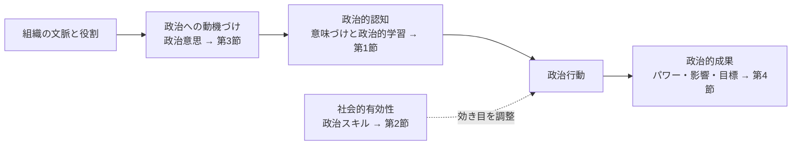

# 第5章 ビジネスパーソンに必要な政治力 — 学術的根拠と実務への含意

本ファイルは、木村琢磨『社内政治の科学』（2025）第5章の目次の見出しだけを手がかりに、各論点に対応する学術文献を調べてまとめたものです。本の本文は読んでいません。中身はすべて学術文献から書いています。「本書がこう述べている」という記述は含みません。

凡例:

- **確認**: 本文 = 論文本文を読んで確認 / 要旨 = 要旨（抄録）で確認 / 二次資料 = 他の論文・レビュー経由 / 未確認 = 内容を確認できていない
- **証拠**: メタ分析 / 複数の実証 / 単一の実証 / 理論・概念 / 事例

## この章で扱う論点

| 目次の見出し | 対応する学術概念 | 主要文献 |
|---|---|---|
| 1-1 政治知識とは | 組織社会化の「政治」次元、political knowledge、政治的学習 | Chao et al. 1994, Silvester & Wyatt 2018, Seibert, Kraimer & Crant 2001 |
| 1-2 正当性に関する理解 | 公認・非公認の影響、正当でない影響システムとしての政治、管理職の政治の正当性認識 | Mayes & Allen 1977, Mintzberg 1983/1985, Buchanan 2008, Suchman 1995 |
| 1-3 文脈知識 | 文脈に特有の知識、政治的認知（sense-making と political learning）、政治的洞察力の「人と状況を読む」 | Ferris et al. 2007, Blass & Ferris 2007, Silvester & Wyatt 2018, Hartley et al. 2007 |
| 2-1 社内政治のスキルとは | political skill の定義 | Ferris et al. 2005, Ferris et al. 2007, Kimura 2015 |
| 2-2 政治スキルの4つの要素 | social astuteness / interpersonal influence / networking ability / apparent sincerity | Ferris et al. 2005, Ferris et al. 2007, Munyon et al. 2015, Bing et al. 2011 |
| 2-3 政治スキルの開発法 | 行動モデリング、メンタリング、ドラマ・ベースの訓練、非公式な社会化 | Ferris et al. 2007, Silvester & Wyatt 2018, Doldor 2017 |
| 3-1 政治準備性の形成 | 学術用語としては未確認。候補は political will、政治的成熟、政治への構え | Treadway et al. 2005, Doldor 2017 |
| 3-2 政治意思 | political will（自己奉仕型・利他型） | Treadway et al. 2005, Kapoutsis et al. 2017, Blickle et al. 2018 |
| 3-3 政治的思慮と政治準備性 | political prudence（徳としての思慮） | Amah 2022, Dobel 1998 |
| 4-1 政治的パワーとは | 潜在的パワーとパワーの行使 | Brass & Burkhardt 1993, Pfeffer 1992 |
| 4-2 政治的パワーの基盤 | 5 つの権力基盤、構造的位置 | French & Raven 1959, Brass 1984, Brass & Burkhardt 1993 |
| 4-3 政治的パワーを決める個人的要因 | 評判、性格特性（外向性・自己監視）、政治スキル | Zinko et al. 2007, Anderson et al. 2001, Mehra, Kilduff & Brass 2001 |

この章の 4 つの節の関係は、Silvester & Wyatt（2018）の「政治的有効性」モデルで整理しやすい。同モデルは、政治への動機づけ、政治的認知、政治行動、社会的有効性（政治スキル）を分けて扱う。下の図はそのモデルを簡略化したもの。節との対応は筆者が付けた。

## 第1節 政治知識

### 政治知識とは

#### 学術的な根拠と定義

| 主張 | 出典 | 確認 | 証拠 |
|---|---|---|---|
| 組織社会化（新しく入った人が組織に適応する過程）の内容は 6 つの次元に分かれる。業務の熟達、**政治**、言語、人、組織の目標と価値、歴史。594 人の専門職のデータの因子分析で支持された | Chao, O'Leary-Kelly, Wolf, Klein & Gardner 1994, *Journal of Applied Psychology* 79(5) | 要旨 | 単一の実証 |
| 「政治」次元は、組織内の公式・非公式な関係と権力構造についての情報を得ているかどうかを指す、と一般に説明される | Chao et al. 1994 | 未確認（原典・二次資料とも照合できず） | 理論・概念 |
| 「政治」次元を含む 3 次元の項目には、部門単位の情報と組織全体の情報が混在している | Klein & Weaver 2000（二次資料経由） | 二次資料 | 理論・概念 |
| 政治的学習は「政治の地形についての知識」の獲得と蓄積である。たとえば、どこに権力があり、どう使われているか。経験とともに時間をかけて進み、手続き的な知識や認知スクリプト（状況ごとの行動の型）として長期記憶に蓄えられる | Silvester & Wyatt 2018（SAGE Handbook の章） | 本文（著者稿） | 理論・概念 |
| 政治知識は昇給の伸びやキャリア満足と正の関係を持つ。先回り行動をとる性格（proactive personality）がキャリア成功につながる経路の 1 つとして、政治知識が挙げられている | Seibert, Kraimer & Crant 2001; Blass, Brouer, Perrewé & Ferris 2007（いずれも Silvester & Wyatt 2018 経由） | 二次資料 | 単一の実証 |
| 新人の政治知識は、公式の研修よりも、上司との関係などの非公式な関係を通じて身につきやすい。公式の研修は役割の明確さを高める | Kammeyer-Mueller & Wanberg 2003（Silvester & Wyatt 2018 経由） | 二次資料 | 単一の実証（縦断） |

#### 実務への含意（論文の主張）

- 政治知識は公式の研修ではほとんど扱われない。上位者から選ばれた一部の人にだけ伝わりやすい。女性や少数派の社員は、こうした関係に入りにくく不利になりうる。そのため、力のあるメンターとの積極的な組み合わせや、上司からの非公式な支援への公平なアクセスを確保すべきである（Silvester & Wyatt 2018）。
- 計画的な社会化と、計画外の社会化の両方が政治知識の獲得にどう影響するかを考えるべきである（Silvester & Wyatt 2018）。
- Chao et al. 1994 の実務的含意は、要旨では確認できなかった。

#### 推論（最小限）

- 推論: 異動や転職のあとは、業務知識より先に「誰が何を決めているか」を上司や先輩から聞き取ることが、政治知識の立ち上げになると考えられる。

### 正当性に関する理解

#### 学術的な根拠と定義

| 主張 | 出典 | 確認 | 証拠 |
|---|---|---|---|
| 組織政治とは、組織が公認していない目的を得るため、または公認された目的を公認されていない手段で得るための、影響力の管理である。目的と手段のそれぞれが公認か非公認かで、影響行動を 4 つに分ける | Mayes & Allen 1977, *Academy of Management Review* 2(4) | 二次資料（定義文は複数の二次資料で一致。原典本文は取得できず） | 理論・概念 |
| 組織の中には正当な影響システム（権限、イデオロギー、専門性）と、正当でない影響システムとしての政治がある。政治は、非公式で、局所的で、分断的で、技術的な意味で正当でない行動と定義される | Mintzberg 1983『Power in and around Organizations』; Mintzberg 1985, *Journal of Management Studies* 22(2) | 二次資料 | 理論・概念 |
| 英国の管理職 250 人の調査では、多くが政治的行動を倫理的で必要なものとみなした。組織の効果、変革、資源獲得、評判に政治的戦術が役立つと答えた。約 80% はこの分野の訓練を受けたことがない | Buchanan 2008, *British Journal of Management* 19(1) | 要旨 | 単一の実証（調査） |
| 人事管理は合理性を前提に設計されるが、実際には政治システムでもある。政治的行動を「正当でないもの」と定義すること自体が、統制の仕組みとして働く | Silvester & Wyatt 2018（Ferris & Judge 1991、Doldor の議論を引用） | 本文（著者稿） | 理論・概念 |
| 正当性とは、ある主体の行為が、社会的に作られた規範・価値・信念の体系の中で望ましく適切だという一般化された認識である。実利的・道徳的・認知的の 3 種類がある。※組織と社会の関係についての議論で、社内の個人行動を直接扱うものではない | Suchman 1995, *Academy of Management Review* 20(3) | 要旨・二次資料 | 理論・概念 |

#### 実務への含意（論文の主張）

- 管理職は政治的行動を必要と考えている一方で、訓練をほとんど受けていない。この差を埋める必要がある（Buchanan 2008 の要旨）。
- 組織心理学の実務家は、組織が政治的であることを認め、自分も政治の当事者であると振り返るべきである。政治的有効性の評価には、立場によって異なる見方を取り込む方法が要る（Silvester & Wyatt 2018）。
- Mayes & Allen 1977、Mintzberg 1985、Suchman 1995 の社内での実務的含意は、確認できた範囲では明示されていない。

#### 推論（最小限）

- 推論: 同じ根回しでも、目的と手段が公認か非公認かで周囲の評価が変わる。動く前に「この目的と手段は社内で正当と見られるか」を確かめることが、正当性の理解の実務的な使い方と考えられる。

### 文脈知識

#### 学術的な根拠と定義

| 主張 | 出典 | 確認 | 証拠 |
|---|---|---|---|
| 政治スキルは、仕事の経験やメンタリングなどを通じて得られる**文脈に特有の知識**を含む。職場には大量の手がかりや暗黙知があるが、すべてが重要ではない。経験のあるメンターが重要な文脈情報を選び出し、目立たせる | Ferris, Treadway, Perrewé, Brouer, Douglas & Lux 2007, *Journal of Management* 33(3) | 本文 | 理論・概念 |
| 政治的認知は 2 つに分かれる。sense-making（出来事をその都度理解しようとする意識的・反応的な過程）と、political learning（時間をかけた知識の蓄積）。両者を合わせたものが政治的専門性である | Silvester & Wyatt 2018 | 本文（著者稿） | 理論・概念 |
| 組織の文脈は 2 つの側面に分けられる。政治的環境（構造、公式化の程度、権力と資源の分布）と、役割要因（仕事の種類、階層、資源の統制）。曖昧さが大きく、公式化が弱い組織ほど政治活動が多い。境界をまたぐ役割や変革推進者は、より高い政治的能力を必要とする | Silvester & Wyatt 2018（Ferris et al. 1989、Ammeter et al. 2002 を引用） | 本文（著者稿） | 理論・概念（実証の整理を含む） |
| リーダーの評判は、メンタリング、政治スキル、文脈的学習、適応によって形づくられる | Blass & Ferris 2007, *Human Resource Management* 46(1) | 二次資料（題名と引用のみ） | 未確認 |
| 公共部門の管理職の「政治的洞察力（political astuteness）」は 5 次元で捉えられる。戦略的方向づけと環境の走査、連携と同盟の構築、**人と状況を読む**、対人スキル、個人スキル（自分の動機への自己認識） | Hartley, Fletcher, Wilton, Woodman & Ungemach 2007; Hartley et al. 2013（ANZSOG 報告） | 二次資料 | 単一の実証（調査） |

#### 実務への含意（論文の主張）

- 政治スキルは経験と文脈知識を得るにつれて伸びると予想される。メンタリングや発達的な経験は、政治スキルを伸ばす有効な手段となる（Ferris et al. 2007 の「Practical Implications」）。
- 政治的能力を育てる必要と機会は、組織の環境とその人の役割によって決まる（Silvester & Wyatt 2018）。
- Hartley らの報告の実務的含意は、本文を確認できていない。

#### 推論（最小限）

- 推論: 文脈知識は組織ごと・部署ごとに作り直す必要がある。前の職場で効いたやり方をそのまま持ち込むと、合わない危険がある。

## 第2節 政治スキル

### 社内政治のスキルとは

#### 学術的な根拠と定義

| 主張 | 出典 | 確認 | 証拠 |
|---|---|---|---|
| 政治スキルとは、職場で他者を効果的に理解し、その理解を使って、自分または組織の目標が進むように他者を動かす能力である | Ferris, Treadway, Kolodinsky, Hochwarter, Kacmar, Douglas & Frink 2005, *Journal of Management* 31(1)（Ferris et al. 2007 が定義を引用） | 本文（2007 の引用で確認） | 理論・概念 |
| 政治スキルの高い人は、状況の変化に合わせて行動を調整できる。その調整は誠実に見え、支持と信頼を集める | Ferris et al. 2007 | 本文 | 理論・概念 |
| 政治スキルには、性格による安定した部分と、状況による部分がある。後者は訓練・練習・経験で変えられる。生まれつきの能力にかかわらず、発達的な経験から利益を得られる | Ferris et al. 2007 | 本文 | 理論・概念 |
| 政治スキル研究は 5 つのテーマに整理される。定義と測定、ストレス管理、キャリア成功、個人業績、リーダーシップ効果。期待どおりの効果は見つかっているが、効果が生じる仕組み（媒介変数）や次元ごとの違いの説明が足りない | Kimura 2015, *International Journal of Management Reviews* | 要旨 | 理論・概念（レビュー） |
| 日本企業の従業員の政治行動・政治スキルは、欧米の研究と共通点が多い。ただし戦略的なネットワーキングが少なく、フェイスワーク（相手の面子を保つ働きかけ）とそれに関わるスキルが重要である | 木村 科研費 15K17127 研究成果の概要（2015〜2016 年度） | 要旨（KAKEN） | 単一の実証（インタビュー＋質問紙） |

#### 実務への含意（論文の主張）

- Kimura 2015 の要旨は研究上の課題を示すもので、実務的含意は要旨では確認できなかった。
- Ferris et al. 2007 は、政治スキルが訓練で伸ばせることを実務上の前提としている（開発法の項を参照）。

#### 推論（最小限）

なし

### 政治スキルの4つの要素

#### 学術的な根拠と定義

| 次元 | 内容 | 出典 | 確認 | 証拠 |
|---|---|---|---|---|
| social astuteness（社会的洞察力） | 他者をよく観察し、社会的なやりとりを理解し、自他の行動を正しく解釈する。多様な場面に敏感で、自己認識が高い | Ferris et al. 2007 | 本文 | 理論・概念 |
| interpersonal influence（対人影響力） | 控えめで説得力のある個人的なスタイル。相手や状況に合わせて行動を調整し、望む反応を引き出す | Ferris et al. 2007 | 本文 | 理論・概念 |
| networking ability（ネットワーク構築力） | 多様な人脈を見つけて育てる。友好関係や同盟・連合を作り、機会を作り出して生かす。交渉や対立の管理にも長ける | Ferris et al. 2007 | 本文 | 理論・概念 |
| apparent sincerity（見かけの誠実さ） | 誠実で、裏表がなく、正直だと他者に見える。影響の試みが成功するために決定的に重要 | Ferris et al. 2007 | 本文 | 理論・概念 |

| 主張 | 出典 | 確認 | 証拠 |
|---|---|---|---|
| 4 次元は 18 項目の Political Skill Inventory（PSI）で測られる。4 因子構造は支持されているが、多くは自己報告による検証である | Ferris et al. 2005 | 要旨・二次資料 | 複数の実証 |
| 各次元は性格の異なる側面と結びつく。たとえば social astuteness は自己監視（self-monitoring）や誠実性と、interpersonal influence と networking ability は統制感や先回り行動をとる性格と関係する | Ferris et al. 2007 | 本文 | 理論・概念（一部実証） |
| 政治スキルは、自己効力感、職務満足、組織コミットメント、生産性、組織市民行動、キャリア成功、個人の評判と正の関係を持つ。ビッグファイブと一般知能を統制しても、課業業績を予測する | Munyon, Summers, Thompson & Ferris 2015, *Personnel Psychology* 68(1) | 要旨 | メタ分析 |
| 政治スキルは課業業績と文脈的業績（周囲への協力など）の両方を予測する。文脈的業績のほうが関係が強い。対人的・社会的な要求の高い職種ほど、課業業績との関係が強い | Bing, Davison, Minor, Novicevic & Frink 2011, *Journal of Vocational Behavior* 79(2) | 要旨 | メタ分析 |
| 政治スキルは、役割葛藤・役割過重とストレス反応の関係を弱める「解毒剤」として働く | Ferris et al. 2007（先行研究の整理） | 本文 | 複数の実証 |

#### 実務への含意（論文の主張）

- Munyon et al. 2015 と Bing et al. 2011 の実務的含意は、要旨では確認できなかった。Bing et al. 2011 の結果は、社会的要求の高い職種で政治スキルが特に重要であることを示す（結果そのものの記述であり、論文が提言として述べたかは未確認）。

#### 推論（最小限）

- 推論: 4 次元のうち apparent sincerity は「誠実に見えること」であり、実際の誠実さとは定義上分けられている。見せかけだけの誠実さは長続きしない可能性があり、使い方には注意が要る。

### 政治スキルの開発法

#### 学術的な根拠と定義

| 方法 | 内容 | 出典 | 確認 | 証拠 |
|---|---|---|---|---|
| フィードバック | 効果的な開発法は、自分の社会的なやりとり、状況への気づきと理解、取りうる行動の選択肢についてフィードバックを与える必要がある | Ferris et al. 2007 | 本文 | 理論・概念 |
| 行動モデリング | 社会的学習理論に基づく。熟練者が手本を示し、参加者が繰り返し練習する。訓練効果は広く検証されている。練習の場としては、実際に影響が必要な社会的場面が最適 | Ferris et al. 2007（Burke & Day 1986、May & Kahnweiler 2000 を引用） | 本文 | 複数の実証（行動モデリング一般について） |
| メンタリング | 政治スキルの高いメンターの言葉遣い、表情、姿勢を観察して学ぶ。メンターがやりとりの理由を説明する時間を取ることが重要 | Ferris et al. 2007（Perrewé, Young & Blass 2002、Lankau & Scandura 2002 を引用） | 本文 | 理論・概念（一部実証） |
| コミュニケーション訓練・ドラマ・ベースの訓練・ロールプレイ | 政治スキルはこれらの方法で訓練・育成できると提案されている。ただし実施した組織は少なく、証拠は限られる | Ferris et al. 2000, 2005（Silvester & Wyatt 2018 経由） | 二次資料 | 理論・概念（証拠は限定的） |
| 経験と重要な他者 | 管理職 38 人のインタビューから、政治的成熟の 3 段階モデルを導いた。成熟は行動だけでなく、政治についての考え方の型の変化を伴う。経験と重要な他者が学習を促す | Doldor 2017, *British Journal of Management* 28(4) | 要旨 | 単一の実証（質的） |

#### 実務への含意（論文の主張）

- メンタリングと発達的経験は、政治スキルを伸ばす有効な手段である（Ferris et al. 2007）。
- メンターの選び方が大事である。上位で力のあるメンターほど、政治環境についての知識を伝えやすい。公式に割り当てたメンタリングは、自然にできた非公式のメンタリングより効果が低い可能性がある。公式のメンターは目立つため、正当でないと見られうる行動を勧めにくい（Silvester & Wyatt 2018）。
- ドラマ・ベースの訓練などの公式な訓練の効果は、さらに研究が必要である（Silvester & Wyatt 2018）。
- Doldor 2017 の 3 段階の中身と実務的含意は、本文を確認できていない。

#### 推論（最小限）

- 推論: 研修だけに頼らず、政治スキルの高い上位者の会議に同席させ、終わったあとに「なぜあの言い方をしたか」を話し合う場を作ることが、論文の示す方法に最も近い。

## 第3節 政治準備性

この節の見出し「政治準備性」「政治的思慮」に当たる学術用語は、確認できなかった。KAKEN の木村琢磨の研究課題（15K17127、17K03961、23K01544）の概要に、political readiness、政治準備性、political prudence、政治的思慮の語は見当たらなかった。英語の学術文献でも、political readiness という確立した構成概念は見つからなかった。以下は**候補となる学術概念**であり、**本書での意味は未確認**である。

| 見出しの語 | 候補となる学術概念 | 近さの理由 | 主要文献 |
|---|---|---|---|
| 政治準備性 | political will（政治意思）＋ 政治への構え・考え方の型 | 政治的行動に踏み出す前提となる動機と心構え | Treadway et al. 2005, Doldor 2017 |
| 政治意思 | political will | 語がそのまま一致 | Treadway et al. 2005, Kapoutsis et al. 2017 |
| 政治的思慮 | political prudence | 語がほぼ一致 | Amah 2022, Dobel 1998 |

### 政治準備性の形成

#### 学術的な根拠と定義

| 主張 | 出典 | 確認 | 証拠 |
|---|---|---|---|
| 政治的成熟は 3 段階で進む。政治意思と政治スキルの両方が発達する。成熟は目に見える行動だけでなく、政治と自分の役割についての考え方の型（mindset、深層スクリプト）の質的な変化を伴う | Doldor 2017 | 要旨 | 単一の実証（質的、38 人） |
| 政治的行動を行うには、政治意思と政治スキルの両方が必要である | Mintzberg 1983, 1985（Ferris et al. 2007、Silvester & Wyatt 2018 が引用） | 本文（引用元で確認） | 理論・概念 |
| 政治への動機づけは、権力を求める傾向（性格など）と、権力を求める理由（価値・欲求・目標）に分けて考えるべきである | Silvester & Wyatt 2018 | 本文（著者稿） | 理論・概念 |
| 管理職の政治意思には性別による違いがありうる。14 人の半構造化インタビューで検討した | Doldor, Anderson & Vinnicombe 2013, *British Journal of Management* 24(3) | 要旨（方法のみ。結果は未確認） | 単一の実証（質的） |

#### 実務への含意（論文の主張）

- Doldor 2017 の実務的含意は、要旨では確認できなかった。
- 政治的有効性の開発は、ビジネスでも政治の世界でも慎重に扱われ、研究が少ない（Silvester & Wyatt 2018）。

#### 推論（最小限）

- 推論: 「政治に関わる気がない」状態は、スキル不足とは別の問題として扱う必要があると考えられる。

### 政治意思

#### 学術的な根拠と定義

| 主張 | 出典 | 確認 | 証拠 |
|---|---|---|---|
| 政治意思とは、政治的な目標を追うためにエネルギーを使おうとする意欲であり、政治的行動の前提条件である | Treadway, Hochwarter, Kacmar & Ferris 2005, *Journal of Organizational Behavior* 26(3)（Silvester & Wyatt 2018 が定義を引用） | 本文（引用で確認） | 理論・概念 |
| 193 人の調査で、達成欲求と内発的動機づけは政治的行動と正の関係を持った。政治的行動は感情労働（感情を抑えたり装ったりする負担）を伴うが、政治スキルの高い人ではこの反応が見られなかった | Treadway et al. 2005 | 要旨 | 単一の実証 |
| 権力欲求は、政治スキルが発揮される可能性を高める | Ferris et al. 2007（McClelland & Burnham 1976 を引用） | 本文 | 理論・概念 |
| 政治意思尺度（Political Will Scale）は 2 次元。自己奉仕型（self-serving）と利他型（benevolent）。米国・ギリシャ・英国の 6 サンプル（925 人）で信頼性と妥当性を確認した | Kapoutsis, Papalexandris, Treadway & Bentley 2017, *Journal of Management* 43 | 要旨・二次資料 | 複数の実証 |
| 他者評価を含む検証で、自己奉仕型の尺度は権力志向や地位・収入との関係が支持された。利他型の尺度は、評価者間の一致や利他的動機としての解釈が支持されなかった | Blickle, Schütte & Wihler 2018, *Journal of Vocational Behavior* | 二次資料 | 単一の実証 |

#### 実務への含意（論文の主張）

- Treadway et al. 2005 と Kapoutsis et al. 2017 の実務的含意は、要旨では確認できなかった。
- Blickle et al. 2018 は、利他型の項目を作り直すべきだと提言しているが、これは研究上の提言である。

#### 推論（最小限）

- 推論: 政治意思の「強さ」だけでなく「向き」（自分のためか、他者や組織のためか）を区別して見る必要がある。ただし利他型の測定はまだ安定していない。

### 政治的思慮と政治準備性

#### 学術的な根拠と定義

| 主張 | 出典 | 確認 | 証拠 |
|---|---|---|---|
| 政治的思慮（political prudence）は、人格を形づくる徳（virtue）であり、自分の政治的行動が害のある方向に向かわないよう自己を律する変数である | Amah 2022, *Journal of Business Ethics* 176(2) | 要旨 | 理論・概念 |
| ナイジェリア・ラゴスの 3 組織の横断調査で、政治的思慮は政治意思と政治的行動の関係を調整した。利他的な政治意思を持つ人は政治的行動に向かい、自己奉仕的な政治意思を持つ人は政治的行動を控えた | Amah 2022 | 要旨 | 単一の実証（横断） |
| 政治的思慮はリーダーシップの倫理として論じられてきた（行政学） | Dobel 1998, *Public Administration Review* | 二次資料（題名のみ） | 理論・概念 |

#### 実務への含意（論文の主張）

- 組織は思慮を育てることで、従業員を有害な政治的行動から建設的な政治的行動へ向けることができ、生産性にもつながる（Amah 2022 の要旨）。

#### 推論（最小限）

- 推論: 政治への意欲を高めるだけでは、自己奉仕的な政治行動が増えるおそれがある。意欲と、それを律する思慮を対にして考えることが、上記文献の組み合わせから導ける。ただし Amah 2022 は単一国・横断調査で、一般化には注意が要る。

## 第4節 政治的パワー（政治的権力）

### 政治的パワー（政治的権力）とは

#### 学術的な根拠と定義

| 主張 | 出典 | 確認 | 証拠 |
|---|---|---|---|
| 潜在的なパワー（構造上の位置）と、パワーの行使（行動上の戦術）を分けて調べた。構造的位置はネットワーク中心性と階層で、行動は主張、取り入り、交換、上位者への訴え、合理的説得、連合形成で測った。両方が、それぞれ独立に、他者から見たその人のパワーと関係した | Brass & Burkhardt 1993, *Academy of Management Journal* 36(3) | 要旨（二次資料経由） | 単一の実証 |
| 構造は行動とパワーの関係を部分的に媒介し、行動も構造とパワーの関係を部分的に媒介した。交互作用も見られた | Brass & Burkhardt 1993 | 二次資料 | 単一の実証 |
| 政治の場では資源の獲得と統制がパワーの中心である。価値ある資源を蓄えると、他者の依存が生まれ、それがパワーとして現れる | Ferris et al. 2007（Mintzberg 1983、Pfeffer 1992 を引用） | 本文 | 理論・概念 |

#### 実務への含意（論文の主張）

- Brass & Burkhardt 1993 の実務的含意は、要旨では確認できなかった。

#### 推論（最小限）

- 推論: パワーは役職だけで決まらず、どこにいるか（構造）と、どう動くか（行動）の組み合わせで決まる。役職がなくても、両方を意識すれば影響力を持てる余地がある。

### 政治的パワーの基盤

#### 学術的な根拠と定義

| 権力基盤 | 内容 | 出典 | 確認 | 証拠 |
|---|---|---|---|---|
| 報酬 | 相手に報酬を与えられること | French & Raven 1959 | 二次資料（Zinko et al. 2007 本文が列挙） | 理論・概念 |
| 強制 | 相手を罰せられること | French & Raven 1959 | 二次資料 | 理論・概念 |
| 正当 | 組織上の地位から与えられる権力。同じ地位に就けば誰でも得られる | French & Raven 1959 | 二次資料 | 理論・概念 |
| 準拠 | 相手がその人と同一視したいと思うこと | French & Raven 1959 | 二次資料 | 理論・概念 |
| 専門 | 相手がその人の知識や技能を自分より上と認め、従うこと | French & Raven 1959 | 二次資料 | 理論・概念 |

| 主張 | 出典 | 確認 | 証拠 |
|---|---|---|---|
| 新聞社の非管理職 140 人で、仕事の流れ、コミュニケーション、友人関係のネットワーク上の位置が、上司・同僚から見た影響力と、管理職への昇進に強く関係した。技術中核の人は、通常の業務以外の接触が影響力の獲得に特に重要だった | Brass 1984, *Administrative Science Quarterly* | 要旨（二次資料経由） | 単一の実証 |
| Pfeffer 1992 は、パワーの源泉として構造的要因（資源の統制、情報へのアクセスなど）と個人の属性（柔軟性、持久力、対立への耐性など）の両方を挙げる | Pfeffer 1992『Managing with Power』 | 二次資料（出版社の紹介） | 理論・概念 |

#### 実務への含意（論文の主張）

- Brass 1984 と French & Raven 1959 の実務的含意は、確認できた範囲では明示されていない。

#### 推論（最小限）

- 推論: 正当権力以外の 4 つの基盤とネットワーク上の位置は、役職がなくても育てられる。特に専門と準拠は、周囲の評価に支えられる。

### 政治的パワーを決める個人的要因

#### 学術的な根拠と定義

| 要因 | 主張 | 出典 | 確認 | 証拠 |
|---|---|---|---|---|
| 評判 | 個人の評判とは、他者が合意した集合的な認識である。周囲の人との比較を通じて行動を調整し、環境の行動規範から外れて目立つことから生まれる | Zinko, Ferris, Blass & Laird 2007, *Research in Personnel and Human Resources Management* 26 | 本文 | 理論・概念 |
| 評判 | 評判が高まるとパワーが増え、パワーが仕事を進めやすくし、さらに評判を高める（Pfeffer 1992 の循環）。評判は準拠権力や専門権力に直接、正当権力には自律性やキャリア成功を通じて間接に効く | Zinko et al. 2007 | 本文 | 理論・概念 |
| 評判 | 部下から見た上司の正当・準拠・専門の権力に、評判が大きく寄与した | Gioia & Sims 1983（Zinko et al. 2007 経由） | 二次資料 | 単一の実証 |
| 政治スキル | 政治スキルは個人の評判とリーダーの評判の重要な先行要因である | Ferris et al. 2007; Munyon et al. 2015 | 本文・要旨 | メタ分析を含む |
| 外向性 | 寮・学生団体の集団で、外向性の高さは男女とも地位の高さを強く予測した。神経症傾向の高さは男性でのみ地位の低さを予測した。他のビッグファイブ特性は地位を予測しなかった | Anderson, John, Keltner & Kring 2001, *Journal of Personality and Social Psychology* 81(1) | 要旨（二次資料経由） | 単一の実証 |
| 自己監視 | ハイテク企業 116 人で、自己監視の高い人は、社会的な隔たりをつなぐ中心的な位置を占めやすかった。自己監視とネットワーク中心性は、それぞれ独立に業績を予測した | Mehra, Kilduff & Brass 2001, *Administrative Science Quarterly* 46(1) | 要旨（二次資料経由） | 単一の実証 |

#### 実務への含意（論文の主張）

- 評判は昇進や解雇などの重要な人事判断の基礎として使われている（Zinko et al. 2007 の要旨）。これは現状の指摘であり、具体的な提言は本文の範囲では確認していない。
- Anderson et al. 2001 と Mehra et al. 2001 の実務的含意は、要旨では確認できなかった。

#### 推論（最小限）

- 推論: 性格特性は変えにくいが、評判と政治スキルは行動で積み上げられる。個人が手を入れやすいのは後者だと考えられる。

## 未確認の点

- **政治準備性・政治的思慮の本書での意味**: 学術用語としての political readiness は見つからなかった。著者の一般向け記事（東洋経済オンライン 2026-04-09）の見出しでは、政治準備性は社内政治を受け入れることと結びつけて扱われていたが、定義は確認できていない。本ファイルの第3節は候補概念による整理である。
- **Mayes & Allen 1977 の原典本文**: 定義文は複数の二次資料で一致したが、原典は取得できなかった。4 象限の名称も未確認。
- **Chao et al. 1994 の「政治」次元の正確な定義と項目**: 本文未確認。
- **Doldor 2017 の 3 段階の中身**: 要旨のみ。段階の名称と内容は未確認。
- **Doldor et al. 2013 の結果**（政治意思の次元と性差）: 未確認。
- **Hartley et al. 2007 の「人と状況を読む」次元の詳しい定義**: 未確認。
- **Blass & Ferris 2007 の内容**: 題名と引用のみで、要旨も確認できていない。
- **Pfeffer 1992 の個人属性の正確なリスト**: 出版社の紹介文のみで確認。energy・focus・sensitivity などは 2010 年の別書に由来する可能性がある。
- **Munyon et al. 2015、Bing et al. 2011 の効果量**: 要旨のみで、数値は未確認。
- **ドラマ・ベースの訓練の効果**: 提案はあるが、実証の証拠は限られる（Silvester & Wyatt 2018 による）。

## 主要文献

| 文献 | 種別 | 年 | この章での使いどころ | 確認 |
|---|---|---|---|---|
| Chao, O'Leary-Kelly, Wolf, Klein & Gardner, Organizational socialization: Its content and consequences, *JAP* | 実証論文 | 1994 | 政治知識（社会化の政治次元） | 要旨 |
| Mayes & Allen, Toward a definition of organizational politics, *AMR* | 概念論文 | 1977 | 正当性（公認・非公認） | 二次資料 |
| Mintzberg, The organization as political arena, *JMS* | 概念論文 | 1985 | 正当性、政治意思と政治スキル | 二次資料 |
| Buchanan, You stab my back, I'll stab yours, *BJM* | 調査研究 | 2008 | 管理職の政治の正当性認識 | 要旨 |
| Suchman, Managing legitimacy, *AMR* | 概念論文 | 1995 | 正当性の一般的定義 | 要旨・二次資料 |
| Silvester & Wyatt, Political effectiveness at work, SAGE Handbook | レビュー章 | 2018 | 政治知識、文脈、開発法、政治意思 | 本文（著者稿） |
| Ferris et al., Development and validation of the Political Skill Inventory, *JOM* | 尺度開発 | 2005 | 政治スキルの定義と 4 次元 | 要旨・二次資料 |
| Ferris et al., Political skill in organizations, *JOM* | レビュー | 2007 | 定義、4 次元、先行要因、開発法、文脈知識 | 本文 |
| Kimura, A review of political skill, *IJMR* | レビュー | 2015 | 政治スキル研究の整理 | 要旨 |
| Munyon, Summers, Thompson & Ferris, Political skill and work outcomes, *Personnel Psychology* | メタ分析 | 2015 | 政治スキルの帰結 | 要旨 |
| Bing et al., The prediction of task and contextual performance by political skill, *JVB* | メタ分析 | 2011 | 政治スキルと業績 | 要旨 |
| Doldor, From politically naïve to politically mature, *BJM* | 質的研究 | 2017 | 政治準備性の形成、開発法 | 要旨 |
| Treadway, Hochwarter, Kacmar & Ferris, Political will, political skill, and political behavior, *JOB* | 実証論文 | 2005 | 政治意思の定義と先行要因 | 要旨・本文（引用） |
| Kapoutsis, Papalexandris, Treadway & Bentley, Measuring political will in organizations, *JOM* | 尺度開発 | 2017 | 政治意思の 2 次元 | 要旨・二次資料 |
| Blickle, Schütte & Wihler, Political will, work values, and objective career success, *JVB* | 実証論文 | 2018 | 政治意思尺度の再検証 | 二次資料 |
| Amah, The role of political prudence and political skill in the political will and political behavior relationship, *JBE* | 実証論文 | 2022 | 政治的思慮 | 要旨 |
| French & Raven, The bases of social power | 理論章 | 1959 | 権力基盤 | 二次資料 |
| Brass, Being in the right place, *ASQ* | 実証論文 | 1984 | 構造的位置と影響力 | 要旨（二次資料経由） |
| Brass & Burkhardt, Potential power and power use, *AMJ* | 実証論文 | 1993 | 構造と行動の両方がパワーを決める | 要旨（二次資料経由） |
| Pfeffer, Managing with Power | 学術書 | 1992 | パワーの源泉（構造・個人） | 二次資料 |
| Zinko, Ferris, Blass & Laird, Toward a theory of reputation in organizations | 理論章 | 2007 | 評判とパワー | 本文 |
| Anderson, John, Keltner & Kring, Who attains social status?, *JPSP* | 実証論文 | 2001 | 性格と地位 | 要旨（二次資料経由） |
| Mehra, Kilduff & Brass, The social networks of high and low self-monitors, *ASQ* | 実証論文 | 2001 | 自己監視とネットワーク位置 | 要旨（二次資料経由） |
| 木村琢磨, 日本企業における従業員の社内政治行動と政治スキル（科研費 15K17127） | 研究報告 | 2017 | 日本企業の政治スキル | 要旨（KAKEN） |

## Sources

- [Ferris et al. 2007 Political Skill in Organizations（PDF）](https://www.crforum.co.uk/wp-content/uploads/2017/06/Political-Skill-in-Organizations.pdf)
- [Silvester & Wyatt 2018 Political Effectiveness at Work（City Research Online 著者稿）](https://openaccess.city.ac.uk/id/eprint/18174/)
- [Zinko et al. 2007 Toward a Theory of Reputation in Organizations（PDF）](https://myweb.ecu.edu/furnerc/zpubs/chapter/1.pdf)
- [Amah 2022 The Role of Political Prudence and Political Skill（IDEAS/RePEc）](https://ideas.repec.org/a/kap/jbuset/v176y2022i2d10.1007_s10551-020-04696-x.html)
- [KAKEN 15K17127 日本企業における従業員の社内政治行動と政治スキル](https://kaken.nii.ac.jp/ja/grant/KAKENHI-PROJECT-15K17127/)
- [KAKEN 17K03961 政治的パースペクティブによる倫理的リーダーシップ行動の研究](https://kaken.nii.ac.jp/ja/grant/KAKENHI-PROJECT-17K03961/)
- [KAKEN 23K01544 バーチャル・チームにおける組織内政治行動](https://kaken.nii.ac.jp/ja/grant/KAKENHI-PROJECT-23K01544/)
- [KAKEN 研究者名検索（木村琢磨）](https://kaken.nii.ac.jp/ja/search/?kw=%E6%9C%A8%E6%9D%91%E7%90%A2%E7%A3%A8)
- [Kimura 2015 IJMR（Zendy）](https://zendy.io/title/10.1111/ijmr.12041)
- [Munyon et al. 2015（EconBiz）](https://www.econbiz.de/Record/political-skill-and-work-outcomes-a-theoretical-extension-meta-analytic-investigation-and-agenda-for-the-future/10010520728)
- [Bing et al. 2011（Peeref 要旨）](https://peeref.com/works/61482663)
- [Ferris et al. 2005 PSI（BibBase）](https://bibbase.org/network/publication/ferris-treadway-kolodinsky-hochwarter-kacmar-douglas-frink-developmentandvalidationofthepoliticalskillinventory-2005)
- [Kapoutsis et al. 2017（EconBiz）](https://econbiz.de/Record/measuring-political-will-in-organizations-theoretical-construct-development-and-empirical-validation-kapoutsis-ilias/10011731518)
- [Blickle et al. 2018（Exeter ORE）](https://ore.exeter.ac.uk/repository/handle/10871/122021)
- [Treadway et al. 2005（BVB カタログ）](https://bvbvf1.bib-bvb.de/vufind/PrimoRecord/cdi_proquest_miscellaneous_57187887)
- [Doldor 2017（MetaTOC）](https://metatoc.com/papers/100809-from-politically-naive-to-politically-mature-conceptualizing-leaders-political-maturation-journey)
- [Doldor, Anderson & Vinnicombe 2013（QMUL Research Online）](https://qmro.qmul.ac.uk/xmlui/handle/123456789/3326)
- [Chao et al. 1994 Organizational Socialization（UTB カタログ）](https://vufind-test.katalog.k.utb.cz/SummonRecord/FETCH-LOGICAL-a502t-b3c2a4543751e5e7e8979d11c3558a1cd3546d7621bd6a8bee822995996439953)
- [Mayes & Allen 1977（UNL Digital Commons）](https://digitalcommons.unl.edu/managementfacpub/183/)
- [Mintzberg 1985（IDEAS/RePEc）](https://ideas.repec.org/a/bla/jomstd/v22y1985i2p133-154.html)
- [Buchanan 2008（Cranfield CERES）](https://dspace.lib.cranfield.ac.uk/items/9fa695ff-e4b1-4304-9e86-d1eafaac1f5e)
- [Suchman 1995（Wikipedia: Mark C. Suchman）](https://en.wikipedia.org/wiki/Mark_C._Suchman)
- [Hartley et al. political astuteness（Emerald CDI）](https://www.emerald.com/insight/content/doi/10.1108/CDI-08-2013-0097/full/html)
- [Brass & Burkhardt 1993（SUFE 抄録）](https://academicnewsletter.sufe.edu.cn/info/363967)
- [Brass 1984 についての対談（Talking About Organizations）](https://www.talkingaboutorganizations.com/61-power-influence-in-organizations-dan-brass/)
- [Pfeffer 1992 Managing with Power（Google Books）](https://books.google.com/books/about/Managing_with_Power.html?id=xbEN74KGZgsC)
- [Anderson et al. 2001（Berkeley 研究室 PDF）](https://esilab.berkeley.edu/wp-content/uploads/2017/12/Anderson-John-Keltner-Kring.pdf)
- [Mehra, Kilduff & Brass 2001（University of Kentucky）](https://scholars.uky.edu/en/publications/the-social-networks-of-high-and-low-self-monitors-implications-fo/)
- [東洋経済オンライン 2026-04-09 なぜ優秀なのに出世できない？社内政治の正体](https://toyokeizai.net/articles/-/940980)
