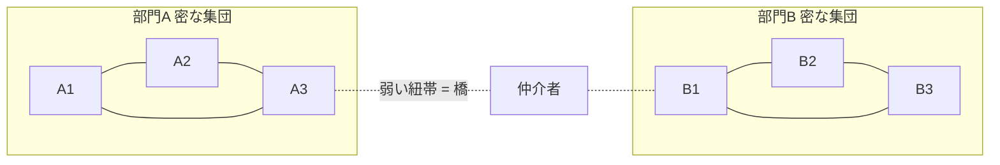

# 第6章 社内政治を分析する — 学術的根拠と実務への含意

本ファイルは、木村琢磨『社内政治の科学』（2025）第6章の目次の見出しだけを手がかりに、各論点に対応する学術文献を調べてまとめたものです。本の本文は読んでいません。中身はすべて学術文献から書いています。「本書がこう述べている」という記述は含みません。

凡例:

- **確認**: 本文 = 論文本文を読んで確認 / 要旨 = 要旨（抄録）で確認 / 二次資料 = 他の論文・書評・解説経由 / 未確認 = 内容を確認できていない
- **証拠**: メタ分析 / 複数の実証 / 単一の実証 / 理論・概念 / 事例

## この章で扱う論点

| 目次の見出し | 対応する学術概念 | 主要文献 |
|---|---|---|
| 1-1 ポジション分析 | 地域権力構造研究の地位法（positional method）、権力の代表指標 | Angeles 1973（方法の整理）, Pfeffer 1992 |
| 1-2 評判分析 | 声価法（reputational method）、評判による権力測定 | Hunter 1953, Wolfinger の批判, Krackhardt 1990, Pfeffer 1992 |
| 1-3 意思決定分析 | 争点法・決定法（decisional method）、決定結果による権力測定 | Dahl 1961, Salancik & Pfeffer 1974 |
| 2-1 ネットワーク分析 | 組織内ネットワークの中心性と影響力 | Brass 1984, Krackhardt 1990 |
| 2-2 今からできるネットワーク分析 | 助言・信頼・コミュニケーションの 3 つの非公式ネットワークの描き方 | Krackhardt & Hanson 1993 |
| 2-3 強い紐帯と弱い紐帯 | 弱い紐帯の強さ、強い紐帯（philos）の強さ | Granovetter 1973, Krackhardt 1992 |
| 2-4 構造的空隙 | 構造的空隙、仲介（ブローカー） | Burt 1992, Burt 2004 |
| 3-1 組織内政治の知覚の診断 | 組織内政治の知覚（POPs）と POPS 尺度 | Kacmar & Ferris 1991, Kacmar & Carlson 1997 |
| 3-2 政治的風土の診断 | 政治的風土（共有された知覚）、5 次元の政治風土尺度 | Landells & Albrecht 2016/2019, Rosen et al. 2017 |
| 3-3 政治の原因分析 | POPs の先行要因（組織・職務・個人） | Ferris, Russ & Fandt 1989, Atinc et al. 2010, Hochwarter et al. 2020 |
| 4-1 政治的リーダーの資質を可視化するタレント・アセスメント | 政治的スキル（PSI）の他者評価と基準関連妥当性 | Munyon et al. 2015, Blickle et al. 2012, Kückelhaus, Meurs & Blickle 2024 |
| 4-2 タレント・アナリティクスによる可視化アプローチ | HR アナリティクス、ネットワーク位置による人材の可視化 | Marler & Boudreau 2017, Burt 2004, Brass 1984 |
| 4-3 リーダーの必須要素：倫理性のアセスメント | 倫理的リーダーシップと ELS 尺度、ダークトライアド、政治的スキルによるマキャベリズムの隠蔽 | Brown, Treviño & Harrison 2005, O'Boyle et al. 2012, Kückelhaus et al. 2024 |

注: 第1節の「ポジション・評判・意思決定」の 3 分析が、地域権力構造研究の 3 手法を指しているかは、本書を読んでいないため**未確認**。見出しの語が 3 手法と一致するため、対応候補として扱う。

## 第1節 変革時の政治的反応の予測

この節の 3 つの見出しは、地域権力構造（community power）研究で使われてきた 3 つの権力特定法と語が一致する。下表にまとめる。

| 手法 | 何を手がかりにするか | 典型的な研究 | 主な弱点 |
|---|---|---|---|
| 地位法（positional） | 公式の役職 | 特定の代表者なし（方法として整理） | 役職のない実力者を見落とす |
| 声価法（reputational） | 事情通による「誰が力を持つか」の指名 | Hunter 1953 | 権力そのものではなく評判を測っている可能性 |
| 決定法（decisional） | 具体的な争点で誰が決定に影響したか | Dahl 1961 | 少数の目に見える争点に限られる |

出典: Angeles 1973 の方法の整理（本文で確認）、Penn State Extension の解説（本文で確認、ただし Hunter・Dahl への帰属はない）。

### ポジション分析

#### 学術的な根拠と定義

| 主張 | 出典 | 確認 | 証拠 |
|---|---|---|---|
| 地位法は、経済・政治・社会・宗教などの機関で公式の役職にある人を特定し、権力はその地位にあると仮定する | Angeles 1973 | 本文 | 理論・概念（方法論の整理） |
| 地位法は役職を持たないが決定に影響する人を拾えず、声価法が狙う「見えない指導者」を捉えない | Angeles 1973 | 本文 | 理論・概念 |
| 組織内の権力診断では、影響力のある委員会に誰が座っているかを「代表指標」（representational indicators）として使える | Pfeffer 1992『Managing with Power』第3章 | 二次資料（読書ノート・要約経由） | 理論・概念 |
| 権力の診断は、関係する下位単位を特定し、指標を当てて相対的な権力を順位づけ、相互依存のパターンを検討する手順で行う | Pfeffer 1992 | 二次資料 | 理論・概念 |
| 給与は権力の指標として弱い。市場要因で決まることがあるためである | Pfeffer 1992 | 二次資料 | 理論・概念 |

#### 実務への含意（論文の主張）

- Pfeffer 1992 は、物事を成し遂げるには組織内の相対的な権力を診断できることが重要だとし、その道具として上記の指標を示す（二次資料）。
- 地域研究の実務家向け解説は、地位の情報を簡単に集めたうえで、声価法と決定法を組み合わせて権力の全体像をつかむことを勧める（Penn State Extension, 本文）。

#### 推論（最小限）

推論: 組織図と会議体の構成は最初に集めやすい情報である。ただしそれだけで変革への反応を予測すると、役職のない実力者を見落とす。

### 評判分析

#### 学術的な根拠と定義

| 主張 | 出典 | 確認 | 証拠 |
|---|---|---|---|
| 声価法は Hunter が地域権力構造の研究で主に用いた。権力は表に出ずに行使されると仮定し、事情通に有力者を指名・順位づけしてもらう | Hunter 1953（Angeles 1973 経由） | 二次資料（Angeles 1973 本文） | 単一の実証（事例研究） |
| 声価法には「権力ではなく別の現象を測っている」との批判がある（Wolfinger の批判） | Wolfinger（Angeles 1973 経由） | 二次資料 | 理論・概念 |
| 組織内の権力診断では、人々に誰が力を持つかを尋ねる「評判指標」を使える | Pfeffer 1992 | 二次資料 | 理論・概念 |
| 助言ネットワークの構造を正確に認知している人ほど、同僚から力があると評価された。友人ネットワークの認知の正確さは評判上の権力と関係しなかった | Krackhardt 1990, ASQ 35(2) | 要旨（JSTOR の要約経由） | 単一の実証 |

#### 実務への含意（論文の主張）

- Pfeffer 1992 は、評判指標を他の指標（代表指標・決定の帰結・権力の象徴）と組み合わせて使うよう示す（二次資料）。異文化での診断では、同じ指標を無批判に持ち込まないよう注意する、とされる（二次資料）。
- Krackhardt 1990 の実務的含意は、要旨の範囲では確認できなかった（未確認）。

#### 推論（最小限）

推論: 「誰に聞けば話が通るか」を複数の人に尋ねると、役職と実際の影響力のずれが見える。ただし評判は過去の印象を反映するので、決定の記録で裏づけるほうがよい。

### 意思決定分析

#### 学術的な根拠と定義

| 主張 | 出典 | 確認 | 証拠 |
|---|---|---|---|
| 決定法（争点法）は、一連の争点・決定を選び、決定過程の各段階で誰が影響したかを追跡する。Dahl・Polsby・Wolfinger ら多元主義者が提唱した | Dahl 1961『Who Governs?』（Angeles 1973 経由） | 二次資料（Angeles 1973 本文） | 単一の実証（事例研究） |
| 決定法は参加の度合いを測れるが、対象が少数の決定に限られる | Angeles 1973 | 本文 | 理論・概念 |
| 研究は単一手法から、声価法と決定法を組み合わせる段階へ移った | Angeles 1973 ほか（検索結果の要約） | 二次資料 | 理論・概念 |
| 大学内の下位単位（学科）の権力は組織の意思決定に影響し、権力は資源獲得に使われうる | Salancik & Pfeffer 1974, ASQ 19(4) | 要旨（書誌・要旨と二次資料） | 単一の実証 |
| 組織内の権力診断では、誰が決定から利益を得たか（決定の帰結）や、権力の象徴（執務空間など）を指標にできる | Pfeffer 1992 | 二次資料 | 理論・概念 |

#### 実務への含意（論文の主張）

- Pfeffer 1992 は、決定の帰結を観察することを権力診断の一部として示す（二次資料）。
- Salancik & Pfeffer 1974 の実務的含意は確認できなかった（未確認）。

#### 推論（最小限）

推論: 過去の予算配分や人事、議論の割れた案件で「誰の案が通ったか」をたどると、変革案に対して誰が拒否権に近い力を持つかを予測しやすい。

### 補足: ステークホルダー分析との関係

変革時の反応予測には、経営学のステークホルダー分析も近い。

| 主張 | 出典 | 確認 | 証拠 |
|---|---|---|---|
| 利害関係者の重要度（salience）は、権力・正当性・緊急性の 3 属性の組み合わせで決まる | Mitchell, Agle & Wood 1997, AMR 22(4) | 要旨（書誌と要約。類型の名称は二次資料） | 理論・概念 |

本書第1節がこの枠組みを使っているかは未確認。

## 第2節 社内の派閥やコネを分析する：ネットワーク分析

図の読み方: 部門内は強い紐帯で密につながる。部門間をつなぐ人は構造的空隙をまたぐ仲介者で、異なる情報に触れやすい（Granovetter 1973, Burt 2004）。

### ネットワーク分析

#### 学術的な根拠と定義

| 主張 | 出典 | 確認 | 証拠 |
|---|---|---|---|
| 新聞社の非管理職 140 人を対象に、仕事の流れ・コミュニケーション・友人ネットワークでの中心性（アクセスと統制）が、他者から見た影響力の高さと関連した | Brass 1984, ASQ 29 | 二次資料（解説・ポッドキャスト経由） | 単一の実証 |
| よくつながった人は昇進しやすかった。境界をまたぐ職位の人は影響力を得やすかった | Brass 1984 | 二次資料 | 単一の実証 |
| 助言ネットワークを正確に認知している人ほど、他者から力があると見られた | Krackhardt 1990 | 要旨 | 単一の実証 |

ネットワーク分析とは、人を点、関係を線とみなし、誰が誰とどうつながっているかの構造を測る方法である。中心性は、その構造の中で人がどれだけ中心にいるかの指標である。

#### 実務への含意（論文の主張）

- Brass 1984 の実務的含意は、確認した二次資料の範囲では明示されていない（未確認）。解説では、組織内の位置が権力の源になるという構造的な見方が今では一般に受け入れられている、とされる（二次資料）。

#### 推論（最小限）

推論: 影響力は肩書きだけでなく、仕事や相談の流れのどこにいるかで決まる。派閥を役職や出身部署だけで推定すると外れやすい。

### 今からできるネットワーク分析

#### 学術的な根拠と定義

| 主張 | 出典 | 確認 | 証拠 |
|---|---|---|---|
| 組織図の裏には非公式ネットワークがあり、助言・信頼・コミュニケーションの 3 種に分けて描ける | Krackhardt & Hanson 1993, HBR 71(4) | 二次資料（SAGE 抜粋・解説経由） | 事例 |
| 助言ネットワークは政治的対立や戦略目標の未達の根を示す。信頼ネットワークは非定型の問題（臨時チームの不調など）の原因を示す。コミュニケーション・ネットワークは情報の流れの欠落や資源の無駄を示す | Krackhardt & Hanson 1993 | 二次資料 | 事例 |

| ネットワーク | 典型的な質問の例 | 見えるもの | 見るべき場面 |
|---|---|---|---|
| 助言 | 仕事の助けや助言を誰に求めるか | 日常業務を動かしている人、政治的対立の根 | 定型的な変更 |
| 信頼 | 誰になら微妙な話を打ち明けるか | 非定型の問題の原因 | 大きな変革や危機 |
| コミュニケーション | 毎日誰と仕事の話をするか | 情報の流れの欠落 | 生産性の低下時 |

出典: Krackhardt & Hanson 1993（二次資料）。質問の文言は要約であり、原文の文言は未確認。

#### 実務への含意（論文の主張）

- Krackhardt & Hanson 1993 は、上記の質問による調査で 3 つのネットワークを描き、場面に応じて使い分けるよう勧める（二次資料）。
- 正直な回答を得るには、従業員の信頼を得ることが鍵だとする（二次資料）。

#### 推論（最小限）

推論: 全社調査をしなくても、自部署で「誰に相談するか」を聞くだけで小さな地図は描ける。ただし回答者の匿名性を守らないと、回答そのものが政治化する。

### 強い紐帯と弱い紐帯

#### 学術的な根拠と定義

| 主張 | 出典 | 確認 | 証拠 |
|---|---|---|---|
| 紐帯の強さは、共に過ごす時間・感情の強さ・親密さ・互恵的なサービスの組み合わせで決まる | Granovetter 1973, AJS 78(6) | 本文 | 理論・概念 |
| 強い紐帯は橋（他の集団へ通じる唯一の経路）になりにくい。局所的な橋になりうるのは弱い紐帯だけである | Granovetter 1973 | 本文 | 理論・概念 |
| 弱い紐帯は情報と影響の拡散、移動の機会、地域の組織化を説明する | Granovetter 1973 | 本文 | 理論・概念（転職研究のデータを含む） |
| 強い紐帯は頻繁な接触・情愛・関係の歴史を同時に満たすものと定義され（philos）、友人ネットワークは集団的な意思決定を形づくる強い紐帯の理解に重要である | Krackhardt 1992（Nohria & Eccles 編） | 二次資料（NetData 文書・SAGE 抜粋経由） | 単一の実証（労組結成運動中の企業） |

#### 実務への含意（論文の主張）

- Krackhardt 1992 は、組織内の philos（友人関係）を理解する人は、政治的抵抗を予見し変革を進めやすいと述べる（二次資料: NetData 文書での引用）。
- Granovetter 1973 は組織実務への含意を明示していない。ただし組織分析でいう「連絡役」（liaison persons）が弱い紐帯の橋に当たると注記している（本文）。

#### 推論（最小限）

推論: 新しい情報や他部署の動きは弱い紐帯から入りやすい。一方、変革への抵抗や賛同を左右するのは強い紐帯なので、両方の地図が要る。

### 構造的空隙

#### 学術的な根拠と定義

| 主張 | 出典 | 確認 | 証拠 |
|---|---|---|---|
| 構造的空隙とは、互いにつながっていない人や集団の間の隙間である。そこをまたぐ人（仲介者）は情報と統制の利益を得る | Burt 1992『Structural Holes』 | 二次資料 | 理論・概念 |
| Raytheon のサプライチェーン管理者（約 673 人）では、構造的空隙をまたぐネットワークを持つ管理者ほど良いアイデアを出し、アイデアが価値ありと評価されやすかった | Burt 2004, AJS 110(2) | 二次資料（解説・要約経由） | 単一の実証 |
| 報酬・高い業績評価・昇進は、構造的空隙をまたぐネットワークを持つ人に偏る | Burt 2004 | 二次資料 | 単一の実証 |

#### 実務への含意（論文の主張）

- Burt 2004 に関する解説では、Raytheon の管理者はアイデアを考えるのは得意だが育てるのは苦手だった、とされる（二次資料）。論文自体の実務的含意の文言は未確認。

#### 推論（最小限）

推論: 部門間をつなぐ人は変革の情報の通り道になり、味方にすると効果が大きい。逆にその人が離れると部門間の連携が切れる。

### 流派による見方の違い

| 流派 | ネットワークの見方 |
|---|---|
| 構造的権力論（Brass, Krackhardt） | ネットワーク上の位置そのものが権力の源 |
| 社会関係資本論（Burt） | 空隙をまたぐ仲介が情報と統制の利益を生む |
| 凝集性重視（Krackhardt 1992） | 強い紐帯が信頼と集団の行動を支え、変革の成否を左右する |

## 第3節 社内の政治的風土を分析する

### 組織内政治の知覚の診断

#### 学術的な根拠と定義

| 主張 | 出典 | 確認 | 証拠 |
|---|---|---|---|
| 組織内政治の知覚（POPs: perceptions of organizational politics）を測る POPS 尺度が Kacmar & Ferris 1991 で作られた | Kacmar & Ferris 1991 | 二次資料（原尺度の項目数は資料により 12 項目・31 項目と食い違う） | 単一の実証 |
| Kacmar & Carlson 1997 は 3 研究・9 標本・計 2,758 人で POPS の次元・信頼性・妥当性を構造方程式モデルで検討し、項目の削除・追加で改訂版を作った | Kacmar & Carlson 1997, JOM 23(5) | 要旨 | 複数の実証 |
| 改訂版は 15 項目とされる | Kacmar & Carlson 1997 | 二次資料（NIOSH・QIC-WD 経由） | — |
| POPS は組織的支援の知覚・組織的公正と弁別しにくいとの懸念がある | Brubaker 2012 | 要旨 | 単一の実証 |
| POPs は不満足・低コミットメント・ストレス・離職意図と関連する。職務の遂行（in-role performance）との関連は有意でなかった（79 標本、25,059 人） | Miller, Rutherford & Kolodinsky 2008, JBP 22(3) | 要旨 | メタ分析 |
| POPs はストレイン（r = .48）・離職意図（r = .43）と関連し、独自の阻害ストレッサー（hindrance stressor）である | Chang, Rosen & Levy 2009, AMJ 52(4) | 要旨（数値は二次資料） | メタ分析 |
| POPs は組織への信頼・相互作用的公正と最も強く関連した（118 標本、44,560 人） | Bedi & Schat 2013, Canadian Psychology 54(4) | 要旨 | メタ分析 |

#### 実務への含意（論文の主張）

- 該当文献の要旨の範囲では、POPS を診断に使うことについての実務的含意は明示されていない。
- 実務向けの要約（QIC-WD）は、POPs を測るなら Kacmar & Carlson 1997 の 15 項目版を検討するよう勧める（二次資料、論文自身の主張ではない）。

#### 推論（最小限）

推論: POPS は個人が「この職場は政治的だ」と感じる度合いを測る。実際の政治行動の量ではなく知覚なので、高い値は行動の多さだけでなく不透明さや不公正感の表れでもありうる。

### 政治的風土の診断

#### 学術的な根拠と定義

| 主張 | 出典 | 確認 | 証拠 |
|---|---|---|---|
| 政治的風土の尺度は、個人の体験ではなく、組織の政治的風土についての従業員の知覚を測る | Landells & Albrecht 2019, Frontiers in Psychology 10:1612 | 本文 | 単一の実証（2 標本） |
| 政治は 5 次元で捉えられる: 関係（手続きを迂回するための関係の利用）、コミュニケーション（噂・ゴシップ）、評判（他者の信用を落とす）、決定（地位を使った自己利益的決定）、資源（不公正な配分・蓄積） | Landells & Albrecht 2016（2019 論文での説明） | 本文（2019 論文） | 理論・概念＋尺度開発 |
| 政治はストレスと直接関連し、エンゲージメントには意味ある仕事とストレスを介して間接に負の影響を与えた | Landells & Albrecht 2019 | 本文 | 単一の実証 |
| 第 2 標本では、政治についての組織内の合意が低〜中程度で、共有された風土として扱えなかった | Landells & Albrecht 2019 | 本文 | 単一の実証 |
| 風土の定義には「従業員の共有された知覚」が含まれ、集計には合意の確認が要る | Kessler（風土評定の集計に関する論考） | 二次資料 | 理論・概念 |
| 政治はチーム・職場の文脈要因として上司の評定行動のコストと便益を変える（多層研究） | Rosen et al. 2017, JLOS 24(1) | 要旨 | 複数の実証（2 研究） |

風土（climate）とは、組織の方針・慣行・手続きについて従業員が共有する知覚のことである。個人の知覚（POPs）を集団単位で集計し、合意が十分なときに「風土」とみなす。

#### 実務への含意（論文の主張）

- Landells & Albrecht 2019 は、組織全体の合意が低かったため、政治が多いと示された特定の部署・集団に介入を絞るべきだと述べる（本文）。
- 政治を減らすことは、意味ある仕事・ストレス・エンゲージメントに上流から影響しうると述べる（本文）。
- 各 3 項目の短い尺度は調査負担を減らせると述べる（本文）。

#### 推論（最小限）

推論: 全社平均だけを見ると、政治の濃い部署が薄まって見えない。部署別に集計し、部署内でどれだけ回答がそろっているかも見るとよい。

### 政治の原因分析

#### 学術的な根拠と定義

| 主張 | 出典 | 確認 | 証拠 |
|---|---|---|---|
| Ferris, Russ & Fandt 1989 の POPs モデルが、過去 30 年の研究の成熟を導いたと評価される | Hochwarter et al. 2020, JOM 46(6) | 要旨・二次資料 | 理論・概念（レビュー） |
| 同モデルは状況要因と個人要因の両方を先行要因として扱う。個人要因として自己モニタリングとマキャベリズムが提案されたが、予測因として十分に検証されていないとの指摘がある | Ferris, Russ & Fandt 1989（二次資料経由） | 二次資料 | 理論・概念 |
| 同モデルは州機関 786 人・電力協同組合 469 人のデータで許容できる適合を示した | Ferris らのモデル検証（1999, Human Relations とされる） | 二次資料 | 複数の実証 |
| 権力と統制が分散し、手続きが一貫・公正・透明なとき POPs は低い。公式化（規則の明文化と周知）も POPs を下げるが効果は小さい | Atinc, Darrat, Fuller & Parker 2010, JMI 22(4) | 二次資料（QIC-WD の要約経由） | メタ分析 |
| Hochwarter et al. 2020 は先行要因と帰結のメタ分析を整理し、POPs を出来事として捉える事象システム理論を提案した | Hochwarter et al. 2020 | 要旨 | 理論・概念（レビュー） |

| 先行要因の区分 | 例 | 主な出典 | 確認 |
|---|---|---|---|
| 組織要因 | 集権化、公式化、手続きの公正・透明性 | Atinc et al. 2010 | 二次資料 |
| 職務・職場環境 | 自律性、上司・同僚との関係など（詳細未確認） | Ferris, Russ & Fandt 1989 | 未確認 |
| 個人要因 | 自己モニタリング、マキャベリズム | Ferris, Russ & Fandt 1989 | 二次資料 |

#### 実務への含意（論文の主張）

- 実務向けの要約は、権力の分散と、一貫・公正・透明な手続きで POPs を下げられるとまとめている（QIC-WD, 二次資料。Atinc et al. 2010 自身の文言は未確認）。
- Ferris, Russ & Fandt 1989 と Hochwarter et al. 2020 の実務的含意は確認できなかった（未確認）。

#### 推論（最小限）

推論: 政治の原因を「あの人の性格」に帰すより、決定権の集中や評価・配分手続きの不透明さを先に点検するほうが、メタ分析の結果に沿う。

## 第4節 「政治的リーダー」の発掘

### 政治的リーダーの資質を可視化するタレント・アセスメント

#### 学術的な根拠と定義

| 主張 | 出典 | 確認 | 証拠 |
|---|---|---|---|
| 政治的スキルは自己効力感・職務満足・コミットメント・生産性・組織市民行動・キャリア成功・個人の評判と正に関連し、ビッグファイブと一般知的能力を統制しても課題遂行を予測した | Munyon, Summers, Thompson & Ferris 2015, Personnel Psychology | 要旨・二次資料 | メタ分析 |
| Political Skill Inventory（PSI）は、この構成概念の最も包括的で心理測定的に健全な尺度とされる | Blickle & Frieder 2018（SAGE Handbook の章） | 二次資料 | 理論・概念 |
| 政治的スキルを本人以外が評定し、業績を別の評定者が評定する多源泉の研究がある。それ以前の研究は自己評定に頼っていた | Blickle et al. 2011, Applied Psychology | 要旨 | 複数の実証 |
| 他者による政治的スキルの評定は、実際の行動のよりよい指標である | Meurs et al. 2010（Kückelhaus et al. 2024 での引用） | 二次資料（2024 論文本文） | 単一の実証 |
| 複雑な職務の専門職では、誠実性・学習志向・政治的スキルの 3 つが高い人が上司から最も高い課題遂行評価を受けた。非専門職の対照群ではこの効果はなかった | Blickle, Meurs, Wihler et al. 2012, JOB | 本文 | 単一の実証 |

アセスメントセンターとは、模擬課題や面接を複数の評価者が観察して能力を評価する方法である。政治的スキルをアセスメントセンターで評価した研究は、今回の調査では見つからなかった（未確認）。

#### 実務への含意（論文の主張）

- Blickle et al. 2012 は、組織はこうした特性を持つ人を採用するだけでなく、政治的スキルは在職中に育成できると認識すべきだと述べる（本文）。
- 同論文は、業績の分散の多くが説明されずに残るため、人事上・育成上の決定では一般知的能力テストやアセスメントセンターなど他の方法も併用すべきだと述べる（本文）。

#### 推論（最小限）

推論: 政治的スキルを本人の自己申告だけで測ると、見せ方のうまい人ほど高く出る。同僚や部下からの他者評定を組み合わせるほうが研究の方法と一致する。

### タレント・アナリティクスによる可視化アプローチ

#### 学術的な根拠と定義

| 主張 | 出典 | 確認 | 証拠 |
|---|---|---|---|
| HR アナリティクスは、IT に支えられ、人事プロセス・人的資本・組織業績・外部要因のデータに記述・可視化・統計の分析を当てる実践である | Marler & Boudreau 2017, IJHRM 28(1) | 二次資料（定義は他論文での引用経由） | 理論・概念（統合的レビュー） |
| HR アナリティクスの導入は組織業績との関連が示唆される一方、導入率は非常に低く、研究も乏しい | Marler & Boudreau 2017 | 要旨・二次資料 | 理論・概念（レビュー） |
| ネットワーク上の位置（空隙をまたぐ仲介、中心性）は、アイデアの質・評価・昇進・他者から見た影響力と関連する | Burt 2004, Brass 1984 | 二次資料 | 単一の実証 |

#### 実務への含意（論文の主張）

- Marler & Boudreau 2017 は導入率が低い理由の候補を示すとされる（要旨）。具体的な提言の文言は未確認。
- 政治的リーダーの発掘に HR アナリティクスやネットワーク分析を使うことを直接論じた文献は、今回の調査では見つからなかった（未確認）。

#### 推論（最小限）

推論: 相談・協働のネットワークデータから、部門をつなぐ人や相談の集まる人を候補として洗い出せる。ただし監視と受け取られると信頼が損なわれ、前節の政治的風土を悪化させうる。

### リーダーの必須要素：倫理性のアセスメント

#### 学術的な根拠と定義

| 主張 | 出典 | 確認 | 証拠 |
|---|---|---|---|
| 倫理的リーダーシップは社会的学習理論に基づいて定義され、10 項目の Ethical Leadership Scale（ELS）で部下などが評定する。7 研究・1,465 人で妥当性を検討した | Brown, Treviño & Harrison 2005, OBHDP 97(2) | 要旨・二次資料 | 複数の実証 |
| ELS は配慮行動・誠実さ・リーダーへの信頼・相互作用的公正などと関連する | Brown, Treviño & Harrison 2005 | 二次資料 | 複数の実証 |
| ダークトライアド（マキャベリズム・ナルシシズム・サイコパシー）は互いに関連するが区別すべきである。非生産的職務行動との関連は、サイコパシーが弱く、マキャベリズムが中程度、ナルシシズムが比較的強い | O'Boyle et al. 2012, JAP | 二次資料（要約経由） | メタ分析 |
| マキャベリズムが高い人は、政治的スキルが低いときにだけ同僚からの評判が下がり、業績評価も下がった。政治的スキルが高い人はその不利益を受けなかった（本人 550 人、同僚 1,127 人） | Kückelhaus, Meurs & Blickle 2024, PAID 228 | 本文 | 単一の実証 |
| 長く在籍する従業員では、政治的スキルがマキャベリズムを周囲から隠す可能性が示された | Blickle, Kückelhaus et al. 2020（Exeter リポジトリ） | 二次資料 | 単一の実証 |

#### 実務への含意（論文の主張）

- Kückelhaus et al. 2024 は、政治的スキルの高いマキャベリストの同僚の行動は慎重に評価すべきだと述べる。自己利益的な結果を隠しうるからである（本文）。
- 同論文は、こうした人に政治的スキルの訓練を行うと悪い行動を抑える可能性があるとしつつ、非倫理的行動は容認しないことと、結果だけでなく仕事の過程も評価することを明確にすべきだと述べる（本文）。

#### 推論（最小限）

推論: 政治的スキルの評価だけで政治的リーダーを選ぶと、倫理性の低い人を「うまい人」として選ぶおそれがある。他者評定の倫理性尺度と、結果でなく過程の評価を組み合わせる必要がある。

### 流派による見方の違い

| 立場 | 政治的リーダーの評価の考え方 |
|---|---|
| 政治的スキル論（Ferris, Blickle ら） | 政治的スキルは業績を予測する有用な能力で、育成もできる |
| 倫理・ダーク特性の研究（Brown, O'Boyle, Kückelhaus ら） | 同じスキルが自己利益の隠れ蓑にもなるので、倫理性の評価を別に要する |

## 未確認の点

- 第1節の 3 分析が、地域権力構造研究の地位法・声価法・決定法を指しているか（本書未読のため）。
- Hunter 1953 と Dahl 1961 の原典は読めておらず、Angeles 1973 の整理経由である。
- 組織内の権力の戦略的条件理論（Hickson et al. 1971, Hinings et al. 1974）と第1節との関係は確認していない。
- Krackhardt 1990, Krackhardt 1992, Krackhardt & Hanson 1993, Brass 1984, Burt 2004 は本文を読めておらず、要旨・二次資料での確認である。
- Cross & Parker 2004（組織ネットワーク分析）、Ibarra 1993（ネットワーク中心性と権力）は確認できていない。
- POPS の原尺度（Kacmar & Ferris 1991）の項目数は資料により食い違う。改訂版 15 項目も二次資料での確認。
- Landells & Albrecht 2013（Organizational Political Climate: Shared Perceptions about the Building and Use of Power Bases, Human Resource Management Review）は書誌情報だけを確認した（[ScienceDirect](https://www.sciencedirect.com/science/article/abs/pii/S1053482212000575)）。本文は読んでいないため、本章の政治的風土の記述は 2016 年の尺度（2019 論文での説明）と 2019 年の実証に基づく。
- Ferris, Russ & Fandt 1989 の先行要因の正確な区分と、Atinc et al. 2010 の効果量は未確認。
- 政治的スキルをアセスメントセンターで評価した研究、誠実性テスト（integrity test）と社内政治の関係、政治的リーダーの発掘に HR アナリティクスを使った研究は見つからなかった。
- ナルシシズムと政治的スキルの関係を扱う研究は確認していない。

## 主要文献

| 文献 | 種別 | 年 | この章での使いどころ | 確認 |
|---|---|---|---|---|
| Hunter, Community Power Structure | 学術書（事例研究） | 1953 | 声価法の起源 | 二次資料 |
| Dahl, Who Governs? | 学術書（事例研究） | 1961 | 決定法の起源 | 二次資料 |
| Angeles, In Search of Leadership in Morong, Rizal, Asian Studies | 論文 | 1973 | 3 手法の整理と批判 | 本文 |
| Salancik & Pfeffer, ASQ 19(4) | 論文 | 1974 | 組織内の下位単位の権力と決定 | 要旨 |
| Pfeffer, Managing with Power | 学術書 | 1992 | 組織内の権力診断の指標 | 二次資料 |
| Mitchell, Agle & Wood, AMR 22(4) | 論文 | 1997 | ステークホルダーの重要度 | 要旨 |
| Granovetter, AJS 78(6) | 論文 | 1973 | 弱い紐帯の強さ | 本文 |
| Brass, ASQ 29 | 論文 | 1984 | ネットワーク位置と影響力 | 二次資料 |
| Krackhardt, ASQ 35(2) | 論文 | 1990 | ネットワーク認知の正確さと権力 | 要旨 |
| Krackhardt, Networks and Organizations の章 | 書籍の章 | 1992 | 強い紐帯（philos）と変革への抵抗 | 二次資料 |
| Krackhardt & Hanson, HBR | 実務誌論文 | 1993 | 3 つの非公式ネットワークの描き方 | 二次資料 |
| Burt, Structural Holes | 学術書 | 1992 | 構造的空隙 | 二次資料 |
| Burt, AJS 110(2) | 論文 | 2004 | 仲介と良いアイデア | 二次資料 |
| Kacmar & Carlson, JOM 23(5) | 論文 | 1997 | POPS 尺度の改訂 | 要旨 |
| Miller, Rutherford & Kolodinsky, JBP 22(3) | メタ分析 | 2008 | POPs の帰結 | 要旨 |
| Chang, Rosen & Levy, AMJ 52(4) | メタ分析 | 2009 | POPs の帰結 | 要旨 |
| Bedi & Schat, Canadian Psychology 54(4) | メタ分析 | 2013 | POPs の帰結 | 要旨 |
| Landells & Albrecht, Frontiers in Psychology | 論文 | 2019 | 政治的風土の 5 次元と部署別介入 | 本文 |
| Rosen et al., JLOS 24(1) | 論文 | 2017 | 文脈としての政治（多層） | 要旨 |
| Ferris, Russ & Fandt | 書籍の章 | 1989 | POPs の先行要因モデル | 二次資料 |
| Atinc, Darrat, Fuller & Parker, JMI 22(4) | メタ分析 | 2010 | POPs の先行要因 | 二次資料 |
| Hochwarter et al., JOM 46(6) | レビュー | 2020 | POPs 研究の整理 | 要旨 |
| Munyon et al., Personnel Psychology | メタ分析 | 2015 | 政治的スキルの基準関連妥当性 | 要旨 |
| Blickle, Meurs, Wihler et al., JOB | 論文 | 2012 | 政治的スキルと業績、採用・育成の含意 | 本文 |
| Marler & Boudreau, IJHRM 28(1) | レビュー | 2017 | HR アナリティクスの定義と導入状況 | 二次資料 |
| Brown, Treviño & Harrison, OBHDP 97(2) | 論文 | 2005 | 倫理的リーダーシップと ELS | 要旨 |
| O'Boyle et al., JAP | メタ分析 | 2012 | ダークトライアドと職務行動 | 二次資料 |
| Kückelhaus, Meurs & Blickle, PAID 228 | 論文 | 2024 | 政治的スキルとマキャベリズム | 本文 |

## Sources

- [Angeles 1973, In Search of Leadership in Morong, Rizal (Asian Studies)](https://asj.upd.edu.ph/mediabox/archive/ASJ-11-01-1973/angeles-in%20search%20of%20leadership%20in%20morong%20rizal.pdf)
- [Penn State Extension: Identifying Local Power Structures](https://extension.psu.edu/identifying-local-power-structures-to-facilitate-community-development)
- [Pfeffer, Managing with Power の読書ノート（Scribd）](https://www.scribd.com/document/323061851/pfeffer-1)
- [Pfeffer 1992, Understanding Power in Organizations (California Management Review)](https://cmr.berkeley.edu/1992/02/34-2-understanding-power-in-organizations)
- [Salancik & Pfeffer 1974 の書誌（EconBiz）](https://econbiz.de/Record/the-bases-and-use-of-power-in-organizational-decision-making-the-case-of-a-university-salancik-gerald/10002759793)
- [Mitchell, Agle & Wood 1997 (PDF)](https://fenix.iseg.ulisboa.pt/downloadFile/563083097458401/Mitchell%20et%20al.%201997%20(AMR)%20Toward%20a%20theory%20of%20stakeholder%20identification%20and%20salience%20Defining%20the%20principle%20of%20who%20and%20what%20really%20counts.pdf)
- [Krackhardt 1990 (JSTOR)](https://www.jstor.org/stable/2393394)
- [Granovetter 1973 (PDF)](https://www.cs.umd.edu/~golbeck/INST633o/granovetterTies.pdf)
- [Krackhardt 1992 のデータ文書（NetData kracknets）](https://rdrr.io/cran/NetData/man/kracknets.html)
- [Simmelian ties の章（SAGE）](https://sk.sagepub.com/book/edvol/embed/power-and-influence-in-organizations/chpt/simmelian-ties-super-strong-sticky)
- [Krackhardt & Hanson 1993 の抜粋（SAGE）](https://sk.sagepub.com/book/edvol/embed/creative-management-and-development-3e/chpt/informal-networks-company-behind-chart)
- [Brass 1984 の解説（Talking About Organizations）](https://www.talkingaboutorganizations.com/61-power-influence-in-organizations-dan-brass/)
- [Structural holes（Wikipedia, Burt 2004 の書誌）](https://en.wikipedia.org/wiki/Structural_holes)
- [Networking your way to innovation（London Business School, Burt 2004 の解説）](https://www.london.edu/think/networking-your-way-to-innovation)
- [Kacmar & Carlson 1997 の書誌・要旨](https://data.zhenzhi.com/details/1/895060381)
- [QIC-WD Umbrella Summary: Perceptions of Organizational Politics](https://www.qic-wd.org/sites/default/files/Umbrella%20Summary%20-%20Perceptions%20of%20Organizational%20Politics.pdf)
- [Brubaker 2012, Measuring Political Perceptions in Organizations](https://ojs.amhinternational.com/index.php/jebs/article/view/361)
- [Miller, Rutherford & Kolodinsky 2008 (Springer)](https://link.springer.com/article/10.1007/s10869-008-9061-5)
- [Chang, Rosen & Levy 2009 の書誌（EconBiz）](https://www.econbiz.de/Record/the-relationship-between-perceptions-of-organizational-politics-and-employee-attitudes-strain-and-behavior-a-meta-analytic-examination/10003890918)
- [Bedi & Schat 2013（McMaster Experts）](https://experts.mcmaster.ca/scholarly-works/1092941)
- [Landells & Albrecht 2019 (Frontiers in Psychology)](https://www.frontiersin.org/articles/10.3389/fpsyg.2019.01612/full)
- [Rosen et al. 2017（ACU Research Bank）](https://acuresearchbank.acu.edu.au/item/88599/workplace-politics-and-performance-appraisal-a-two-study-multilevel-field-investigation)
- [Hochwarter et al. 2020（Boise State ScholarWorks）](https://scholarworks.boisestate.edu/manage_facpubs/130)
- [Atinc et al. 2010 の書誌（EconBiz）](https://www.econbiz.de/Record/perceptions-of-organizational-politics-a-meta-analysis-of-theoretical-antecedents/10009884003)
- [Ferris らの POPs モデル検証（Emporia 学位論文）](https://dspacep01.emporia.edu/bitstream/handle/123456789/1406/Lee%201998.pdf?sequence=1)
- [Blickle, Meurs, Wihler et al. 2012 (JOB, 著者稿 PDF)](https://www.psychologie.uni-bonn.de/de/institut/abteilungen/arbeits-organisations-und-wirtschaftspsychologie/uploads-fuer-die-allgemeine-i/forschung/job1843.pdf)
- [Blickle & Frieder 2018（SAGE Handbook の章, PDF）](https://www.psychologie.uni-bonn.de/de/institut/abteilungen/arbeits-organisations-und-wirtschaftspsychologie/uploads-fuer-die-allgemeine-i/forschung/blickle-frieder-ferris-2018.pdf)
- [Munyon et al. 2015 の書誌](https://vufind-test.katalog.k.utb.cz/SummonRecord/FETCH-LOGICAL-c5426-cea44fca186b4223782dbdacf2a2a852d69efa63f834adc42fcc7073d090cf493)
- [Blickle et al. 2011 の書誌](https://test01.ku.dk/:obvius/pureproxy/3974268/da/publications/a-multi-source-multi-study-investigation-of-job-performance-predi)
- [Marler & Boudreau 2017 の書誌（EconBiz）](https://econbiz.de/Record/an-evidence-based-review-of-hr-analytics-marler-janet/10011747448)
- [Brown, Treviño & Harrison 2005 (RePEc)](https://econpapers.repec.org/RePEc:eee:jobhdp:v:97:y:2005:i:2:p:117-134)
- [O'Boyle et al. 2012 (PDF)](https://www.people.vcu.edu/~mamcdani/Publications/O'Boyle%20et%20al%20(2012%20JAP%20-%20Dark%20Triad%29.pdf)
- [Kückelhaus, Meurs & Blickle 2024 (PAID, PDF)](https://psychologie.uni-bonn.de/de/institut/abteilungen/arbeits-organisations-und-wirtschaftspsychologie/uploads-fuer-die-allgemeine-i/forschung/kueckelhaus-meurs-blickle-2024-paid.pdf)
- [Blickle, Kückelhaus et al. 2020（Exeter リポジトリ）](https://ore.exeter.ac.uk/repository/handle/10871/122014)
