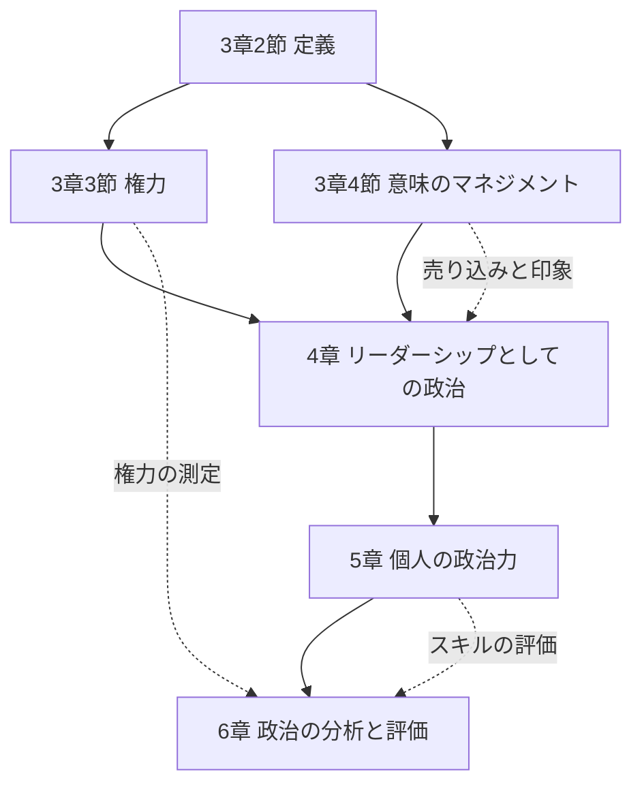

# 『社内政治の科学』の目次に沿った学術文献の整理 — インデックス

- **Type**: survey

## 調査パラメータ

- **調査タイプ**: 学術論文サーベイ（書籍の目次を骨組みにした論点別の整理）
- **骨組み**: 木村琢磨『社内政治の科学 経営学の研究成果』（日本経済新聞出版, 2025）の目次のうち、第3章第2節〜第6章の見出し
- **目次の出典**: [日経BOOKプラス「はじめに：『社内政治の科学 経営学の研究成果』」](https://bookplus.nikkei.com/atcl/column/032900009/102901088/) に掲載された目次画像
- **生成日**: 2026-11-15
- **検索言語**: 英語 + 日本語
- **深さ**: 軽量版（各見出しに対応する主要文献を調べた段階。網羅的な文献収集は未実施）

## この文書の読み方

> **本書の本文は読んでいません。** 目次の見出しを「扱う論点」の手がかりとしてだけ使い、各見出しの中身は学術文献から書いています。「本書がこう書いている」という記述はありません。例外は、著者が公開記事で述べた定義（第3章ファイルで出典付きで紹介）だけです。

各章ファイルでは、各項を次の 3 つに分けています。

| 欄 | 書いていること |
|----|---------------|
| 学術的な根拠と定義 | 論文・学術書が主張していることだけ。出典・確認経路・証拠の強さ付き |
| 実務への含意（論文の主張） | 論文自身が述べている実務的な含意だけ。述べていなければ、そう明記 |
| 推論（最小限） | 上の 2 つから筆者が引き出した推論。各項 1〜3 文。不要なら「なし」 |

**確認経路の表記**: 本文 / 要旨 / 二次資料 / 未確認。**証拠の強さ**: メタ分析 / 複数の実証 / 単一の実証 / 理論・概念 / 事例。

## 章ファイル

| ファイル | 目次の範囲 | 中心になる学術概念 |
|---------|-----------|-------------------|
| [ch3-definition-power-meaning.md](ch3-definition-power-meaning.md) | 第3章 そもそも社内政治とは？ 第2〜4節 | 政治の定義、権力依存と権力の基盤、意味形成・意味付与、印象マネジメント、issue selling |
| [ch4-leadership.md](ch4-leadership.md) | 第4章 リーダーシップとしての社内政治 | 政治的リーダーシップ理論、変革における権力、分配型リーダーシップ、ミドルの戦略的役割 |
| [ch5-political-capability.md](ch5-political-capability.md) | 第5章 ビジネスパーソンに必要な政治力 | 政治知識、政治的スキル（4 次元）、政治的意志、政治的パワーの基盤 |
| [ch6-analysis-methods.md](ch6-analysis-methods.md) | 第6章 社内政治を分析する | 権力構造の 3 測定法、組織ネットワーク分析、政治知覚（POPs）と政治的風土、政治的スキルと倫理性の評価 |

## 目次の流れと学術概念の対応

| 目次 | 主な学術概念 | 代表的な文献 |
|------|-------------|-------------|
| 3.2 定義 | 非公認の影響、自己利益、役割外、非正当性、意味のマネジメント | Mayes & Allen 1977, Pfeffer 1981, Mintzberg 1983, Drory & Romm 1990, Pettigrew 1977, Smircich & Morgan 1982 |
| 3.3 権力 | 権力の定義、権力依存、権力の基盤、部門の権力、ネットワーク上の位置 | Dahl 1957, Emerson 1962, French & Raven 1959, Hickson et al. 1971, Brass 1984 |
| 3.4 意味のマネジメント | sensemaking、sensegiving、印象マネジメント、issue selling、sponsorship | Weick 1995, Gioia & Chittipeddi 1991, Bolino et al. 2016, Dutton & Ashford 1993 |
| 4.1 リーダーシップとは | 影響過程としてのリーダーシップ、マネジメントとの違い | Yukl, Kotter 1990, Dinh et al. 2014 |
| 4.2 政治的リーダーシップ | リーダーシップのロマンス、政治的リーダーシップ理論、アイデンティティ | Meindl et al. 1985, Ammeter et al. 2002, Ferris et al. 2007, van Knippenberg & Hogg 2003 |
| 4.3 変革と政治 | 変革モデル、権力の次元、分配型・集合的リーダーシップ | Kotter 1995, Hardy 1996, Buchanan & Badham, Gronn 2002, Denis et al. 1996/2001 |
| 4.4 ミドル | ミドルの戦略的役割、資源獲得、部下の反応 | Floyd & Wooldridge 1992, Huy 2002, Chang et al. 2009 |
| 5.1 政治知識 | 組織社会化の政治次元、正当性、文脈知識 | Chao et al. 1994, Suchman 1995, Silvester & Wyatt 2018 |
| 5.2 政治スキル | PSI の 4 次元、開発法 | Ferris et al. 2005/2007, Munyon et al. 2015, Kimura 2015 |
| 5.3 政治準備性 | 学術用語としては未確認。候補は政治的意志・政治的成熟・political prudence | Treadway et al. 2005, Kapoutsis et al. 2017, Doldor 2017, Amah 2022 |
| 5.4 政治的パワー | 潜在的パワー、構造的位置、評判、個人特性 | Brass & Burkhardt 1993, Zinko et al. 2007, Anderson et al. 2001 |
| 6.1 変革時の政治的反応の予測 | 地位法・声価法・決定法（対応は未確認） | Hunter 1953, Dahl 1961, Angeles 1973, Salancik & Pfeffer 1974 |
| 6.2 ネットワーク分析 | 中心性、弱い紐帯・強い紐帯、構造的空隙 | Granovetter 1973, Krackhardt 1990/1992, Burt 1992/2004 |
| 6.3 政治的風土の分析 | POPS 尺度、政治的風土、POPs の先行要因 | Kacmar & Carlson 1997, Landells & Albrecht 2016/2019, Atinc et al. 2010 |
| 6.4 政治的リーダーの発掘 | 政治的スキルの他者評価、HR アナリティクス、倫理的リーダーシップ | Blickle et al. 2012, Marler & Boudreau 2017, Brown et al. 2005, Kückelhaus et al. 2024 |

## 章ごとの要点（学術文献の主張）

以下は各章ファイルの「学術的な根拠と定義」欄から要点を抜き出したものです。詳細と出典は各ファイルにあります。

### 第3章（定義・権力・意味）

- 定義には合意がなく、どの要素（非公認・自己利益・役割外・非正当性）を含めるかで、同じ行動が政治になったりならなかったりする（Drory & Romm 1990 ほか）。
- 権力は相手の依存から生まれる。A の B に対する権力は、B の A への依存に等しい（Emerson 1962、本文で確認）。
- 権力と地位は別物で、どちらも自己強化する（Magee & Galinsky 2008、本文で確認）。
- 政治には資源の取り合いだけでなく、出来事の解釈をそろえる「意味」の側面がある（sensegiving: Gioia & Chittipeddi 1991、要旨）。ただし「意味のマネジメントとしての政治」を Pettigrew が何年の著作で述べたかは未確認。

### 第4章（リーダーシップ）

- リーダーの政治的スキルは、部下の反応やリーダーの効果性と関連する（Ferris et al. 2007、本文で確認。Munyon et al. 2015 のメタ分析、要旨）。
- 変革は権力の複数の次元（資源・過程・意味・システム）を動員する作業であり、英雄的リーダー像は権力の働きを見落とす（Hardy 1996、本文で確認）。
- 目標が曖昧で権力が分散した組織（大規模公立病院など）の戦略的変化には、補完的な役割を担う集合的リーダーシップが決定的だが、その集団は崩れやすい（Denis et al. 1996/2001、要旨・事例研究）。
- 上司の政治的スキルが部下の政治知覚を下げるという因果を直接検証した研究は、今回見つかっていない。

### 第5章（政治力）

- 政治的スキルは、社会的洞察力・対人影響力・ネットワーク構築力・誠実さの見せ方の 4 次元で定義される（Ferris et al. 2005/2007、本文で確認）。
- 政治的スキルは、行動モデリング・メンタリング・ドラマ訓練などで育成できるとされる（Ferris et al. 2007、本文で確認）。
- 政治的意志には自己奉仕型と利他型の 2 つの向きがある（Kapoutsis et al. 2017、要旨）。
- パワーは構造上の位置と行動の両方で決まる（Brass & Burkhardt 1993、要旨）。評判は権力の基盤とつながる（Zinko et al. 2007、本文で確認）。
- 「政治準備性」「政治的思慮」は、科研費報告書や英語文献でも学術用語として確認できなかった。

### 第6章（分析手法）

- 地位法・声価法・決定法は、地域権力構造研究で権力を測る古典的な 3 手法として整理されている（Angeles 1973、本文で確認）。目次の 3 分析がこれを指すかは未確認。
- 弱い紐帯は新しい情報の通り道になる（Granovetter 1973、本文で確認）。
- 政治的風土は 5 次元で測れ、部署を絞った介入が提案されている（Landells & Albrecht 2019、本文で確認）。
- 政治的スキルは育成可能で、評価にはアセスメントセンターとの併用が提案されている（Blickle et al. 2012、本文で確認）。
- 政治的スキルが高いと、マキャベリズムが周囲から見えにくくなる。そのため、結果だけでなく過程を評価することが提案されている（Kückelhaus et al. 2024、本文で確認）。

## 確認状況のまとめ

| 章 | 本文で確認できた主な文献 | 二次資料・要旨止まりの重要文献 |
|----|------------------------|-------------------------------|
| 第3章 | Dahl 1957, Emerson 1962, Magee & Galinsky 2008, 著者の公開記事 | Mayes & Allen 1977, Mintzberg 1983, Pfeffer 1981, Pettigrew 1977, Anderson & Brion 2014 |
| 第4章 | Ferris et al. 2007, Hardy 1996 | Ammeter et al. 2002, Treadway et al. 2004, Buchanan 1999, Floyd & Wooldridge 1992, Kotter 1995 |
| 第5章 | Ferris et al. 2007, Silvester & Wyatt 2018, Zinko et al. 2007 | Mayes & Allen 1977, Chao et al. 1994, Doldor 2017, メタ分析の効果量 |
| 第6章 | Granovetter 1973, Angeles 1973, Landells & Albrecht 2019, Blickle et al. 2012, Kückelhaus et al. 2024 | Hunter 1953, Dahl 1961, Krackhardt 1990/1992, Burt 1992, Brass 1984, Atinc et al. 2010 |

## 未確認の主な点

| 項目 | 内容 | 関係する章 |
|------|------|-----------|
| 本書の内容 | 本文を読んでいないため、各節で本書が何を論じているかは分からない | 全章 |
| 政治準備性・政治的思慮 | 学術用語として確認できなかった。候補概念で整理している | 第5章 |
| アイデンティティ変革 | 本書が何を指すかは未確認。候補を 3 つ示している | 第4章 |
| 3 つの分析手法 | 地域権力構造研究の 3 手法と対応するかは未確認 | 第6章 |
| 意味のマネジメントの出典 | Pettigrew の何年の著作の表現かは未確認 | 第3章 |
| 実務応用の研究 | 政治的スキルのアセスメントセンター評価や、HR アナリティクスで政治的リーダーを発掘する研究は見つからなかった | 第6章 |
| 数値 | Gandz & Murray 1980 の「政治がある」と答えた割合（93% と 90% で資料が分かれる）、メタ分析の効果量 | 第3章・第5章 |

## 前回までの run との関係

| run | 切り口 | 本 run との関係 |
|-----|--------|---------------|
| [20261115_schools](../../../../runs/internal_politics/clustering/20261115_schools/index.md) | 10 流派の定義・原因・帰結 | 本 run の各章の文献は、主に流派 A（組織行動論）・C（政治的有効性）・E（戦略的意思決定）・I（社会心理学）・J（日本）に属する |
| [20261115_definition](../../../../runs/internal_politics/clustering/20261115_definition/index.md) | 定義の 5 系統 | 第3章第2節の定義の整理と重なる |

## Sources

- [日経BOOKプラス「はじめに：『社内政治の科学 経営学の研究成果』」（目次画像）](https://bookplus.nikkei.com/atcl/column/032900009/102901088/)
- 各章の出典は、各章ファイルの Sources を参照
