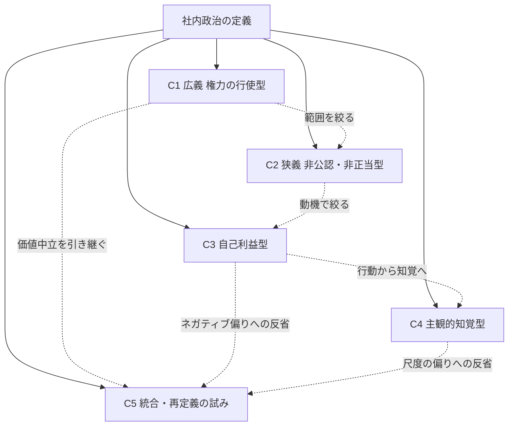
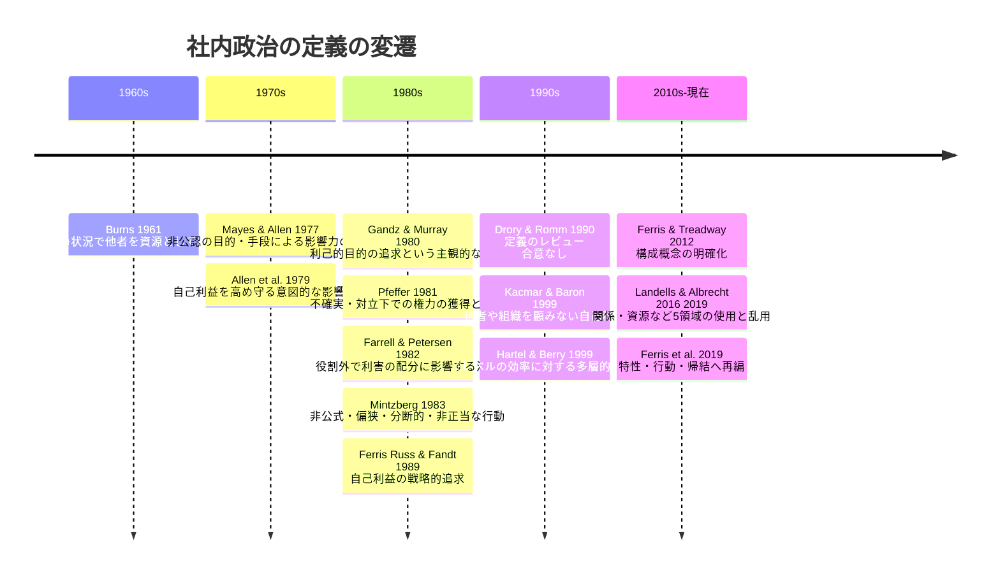

# 社内政治（Organizational Politics）の定義 — ドメインマップ

- **Type**: survey

## 調査パラメータ

- **調査タイプ**: 学術論文サーベイ（定義論・概念整理に絞る）
- **時間範囲**: 1961 – 2026（定義の議論は古典に集中しているため、時間で絞らない）
- **生成日**: 2026-11-15
- **問い**: 研究者は「社内政治」をどう定義してきたか。定義はどんな要素で分かれ、何が争点になっているか
- **入力キーワード**: definition of organizational politics, political behavior, micropolitics, 社内政治 定義
- **検索言語**: 英語（主）+ 日本語（補助）
- **深さ**: 軽量版（クラスタリングのみ。gather / retrieval は未実施）

### 前回までの run との関係

| run | 切り口 | 定義の扱い |
|-----|--------|-----------|
| [20261115](../20261115-domain-map/index.md) | 研究テーマ（POP・政治的スキル・影響戦術など） | 木村琢磨の「正式に承認されていない影響手段」を前提にした |
| [20261115_inevitable](../20261115-inevitable/index.md) | 「必然的に生じる現象」という立場 | 定義を明記せず、Pfeffer 型を暗黙の前提にしていた |
| **本 run** | **定義そのもの** | 定義の系統・構成要素・争点を整理する |

## 全体像（Big Picture）

社内政治の定義は **60 年以上たっても合意がありません**。Drory & Romm（1990, Human Relations）は定義を体系的にレビューし、研究者のあいだで定義が一致していないことを示しました。ただし、彼ら自身は統一の定義を示していません。2015 年の研究でも「定義のコンセンサスはいまだにない」と書かれています。

定義が割れる理由は、**「何を政治に含めるか」の線引きが難しい** ことにあります。

- **広く取りすぎる問題**: 「影響力の行使」だけで定義すると、日常のやりとりはすべて互いに影響し合っているので、**どの行動も政治になってしまう**。
- **狭く取りすぎる問題**: 「自己利益」を定義に入れると、自分の評価のために普通に仕事をすることまで政治になってしまう（Mayes & Allen 1977 の指摘）。そこで「非公認・非正当」に限定すると、今度は **公式な手続きと一体になった影響力行使**（根回しなど）がこぼれ落ちる。

この線引きをめぐって、定義は大きく **5 つの系統** に分かれます。

**検証状況の注意**: 各定義の文言は、多くが **二次資料（教科書・レビュー・ハンドブックの引用）経由** で確認したものです。原典の本文を直接確認できたものはありません。下の表では、確認の経路を「確認」列に示しています。

## 参考レビュー・定義論の基本文献

| タイトル | 年 | 概要 | リンク |
|---------|----|------|-------|
| Mayes & Allen — Toward a Definition of Organizational Politics（AMR 2(4)） | 1977 | 文献から定義を組み立てた最初期の定義論。自己利益を定義に入れることを批判 | [typeset.io](https://typeset.io/pdf/toward-a-definition-of-organizational-politics-2sj5wkusf5.pdf) |
| Drory & Romm — The Definition of Organizational Politics: A Review（Human Relations 43(11)） | 1990 | 定義の構成要素を体系的にレビュー。合意がないことを示す | [BGU](https://cris.bgu.ac.il/en/publications/the-definition-of-organizational-politics-a-review/) |
| Härtel & Berry — In Search of a Unified Definition of Organisational Political Behaviour（JMO） | 1999 | 組織・集団・個人の 3 レベルの「効率」に対して政治を定義する統合案。現場調査で検証 | [Cambridge](https://www.cambridge.org/core/journals/journal-of-management-and-organization/article/in-search-of-a-unified-definition-of-organisational-political-behaviour-evidence-for-a-multilevel-approach/A4E08D3FD5358BC3FF7A8DF51DB943F6) |
| Ferris & Treadway — Politics in Organizations: History, Construct Specification, and Research Directions | 2012 | 構成概念の歴史と明確化。定義の不一致が続いていると指摘 | — |
| Ferris, Ellen, McAllister & Maher — Reorganizing Organizational Politics Research（Annual Review） | 2019 | 構成概念を「特性 / 行動 / 帰結」に再編 | [DOI](https://doi.org/10.1146/annurev-orgpsych-012218-015221) |
| Micropolitics in the Multinational Corporation — Theoretical Foundations and Conceptual Definitions（Cambridge） | — | 政治の定義を一覧にした表を含む章。ドイツ語圏の Mikropolitik 研究も扱う | [Cambridge](https://www.cambridge.org/core/books/micropolitics-in-the-multinational-corporation/theoretical-foundations-and-conceptual-definitions/7966DF3878D68CED6D7ACF4100356599) |

## 定義を分ける構成要素

Drory & Romm（1990）が論じたような定義の構成要素を、本 run では次の 7 つに整理しました。どの要素を定義に含めるかで、系統が分かれます。

| 要素 | 問い | 含めると | 含めないと |
|------|------|---------|-----------|
| E1 影響力の行使 | 他者に影響を与えようとしているか | ほぼすべての定義に含まれる（必要条件） | — |
| E2 意図・戦略性 | 意図的・策略的か | 定型的な指示などを除外できる | 日常のやりとりがすべて政治になる |
| E3 自己利益 | 自分や自集団の利益のためか | 「利己的な行動」としてネガティブになる | 組織のための政治も含められる |
| E4 非公認・非正当 | 公式の権限・手続きの外か | 公式の権限行使と区別できる | 根回しのような公式と一体の行動も含められる |
| E5 対立・不確実性 | 意見の対立や先の見えなさがある状況か | 政治の **発生条件** を定義に組み込める | 状況を問わない |
| E6 役割外 | 職務として求められていない行動か | 通常の職務遂行と区別できる | 職務の一部としての政治も含められる |
| E7 主観的知覚 | 行動そのものか、人がそう感じることか | 「政治の知覚（POP）」の研究になる | 観察可能な行動の研究になる |

## ドメインマップ

**読み方**: C1 が最も広く、C2 → C3 と条件を足すほど範囲が狭まり、評価もネガティブになります。C4 は「行動」から「知覚」へ対象を移したものです。C5 は、C3・C4 のネガティブな偏りへの反省から、価値中立で多層的な定義をめざす流れです。

### 定義の範囲の包含関係

### 定義の時系列

## クラスタ一覧

| # | 系統 | 含む要素 | 価値の置き方 | 代表的な定義 |
|---|------|---------|-------------|-------------|
| 1 | 広義・権力の行使型 | E1 + E5（+ E2） | 中立 | Pfeffer 1981、Burns 1961 |
| 2 | 狭義・非公認／非正当型 | E1 + E2 + E4（+ E6） | ネガティブ寄り | Mayes & Allen 1977、Mintzberg 1983、Farrell & Petersen 1982 |
| 3 | 自己利益型 | E1 + E2 + E3 | ネガティブ | Allen et al. 1979、Ferris et al. 1989、Kacmar & Baron 1999 |
| 4 | 主観的知覚型 | E7（+ E3） | ネガティブ | Gandz & Murray 1980、POP 研究 |
| 5 | 統合・再定義の試み | 系統ごとに異なる | 中立・多層 | Härtel & Berry 1999、Landells & Albrecht、Ferris et al. 2019 |

## クラスタ詳細

### クラスタ 1: 広義・権力の行使型

**概要**: 政治を **「権力が実際に使われている状態（power in action）」** として広く捉える系統です。Pfeffer（1981）は、選択について不確実さや意見の対立がある状況で、自分が望む結果を得るために権力やその他の資源を獲得・育成・使用する活動、と定義しました。権力は「能力（静止した状態）」、政治は「その行使（動いている状態）」という区別です。良し悪しや公式・非公式を定義に含めないので、**価値中立** です。前回 run（20261115_inevitable）の立場と最も相性がよい系統です。

**キーワード**:

- power in action（行動中の権力）
- acquire, develop, and use power and other resources
- uncertainty / dissensus about choices（不確実性・意見の対立）
- power as capacity vs politics as use
- micropolitics（Burns 1961）
- others as resources in competitive situations
- value-neutral definition

**定義の比較**:

| 定義者 | 定義の要旨（言い換え） | 確認 |
|-------|----------------------|------|
| Burns（1961） | 競争的な状況で、他者を資源として利用する行動 | 二次資料（Cambridge 書籍章） |
| Pfeffer（1981） | 不確実・対立のある状況で、望む結果を得るために権力や資源を獲得・育成・使用する組織内の活動 | 二次資料（OpenStax ほか複数の教科書で文言が一致） |
| Pfeffer（1981: 7） | 行動中の権力（power in action） | 二次資料（Cambridge の定義一覧表） |

**弱点**: 範囲が広すぎて、**政治と政治でない行動を区別しにくい**。日常のやりとりにも影響力は含まれるからです。Pfeffer は「不確実・対立がある状況」という条件を加えることで、範囲を少し絞っています。

**調査戦略**:

1. Pfeffer（1981）第 1 章の原典で定義と「権力 / 政治」の区別を確認する
2. Burns（1961, ASQ）の原典で micropolitics の定義を確認する
3. 検索クエリ例: `Pfeffer "power in action" politics definition`, `Burns 1961 micropolitics definition`

**代表的リソース**:

| タイトル | 種別 | 年 | 概要 |
|---------|------|----|------|
| Burns — Micropolitics: Mechanisms of Institutional Change（ASQ） | 論文 | 1961 | micropolitics の原点 |
| Pfeffer — Power in Organizations | 書籍 | 1981 | 広義の定義の代表 |
| OpenStax — Organizational Behavior 13.3 Political Behavior in Organizations | 教科書 | — | Pfeffer の定義を採用している |
| Pfeffer — Managing with Power | 書籍 | 1992 | 実務向けに権力の使い方を論じる |

---

### クラスタ 2: 狭義・非公認／非正当型

**概要**: 政治を **公式の権限・手続きの外にある影響力行使** に限定する系統です。Mayes & Allen（1977）は、組織に公認されていない目的を達成するため、または公認された目的を公認されていない手段で達成するための「影響力の管理」と定義しました。Mintzberg（1983）は、非公式で、見かけ上は偏狭で、たいてい分断的で、何より（技術的な意味で）**正当でない** 個人・集団の行動と定義しています。Farrell & Petersen（1982）は、組織上の役割として求められていないのに、組織内の利害の配分に影響を与える（与えようとする）活動、と **役割外** という条件で絞りました。日本の木村琢磨の定義（正式に承認されていない影響手段を用いる行為）もこの系統に入ります。

**キーワード**:

- non-sanctioned ends / non-sanctioned means（公認されていない目的・手段）
- management of influence
- informal, parochial, divisive, illegitimate（Mintzberg）
- legitimate systems of influence（公式の権限・専門性・イデオロギー）
- extra-role behavior（役割外行動）
- distribution of advantages and disadvantages
- strategic vs routine influence（策略的な影響と定型的な影響）

**Mayes & Allen の 2 × 2**:

| | 目的が公認 | 目的が非公認 |
|---|-----------|-------------|
| **手段が公認** | 政治ではない（通常の職務） | 政治 |
| **手段が非公認** | 政治 | 政治 |

**定義の比較**:

| 定義者 | 定義の要旨（言い換え） | 確認 |
|-------|----------------------|------|
| Mayes & Allen（1977） | 非公認の目的、または非公認の手段による公認の目的の達成をめざす影響力の管理 | 二次資料（法政大学の論文の検索抜粋） |
| Farrell & Petersen（1982） | 役割として求められていないが、組織内の利害の配分に影響する（しようとする）活動 | 二次資料（Cambridge の定義一覧表） |
| Mintzberg（1983: 172） | 非公式・偏狭・分断的で、技術的な意味で非正当な個人・集団の行動 | 二次資料（複数の論文で文言が一致） |
| 木村琢磨 | 正式に承認されていない影響手段を用いて、利益の増大や利害調整を図る行為 | 解説記事（幻冬舎 GOLD ONLINE、日経BP） |

**弱点**: 「公認かどうか」は組織や文化によって違います。**根回し** のように、公式の意思決定と一体になった非公式な調整を、政治と見るかどうかが定義によって変わります。

**調査戦略**:

1. Mayes & Allen（1977）の原典で 2 × 2 の枠組みを確認する
2. Mintzberg（1983）第 13 章前後で「正当な影響力システム」との対比を確認する
3. 木村の論文（法政大学リポジトリ）は画像 PDF でテキスト抽出できなかったため、本文を目で確認する
4. 検索クエリ例: `"non-sanctioned" influence organizational politics definition`, `Mintzberg illegitimate politics system of influence`

**代表的リソース**:

| タイトル | 種別 | 年 | 概要 |
|---------|------|----|------|
| Mayes & Allen — Toward a Definition of Organizational Politics | 論文（AMR） | 1977 | 狭義の定義の原点 |
| Farrell & Petersen — Patterns of Political Behavior in Organizations | 論文（AMR 7(3)） | 1982 | 役割外という条件と、政治行動の類型 |
| Mintzberg — Power In and Around Organizations | 書籍 | 1983 | 非正当性を軸にした定義 |
| Mintzberg — The Organization as Political Arena | 論文（JMS） | 1985 | 定義を組織形態の議論に広げる |
| 木村琢磨 — 組織内政治に関する論文（法政大学） | 論文 | — | Mayes & Allen を狭義の初期研究として紹介 |
| 木村琢磨『社内政治の科学』（日経BP） | 書籍 | — | 日本語の定義の代表 |

---

### クラスタ 3: 自己利益型

**概要**: 政治を **自分や自集団の利益を高める・守るための意図的な影響行為** と定義する系統です。Allen et al.（1979）が代表で、Ferris, Russ & Fandt（1989）の POP モデル、Kacmar & Baron（1999）へと受け継がれ、米国の組織行動論で最もよく使われてきました。Kacmar & Baron は「他者や組織の幸福を顧みない」という条件まで加えており、**最もネガティブな定義** です。前回 run（20261115）の多くの研究はこの系統の定義に立っています。

**キーワード**:

- intentional acts of influence（意図的な影響行為）
- enhance or protect self-interest（自己利益を高める・守る）
- self-serving behavior
- without regard for the well-being of others or the organization
- strategically designed behavior
- uncertainty / ambiguity as breeding ground（Ferris et al. 1989）

**定義の比較**:

| 定義者 | 定義の要旨（言い換え） | 確認 |
|-------|----------------------|------|
| Allen et al.（1979） | 個人や集団の自己利益を高める・守るための意図的な影響行為 | 二次資料（検索抜粋） |
| Ferris, Russ & Fandt（1989） | 自己利益の追求をめざす戦略的な行動。不確実・曖昧な状況で起きやすい | 二次資料（SAGE ハンドブック章）。正確な文言は未確認 |
| Kacmar & Baron（1999） | 他者や組織の幸福を顧みず、自己利益を高めることをめざす個人の行動 | 二次資料（SAGE ハンドブック章） |

**弱点**: Mayes & Allen（1977）が指摘したように、自己利益を定義に入れると **通常の職務遂行**（自分の評価のためにまじめに働くこと）まで政治になります。また、組織のための政治・利他的な政治が定義から締め出されます。

**調査戦略**:

1. Allen et al.（1979, California Management Review）の原典を確認する
2. Ferris, Russ & Fandt（1989）の書籍章で定義の正確な文言を確認する
3. 検索クエリ例: `"self-interest" definition organizational politics critique`, `Kacmar Baron 1999 organizational politics definition`

**代表的リソース**:

| タイトル | 種別 | 年 | 概要 |
|---------|------|----|------|
| Allen, Madison, Porter, Renwick & Mayes — Organizational Politics: Tactics and Characteristics of its Actors（CMR） | 論文 | 1979 | 自己利益型の代表。管理職への質的調査 |
| Madison et al. — Organizational Politics: An Exploration of Managers' Perceptions（Human Relations） | 論文 | 1980 | 管理職が政治をどう捉えているかの質的研究 |
| Ferris, Russ & Fandt — Politics in Organizations | 書籍章 | 1989 | POP モデルの出発点 |
| Kacmar & Baron — Organizational Politics: The State of the Field | レビュー | 1999 | 最もネガティブな定義 |
| SAGE Handbook of Work Stress — Organizational Politics 章 | 書籍章 | — | Kacmar & Baron の定義を採用 |

---

### クラスタ 4: 主観的知覚型

**概要**: 政治を「実際の行動」ではなく **「人が職場をどう感じているか」** として定義する系統です。Gandz & Murray（1980）は、組織のメンバーが、自分や他者が意図的に利己的な目的を追っていると **感じている主観的な状態** に政治を限定しました。この考え方が「政治の知覚（POP）」研究と POPS 尺度につながり、量的研究の主流になりました。ただし、POPS 尺度は **ネガティブな項目に偏っている** と批判されています（Landells & Albrecht）。

**キーワード**:

- subjective state（主観的な状態）
- perceived politicization of organizational processes
- Perceptions of Organizational Politics（POP / POPs）
- POPS scale（Kacmar & Ferris 1991; Kacmar & Carlson 1997）
- negatively biased measurement
- perception vs actual political behavior

**行動の定義と知覚の定義の違い**:

| 観点 | 行動の定義（C1〜C3） | 知覚の定義（C4） |
|------|---------------------|-----------------|
| 対象 | 観察できる影響行為 | メンバーの主観 |
| 測り方 | 観察・自己報告の行動頻度 | 職場風土についての質問紙 |
| 政治が「ある」とは | その行動が行われている | メンバーがそう感じている |
| 利点 | 現象そのものを扱える | 測定しやすく、態度との関係を調べやすい |
| 弱点 | 意図や正当性の判定が難しい | 実際の行動とずれる。ネガティブに偏りやすい |

**調査戦略**:

1. Gandz & Murray（1980, AMJ）の原典で定義と調査結果を確認する
2. POPS 尺度の項目を確認し、ネガティブな偏りを具体的に見る
3. 検索クエリ例: `Gandz Murray 1980 "subjective state" politics`, `POPS scale items negatively biased`

**代表的リソース**:

| タイトル | 種別 | 年 | 概要 |
|---------|------|----|------|
| Gandz & Murray — The Experience of Workplace Politics（AMJ 23(2)） | 論文 | 1980 | 知覚型の定義の原点。428 人調査 |
| Kacmar & Ferris — Perceptions of Organizational Politics Scale（POPS） | 尺度開発 | 1991 | 知覚の測定尺度 |
| Kacmar & Carlson — Further Validation of the POPS | 尺度検証 | 1997 | POPS の改訂版 |
| Saylor — Organizational Behavior 13.4 Organizational Politics | 教科書 | — | Gandz & Murray の調査結果の紹介 |

---

### クラスタ 5: 統合・再定義の試み

**概要**: 定義の不一致と、C3・C4 のネガティブな偏りを乗り越えようとする流れです。

- **Drory & Romm（1990）**: 定義の構成要素をレビューし、政治と政治でない行動は **意図** で区別できると論じた（自身の定義は示していない）。
- **Härtel & Berry（1999）**: 政治を **組織・集団・個人の 3 レベルの「効率」** との関係で定義する多層的な統合案を出し、職場で観察された政治活動をこの定義ですべて捉えられることを 2 段階の現場調査で示した。
- **Landells & Albrecht（2016, 2019）**: 従業員の語りから、**関係・資源・評判・意思決定・コミュニケーションの「使用と乱用」** という 5 領域で、ポジティブとネガティブの両方を含む定義・尺度を作った。
- **Ferris et al.（2019）**: 1 つの定義に統一するのではなく、研究の対象を **特性・行動・帰結** の 3 つに分けて整理し直した。
- **ドイツ語圏の Mikropolitik**（Küpper & Ortmann 1986、Neuberger 2006）: Crozier の組織社会学を受け継ぎ、政治を組織の日常的な働きとして中立的に扱う。

**キーワード**:

- definitional consensus（定義の合意）
- intent as demarcation（意図による線引き）
- multilevel definition（多層的定義）
- organizational / group / individual efficiency
- use and abuse of relationships, resources, reputation, decisions, communication
- political characteristics / actions / outcomes
- Mikropolitik（Küpper & Ortmann; Neuberger）
- value-neutral reconceptualization

**統合案の比較**:

| 統合案 | 線引きの基準 | 価値の扱い | 確認 |
|-------|-------------|-----------|------|
| Drory & Romm（1990） | 意図 | 論じるが定義は出さない | 二次資料（検索抜粋） |
| Härtel & Berry（1999） | 3 レベルの効率との関係 | 中立（どのレベルに資するかで評価） | 要旨（Cambridge） |
| Landells & Albrecht（2016, 2019） | 5 領域の使用と乱用 | 両面 | 論文本文（Frontiers） |
| Ferris et al.（2019） | 定義を統一せず 3 カテゴリーに分ける | 中立 | 要旨（Annual Review） |

**調査戦略**:

1. Drory & Romm（1990）の原典で、構成要素の一覧と「意図」の議論を確認する
2. Härtel & Berry（1999）の本文で、多層的定義の具体的な文言を確認する
3. ドイツ語圏の Mikropolitik は別途ドイツ語文献で確認する（今回は未調査）
4. 検索クエリ例: `"definition of organizational politics" review consensus`, `"multilevel" definition organisational politics efficiency`, `Mikropolitik Neuberger Definition`

**代表的リソース**:

| タイトル | 種別 | 年 | 概要 |
|---------|------|----|------|
| Drory & Romm — The Definition of Organizational Politics: A Review | レビュー（Human Relations） | 1990 | 定義論の中心的レビュー |
| Härtel & Berry — In Search of a Unified Definition of Organisational Political Behaviour | 論文（JMO 5(1)） | 1999 | 多層的な統合定義 |
| Ferris & Treadway — Politics in Organizations: History, Construct Specification, and Research Directions | 書籍章 | 2012 | 構成概念の明確化 |
| Landells & Albrecht — The Positives and Negatives of Organizational Politics: A Qualitative Study（JBP） | 質的研究 | 2015 | 両面的な定義の土台 |
| Landells & Albrecht — Perceived Organizational Politics, Engagement, and Stress（Frontiers） | 尺度検証 | 2019 | 5 領域の両面尺度 |
| Ferris, Ellen, McAllister & Maher — Reorganizing Organizational Politics Research | レビュー（Annual Review） | 2019 | 特性・行動・帰結への再編 |
| Küpper & Ortmann — Mikropolitik in Organisationen | 論文 | 1986 | ドイツ語圏の Mikropolitik |
| Neuberger — Mikropolitik und Moral in Organisationen | 書籍 | 2006 | ドイツ語圏の Mikropolitik の総覧 |

---

## 定義を選ぶときの判断軸（意思決定用）

| 研究の目的 | 向いている系統 | 理由 |
|-----------|---------------|------|
| 政治を「必然的に生じる現象」として記述したい | **C1 広義**（+ C5 の多層案） | 価値中立で、発生条件（不確実性・対立）が定義に入っている |
| 根回しなど、公式と非公式の境目を扱いたい | **C1 広義** または **C5** | C2 では公式と一体の調整がこぼれ落ちる |
| 「正当な権限行使」と「政治」を区別したい | **C2 狭義** | 公認・非公認の線引きがはっきりしている |
| 既存の量的研究（POP・メタ分析）と比較したい | **C3 / C4** | 米国の量的研究の大半がこの定義に立つ |
| 政治の良い面と悪い面の両方を測りたい | **C5**（Landells & Albrecht） | 両面を含む尺度がある |

## 研究ギャップ

| ギャップ | 内容 |
|---------|------|
| 原典確認の不足 | 多くの定義が教科書・レビュー経由で引用され続けており、文言が少しずつずれている可能性がある |
| 定義と尺度のずれ | 中立的な定義（C1・C5）を掲げながら、測定はネガティブな POPS（C4）を使う研究が多い |
| 文化による「公認」の違い | C2 の「公認・非公認」は文化依存だが、比較研究がほとんどない |
| 日本語の定義論 | 日本語で定義を体系的に比較した学術文献は、今回の検索では見つからなかった |

## Sources

- [Mayes & Allen 1977（typeset.io）](https://typeset.io/pdf/toward-a-definition-of-organizational-politics-2sj5wkusf5.pdf)
- [Drory & Romm 1990（BGU）](https://cris.bgu.ac.il/en/publications/the-definition-of-organizational-politics-a-review/)
- [Drory & Romm 1990（Scilit）](https://scilit.com/publications/1a288f56eb29f427b11fc711fb9b41a4)
- [Härtel & Berry 1999（Cambridge）](https://www.cambridge.org/core/journals/journal-of-management-and-organization/article/in-search-of-a-unified-definition-of-organisational-political-behaviour-evidence-for-a-multilevel-approach/A4E08D3FD5358BC3FF7A8DF51DB943F6)
- [Härtel & Berry 1999（RePEc）](https://ideas.repec.org/a/cup/jomorg/v5y1999i01p26-34_00.html)
- [Micropolitics in the Multinational Corporation（Cambridge）](https://www.cambridge.org/core/books/micropolitics-in-the-multinational-corporation/theoretical-foundations-and-conceptual-definitions/7966DF3878D68CED6D7ACF4100356599)
- [Cambridge 書籍章（定義一覧表）](https://www.cambridge.org/core/product/identifier/9781107283947%23CT-BP-2/type/BOOK_PART)
- [OpenStax Organizational Behavior 13.3](https://openstax.org/books/organizational-behavior/pages/13-3-political-behavior-in-organizations)
- [SAGE Encyclopedia — Power](https://sk.sagepub.com/ency/edvol/embed/organization/chpt/power)
- [SAGE Handbook of Work Stress — Organizational Politics](https://sk.sagepub.com/hnbk/edvol/embed/hdbk_workstress/chpt/organizational-politics)
- [Silvester 2008, Politics and Politicians at Work（City, University of London）](https://openaccess.city.ac.uk/id/eprint/11828/1/Silvester%20(2008)%20%20Politics%20and%20Politicians%20at%20Work.pdf)
- [Saylor Organizational Behavior 13.4](https://saylordotorg.github.io/text_organizational-behavior-v1.1/s17-04-organizational-politics.html)
- [Landells & Albrecht 2015（Springer）](https://link.springer.com/10.1007/s10869-015-9434-5)
- [Landells & Albrecht 2019（Frontiers）](https://www.frontiersin.org/journals/psychology/articles/10.3389/fpsyg.2019.01612/full)
- [Political Skill in Organizations（JOM）](https://www.crforum.co.uk/wp-content/uploads/2017/06/Political-Skill-in-Organizations.pdf)
- [Ferris et al. 2019](https://doi.org/10.1146/annurev-orgpsych-012218-015221)
- [木村琢磨 論文（法政大学リポジトリ）](https://hosei.ecats-library.jp/da/repository/00007610/cd-gak08_kimura.pdf)
- [木村琢磨 科研費 15K17127（KAKEN）](https://kaken.nii.ac.jp/ja/grant/KAKENHI-PROJECT-15K17127)
- [社内政治の定義の解説（幻冬舎 GOLD ONLINE）](https://gentosha-go.com/articles/-/73717)
- [『社内政治の科学』紹介（日経BP）](https://bookplus.nikkei.com/atcl/column/101000304/030600024/)
