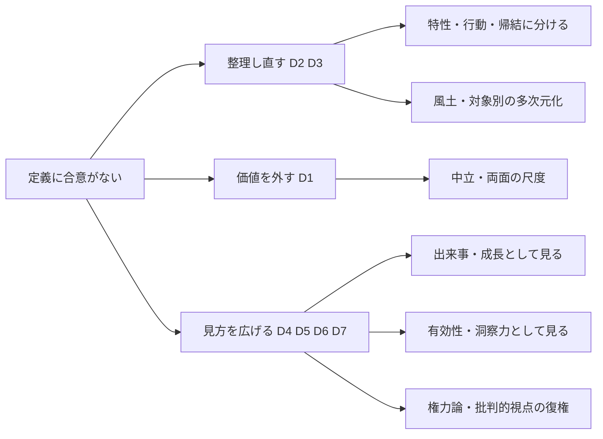
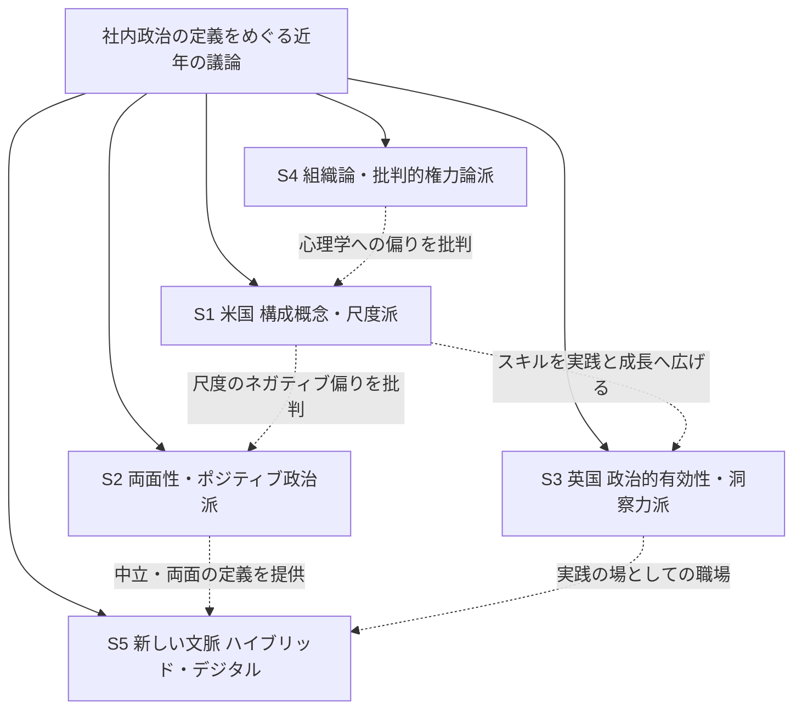
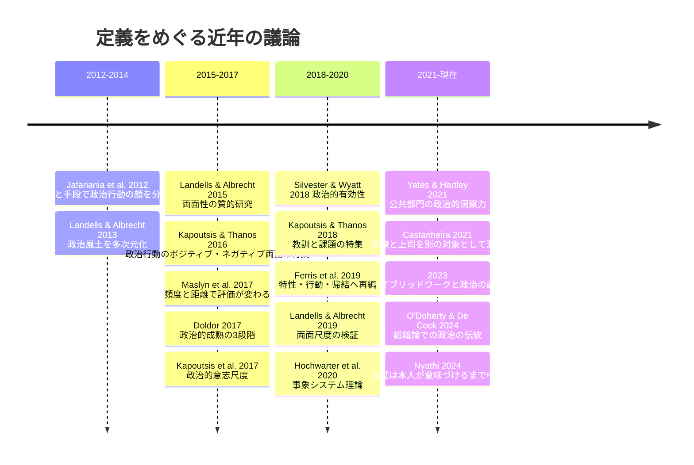

# 社内政治の定義をめぐる近年の議論と流派 — ドメインマップ

- **Type**: survey

## 調査パラメータ

- **調査タイプ**: 学術論文サーベイ（定義・概念化をめぐる近年の議論）
- **時間範囲**: 主に 2015 – 2026（議論の前提になる 2010 年代前半の研究も一部含む）
- **生成日**: 2026-11-15
- **前提**: 社内政治の定義に合意がないことは出発点として受け入れる（[20261115_definition](../20261115-definition/index.md) を参照）
- **問い**: 合意がない中で、近年どんな議論がされているか。どんな定義・流派があるか
- **検索言語**: 英語（主）
- **深さ**: 軽量版（クラスタリングのみ。gather / retrieval は未実施）

## 全体像（Big Picture）

2015 年以降の議論は、**「1 つの正しい定義を決める」ことから離れつつある** のが大きな特徴です。合意がないことを前提に、次の 3 つの方向へ議論が分かれています。

1. **整理し直す**: 定義を 1 つに絞らず、研究の対象を上位のカテゴリーに分けて整理する（Ferris et al. 2019 の「特性 / 行動 / 帰結」）。「政治の知覚」と「政治的行動」は別の構成概念だ、という区別も強まっています。
2. **価値を外す**: 「政治 = 利己的で有害」という前提をやめ、中立または両面のものとして定義し直す。「知覚された政治は、本人がラベルを貼るまでは中立だ」という主張まで出ています（Nyathi 2024）。
3. **見方を広げる**: 「職場にどれくらい政治があるか」という静的な見方から、**出来事・プロセス・成長** として見る動的な見方へ（Hochwarter et al. 2020 の事象システム理論、Doldor の政治的成熟）。さらに、組織論の側からは、心理学に偏った研究に対して **権力論・批判的視点を取り戻そう** という動きがあります（O'Doherty & De Cock 2024）。

これらの議論の担い手は、地域と学問分野ごとに **5 つの流派** に分かれます。

**検証状況の注意**: 多くの文献は要旨・検索抜粋・二次資料で確認したもので、本文を読めたのは一部（Landells & Albrecht 2019、Silvester & Wyatt 2018 など）です。リモートワークと政治の研究は、プレプリントや修士論文など **査読前・小規模** のものが中心です。

## 近年の主要な論点

| # | 論点 | 対立する立場 | 主な文献 |
|---|------|-------------|---------|
| D1 | 価値をどう置くか | ネガティブ前提 ↔ 中立 ↔ 両面（bright side） | Kapoutsis & Thanos 2016/2018、Landells & Albrecht 2019、Maslyn et al. 2017、Nyathi 2024 |
| D2 | 構成概念をどう切り分けるか | 1 つの「社内政治」 ↔ 知覚・行動・スキルなどを別概念に | Ferris et al. 2019、Jafariania et al. 2012 |
| D3 | 次元とレベル | 一次元・個人の知覚 ↔ 多次元・集団の風土・対象別 | Landells & Albrecht 2013、Maslyn & Fedor 1998、Castanheira 2021 |
| D4 | 静的か動的か | 「どれくらいあるか」 ↔ 出来事・頻度・距離・成長 | Hochwarter et al. 2020、Maslyn et al. 2017、Doldor 2017 |
| D5 | 個人の何を見るか | 政治的スキル（能力） ↔ 政治的有効性・政治的洞察力（成果と実践） | Silvester & Wyatt 2018、Yates & Hartley 2021、Doldor 2017 |
| D6 | 誰の学問か | 産業組織心理学 ↔ 組織論・批判的権力論 | O'Doherty & De Cock 2024、Clegg ら |
| D7 | 新しい文脈 | 対面の職場 ↔ ハイブリッド・デジタルな職場 | 2023 年以降のプレプリント・学位論文 |

### 論点ごとの「近年の答え方」

## ドメインマップ（流派）

**読み方**: S1 が量的研究の主流で、S2・S3・S4 はそれぞれ別の角度から S1 の前提（ネガティブな定義、個人の能力への限定、心理学への偏り）を問い直しています。S5 はまだ定義の議論が始まったばかりの新しい領域です。

### 近年の議論の時系列

## クラスタ（流派）一覧

| # | 流派 | 地域・分野 | 定義の立場 | 主な論点 |
|---|------|-----------|-----------|---------|
| S1 | 構成概念・尺度派 | 米国・産業組織心理学 | 定義を統一せず、構成概念を分けて精緻化 | D2, D3, D4 |
| S2 | 両面性・ポジティブ政治派 | 豪州・ギリシャ・イスラエルなど | 中立または両面 | D1, D3 |
| S3 | 政治的有効性・洞察力派 | 英国・公共部門研究 | 政治は職場の通常の一部。能力より実践と成長 | D5, D4 |
| S4 | 組織論・批判的権力論派 | 欧州・組織論 | 政治を権力関係として広く捉える | D6 |
| S5 | 新しい文脈 | 横断（萌芽的） | 未確立。可視性・デジタル統制で捉え直す | D7 |

## クラスタ詳細

### S1: 構成概念・尺度派（米国・産業組織心理学）

**概要**: Ferris らを中心とする、量的研究の主流です。近年は、定義の不一致を **構成概念を細かく分けて整理する** ことで乗り越えようとしています。Ferris et al.（2019）は、従来の「政治の知覚 / 政治的行動 / 政治的スキル」という分け方が研究を狭めていたとして、上位の **「政治的特性 / 政治的行動 / 政治的帰結」** に再編しました。Hochwarter et al.（2020）は、政治の知覚を「職場の安定した性質」ではなく、**新しさ・混乱の大きさ・重大さ** で評価できる個別の **出来事** として捉える事象システム理論を提案しました。また、知覚を「組織全体」と「職場の集団」、「同僚」と「上司」のように **対象別に分けて測る** 研究も続いています。

**キーワード**:

- reorganizing organizational politics research
- political characteristics / actions / outcomes
- perceptions of organizational politics（POPs）vs political behavior
- event systems theory（novelty, disruption, criticality）
- foci / loci of politics perceptions（organization vs work group; coworkers vs supervisors）
- dimensionality（一次元か多次元か）
- higher-order, reflective-formative construct
- meta-analysis of POP antecedents and outcomes

**この流派の定義の扱い**:

| 研究 | 定義・概念化の要点 |
|------|------------------|
| Ferris et al.（2019） | 定義を 1 つに統一せず、特性・行動・帰結の 3 つに分けて研究を整理する |
| Hochwarter et al.（2020） | 政治の知覚を、新しさ・混乱・重大さで評価される「出来事」として捉える |
| Maslyn & Fedor（1998） | 組織レベルと集団レベルの政治知覚は別物で、予測する結果も違う |
| Castanheira（2021, BJM） | 政治の知覚を、同僚の利己的行動と上司の利己的行動の 2 つに分けて扱う |

**調査戦略**:

1. Ferris et al.（2019）と Hochwarter et al.（2020）の本文で、再編案と事象システム理論の中身を確認する
2. 検索クエリ例: `"event systems theory" organizational politics`, `"political characteristics" "political actions" "political outcomes"`, `politics perceptions foci coworker supervisor`
3. 論点: 再編しても、測定には今もネガティブ前提の POPS が使われ続けている

**代表的リソース**:

| タイトル | 種別 | 年 | 概要 |
|---------|------|----|------|
| Maslyn & Fedor — Perceptions of Politics: Does Measuring Different Foci Matter?（JAP） | 論文 | 1998 | 対象別の測定の出発点 |
| Ferris, Ellen, McAllister & Maher — Reorganizing Organizational Politics Research（Annual Review of OPOB 6） | レビュー | 2019 | 特性・行動・帰結への再編 |
| Hochwarter, Rosen, Jordan, Ferris, Ejaz & Maher — Perceptions of Organizational Politics Research: Past, Present, and Future（JOM 46(6)） | レビュー | 2020 | 事象システム理論の提案 |
| Castanheira et al. — Organizational Politics and Its Impact on Performance and Deviance（BJM） | 論文 | 2021 | 同僚と上司の 2 つの対象 |

---

### S2: 両面性・ポジティブ政治派

**概要**: 「政治 = 利己的で有害」という前提を正面から問い直す流派です。ギリシャの Kapoutsis & Thanos は European Management Journal で 2 度の特集（2016 年「政治行動のポジティブ・ネガティブ両面」、2018 年「教訓・課題・今後の方向」）を組み、政治はどこにでもあるが有害だという「ゼロサム」の見方を批判しました。豪州の Landells & Albrecht は、関係・資源・評判・意思決定・コミュニケーションの **使用と乱用** という 5 領域で、両面を測る尺度を作りました。Maslyn, Farmer & Bettenhausen（2017）は、ポジティブな政治は **頻度が高いほど** 好ましく評価され、ネガティブな政治は **中程度のときに最も好ましく** 評価される（曲線関係）ことを示しました。2024 年には「知覚された政治は、本人がラベルを貼るまでは中立だ」という主張も出ています。

**キーワード**:

- positive and negative aspects of political behaviour
- bright side of workplace politics
- zero-sum / pejorative view（ゼロサム的・否定的な見方）
- use and abuse of relationships, resources, reputation, decisions, communication
- frequency and distance of experienced politics
- curvilinear effects of negative politics
- neutral construct until labeled
- social capital view of politics
- organizational political climate（多次元の政治風土）

**価値の置き方の比較**:

| 立場 | 主張 | 代表的な研究 |
|------|------|-------------|
| ネガティブ前提（従来） | 政治は利己的で、少ないほど良い | POPS を使う研究の大半 |
| 両面 | 政治には機能的・逆機能的の両方がある | Kapoutsis & Thanos 2016、Landells & Albrecht 2019 |
| 条件付き | 評価は頻度・距離・量で変わる | Maslyn et al. 2017 |
| 中立 | 知覚は本人が意味づけるまで中立 | Nyathi 2024 |
| ポジティブ寄り | 政治は社会関係資本として働く | Bright side of workplace politics（IJOA 2023） |

**調査戦略**:

1. Kapoutsis & Thanos の 2 つの特集の序文で、問題設定を確認する
2. Landells & Albrecht（2013 → 2015 → 2019）を順に読み、両面尺度の作り方を追う
3. 検索クエリ例: `"bright side" workplace politics`, `"positive politics" perceptions scale`, `"frequency and distance" organizational politics`
4. 論点: 「ポジティブな政治」と「正当な影響力の行使」の区別があいまい。両面尺度はまだ広く使われていない

**代表的リソース**:

| タイトル | 種別 | 年 | 概要 |
|---------|------|----|------|
| Landells & Albrecht — Organizational Political Climate: Shared Perceptions about the Building and Use of Power Bases（HRMR） | 論文 | 2013 | 政治風土を多次元・機能/逆機能の両面で捉える |
| Landells & Albrecht — The Positives and Negatives of Organizational Politics（JBP） | 質的研究 | 2015 | 両面性の記述 |
| Kapoutsis & Thanos — Politics in Organizations: Positive and Negative Aspects of Political Behaviour（EMJ 特集） | 特集序文 | 2016 | 両面性を正面から扱う特集 |
| Maslyn, Farmer & Bettenhausen — When Organizational Politics Matters（Human Relations） | 論文 | 2017 | 頻度と距離で評価が変わる |
| Kapoutsis & Thanos — Politics in Organizations: Lessons, Challenges and Future Directions（EMJ 36(5)） | 特集序文 | 2018 | ゼロサム的な見方への批判 |
| Landells & Albrecht — Perceived Organizational Politics, Engagement, and Stress（Frontiers） | 尺度検証 | 2019 | 5 領域の両面尺度 |
| Looking at the Bright Side of Workplace Politics through the Lens of Social Capital（IJOA） | 論文 | 2023 | 社会関係資本としての政治 |
| Nyathi — ポジティブな政治知覚のレビュー（HRMS） | レビュー | 2024 | 知覚は本人が意味づけるまで中立 |
| Tziner, Drory & Reizer — ポジティブな政治的スキルと業績 | 論文 | 2024 | 有害な結果と並んでポジティブな結果もある |

---

### S3: 政治的有効性・洞察力派（英国・公共部門研究）

**概要**: 英国を中心に、政治を **職場で当たり前に必要になる実践** として捉え、「うまく政治を扱える」とはどういうことか、それがどう **育つか** を調べる流派です。Silvester & Wyatt（2018）は、個人の政治的スキル（能力）ではなく、政治的な職場を理解して **うまく進んでいける力** を「政治的有効性（political effectiveness）」と定義し、この概念を正面から扱った研究がなかったと指摘しました。Hartley らは公共部門の管理職を対象に「政治的洞察力（political astuteness）」の枠組み（戦略的な方向づけと情報収集、合意と連携の構築、人と状況を読む、対人スキル）を作り、それが **経験を通じて場当たり的に** 身につくことを示しました。Doldor は、政治的意志とスキルが管理職のあいだで 3 段階で **成熟していく** モデルを示し、男女差も調べています。

**キーワード**:

- political effectiveness（政治的有効性）
- political astuteness（政治的洞察力）
- political maturation（政治的成熟）
- reading people and situations
- building alignment and alliances
- strategic direction and scanning
- public managers / public leadership
- gender and political will
- experiential, haphazard development

**S1 との違い**:

| 観点 | S1（政治的スキル） | S3（有効性・洞察力） |
|------|------------------|---------------------|
| 焦点 | 個人の安定した能力 | 状況の中でうまく進めた結果と実践 |
| 時間 | 静的（尺度で 1 回測る） | 動的（経験を通じて成熟する） |
| 方法 | 質問紙・メタ分析 | インタビュー・混合研究 |
| 対象 | 主に民間企業の従業員 | 公共部門の管理職・女性管理職を含む |
| 政治の見方 | 中立〜ネガティブ | 職場の通常の一部 |

**調査戦略**:

1. Silvester & Wyatt（2018）で「政治的有効性」の定義と、既存研究とのずれを確認する
2. Yates & Hartley（2021）で政治的洞察力の枠組みと育ち方を確認する
3. Doldor の論文（BJM）と博士論文で、成熟の 3 段階を確認する
4. 検索クエリ例: `"political effectiveness" at work`, `"political astuteness" leadership public`, `"political maturation" managers`

**代表的リソース**:

| タイトル | 種別 | 年 | 概要 |
|---------|------|----|------|
| Doldor — Examining Political Will, Political Skill and Their Maturation among Male and Female Managers（Cranfield 博士論文） | 博士論文 | — | 成熟と男女差 |
| Doldor — From Politically Naive to Politically Mature（BJM） | 論文 | 2017 | 政治的成熟の 3 段階モデル |
| Silvester & Wyatt — Political Effectiveness at Work | 書籍章 | 2018 | 政治的有効性の定義 |
| Silvester — Politics and Politicians at Work | 論文 | 2008 | 職場の政治と政治家研究をつなぐ |
| Yates & Hartley — 政治的洞察力の発達（International Public Management Journal） | 論文 | 2021 | 英・豪・NZ の公共部門管理職の調査 |
| ANZSOG — Leading with Political Astuteness | 研究要約 | — | 実務向けの要約 |
| Learning to Lead with Political Astuteness（Open University） | 論文 | — | 洞察力の学習 |

---

### S4: 組織論・批判的権力論派（欧州）

**概要**: 社内政治の研究が **個人の心理と尺度に偏りすぎた** ことを批判し、組織論・社会学の権力論を取り戻そうとする流派です。O'Doherty & De Cock（2024, Organization Studies）は、同誌の 1986–2010 年の論文から、政治が学際的に研究されてきた伝統をたどり、既存の枠組みの「あいだ」に立つ視点（interstitial positions）を提案しました。Clegg の「権力の回路（circuits of power）」は、権力を出来事・性向・促進の 3 つの回路の相互作用として捉え、Foucault の影響のもとで監視や言説としての権力も扱います。2023 年の対談では、研究が権力と政治の問題に正面から向き合っていないという批判も出ています。この流派では、政治は「個人の行動」より **組織に埋め込まれた権力関係** として定義されます。

**キーワード**:

- politics in organization studies
- multi-disciplinary traditions / interstitial positions
- circuits of power（episodic, dispositional, facilitative）
- obligatory passage points
- Foucault / surveillance / discursive practice
- critical management studies
- Frameworks of Power（Clegg）
- Mikropolitik（ドイツ語圏の伝統）
- power and democracy in organizations

**心理学系（S1）との定義の違い**:

| 観点 | S1 | S4 |
|------|----|----|
| 政治の単位 | 個人の知覚・行動 | 組織に埋め込まれた権力関係 |
| 権力の見方 | 個人が持ち、使うもの | 関係・制度・言説の中で生まれるもの |
| 研究の目的 | 予測と管理 | 批判と理解 |
| 方法 | 質問紙 | 理論・事例・言説分析 |

**調査戦略**:

1. O'Doherty & De Cock（2024）の著者最終稿（Liverpool リポジトリ）で、6 本の論文と「あいだの視点」の議論を確認する
2. Clegg, Courpasson & Phillips（2006）『Power and Organizations』で権力論の系譜を押さえる
3. 検索クエリ例: `"politics in organization studies" traditions`, `"circuits of power" Clegg organization`, `critical perspective organizational politics`
4. 論点: S1 との対話がほとんどない。定義の土台（権力とは何か）がそもそも違う

**代表的リソース**:

| タイトル | 種別 | 年 | 概要 |
|---------|------|----|------|
| Clegg — Frameworks of Power | 書籍 | 1989 / 第 2 版 | 権力の回路モデル |
| Clegg — Foucault, Power and Organizations | 書籍章 | 1998 | 監視と言説としての権力 |
| Clegg, Courpasson & Phillips — Power and Organizations | 書籍 | 2006 | 組織と権力の理論の系譜 |
| Frameworks of Power 第 2 版をめぐる対談（UTS） | 対談 | 2023 | 研究が権力と政治を避けているという批判 |
| O'Doherty & De Cock — Politics in Organization Studies: Multi-disciplinary Traditions and Interstitial Positions（Organization Studies 45(5)） | 論文 | 2024 | 組織論での政治研究の伝統の再評価 |

---

### S5: 新しい文脈（ハイブリッド・デジタル）

**概要**: リモート・ハイブリッドワークで、社内政治の **現れ方そのもの** が変わっているという議論です。2023 年の調査では、ハイブリッドの職場でも政治は続いており、形を変えて現れていると報告されています。プレプリントでは、リモートでは政治が **見えにくく・デジタル化** し、情報の非対称と透明性の低さを通じて疲弊につながると論じています。2025 年のシステムダイナミクス研究は、ハイブリッドワークは階層を平らにするのではなく、**デジタルな可視性・会議の構造・アルゴリズムによる意思決定** に沿って権力を再配分すると指摘しました。ただし、どれも **査読前・小規模・学位論文** が中心で、定義の議論はまだ始まったばかりです。AI やアルゴリズム管理と社内政治を直接扱った研究は、今回の検索では見つかりませんでした。

**キーワード**:

- hybrid work politics
- remote work / concealed and digitalized politics
- visibility / visibility dumping
- information asymmetry / transparency
- digital gatekeeping
- redistribution of power along digital control lines
- algorithmic decision-making
- political engagement in hybrid work

**調査戦略**:

1. 査読済みの研究を探す: `"organizational politics" "hybrid work"`, `"perceived politics" remote work`, `visibility hybrid work power`
2. S2 の中立・両面の定義が、デジタル環境でも使えるかを確認する
3. AI・アルゴリズム管理と政治は研究ギャップとして扱い、隣接分野（algorithmic management）から探す
4. 論点: 「見えない政治」をどう定義し、どう測るか

**代表的リソース**:

| タイトル | 種別 | 年 | 概要 |
|---------|------|----|------|
| ハイブリッドワークでの職場政治の調査（Fortune / Bloomberg 報道） | 調査報道 | 2023 | 政治はハイブリッドの職場でも続き、形を変えて現れる |
| Remote Control: Hybrid Work, Digital Gatekeeping, and Systemic Power Shifts（System Dynamics Conference） | 学会要旨 | 2025 | デジタル統制に沿った権力の再配分 |
| Exploring the Role of Visibility in Hybrid Work（Victoria University of Wellington） | 学位論文 | — | 可視性の概念と「visibility dumping」 |
| リモートワークでの政治知覚と疲弊・離脱（Preprints.org） | プレプリント | 2026 | 見えにくくデジタル化した政治 |
| ハイブリッドワークと政治的関与（UNBC 修士論文） | 修士論文 | 2025 | 152 人の調査 |

---

## 流派を選ぶときの判断軸（意思決定用）

| 知りたいこと | 向いている流派 | 理由 |
|-------------|---------------|------|
| 既存の量的研究の到達点と課題 | S1 | 主流で、レビューとメタ分析が最も多い |
| 政治を「悪」としない定義と尺度 | S2 | 両面尺度と「中立」の議論がある |
| 政治にうまく関わる力がどう育つか | S3 | 有効性・洞察力・成熟の研究がある |
| そもそも権力とは何か、なぜ研究が偏ったか | S4 | 組織論の側からの根本的な問い直し |
| これからの職場で政治がどう変わるか | S5 | 萌芽的。研究ギャップが大きい |

前回までの run の立場（「必然的に生じる現象」・Pfeffer 型の広義の定義）に最も近いのは **S2 と S4** です。S2 は価値を外した定義と測定を、S4 は権力関係として広く捉える理論を提供します。

## 研究ギャップ

| ギャップ | 内容 | 関係する流派 |
|---------|------|-------------|
| 流派間の分断 | S1 と S4 はほぼ対話がなく、権力の捉え方が違う | S1, S4 |
| 定義と測定のずれ | 中立・両面の定義が増えても、測定はネガティブ前提の POPS が主流 | S1, S2 |
| 動的な見方の実証 | 事象システム理論や成熟モデルを縦断データで検証した研究は少ない | S1, S3 |
| デジタル・AI | ハイブリッドワークの研究は査読前が中心で、AI・アルゴリズム管理との関係は未研究 | S5 |
| 非西洋の文脈 | どの流派も欧米中心で、根回しのような合意形成の議論にはつながっていない | 全体 |

## Sources

- [Ferris et al. 2019（Boise State）](https://experts.boisestate.edu/en/publications/reorganizing-organizational-politics-research-a-review-of-the-lit/)
- [Hochwarter et al. 2020（Boise State ScholarWorks）](https://scholarworks.boisestate.edu/manage_facpubs/130)
- [Hochwarter et al. 2020（EconBiz）](https://www.econbiz.de/Record/perceptions-of-organizational-politics-research-past-present-and-future-hochwarter-wayne/10012232087)
- [Maslyn & Fedor 1998 の紹介（SUFE）](https://academicnewsletter.sufe.edu.cn/info/372860)
- [Castanheira 2021, British Journal of Management（FGV）](https://pesquisa-eaesp.fgv.br/sites/gvpesquisa.fgv.br/files/arquivos/jo_3_-_british_j_of_management_-_2021_-_castanheira_-_organizational_politics_and_its_impact_on_performance_and_deviance_through.pdf)
- [Landells & Albrecht 2013（ScienceDirect）](https://www.sciencedirect.com/science/article/abs/pii/S1053482212000575)
- [Landells & Albrecht 2019（PMC）](https://www.ncbi.nlm.nih.gov/pmc/articles/PMC6635907/)
- [Kapoutsis & Thanos 2018（Lancaster）](https://www.research.lancs.ac.uk/portal/en/publications/politics-in-organizations(01a31a7e-dde4-46ea-b740-e19de8850c8d)/export.html)
- [Kapoutsis & Thanos 2016（Lancaster）](https://www.research.lancs.ac.uk/portal/en/publications/politics-in-organizations(56e89830-f85a-4693-a1c1-3f06a6c37ede)/export.html)
- [Maslyn, Farmer & Bettenhausen 2017（Wichita State）](https://soar.wichita.edu/entities/publication/23581d56-e250-4b19-ae21-817bb9998587)
- [Nyathi 2024（EnPress）](https://www.enpress-publisher.com/files/journals/34_hrms/articles/3403/submission/proof/3403-181-8085-3-10-20240913.pdf)
- [Tziner, Drory & Reizer 2024（Journal of Work and Organizational Psychology）](https://journals.copmadrid.org/jwop/files/1576-5962-jwop-40-2-0089.pdf)
- [Bright side of workplace politics 2023（DOI）](https://doi.org/10.1108/IJOA-12-2022-3554)
- [Jafariania et al. 2012（Growing Science）](https://growingscience.com/msl/metadata/j.msl.2012.09.008.html)
- [Silvester & Wyatt 2018（City, University of London）](https://openaccess.city.ac.uk/id/eprint/18174/8/Silvester%20%2B%20Wyatt%20%282018%29%20Political%20Effectiveness%20-%20for%20CRO.pdf)
- [Silvester 2008（City, University of London）](https://openaccess.city.ac.uk/id/eprint/11828/1/Silvester%20(2008)%20%20Politics%20and%20Politicians%20at%20Work.pdf)
- [Doldor 博士論文（Cranfield）](https://dspace.lib.cranfield.ac.uk/handle/1826/9410?show=full)
- [Yates & Hartley 2021（International Public Management Journal）](https://informahealthcare.com/doi/full/10.1080/10967494.2021.1894281)
- [Leading with Political Astuteness（ANZSOG）](https://anzsog.edu.au/insights/leading-with-political-astuteness-brief)
- [Learning to Lead with Political Astuteness（Open University）](https://oro.open.ac.uk/75988)
- [O'Doherty & De Cock 2024（Liverpool）](https://livrepository.liverpool.ac.uk/id/eprint/3178981)
- [O'Doherty & De Cock 2024（SAGE）](https://journals.sagepub.com/doi/10.1177/01708406241238378)
- [Frameworks of Power 対談（UTS）](https://opus.lib.uts.edu.au/rest/bitstreams/51647019-947d-4b0f-929f-2e04197849cb/retrieve)
- [Clegg, Foucault, Power and Organizations（On Work）](https://onwork.edu.au/bibitem/1998-Clegg,Stewart-Foucault,power+and+organizations/)
- [Clegg, Courpasson & Phillips 2006（On Work）](https://onwork.edu.au/bibitem/2006-Clegg,Stewart+R-Courpasson,David-etal-Power+and+Organizations/)
- [Clegg ほか, MNC の政治化（VU Amsterdam）](https://research.vu.nl/ws/files/2169841/192557.pdf)
- [ハイブリッドワークと職場政治の調査（Fortune）](https://fortune.com/2023/04/26/remote-work-toxic-office-politics-survey/)
- [Remote Control 2025（System Dynamics）](https://proceedings.systemdynamics.org/2025/abstracts/1148.html)
- [Visibility in Hybrid Work（Victoria University of Wellington）](https://openaccess.wgtn.ac.nz/articles/thesis/Exploring_the_Role_of_Visibility_in_Hybrid_Work/29551604)
- [リモートワークと政治知覚（Preprints.org）](https://www.preprints.org/manuscript/202609.0700/v1)
- [ハイブリッドワークと政治的関与（UNBC）](https://unbc.arcabc.ca/_flysystem/repo-bin/2025-09/RAHMAN%20Akifa_MSc_20225_A1b.pdf)
