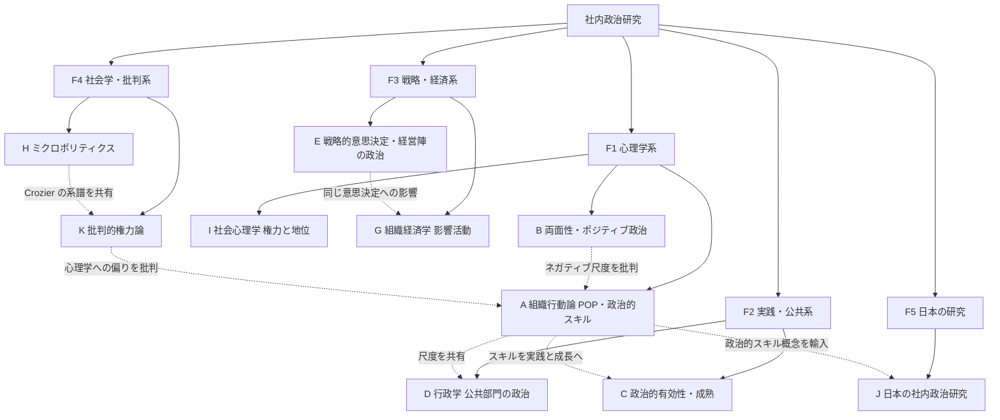
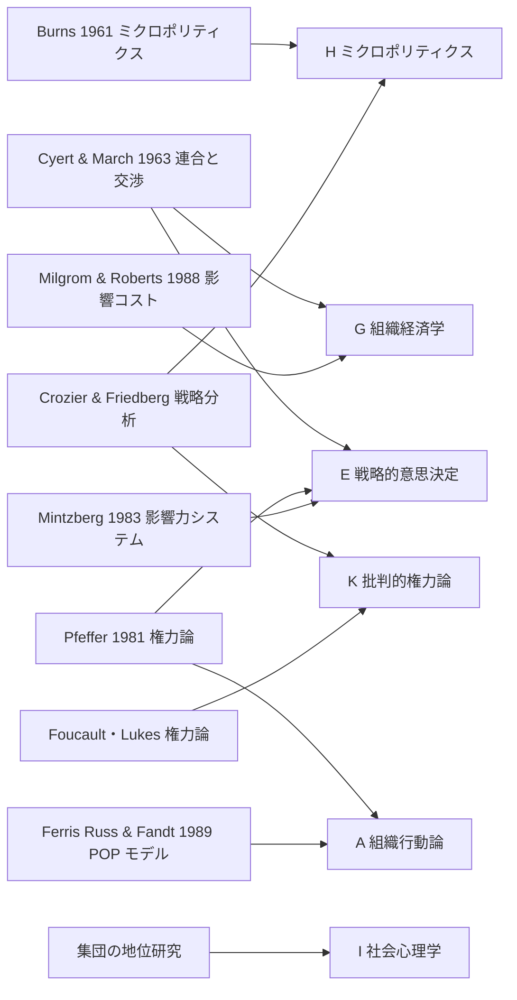

# 社内政治研究の流派 — 定義・発生原因・帰結で見る概観

- **Type**: survey

## 調査パラメータ

- **調査タイプ**: 学術論文サーベイ（学術領域の流派の概観）
- **対象**: **現在も活動中の流派**（2015 年以降も論文が出ているもの）。源流の古典は、各流派の背景として短く触れるだけにする
- **分野の範囲**: 組織行動論・産業組織心理学に加え、社会心理学、戦略論、組織経済学、行政学、欧州の組織社会学（ドイツ語圏の Mikropolitik、多国籍企業のミクロポリティクス）、批判的組織論、日本の研究
- **比較の軸**: 各流派の **(1) 定義**、**(2) 発生原因**（なぜ政治が生じるか）、**(3) 帰結**（政治の結果として何が起こり、何が必要になるか）
- **生成日**: 2026-11-15
- **検索言語**: 英語 + 日本語 + ドイツ語（補助）
- **深さ**: 軽量版（クラスタリングのみ。gather / retrieval は未実施）

## 全体像（Big Picture）

「社内政治」は 1 つの学問分野ではなく、**複数の分野がそれぞれの問いから同じ現象を扱っている** 領域です。分野ごとに、政治を何として見るかが違います。

| 系統 | 政治を何として見るか | 中心の問い |
|------|---------------------|-----------|
| F1 心理学系 | 個人の **知覚・能力・地位の追求** | 政治は人にどう感じられ、誰がうまく扱えるか |
| F2 実践・公共系 | 管理職が日常的に扱う **仕事の一部** | 政治をうまく進める力とは何で、どう育つか |
| F3 戦略・経済系 | **意思決定と資源配分** をめぐる影響行動 | 政治は意思決定の質と組織の設計をどう変えるか |
| F4 社会学・批判系 | 組織に埋め込まれた **権力関係とゲーム** | 組織の秩序は政治によってどう作られ、維持されるか |
| F5 日本の研究 | 日本企業の **社内政治行動と政治スキル** | 日本企業での政治はどんな形をとるか |

流派のあいだの交流は少なく、とくに **心理学系（F1）と社会学・批判系（F4）はほぼ分断** しています。戦略系と経済系（F3）も、同じ「意思決定への影響行動」を扱いながら、引用し合うことはあまりありません。

**検証状況の注意**: 各流派の定義・原因・帰結は、多くを要旨・レビュー・二次資料から整理したもので、原典の本文を確認できたものは一部です。表中の「確認」欄に、確認の経路を示しています。

## ドメインマップ

**読み方**: 実線は系統と流派の所属、点線は流派間の影響・批判・共有を表します。A（組織行動論）が量的研究の中心で、B・C・D・J は A の概念や尺度を受け継ぎつつ広げています。F3 と F4 は、A とは別の理論的な源流を持っています。

### 源流と流派の対応

## 流派の比較（定義・発生原因・帰結）

| 流派 | 定義（言い換え） | 発生原因 | 帰結（起こること） | 帰結（必要になること） |
|------|----------------|---------|-------------------|---------------------|
| A 組織行動論 | 自己利益のための戦略的な影響行動、またはそれが職場に横行しているという **知覚** | 不確実性・曖昧さ、集権化、公式化の低さ、資源の希少性、個人特性 | 満足度・コミットメントの低下、ストレス、離職意図。政治的スキルが高い人は業績・評判が上がる | 政治的スキル、公正さ、透明性 |
| B 両面性 | 関係・資源・評判・意思決定・コミュニケーションの **使用と乱用** | 組織に本質的に備わる。使われ方の違いが評価を分ける | 使い方次第でエンゲージメント向上にもストレスにもなる。頻度・距離・量で評価が変わる | 政治の「使われ方」を整える風土づくり |
| I 社会心理学 | 権力（資源の制御）と地位（周囲からの尊敬）の **獲得・維持・喪失** | 人の集団に階層が自然に生まれ、自己強化する | 階層の固定化、地位をめぐる対立。地位の合意がある集団は対立が少なく結束が強い | 階層の設計、地位の合意形成 |
| C 政治的有効性 | 政治的な職場を理解し、**うまく進んでいく** こと（政治は職場の通常の一部） | 利害関係者が多く、目標が争われる職場の性質 | 管理職の効果性を左右する。力は経験を通じて段階的に成熟する | 政治的有効性・洞察力の育成 |
| D 行政学 | 公共組織の政治の知覚（A の概念を公共部門に適用） | 官僚制、政治的な外部環境、公共サービスの性質 | 職員の業績、市民の満足・信頼・発言への影響 | 公共部門の倫理、管理の質 |
| E 戦略的意思決定 | 戦略的意思決定で、経営陣が **自分の影響力を高める**、観察できるが隠れがちな行動 | 戦略的意思決定の重要性と不確実性、経営陣内の利害の違い | 意思決定の質を下げることが多いが、**いつも下げるとは限らない** | 経営陣の行動の統合、分権化 |
| G 組織経済学 | 組織の決定を **自分の私的な利益の方向へ動かそうとする活動**（影響活動） | 決定に裁量があり、その決定が分配に影響すること | **影響コスト**（努力の浪費、歪んだ決定）。企業規模の上限、事業売却の説明にもなる | 硬直的なルール・官僚制で裁量を減らす、決定権の設計 |
| H ミクロポリティクス | 構造の制約の中で、行為者が **余地を使い、境界を動かす** 権力のゲーム | 組織の構造が行動を決めきれない（不確実性の領域が残る） | 組織の秩序がゲームの結果として作られる。多国籍企業では子会社のイニシアチブ・交渉力を説明 | ゲームと規則の理解、行為者の戦略 |
| K 批判的権力論 | 言説・制度・監視の中に **埋め込まれた権力関係** | 支配の構造、言説、資本主義的な組織の性質 | 支配の再生産と、それへの抵抗 | 権力の批判的な分析、組織の民主化 |
| J 日本の研究 | 正式に承認されていない影響手段で、利益や利害を調整する行為 | 日本企業の組織と雇用の特徴（今回は詳細未確認） | 日本の従業員は戦略的ネットワーキングが少なく、フェイスワーク（体面への配慮）が重要 | 日本の文脈に合った政治スキル |

## クラスタ一覧

| # | 系統 | 含む流派 | 主な分析単位 | 主な方法 |
|---|------|---------|-------------|---------|
| F1 | 心理学系 | A 組織行動論、B 両面性、I 社会心理学 | 個人・集団 | 質問紙、メタ分析、実験 |
| F2 | 実践・公共系 | C 政治的有効性、D 行政学 | 管理職・公共組織 | インタビュー、混合研究、全国調査 |
| F3 | 戦略・経済系 | E 戦略的意思決定、G 組織経済学 | 経営陣・意思決定・組織設計 | 事例、意思決定のサーベイ、数理モデル |
| F4 | 社会学・批判系 | H ミクロポリティクス、K 批判的権力論 | 行為者のゲーム・組織の権力関係 | 質的研究、理論、言説分析 |
| F5 | 日本の研究 | J 日本の社内政治研究 | 日本企業の従業員 | 質的・量的調査 |

## クラスタ詳細

### F1: 心理学系

**概要**: 政治を **個人の知覚・能力・地位の追求** として扱う系統で、量的研究の中心です。A が米国の主流、B が A の前提を問い直す流れ、I が社会心理学から階層の発生を説明する流れです。

#### A: 組織行動論（POP・政治的スキル）

- **分野・拠点**: 米国の組織行動論・産業組織心理学（Ferris, Hochwarter, Kacmar, Treadway ら）
- **源流**: Ferris, Russ & Fandt（1989）の POP モデル、Pfeffer（1981）
- **活動状況**: Ferris et al.（2019, Annual Review）で研究を「特性・行動・帰結」に再編、Hochwarter et al.（2020, JOM）で事象システム理論を提案
- **定義**: 自己利益を高めるための戦略的な影響行動（Kacmar & Baron 1999 など）。量的研究では、それが職場に横行しているという **知覚（POP）** として測る
- **発生原因**: 不確実性・曖昧さ（Ferris et al. 1989）、集権化、公式化の低さ、昇進機会の少なさ、マキャベリズムなどの個人特性
- **帰結**: メタ分析では、POP が高いほど職務満足・コミットメントが下がり、ストレス・離職意図が上がる（Chang et al. 2009）。政治的スキルは業績・キャリア成功・評判と正の関係（Munyon et al. 2015）
- **必要になること**: 政治的スキルの育成、公正さと透明性による政治知覚の低減

**キーワード**:

- perceptions of organizational politics（POP / POPS）
- political skill / Political Skill Inventory
- political will
- event systems theory
- political characteristics / actions / outcomes

#### B: 両面性・ポジティブ政治

- **分野・拠点**: 組織行動論・HRM（豪州 Landells & Albrecht、ギリシャ Kapoutsis & Thanos、米国 Maslyn ら）
- **源流**: Gandz & Murray（1980）、Butcher & Clarke（1999）、Hochwarter（2012）
- **活動状況**: European Management Journal の特集（2016, 2018）、両面尺度の検証（2019）、ポジティブな政治知覚のレビュー（2024）
- **定義**: 関係・資源・評判・意思決定・コミュニケーションの **使用と乱用**（Landells & Albrecht）。知覚は、本人が意味づけるまでは中立（Nyathi 2024）
- **発生原因**: 政治は組織に本質的に備わる。問題は量より **使われ方**
- **帰結**: 使い方によって、意味のある仕事を通じたエンゲージメントの向上にも、ストレスにもつながる（Landells & Albrecht 2019）。ポジティブな政治は頻度が高いほど好ましく、ネガティブな政治は中程度のときに最も好ましく評価される（Maslyn et al. 2017）
- **必要になること**: 政治の使われ方を整える風土・HRM

**キーワード**:

- positive and negative politics
- use and abuse of power bases
- organizational political climate
- frequency and distance of politics
- bright side of workplace politics

#### I: 社会心理学（権力と地位）

- **分野・拠点**: 社会心理学・組織行動論（Galinsky, Magee, Anderson, Bunderson ら）
- **源流**: 集団の地位研究、権力の心理学
- **活動状況**: Magee & Galinsky（2008）以降、権力と地位の研究は現在も活発（2024 年の Organization Science など）
- **定義**: 「社内政治」という語はあまり使わず、**権力（価値ある資源の制御）と地位（他者からの尊敬）** の獲得・維持・喪失として扱う
- **発生原因**: 人の集団には階層が自然に生まれ、権力と地位は **自己強化する**。地位から権力への経路の方が、その逆より強い（2024）
- **帰結**: 階層の固定化、地位をめぐる対立。地位について合意がある集団は、対立が少なく結束と信頼が高い。階層は集団の学習にも影響する（Bunderson & Reagans 2011）
- **必要になること**: 階層の設計、地位についての合意づくり

**キーワード**:

- social hierarchy / power vs status
- self-reinforcing hierarchy
- status conflict
- dominance vs prestige
- hierarchy and collective learning

**F1 の代表的リソース**:

| タイトル | 流派 | 種別 | 年 | 確認 |
|---------|------|------|----|------|
| Magee & Galinsky — Social Hierarchy: The Self-Reinforcing Nature of Power and Status（Academy of Management Annals） | I | レビュー | 2008 | 要旨 |
| Chang, Rosen & Levy — POP のメタ分析（AMJ） | A | メタ分析 | 2009 | 二次資料 |
| Bunderson & Reagans — Power, Status, and Learning in Organizations（Organization Science） | I | レビュー | 2011 | 要旨 |
| Landells & Albrecht — Organizational Political Climate（HRMR） | B | 論文 | 2013 | 要旨 |
| Munyon, Summers, Thompson & Ferris — Political Skill and Work Outcomes（Personnel Psychology） | A | メタ分析 | 2015 | 要旨 |
| Kapoutsis & Thanos — Politics in Organizations（EMJ 特集） | B | 特集序文 | 2016 / 2018 | 書誌情報 |
| Maslyn, Farmer & Bettenhausen — When Organizational Politics Matters（Human Relations） | B | 論文 | 2017 | 要旨 |
| Ferris, Ellen, McAllister & Maher — Reorganizing Organizational Politics Research | A | レビュー | 2019 | 要旨 |
| Landells & Albrecht — Perceived Organizational Politics, Engagement, and Stress（Frontiers） | B | 論文 | 2019 | 本文 |
| Hochwarter et al. — POP Research: Past, Present, and Future（JOM） | A | レビュー | 2020 | 要旨 |
| The Asymmetric Nature of Social Hierarchies（Organization Science） | I | 論文 | 2024 | 要旨 |
| Nyathi — ポジティブな政治知覚のレビュー（HRMS） | B | レビュー | 2024 | 要旨 |

---

### F2: 実践・公共系

**概要**: 政治を **管理職が日常的に扱う仕事の一部** として捉え、それをうまく進める力や、公共部門での政治の働きを調べる系統です。英国と、イスラエルなどの行政学に拠点があります。

#### C: 政治的有効性・成熟（英国）

- **分野・拠点**: 職業心理学・リーダーシップ研究（英国 Silvester, Wyatt, Doldor、Hartley ら）
- **源流**: Butcher & Clarke の「経営に欠けた分野」としての政治、Silvester の政治家研究
- **活動状況**: Silvester & Wyatt（2018）、Doldor（2017）、Yates & Hartley（2021）
- **定義**: 政治的な職場環境を **理解し、うまく進んでいく力**（political effectiveness）。政治は職場の通常の一部として扱う
- **発生原因**: 利害関係者が多く、目標が争われ、資源をめぐる交渉が欠かせない職場の性質
- **帰結**: 管理職やリーダーの効果性を左右する。政治的意志とスキルは 3 段階で成熟し、男女で成熟の仕方が違う（Doldor）
- **必要になること**: 政治的有効性・洞察力の育成（経験に頼る場当たり的な育ち方を体系化する）

**キーワード**:

- political effectiveness
- political maturation
- political will and gender
- politically naive / politically mature

#### D: 行政学（公共部門の政治）

- **分野・拠点**: 行政学・公共経営（イスラエル Vigoda-Gadot、英・豪・NZ の Hartley ら）
- **源流**: A の POP 研究を公共部門に適用
- **活動状況**: Vigoda-Gadot は 2025 年まで公共ガバナンスと信頼の研究を継続。Yates & Hartley（2021）は公共部門管理職の政治的洞察力を調査
- **定義**: 公共組織の中の政治の知覚（A と同じ概念）。Hartley らは、公共管理職が扱う「政治」を、組織内だけでなく **政治家や地域社会との関係** まで含めて捉える
- **発生原因**: 官僚制、政治的な外部環境、公共の目標の多さと対立
- **帰結**: 職員の業績や態度に加え、**市民の満足・信頼・発言の意向** にまで影響する（Vigoda-Gadot 2007）。公務員の市民への信頼も、組織の政治で予測される（2012）
- **必要になること**: 公共部門の倫理、管理の質、政治的洞察力（戦略的な方向づけ、合意と連携づくり、人と状況を読む力）

**キーワード**:

- organizational politics in the public sector
- citizens' trust / satisfaction / voice
- political astuteness
- public managers
- democratic ethos

**F2 の代表的リソース**:

| タイトル | 流派 | 種別 | 年 | 確認 |
|---------|------|------|----|------|
| Vigoda-Gadot — 市民の政治知覚と信頼（JPART） | D | 論文 | 2007 | 要旨 |
| Vigoda-Gadot ほか — 公務員の市民への信頼（Public Organization Review） | D | 論文 | 2012 | 要旨 |
| Doldor — From Politically Naive to Politically Mature（BJM） | C | 論文 | 2017 | 要旨 |
| Silvester & Wyatt — Political Effectiveness at Work | C | 書籍章 | 2018 | 本文 |
| Yates & Hartley — 公共部門管理職の政治的洞察力（International Public Management Journal） | D | 論文 | 2021 | 要旨 |
| Handbook on Trust in Public Governance — Vigoda-Gadot の章 | D | 書籍章 | 2025 | 要旨 |

---

### F3: 戦略・経済系

**概要**: 政治を **意思決定と資源配分をめぐる影響行動** として扱う系統です。戦略論は経営陣の意思決定の質への影響を、組織経済学は影響行動が生むコストと、それを抑える組織設計を論じます。どちらも Cyert & March の「企業は連合である」を源流に持ちます。

#### E: 戦略的意思決定・経営陣の政治

- **分野・拠点**: 戦略論・経営陣（TMT）研究（Elbanna、Shepherd ら。源流は Eisenhardt & Bourgeois 1988）
- **源流**: Cyert & March（1963）、Pfeffer（1981）、Mintzberg（1983）、Eisenhardt & Bourgeois（1988）
- **活動状況**: Shepherd et al.（2020, Long Range Planning）、DeBode et al.（2023, Small Group Research）、Motloung & Lew（2023）
- **定義**: 経営陣が意思決定への影響力を高めるための、観察できるが隠れがちな行動（裏での連合づくり、非公式な場でのロビー活動、情報の出し惜しみ、議題のコントロール）
- **発生原因**: 戦略的意思決定の重要性と不確実性、経営陣内の利害や考えの違い。大規模な革新・M&A・再編・新市場参入などの決定は、とくに政治を引き起こしやすい
- **帰結**: 政治的な意思決定は質を下げるとされてきたが、**いつも下げるとは限らない**。行動の統合が進み、分権化された経営陣では悪影響が弱まる（Shepherd et al. 2020, 117 件の戦略的決定）。経営陣の政治的な分極化は、決定の包括性と速さに影響する
- **必要になること**: 経営陣の行動の統合、分権化、意思決定プロセスの設計

**キーワード**:

- political behavior in strategic decision making
- top management team politics
- behavioral integration
- TMT political polarization
- strategic leader indecision
- issue selling（ミドルからの売り込み）

#### G: 組織経済学（影響活動）

- **分野・拠点**: 組織経済学・企業理論（Milgrom & Roberts、Powell ら）
- **源流**: Milgrom & Roberts（1988, 1990）、Meyer, Milgrom & Roberts（1992）
- **活動状況**: Powell（2015, Journal of Law, Economics, & Organization）など、影響コストのモデルの発展が続いている
- **定義**: 組織の中の人が、組織の決定を **自分の私的な利益の方向へ動かそうとする活動**（influence activities）
- **発生原因**: 決定を下す人に **裁量** があり、その決定が **分配**（予算・人員・昇進など）に影響すること。たとえば事業部長が本社に予算を求めてロビー活動をする
- **帰結**: **影響コスト**（影響活動に使われる時間と努力の浪費、決定の歪み）。これが企業規模の上限を決める要因の 1 つになり、業績の悪い事業の売却も説明する。リストラが予想されると影響コストは増える
- **必要になること**: 事後の決定の質を多少犠牲にしても、**硬直的なルール・官僚制** で裁量を減らし、影響活動の動機を弱める。官僚制は「統合のコスト」ではなく、影響活動への **合理的な対応** として生まれる（Powell）

**キーワード**:

- influence activities / influence costs
- discretion and distributive consequences
- bureaucracy as response to influence
- rigid organizational practices
- internal capital markets / lobbying for budgets
- firm boundaries / divestiture

**F3 の代表的リソース**:

| タイトル | 流派 | 種別 | 年 | 確認 |
|---------|------|------|----|------|
| Eisenhardt & Bourgeois — Politics of Strategic Decision Making in High-Velocity Environments（AMJ） | E | 論文 | 1988 | 本文（一部） |
| Milgrom & Roberts — Bargaining Costs, Influence Costs, and the Organization of Economic Activity | G | 論文 | 1990 | 本文（PDF） |
| Meyer, Milgrom & Roberts — Organizational Prospects, Influence Costs, and Ownership Changes | G | 論文 | 1992 | 要旨 |
| Powell — An Influence-Cost Model of Organizational Practices and Firm Boundaries（JLEO） | G | 論文 | 2015 | 要旨 |
| Shepherd et al. — Political Behavior Does Not (Always) Undermine Strategic Decision Making（Long Range Planning） | E | 論文 | 2020 | 要旨 |
| DeBode, Fox & McSweeney — TMT Political Polarization and Strategic Decision-Making（Small Group Research） | E | 論文 | 2023 | 要旨 |
| Motloung & Lew — Drivers and Consequences of Strategic Leader Indecision（LODJ） | E | 事例研究 | 2023 | 要旨 |

---

### F4: 社会学・批判系

**概要**: 政治を、個人の行動より **組織に埋め込まれた権力関係とゲーム** として扱う系統です。欧州の組織社会学が拠点で、Crozier & Friedberg の戦略分析を共通の源流に持ちます。H は行為者が構造の中で行うゲームを記述し、K は権力の構造そのものを批判的に分析します。

#### H: ミクロポリティクス（ドイツ語圏の Mikropolitik、多国籍企業研究）

- **分野・拠点**: 組織社会学・国際経営（ドイツ語圏の Küpper & Ortmann、Neuberger。多国籍企業研究の Geppert, Dörrenbächer, Becker-Ritterspach ら）
- **源流**: Burns（1961）、Crozier & Friedberg（1977）
- **活動状況**: 書籍『Micropolitics in the Multinational Corporation』（Cambridge, 2016）、子会社のミクロポリティクス戦略のプロセスモデル（2025）
- **定義**: 構造的な制約の中で、個人や集団が **行動の余地を使い、その境界を動かす** 権力のゲーム。行動は「ゲーム・ルール・資源」の中での戦略として再構成される。Neuberger は、権力の **日常的な構築と使用** として定義し、評価も「組織を害する利己的行動」から「非公式なやり方で正当な目標を追うこと」まで幅があるとした
- **発生原因**: 組織の構造が行動を決めきれず、**不確実性の領域** が残ること。多国籍企業では、本社と子会社の利害の違い、制度環境の違い
- **帰結**: 組織の秩序は、ゲームの結果として作られ、作り直される。多国籍企業では、子会社のイニシアチブの売り込み、交渉力、戦術の時間的な順序が、本社との関係を形づくる
- **必要になること**: ゲームと規則を理解すること。リーダーシップを「複雑な依存関係の中での権力の構築と使用」として捉え直すこと

**キーワード**:

- Mikropolitik / micropolitics
- games, rules, and resources
- zones of uncertainty
- headquarters–subsidiary relations
- subsidiary initiative selling / bargaining
- actor-centred perspective

#### K: 批判的権力論

- **分野・拠点**: 批判的組織論・批判的経営研究（Clegg、O'Doherty & De Cock ら）
- **源流**: Foucault、Lukes、Crozier、批判的経営研究（CMS）
- **活動状況**: 『Frameworks of Power』第 2 版をめぐる対談（2023）、O'Doherty & De Cock（2024, Organization Studies）
- **定義**: 言説・制度・監視の中に **埋め込まれた権力関係**。Clegg は権力を、出来事（episodic）・性向（dispositional）・促進（facilitative）の 3 つの回路の相互作用として捉える
- **発生原因**: 支配の構造、言説、組織の制度そのもの
- **帰結**: 権力は「必ず通る地点」を通じて人を力づけたり力を奪ったりし、支配が再生産される。同時に抵抗も生まれる
- **必要になること**: 権力の批判的な分析、組織の民主化。研究が権力と政治の問題に正面から向き合うこと

**キーワード**:

- circuits of power
- obligatory passage points
- Foucault / surveillance / discourse
- critical management studies
- politics in organization studies
- power and democracy

**F4 の代表的リソース**:

| タイトル | 流派 | 種別 | 年 | 確認 |
|---------|------|------|----|------|
| Küpper & Ortmann（編）— Mikropolitik: Rationalität, Macht und Spiele in Organisationen | H | 書籍 | 1992 | 書誌情報 |
| Neuberger — Mikropolitik: der alltägliche Aufbau und Einsatz von Macht in Organisationen（後に Mikropolitik und Moral in Organisationen） | H | 書籍 | 1995 / 2006 | 書誌情報 |
| Clegg — Frameworks of Power | K | 書籍 | 1989 / 第 2 版 | 二次資料 |
| Clegg, Courpasson & Phillips — Power and Organizations | K | 書籍 | 2006 | 書誌情報 |
| Geppert & Dörrenbächer — 多国籍企業の権力と政治の理論のレビュー | H | レビュー | 2014 | 二次資料（書評） |
| Becker-Ritterspach, Blazejewski, Dörrenbächer & Geppert（編）— Micropolitics in the Multinational Corporation（Cambridge） | H | 書籍 | 2016 | 書誌情報・書評 |
| Frameworks of Power 第 2 版をめぐる対談（UTS） | K | 対談 | 2023 | 要旨 |
| O'Doherty & De Cock — Politics in Organization Studies（Organization Studies 45(5)） | K | 論文 | 2024 | 要旨 |
| 子会社のミクロポリティクス戦略のプロセスモデル（Cambridge の経営学誌） | H | 論文 | 2025 | 要旨 |

---

### F5: 日本の研究

**概要**: 日本企業を対象にした社内政治の研究は少なく、**木村琢磨** の研究が中心です。米国 A 流派の政治的スキル研究を土台にしつつ、日本企業での政治行動の形を調べています。

#### J: 日本の社内政治研究

- **分野・拠点**: 組織行動論（木村琢磨。法政大学を経て 2025 年から昭和女子大学）
- **源流**: A 流派（政治的スキル）、Mayes & Allen（1977）の狭義の定義
- **活動状況**: 政治的スキル研究のレビュー（International Journal of Management Reviews, 2015）、科研費研究、一般向け書籍『社内政治の科学』（2025）
- **定義**: 正式に承認されていない影響手段を用いて、利益の増大・損失の抑止・権力や資源の獲得・利害調整を図る行為
- **発生原因**: 利害の異なる個人・集団から成る組織で、意思決定を進めるために避けられない（日本企業に固有の原因の分析は、今回は詳細を確認できていない）
- **帰結**: 日本の従業員は、戦略的ネットワーキングが少なく、**フェイスワーク**（相手の体面への配慮）の重要性が高い。社内政治の戦術は「準備的戦術」と「活用的戦術」に分けられる
- **必要になること**: 日本の文脈に合った政治スキル。根回しなど、合意形成を進める実践

**キーワード**:

- 社内政治 / 組織内政治
- 政治スキル
- フェイスワーク
- 戦略的ネットワーキング
- 準備的戦術 / 活用的戦術
- 根回し

**F5 の代表的リソース**:

| タイトル | 流派 | 種別 | 年 | 確認 |
|---------|------|------|----|------|
| 木村琢磨 — 組織内政治に関する論文（法政大学リポジトリ） | J | 論文 | — | 検索抜粋（画像 PDF のため本文未確認） |
| Kimura — 政治的スキル研究のレビュー（International Journal of Management Reviews） | J | レビュー | 2015 | 二次資料（紹介記事） |
| 木村琢磨 — 科研費 15K17127 成果報告 | J | 研究報告 | 2017 | 検索抜粋 |
| 科研費 17K03961 成果報告 | J | 研究報告 | — | 検索抜粋 |
| 木村琢磨『社内政治の科学』（日本経済新聞出版） | J | 書籍 | 2025 | 紹介記事 |

---

## 流派のあいだの関係

| 関係 | 内容 |
|------|------|
| 共有 | A の POP 尺度と政治的スキル概念が、D（行政学）と J（日本）に輸入されている |
| 発展 | C は A の政治的スキルを、実践と成長の観点へ広げた |
| 批判 | B は A の尺度のネガティブな偏りを、K は A の心理学への偏りを批判する |
| 並行 | E と G は同じ「意思決定への影響行動」を扱うが、ほとんど引用し合わない |
| 源流の共有 | H と K は Crozier & Friedberg の系譜を共有する |
| 分断 | F1（心理学系）と F4（社会学・批判系）はほぼ対話がない |

## 次の一手（意思決定用）

| 選択肢 | 内容 | 向いている目的 |
|--------|------|---------------|
| 比較表の原典確認 | 各流派の代表論文 1〜2 本の本文で、定義・原因・帰結を確かめる | 概観の正確さを上げたい |
| F3 を深掘り | 戦略論と組織経済学の「影響行動」をつなぐ | 意思決定と組織設計に関心がある |
| F4 を深掘り | ドイツ語圏の Mikropolitik と多国籍企業研究を詳しく見る | 英語圏の主流以外を知りたい |
| gather 実行 | 流派ごとの論文リストを作る | 体系的なサーベイに進みたい |

## Sources

- [Ferris et al. 2019（Boise State）](https://experts.boisestate.edu/en/publications/reorganizing-organizational-politics-research-a-review-of-the-lit/)
- [Hochwarter et al. 2020（Boise State ScholarWorks）](https://scholarworks.boisestate.edu/manage_facpubs/130)
- [Munyon et al. 2015](https://independent.academia.edu/JamesSummers10)
- [Landells & Albrecht 2013（ScienceDirect）](https://www.sciencedirect.com/science/article/abs/pii/S1053482212000575)
- [Landells & Albrecht 2019（PMC）](https://www.ncbi.nlm.nih.gov/pmc/articles/PMC6635907/)
- [Kapoutsis & Thanos 2018（Lancaster）](https://www.research.lancs.ac.uk/portal/en/publications/politics-in-organizations(01a31a7e-dde4-46ea-b740-e19de8850c8d)/export.html)
- [Maslyn, Farmer & Bettenhausen 2017（Wichita State）](https://soar.wichita.edu/entities/publication/23581d56-e250-4b19-ae21-817bb9998587)
- [Nyathi 2024（EnPress）](https://www.enpress-publisher.com/files/journals/34_hrms/articles/3403/submission/proof/3403-181-8085-3-10-20240913.pdf)
- [Magee & Galinsky 2008（MIT）](https://web.mit.edu/curhan/www/docs/Articles/15341_Readings/Power/Magee,%20J.%20C.,%20&%20Galinsky,%20A.%20D.%20(2008).%20Social%20hierarchy-%20The%20self%E2%80%90reinforcing%20nature%20of%20power%20and%20status..pdf)
- [Bunderson & Reagans 2011（INFORMS）](https://pubsonline.informs.org/doi/10.1287/orsc.1100.0590)
- [The Asymmetric Nature of Social Hierarchies 2024（INFORMS）](https://pubsonline.informs.org/doi/10.1287/orsc.2024.18685)
- [Silvester & Wyatt 2018（City, University of London）](https://openaccess.city.ac.uk/id/eprint/18174/8/Silvester%20%2B%20Wyatt%20%282018%29%20Political%20Effectiveness%20-%20for%20CRO.pdf)
- [Doldor 博士論文（Cranfield）](https://dspace.lib.cranfield.ac.uk/handle/1826/9410?show=full)
- [Yates & Hartley 2021](https://informahealthcare.com/doi/full/10.1080/10967494.2021.1894281)
- [Vigoda-Gadot 2012（RePEc）](https://econpapers.repec.org/RePEc:kap:porgrv:v:12:y:2012:i:4:p:383-399)
- [Vigoda-Gadot 公共部門の研究紹介（SUFE）](https://academicnewsletter.sufe.edu.cn/info/419193)
- [Vigoda-Gadot 2025 Handbook 章（NYU IFP）](https://ifp.nyu.edu/?p=321246)
- [Eisenhardt & Bourgeois 1988](https://qualquant.org/wp-content/uploads/text/1988%20Eisenhardt737-770.pdf)
- [Shepherd et al. 2020（Aston）](https://research.aston.ac.uk/en/publications/political-behavior-does-not-always-undermine-strategic-decision-m)
- [DeBode, Fox & McSweeney 2023（Missouri State）](https://bearworks.missouristate.edu/articles00/410)
- [Motloung & Lew 2023（Emerald）](https://emerald.com/insight/content/doi/10.1108/LODJ-10-2021-0457)
- [Milgrom & Roberts 1990（UConn）](https://richard-langlois.media.uconn.edu/wp-content/uploads/sites/1617/2022/10/Milgrom-and-Roberts-1990.pdf)
- [Meyer, Milgrom & Roberts 1992（Nuffield）](https://www.nuffield.ox.ac.uk/economics/Papers/Abstracts/MeyerOPICOC.html)
- [Powell 2015（Kellogg）](https://www.kellogg.northwestern.edu/academics-research/research/detail/2015/an-influence-cost-model-of-organizational-practices-and-firm/)
- [Powell 2015（RePEc）](https://econpapers.repec.org/RePEc:oup:jleorg:v:31:y:2015:i:suppl_1:p:i104-i142.)
- [Küpper & Ortmann 1992（Springer）](https://link.springer.com/book/9783531120188)
- [Neuberger, Mikropolitik（Augsburg）](https://opus.bibliothek.uni-augsburg.de/opus4/frontdoor/index/index/docId/21291)
- [Mikropolitik の解説（Ruhr-Universität Bochum）](https://www.sowi.ruhr-uni-bochum.de/mam/regionalpolitik/mmf.pdf)
- [Neuberger の業績（Laudatio）](https://margritegner.ch/wp-content/uploads/2021/11/laudatio_fuer_professor_oswald-neuenberger.pdf)
- [Micropolitics in the MNC 書評（Emerald）](https://www.emerald.com/insight/content/doi/10.1108/cpoib-10-2016-0041/full/html)
- [Micropolitics in the MNC 序章（Cambridge）](https://www.cambridge.org/core/books/abs/micropolitics-in-the-multinational-corporation/introduction/5431D9DF3661E2DB7FD7AC6CE5E913D3)
- [Clegg, Foucault, Power and Organizations（On Work）](https://onwork.edu.au/bibitem/1998-Clegg,Stewart-Foucault,power+and+organizations/)
- [Clegg, Courpasson & Phillips 2006（On Work）](https://onwork.edu.au/bibitem/2006-Clegg,Stewart+R-Courpasson,David-etal-Power+and+Organizations/)
- [Frameworks of Power 対談（UTS）](https://opus.lib.uts.edu.au/rest/bitstreams/51647019-947d-4b0f-929f-2e04197849cb/retrieve)
- [O'Doherty & De Cock 2024（Liverpool）](https://livrepository.liverpool.ac.uk/id/eprint/3178981)
- [木村琢磨 論文（法政大学）](https://hosei.ecats-library.jp/da/repository/00007610/cd-gak08_kimura.pdf)
- [木村琢磨 科研費報告（法政大学）](https://hosei.ecats-library.jp/da/repository/00021279/17_kaken_15K17127seika.pdf)
- [科研費 17K03961 報告（KAKEN）](https://kaken.nii.ac.jp/file/KAKENHI-PROJECT-17K03961/17K03961seika.pdf)
- [『社内政治の科学』紹介（Real Sound）](https://realsound.jp/book/2026/02/post-2317655.html)
- [木村琢磨 紹介（PRESIDENT Online）](https://president.jp/articles/-/112701)
