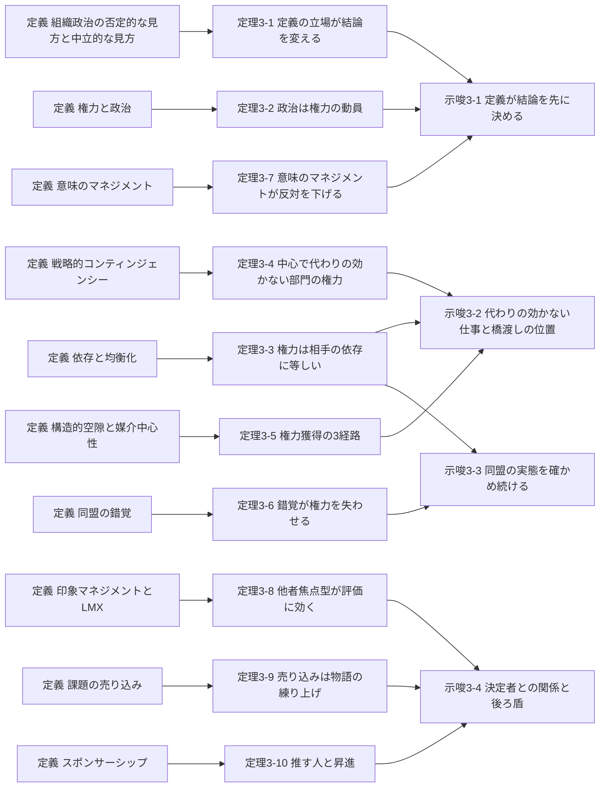

# 第3章 そもそも社内政治とは？ — 定義・定理・示唆

> 木村琢磨『社内政治の科学』（2025）の目次の見出しを「論点の枠」として使い、本文を読んだ論文だけを根拠に定理を立てました。本の内容は書いていません。著者の定義は、著者の公開記事から出典付きで紹介します。レビューの中で紹介されているだけの原典は、名指しせず「レビューによる整理」として扱います。

## この章の問い

社内政治とは何か。社内政治は権力とどう関係するか。なぜ意味のマネジメントが政治になるのか。

目次の見出し（第2〜4節）は次のとおりです。

- 第2節 社内政治の定義: なぜ定義が重要か / 古典的研究における定義 / 対立、そして意味のマネジメントへ / 本書での社内政治の定義
- 第3節 社内政治と権力: 権力とは / 権力の行使・使用としての政治 / 権力獲得のための社内政治
- 第4節 社内政治と意味のマネジメント: 意味形成理論 / 意味のマネジメントとしての政治 / 印象マネジメントとしての政治 / 部下や企画を売り込む

## 1. 定義

### 1.1 研究方法と統計の用語

- **レビュー（review）**: 既存の研究を集めて、知見を整理・比較する論文。新しいデータは集めない。[^d1]
- **スコーピング・レビュー（scoping review）**: レビューの一種。ある主題の研究がどこまであるかを、地図を描くように幅広く整理する。効果の大きさの統合は目的にしない。[^d2]
- **メタ分析（meta-analysis）**: 複数の研究の結果を数値で統合し、平均的な効果の大きさを推定する方法。[^d3]
- **効果量（effect size）**: 研究で得られた効果の大きさを、研究間で比べられる形にした数値。相関などで表す。[^d3]
- **k**: メタ分析で統合した研究（効果量）の数。[^d3]
- **N**: 調査や実験の対象者の数。[^d1]
- **分散（variance）**: データのばらつきの大きさ。[^d4]
- **相関（correlation, r）**: 2 つの変数が一緒に増減する程度。-1〜1 の値をとる。因果は示さない。[^d4]
- **補正相関（corrected correlation）**: メタ分析で、測定の誤差などを補正して推定した相関。[^d3]
- **回帰係数（β）**: 他の変数をそろえたうえで、ある変数が 1 単位変わると結果がどれだけ変わるかを示す値。[^d4]
- **ロジスティック回帰（logistic regression）**: 「外されたかどうか」のような 2 値の結果が起こる確率を、他の変数で説明する回帰の方法。[^d4]
- **正準相関（canonical correlation）**: 変数の「束」どうし（例: 権力の基盤の変数群と権力の変数群）の結びつきの強さ。二乗した値は、束どうしが共有する分散の割合を表す。[^d4]
- **負荷量（loading）**: 正準相関などで、個々の変数が束の合成値とどれだけ強く結びつくかを示す値。[^d4]
- **有意（significant）**: 結果が偶然だけで生じたとは考えにくいと、統計的な検定で判断されること。[^d4]
- **媒介（mediation）**: X が Y に効く経路の途中に M があり、X → M → Y という形で効果が伝わること。M を媒介変数という。[^d4]
- **調整（moderation）**: X が Y に効く強さが、第 3 の変数 Z の値によって変わること。Z を調整変数という。[^d4]
- **自己報告（self-report）**: 対象者本人が質問紙に答える測り方。[^d4]
- **同一回答者の評定による膨らみ（common method variance）**: 2 つの変数を同じ人が同じ方法で答えると、両者の関連が実際より強く出やすいこと。[^d4]
- **横断研究（cross-sectional study）**: 1 時点のデータだけで変数の関連をみる研究。因果の向きは決められない。[^d1]
- **縦断研究（longitudinal study）**: 同じ対象を 2 時点以上で測り、変化をみる研究。[^d1]
- **時間差調査（time-lagged survey）**: 原因側と結果側の変数を、時間をずらして別々に測る調査。[^d1]
- **実験（experiment）**: 研究者が条件を割り当て（実験操作）、条件による結果の差をみる研究。[^d1]
- **質的研究（qualitative research）**: 数値ではなく、面接や観察の言葉をもとに過程や意味を分析する研究。[^d1]
- **エスノグラフィー（ethnography）**: 研究者が現場に長く入り込み、観察と聞き取りで集団の実態を記述する質的研究。[^d1]
- **人口学的特性（demographics）**: 性別・年齢・人種など、人の属性を表す特徴。[^d1]
- **半構造化面接（semi-structured interview）**: 大まかな質問項目を決めたうえで、話の流れに応じて質問を変える面接。[^d1]
- **回顧的面接（retrospective interview）**: 終わった出来事を後から振り返って語ってもらう面接。[^d1]

### 1.2 組織と役割の用語

- **部門（subunit）**: 組織の中の下位の単位。部・課・図書館のような機能のまとまり。[^d5]
- **中間管理職（middle manager）**: 経営トップより 1〜4 階層下の管理職。[^d6]
- **決定者（target）**: ある課題を採り上げるかを決める権限を持つ人。[^d6]
- **売り手（seller）**: 決定者に、ある課題が重要だと納得させようとする人。[^d6]
- **評価者（rater）**: 他者の業績や面接の出来を採点する人。[^d7]
- **人事判断**: 上司が部下について下す、昇進可能性の評価や賞与の配分などの判断。[^d1]

### 1.3 政治に関する用語

- **社内政治（著者の公開記事の定義）**: 利害の不一致や対立があるときに、正式なルートではない方法で、他者や組織に影響を与えようとする行動。相手の気分を少し良くするような小さな影響も含む。[^d8]
- **組織政治の否定的な見方**: 組織政治を、組織が認めない目的や手段で自己利益を追う、正統でない行動とみる見方。[^d9]
- **組織政治の中立的な見方**: 組織政治を、良くも悪くもない、組織に本来備わる現象とみる見方。権力と対立、複数の正統な視点の交渉が中心になる。[^d10]
- **政治の知覚（perceptions of politics）**: 観察者が、他者の行動の裏に自己利益の動機を読み取って「政治的だ」と判断する主観的な状態。行動そのものではなく、動機の推測を含む。[^d11]
- **組織政治の 5 次元**: 関係の構築と利用、個人の評判の構築、意思決定と資源の統制、意思決定への影響、コミュニケーション経路の利用。肯定・否定の両面を含めるために作られた測定の枠組み。[^d12]
- **政治（Fleming & Spicer の作業定義）**: 権力を動員して、人々の関係や財の配分を組み替える活動。[^d13]

### 1.4 権力に関する用語

- **権力（Dahl の定義）**: A が B に、B が本来しないことをさせられる程度。基盤（使える資源）、手段、量（確率で表す）、範囲（B の反応の種類）の 4 つで記述する。[^d14]
- **権力（Fleming & Spicer の定義）**: 他者に影響する能力。目標を他者を通じて達成するための資源。[^d15]
- **依存（dependence）**: A の B への依存は、B が仲介する目標への A の関心（動機づけの投資）に比例し、その目標を B 以外から得られる程度に反比例する。[^d16]
- **権力（Emerson の定義）**: A が B の抵抗を潜在的に乗り越えられる量。常に観察されるわけではない潜在力。A の B への権力は B の A への依存に等しい。[^d17]
- **均衡化（balancing operation）**: 権力の差がある関係で、弱い側が差を縮める動き。目標への関心を下げる、代わりの関係を開拓する、強い側に地位を与える、連合を組む、の 4 つの型がある。[^d18]
- **連合（coalition）**: 複数の人が手を組み、共同で第三者に対する立場を強めること。[^d18]
- **地位（status）**: 個人や集団が他者から尊敬・賞賛される程度。[^d19]
- **権力（Magee & Galinsky の定義）**: 社会関係の中で、価値ある資源を非対称に統制していること。価値は主観的に決まる。地位とは区別する。[^d20]
- **権力の 4 つの顔**: 強制、操作、支配、主体化。前 2 つは一時的な行為として現れ、後 2 つは制度や考え方に組み込まれて現れる。[^d21]
- **強制（coercion）**: 相手が本来しないことを、直接の働きかけでさせる権力。[^d22]
- **操作（manipulation）**: 議題を絞り、議論してよい範囲を決めることで働く権力。[^d22]
- **支配（domination）**: 人々の選好や価値観、政治的な見方そのものを形づくる権力。[^d23]
- **主体化（subjectification）**: 人の自己認識や感情、アイデンティティを形づくる権力。[^d23]
- **不確実性（uncertainty）**: 将来の出来事についての情報が足りず、選択肢とその結果が予測できない状態。[^d5]
- **戦略的コンティンジェンシー（strategic contingency）**: ある部門の活動に必要な条件のうち、別の部門の活動によって左右されるもの。この理論では、部門の権力の基盤は、不確実性への対処、中心性、代替可能性の 3 つである。[^d5]
- **中心性（centrality）**: 部門の活動が組織全体の活動とどれだけ結びついているか。大学では、部門が大学の中心的な使命にどれだけ合うか。[^d24]
- **代替可能性（substitutability）**: 他の部門が同じ機能を代わりに果たせる程度。低いほど権力が増すとされる。[^d25]
- **構造的空隙（structural hole）**: 人間関係のネットワークで、互いにつながっていない人々の間にある隙間。[^d26]
- **媒介中心性（betweenness centrality）**: ネットワーク上で、他の人々どうしを結ぶ経路の途中にどれだけ位置するかを示す指標。[^d26]
- **高権力役・低権力役**: 実験で参加者に割り当てる、交渉で強い立場と弱い立場の役。[^d27]
- **同盟（alliance）**: 他者との、互いに味方し合う結びつき。[^d27]
- **同盟の錯覚（illusions of alliance）**: 他者との同盟の強さを、実際より強く見積もること。[^d27]

### 1.5 意味に関する用語

- **意味形成（sensemaking）**: 手がかりと枠組みを結びつけて、出来事の意味を解釈すること。[^d28]
- **意味付与（sensegiving）**: 自分の解釈やビジョンを他者に伝え、理解させ、受け入れさせて行動させること。[^d29]
- **意味のマネジメント（management of meaning）**: 言語・物語・枠組み・儀式・象徴を使い、組織の行動を正当化し、理解と合意をつくること。[^d30]
- **戦略変更（strategic change）**: 組織が戦略の方向を大きく変えること。[^d29]

### 1.6 影響の戦術に関する用語

- **印象マネジメント（impression management）**: 他者からどう見られるかを左右しようとする、目標のある行動。意識的か無意識か、偽りか本物かは問わない。[^d31]
- **自己焦点型の印象マネジメント**: 自分の有能さを相手に印象づける戦術。自己宣伝などを含む。[^d32]
- **他者焦点型の印象マネジメント**: 相手の好意を得る戦術。取り入り、意見同調、好意の提供などを含む。[^d32]
- **取り入り（ingratiation）**: 相手に好かれるために、相手を持ち上げたり気を配ったりする行動。他者焦点型の代表である。[^d32]
- **職場外の取り入り**: 部下が上司に対し、職場の外で行う取り入り。休日の贈り物やあいさつ、上司の私的な用事への気配りなど。[^d33]
- **LMX（leader-member exchange）**: 上司と部下の間の交換関係の質。質が高い部下ほど多くの利点を得るとされる。[^d34]
- **中庸思考（Zhongyong thinking）**: 外の条件と内の欲求をどう統合するかについての、中国の伝統的な考え方の型。[^d34]
- **課題の売り込み（issue selling）**: 売り手が決定者に、ある課題が組織にとって戦略的に重要だと納得させる過程。従来は「包装」と「売り込み」の 2 段で整理されてきた。[^d6]
- **物語の断片（narrative fragments）**: 課題についての、まだまとまっていない部分的な語り。非公式の場で口頭で交わされる。[^d35]
- **利害の結合（associating interests）**: 関係者の利害を一つの物語に結び、関係者と同盟を組むこと。[^d36]
- **戦略的な枠付け（strategic framing）**: 課題を、売り手の周りの利害を超えて、組織の戦略的な活動に長期の影響を持つものとして語ること。[^d36]
- **例証（illustrating）**: 数字や顧客の声などの具体的な証拠で物語を裏づけること。[^d36]
- **スポンサーシップ（sponsorship）**: 権力や影響力を持つ人（推す側）が、その立場を使って特定の人（推される側）を積極的に推し、昇進の機会を与えること。[^d37]
- **メンタリング（mentorship）**: 指導役が相手の能力開発を助けること。昇進そのものに向けた働きかけではない。[^d37]

## 2. 定理

### 定理 3-1: 組織政治の定義は否定的な見方と中立的な見方に分かれ、どちらを採るかで測定の仕方と「政治は有害か」という結論が変わる

- 内容: Silvester は心理学の主な定義 10 個を表にまとめた。そのほぼすべてが、他者を犠牲にした自己利益の追求に触れている。[^t3-1a] 否定的な見方に沿って作られた政治の知覚の質問紙は、自分の利益にならない行動を思わせる項目が中心で、政治とストレスの関連が出やすい。[^t3-1b] 中立的な見方では、政治は曖昧な場面で合意をつくり、意味形成を助ける働きも持つ。[^t3-1c] Landells & Albrecht は組織政治の 5 次元で測ったが、それでも政治の知覚はストレスと結びつき、意味ある仕事との関連は強くなかった。[^t3-1d]
- 研究の種類と対象: Silvester はレビュー。Landells & Albrecht はオーストラリアの従業員 2 標本（N=303、N=353）の横断研究。
- 条件・限界: 測定の偏りが結論を左右しうるという指摘はレビューの議論である。定義を変えると結論がどれだけ変わるかを直接比べた研究ではない。

### 定理 3-2: 権力は他者に影響する能力であり、政治はその権力を動員して関係や財の配分を組み替える活動である

- 内容: Fleming & Spicer は、権力と政治がよく混同されると指摘し、両者を分ける。権力は他者に影響する能力で、政治はそれを動員する活動である。[^t3-2a] 権力を否定的にだけみるのは一面的で、権力は良い成果も生みうると述べる。[^t3-2b]
- 研究の種類と対象: レビュー（経営学・組織論の権力研究の整理）。
- 条件・限界: 作業定義であり、実証で検証された命題ではない。定理 3-1 のとおり、研究者の間で定義の合意はない。

### 定理 3-3: A の B に対する権力は B の A への依存に等しく、その依存は B が A を通して得たい目標への関心が強いほど大きく、代わりの入手先が多いほど小さい

- 内容: Emerson は、権力を人の属性ではなく関係の性質とみる。[^t3-3a] 権力の差は不安定で、弱い側の均衡化を引き起こす。均衡化には 4 つの型があり、その一つが連合である。[^t3-3b] Magee & Galinsky も同じ依存の考え方で権力を定義する。そのうえで、肩書きが低い人でも、上司が頼る専門性を持てば権力を持ちうると述べる。[^t3-3c]
- 研究の種類と対象: Emerson は理論論文（小集団研究からの例示あり）。Magee & Galinsky はレビュー。
- 条件・限界: 依存を決める 2 つの変数がどう組み合わさるかは、経験的な問題として残されている。[^t3-3d] 比例・反比例は方向だけを示す命題である。

### 定理 3-4: 組織の中心的な使命に深く結びつき、他部門が頼る不確実性に対処し、代わりが効きにくい部門は、公式の地位以上の権力を持つ

- 内容: Fleming & Spicer のレビューは次の知見を整理している。工場で唯一の不確実性を握る保守担当が強い権力を持った事例、不確実性への対処が部門の権力と結びついた調査、大学で希少で中心的な資源（外部研究費）の統制が権力の源になった研究である。[^t3-4a] Crawford は、戦略的コンティンジェンシーの理論を米国の教養系大学の図書館で検証した。権力の基盤の変数群と権力の変数群（予算の割合、職員数、知覚された権力）の第 1 正準相関は 0.87（二乗 0.76）だった。第 2 の組では、知覚された中心性（負荷量 0.95）と知覚された権力（負荷量 0.99）が強く結びついた。代替可能性の変数の負荷量は小さかった。[^t3-4b]
- 研究の種類と対象: Fleming & Spicer はレビュー（原典は事例研究と質問紙調査）。Crawford は縦断研究（1981–82 年度と 1989–90 年度の 2 時点）。米国の教養系大学 487 校の図書館長に質問紙を送り、416 校が回答した。
- 条件・限界: Crawford の中心性と権力は、どちらも図書館長本人の知覚で測っている。そのため、同一回答者の評定による膨らみがありうる。著者自身も、相関を因果として扱っている点と、一つの種類の大学に限られる点を限界に挙げている。[^t3-4c] Fleming & Spicer は、権力を希少資源の統制だけで測ると他の源泉を見落とすと注意している。[^t3-4a]

### 定理 3-5: 権力は、個人の特性、集団の利益への貢献、ネットワーク上の位置という 3 つの経路で獲得され、権力を持つ人の心理は権力を強める方向にも弱める方向にも働く

- 内容: Brion は権力獲得の研究を 3 つに分ける。1 つ目は人口学的特性と性格である。2 つ目は機能で、集団の課題に役立つ有能さや、集団の利益のために行動することである。集団に貢献した人ほど影響力を得たという研究も紹介する。3 つ目は構造で、構造的空隙を橋渡しする位置や媒介中心性の高さが、情報の利益と権力をもたらす。[^t3-5a] 逆に、その位置を築けないことは権力を失いやすくする。[^t3-5b] Magee & Galinsky は、権力が持ち主の考え方と行動を変え、権力の維持と獲得に向かわせると整理する。同時に、その自己強化を弱める力もあると述べる。[^t3-5c]
- 研究の種類と対象: どちらもレビュー（Brion は博士論文の文献レビューの章）。
- 条件・限界: 3 経路の相対的な強さは比べていない。研究の多くは実験室や小集団、または経営者を対象にしている。

### 定理 3-6: 権力を持つ人ほど同盟の錯覚が強く、その錯覚が強い人ほど相手から同盟相手と感じられなくなって、連合から外され、得る資源が減る

- 内容: 研究 1 では、自分に権力があるとみる学生ほど、長期のプロジェクト班で同盟の錯覚が強かった（r=0.25）。[^t3-6a] 研究 3 では、3 者で連合を組む交渉で、高権力役の同盟の錯覚が強いほど最終の連合から外された（ロジスティック回帰 β=1.26）。得点も少なかった。[^t3-6b] 得点への効果は、相手が感じる同盟の強さを媒介していた。[^t3-6c] 研究 4 で同盟の錯覚を実験操作すると、過大評価の条件では高権力役の 37.5% が連合から外された。過小評価の条件では 6.7% だった。[^t3-6d]
- 研究の種類と対象: 実験（米国西海岸の大学の経営学部生。研究 1 は 115 名、研究 2 は 53 名、研究 3 は 147 名、研究 4 は 93 名）。
- 条件・限界: 研究 3・4 は 1 時間ほどの実験課題である。権力の役は理由を示さずに割り当てたもので、正統性のある権力とは異なりうると著者自身が述べている。[^t3-6e]

### 定理 3-7: 言語・物語・象徴による意味のマネジメントは、組織内の反対や対立を下げて行動を動員し、とくに戦略変更のような曖昧な局面で重要になる

- 内容: Rindova & Srinivas は、管理が 2 つの水準で進むという整理を紹介する。実質の水準では決定と成果が扱われ、象徴の水準では言語と象徴的な行為が決定を正当化する。[^t3-7a] 意味のマネジメントは、反対と対立を下げて行動を動員し、外部からの監視も和らげる。[^t3-7b] 戦略変更の始まりでは、トップがまず出来事の意味を解釈し（意味形成）、次にビジョンを広めて関係者に受け入れさせていた（意味付与）。変化が曖昧さと利害の違いを目立たせるとき、指導者には共有された説明をつくる必要が生じる。[^t3-7c] Fleming & Spicer も、選好そのものを形づくる働きを「支配」として権力に含めている。[^d23]
- 研究の種類と対象: レビュー（原典は事例研究とエスノグラフィーが中心）。
- 条件・限界: すべてレビューによる整理で、原典の本文は読んでいない。原典の多くは単一組織の質的研究である。

### 定理 3-8: 他者焦点型の印象マネジメントは評価者の業績評価や人事判断を高め、職場外の取り入りの効果は LMX を媒介して生じる

- 内容: Peck & Levashina のメタ分析では、業績評価に対して他者焦点型は有意で（k=4、補正相関 0.25）、自己焦点型は有意でなかった（k=6、0.18）。面接評価では自己焦点型が有意だった（k=20、0.24）。[^t3-8a] 働きかけの相手が評価者本人のときは有意で（0.27）、評価者が観察者のときは有意でなかった（0.11）。[^t3-8b] Sun らは、職場外の取り入りが上司による昇進可能性の評価（β=0.43）と賞与配分（β=0.29）を高めることを示した。意思決定への参加には有意な効果がなかった。[^t3-8c] これらの効果は LMX を部分的に媒介していた。上司の中庸思考が強いと、LMX を媒介した効果は有意でなくなった（中庸思考による調整）。[^t3-8d]
- 研究の種類と対象: Peck & Levashina はメタ分析（1990〜2015 年の 9 誌から 18 本、効果量 42、N=8,635）。Sun らは時間差調査（中国の製造業 4 社、上司と部下 252 組、1 か月の時間差）。
- 条件・限界: 業績評価のメタ分析は研究数が少ない（k=4〜6）。評価の向上であって、実際の成果の向上ではない。Sun らの測定は自己報告で、同一回答者の評定による膨らみの可能性を著者らも認めている。[^t3-8e]

### 定理 3-9: 課題の売り込みは、非公式な場で物語の断片を関係者と少しずつ練り上げる段階と、公式の場で一貫した物語として決定者に示す段階からなり、その移行には利害の結合・戦略的な枠付け・例証が要る

- 内容: 従来の研究は、売り手が合理的・直線的に課題を「包装」して「売り込む」と考えていた。この研究は、課題が戦略的かどうかは関係者の意味づけでつくられるとみる。中間管理職は、まず近い関係の人と口頭で物語の断片を交換し、次に経営会議などで一つの物語として示す。[^t3-9a] 利害の結合で「一つの声」で語れる同盟をつくることが、物語の一貫性を高めた。ただし利害の結合は必要条件であって十分条件ではなく、戦略的な枠付けと例証が加わる必要があった。[^t3-9b]
- 研究の種類と対象: 質的研究。フランスの多様な業種・規模の組織の中間管理職 42 名への、回顧的な半構造化面接。
- 条件・限界: 回顧的面接で、売り手の視点だけである。面接は大学院の授業の一環で学生が実施した。[^t3-9c] 成功と失敗の比較で因果を示したものではない。

### 定理 3-10: スポンサーシップは昇進や指導的地位への到達と結びつくと多くの研究で報告されているが、その証拠は横断研究と質的研究が中心で、女性は推される機会を得にくいと報告されることが多い

- 内容: Schwartz らは医学部教員を対象とした 16 本の研究を集めた。研究間で、スポンサーシップの定義の 3 要素（昇進の機会の提供、推す側が権力を持つこと、積極的な推薦）はおおむね一致していた。[^d37] 10 本が、スポンサーシップが昇進と結びつくと報告した。昇進の指標には、大型研究費の獲得や学部長・部門長への就任などが含まれていた。[^t3-10a] 男女差を調べた量的研究の結果はまちまちだった。質的研究では、女性が推される機会を得にくいと報告されていた。[^t3-10b]
- 研究の種類と対象: スコーピング・レビュー（PubMed・Embase・Web of Science、過去 50 年、16 本。量的 5、質的 8、混合 3）。対象は米国中心の医学部教員。
- 条件・限界: 量的研究のほとんどは横断研究で、回顧的な質問が多い。スポンサーシップは非公式に行われるため、追跡しにくい。[^t3-10c]

## 3. 示唆

以下は論文の主張ではなく、定理を組み合わせて導いたものです。

### 示唆 3-1: 社内政治をどう定義するかは中立な前置きではなく、何を政治として数え、政治を有害とみるかを先に決めてしまう

- 組み合わせ: 定理 3-1 + 定理 3-2 + 定理 3-7
- 導出: 定理 3-1 では、否定的な見方に沿った測定が、政治と悪い結果の関連を出やすくしていた。定理 3-2 と定理 3-7 の広い定義では、権力の動員や意味のマネジメントも政治に含まれ、それは合意づくりにも使われる。どちらの定義を採るかで、同じ行動が政治に入るか、入ったとき有害とみなされるかが変わる。
- 追加の前提: なし

### 示唆 3-2: 社内で権力を得る筋道は、中心性が高く代替可能性が低い仕事や、他者が頼る不確実性への対処を担うことと、構造的空隙を橋渡しする位置に立つことである

- 組み合わせ: 定理 3-3 + 定理 3-4 + 定理 3-5
- 導出: 定理 3-3 では、権力は相手の依存で決まり、依存は代わりが少ないほど大きい。定理 3-4 では、中心的で不確実性に対処する部門が権力を持っていた。定理 3-5 では、構造的空隙を橋渡しする位置も権力をもたらす。3 つはどれも、相手にとって重要で他から得にくいものを握ることが権力の源になるという同じ構造を示す。
- 追加の前提: 部門単位の知見（定理 3-4）が、個人単位にも同じ向きで当てはまること。

### 示唆 3-3: 権力を持つ側は同盟の錯覚に陥りやすく、弱い側の連合によって権力を失いうるため、同盟の実態を確かめ続けることが権力の維持に必要になる

- 組み合わせ: 定理 3-3 + 定理 3-6
- 導出: 定理 3-3 では、権力の差は弱い側の均衡化を引き起こし、その一つが連合である。定理 3-6 では、権力を持つ人は同盟の錯覚に陥り、錯覚が強いほど相手の支持を失って連合から外された。合わせると、権力を持つ人が連合を組まれて権力を失う経路の一つは、自分の同盟を見誤ることである。
- 追加の前提: 学生の短い実験課題の結果（定理 3-6）が、組織の中で長く続く関係にも同じ向きで当てはまること。

### 示唆 3-4: 部下や企画を売り込むときは、決定者や評価者本人との関係を通じて働きかけ、利害の結合で関係者を一つの物語にまとめることが通りやすさを高めうるが、推す側に権力があることが前提になる

- 組み合わせ: 定理 3-8 + 定理 3-9 + 定理 3-10
- 導出: 定理 3-8 では、評価者本人に向けた他者焦点型の印象マネジメントが評価や人事判断に効き、その効果は LMX を媒介していた。定理 3-9 では、利害の結合と同盟が物語の説得力を高めた。定理 3-10 では、権力を持つ人が積極的に推すことが昇進と結びついていた。どれも、自分の能力を示すことより、決定者との関係と、力のある後ろ盾や同盟を通じた働きかけが効く点で共通する。
- 追加の前提: 業績評価・人事判断（定理 3-8）と医学部の昇進（定理 3-10）の知見が、一般企業での企画の承認や部下の推薦にも同じ向きで当てはまること。

## 参考文献

| 番号 | 文献 | 本文の入手先 URL | ライセンス |
|------|------|------------------|------------|
| 1 | 木村琢磨, 2026, 社内政治の実態（『社内政治の科学』〔日経BP〕からの抜粋・再編集の連載記事）, 幻冬舎 GOLD ONLINE（2026 年 1 月 11 日） | <https://gentosha-go.com/articles/-/73725?page=3> | 不明（© Gold Online Inc. All rights reserved） |
| 2 | Silvester, J., 2008, The Good, the Bad and the Ugly: Politics and Politicians at Work, International Review of Industrial and Organizational Psychology 23 | <https://openaccess.city.ac.uk/id/eprint/11828/1/Silvester%20(2008)%20%20Politics%20and%20Politicians%20at%20Work.pdf> | 著者稿（著作権は著者・出版社など） |
| 3 | Landells, E. M. & Albrecht, S. L., 2019, Perceived Organizational Politics, Engagement, and Stress: The Mediating Influence of Meaningful Work, Frontiers in Psychology 10: 1612 | <https://pmc.ncbi.nlm.nih.gov/articles/PMC6635907> | CC BY |
| 4 | Dahl, R. A., 1957, The Concept of Power, Behavioral Science 2(3): 201–215 | <https://fbaum.unc.edu/teaching/articles/Dahl_Power_1957.pdf> | 不明 |
| 5 | Emerson, R. M., 1962, Power-Dependence Relations, American Sociological Review 27(1): 31–41 | <https://umsl.edu/%7Ekeelr/3210/resources/emerson_power_depend.pdf> | 不明 |
| 6 | Magee, J. C. & Galinsky, A. D., 2008, Social Hierarchy: The Self-Reinforcing Nature of Power and Status, Academy of Management Annals 2(1): 351–398 | <https://web.mit.edu/curhan/www/docs/Articles/15341_Readings/Power/Magee,%20J.%20C.,%20&%20Galinsky,%20A.%20D.%20(2008).%20Social%20hierarchy-%20The%20self%E2%80%90reinforcing%20nature%20of%20power%20and%20status..pdf> | 不明 |
| 7 | Fleming, P. & Spicer, A., 2014, Power in Management and Organization Science, Academy of Management Annals 8(1) | <https://openaccess.city.ac.uk/id/eprint/8236/4/Annals%20accepted.pdf> | 著者稿（著作権は著者・出版社など） |
| 8 | Crawford, G. A., 1997, Information As a Strategic Contingency: Applying the Strategic Contingencies Theory of Intraorganizational Power to Academic Libraries, College & Research Libraries 58(2): 145–155 | <https://distantreader.org/stacks/journals/crl/crl-15115.pdf> | 不明 |
| 9 | Brion, S., 2010, How Power is Lost: Illusions of Alliance Among the Powerful, UC Berkeley 博士論文 | <https://escholarship.org/content/qt5xq3z06x/qt5xq3z06x.pdf> | 不明 |
| 10 | Rindova, V. P. & Srinivas, S. B., 2017, Managing Meaning—Culture, The Oxford Handbook of Management 所収 | <https://santoshbs.github.io/files/RindovaSrinivas_2017_ManagingMeaning_PreprintVersion.pdf> | 著者稿（著作権は出版社など） |
| 11 | Peck, J. A. & Levashina, J., 2017, Impression Management and Interview and Job Performance Ratings: A Meta-Analysis of Research Design with Tactics in Mind, Frontiers in Psychology 8: 201 | <https://www.frontiersin.org/journals/psychology/articles/10.3389/fpsyg.2017.00201/full> | CC BY |
| 12 | Sun, J. et al., 2021, Upward Ingratiation Outside the Workplace and Supervisor's Human Resource Decisions, Frontiers in Psychology 12: 636756 | <https://pmc.ncbi.nlm.nih.gov/articles/PMC8187586/> | CC BY |
| 13 | Vacquier, F., Garreau, L. & Dameron, S., 2024, The Construction of a Strategic Issue, M@n@gement 27(1): 19–37 | <https://management-aims.com/index.php/mgmt/article/download/5778/17006> | CC BY-NC |
| 14 | Schwartz, L. P., Williams, K. & Feldman, M. D., 2024, Does Sponsorship Promote Equity in Career Advancement in Academic Medicine? A Scoping Review, Journal of General Internal Medicine 39(3): 470–480 | <https://pmc.ncbi.nlm.nih.gov/articles/PMC10897109/> | CC BY |

## 脚注

[^d1]: 一般的な用法（筆者の説明）。

[^d2]: 一般的な用法（筆者の説明）。本章では Schwartz, Williams & Feldman (2024) がこの方法をとる。 [本文](https://pmc.ncbi.nlm.nih.gov/articles/PMC10897109/)

[^d3]: 一般的な用法（筆者の説明）。本章では Peck & Levashina (2017) の Methods と Table 2 がこの用語を使う。 [本文](https://www.frontiersin.org/journals/psychology/articles/10.3389/fpsyg.2017.00201/full)

[^d4]: 一般的な用法（筆者の説明）。

[^d5]: Crawford (1997), Information As a Strategic Contingency, p. 146, 左段第 2 段落と右段第 2〜3 段落。要旨: 戦略的コンティンジェンシーを、ある部門の活動に必要で、別の部門の活動に左右される条件と定義する。部門の権力の基盤を不確実性への対処・代替可能性・中心性とし、不確実性を将来の出来事についての情報の不足と定義する。 [本文](https://distantreader.org/stacks/journals/crl/crl-15115.pdf)

[^d6]: Vacquier, Garreau & Dameron (2024), The Construction of a Strategic Issue, p. 19, Abstract と序論第 1 段落、p. 22, Methods「Data collection」第 1 段落。抜き出し: 「For the past 30 years, the issue-selling movement has uncovered the vast repertoire of actions by which ‘sellers’ persuade a decision-maker that an issue is strategic.」（CC BY-NC 4.0）。要旨: 従来は包装と売り込みの 2 段で整理されてきたこと、売り手を説得の相手（target）と区別すること、面接対象の中間管理職は経営トップより 1〜4 階層下だったことを述べる。 [本文](https://management-aims.com/index.php/mgmt/article/download/5778/17006)

[^d7]: Peck & Levashina (2017), Impression Management and Interview and Job Performance Ratings, Results, Hypothesis 5a の段落。要旨: 評価者が印象マネジメントの相手本人である場合と、観察者である場合を区別して効果を比べる。 [本文](https://www.frontiersin.org/journals/psychology/articles/10.3389/fpsyg.2017.00201/full)

[^d8]: 木村 (2026), 幻冬舎 GOLD ONLINE 記事 3 ページ目, 節「社内政治は『対立する場面で非公式に影響を与える』こと」第 1〜2 段落。抜き出し: 「利害の不一致や対立があるときに」。要旨: 正式なルートではない方法で他者や組織に影響を与えようとする行動を社内政治と定義し、相手を少し良い気分にさせるような小さな変化も影響に含めるとする。 [本文](https://gentosha-go.com/articles/-/73725?page=3)

[^d9]: Silvester (2008), Politics and Politicians at Work, 著者稿 p. 4, 節「Organizations as Political Arenas」第 1 段落（「The 1970s and 1980s saw」で始まる段落）。抜き出し: 「view politics as an illegitimate aspect of organizational life」。要旨: この見方の中心は、組織や他の成員の利益より自己利益を優先することだとする。 [本文](https://openaccess.city.ac.uk/id/eprint/11828/1/Silvester%20(2008)%20%20Politics%20and%20Politicians%20at%20Work.pdf)

[^d10]: Silvester (2008), 著者稿 pp. 5–6, 節「Organizations as Political Arenas」第 2〜3 段落（「In contrast, researchers in the second category」で始まる段落と次の段落）。抜き出し: 「a natural and endemic feature of organizational life」。要旨: この見方では権力と対立が中心概念で、複数の正統な視点のもとで共有された現実を交渉し続ける過程として政治をみる。 [本文](https://openaccess.city.ac.uk/id/eprint/11828/1/Silvester%20(2008)%20%20Politics%20and%20Politicians%20at%20Work.pdf)

[^d11]: Silvester (2008), 著者稿 pp. 10–11, 節「Perceptions of Politics: A Critical Evaluation」第 2 段落（「Another problematic area」で始まる段落）。要旨: 政治の知覚の研究は他者の動機の主観的な判断に頼っており、観察者は行動を見たうえで、なぜそうしたかを推し量らなければならない。 [本文](https://openaccess.city.ac.uk/id/eprint/11828/1/Silvester%20(2008)%20%20Politics%20and%20Politicians%20at%20Work.pdf)

[^d12]: Landells & Albrecht (2019), Perceived Organizational Politics, Engagement, and Stress, Introduction, 小節「Definitions and Measures of Organizational Politics」第 1 段落。抜き出し: 「proposed five dimensions of organizational politics that could encompass both positive and negative perspectives」「(1) building and using relationships, (2) building personal reputation」（CC BY 4.0）。要旨: 残りの次元は、意思決定と資源の統制、意思決定への影響、コミュニケーション経路の利用である。 [本文](https://pmc.ncbi.nlm.nih.gov/articles/PMC6635907)

[^d13]: Fleming & Spicer (2014), Power in Management and Organization Science, 著者稿 p. 2, 序論第 3 段落（「For the purposes of this paper」で始まる段落）。要旨: Arendt に従い、政治を、権力の動員によって人々の関係と財の配分を組み替える活動とする。 [本文](https://openaccess.city.ac.uk/id/eprint/8236/4/Annals%20accepted.pdf)

[^d14]: Dahl (1957), The Concept of Power, pp. 202–203, p. 202 右段最終段落から p. 203 左段第 1 段落、および p. 203 左段第 3 段落〜右段第 3 段落。抜き出し: 「do something that B would not otherwise do」。要旨: 権力の記述には、基盤（行為者が使える資源）、手段、量（確率で表す）、範囲（B の反応）の 4 つが必要だとする。 [本文](https://fbaum.unc.edu/teaching/articles/Dahl_Power_1957.pdf)

[^d15]: Fleming & Spicer (2014), 著者稿 p. 2, 序論第 3 段落。抜き出し: 「power is the capacity to influence other actors」。要旨: 権力は、共有された、または争われている目標を他者を通じて達成するための資源だとする。 [本文](https://openaccess.city.ac.uk/id/eprint/8236/4/Annals%20accepted.pdf)

[^d16]: Emerson (1962), Power-Dependence Relations, p. 32, 右段第 1〜2 段落（「Dependence (Dab)」の命題）。要旨: A の B への依存は、B が仲介する目標への A の動機づけの投資に比例し、A-B 関係の外でその目標を得られる程度に反比例する。 [本文](https://umsl.edu/%7Ekeelr/3210/resources/emerson_power_depend.pdf)

[^d17]: Emerson (1962), p. 32 右段第 4 段落（「Power (Pab)」の定義）〜 p. 33 左段第 3 段落。抜き出し: 「equal to, and based upon, the dependence of B upon A」。要旨: 権力は B の抵抗を潜在的に乗り越えられる量で、すべてのやりとりで観察されるわけではない潜在力だとする。 [本文](https://umsl.edu/%7Ekeelr/3210/resources/emerson_power_depend.pdf)

[^d18]: Emerson (1962), p. 35, 右段第 1 段落（4 つの均衡化の型を述べる段落）。要旨: 均衡化の型は、弱い側の動機づけの撤退、代わりの関係の開拓、強い側への地位の付与、連合と集団の形成の 4 つである。 [本文](https://umsl.edu/%7Ekeelr/3210/resources/emerson_power_depend.pdf)

[^d19]: Magee & Galinsky (2008), Social Hierarchy, p. 359, 小節「Definition of Social Status」第 1 段落。要旨: 地位を、個人や集団が他者から尊敬・賞賛される程度と定義し、地位の序列は主に主観的だとする。 [本文](https://web.mit.edu/curhan/www/docs/Articles/15341_Readings/Power/Magee,%20J.%20C.,%20&%20Galinsky,%20A.%20D.%20(2008).%20Social%20hierarchy-%20The%20self%E2%80%90reinforcing%20nature%20of%20power%20and%20status..pdf)

[^d20]: Magee & Galinsky (2008), pp. 361–362, 小節「Definition of Social Power」第 1 段落。抜き出し: 「asymmetric control over valued resources in social relations」。要旨: 非対称と関係を定義に入れるのは依存の差を捉えるためで、資源の価値は主観的に決まるとする。 [本文](https://web.mit.edu/curhan/www/docs/Articles/15341_Readings/Power/Magee,%20J.%20C.,%20&%20Galinsky,%20A.%20D.%20(2008).%20Social%20hierarchy-%20The%20self%E2%80%90reinforcing%20nature%20of%20power%20and%20status..pdf)

[^d21]: Fleming & Spicer (2014), 著者稿 p. 3, 節「Four Faces of Organizational Power」第 1〜2 段落。要旨: 強制と操作は特定できる行為に頼る一時的な形、支配と主体化は制度・考え方・言説の資源を動員する持続的な形だとする。 [本文](https://openaccess.city.ac.uk/id/eprint/8236/4/Annals%20accepted.pdf)

[^d22]: Fleming & Spicer (2014), 著者稿 p. 4, 小節「Coercion」第 1 段落と小節「Manipulation」第 1 段落。要旨: 強制は相手が本来しないことを直接の働きかけでさせる権力、操作は議論される課題を絞り、許される範囲に収める議題設定の権力だとする。 [本文](https://openaccess.city.ac.uk/id/eprint/8236/4/Annals%20accepted.pdf)

[^d23]: Fleming & Spicer (2014), 著者稿 p. 5, 小節「Domination」第 1 段落、p. 6, 小節「Subjectification」第 1 段落。要旨: 支配は人々の選好・態度・政治的な見方を形づくる権力、主体化は自己認識・感情・アイデンティティを形づくる権力だとする。 [本文](https://openaccess.city.ac.uk/id/eprint/8236/4/Annals%20accepted.pdf)

[^d24]: Crawford (1997), p. 146, 右段第 3 段落。抜き出し: 「the degree to which its activities are interlinked into the system」。要旨: 大学研究では、中心性を部門が大学の中心的な使命にどれだけ合うかとして定義した例を紹介する。 [本文](https://distantreader.org/stacks/journals/crl/crl-15115.pdf)

[^d25]: Crawford (1997), p. 149, 左段「Substitutability referred to」で始まる段落。要旨: 代替可能性を、学内の他の部門が図書館と同様の機能を果たせる程度と定義する。 [本文](https://distantreader.org/stacks/journals/crl/crl-15115.pdf)

[^d26]: Brion (2010), How Power is Lost, Chapter 1, pp. 5–6, 小節「Structural」第 2 段落。要旨: 構造的空隙を橋渡しする位置は情報の利益と権力をもたらし、媒介中心性などのネットワークの特徴が権力獲得に寄与するとする。 [本文](https://escholarship.org/content/qt5xq3z06x/qt5xq3z06x.pdf)

[^d27]: Brion (2010), Chapter 1, p. 3, 序論の第 4 段落（「individuals may lose power is that they fail」を含む段落）。抜き出し: 「the overestimation of the strength of one’s alliances with others」。要旨: 同盟を形成・維持できないことが権力の喪失につながるとする。 [本文](https://escholarship.org/content/qt5xq3z06x/qt5xq3z06x.pdf)

[^d28]: Rindova & Srinivas (2017), Managing Meaning—Culture, プレプリント p. 4, 第 1 段落（「First, we concur with Baumeister」で始まる段落）。要旨: Weick に依り、意味形成を手がかりと枠組みを結びつけて現在を意味づけることとして紹介する。 [本文](https://santoshbs.github.io/files/RindovaSrinivas_2017_ManagingMeaning_PreprintVersion.pdf)

[^d29]: Rindova & Srinivas (2017), プレプリント p. 7, 小節「Organizational and Strategic Change」第 1 段落。要旨: 戦略変更の始まりでは、トップがまず出来事の意味を解釈し、次にビジョンを構築して広め、関係者が理解し受け入れ行動するよう働きかけるとする。 [本文](https://santoshbs.github.io/files/RindovaSrinivas_2017_ManagingMeaning_PreprintVersion.pdf)

[^d30]: Rindova & Srinivas (2017), プレプリント p. 2, 第 2 段落（「This research has shown」で始まる段落）、p. 6, 節「Managing Meaning Internally and Externally」第 1 段落。要旨: 組織は信念の体系であり、管理者は言語・物語・枠組み・概念・儀式・視覚的イメージなどの象徴的手段で組織の行動を方向づける。意味のマネジメントにより、組織の活動は理解され合意されたものになるとする。 [本文](https://santoshbs.github.io/files/RindovaSrinivas_2017_ManagingMeaning_PreprintVersion.pdf)

[^d31]: Peck & Levashina (2017), Introduction 第 1 段落。抜き出し: 「IM is defined as conscious or unconscious, deceptive or authentic, goal directed behavior.」（CC BY 4.0）。 [本文](https://www.frontiersin.org/journals/psychology/articles/10.3389/fpsyg.2017.00201/full)

[^d32]: Peck & Levashina (2017), Theoretical background 第 2 段落、Methods の小節「Description of variables」の印象マネジメントの項。抜き出し: 「Self-focused tactics involve the applicant trying to promote perceptions of competence」「Other-focused tactics included bargaining, favor rendering, appealing to higher authority, opinion conformity」（CC BY 4.0）。要旨: 取り入りは他者焦点型、自己宣伝は自己焦点型に分類されている。 [本文](https://www.frontiersin.org/journals/psychology/articles/10.3389/fpsyg.2017.00201/full)

[^d33]: Sun et al. (2021), Upward Ingratiation Outside the Workplace, Introduction, 「The above-mentioned inconsistent results」で始まる段落。抜き出し: 「presenting gifts and greetings on holidays and paying attention to the personal needs of supervisors」（CC BY 4.0）。 [本文](https://pmc.ncbi.nlm.nih.gov/articles/PMC8187586/)

[^d34]: Sun et al. (2021), Introduction, 「The third objective」で始まる段落、Theory and Hypothesis, 小節「The Mediation Effect of LMX」。抜き出し: 「ZYT refers to the thinking mode of how to integrate external conditions with internal needs」「subordinates with high-quality LMX relationships with their supervisors gain a number of advantages and benefits」（CC BY 4.0）。 [本文](https://pmc.ncbi.nlm.nih.gov/articles/PMC8187586/)

[^d35]: Vacquier, Garreau & Dameron (2024), p. 20, 序論の「qualitative study based on 42 semistructured interviews」を含む段落。要旨: 課題はまず、非公式な場で関係者のネットワークと口頭で交わされる断片的な物語の形で存在するとする。 [本文](https://management-aims.com/index.php/mgmt/article/download/5778/17006)

[^d36]: Vacquier, Garreau & Dameron (2024), pp. 30–31, Results の小節「Strategic framing」第 1 段落と小節「Illustrating」第 1 段落。抜き出し: 「the association of interests in a single, articulated narrative is a necessary, but not sufficient, condition for an issue to be perceived as strategic by the target in formal decision-making situations.」（CC BY-NC 4.0）。要旨: 戦略的な枠付けは課題を売り手の周りの利害を超えたものとして語ること、例証は数字や顧客の声などの証拠で物語を具体化することだとする。 [本文](https://management-aims.com/index.php/mgmt/article/download/5778/17006)

[^d37]: Schwartz, Williams & Feldman (2024), Does Sponsorship Promote Equity, Introduction 第 2〜3 段落、Results の小節「Definition of Sponsorship」。抜き出し: 「Sponsorship is specifically focused on the provision of career advancement opportunities」「sponsorship requires the sponsor to hold a position of power or influence」（CC BY 4.0）。要旨: メンタリングは相手の能力開発に焦点があり、昇進そのものに向けたものではないと区別する。 [本文](https://pmc.ncbi.nlm.nih.gov/articles/PMC10897109/)

[^t3-1a]: Silvester (2008), 著者稿 p. 18, 「As we have seen, many definitions」を含む段落、および pp. 64–65, Table 1「Definitions of Political Behaviour」（定義 1〜10）。要旨: 政治の定義の多くは、他者を犠牲にして利己的にふるまうことに触れている。 [本文](https://openaccess.city.ac.uk/id/eprint/11828/1/Silvester%20(2008)%20%20Politics%20and%20Politicians%20at%20Work.pdf)

[^t3-1b]: Silvester (2008), 著者稿 p. 11, 「Comparatively few researchers」で始まる段落。要旨: 政治の知覚の質問紙はほぼ例外なく政治の否定的な面に焦点を当てている。項目は回答者自身の利益にならない行動を暗に想定しており、そのため職場のストレスとの関連が出やすい。 [本文](https://openaccess.city.ac.uk/id/eprint/11828/1/Silvester%20(2008)%20%20Politics%20and%20Politicians%20at%20Work.pdf)

[^t3-1c]: Silvester (2008), 著者稿 p. 5, 「In contrast, researchers in the second category」で始まる段落。要旨: 規則や手続きが不明確な場面では、政治活動が集団間の合意と共有された信念をつくり、変化の中で意味形成の働きを果たしうるとする。 [本文](https://openaccess.city.ac.uk/id/eprint/11828/1/Silvester%20(2008)%20%20Politics%20and%20Politicians%20at%20Work.pdf)

[^t3-1d]: Landells & Albrecht (2019), Discussion 第 2 段落と第 4 段落。抜き出し: 「First, the results support previously reported direct effects of organizational politics on stress.」「It needs to be noted that although the influence of politics on meaning was significant, the association was not strong.」（CC BY 4.0）。 [本文](https://pmc.ncbi.nlm.nih.gov/articles/PMC6635907)

[^t3-2a]: Fleming & Spicer (2014), 著者稿 p. 2, 序論第 1 段落（「The social sciences often conflate」で始まる段落）。要旨: 社会科学は権力と政治をしばしば混同するので、両者を分析上区別する必要がある。組織政治は今も陰口や裏取引のような行動と理解されがちだとする。 [本文](https://openaccess.city.ac.uk/id/eprint/8236/4/Annals%20accepted.pdf)

[^t3-2b]: Fleming & Spicer (2014), 著者稿 p. 3, 「A final point of clarification」で始まる段落。要旨: 権力を否定的にだけみるのは一面的で、権力は状況によって非常に肯定的な力にもなりうるとする。 [本文](https://openaccess.city.ac.uk/id/eprint/8236/4/Annals%20accepted.pdf)

[^t3-3a]: Emerson (1962), p. 32, 左段第 1 段落。要旨: 権力は社会関係の性質であって、行為者の属性ではないとする。 [本文](https://umsl.edu/%7Ekeelr/3210/resources/emerson_power_depend.pdf)

[^t3-3b]: Emerson (1962), p. 34 の均衡な関係と不均衡な関係の節、p. 35 右段第 1 段落。要旨: 不均衡な関係は不安定で、弱い側による均衡化を促し、その 4 つ目の型は連合と集団の形成であるとする。 [本文](https://umsl.edu/%7Ekeelr/3210/resources/emerson_power_depend.pdf)

[^t3-3c]: Magee & Galinsky (2008), p. 361, 小節「Definition of Social Power」第 1 段落（Emerson の依存に依拠する部分）、pp. 361–362, 同小節第 2 段落。要旨: 権力の源泉には公式の序列と独立したものがあり、部下が上司の頼る技術的な専門性を持つ場合のように、肩書きの低い人が地位以上の権力を持つことがあるとする。 [本文](https://web.mit.edu/curhan/www/docs/Articles/15341_Readings/Power/Magee,%20J.%20C.,%20&%20Galinsky,%20A.%20D.%20(2008).%20Social%20hierarchy-%20The%20self%E2%80%90reinforcing%20nature%20of%20power%20and%20status..pdf)

[^t3-3d]: Emerson (1962), p. 32, 右段第 1 段落（「Two variables appear to function jointly」で始まる段落）。要旨: 2 つの変数がどう組み合わさるかは経験的な問題なので、命題は関係の方向を示すにとどまるとする。 [本文](https://umsl.edu/%7Ekeelr/3210/resources/emerson_power_depend.pdf)

[^t3-4a]: Fleming & Spicer (2014), 著者稿 pp. 9–10, 節「Coercion 'In' Organizations」の「This insight was explored」で始まる段落から「Many other studies have confirmed」で始まる段落まで。要旨: たばこ工場で機械の稼働という唯一の不確実性を握る保守担当が強い力を持った民族誌、不確実性の統制が部門の権力を高めた Aston 研究、大学で希少で中心的な資源（外部研究費）の統制が部門の権力の源になった研究を紹介する。そのうえで、権力を希少資源の統制だけで定義・測定すると他の源泉を無視する危険があると述べる。 [本文](https://openaccess.city.ac.uk/id/eprint/8236/4/Annals%20accepted.pdf)

[^t3-4b]: Crawford (1997), p. 151, Table 2「Step Two」、p. 152, Results の左段第 2 段落〜右段第 1 段落。要旨: 権力の基盤を独立変数、権力の変数を従属変数とした分析で 3 つの正準相関が有意だった。第 1 は 0.87 で分散の 76% を説明し、第 2 の組では知覚された中心性（0.95）だけが高く負荷し、知覚された権力（0.99）と強く結びついた。代替可能性の 3 変数の負荷量は第 1・第 2 の組で 0.07 以下だった。 [本文](https://distantreader.org/stacks/journals/crl/crl-15115.pdf)

[^t3-4c]: Crawford (1997), p. 149, 右段「After pretesting」で始まる段落（487 校への送付、416 校の有効回答）、p. 148 右段（1981–82 年度と 1989–90 年度の 2 時点）、p. 153, 節「Limitations」第 1 段落と第 4 段落。要旨: 一つの種類の大学だけのデータであること、変数の関係が相関にすぎないのにモデルが因果を想定していることを限界に挙げる。 [本文](https://distantreader.org/stacks/journals/crl/crl-15115.pdf)

[^t3-5a]: Brion (2010), Chapter 1, pp. 4–6, 節「Power Acquisition」の小節「Demographics and Personality」「Functional」「Structural」。要旨: 権力獲得の研究を、人口学的特性と性格、集団への貢献（有能さや集団の利益のための行動）、ネットワーク上の構造の 3 つに分ける。集団のために貢献した人ほど影響力を得たという研究を紹介する。 [本文](https://escholarship.org/content/qt5xq3z06x/qt5xq3z06x.pdf)

[^t3-5b]: Brion (2010), Chapter 1, p. 8, 小節「Endogenous: Structural Factors」の最終段落。要旨: 構造的空隙を橋渡しできない場合や、媒介中心性の高いネットワークを築けない場合に、権力を失いやすくなるとする。 [本文](https://escholarship.org/content/qt5xq3z06x/qt5xq3z06x.pdf)

[^t3-5c]: Magee & Galinsky (2008), p. 351, 要旨、p. 365, 節「The Self-Reinforcing Nature of Power and Status」冒頭、p. 379, 節「Forces of Hierarchy Attenuation」第 1 段落。要旨: 権力は持ち主の心理を変え、権力の維持と獲得につながるように考え行動させる。ただし自己強化が完全に働けば一人の勝者に行き着くはずだがそうならないので、序列を弱める力もあるとする。 [本文](https://web.mit.edu/curhan/www/docs/Articles/15341_Readings/Power/Magee,%20J.%20C.,%20&%20Galinsky,%20A.%20D.%20(2008).%20Social%20hierarchy-%20The%20self%E2%80%90reinforcing%20nature%20of%20power%20and%20status..pdf)

[^t3-6a]: Brion (2010), Chapter 2, p. 21, 「Results and Discussion: Experiment 1」第 1 段落。要旨: 気質としての権力の感覚は、班内の同盟の錯覚と相関した（r(105)=0.251, p=0.010）。 [本文](https://escholarship.org/content/qt5xq3z06x/qt5xq3z06x.pdf)

[^t3-6b]: Brion (2010), Chapter 3, p. 27, Experiment 3 の Results の「Do powerholders」で始まる段落。要旨: 高権力役の同盟の錯覚は、連合からの除外の頻度を予測し（2 値ロジスティック回帰 β=1.26, p=0.01）、交渉の最終得点を下げた（β=-0.363, p=0.01）。 [本文](https://escholarship.org/content/qt5xq3z06x/qt5xq3z06x.pdf)

[^t3-6c]: Brion (2010), Chapter 3, pp. 27–28, Experiment 3 の媒介分析の段落。要旨: 低権力役が感じる同盟の強さを媒介変数に入れると、同盟の錯覚から最終得点への直接効果は有意でなくなり、間接効果は有意だった。 [本文](https://escholarship.org/content/qt5xq3z06x/qt5xq3z06x.pdf)

[^t3-6d]: Brion (2010), Chapter 3, p. 28（参加者 93 名）、p. 30, Experiment 4 の Results の「Do powerholders with illusions of alliance lose alliances?」で始まる段落。要旨: 高権力役が連合から外された割合は、過大評価の条件で 37.5%、過小評価の条件で 6.7% だった（Fisher の正確検定, p=0.05）。 [本文](https://escholarship.org/content/qt5xq3z06x/qt5xq3z06x.pdf)

[^t3-6e]: Brion (2010), Chapter 4, pp. 33–34, 限界の段落（「However, the short-term nature of the task」と「An additional limitation」で始まる段落）。要旨: 1 時間ほどの課題であること、権力の役を理由を示さず無作為に割り当てたこと、権力が正統化されているかで結果が変わりうることを限界に挙げる。 [本文](https://escholarship.org/content/qt5xq3z06x/qt5xq3z06x.pdf)

[^t3-7a]: Rindova & Srinivas (2017), プレプリント p. 2, 第 1 段落（「THE management of meaning」で始まる段落）。要旨: Pfeffer に依り、管理は実質の行為と成果の水準と、政治的な言語と象徴的行為が決定を正当化する象徴の水準の 2 つで進むと紹介する。 [本文](https://santoshbs.github.io/files/RindovaSrinivas_2017_ManagingMeaning_PreprintVersion.pdf)

[^t3-7b]: Rindova & Srinivas (2017), プレプリント p. 6, 節「Managing Meaning Internally and Externally」第 1 段落。抜き出し: 「lower opposition and conflict, thereby mobilizing organizational action」。要旨: もう一つの働きとして、外部の聴衆による監視を減らすことを挙げる。 [本文](https://santoshbs.github.io/files/RindovaSrinivas_2017_ManagingMeaning_PreprintVersion.pdf)

[^t3-7c]: Rindova & Srinivas (2017), プレプリント p. 7, 小節「Organizational and Strategic Change」第 1 段落。要旨: 戦略変更は意味をめぐる象徴的な争いを伴い、変化が多くの課題の曖昧さと関係者の利害の違いを目立たせるため、指導者に共有された説明をつくる必要が生じるとする。 [本文](https://santoshbs.github.io/files/RindovaSrinivas_2017_ManagingMeaning_PreprintVersion.pdf)

[^t3-8a]: Peck & Levashina (2017), Results 第 2 段落と Table 2。抜き出し: 「the relationship between self-focused tactics and performance ratings is not significant」「other-focused tactics have a stronger impact on performance ratings」（CC BY 4.0）。 [本文](https://www.frontiersin.org/journals/psychology/articles/10.3389/fpsyg.2017.00201/full)

[^t3-8b]: Peck & Levashina (2017), Results, Hypothesis 5a の段落。抜き出し: 「IM has a significant impact on ratings when the target of IM is also the rater of performance」「IM has no significant impact on ratings when the rater of performance is an observer」（CC BY 4.0）。 [本文](https://www.frontiersin.org/journals/psychology/articles/10.3389/fpsyg.2017.00201/full)

[^t3-8c]: Sun et al. (2021), Data Analysis and Results, 小節「Test of Hypotheses」第 1 段落。抜き出し: 「had a significant effect on chance of promotion (β = 0.43, p < 0.01)」「but there is no significant effect on participation in the decision-making」（CC BY 4.0）。 [本文](https://pmc.ncbi.nlm.nih.gov/articles/PMC8187586/)

[^t3-8d]: Sun et al. (2021), Data Analysis and Results, 小節「Test of Hypotheses」第 2 段落と PROCESS Model 14 の段落。抜き出し: 「LMX played a partial mediation role in the relationship between ingratiation outside the workplace and bonus allocation, as well as in the relationship between ingratiation outside the workplace and chance of promotion」「However, at the higher levels of ZYT (i.e., +1 SD above the mean), the results were not significant for either chance of promotion [CI = (−0.15, 0.20)] or bonus allocation [CI = (−0.03, 0.11)].」（CC BY 4.0）。 [本文](https://pmc.ncbi.nlm.nih.gov/articles/PMC8187586/)

[^t3-8e]: Sun et al. (2021), Data Analysis and Results, 小節「Confirmatory Factor Analysis and Common Method Bias Control」。抜き出し: 「Since all the measurement scales were self-reported, there may be a potential for common method variance (CMV) problems.」（CC BY 4.0）。 [本文](https://pmc.ncbi.nlm.nih.gov/articles/PMC8187586/)

[^t3-9a]: Vacquier, Garreau & Dameron (2024), p. 19, Abstract。抜き出し: 「we show this process starts with a phase of incremental elaboration, in which the seller informally shares narrative fragments with a network of actors, followed by a phase of interpretation, in which the seller formally presents his or her narrative to a decision-maker, coherently articulating previously collected narrative fragments.」（CC BY-NC 4.0）。 [本文](https://management-aims.com/index.php/mgmt/article/download/5778/17006)

[^t3-9b]: Vacquier, Garreau & Dameron (2024), p. 30, Results の小節「Associating interests」最終段落と小節「Strategic framing」第 1 段落。要旨: 利害の結合は関係者との同盟をつくり、課題が「一つの声」で語られることで物語の一貫性と説得力が増す。ただし公式の場で戦略的と認められるには、利害の結合だけでは足りず、戦略的な枠付けと例証を組み合わせる必要があったとする。 [本文](https://management-aims.com/index.php/mgmt/article/download/5778/17006)

[^t3-9c]: Vacquier, Garreau & Dameron (2024), p. 22, Methods の小節「Data collection」第 1〜3 段落。抜き出し: 「We have chosen to use exclusively retrospective interviews to address how a seller (seller) gives a strategic scope to a problem (issue) to convince his target.」（CC BY-NC 4.0）。要旨: 面接は研究修士課程の質的方法論の授業で学生が実施・録音・書き起こしたとする。 [本文](https://management-aims.com/index.php/mgmt/article/download/5778/17006)

[^t3-10a]: Schwartz, Williams & Feldman (2024), Results の小節「Effects of Sponsorship on Career Advancement」第 1 段落と Table 5。抜き出し: 「Ten studies reported that sponsorship was associated with career advancement, often as a critical component」（CC BY 4.0）。要旨: 昇進の指標には、大型研究費の獲得や学部長・部門長などへの就任が含まれていた。 [本文](https://pmc.ncbi.nlm.nih.gov/articles/PMC10897109/)

[^t3-10b]: Schwartz, Williams & Feldman (2024), Results の小節「Gender Differences in Sponsorship」第 1〜2 段落。抜き出し: 「Of the qualitative studies in our review, women reported a lack of access to sponsorship.」（CC BY 4.0）。要旨: 男女差を報告した量的研究 4 本のうち、2 本は男性の方が推されやすく、1 本は差がなく、1 本は検出力が足りなかった。 [本文](https://pmc.ncbi.nlm.nih.gov/articles/PMC10897109/)

[^t3-10c]: Schwartz, Williams & Feldman (2024), Results 第 2 段落（研究の内訳）と Limitations の段落。抜き出し: 「the others used cross-sectional, often retrospective surveys」（CC BY 4.0）。要旨: スポンサーシップは人目につかない場で行われることが多く、追跡と数量化が難しいとする。 [本文](https://pmc.ncbi.nlm.nih.gov/articles/PMC10897109/)
