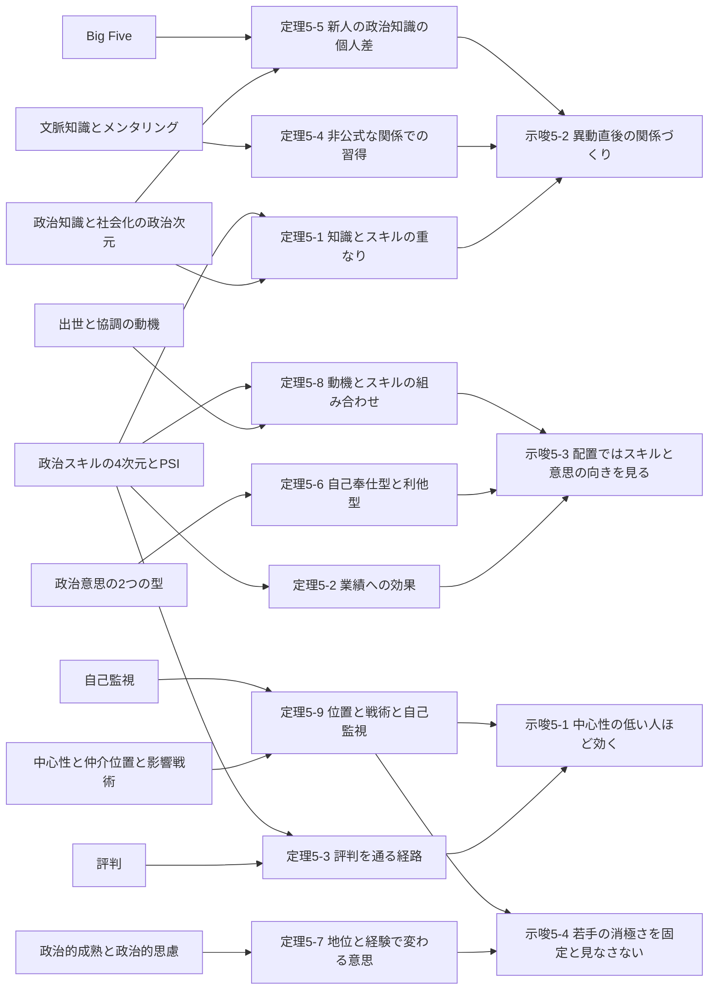

# 第5章 ビジネスパーソンに必要な政治力 — 定義・定理・示唆

## この章の問い

社内政治で成果を上げる個人の力は、政治知識・政治スキル・政治意思・パワーからどう成り立つのか。それぞれはどう身につき、どう成果につながるのか。本の本文は読んでいないので、下の目次の見出しを論点の枠として使い、論文の本文で答えます。

目次の見出し:

- 第1節 政治知識: 政治知識とは / 正当性に関する理解 / 文脈知識
- 第2節 政治スキル: 社内政治のスキルとは / 4つの要素 / 開発法
- 第3節 政治準備性: 形成 / 政治意思 / 政治的思慮と政治準備性
- 第4節 政治的パワー: とは / 基盤 / 決める個人的要因

## 1. 定義

### 1.1 研究方法と統計の用語

- **実証研究**: データを集めて仮説を確かめる研究。[^d52]
- **理論的命題**: データで確かめる前の、理論から立てた主張。[^d52]
- **レビュー**: 既存の研究をまとめて整理した文献。本ファイルで「レビューによる整理」と書くときは、原典ではなくレビューの記述で確認したことを示す。[^d52]
- **標本（sample）**: 研究のためにデータを集めた人の集まり。[^d52]
- **尺度**: ある性質を、複数の質問項目への回答の合計などで測る道具。[^d52]
- **因子分析と因子**: 多くの項目への回答の背後にある少数の共通の要因（因子）を取り出す分析。[^d52]
- **自己報告**: 本人が質問紙に答えて自分のことを報告する測り方。[^d52]
- **相関係数（r）**: 2 つの量が一緒に増減する程度を −1〜1 で表す値。[^d52]
- **統制**: 他の変数の影響を分析で取り除くこと。[^d52]
- **階層的回帰と標準化係数（β）**: 階層的回帰は、統制する変数を先に入れ、関心のある変数を後から加えて、追加の説明力を見る回帰分析。β はそのときの変数の効きの強さを、単位をそろえて表した値。[^d56]
- **媒介**: A が B を通じて C に影響すること。B を媒介変数という。B ですべて説明できるとき「完全に媒介」という。[^d52]
- **調整と交互作用**: A と C の関係の強さが、第 3 の変数 B の値によって変わること（調整）。統計的には A と B の掛け合わせ（交互作用）の効果として調べる。[^d52]
- **縦断研究と横断研究**: 縦断研究は同じ人を時間をおいて何度か測る研究。横断研究は 1 時点だけで測る研究。[^d52]
- **メタ分析とメタ回帰**: メタ分析は複数の研究の結果を統計的にまとめる方法。メタ回帰は、研究間の結果の違いを研究の特徴で説明する分析。[^d52]
- **ρ（母相関の推定値）と 95% 信用区間**: ρ はメタ分析で測定誤差などを補正して推定した相関。95% 信用区間は、状況によって変わる真の効果の大部分が入る範囲。0 をまたげば、効果がほぼない状況もありうる。[^d52]
- **質的研究**: 面接記録などの言葉のデータを、数値にせずに解釈する研究。[^d52]
- **半構造化面接**: 質問の大枠を決めておき、相手の話に応じて質問を変えて聞く面接。[^d57]
- **テンプレート分析（template analysis）**: 面接記録などを、階層的なコードの表（テンプレート）を作りながら整理する主題分析の一種。[^d57]

### 1.2 社内政治とパワーに関する用語

- **社内政治（organizational politics）**: 公式の役割とは別に、組織の中の個人や部署の間にある非公式な権力関係と、それをめぐる動き。[^d1]
- **政治行動（political behavior）**: 他者に影響を与えて自分や集団の目的を達成しようとする行動。研究上の定義の多くは、組織が公認していない目的や手段による影響として定める。[^d2]
- **政治の正当性（legitimacy）**: ある行動を組織が「正当」と認めるか「正当でない」と見なすか、という区別。政治行動を「公認されていない」と定義すると、政治は公式の人事制度の外にある活動になり、政治を正当でないと呼ぶこと自体が統制の仕組みとして働く。[^d3]
- **パワー（power）**: 他者の行動や資源の流れを左右できる力。関係的・状況的なものだが、誰がパワーを持つかについての周囲の認知（パワーの認知）が重要で、研究では多くの場合この認知を測る。本ファイルでは見出しの「政治的パワー」もこの意味で読む（本書での意味は未確認）。[^d4]
- **政治的効果性（political effectiveness）**: 職場の政治環境をうまく渡り、パワーを得て、他者を動かし、政治的な目標を達成する能力。[^d5]

### 1.3 人の役割と職場の場面

- **新人（newcomer）**: 組織に新しく採用されたばかりの人。[^d6]
- **組織社会化（organizational socialization）**: 新人が新しい組織になじみ、どう振る舞えばよいか、環境に合っているかを学んでいく過程。[^d7]
- **メンター・メンタリング（mentor / mentoring）**: 経験のある人（メンター）が、相手の手本となり、職場で起きたやりとりを一緒に振り返ることで、職場環境の理解と対人的な力を育てる関係。[^d8]
- **公式メンタリングと非公式メンタリング**: 公式メンタリングは組織がメンターと相手を割り当てる仕組み。非公式メンタリングは互いの一体感などから自然にできる関係。[^d9]
- **若手・中堅・幹部（junior / mid-level / senior）**: 組織の階層の下位・中位・上位にいる人。Montgomery（2022）では、チームの管理責任を持つ管理職の入口の層、部門の長などの中間層、上級経営チームの層を指す。[^d10]
- **境界をまたぐ役割（boundary-spanning role）**: 組織の部署や組織の外との境界で、異なる集団や期待の間をつなぐ役割。[^d11]
- **変革推進者（change agent）**: 組織の変化を進める役割の人。複数の集団、対立する利害、流動的な環境を扱う必要がある。[^d12]

### 1.4 政治知識に関する用語

- **政治知識（political knowledge / political savvy）**: 組織で物事が実際にどう動くか、誰が最も影響力を持つか、人の行動の裏の動機は何か、についての理解。[^d13]
- **組織社会化の政治次元**: 組織社会化で新人が学ぶ内容のうち、政治知識にあたる部分。Chao らの尺度の 5 項目（「組織の政治をよく理解していない」「最も影響力のある人を知っている」など）で測る。[^d14]
- **文脈知識（contextually specific knowledge）**: 仕事経験やメンタリングで得る、その職場に固有の知識。職場には手がかりや暗黙知が多すぎるため、重要なものを選び出す仕組みが要る。[^d15]
- **政治的学習（political learning）**: 権力のありかや使われ方など「政治の地形」についての知識を、経験を通じて長期記憶に蓄えること。[^d16]
- **sense-making**: 出来事が起きるたびに、それを理解し説明しようとする意識的で反応的な過程。[^d17]
- **政治的専門性（political expertise）**: 政治的学習と sense-making を合わせたもの。[^d18]

### 1.5 政治スキルに関する用語

- **政治スキル（political skill）**: 職場で他者を的確に理解し、その理解を使って、自分または組織の目標が進むように他者を動かす能力。性格による安定した部分と、訓練や経験で変わる部分がある。[^d19]
- **社会的洞察力（social astuteness）**: 他者と社会的なやりとりを正しく読み取り、自分と他者の行動を的確に解釈する力。政治スキルの次元の 1 つ。[^d20]
- **対人影響力（interpersonal influence）**: 相手と状況に合わせて自分の行動を調整し、望む反応を引き出す力。政治スキルの次元の 1 つ。[^d21]
- **ネットワーク構築力（networking ability）**: 多様な人脈を見つけて育て、連合を作る力。政治スキルの次元の 1 つ。[^d22]
- **見かけの誠実さ（apparent sincerity）**: 裏の動機がなく、誠実で本物だと他者に見える性質。政治スキルの次元の 1 つ。[^d23]
- **政治スキルの 4 次元**: 社会的洞察力・対人影響力・ネットワーク構築力・見かけの誠実さの 4 つ。互いに相関するが、別々の能力とされる。[^d24]
- **PSI（Political Skill Inventory）**: 政治スキルを 4 次元 18 項目で測る自己報告の尺度。次元別にも合計点でも使える。米国・中国・ドイツ・ロシア・トルコの回答で構造はほぼ同じだが、間接的な話し方の文化では社会的洞察力とネットワーク構築力が高めに出た。[^d25]
- **社会的効果性（social effectiveness）**: 相手の必要に敏感で、相手に合わせて反応を変える力の総称。政治スキルのほか、場面に合わせて自分の見せ方を変える傾向や共感なども含む。[^d26]
- **感情知能（emotional intelligence）**: 感情を正しく知覚・表現し、理解し、調整する能力。[^d27]

### 1.6 政治意思と政治準備性に関する用語

- **政治意思（political will）**: 政治的な目標を追うために、自分のエネルギーや資源を使おうとする意欲。政治行動の前提条件とされる。[^d28]
- **権力欲求（need for power）**: 他者に影響を与え、その行動や感情を動かしたいという欲求。[^d29]
- **達成欲求（need for achievement）**: 難しい課題で成功したいという欲求。[^d30]
- **親和欲求（need for affiliation）**: 他者と親しい関係を持ちたいという欲求。[^d31]
- **内発的動機づけ（intrinsic motivation）**: 新しい挑戦や成長、有能さの発揮を、それ自体が報酬であるかのように求める傾向。[^d32]
- **マキャベリアニズム（Machiavellianism）**: 目的のために他者を操作し、欺き、利用しようとする傾向。[^d33]
- **自己奉仕型の政治意思（self-serving political will）**: 政治意思のうち、自分の道具的な利益を求める意欲。[^d34]
- **利他型の政治意思（benevolent political will）**: 政治意思のうち、集団や他者の利益を求める意欲。本当に利他的なのか、見返りを期待する互恵的なものなのかは争われている。[^d35]
- **政治準備性**: 本書第3節の見出しの語。本書での意味は未確認で、同じ名前の確立した学術概念も見つからなかった。本ファイルでは、この語を定理と示唆で使わず、近い概念である政治意思・政治的思慮・政治的成熟で論点を扱う。[^d36]
- **政治的思慮（political prudence）**: 政治意思が行動になる前に、結果の望ましさ、他の手段の有無、成功の見込みを見積もり、意思を抑えたり向きを変えたりする評価の働き。Kapoutsis による理論上の提案で、定義はまだゆるい。本書の見出しの「政治的思慮」と同じ意味かは未確認。[^d37]
- **政治的成熟（political maturation）**: 政治への意欲と構えが、キャリアを通じて変わっていく過程。民間企業のリーダーの面接研究では「素朴と発見」「対処と忍耐」「活用と熟達」の 3 段階が示された。[^d38]
- **出世の動機と協調の動機（get ahead / get along）**: 出世の動機は地位・パワー・資源を得たいという動機。協調の動機は支えられ、受け入れられ、孤立しないでいたいという動機。[^d39]

### 1.7 パワーの基盤とネットワークに関する用語

- **パワーの 5 基盤**: French と Raven の古典的な分類。報酬（報酬を与えられる）、強制（罰を与えられる）、正当（公式の地位による）、準拠（相手がその人と一体化したいと思う）、専門（知識や技能が上だと見なされる）の 5 つ。[^d40]
- **評判（reputation）**: 他者がある個人について持つ、おおむね合意された集合的な認識。本人の行動に影響され、時間をかけて形成され、その人の今後の行動についての不確かさを減らす。[^d41]
- **社会ネットワーク（social network）**: 人などの行為者（ノード）と、その間の関係（紐帯）の集まり。関係の配置が、行為者の位置と、パワーを得る機会と制約を決める。[^d42]
- **ネットワーク中心性（network centrality）**: ネットワークの中でどれだけ中心的な位置にいるか。最も単純には、関係を持つ相手の数（次数中心性）で測る。[^d43]
- **構造的空隙と仲介位置（structural hole / brokerage）**: 互いにつながっていない相手どうしの間に立つ位置。情報の流れを制御でき、重複しない情報を得られる。この位置に立つことを仲介という。[^d44]
- **媒介中心性（betweenness centrality）**: 他の人どうしをつなぐ経路の上に、どれだけ位置しているかで測る中心性。ネットワーク全体で見た構造的空隙の指標。[^d45]
- **構造的パワー**: 人の資質や戦術ではなく、ネットワーク上の位置（中心性など）から生じる潜在的なパワー。[^d46]
- **支配連合（dominant coalition）**: 組織の中で意思決定を握る経営幹部の集まり。[^d47]
- **影響戦術（political tactics）**: 他者を動かすために使う行動。ここでは主張（強く求める）、取り入り（好かれようとする）、交換（見返りを示す）、上位者への訴え、合理的説得（理由と事実で説く）、連合形成（味方を集める）の 6 つ。[^d48]
- **道具的ネットワークと表出的ネットワーク（instrumental / expressive network）**: 道具的ネットワークは仕事上の助言や情報のやりとりの関係。表出的ネットワークは友人関係や感情的な支えの関係。[^d49]
- **自己監視（self-monitoring）**: 場面が求める人物像に合わせて自分の見せ方を調整する傾向。高い人は場面ごとに柔軟に振る舞い、低い人は自分の態度や価値に沿って一貫して振る舞う。[^d50]

### 1.8 性格と成果の指標

- **Big Five**: 性格を 5 つの特性で表す枠組み。開放性（美的感受性と想像力の豊かさ）、誠実性（意志が強く、注意深い）、外向性（話し好きで人付き合いを楽しむ）、協調性（寛容で協力的）、神経症傾向（不安や気分の波が大きい）。[^d51]
- **一般知能（GMA: general mental ability）**: 学習や推論など、さまざまな知的課題に共通して働く能力。[^d52]
- **自己効力感（self-efficacy）**: 自分はうまくやれるという本人の信念。[^d52]
- **個人の主導性（personal initiative）**: 自分から先回りして動き、目標に向けて行動する一連の行動。[^d53]
- **課題業績と文脈的業績（task / contextual performance）**: 課題業績は職務そのものの出来。文脈的業績は協力・援助・思いやりなど、職場を支える行動の出来。[^d54]
- **上司評定**: 上司が部下の業績や特性を評価した点数。[^d52]
- **昇進可能性（promotability）**: 昇進にふさわしいと評価者が見る程度。[^d52]
- **キャリア成功（career success）**: 収入・職位などの客観的な成功と、キャリア満足などの主観的な成功。[^d55]

## 2. 定理

### 定理 5-1: 政治知識は政治スキルと中程度に重なり、特に社会的洞察力と強く結びつく

- 内容: 組織社会化の政治次元で測る政治知識は、PSI で測る政治スキル全体と r = .47、社会的洞察力とは r = .60 で相関した。政治スキルは感情知能とも r = .53 で重なるが、同一ではない。政治知識は、政治スキルのうち「読む」成分である社会的洞察力に最も近い。[^t5-1]
- 研究の種類と対象: 尺度開発時の相関研究を紹介したレビュー（Ferris et al. 2007 による整理）。
- 条件・限界: 相関は同じ時点の自己報告どうしで、因果の向きは分からない。サンプルの国や業種は該当箇所に書かれておらず、確認していない。

### 定理 5-2: 政治スキルは一般知能と Big Five を統制しても業績を予測するが、その強さは仕事の対人的な要求によって大きく変わる

- 内容: メタ分析では、政治スキルと課題業績の関係は ρ = .26、文脈的業績とは ρ = .38 だった。ただし 95% 信用区間は課題業績で −.07〜.52、文脈的業績で −.05〜.71 と 0 をまたぎ、研究間のばらつきが大きい。メタ回帰では、一般知能と Big Five を統制しても、政治スキルが高い人ほど課題業績が高かった。仕事が社会的・対人的なやりとりを多く求めるほど、関係は強くなった。[^t5-2]
- 研究の種類と対象: メタ分析と単独の実証研究を紹介したレビュー（Blickle, Frieder & Ferris 2018 による整理）。
- 条件・限界: 平均的な効果は中程度で、状況によっては効果がほぼ消える。数値はレビュー経由で、メタ分析そのものの本文は読んでいない。

### 定理 5-3: 政治スキルが業績とキャリア成功に効く経路の一部は、評判の形成を通る

- 内容: ある研究では、政治スキルが高い人の業績が高いことは、すべて評判の高さを通じて生じていた（完全な媒介）。メタ回帰でも、評判と自己効力感を通じた経路が見られた。1 年間の縦断研究では、ある時点で政治スキルが高い人ほど 1 年後の収入・職位・キャリア満足が高く、職位とキャリア満足については評判の高さを通じた効果だった。別の 2 研究では、政治スキルと評判の相関は r = .35 と .40 だった。[^t5-3a] [^t5-3b]
- 研究の種類と対象: 実証研究とメタ分析を紹介したレビュー（Blickle, Frieder & Ferris 2018 と Ferris et al. 2007 による整理）。
- 条件・限界: 評判のほかに、自己効力感や個人の主導性など別の経路もある。個々の研究の対象国と人数は、レビューの記述からは確認していない。日本での検証も確認していない。

### 定理 5-4: 政治知識と政治スキルは、公式の研修より、メンターや上司との非公式な関係を通じて身につきやすい

- 内容: 新人の組織社会化の縦断研究では、政治知識は非公式な関係を通じてよく育ち、公式の研修は役割の明確さを高めた。別の研究では、メンタリング行動がネットワーク構築力を高め、その関係を政治の理解が媒介した。Ferris et al. 2007 は、メンターが大量の文脈知識から重要なものを選び出し、政治スキルを育てると論じる（理論的命題）。[^t5-4a] [^t5-4b] [^t5-4c]
- 研究の種類と対象: 縦断研究を含む実証研究のレビューと、理論的命題（Silvester & Wyatt 2018、Blickle, Frieder & Ferris 2018、Ferris et al. 2007 による整理）。
- 条件・限界: 政治スキルの研修を取り入れた組織は少なく、その効果の証拠は限られる。公式メンタリングのメンターは目立つぶん、正当でないと見られうる政治行動を勧めにくく、効果が弱い可能性がある。[^t5-4d]

### 定理 5-5: 新人が入社後半年で身につける政治知識には性格による個人差があり、開放性と誠実性が高い新人ほど多く、外向性は関係しない

- 内容: 入社 1 か月以内に Big Five を測り、その 6 か月後に政治知識を測った。性別・経験・学歴・組織などを統制した階層的回帰で、開放性（β = .34）と誠実性（β = .32）が高い新人ほど政治知識が多かった。外向性は政治知識と関係しなかった（β = .04）。著者は、外向的な人はパワーには関心があっても、政治知識を求めるとは限らないと解釈する。[^t5-5]
- 研究の種類と対象: 実証研究（縦断研究、自己報告）。対象はバーレーンの 7 組織（製造・航空・医療・軍・通信・金融とコンサルティング・教育）の新人で、当初 439 人、時点 1 は 272 人、時点 2 は 180 人。
- 条件・限界: 自己報告で、1 か国だけのデータ。報告に不整合がある。神経症傾向は本文で「正の関係」とされるが、表の係数は −.22 である。誠実性は表に行がなく、本文の値しか確認できない。本文には結果の変数を「課題業績」と書いた箇所もある。このため、神経症傾向の向きは定理に入れていない。

### 定理 5-6: 政治意思は自己奉仕型と利他型の 2 次元に分かれ、前者は権力欲求・達成欲求と、後者は親和欲求・内発的動機づけと結びつくが、利他型が本当に利他的かは確かめられていない

- 内容: 米国の学生、ギリシャの卒業生、運輸業の従業員という複数の標本で作られた政治意思の尺度では、2 因子の構造が最もよく当てはまった。自己奉仕型の政治意思は権力欲求・達成欲求と強く関係し、親和欲求とは関係しなかった。利他型の政治意思は親和欲求・内発的動機づけと強く関係し、権力欲求とは関係しなかった。その後の研究では、利他型の 2 項目（自分の労働条件の改善など）は他者への善意と関係しない可能性が指摘され、利他型と利他性の間にも関連が見つからなかった。[^t5-6a] [^t5-6b]
- 研究の種類と対象: 尺度開発と検証の実証研究を紹介したレビュー（Montgomery 2022 の第 2 章による整理）。
- 条件・限界: 相関の大きさはレビューに書かれておらず、確認していない。2 次元が同時に高くなりうるのか、利他型が互恵的なのかは未解決とされる。

### 定理 5-7: 政治意思は固定した特性ではなく、地位と経験が上がるにつれ、防御から積極へ、課題の達成から全体の戦略へ、リスク回避からリスクを扱える方向へ変わる

- 内容: 英国の地方自治体の職員 30 人（若手・中堅・幹部 各 10 人）の面接では、若手は身を守るため、目立たず反抗的と見られないように動いた。中堅は戦う場面を選び、場合ごとにリスクを見積もり、自分やチームの利益を求めた。幹部は自治体全体の戦略のために、リスクを受け入れて状況そのものを動かそうとした。管理の責任が増えるほど、他者のための（利他型の）政治意思も増えた。民間企業のリーダーの面接研究も、政治的成熟が素朴な段階から熟達の段階へ進むと報告している。ただし民間企業では若手が政治を非機能的・非倫理的と見たのに対し、自治体では若手でも政治を機能的と見ており、変わり方は組織の文脈で違った。[^t5-7a] [^t5-7b] [^t5-7c]
- 研究の種類と対象: 質的研究（半構造化面接、テンプレート分析）。対象は英国の地方自治体の職員 30 人と議員 30 人のうち、職員の分析（Montgomery 2022）。
- 条件・限界: 同じ人を追った縦断研究ではなく、地位の違う人の比較である。変化が経験による成長なのか、その地位に就く人の選抜によるのかは分からない。中堅の場合ごとのリスク評価は政治的思慮の考え方に近いと著者は述べるが、政治的思慮を測ってはいない。

### 定理 5-8: 出世や協調の動機は、政治スキルが高いときにだけ、高い業績や昇進可能性の評価につながる

- 内容: 複数の研究で、出世の動機・協調の動機のそれぞれと政治スキルの組み合わせが強い人（動機が強く、政治スキルも高い人）ほど、上司による協力と昇進可能性の評定が、他のどの組み合わせの人よりも高かった。外向性（出世の動機の指標）が高く政治スキルも高い自動車販売員は、他の組み合わせより多く売った。Silvester & Wyatt のモデルも、動機と組織の文脈が政治行動への傾向を決め、政治スキルなどの社会的効果性が政治行動の成果を左右するとする（理論的命題）。境界をまたぐ役割や変革推進者は、政治的効果性をより強く求められるとされる。[^t5-8a] [^t5-8b]
- 研究の種類と対象: 実証研究のレビューと理論的命題（Blickle, Frieder & Ferris 2018、Silvester & Wyatt 2018 による整理）。
- 条件・限界: ここでの動機は性格（誠実性・協調性・外向性）や動機の尺度で測られており、政治意思の尺度そのものではない。政治意思の尺度と政治スキルの交互作用は、本文で確認できていない。

### 定理 5-9: パワーの認知はネットワーク中心性と影響戦術の双方から生じ、中心性が高いほど影響戦術の重要性は下がり、仲介位置には自己監視の高い人が就きやすい

- 内容: 組織内の研究で、ネットワーク中心性と影響戦術は、どちらもパワーの認知と関係した。中心性が高いほど、影響戦術の重要性は下がった。支配連合への紐帯は、管理職でない従業員のパワーと昇進に関係した。ハイテク企業の研究では、自己監視の高い人は媒介中心性の高い位置に就きやすく、在籍が長いほど中心に移った。自己監視の低い人にはこの傾向がなかった。138 のネットワーク標本のメタ分析でも、自己監視は道具的ネットワークと表出的ネットワークの両方で仲介位置を予測し、Big Five より仲介位置の理解に役立った。[^t5-9a] [^t5-9b] [^t5-9c]
- 研究の種類と対象: 組織内ネットワークの実証研究とメタ分析を紹介したレビュー（Brass & Krackhardt 2012、Kilduff & Buengeler 2019 による整理）。
- 条件・限界: 原典の対象組織や人数は、レビューの記述からは一部しか確認していない。測っているのはパワーの認知である。自己監視の低い人は、仲の良い閉じた集団の中では信頼を得やすいという指摘もある。[^t5-9d]

## 3. 示唆

以下は論文の主張ではなく、上の定理を組み合わせた導出です。

### 示唆 5-1: ネットワーク中心性の低い人ほど、政治スキルと評判づくりの効き目が大きい可能性がある

- 組み合わせ: 定理 5-3 + 定理 5-9
- 導出: 定理 5-9 では、中心性が低いほど影響戦術の重要性が高い。定理 5-3 では、政治スキルは評判を通じて業績やキャリア成功につながる。中心性の低い人にとっては、影響戦術をうまく使う政治スキルと、その結果としての評判が、構造的パワーの不足を補う主な手段になると導ける。
- 追加の前提: 若手や異動直後の人は中心性が低いことが多い。また、定理 5-9 はパワーの認知についての結果で、業績やキャリア成功でも同じ形で成り立つと仮定している。

### 示唆 5-2: 異動や転職の直後は、上司やメンターとの非公式な関係を早く作ることが政治知識を取り戻す近道になるが、その速さには個人差がある

- 組み合わせ: 定理 5-1 + 定理 5-4 + 定理 5-5
- 導出: 定理 5-4 では、政治知識は非公式な関係を通じて育つ。定理 5-1 では、政治知識は社会的洞察力と強く重なる。新しい職場では読む力の土台となる政治知識が不足するため、それを運ぶ非公式な関係づくりを優先すべきと導ける。定理 5-5 から、開放性や誠実性の低い人ほど政治知識の獲得が遅れやすく、意識的な支援が要ると導ける。
- 追加の前提: 文脈知識の大部分は、職場が変わると使えなくなる。新人についての定理 5-4 と 5-5 が、経験者の異動にも当てはまる。

### 示唆 5-3: 境界をまたぐ役割や変革推進者に人を就けるときは、政治スキルだけでなく、その人の政治意思の向きも見る必要がある

- 組み合わせ: 定理 5-2 + 定理 5-6 + 定理 5-8
- 導出: 定理 5-2 では、政治スキルの業績への効果は対人的な要求が大きい仕事で強い。定理 5-8 では、動機は政治スキルがあって初めて成果につながる。定理 5-6 では、政治意思には自己奉仕型と利他型があり、結びつく欲求が違う。したがって、こうした役割では政治スキルと動機の両方を見たうえで、その動機が自分のためか集団のためかも確かめるべきと導ける。
- 追加の前提: 変革の役割では、利他型の政治意思のほうが周りの協力を得やすい（定理にはない前提）。定理 5-8 の動機の結果が、政治意思にも当てはまる。

### 示唆 5-4: 若手が政治に消極的に見えても、それを固定した特性と見なさず、地位と経験の変化を前提に育成と評価を考えるべきである

- 組み合わせ: 定理 5-7 + 定理 5-9
- 導出: 定理 5-7 では、若手の政治意思は身を守る方向に偏るが、地位と経験が上がると積極的になり、利他型の政治意思も増える。定理 5-9 では、自己監視の高い人は在籍が長いほど中心的な位置に移る。どちらも、政治への構えとネットワーク上の位置が、ある 1 時点では決まらないことを示す。このため、若手の 1 時点の消極さで政治的な素質を判断すると、後の伸びを見落とすと導ける。
- 追加の前提: 組織が若手の政治的な素質を早い時点で評価し、配置に使っている。地位の違う人の比較である定理 5-7 の結果が、同じ人の変化にも当てはまる。

## 4. 扱えなかった論点

- 政治意思の尺度そのものと政治スキルの交互作用の大きさ: 本文を読める資料が見つからなかった。
- 政治的思慮を測った実証研究（政治意思と行動の関係を政治的思慮が調整するか）: 本文を読める資料が見つからなかった。

## 参考文献

脚注の頁は、書籍・論文の印刷頁です（Silvester & Wyatt 2018 は著者稿の頁、Blickle, Frieder & Ferris 2018 は PDF の「Page N of 28」）。段落番号は、その頁の先頭から数えた番号で、前の頁から続く段落を第 1 段落とします。

| 番号 | 文献（著者, 年, タイトル, 誌名・巻号） | 本文の入手先 URL | ライセンス |
|---|---|---|---|
| 1 | Ferris, Treadway, Perrewé, Brouer, Douglas & Lux, 2007, Political skill in organizations, Journal of Management 33(3), 290–320 | <https://www.crforum.co.uk/wp-content/uploads/2017/06/Political-Skill-in-Organizations.pdf> | 不明（出版社版 PDF。著作権は出版社） |
| 2 | Silvester & Wyatt, 2018, Political effectiveness at work, The SAGE Handbook of Industrial, Work & Organizational Psychology（第 8 章） | <https://openaccess.city.ac.uk/id/eprint/18174/8/Silvester%20%2B%20Wyatt%20%282018%29%20Political%20Effectiveness%20-%20for%20CRO.pdf> | 著者稿（著作権は出版社など） |
| 3 | Blickle, Frieder & Ferris, 2018, Political skill, The SAGE Handbook of Industrial, Work and Organizational Psychology: Personnel Psychology and Employee Performance, 299–319 | <https://www.psychologie.uni-bonn.de/de/institut/abteilungen/arbeits-organisations-und-wirtschaftspsychologie/uploads-fuer-die-allgemeine-i/forschung/blickle-frieder-ferris-2018.pdf> | 不明（出版社版 PDF。著作権は出版社） |
| 4 | Montgomery, 2022, Political Will in Political Work, 博士論文（University of Kent） | <https://kar.kent.ac.uk/102205/1/203PoliticalWillInPoliticalWork_JoelMontgomery2023PDFFINAL.pdf> | 不明（博士論文） |
| 5 | Swid, 2024, Unveiling the power play: How newcomers' traits shape political acumen within organizations, Journal of Organizational Psychology 24(2), 27–37 | <https://articlegateway.com/index.php/JOP/article/download/7016/6626> | 不明 |
| 6 | Kilduff & Buengeler, 2019, Self-monitoring: A personality theory for network research, Social Networks at Work（第 8 章）, 155–177 | <https://discovery.ucl.ac.uk/id/eprint/10084131/1/kilduff%20buengeler.pdf> | 著者稿（著作権は出版社など） |
| 7 | Brass & Krackhardt, 2012, Power, politics, and social networks in organizations, Politics in Organizations（第 12 章）, 355–375 | <https://www.heinz.cmu.edu/faculty-research/profiles/krackhardt-davidm/_files/2012polinorgs.pdf> | 不明（出版社版 PDF。著作権は出版社） |
| 8 | Zinko, Ferris, Blass & Laird, 2007, Toward a theory of reputation in organizations, Research in Personnel and Human Resources Management 26, 163–204 | <https://myweb.ecu.edu/furnerc/zpubs/chapter/1.pdf> | 不明（出版社版 PDF。著作権は出版社） |

## 脚注

[^d1]: Swid (2024), Unveiling the power play, p. 28,「Political Knowledge of the Organization as an Adjustment Outcome」第 1 段落。要旨: 明確に定められた役割とは違い、組織の政治は個人や部署の間の非公式な権力関係だと述べる。 [本文](https://articlegateway.com/index.php/JOP/article/download/7016/6626)
[^d2]: Silvester & Wyatt (2018), Political effectiveness at work, 著者稿 p. 10, 最終段落と Table 8.1（著者稿 pp. 42–43）。要旨: 政治行動の定義を表にまとめ、そのうち 6 つが政治行動を「正当でない」「組織が公認していない」影響として定義していると指摘する。 [本文](https://openaccess.city.ac.uk/id/eprint/18174/8/Silvester%20%2B%20Wyatt%20%282018%29%20Political%20Effectiveness%20-%20for%20CRO.pdf)
[^d3]: Silvester & Wyatt (2018), Political effectiveness at work, 著者稿 p. 11, 第 1〜3 段落と p. 12, 第 1 段落（「A Question of Legitimacy」の節）。要旨: 政治行動を無許可の行動と定義すると、政治は公式の人事制度の外で働くものとなり、組織に行動を「正当でない」と名づける権限を認めることになる。政治の脱正当化はそれ自体が統制の仕組みになる、と述べる。 [本文](https://openaccess.city.ac.uk/id/eprint/18174/8/Silvester%20%2B%20Wyatt%20%282018%29%20Political%20Effectiveness%20-%20for%20CRO.pdf)
[^d4]: Brass & Krackhardt (2012), Power, politics, and social networks, p. 356, 第 2 段落と p. 358,「Network Centrality」第 2 段落。要旨: パワーは関係的・状況的だが、パワーの認知が重要で、多くの従業員は誰がパワーを持つかについて意見が一致する。中心的な人は資源の流れを制御し、他者はその人に依存する、と説明する。 [本文](https://www.heinz.cmu.edu/faculty-research/profiles/krackhardt-davidm/_files/2012polinorgs.pdf)
[^d5]: Silvester & Wyatt (2018), Political effectiveness at work, 著者稿 p. 17,「A Model of Political Effectiveness」第 1 段落。抜き出し: 「the ability to successfully navigate political environments at work」。 [本文](https://openaccess.city.ac.uk/id/eprint/18174/8/Silvester%20%2B%20Wyatt%20%282018%29%20Political%20Effectiveness%20-%20for%20CRO.pdf)
[^d6]: Swid (2024), Unveiling the power play, p. 30,「Participants」第 1 段落。要旨: 研究の対象は 7 組織に最近採用された従業員で、全員が新規採用者であることを条件とした。 [本文](https://articlegateway.com/index.php/JOP/article/download/7016/6626)
[^d7]: Swid (2024), Unveiling the power play, p. 27,「Introduction」第 1 段落。要旨: 新人の適応の成果を近い成果と遠い成果に分け、新人の主な関心はどう振る舞うか、新しい環境に合っているかにあると述べる。 [本文](https://articlegateway.com/index.php/JOP/article/download/7016/6626)
[^d8]: Ferris et al. (2007), Political skill in organizations, p. 299, 第 3・4 段落。要旨: 政治スキルの高いメンターの振る舞いを観察させ、やりとりを一緒に話し合うことで、相手は職場環境をより深く理解し、対人的な力を身につける、と述べる。 [本文](https://www.crforum.co.uk/wp-content/uploads/2017/06/Political-Skill-in-Organizations.pdf)
[^d9]: Silvester & Wyatt (2018), Political effectiveness at work, 著者稿 p. 28, 第 2 段落。要旨: 公式メンタリングはメンターと相手を割り当てる仕組みで、関係が自然にでき、互いの一体感に基づく非公式メンタリングより効果が低いとの議論を紹介する。 [本文](https://openaccess.city.ac.uk/id/eprint/18174/8/Silvester%20%2B%20Wyatt%20%282018%29%20Political%20Effectiveness%20-%20for%20CRO.pdf)
[^d10]: Montgomery (2022), Political Will in Political Work, p. 93, 第 2・3 段落と p. 95, Table 3.2。要旨: 若手はチーム管理の責任を持つ新任の管理職、中堅は部門の長などの中間管理職、幹部は上級経営チームの成員として、地位で 3 層に分けた。 [本文](https://kar.kent.ac.uk/102205/1/203PoliticalWillInPoliticalWork_JoelMontgomery2023PDFFINAL.pdf)
[^d11]: Silvester & Wyatt (2018), Political effectiveness at work, 著者稿 p. 19, 第 1 段落。Kilduff & Buengeler (2019), Self-monitoring, p. 163, 第 3 段落。要旨: 境界をまたぐ役割の人は政治活動を理解し関わることをより多く求められる（Silvester & Wyatt）。境界をまたぐ人は異なる場面と規範の期待の間を取り持つ（Kilduff & Buengeler）。 [本文](https://openaccess.city.ac.uk/id/eprint/18174/8/Silvester%20%2B%20Wyatt%20%282018%29%20Political%20Effectiveness%20-%20for%20CRO.pdf) [本文](https://discovery.ucl.ac.uk/id/eprint/10084131/1/kilduff%20buengeler.pdf)
[^d12]: Silvester & Wyatt (2018), Political effectiveness at work, 著者稿 p. 19, 第 1 段落。要旨: 知識労働者、コンサルタント、変革推進者の役割は、複数の集団、対立する利害、流動的な環境を扱うため、より高い政治的能力を要する。 [本文](https://openaccess.city.ac.uk/id/eprint/18174/8/Silvester%20%2B%20Wyatt%20%282018%29%20Political%20Effectiveness%20-%20for%20CRO.pdf)
[^d13]: Ferris et al. (2007), Political skill in organizations, p. 293, 第 5 段落。抜き出し: 「it is actually measuring political savvy or understanding」。要旨: 組織社会化の政治次元の項目は、物事が実際にどう動くか、誰が最も影響力を持つか、人の行動の裏の動機は何かの理解に焦点を当てている、と述べる。 [本文](https://www.crforum.co.uk/wp-content/uploads/2017/06/Political-Skill-in-Organizations.pdf)
[^d14]: Swid (2024), Unveiling the power play, p. 31,「Political Knowledge」第 1 段落。Ferris et al. (2007), Political skill in organizations, p. 293, 第 5 段落。要旨: 組織の政治知識は Chao et al. (1994) の 5 項目で測り、例として上の 2 項目を挙げる（Swid）。Chao らの組織社会化研究が政治の次元を見いだした（Ferris et al.）。 [本文](https://articlegateway.com/index.php/JOP/article/download/7016/6626) [本文](https://www.crforum.co.uk/wp-content/uploads/2017/06/Political-Skill-in-Organizations.pdf)
[^d15]: Ferris et al. (2007), Political skill in organizations, p. 314, 最終段落（「Practical Implications」第 1 段落）と p. 315, 第 1・2 段落。要旨: 政治スキルには、仕事経験やメンタリングで得る文脈に固有の知識が含まれる。職場には刺激・手がかり・暗黙知が多すぎるため、重要な情報を選び出す仕組みが要る。 [本文](https://www.crforum.co.uk/wp-content/uploads/2017/06/Political-Skill-in-Organizations.pdf)
[^d16]: Silvester & Wyatt (2018), Political effectiveness at work, 著者稿 p. 21, 第 1・2 段落（「Political Cognition」の節）。要旨: 政治的学習は、権力のありかと使われ方など政治の地形についての知識を得て蓄えることで、長期記憶にある手続き的知識として、経験とともに時間をかけて進む。 [本文](https://openaccess.city.ac.uk/id/eprint/18174/8/Silvester%20%2B%20Wyatt%20%282018%29%20Political%20Effectiveness%20-%20for%20CRO.pdf)
[^d17]: Silvester & Wyatt (2018), Political effectiveness at work, 著者稿 p. 21, 第 1・2 段落。要旨: sense-making は政治環境の出来事を理解し説明しようとする継続的な努力で、特定の出来事をきっかけに起きる意識的・反応的な過程である。 [本文](https://openaccess.city.ac.uk/id/eprint/18174/8/Silvester%20%2B%20Wyatt%20%282018%29%20Political%20Effectiveness%20-%20for%20CRO.pdf)
[^d18]: Silvester & Wyatt (2018), Political effectiveness at work, 著者稿 p. 21, 第 2 段落。要旨: 政治的認知のこの 2 つの側面が、個人の政治的専門性を形づくる、と述べる。 [本文](https://openaccess.city.ac.uk/id/eprint/18174/8/Silvester%20%2B%20Wyatt%20%282018%29%20Political%20Effectiveness%20-%20for%20CRO.pdf)
[^d19]: Ferris et al. (2007), Political skill in organizations, p. 291,「Definition and Construct Specification」第 1 段落と p. 292, 第 2 段落。抜き出し: 「the ability to effectively understand others at work」。要旨: 続けて、その理解を使い自分または組織の目標が進むように他者を動かすこと、と定義する。p. 292 では、性格による安定した部分と状況で変わる部分の両方があると述べる。 [本文](https://www.crforum.co.uk/wp-content/uploads/2017/06/Political-Skill-in-Organizations.pdf)
[^d20]: Ferris et al. (2007), Political skill in organizations, p. 292, 第 4 段落（Social astuteness）。要旨: 政治スキルの高い人は他者をよく観察し、社会的なやりとりを理解し、自分と他者の行動を正確に解釈する。 [本文](https://www.crforum.co.uk/wp-content/uploads/2017/06/Political-Skill-in-Organizations.pdf)
[^d21]: Ferris et al. (2007), Political skill in organizations, p. 292, 第 5 段落（Interpersonal influence）。要旨: 状況に合わせて行動を調整し、他者から望む反応を引き出す力である。 [本文](https://www.crforum.co.uk/wp-content/uploads/2017/06/Political-Skill-in-Organizations.pdf)
[^d22]: Ferris et al. (2007), Political skill in organizations, p. 292, 第 6 段落（Networking ability）。要旨: 多様な人脈とネットワークを見つけて育て、強い同盟や連合を作る力である。 [本文](https://www.crforum.co.uk/wp-content/uploads/2017/06/Political-Skill-in-Organizations.pdf)
[^d23]: Ferris et al. (2007), Political skill in organizations, p. 292, 第 7 段落（Apparent sincerity）から p. 293, 第 1 段落。要旨: 他者から誠実で本物に見え、裏の動機がないと受け取られることで、影響の試みが成功しやすくなる。 [本文](https://www.crforum.co.uk/wp-content/uploads/2017/06/Political-Skill-in-Organizations.pdf)
[^d24]: Ferris et al. (2007), Political skill in organizations, p. 293, 第 2 段落。要旨: 4 次元は互いに関係し相関すると想定されるが、別の構成概念のままである、と述べる。 [本文](https://www.crforum.co.uk/wp-content/uploads/2017/06/Political-Skill-in-Organizations.pdf)
[^d25]: Blickle, Frieder & Ferris (2018), Political skill, Page 4 of 28, 第 1 段落と Page 5 of 28, 第 1 段落。要旨: Ferris ら (2005) が 4 次元 18 項目の PSI を作り、次元別にも合計点でも使える。5 か国の回答で項目の負荷はおおむね同じで、間接的な話し方の文化（中国・トルコ）では社会的洞察力とネットワーク構築力が高かった。 [本文](https://www.psychologie.uni-bonn.de/de/institut/abteilungen/arbeits-organisations-und-wirtschaftspsychologie/uploads-fuer-die-allgemeine-i/forschung/blickle-frieder-ferris-2018.pdf)
[^d26]: Silvester & Wyatt (2018), Political effectiveness at work, 著者稿 p. 22, 最終段落と p. 23, 第 1・2 段落（「Social Effectiveness」の節）。要旨: 政治行動の効果は、相手の必要に敏感で反応の変え方を知っているかに左右され、政治スキルを自己監視・共感などとともに社会的効果性の構成概念として挙げる。 [本文](https://openaccess.city.ac.uk/id/eprint/18174/8/Silvester%20%2B%20Wyatt%20%282018%29%20Political%20Effectiveness%20-%20for%20CRO.pdf)
[^d27]: Blickle, Frieder & Ferris (2018), Political skill, Page 6 of 28, 第 4 段落。要旨: Mayer と Salovey の定義を引き、感情を正確に知覚・評価・表現し、理解し、調整する能力として感情知能を説明する。 [本文](https://www.psychologie.uni-bonn.de/de/institut/abteilungen/arbeits-organisations-und-wirtschaftspsychologie/uploads-fuer-die-allgemeine-i/forschung/blickle-frieder-ferris-2018.pdf)
[^d28]: Silvester & Wyatt (2018), Political effectiveness at work, 著者稿 p. 19, 最終段落〜p. 20, 第 1 段落（「Political Motivation」の節）。抜き出し: 「actor’s willingness to expend energy in pursuit of political goals」。要旨: Treadway ら (2005) の定義で、政治行動の不可欠な前提条件とされる。Montgomery (2022), pp. 36–37, Table 2.1 にも同じ定義が並ぶ。 [本文](https://openaccess.city.ac.uk/id/eprint/18174/8/Silvester%20%2B%20Wyatt%20%282018%29%20Political%20Effectiveness%20-%20for%20CRO.pdf) [本文](https://kar.kent.ac.uk/102205/1/203PoliticalWillInPoliticalWork_JoelMontgomery2023PDFFINAL.pdf)
[^d29]: Montgomery (2022), Political Will in Political Work, p. 41, 第 3 段落。要旨: 権力欲求は他者を統制し、支配し、影響を与えたいという動機で、Winter は他者の行動や感情に影響を与えたい欲求と定義した。 [本文](https://kar.kent.ac.uk/102205/1/203PoliticalWillInPoliticalWork_JoelMontgomery2023PDFFINAL.pdf)
[^d30]: Montgomery (2022), Political Will in Political Work, p. 42, 最終段落。要旨: 達成欲求は、難しい課題で成功を収めようとする動機の強さを指す。 [本文](https://kar.kent.ac.uk/102205/1/203PoliticalWillInPoliticalWork_JoelMontgomery2023PDFFINAL.pdf)
[^d31]: Montgomery (2022), Political Will in Political Work, p. 61, 第 1・2 段落（McClelland の欲求の 1 つとして登場）。定義の言い換えは一般的な用法（筆者の説明）。本文には親和欲求の定義文はない。 [本文](https://kar.kent.ac.uk/102205/1/203PoliticalWillInPoliticalWork_JoelMontgomery2023PDFFINAL.pdf)
[^d32]: Montgomery (2022), Political Will in Political Work, p. 43, 第 2 段落。要旨: 内発的動機づけは、新しい挑戦を求め、成長し、有能さを示し、関心を追う生来の傾向で、それ自体が報酬になる。 [本文](https://kar.kent.ac.uk/102205/1/203PoliticalWillInPoliticalWork_JoelMontgomery2023PDFFINAL.pdf)
[^d33]: Montgomery (2022), Political Will in Political Work, p. 43, 最終段落〜p. 44, 第 1 段落。要旨: マキャベリアニズムは、目的のために他者を操作し、欺き、利用しようとする意図を指す。 [本文](https://kar.kent.ac.uk/102205/1/203PoliticalWillInPoliticalWork_JoelMontgomery2023PDFFINAL.pdf)
[^d34]: Montgomery (2022), Political Will in Political Work, p. 61, 第 1 段落（2.4.1「The Political Will Scale」）。要旨: 自己奉仕型の次元は、道具的な利益を求める行為者として特徴づけられる。 [本文](https://kar.kent.ac.uk/102205/1/203PoliticalWillInPoliticalWork_JoelMontgomery2023PDFFINAL.pdf)
[^d35]: Montgomery (2022), Political Will in Political Work, p. 61, 第 2 段落と p. 62, 第 2 段落〜p. 63, 第 1 段落。要旨: 利他型の次元は共通・集団の利益を求める動機をとらえる。ただし尺度の作者の定義は揺れており、互恵性と結びつける記述もあるため論争がある。 [本文](https://kar.kent.ac.uk/102205/1/203PoliticalWillInPoliticalWork_JoelMontgomery2023PDFFINAL.pdf)
[^d36]: 筆者の説明。本書の本文は読んでおらず、目次の見出しだけを使った。本ファイルで読んだ資料の中に、「政治準備性」に当たる英語の確立した概念名は見つからなかった。
[^d37]: Montgomery (2022), Political Will in Political Work, p. 51, 第 2 段落（2.3「A Social Cognitive Perspective on Political Will」）。抜き出し: 「the construct remains very loosely defined」。要旨: Kapoutsis (2016) は、政治意思がリスクの評価、他の手段の検討、労力の見積もりで調整されるとし、期待理論の 3 要素で説明した。実証研究は主に倫理的な行動を促す徳として扱ってきた。本書の見出しとの対応は筆者は未確認。 [本文](https://kar.kent.ac.uk/102205/1/203PoliticalWillInPoliticalWork_JoelMontgomery2023PDFFINAL.pdf)
[^d38]: Montgomery (2022), Political Will in Political Work, p. 64, 第 1・2 段落と p. 65, 第 1 段落（2.4.2「Attitudinal Dimensions」）。要旨: Doldor (2017) は 2 つの国際企業の 38 人のリーダーを地位で 3 層に分けて面接し、政治意思の成熟を 3 段階のモデルにまとめた。政治意思はキャリアを通じて成熟しうる、と述べる。 [本文](https://kar.kent.ac.uk/102205/1/203PoliticalWillInPoliticalWork_JoelMontgomery2023PDFFINAL.pdf)
[^d39]: Blickle, Frieder & Ferris (2018), Political skill, Page 9 of 28, 第 5 段落。要旨: 社会分析理論では、人には受け入れられ孤立しないでいたい欲求と、パワー・地位・資源を得たい欲求の 2 つの基本的な欲求がある。 [本文](https://www.psychologie.uni-bonn.de/de/institut/abteilungen/arbeits-organisations-und-wirtschaftspsychologie/uploads-fuer-die-allgemeine-i/forschung/blickle-frieder-ferris-2018.pdf)
[^d40]: Zinko et al. (2007), Toward a theory of reputation, p. 188, 第 2〜4 段落と p. 189, 第 1 段落。要旨: French と Raven の 5 基盤を挙げ、正当なパワーは公式の地位に結びつき、準拠のパワーでは他者がその人と一体化したいと願い、専門のパワーは相手の知識が上だという判断による、と説明する。 [本文](https://myweb.ecu.edu/furnerc/zpubs/chapter/1.pdf)
[^d41]: Zinko et al. (2007), Toward a theory of reputation, p. 165, 第 1 段落と第 3 段落。抜き出し: 「a generally agreed upon, collective perception of an individual」。要旨: 本人の行動に影響され、すぐにではなく時間をかけて現れ、今後の行動についての曖昧さを減らす、と定義する。 [本文](https://myweb.ecu.edu/furnerc/zpubs/chapter/1.pdf)
[^d42]: Brass & Krackhardt (2012), Power, politics, and social networks, p. 356, 第 3 段落（「Social Networks and Power」の節）。要旨: 社会ネットワークを、ノード（行為者）とその間の関係の集まりと定義し、関係の配置が社会構造上の位置を決め、パワーを得る機会と制約を与えると述べる。 [本文](https://www.heinz.cmu.edu/faculty-research/profiles/krackhardt-davidm/_files/2012polinorgs.pdf)
[^d43]: Brass & Krackhardt (2012), Power, politics, and social networks, p. 358,「Network Centrality」第 1 段落と p. 359, 第 1 段落。要旨: 中心的な位置とパワーの関連は多くの場面で確かめられている。関係の数（ネットワークの大きさ）を次数中心性と呼ぶ。 [本文](https://www.heinz.cmu.edu/faculty-research/profiles/krackhardt-davidm/_files/2012polinorgs.pdf)
[^d44]: Brass & Krackhardt (2012), Power, politics, and social networks, p. 359,「Structural Holes」第 1・2 段落。Kilduff & Buengeler (2019), Self-monitoring, p. 169,「Brokerage」第 1 段落。要旨: 互いにつながっていない相手と関係を持つことを構造的空隙と呼び、情報の流れの制御と重複しない情報の入手という利点がある（Brass & Krackhardt）。つながっていない集団の間を仲介する人は出世しやすい（Kilduff & Buengeler）。 [本文](https://www.heinz.cmu.edu/faculty-research/profiles/krackhardt-davidm/_files/2012polinorgs.pdf) [本文](https://discovery.ucl.ac.uk/id/eprint/10084131/1/kilduff%20buengeler.pdf)
[^d45]: Brass & Krackhardt (2012), Power, politics, and social networks, p. 360, 第 2 段落。要旨: ネットワーク全体で見た構造的空隙の指標（媒介中心性）が、組織のパワーと関連してきた。経路による言い換えは一般的な用法（筆者の説明）。 [本文](https://www.heinz.cmu.edu/faculty-research/profiles/krackhardt-davidm/_files/2012polinorgs.pdf)
[^d46]: Brass & Krackhardt (2012), Power, politics, and social networks, p. 355, 第 1 段落と p. 364,「Building Powerful Networks」第 2 段落。要旨: パワーを第一に構造的な現象とみなす立場をとり、ネットワーク上の位置（中心性）を潜在的なパワー（資源への接近）の指標として扱う。 [本文](https://www.heinz.cmu.edu/faculty-research/profiles/krackhardt-davidm/_files/2012polinorgs.pdf)
[^d47]: Brass & Krackhardt (2012), Power, politics, and social networks, p. 363,「Ties to Powerful Alters」第 1 段落。要旨: 組織の経営幹部の支配連合への紐帯を扱う。「意思決定を握る」という言い換えは一般的な用法（筆者の説明）。 [本文](https://www.heinz.cmu.edu/faculty-research/profiles/krackhardt-davidm/_files/2012polinorgs.pdf)
[^d48]: Brass & Krackhardt (2012), Power, politics, and social networks, p. 364,「Building Powerful Networks」第 2 段落。要旨: 研究で使われた影響戦術として、主張、取り入り、交換、上位者への訴え、合理性、連合形成の 6 つを挙げる。各戦術の括弧内の説明は筆者の説明。 [本文](https://www.heinz.cmu.edu/faculty-research/profiles/krackhardt-davidm/_files/2012polinorgs.pdf)
[^d49]: Kilduff & Buengeler (2019), Self-monitoring, p. 170, 第 3 段落（2 種類のネットワークとして登場）。各ネットワークの言い換えは一般的な用法（筆者の説明）。 [本文](https://discovery.ucl.ac.uk/id/eprint/10084131/1/kilduff%20buengeler.pdf)
[^d50]: Kilduff & Buengeler (2019), Self-monitoring, p. 160, 最終段落、p. 161, 第 3 段落、p. 163, 第 1 段落。抜き出し: 「the appropriate type of person called for in every situation」。要旨: 自己監視の高い人はどの場面でもその場にふさわしい人物を演じようとし、低い人は場面の要求に反応しにくく、自分の態度や傾向に沿って振る舞う。 [本文](https://discovery.ucl.ac.uk/id/eprint/10084131/1/kilduff%20buengeler.pdf)
[^d51]: Swid (2024), Unveiling the power play, p. 28,「Personality Traits as Antecedents of Political Knowledge」第 1 段落。要旨: Goldberg (1993) に基づき、5 つの特性をそれぞれ定義している。 [本文](https://articlegateway.com/index.php/JOP/article/download/7016/6626)
[^d52]: 一般的な用法（筆者の説明）。
[^d53]: Blickle, Frieder & Ferris (2018), Political skill, Page 9 of 28, 第 2 段落。要旨: 個人の主導性は、人間の主体性に根ざした、先取り的で行動志向の、目標に向けた一連の行動を指す。 [本文](https://www.psychologie.uni-bonn.de/de/institut/abteilungen/arbeits-organisations-und-wirtschaftspsychologie/uploads-fuer-die-allgemeine-i/forschung/blickle-frieder-ferris-2018.pdf)
[^d54]: Blickle, Frieder & Ferris (2018), Political skill, Page 8 of 28, 第 3 段落。要旨: 文脈的業績の例として組織市民行動と対人的促進（思いやり・協力・援助と見られる程度）を挙げる。課題業績の言い換えは一般的な用法（筆者の説明）。 [本文](https://www.psychologie.uni-bonn.de/de/institut/abteilungen/arbeits-organisations-und-wirtschaftspsychologie/uploads-fuer-die-allgemeine-i/forschung/blickle-frieder-ferris-2018.pdf)
[^d55]: Blickle, Frieder & Ferris (2018), Political skill, Page 11 of 28,「Political Skill and Career Success」第 2 段落。要旨: 客観的なキャリア成功（職位）と主観的なキャリア成功（キャリア満足）を区別する。 [本文](https://www.psychologie.uni-bonn.de/de/institut/abteilungen/arbeits-organisations-und-wirtschaftspsychologie/uploads-fuer-die-allgemeine-i/forschung/blickle-frieder-ferris-2018.pdf)
[^d56]: Swid (2024), Unveiling the power play, p. 32,「Analysis」第 1 段落。要旨: 階層的回帰は、変数を入れる順番を研究者が決め、統制変数の影響を除いたうえで関心のある変数の追加の予測力を評価する方法だと説明する。β の言い換えは一般的な用法（筆者の説明）。 [本文](https://articlegateway.com/index.php/JOP/article/download/7016/6626)
[^d57]: Montgomery (2022), Political Will in Political Work, p. 97, 第 1 段落と p. 104, 3.3.2 第 1 段落。要旨: 面接は半構造化面接で行った。テンプレート分析は、階層的なコード化を重視する主題分析の一種である。半構造化面接の言い換えは一般的な用法（筆者の説明）。 [本文](https://kar.kent.ac.uk/102205/1/203PoliticalWillInPoliticalWork_JoelMontgomery2023PDFFINAL.pdf)
[^t5-1]: Ferris et al. (2007), Political skill in organizations, p. 293, 第 5・6 段落と p. 294, 第 2 段落。要旨: Ferris, Treadway ら (2005) では、政治スキルの合計点と政治知識の相関は r = .47、次元の中で最も強いのは社会的洞察力との r = .60 だった。政治スキルと感情知能の相関は r = .53 で、重なりは中程度だった。 [本文](https://www.crforum.co.uk/wp-content/uploads/2017/06/Political-Skill-in-Organizations.pdf)
[^t5-2]: Blickle, Frieder & Ferris (2018), Political skill, Page 8 of 28, 第 2・4 段落。抜き出し: 「varied widely as a function of intervening variables」。要旨: Munyon ら (2015) のメタ分析で ρ = .26（課題業績）と ρ = .38（文脈的業績）、信用区間は上の値。メタ回帰では一般知能と性格を超えて課題業績を予測し、仕事が社会的・対人的なやりとりを求めるほど関係が強かった。 [本文](https://www.psychologie.uni-bonn.de/de/institut/abteilungen/arbeits-organisations-und-wirtschaftspsychologie/uploads-fuer-die-allgemeine-i/forschung/blickle-frieder-ferris-2018.pdf)
[^t5-3a]: Blickle, Frieder & Ferris (2018), Political skill, Page 8 of 28, 第 5 段落〜Page 9 of 28, 第 1 段落と Page 11 of 28,「Political Skill and Career Success」第 3 段落。要旨: Liu ら (2007) で評判が政治スキルと業績の関係を完全に媒介し、メタ回帰でも自己効力感と評判が媒介した。Blickle ら (2011) では時点 1 の政治スキルが 1 年後の収入・職位・キャリア満足を予測し、評判が職位とキャリア満足への関係を媒介した。 [本文](https://www.psychologie.uni-bonn.de/de/institut/abteilungen/arbeits-organisations-und-wirtschaftspsychologie/uploads-fuer-die-allgemeine-i/forschung/blickle-frieder-ferris-2018.pdf)
[^t5-3b]: Ferris et al. (2007), Political skill in organizations, p. 308, 第 6 段落〜p. 309, 第 1 段落。要旨: 政治スキルと評判の相関が 2 研究で r = .35 と .40 と報告され、2 研究で評判による完全な媒介が見つかった。 [本文](https://www.crforum.co.uk/wp-content/uploads/2017/06/Political-Skill-in-Organizations.pdf)
[^t5-4a]: Silvester & Wyatt (2018), Political effectiveness at work, 著者稿 p. 27, 第 2 段落〜p. 28, 第 1 段落。要旨: Kammeyer-Mueller と Wanberg (2003) の縦断研究では、政治知識は非公式な関係でよく育ち、公式の研修は役割の明確さを高めた。上司は非公式な過程を説明し、自分のネットワークに新人を紹介できた。 [本文](https://openaccess.city.ac.uk/id/eprint/18174/8/Silvester%20%2B%20Wyatt%20%282018%29%20Political%20Effectiveness%20-%20for%20CRO.pdf)
[^t5-4b]: Blickle, Frieder & Ferris (2018), Political skill, Page 7 of 28, 第 2 段落。要旨: Blass ら (2007) は、メンタリング行動がネットワーク構築力を高め、その関係を政治の理解が媒介することを見いだした。 [本文](https://www.psychologie.uni-bonn.de/de/institut/abteilungen/arbeits-organisations-und-wirtschaftspsychologie/uploads-fuer-die-allgemeine-i/forschung/blickle-frieder-ferris-2018.pdf)
[^t5-4c]: Ferris et al. (2007), Political skill in organizations, p. 315, 第 1・2 段落。要旨: 経験のあるメンターの導きが重要な文脈情報を選び出し、経験と文脈知識が増えるにつれて政治スキルはいくらか高まると予想する。 [本文](https://www.crforum.co.uk/wp-content/uploads/2017/06/Political-Skill-in-Organizations.pdf)
[^t5-4d]: Silvester & Wyatt (2018), Political effectiveness at work, 著者稿 p. 27, 第 2 段落と p. 28, 第 2 段落〜p. 29, 第 1 段落。要旨: 政治スキル研修を取り入れた組織は比較的少なく、証拠は限られる。公式メンタリングのメンターは目立つため、正当でない・公認されていないと見られうる政治行動を勧めることにためらいがあるかもしれない。 [本文](https://openaccess.city.ac.uk/id/eprint/18174/8/Silvester%20%2B%20Wyatt%20%282018%29%20Political%20Effectiveness%20-%20for%20CRO.pdf)
[^t5-5]: Swid (2024), Unveiling the power play, p. 30,「Participants」第 1・2 段落と「Timing」第 1 段落、p. 31, 第 1 段落、p. 32,「Findings」第 1・2 段落と Table 1、p. 33,「Conclusion and Implications」第 1 段落。抜き出し: 「extraverted employees are interested in having political power」。要旨: 本文では誠実性 .32・開放性 .34・神経症傾向 −.22 を「正に予測」とし、外向性は .04 で支持されなかった。Table 1 には開放性・神経症傾向・外向性の行しかない。 [本文](https://articlegateway.com/index.php/JOP/article/download/7016/6626)
[^t5-6a]: Montgomery (2022), Political Will in Political Work, p. 60, 2.4.1 第 1 段落と p. 61, 第 1・2 段落（Figure 2.3）。要旨: Kapoutsis ら (2017) は米国の学部生、ギリシャの卒業生、運輸業の従業員の標本で尺度を作り、2 因子構造が最もよく当てはまった。自己奉仕型は達成欲求・権力欲求と密接に関係し親和欲求とは無関係、利他型は親和欲求・内発的動機づけと密接に関係し権力欲求とは無関係だった。 [本文](https://kar.kent.ac.uk/102205/1/203PoliticalWillInPoliticalWork_JoelMontgomery2023PDFFINAL.pdf)
[^t5-6b]: Montgomery (2022), Political Will in Political Work, p. 62, 第 2 段落〜p. 63, 第 1 段落と p. 65, 第 2 段落。要旨: Blickle ら (2018) は利他型の 2 項目が他者への善意と無関係かもしれないと指摘し、利他型と利他性の関連も見いださなかった。次元の数と性質、利他型が無私か互恵的かは争われている。 [本文](https://kar.kent.ac.uk/102205/1/203PoliticalWillInPoliticalWork_JoelMontgomery2023PDFFINAL.pdf)
[^t5-7a]: Montgomery (2022), Political Will in Political Work, p. 93, 第 2 段落と p. 95, Table 3.2、p. 97, 第 1 段落、p. 104, 3.3.2 第 1 段落。要旨: 職員 30 人と議員 30 人の計 60 人を、それぞれ若手・中堅・幹部 各 10 人に分けて半構造化面接を行い、テンプレート分析で整理した。 [本文](https://kar.kent.ac.uk/102205/1/203PoliticalWillInPoliticalWork_JoelMontgomery2023PDFFINAL.pdf)
[^t5-7b]: Montgomery (2022), Political Will in Political Work, p. 132, 第 1・2 段落と p. 133, 第 1 段落、p. 145, 4A.7 第 1 段落、p. 146, 4A.7.1、p. 148, 4A.7.2 第 1 段落、p. 149, 4A.7.3 第 1 段落〜p. 150, 第 1 段落。要旨: 若手は身を守るため目立たず反抗的と見られないよう動き、中堅は戦う場面を選び場合ごとにリスクを評価し、幹部はリスクを受け入れて文脈を形づくろうとした。地位と責任が増すほど他者のための動機が増えた。中堅のリスク評価は政治的思慮の考えに通じると著者は述べる。 [本文](https://kar.kent.ac.uk/102205/1/203PoliticalWillInPoliticalWork_JoelMontgomery2023PDFFINAL.pdf)
[^t5-7c]: Montgomery (2022), Political Will in Political Work, p. 147, 第 1 段落と p. 64, 第 2 段落。要旨: Doldor (2017) の民間企業 2 社では、キャリアの初めに政治を非機能的・非倫理的と見る傾向があったが、地方自治体では若手でも政治を一貫して機能的と見ていた。 [本文](https://kar.kent.ac.uk/102205/1/203PoliticalWillInPoliticalWork_JoelMontgomery2023PDFFINAL.pdf)
[^t5-8a]: Blickle, Frieder & Ferris (2018), Political skill, Page 9 of 28, 第 5 段落〜Page 10 of 28, 第 3 段落。要旨: Blickle ら (2011) で、協調の動機 × 政治スキル、出世の動機 × 政治スキルの交互作用が上司評定の協力と昇進可能性を最もよく予測した。外向性と政治スキルがともに高い自動車販売員が最も多く売った（Blickle ら 2010）。 [本文](https://www.psychologie.uni-bonn.de/de/institut/abteilungen/arbeits-organisations-und-wirtschaftspsychologie/uploads-fuer-die-allgemeine-i/forschung/blickle-frieder-ferris-2018.pdf)
[^t5-8b]: Silvester & Wyatt (2018), Political effectiveness at work, 著者稿 p. 17, 第 1 段落、p. 19, 第 1 段落、p. 23, 第 2 段落。要旨: 政治的効果性はまず政治行動への傾向に依存し、それは組織と個人の要因に影響される。社会的効果性が政治行動の成果を調整すると提案する。境界をまたぐ役割や変革推進者はより高い政治的能力を要する。 [本文](https://openaccess.city.ac.uk/id/eprint/18174/8/Silvester%20%2B%20Wyatt%20%282018%29%20Political%20Effectiveness%20-%20for%20CRO.pdf)
[^t5-9a]: Brass & Krackhardt (2012), Power, politics, and social networks, p. 364,「Building Powerful Networks」第 2 段落。抜き出し: 「behavioral tactics decreased in importance as network centrality increased」。要旨: Brass と Burkhardt (1993) では、ネットワーク中心性と 6 つの影響戦術がどちらもパワーの認知と有意に関係し、互いの関係を部分的に媒介した。 [本文](https://www.heinz.cmu.edu/faculty-research/profiles/krackhardt-davidm/_files/2012polinorgs.pdf)
[^t5-9b]: Brass & Krackhardt (2012), Power, politics, and social networks, p. 363,「Ties to Powerful Alters」第 1 段落。要旨: 組織の経営幹部の支配連合への紐帯が、管理職でない従業員のパワーと昇進に関係した（Brass 1984, 1985）。 [本文](https://www.heinz.cmu.edu/faculty-research/profiles/krackhardt-davidm/_files/2012polinorgs.pdf)
[^t5-9c]: Kilduff & Buengeler (2019), Self-monitoring, p. 169,「Brokerage」第 1 段落と p. 170, 第 3 段落。要旨: ハイテク企業の研究で、自己監視の高い人は媒介中心性の高い位置を占め、在籍が長いほど組織のネットワークで中心に移ったが、低い人はそうではなかった。138 の標本のメタ分析で、自己監視は表出的・道具的の両ネットワークで仲介を予測し、Big Five と比べて特に重要だった。 [本文](https://discovery.ucl.ac.uk/id/eprint/10084131/1/kilduff%20buengeler.pdf)
[^t5-9d]: Kilduff & Buengeler (2019), Self-monitoring, p. 164, 第 2 段落。要旨: 自己監視の低い人は印象操作をしないため、開かれた一貫した態度が大事な結束の強い友人集団では、高い信頼を得るかもしれない。 [本文](https://discovery.ucl.ac.uk/id/eprint/10084131/1/kilduff%20buengeler.pdf)
