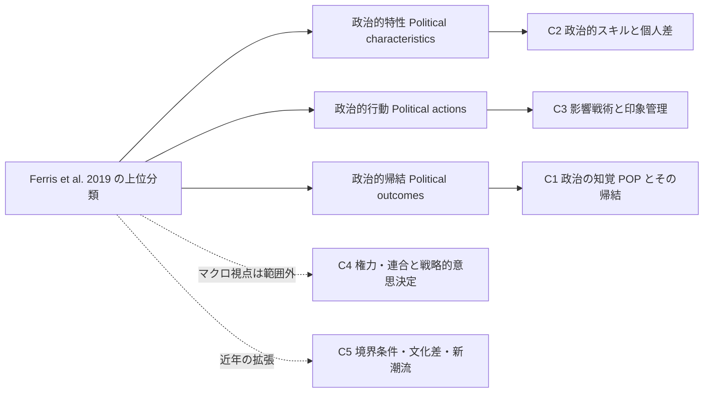
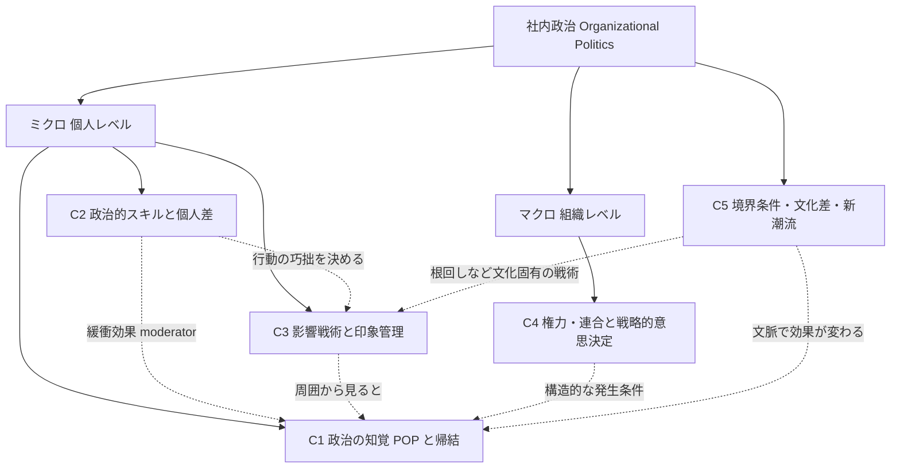
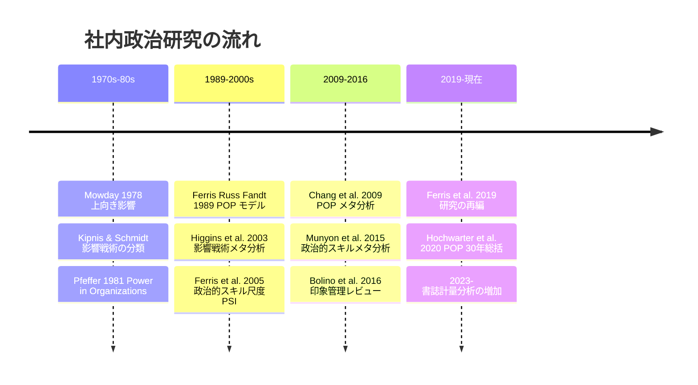
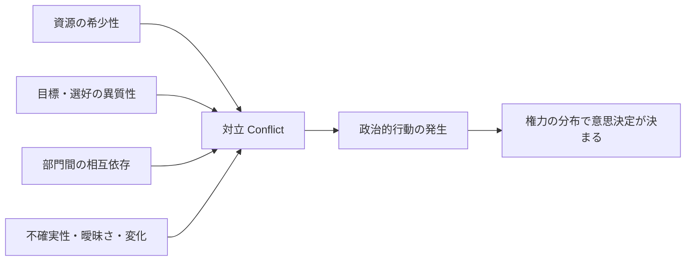

# 社内政治（Organizational Politics）研究 — ドメインマップ

## 調査パラメータ

- **調査タイプ**: 学術論文サーベイ（実証研究・メタ分析を重視）
- **時間範囲**: 古典（1970年代〜）を土台に、主に 2015 – 2026 のレビュー・メタ分析
- **生成日**: 2026-11-15
- **入力キーワード**: 社内政治, organizational politics, 根回し, 政治的スキル
- **検索言語**: 英語（主）+ 日本語（補助）
- **深さ**: 軽量版（クラスタリングのみ。gather / retrieval は未実施）

## 全体像（Big Picture）

社内政治は経営学・産業組織心理学で **組織行動（OB）の主要テーマ** として約 40 年研究されています。学術的には「正式に承認されていない影響手段を使い、自分や集団の利益を守る・増やす行動」と定義されることが多いです。

研究の流れは大きく 2 つです。

- **ミクロ（個人）系**: Ferris らを中心とする米国の産業組織心理学。「政治の知覚（POP）」「政治的行動（影響戦術）」「政治的スキル」の 3 つの構成概念で整理されてきました。
- **マクロ（組織）系**: Pfeffer らの権力論・資源依存論、Eisenhardt らの戦略的意思決定研究。「意思決定は合理性だけでなく連合と権力で決まる」という見方です。

研究の評価軸も変わってきました。以前は「利己的で有害な行動」として負の側面が中心でしたが、近年は **「利害が違う人々の合意形成に避けられない機能」** として中立〜肯定的にも扱われます。Ferris, Ellen, McAllister & Maher（2019）は、従来の 3 構成概念の分け方が研究を狭めていると指摘し、**「政治的特性 / 政治的行動 / 政治的帰結」** という上位の枠組みへの再編を提案しています。2023 年以降は書誌計量分析（bibliometric）も増えており、新しいテーマとして **ストレス、印象管理、リーダーの政治的スキル** が挙がっています。

**事前スキャンで見えた偏り**: 実証研究の大半は **米英の自己報告式サーベイ** です。日本企業を対象にした実証研究は少なく、根回しの効果を定量的に検証した研究はほとんど見つかっていません（木村琢磨『社内政治の科学』などの解説が中心）。

## 参考サーベイ・レビュー論文

| タイトル | 年 | 概要 | リンク |
|---------|----|------|-------|
| Reorganizing Organizational Politics Research: A Review of the Literature and Identification of Future Research Directions（Ferris, Ellen, McAllister & Maher） | 2019 | Annual Review of OPOB。3 構成概念を「特性 / 行動 / 帰結」に再編。**本マップの分け方の土台** | [DOI](https://doi.org/10.1146/annurev-orgpsych-012218-015221) |
| Perceptions of Organizational Politics Research: Past, Present, and Future（Hochwarter et al.） | 2020 | Journal of Management。POP 研究 30 年の総括。事象システム理論（event systems theory）を提案 | [Boise State](https://experts.boisestate.edu/en/publications/perceptions-of-organizational-politics-research-past-present-and-/) |
| Perceptions of Organizational Politics: Theory and Research Directions（Ferris et al.） | 2002 | POP の理論・研究方向を整理した長編レビュー | [DOI](https://doi.org/10.1016/S1475-9144(02)01034-2) |
| The Relationships Among Perceptions of Organizational Politics and Employee Attitudes, Strain, and Behavior: A Meta-Analytic Examination（Chang, Rosen & Levy） | 2009 | AMJ。POP → 態度・ストレス・行動のメタ分析 | — |
| Political Skill and Work Outcomes: A Theoretical Extension, Meta-Analytic Investigation, and Agenda for the Future（Munyon, Summers, Thompson & Ferris） | 2015 | Personnel Psychology。政治的スキル → 業績・キャリア・評判のメタ分析 | [academia.edu](https://independent.academia.edu/JamesSummers10) |
| Influence Tactics and Work Outcomes: A Meta-Analysis（Higgins, Judge & Ferris） | 2003 | 影響戦術（迎合・自己宣伝・合理的説得など）と成果のメタ分析 | [typeset.io](https://typeset.io/pdf/influence-tactics-and-work-outcomes-a-meta-analysis-54kyfa056u.pdf) |
| Impression Management in Organizations: Critical Questions, Answers, and Areas for Future Research（Bolino, Long & Turnley） | 2016 | Annual Review of OPOB。印象管理の先行要因・帰結・誠実/欺瞞的 IM | — |
| Impact of Organizational Politics on Employee Outcomes: A Systematic Literature Review（Malik et al.） | 2024 | 従業員アウトカムへの影響の体系的レビュー | [EconBiz](https://econbiz.de/Record/impact-of-organizational-politics-on-employee-outcomes-a-systematic-literature-review-malik-lubna-rashid/10014552696) |
| Mapping the Terrain of Organizational Politics Research: Insights from a Bibliometric Analysis（Rehman et al.） | 2025 | Scopus 1977–2023 の書誌計量。3 テーマ（知覚と影響 / リーダーシップと政治行動 / 業績） | [UEL](https://repository.uel.ac.uk/item/8z48y) |
| What Is Known and Unknown: A Bibliometric Analysis of Organizational Politics | 2023 | 既知・未知の領域と最近の傾向をマッピング | [CEEOL](https://ceeol.com/search/article-detail?id=1136825) |

### サーベイのタクソノミーとクラスタの対応

Ferris et al.（2019）の再編案を、本マップの 5 クラスタに対応づけると次のとおりです。

## ドメインマップ

**読み方**: 政治的スキル（C2）は「同じ政治的環境（C1）でも傷つきにくい」「同じ戦術（C3）でもうまく効く」という **調整変数** として働きます。C4 は「なぜ組織に政治が生まれるのか」という構造面の説明です。

### 研究の時系列

## クラスタ一覧

| # | クラスタ名 | 分析レベル | キーワード数 | 一行要約 |
|---|-----------|-----------|-------------|---------|
| 1 | 政治の知覚（POP）とその帰結 | 個人 / 職場 | 10 | 「この職場は政治的だ」という知覚が満足度・ストレス・離職に与える影響 |
| 2 | 政治的スキルと個人差 | 個人 | 10 | 政治を「うまくやる」能力の測定と、業績・キャリアへの効果 |
| 3 | 影響戦術と印象管理 | 個人 / 二者関係 | 11 | 迎合・自己宣伝・連合などの具体的な戦術とその効果 |
| 4 | 権力・連合と戦略的意思決定 | 組織 / 経営陣 | 10 | 組織レベルで権力と連合が意思決定を左右する仕組み |
| 5 | 境界条件・文化差・新潮流 | 横断 | 11 | 文化（根回し等）、リーダー、ポジティブな政治、リモート環境など |

## クラスタ詳細

### クラスタ 1: 政治の知覚（POP）とその帰結

**概要**: 社内政治研究で最も蓄積が多い領域です。従業員が「職場で利己的な駆け引きが横行している」と **主観的に感じる程度**（Perceptions of Organizational Politics: POP）を測り、仕事の態度・健康・行動への影響を調べます。実際の政治行動の量ではなく **知覚** を扱うのが特徴です。メタ分析では、POP が高いほど職務満足・組織コミットメントが下がり、ストレスと離職意図が上がる関係が一貫して報告されています。

**キーワード**:

- Perceptions of Organizational Politics (POP / POPs)
- POPS 尺度（Kacmar & Ferris; Kacmar & Carlson）
- Ferris, Russ & Fandt (1989) モデル
- job satisfaction / organizational commitment
- job strain / burnout / psychological well-being
- turnover intention
- organizational citizenship behavior (OCB)
- counterproductive work behavior (CWB)
- organizational justice（公正知覚との区別）
- event systems theory

**想定される因果構造**:

$$
\text{組織要因・個人要因} \rightarrow \text{POP} \rightarrow \{\text{満足度}\downarrow,\ \text{コミットメント}\downarrow,\ \text{ストレス}\uparrow,\ \text{離職意図}\uparrow\}
$$

**調査戦略**:

1. Hochwarter et al. (2020) で全体像をつかむ
2. Chang, Rosen & Levy (2009) のメタ分析で効果量を確認する
3. 検索クエリ例: `"perceptions of organizational politics" meta-analysis`, `POPs outcomes longitudinal`
4. 論点: POP と「組織的公正」はどこが違うのか（構成概念の重なり）、横断調査が多く因果が弱い点

**代表的リソース**:

| タイトル | 種別 | 年 | 概要 |
|---------|------|----|------|
| Ferris, Russ & Fandt — Politics in Organizations | 書籍章 | 1989 | POP 研究の出発点となったモデル |
| Chang, Rosen & Levy — POP と態度・ストレス・行動のメタ分析 | 論文（AMJ） | 2009 | POP の帰結に関する中心的メタ分析 |
| 118 サンプルを統合した POP メタ分析（態度・健康・行動） | 論文 | — | 健康面の帰結まで含めたメタ分析（著者は未確認） |
| Hochwarter et al. — POP Research: Past, Present, and Future | レビュー（JOM） | 2020 | 30 年の総括と今後の方向 |
| Malik et al. — Impact of Organizational Politics on Employee Outcomes | 体系的レビュー | 2024 | 従業員アウトカムへの影響の最新整理 |

---

### クラスタ 2: 政治的スキルと個人差

**概要**: 「社内政治にうまく対処できる人とできない人の違い」を扱う領域です。Ferris らは政治的スキルを **社会的洞察力・対人影響力・ネットワーキング能力・誠実さの見せ方（apparent sincerity）** の 4 次元で定義し、尺度（Political Skill Inventory: PSI）を作りました。メタ分析では、政治的スキルが業績・キャリア成功・評判と正の関係を持つことが示されています。また、政治的な職場の悪影響をやわらげる **調整変数** としての研究も多くあります。

**キーワード**:

- political skill / Political Skill Inventory (PSI, 18 項目)
- social astuteness（社会的洞察力）
- interpersonal influence（対人影響力）
- networking ability（ネットワーキング能力）
- apparent sincerity（誠実さの見せ方）
- leader political skill
- personal reputation
- career success
- Machiavellianism / dark triad（暗い性格特性との関係）
- self-monitoring

**政治的スキルの調整効果**:

$$
\text{Outcome} = \beta_1\,\text{POP} + \beta_2\,\text{PS} + \beta_3\,(\text{POP} \times \text{PS}),\quad \beta_3 \text{ が有意なら緩衝効果}
$$

**調査戦略**:

1. Munyon et al. (2015) のメタ分析で効果の全体像を確認する
2. Ferris et al. (2005) の PSI 開発論文で構成概念を理解する
3. 検索クエリ例: `"political skill" meta-analysis`, `"political skill" moderator perceptions of politics`, `"leader political skill"`
4. 論点: 政治的スキルは鍛えられるのか（訓練可能性）、マキャベリズムとの違い、高 POP 下で CWB を促すという負の側面

**代表的リソース**:

| タイトル | 種別 | 年 | 概要 |
|---------|------|----|------|
| Ferris et al. — Development and Validation of the Political Skill Inventory | 論文（JOM） | 2005 | PSI 尺度の開発 |
| Bing et al. — 政治的スキルによる課業・文脈業績の予測（メタ分析） | 論文（JVB） | 2011 | 業績予測のメタ分析と調整要因 |
| Munyon, Summers, Thompson & Ferris — Political Skill and Work Outcomes | メタ分析（Pers. Psych.） | 2015 | 自己効力感・満足・業績・キャリア・評判との関係 |
| Brouer, Harris & Kacmar — 政治的スキルの調整効果 | 論文 | 2011 | POP と結果の関係を政治的スキルが調整 |
| 政治的スキルと利己的 CWB（POP の調整効果） | 論文（Cambridge） | 2022 | 高 POP 下では政治的スキルが CWB と正の関係 — 負の側面 |
| How important are political skills for career success?（IJHRM） | 体系的レビュー + メタ分析 | 2021 | キャリア成功への寄与 |

---

### クラスタ 3: 影響戦術と印象管理

**概要**: 社内政治の **具体的な行動** を扱う領域です。上司・同僚・部下を動かすための戦術（合理的説得・迎合・交換・連合・上位者への訴えなど）の分類と、その効果を調べます。Kipnis & Schmidt の分類が出発点で、Yukl らが改良しました。印象管理（自己宣伝・迎合・模範・威嚇・懇願）は、評価者の目に自分をどう見せるかの研究で、人事評価や採用面接の文脈でメタ分析があります。

**キーワード**:

- influence tactics（Kipnis & Schmidt 1980; Yukl & Falbe）
- upward / downward / lateral influence
- rational persuasion（合理的説得）
- ingratiation（迎合）
- self-promotion（自己宣伝）
- exchange / coalition / upward appeal
- impression management（Jones & Pittman の 5 戦術）
- supervisor-focused vs job-focused IM
- performance appraisal bias
- voice / issue selling（提案・問題提起の売り込み）
- Profiles of Organizational Influence Strategies (POIS)

**主要な影響戦術の比較**:

| 戦術 | 方向 | 典型的な効果（メタ分析の傾向） |
|------|------|-------------------------------|
| 合理的説得 | 上向き・横 | 業績評価・成果と最も安定して正の関係 |
| 迎合（ingratiation） | 上向き | 上司の好意・評価に正。ただし見抜かれると逆効果 |
| 自己宣伝 | 上向き | 効果は不安定。迎合とは別物として扱うべき |
| 連合・上位者への訴え | 上向き・横 | 強硬な戦術で、関係を損なうリスクが高い |

**調査戦略**:

1. Higgins, Judge & Ferris (2003) で戦術ごとの効果量を確認する
2. Bolino, Long & Turnley (2016) で印象管理の全体像をつかむ
3. 検索クエリ例: `"influence tactics" meta-analysis`, `"upward influence" review`, `"issue selling" middle managers`
4. 論点: 戦術の効果は相手との関係性（LMX）や文化でどう変わるか、誠実な IM と欺瞞的な IM の区別

**代表的リソース**:

| タイトル | 種別 | 年 | 概要 |
|---------|------|----|------|
| Mowday — The Exercise of Upward Influence in Organizations | 論文 | 1978 | 上向き影響の最初期の実証研究 |
| Kipnis, Schmidt & Wilkinson — Intraorganizational Influence Tactics | 論文 | 1980 | 影響戦術の 8 次元分類 |
| Higgins, Judge & Ferris — Influence Tactics and Work Outcomes | メタ分析 | 2003 | 戦術ごとの成果への影響 |
| Smith et al. — 性別と影響戦術のメタ分析 | メタ分析 | 2013 | 横・上向き影響のジェンダー差 |
| Bolino, Long & Turnley — Impression Management in Organizations | レビュー（Annual Review） | 2016 | 印象管理研究の総括 |
| Peck & Levashina — 面接と業績における印象管理のメタ分析 | メタ分析（Frontiers） | 2017 | 迎合の効果はラボ r=0.33、フィールド r=0.21 |
| Dutton & Ashford — Selling Issues to Top Management | 論文（AMR） | 1993 | ミドルの問題提起（issue selling）の古典 |

---

### クラスタ 4: 権力・連合と戦略的意思決定

**概要**: 個人の心理ではなく **組織レベル** で政治を見る領域です。Pfeffer は、資源が足りない・目標がバラバラ・部門が互いに依存し合う・不確実性が高い、という条件がそろうと対立が起き、それが政治を生むと論じました。戦略的意思決定の研究（Eisenhardt & Bourgeois 1988 など）では、裏での連合づくり、情報の出し惜しみ、議題のコントロールといった行動が観察され、政治的な意思決定ほど業績が悪いという結果も出ています。

**キーワード**:

- power in organizations（Pfeffer 1981; Managing with Power 1992）
- resource dependence theory（Pfeffer & Salancik 1978）
- strategic contingencies theory（部門の権力の源泉）
- dominant coalition（支配的連合）
- political model of decision making
- agenda control / information withholding
- top management team (TMT) politics
- micropolitics
- garbage can model（隣接領域）
- middle manager strategic influence

**政治が生まれる条件（Pfeffer のモデル）**:

**調査戦略**:

1. Pfeffer (1981) の理論枠組みを押さえる
2. Eisenhardt & Bourgeois (1988) で経営陣の政治の実証を読む
3. 検索クエリ例: `"political behavior" strategic decision making`, `"top management team" politics performance`, `"dominant coalition" strategic change`
4. 論点: マクロの権力論と、C1〜C3 のミクロ研究はほぼ分断されている（Ferris et al. 2019 もマクロ側は扱いが薄い）

**代表的リソース**:

| タイトル | 種別 | 年 | 概要 |
|---------|------|----|------|
| Pfeffer & Salancik — The External Control of Organizations | 書籍 | 1978 | 資源依存論 |
| Pfeffer — Power in Organizations | 書籍 | 1981 | 権力と政治を組織分析に組み込んだ古典 |
| Mintzberg — Power In and Around Organizations | 書籍 | 1983 | 組織内外の権力の類型 |
| Eisenhardt & Bourgeois — Politics of Strategic Decision Making in High-Velocity Environments | 論文（AMJ） | 1988 | 経営陣の政治と業績の関係 |
| Pfeffer — Managing with Power | 書籍 | 1992 | 実務者向けの権力論 |
| Bringing Politics Back（Wharton） | 論文 | — | 支配的連合が組織の継続と変化を生むという議論 |

---

### クラスタ 5: 境界条件・文化差・新潮流

**概要**: 「社内政治の効果は文脈によって変わる」ことを扱う横断的な領域です。文化差（集団主義・権力格差、日本の根回しや稟議）、リーダーの政治的スキル、政治を **ポジティブな機能** として捉える研究、そしてリモート・ハイブリッドワークでの可視性の政治などが含まれます。2023 年以降の書誌計量分析では、ストレス・印象管理・リーダーの政治的スキルが新しいテーマとして挙がっています。

**キーワード**:

- cross-cultural organizational politics
- power distance / collectivism
- nemawashi（根回し）/ ringi（稟議）
- guanxi（関係、中国）
- positive / prosocial politics
- leader political skill / leader political behavior
- politics climate（集団レベルの政治風土）
- multilevel politics
- remote work / hybrid work visibility
- gender and politics
- bibliometric analysis of organizational politics

**調査戦略**:

1. 2023–2025 の書誌計量分析（Rehman et al. など）で新しいテーマの流れを確認する
2. 文化差は `"organizational politics" cross-cultural`, `"political skill" collectivism` で検索する
3. 日本の文脈は木村琢磨氏の研究（法政大学リポジトリ、科研費報告）を起点にする
4. 論点: 日本の実証研究が少ない（研究ギャップ）、根回しを「政治的行動」と見るか「公式プロセスの一部」と見るか

**代表的リソース**:

| タイトル | 種別 | 年 | 概要 |
|---------|------|----|------|
| What Is Known and Unknown: A Bibliometric Analysis of Organizational Politics | 書誌計量 | 2023 | 既知・未知の領域のマッピング |
| Scopus 書誌計量研究（Revista de Administração da UFSM） | 書誌計量 | 2023 | 中心テーマは業績・権力、新テーマはストレス・印象管理・リーダーの政治的スキル |
| Rehman et al. — Mapping the Terrain of Organizational Politics Research | 書誌計量 | 2025 | 1977–2023 を 3 テーマで整理 |
| 木村琢磨 — 社内政治に関する研究（法政大学リポジトリ） | 論文 | — | 日本企業のミドルの政治行動 |
| 木村琢磨 — 科研費 15K17127 成果報告 | 研究報告 | — | 日本企業の社内政治の実証 |
| 木村琢磨『社内政治の科学』（日経BP） | 書籍 | — | 日本語の学術的な入門書 |

---

## 次の一手（意思決定用）

| 選択肢 | 内容 | 向いている目的 |
|--------|------|---------------|
| C1 + C2 を深掘り | メタ分析中心で「何が分かっているか」を固める | 全体像を最短で押さえたい |
| C4 を深掘り | ミクロとマクロの分断をつなぐ | 意思決定プロセスへの関心が強い |
| C5（日本）を深掘り | 研究ギャップの確認 | 日本企業への適用を考えたい |
| gather 実行 | 全クラスタの論文リストを作る | 体系的なサーベイに進みたい |

## Sources

- [Ferris et al. 2019, Annual Review of OPOB](https://doi.org/10.1146/annurev-orgpsych-012218-015221)
- [Hochwarter et al. 2020, Journal of Management](https://experts.boisestate.edu/en/publications/perceptions-of-organizational-politics-research-past-present-and-/)
- [Ferris et al. 2002, Research in Multi-Level Issues](https://www.emerald.com/insight/content/doi/10.1016/S1475-9144(02)01034-2/full/html)
- [Munyon et al. 2015](https://independent.academia.edu/JamesSummers10)
- [Political skill and self-serving CWB（Cambridge）](https://www.cambridge.org/core/services/aop-cambridge-core/content/view/FFC86CBFA7FC46354372DE6025104A38/S183336721900066Xa.pdf/political-skill-and-self-serving-counterproductive-work-behaviors-moderating-role-of-perceptions-of-organizational-politics.pdf)
- [Higgins, Judge & Ferris 2003](https://typeset.io/pdf/influence-tactics-and-work-outcomes-a-meta-analysis-54kyfa056u.pdf)
- [Peck & Levashina 2017, Frontiers in Psychology](https://www.frontiersin.org/journals/psychology/articles/10.3389/fpsyg.2017.00201/full)
- [Eisenhardt & Bourgeois 1988](https://qualquant.org/wp-content/uploads/text/1988%20Eisenhardt737-770.pdf)
- [Bringing Politics Back（Wharton）](https://faculty.wharton.upenn.edu/wp-content/uploads/2016/11/BringingPoliticsBack.pdf)
- [Malik et al. 2024](https://econbiz.de/Record/impact-of-organizational-politics-on-employee-outcomes-a-systematic-literature-review-malik-lubna-rashid/10014552696)
- [Rehman et al. 2025](https://repository.uel.ac.uk/item/8z48y)
- [Bibliometric analysis 2023（CEEOL）](https://ceeol.com/search/article-detail?id=1136825)
- [Scopus bibliometric 2023（Redalyc）](https://www.redalyc.org/journal/2734/273476414007/movil)
- [木村琢磨 研究論文（法政大学）](https://hosei.ecats-library.jp/da/repository/00007610/cd-gak08_kimura.pdf)
- [木村琢磨 科研費報告（法政大学）](https://hosei.ecats-library.jp/da/repository/00021279/17_kaken_15K17127seika.pdf)
- [『社内政治の科学』紹介（日経BP）](https://bookplus.nikkei.com/atcl/column/101000304/030600024/)
