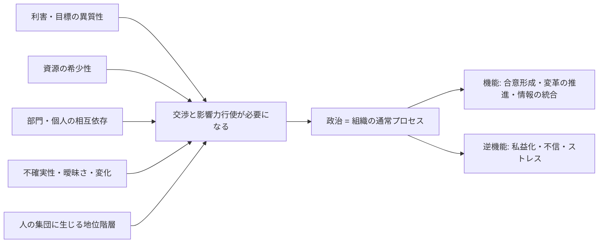
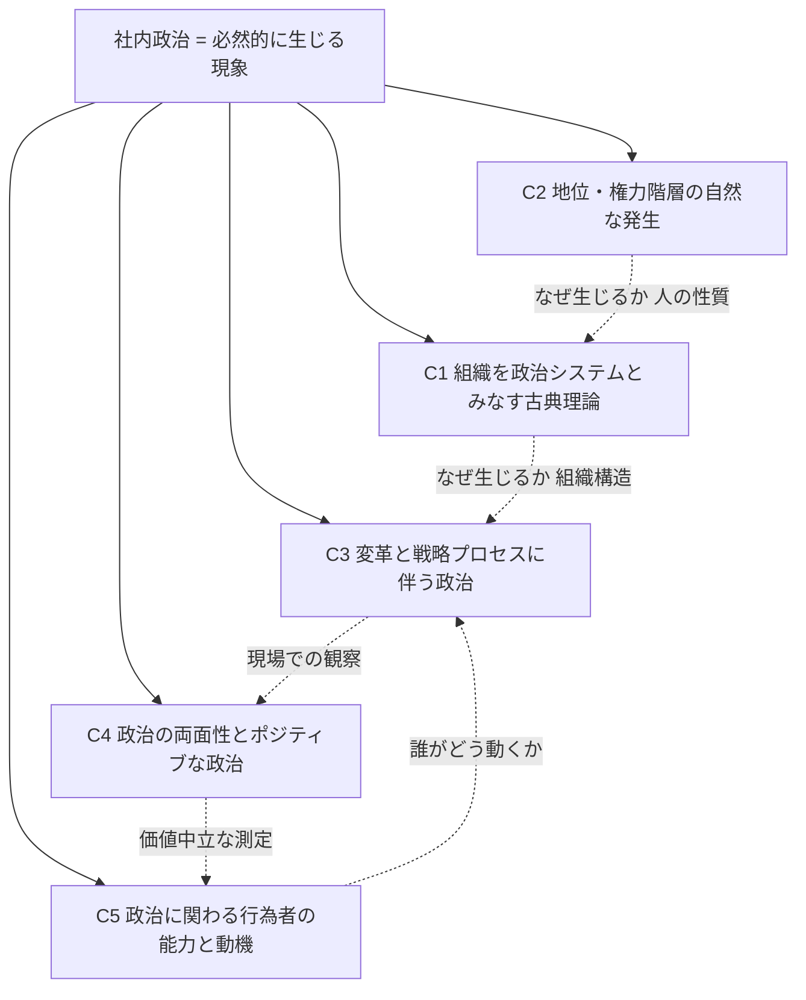
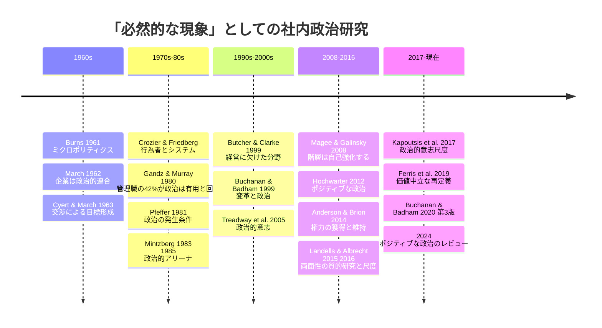
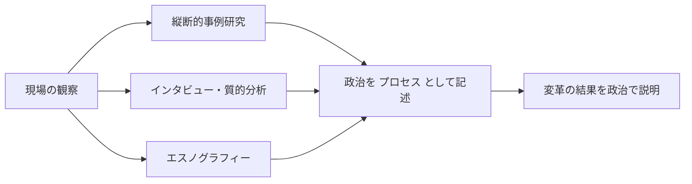

# 社内政治を「必然的に生じる現象」として捉える研究 — ドメインマップ

## 調査パラメータ

- **調査タイプ**: 学術論文サーベイ（理論・実証・質的研究）
- **時間範囲**: 古典（1960年代〜）を土台に、2010 – 2026 の研究まで
- **生成日**: 2026-11-15
- **立場**: 社内政治を「悪いもの・避けるべきもの」ではなく、**組織があれば必ず生じる現象** として捉え、その **発生の仕組みと働き** を記述・説明する研究を集める
- **入力キーワード**: 社内政治, organizational politics, 必然, 現象, micropolitics, political arena, positive politics
- **検索言語**: 英語（主）+ 日本語（補助）
- **深さ**: 軽量版（クラスタリングのみ。gather / retrieval は未実施）

### 前回 run（[20261115](../20261115/index.md)）との違い

| 観点 | 前回 run | 今回 run |
|------|---------|---------|
| 社内政治の見方 | 主に「知覚された悪影響」（POP → 満足度↓・離職↑） | **組織の構造から必ず生じる現象** |
| 中心の問い | 政治は従業員にどんな害を与えるか | **なぜ・どのように政治が生じ、組織の中で何をしているか** |
| 主な系譜 | 米国の産業組織心理学（Ferris ら） | **組織論・組織社会学・権力論・変革論・社会心理学** |
| 除外したもの | — | 「政治＝害」を前提にした POP の帰結研究（必要な範囲で対比として参照するだけ） |

## 全体像（Big Picture）

この立場の出発点は、**「組織とは利害の違う人々の連合である」** という見方です。March（1962）は企業を「政治的な連合」とみなし、組織の目標は最初から与えられるのではなく、メンバーの交渉で決まると論じました。そうであれば、資源が限られ、目標がばらばらで、部門が互いに依存し、先が読めない限り、**交渉と影響力の行使（＝政治）は組織が動くための通常のプロセス** になります。

この見方は、次の 4 つの研究の流れに分かれて発展してきました。

- **組織論・組織社会学**: 組織を政治システムとして見る古典（March、Cyert & March、Burns、Crozier、Pfeffer、Mintzberg）
- **社会心理学・進化的視点**: 人の集団には地位と権力の階層が自然に生まれ、それ自体を強める仕組みがある（Magee & Galinsky、Anderson & Brion）
- **変革・戦略プロセス研究**: 組織変革や戦略の実行には政治が **必ず伴う**（Buchanan & Badham）。ミドルマネジャーの影響力行使を、意味づけ（sensemaking）のプロセスとして記述する
- **両面性・ポジティブな政治**: 政治には機能的な面と逆機能的な面の両方がある。尺度も「ネガティブ前提」から「中立・両面」へ作り直されている（Landells & Albrecht）

実証的な裏づけとして、Gandz & Murray（1980）の調査では回答者の **93% が自社に政治があると答え**、**42% が「政治は組織がうまく機能するのに役立つ」** と答えています。Butcher & Clarke（1999）は社内政治を「経営学から抜け落ちた分野」と呼び、管理職の仕事そのものに政治が組み込まれていると主張しました。

**事前スキャンで見えた偏り**: 「必然的な現象」という立場の研究は、**理論・事例・質的研究が中心** です。量的な実証研究は今もネガティブ前提の POPS 尺度に頼るものが多く、両面性を測る尺度（Landells & Albrecht 2016/2019）はまだ広く使われていません。日本の根回し・稟議を「合意形成の政治」として記述した学術研究も少数です。

## 参考サーベイ・レビュー・基本文献

| タイトル | 年 | 概要 | リンク |
|---------|----|------|-------|
| March — The Business Firm as a Political Coalition | 1962 | 企業を政治的連合とみなす出発点 | — |
| Burns — Micropolitics: Mechanisms of Institutional Change（ASQ） | 1961 | 「ミクロポリティクス」の概念を提示。政治を制度変化の仕組みとして扱う | — |
| Pfeffer — Power in Organizations | 1981 | 政治が生じる条件（希少性・異質性・相互依存・不確実性）のモデル | — |
| Mintzberg — The Organization as Political Arena（JMS） | 1985 | 対立が組織を占めた状態を「政治的アリーナ」という 1 つの組織形態として類型化 | [RePEc](https://ideas.repec.org/a/bla/jomstd/v22y1985i2p133-154.html) |
| Butcher & Clarke — Organisational Politics: The Missing Discipline of Management?（ICT） | 1999 | 政治は経営に不可欠で、変革を進める「政治的な流暢さ」が軽視されてきたと主張 | [DOI](https://doi.org/10.1108/00197859910253100) |
| Buchanan & Badham — Power, Politics, and Organizational Change（第 3 版） | 2020 | 政治は組織変革に必ず伴い、機能的・逆機能的の両方の帰結を生む | [SAGE](https://in.sagepub.com/en-in/sas/power-politics-and-organizational-change/book261097) |
| Vigoda-Gadot & Drory（編）— Handbook of Organizational Politics（第 2 版） | 2016 | 政治的スキル・政治的意志・リーダーシップを含む研究の総覧 | [IUCC](https://cris.iucc.ac.il/en/publications/handbook-of-organizational-politics-second-edition-looking-back-a/) |
| Ferris, Ellen, McAllister & Maher — Reorganizing Organizational Politics Research | 2019 | 定義を価値中立に寄せ、「特性 / 行動 / 帰結」に再編 | [DOI](https://doi.org/10.1146/annurev-orgpsych-012218-015221) |
| Landells & Albrecht — Perceived Organizational Politics, Engagement, and Stress（Frontiers） | 2019 | ポジティブ・ネガティブ両面を測る新しい政治知覚尺度の検証 | [Frontiers](https://www.frontiersin.org/journals/psychology/articles/10.3389/fpsyg.2019.01612/full) |

### 「政治が必然的に生じる」理屈の骨格

各クラスタに共通する前提を 1 枚にまとめると次のとおりです。

$$
\text{政治の発生しやすさ} \;\propto\; \text{目標の異質性} \times \text{資源の希少性} \times \text{相互依存} \times \text{不確実性}
$$

（Pfeffer 1981 のモデルを簡略化した概念式。どれか 1 つでも 0 に近ければ政治は起きにくい、という読み方をします）

## ドメインマップ

**読み方**: C1 と C2 は **「なぜ政治が生じるのか」**（組織の構造と人の性質）を説明します。C3 は **「どこで・どのように生じるのか」**（変革や戦略の現場）を記述します。C4 は **「何をもたらすのか」**（機能と逆機能）を評価し、C5 は **「誰がどう関わるのか」**（能力と動機）を扱います。

### 研究の時系列

## クラスタ一覧

| # | クラスタ名 | 問い | 主な学問分野 | 研究方法 |
|---|-----------|------|-------------|---------|
| 1 | 組織を政治システムとみなす古典理論 | なぜ組織に政治が生じるのか（構造） | 組織論・組織社会学 | 理論・事例 |
| 2 | 地位・権力階層の自然な発生 | なぜ人の集団に政治が生じるのか（人の性質） | 社会心理学・進化心理学 | 実験・縦断調査 |
| 3 | 変革と戦略プロセスに伴う政治 | 政治はどこで・どのように現れるのか | 戦略論・変革論・SAP | 質的研究・縦断事例 |
| 4 | 政治の両面性とポジティブな政治 | 政治は組織に何をもたらすのか | 組織行動論・HRM | 質的研究・尺度開発 |
| 5 | 政治に関わる行為者の能力と動機 | 誰がどのように政治に関わるのか | 産業組織心理学 | 尺度開発・量的調査 |

## クラスタ詳細

### クラスタ 1: 組織を政治システムとみなす古典理論

**概要**: 「組織は単一の目標を持つ合理的な機械ではなく、利害の違う人々の連合である」という見方の理論群です。目標は交渉で決まり、権力は資源と不確実性の制御から生まれ、政治は組織が動くための通常の仕組みだと考えます。社内政治を **組織の本質的な性質** として扱う、この立場の理論的な土台です。

**キーワード**:

- business firm as a political coalition（March 1962）
- behavioral theory of the firm / bargaining（Cyert & March 1963）
- micropolitics（Burns 1961）
- actors and systems / zones of uncertainty（Crozier & Friedberg）
- power in organizations（Pfeffer 1981）
- resource dependence theory（Pfeffer & Salancik 1978）
- strategic contingencies theory（Hickson et al. 1971）
- political arena（Mintzberg 1985）
- dominant coalition
- organizations as political systems（Morgan, Images of Organization）
- interest groups / negotiated order

**理論の比較**:

| 理論 | 政治が生じる理由 | 政治の位置づけ |
|------|-----------------|---------------|
| March / Cyert & March | 目標がメンバー間で一致しない | 交渉で目標を決める通常のプロセス |
| Burns | 個人の利害と組織の利害がずれる | 制度が変わる仕組み |
| Crozier & Friedberg | 誰かが不確実性を握る | 不確実性を握る者が権力を持つ |
| Pfeffer | 希少性・異質性・相互依存・不確実性 | 条件がそろえば必ず生じる |
| Mintzberg | 対立が組織を占める | 「政治的アリーナ」という組織形態の 1 つ。変化の移行期にも現れる |

**調査戦略**:

1. Pfeffer（1981）と Mintzberg（1983）で枠組みをつかむ
2. March（1962）、Cyert & March（1963）で「目標は交渉で決まる」という出発点を確認する
3. 検索クエリ例: `"political coalition" organization theory`, `"micropolitics" organization review`, `"political arena" Mintzberg`
4. 論点: 古典理論は「政治は必然」と言うが、**量的に検証された部分は少ない**。後の C3・C4 の研究がどこまで裏づけたかを確認する

**代表的リソース**:

| タイトル | 種別 | 年 | 概要 |
|---------|------|----|------|
| Burns — Micropolitics: Mechanisms of Institutional Change | 論文（ASQ） | 1961 | 政治を「他者を資源として使う競争的行動」と定義 |
| March — The Business Firm as a Political Coalition | 論文 | 1962 | 企業 = 政治的連合 |
| Cyert & March — A Behavioral Theory of the Firm | 書籍 | 1963 | 予算や目標は連合内の交渉の結果 |
| Hickson et al. — A Strategic Contingencies Theory of Intraorganizational Power | 論文（ASQ） | 1971 | 不確実性に対処できる部門が権力を持つ |
| Pfeffer & Salancik — The External Control of Organizations | 書籍 | 1978 | 資源依存論 |
| Crozier & Friedberg — Actors and Systems: The Politics of Collective Action | 書籍 | 1977 / 1980 | 組織社会学から見た権力と集合行為 |
| Pfeffer — Power in Organizations | 書籍 | 1981 | 政治が生じる条件のモデル |
| Mintzberg — Power In and Around Organizations | 書籍 | 1983 | 組織内外の影響力システム |
| Mintzberg — The Organization as Political Arena | 論文（JMS） | 1985 | 政治的アリーナの 4 類型 |
| Micropolitics in the Multinational Corporation（Cambridge） | 書籍 | — | ミクロポリティクス概念の理論的整理 |

---

### クラスタ 2: 地位・権力階層の自然な発生

**概要**: 「なぜ人が集まると、必ず誰かが影響力を持ち、駆け引きが生じるのか」を **人の性質** から説明する研究群です。社会心理学では、地位（周囲からの尊敬）と権力（資源の制御）は別のものであり、どちらの階層も **自分自身を強める**（一度上に立つと、さらに上に立ちやすくなる）ことが示されています。進化的な視点では、地位を得る道として **支配（dominance）** と **威信（prestige）** の 2 つが区別されます。組織の公式な階層とは別に、非公式な階層が自然に生まれる理由を説明します。

**キーワード**:

- social hierarchy（社会的階層）
- power vs status（権力と地位の区別）
- self-reinforcing hierarchy（自己強化する階層）
- dominance vs prestige（支配と威信）
- status attainment in groups
- status conflict
- informal hierarchy / emergent leadership
- coalitional psychology（連合をつくる心理）
- power acquisition, maintenance, and loss
- micropolitics of status in teams

**調査戦略**:

1. Magee & Galinsky（2008）で「階層は自己強化する」という基本命題を押さえる
2. Anderson & Brion（2014）で、権力の獲得・維持・喪失をプロセスとして見る
3. 検索クエリ例: `"social hierarchy" self-reinforcing power status`, `"dominance" "prestige" status attainment organizations`, `"status conflict" teams`
4. 論点: 実験室研究が多く、実際の組織の政治にどこまで当てはまるか。C1 の組織理論とつなげる研究はまだ少ない

**代表的リソース**:

| タイトル | 種別 | 年 | 概要 |
|---------|------|----|------|
| Magee & Galinsky — Social Hierarchy: The Self-Reinforcing Nature of Power and Status | レビュー（AMA） | 2008 | 権力と地位は別物で、どちらも自己強化する |
| Anderson & Kennedy — Micropolitics: A New Model of Status Hierarchies in Teams | 書籍章 | 2012 | 集団は能力主義を目指すが、説得のうまい人が上に立つことがある |
| Anderson & Brion — Perspectives on Power in Organizations（Annual Review） | レビュー | 2014 | 数百の実証研究を、権力の獲得・維持・喪失のプロセスとして整理 |
| Cheng, Tracy, Henrich ほか — Dominance and Prestige | 論文（JPSP） | 2013 | 地位を得る 2 つの道（支配と威信）がどちらも影響力につながる |
| The Asymmetric Nature of Social Hierarchies（Organization Science） | 論文 | 2024 | 地位 → 権力の経路の方が、権力 → 地位の経路より強い |

---

### クラスタ 3: 変革と戦略プロセスに伴う政治

**概要**: 政治が **最もはっきり現れる場面**（組織変革・戦略の策定と実行・再編）を、現場に近い方法で記述する研究群です。Buchanan & Badham は、変革を進める人は政治に関わらざるを得ず、政治は変革に必ず伴うと論じました。戦略研究では、経営陣の意思決定に連合・ロビー活動・情報の制御が観察されています。近年は、ミドルマネジャーが上司の理解を形づくる「意味づけ（sensegiving）」と政治を一体のものとして記述する質的研究が増えています。

**キーワード**:

- politics of organizational change
- change agent as political entrepreneur
- "turf game"（Buchanan & Badham）
- strategic decision making politics（Eisenhardt & Bourgeois 1988）
- issue selling（Dutton & Ashford 1993）
- middle manager sensemaking / sensegiving
- strategy-as-practice（SAP）
- micropolitics of strategy implementation
- headquarters–subsidiary micropolitics
- longitudinal case study / ethnography

**研究方法の特徴**:

**調査戦略**:

1. Buchanan & Badham（2020, 第 3 版）で変革と政治の関係を体系的に押さえる
2. Eisenhardt & Bourgeois（1988）で経営陣の政治の実証を読む
3. 検索クエリ例: `"politics" "organizational change" lived experience`, `"middle managers" sensemaking politics change`, `"strategy as practice" power politics`, `micropolitics strategy implementation`
4. 論点: この立場の研究の中では **最も「現象の記述」に近い**。根回し・稟議のような日本の合意形成も、ここに位置づけて比較できる可能性がある

**代表的リソース**:

| タイトル | 種別 | 年 | 概要 |
|---------|------|----|------|
| Eisenhardt & Bourgeois — Politics of Strategic Decision Making in High-Velocity Environments | 論文（AMJ） | 1988 | 経営陣の連合形成・情報の制御を観察 |
| Dutton & Ashford — Selling Issues to Top Management | 論文（AMR） | 1993 | ミドルが問題を「売り込む」プロセス |
| Buchanan & Badham — Power, Politics, and Organizational Change | 書籍 | 1999 / 2020 | 政治は変革に必ず伴う |
| Buchanan — Politics and Organizational Change: The Lived Experience | 論文（Human Relations） | 1999 | 変革を担う管理職の政治経験 |
| Balogun & Johnson ほか — Organizational Restructuring and Middle Manager Sensemaking | 書籍章（SAP） | 2007 | 経営陣がいない場での横のやりとりが変革を形づくる |
| 戦略実行のミクロ政治プロセス（Cranfield 博士論文） | 博士論文 | — | 戦略変化は政治・社会プロセス抜きに理解できない |
| Abdullah & Ismail — Micropolitics of Middle Managers in Influencing Centre-led Change | 事例研究 | 2019 | 本社主導の変革でミドルが行うミクロ政治 |
| Bringing Politics Back（Wharton） | 論文 | — | 支配的連合が組織の継続と変化を生む |

---

### クラスタ 4: 政治の両面性とポジティブな政治

**概要**: 「政治は悪」という前提を見直し、**機能的な面と逆機能的な面の両方** を記述・測定する研究群です。古くは Gandz & Murray（1980）が、管理職の多くが政治を「組織に役立つ」とも見ていることを示しました。Butcher & Clarke は政治を組織民主主義の基盤とまで位置づけています。近年は Landells & Albrecht が、従業員の語りの質的分析から両面性を捉える 5 次元（関係・資源・評判・意思決定・コミュニケーション）を見出し、ネガティブ前提の POPS 尺度に代わる尺度を作りました。

**キーワード**:

- positive politics / constructive politics
- functional vs dysfunctional politics
- organizational politics as organizational democracy（Butcher & Clarke 2002）
- political fluency
- negatively biased POPS（従来尺度の偏り）
- five dimensions: relationships / resources / reputation / decisions / communication
- interpretative phenomenological analysis（IPA）
- meaningful work / engagement
- legitimate vs illegitimate political behavior
- value-neutral definition of politics

**ネガティブ前提と両面前提の比較**:

| 観点 | ネガティブ前提（POPS 型） | 両面前提（Landells & Albrecht 型） |
|------|-------------------------|-----------------------------------|
| 定義 | 自己利益のための非公式な行動 | 関係・資源・評判・意思決定・情報の **使い方と乱用** |
| 測るもの | 職場の政治の「ひどさ」 | 政治の **使われ方の良し悪し** |
| 想定される結果 | 満足度↓・ストレス↑ | 使い方次第でエンゲージメント↑ にもストレス↑ にもなる |
| 前提 | 政治は少ないほど良い | 政治はなくならない。どう使われるかが問題 |

**調査戦略**:

1. Gandz & Murray（1980）で管理職の実感を確認する
2. Butcher & Clarke（1999, 2002）で「経営に不可欠な分野」という主張を押さえる
3. Landells & Albrecht（2015 → 2016 → 2019）を順に読み、質的研究 → 次元化 → 尺度検証の流れを追う
4. 検索クエリ例: `"positive politics" organizations`, `"positive and negative" "organizational politics" scale`, `"political behavior" functional dysfunctional`
5. 論点: 両面尺度の検証はまだ少ない。「ポジティブな政治」と「影響力の正当な行使」を区別する基準が曖昧

**代表的リソース**:

| タイトル | 種別 | 年 | 概要 |
|---------|------|----|------|
| Gandz & Murray — The Experience of Workplace Politics（AMJ） | 論文 | 1980 | 428 人中 42% が「政治は組織の機能に役立つ」と回答 |
| Butcher & Clarke — Organisational Politics: The Missing Discipline of Management? | 論文 | 1999 | 政治的な流暢さは変革に不可欠 |
| Butcher & Clarke — Organizational Politics: The Cornerstone for Organizational Democracy | 論文（Org. Dynamics） | 2002 | 政治を組織民主主義の基盤と位置づける |
| Butcher & Clarke — Smart Management: Using Politics in Organisations | 書籍 | 2001 / 2008 | 政治は管理職の仕事に組み込まれている |
| Drory & Vigoda-Gadot — Organizational Politics and HRM: A Typology | 論文 | 2010 | 政治には HRM に役立つ面がある |
| Hochwarter — The Positive Side of Organizational Politics | 書籍章 | 2012 | ポジティブな政治は組織生活に欠かせない |
| Landells & Albrecht — Organizational Political Climate: Shared Perceptions about the Building and Use of Power Bases | 論文 | 2013 | 政治風土を権力基盤の構築・使用として捉える |
| Landells & Albrecht — The Positives and Negatives of Organizational Politics: A Qualitative Study（JBP） | 質的研究 | 2015 | IPA による両面性の記述 |
| Landells & Albrecht — Perceived Organizational Politics, Engagement, and Stress（Frontiers） | 尺度検証 | 2019 | 5 次元の両面尺度 |
| Nyathi — ポジティブな政治知覚のレビュー（HRMS） | レビュー | 2024 | ポジティブな政治知覚の先行要因と帰結 |

---

### クラスタ 5: 政治に関わる行為者の能力と動機

**概要**: 政治が必然であるなら、問いは「政治をするか・しないか」ではなく **「誰が、なぜ、どれくらいうまく関わるか」** になります。この立場では、政治的スキル（うまく関わる能力）と政治的意志（関わろうとする動機）を **価値中立な個人差** として扱います。Treadway et al.（2005）は政治的意志に利己的な動機と利他的な動機の両方が含まれるとし、Kapoutsis et al.（2017）はその 2 次元尺度を作りました。前回 run の C2 と重なりますが、ここでは「政治の害をやわらげる能力」ではなく **「現象の担い手の特性」** として整理しています。

**キーワード**:

- political skill（Ferris et al. 2005; Political Skill Inventory）
- political will（Treadway et al. 2005）
- self-serving vs benevolent political will（利己的・利他的動機）
- political will scale（Kapoutsis et al. 2017）
- political behavior as everyday managerial work
- leader political skill
- stakeholder management
- reputation building
- network building / brokerage
- influence tactics as normal behavior（Kipnis & Schmidt）

**行為者モデル**:

$$
\text{政治的行動} = f(\underbrace{\text{政治的意志}}_{\text{関わる動機}},\ \underbrace{\text{政治的スキル}}_{\text{関わる能力}},\ \underbrace{\text{状況}}_{\text{C1 の発生条件}})
$$

**調査戦略**:

1. Treadway et al.（2005）で「意志 × スキル → 行動」の枠組みを押さえる
2. Kapoutsis et al.（2017）で政治的意志の 2 次元（利己・利他）を確認する
3. Handbook of Organizational Politics（第 2 版）の第 1 部で全体を俯瞰する
4. 検索クエリ例: `"political will" benevolent self-serving`, `"political will" "political skill" political behavior`, `"political skill" leader effectiveness`
5. 論点: 「利他的な政治」の実証はまだ少ない。能力と動機の研究が、C3 の現場記述とほとんどつながっていない

**代表的リソース**:

| タイトル | 種別 | 年 | 概要 |
|---------|------|----|------|
| Kipnis, Schmidt & Wilkinson — Intraorganizational Influence Tactics | 論文 | 1980 | 日常の影響戦術の分類 |
| Ferris et al. — Political Skill in Organizations（JOM） | レビュー | 2007 | 政治的スキルの理論的整理 |
| Ferris et al. — Development and Validation of the Political Skill Inventory | 論文（JOM） | 2005 | PSI 尺度 |
| Treadway et al. — Political Will, Political Skill, and Political Behavior（JOB） | 論文 | 2005 | 意志 × スキル → 行動 |
| Kapoutsis et al. — The Political Will Construct（scale development） | 論文 | 2017 | 2 次元の政治的意志尺度（3 か国・900 人超で検証） |
| Political Will: Mechanisms of Stakeholder Management | 論文 | — | 政治的意志をステークホルダー管理として捉える |
| Munyon et al. — Political Skill and Work Outcomes | メタ分析 | 2015 | 政治的スキルと業績・キャリア・評判 |
| Vigoda-Gadot & Drory（編）— Handbook of Organizational Politics（第 2 版） | 書籍 | 2016 | 政治的スキル・意志・リーダーシップの総覧 |

---

## 研究ギャップ（この立場で見たとき）

| ギャップ | 内容 | 関係するクラスタ |
|---------|------|-----------------|
| 量的検証の不足 | 「必然」という主張は理論・事例が中心で、発生条件を量的に検証した研究が少ない | C1, C3 |
| 測定の偏り | 量的研究の多くがネガティブ前提の POPS を使い続けている | C4 |
| ミクロとマクロの分断 | 社会心理学（C2）・個人差（C5）と組織理論（C1）・変革研究（C3）がつながっていない | C1, C2, C3, C5 |
| 文化的文脈 | 根回し・稟議など、非西洋の合意形成を「政治」として記述した研究が少ない | C3, C4 |

## 次の一手（意思決定用）

| 選択肢 | 内容 | 向いている目的 |
|--------|------|---------------|
| C1 + C4 を深掘り | 「なぜ生じるか」の理論と「何をもたらすか」の評価をセットで固める | この立場の主張を最短で押さえたい |
| C3 を深掘り | 変革・戦略の現場で政治がどう現れるかの質的研究を集める | 現象そのものを具体的に知りたい |
| C2 を深掘り | 人の集団に階層と政治が生じる心理的な仕組み | 「なぜ人は政治をするのか」の根本を知りたい |
| gather 実行 | 全クラスタの論文リストを作る | 体系的なサーベイに進みたい |

## Sources

- [Mintzberg 1985, The Organization as Political Arena（RePEc）](https://ideas.repec.org/a/bla/jomstd/v22y1985i2p133-154.html)
- [Micropolitics in the Multinational Corporation（Cambridge）](https://www.cambridge.org/core/books/micropolitics-in-the-multinational-corporation/theoretical-foundations-and-conceptual-definitions/7966DF3878D68CED6D7ACF4100356599)
- [Toward a Definition of Organizational Politics（typeset.io）](https://typeset.io/pdf/toward-a-definition-of-organizational-politics-2sj5wkusf5.pdf)
- [Coalitions（SAGE Encyclopedia）](https://sk.sagepub.com/ency/edvol/embed/organization/chpt/coalitions)
- [Butcher & Clarke 1999](https://doi.org/10.1108/00197859910253100)
- [Butcher & Clarke 2002（Cranfield）](https://dspace.lib.cranfield.ac.uk/items/ee89c09f-83fe-48a6-9a5b-2418813be5c1)
- [Smart Management（Schweitzer）](https://www.schweitzer-online.de/en/buch/Butcher/Smart-Management/9781349426850/A36586988/)
- [Politics and Organizational Change: The Lived Experience（Macquarie）](https://researchers.mq.edu.au/en/publications/politics-and-organizational-change-the-lived-experience/)
- [Buchanan & Badham, Power, Politics, and Organizational Change（SAGE）](https://in.sagepub.com/en-in/sas/power-politics-and-organizational-change/book261097)
- [Office politics: what HR practitioners need to know（HRZone）](https://hrzone.com/office-politics-what-hr-practitioners-need-to-know/)
- [Landells & Albrecht 2015（Springer）](https://link.springer.com/10.1007/s10869-015-9434-5)
- [Landells & Albrecht 2019（Frontiers）](https://www.frontiersin.org/journals/psychology/articles/10.3389/fpsyg.2019.01612/full)
- [Perceptions of organizational politics: the positives and negatives（Deakin）](https://dro.deakin.edu.au/articles/thesis/Perceptions_of_organizational_politics_the_positives_and_negatives/21111583/1)
- [Nyathi 2024（EnPress）](https://www.enpress-publisher.com/files/journals/34_hrms/articles/3403/submission/proof/3403-181-8085-3-10-20240913.pdf)
- [Magee & Galinsky 2008（Columbia）](https://business.columbia.edu/faculty/research/social-hierarchy-self-reinforcing-nature-power-and-status)
- [Anderson & Kennedy 2012, Micropolitics（Emerald）](https://emerald.com/insight/content/doi/10.1108/S1534-0856(2012)0000015006/full/html)
- [Anderson & Brion 2014 の解説（IESE Insight）](https://www.iese.edu/insight/?p=3745)
- [The Asymmetric Nature of Social Hierarchies 2024（INFORMS）](https://pubsonline.informs.org/doi/10.1287/orsc.2024.18685)
- [Political Skill in Organizations（JOM）](https://www.crforum.co.uk/wp-content/uploads/2017/06/Political-Skill-in-Organizations.pdf)
- [Political will scale（core.ac.uk）](https://core.ac.uk/download/327080104.pdf)
- [Political Will: Mechanisms of Stakeholder Management](https://ouci.dntb.gov.ua/works/455DLv34)
- [Handbook of Organizational Politics 第 2 版（IUCC）](https://cris.iucc.ac.il/en/publications/handbook-of-organizational-politics-second-edition-looking-back-a/)
- [Drory & Vigoda-Gadot, Organizational politics and HRM（Haifa）](https://cris.haifa.ac.il/en/publications/organizational-politics-and-human-resource-management-a-typology-/)
- [Gandz & Murray 1980 の紹介（Saylor）](https://saylordotorg.github.io/text_organizational-behavior-v1.1/s17-04-organizational-politics.html)
- [Eisenhardt & Bourgeois 1988](https://qualquant.org/wp-content/uploads/text/1988%20Eisenhardt737-770.pdf)
- [Bringing Politics Back（Wharton）](https://faculty.wharton.upenn.edu/wp-content/uploads/2016/11/BringingPoliticsBack.pdf)
- [Organizational Restructuring and Middle Manager Sensemaking（Cambridge）](https://www.cambridge.org/core/books/strategy-as-practice/organizational-restructuring-and-middle-manager-sensemaking/8ABD2E4A8220626ABFFAD538CFAB7449)
- [Micro-political processes in strategy implementation（Cranfield）](https://dspace.lib.cranfield.ac.uk/handle/1826/3794)
- [Abdullah & Ismail 2019（Jurnal Pengurusan）](https://ukm.my/jurnalpengurusan/article/micropolitics-of-middle-managers-in-influencing-centre-led-change-initiative-case-study-of-a-malaysian-based-mnc)
- [Ferris et al. 2019](https://doi.org/10.1146/annurev-orgpsych-012218-015221)
