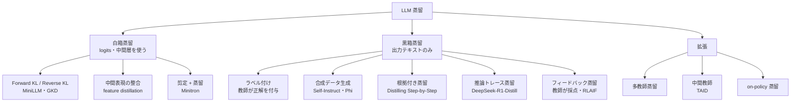

# クラスタ 1: 蒸留手法と技術基盤（`kd_methods`）

## 概要

LLM 蒸留の技術的な土台を扱います。教師の内部状態（logits・中間表現）にアクセスできる **白箱蒸留** と、出力テキストだけを使う **黒箱蒸留**（商用 API を教師にする場合はこちら）が大分類です。2023年以降は、教師に根拠（rationale / CoT）を出させて生徒に学ばせる **推論蒸留**、教師に学習データそのものを生成させる **合成データ蒸留**、さらに **剪定（pruning）と蒸留の組合せ**（NVIDIA Minitron）が実務の主流になりました。ビジネス事例を読むうえで「どの方式で蒸留したか」によってコスト構造・規約上の制約・精度が変わるため、最初に押さえるべきクラスタです。

## 方式の分類

| 方式 | 教師へのアクセス | 必要データ | 商用 API 教師で可能か | 代表例 |
|------|----------------|-----------|---------------------|-------|
| 白箱（logit KD） | 重み・logits | 少〜中 | ✗ | MiniLLM, GKD, Gemma 2 |
| 剪定 + 蒸留 | 重み | 少（スクラッチ比 1/40 トークン） | ✗ | Minitron |
| 黒箱 SFT（合成データ） | 出力のみ | 中〜大 | △ 規約次第 | Alpaca, Phi, Bedrock 蒸留 |
| 根拠付き / 推論蒸留 | 出力 + CoT | 中 | △ CoT 非開示の API あり | Step-by-Step, R1-Distill |
| フィードバック蒸留 | 採点出力 | 中 | △ | RLAIF, UltraFeedback |

## キーワード

- `knowledge distillation`
- `white-box distillation` / `black-box distillation`
- `sequence-level KD`
- `reverse KL` / `MiniLLM` / `GKD (on-policy distillation)`
- `Distilling Step-by-Step` / `rationale distillation`
- `chain-of-thought distillation` / `reasoning distillation`
- `synthetic data generation` / `Self-Instruct`
- `pruning and distillation` / `Minitron`
- `multi-teacher distillation`
- `TAID (Temporally Adaptive Interpolated Distillation)`
- `capacity gap`
- `task-specific vs general distillation`
- `LLM-as-a-judge` (蒸留データの品質管理)
- `dataset distillation`
- `distillation scaling laws`

## 調査戦略

- **クエリ**: `"LLM knowledge distillation survey"`, `"reasoning distillation small models"`, `"on-policy distillation"`, `"distillation scaling law"`, `"知識蒸留 LLM 手法 解説"`
- **読む順序**: Xu et al. 2024 サーベイ → Distilling Step-by-Step（Google, 2023）→ MiniLLM / GKD → Minitron（NVIDIA, 2024）→ DeepSeek-R1 論文の蒸留節 → Distillation Scaling Laws（Apple, 2025）
- **主な研究組織**: Google Research, Microsoft Research, NVIDIA, Apple MLR, DeepSeek, Sakana AI
- **ビジネス観点で押さえる点**: 方式ごとの **学習コスト**・**必要データ量**・**教師の種類の制約**（C8 と接続）

## 代表的なリソース

| タイトル | 種別 | 年 | 概要 |
|---------|------|----|------|
| A Survey on Knowledge Distillation of Large Language Models (arXiv 2402.13116) | 論文（サーベイ） | 2024 | 抽出・移転・スキル・垂直領域の分類 |
| Survey on KD for LLMs: Methods, Evaluation, and Application (arXiv 2407.01885) | 論文（サーベイ） | 2024 | 白箱/黒箱の分類と評価 |
| Knowledge Distillation and Dataset Distillation of LLMs (arXiv 2504.14772) | 論文（サーベイ） | 2025 | データセット蒸留との統合 |
| Distilling Step-by-Step! (Hsieh et al., Google) | 論文 | 2023 | 根拠付き蒸留で 770M が 540B PaLM を上回る |
| MiniLLM: Knowledge Distillation of LLMs (Gu et al.) | 論文 | 2023 | reverse KL による生成モデル蒸留 |
| On-Policy Distillation of Language Models / GKD (Agarwal et al., Google) | 論文 | 2023 | 生徒自身の出力で学ぶ on-policy 蒸留 |
| Compact Language Models via Pruning and Knowledge Distillation (arXiv 2407.14679, NVIDIA) | 論文 | 2024 | 剪定 + 蒸留で学習トークン最大 40 分の 1 |
| DeepSeek-R1 (arXiv 2501.12948) | 論文 | 2025 | 推論トレースを Qwen/Llama へ蒸留 |
| TAID (Sakana AI, ICLR 2025) | 論文 | 2025 | 中間教師で能力差を埋める |
| Distillation Scaling Laws (Apple) | 論文 | 2025 | 蒸留の計算量配分の法則 |
