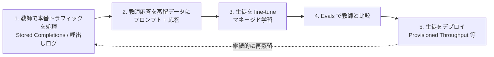

# クラスタ 2: クラウド・ベンダーの蒸留サービス（`distillation_platforms`）★

## 概要

蒸留を **マネージド機能** として提供するクラウド・ベンダーのサービスを扱います。2024年10月の **OpenAI Model Distillation**（Stored Completions + Evals + fine-tuning）を皮切りに、**Amazon Bedrock Model Distillation**（2024年12月プレビュー、2025年5月 GA）、**Azure AI Foundry の蒸留**、**Vertex AI の Gemini Distillation Service**、**Alibaba Cloud PAI（EasyDistill / DistilQwen）**、**NVIDIA NeMo**（剪定 + 蒸留）が出そろいました。これらのサービスは「同じベンダーの大モデルを教師、小モデルを生徒にする」**囲い込み型** の設計が多く、ビジネス上は **価格・対応モデルの組合せ・データの扱い** が比較の軸になります。ベンダーが出す性能値は自社集計なので、顧客別の成果を別に探す必要があります（仮説 H2）。

## サービス比較（事前スキャン時点）

| サービス | 開始 | 教師 → 生徒の例 | 主張する効果 | 名前の出た顧客 |
|---------|------|----------------|------------|--------------|
| OpenAI Model Distillation | 2024-10 | GPT-4o / o1 → GPT-4o mini | 小型モデルで大型に近い精度 | 公開事例は少ない |
| Amazon Bedrock Model Distillation | 2024-12 プレビュー / 2025-05 GA | Nova Premier → Nova Lite/Micro、Llama 405B → 8B 等 | 最大 500% 高速・最大 75% 安価・RAG で精度低下 2% 未満 | Robin AI（成果数値なし）※ Moody's / PwC は蒸留以外の Bedrock 機能の顧客 |
| Azure AI Foundry 蒸留 | 2024–2025 | GPT-4o → GPT-4o mini 等 | Stored Completions 10 件以上から | 要調査 |
| Vertex AI Gemini Distillation | 2025–2026 | gemini-3.1-pro → gemini-2.5-flash（早期アクセス） | 要調査 | 要調査 |
| Alibaba Cloud PAI / EasyDistill | 2025 | Qwen 大 → DistilQwen | 産業向け蒸留パイプライン | Alibaba 社内 |
| NVIDIA NeMo（Minitron） | 2024 | Llama 3.1 8B → 4B | 学習コスト削減 | 要調査 |
| Snorkel / Predibase / Arcee 等 | 2023– | 任意 | データ開発・SLM 特化 | 要調査 |

## キーワード

- `Amazon Bedrock Model Distillation`
- `OpenAI Model Distillation` / `Stored Completions` / `Evals`
- `Azure AI Foundry distillation`
- `Vertex AI distillation` / `Gemini Distillation Service`
- `Alibaba Cloud PAI` / `EasyDistill` / `DistilQwen`
- `NVIDIA NeMo` / `Minitron`
- `Snorkel Flow` / `Predibase` / `Arcee` / `Together AI`
- `Nova Premier` / `Nova Micro`
- `provisioned throughput`
- `distillation pricing`
- `data augmentation in distillation`
- `function calling distillation`
- `teacher-student pairing`
- `customer case study`

## 調査戦略

- **クエリ**: `"Bedrock Model Distillation customer"`, `"re:Invent distillation session"`, `"Azure OpenAI distillation case study"`, `"Vertex AI distillation"`, `"Bedrock 蒸留 事例"`, `"モデル蒸留 AWS 導入事例"`
- **一次資料**: 各社公式ドキュメント、価格ページ、ローンチブログ、AWS / Google / Microsoft の顧客事例ページ、re:Invent / Ignite / Next のセッション
- **注意**: 「最大 ○%」は最良ケースのベンダー値。顧客名だけで成果数値が無い事例は別扱いで記録する
- **AWS 日本**: 「コスト面から蒸留への需要が高まる」という発言（AWS ジャパン）を手掛かりに、国内顧客の事例を探す（C7 と接続）

## 代表的なリソース

| タイトル | 種別 | 年 | 概要 |
|---------|------|----|------|
| Model Distillation in the API (OpenAI) | 公式 | 2024 | Stored Completions・Evals・蒸留の一連機能 |
| Amazon Bedrock Model Distillation（製品ページ / ユーザーガイド） | 公式 | 2024–2025 | 500% 高速・75% 安価・精度低下 2% 未満 |
| Amazon Bedrock Model Distillation GA（What's New） | 公式 | 2025 | GA 発表 |
| Bedrock Model Distillation: Boost function calling accuracy（AWS ブログ） | 技術ブログ | 2025 | Llama で tool calling を蒸留 |
| Azure OpenAI 蒸留（Tech Community） | 公式 | 2025 | Stored Completions からの蒸留 |
| Gemini Distillation Service（Google Cloud doc） | 公式 | 2026 | gemini-3.1-pro → 2.5-flash |
| DistilQwen2.5: Industrial Practices (arXiv 2504.15027) | 論文 | 2025 | Alibaba の産業蒸留 |
| EasyDistill（EMNLP 2025 Demo） | 論文 | 2025 | PAI に統合された蒸留ツールキット |
| Why enterprises should embrace LLM distillation（Snorkel） | ベンダーブログ | 2025 | 企業向け蒸留の論点 |
| Two approaches to distill LLMs for better enterprise value（Snorkel） | ベンダーブログ | 2024 | 2 方式の比較 |
