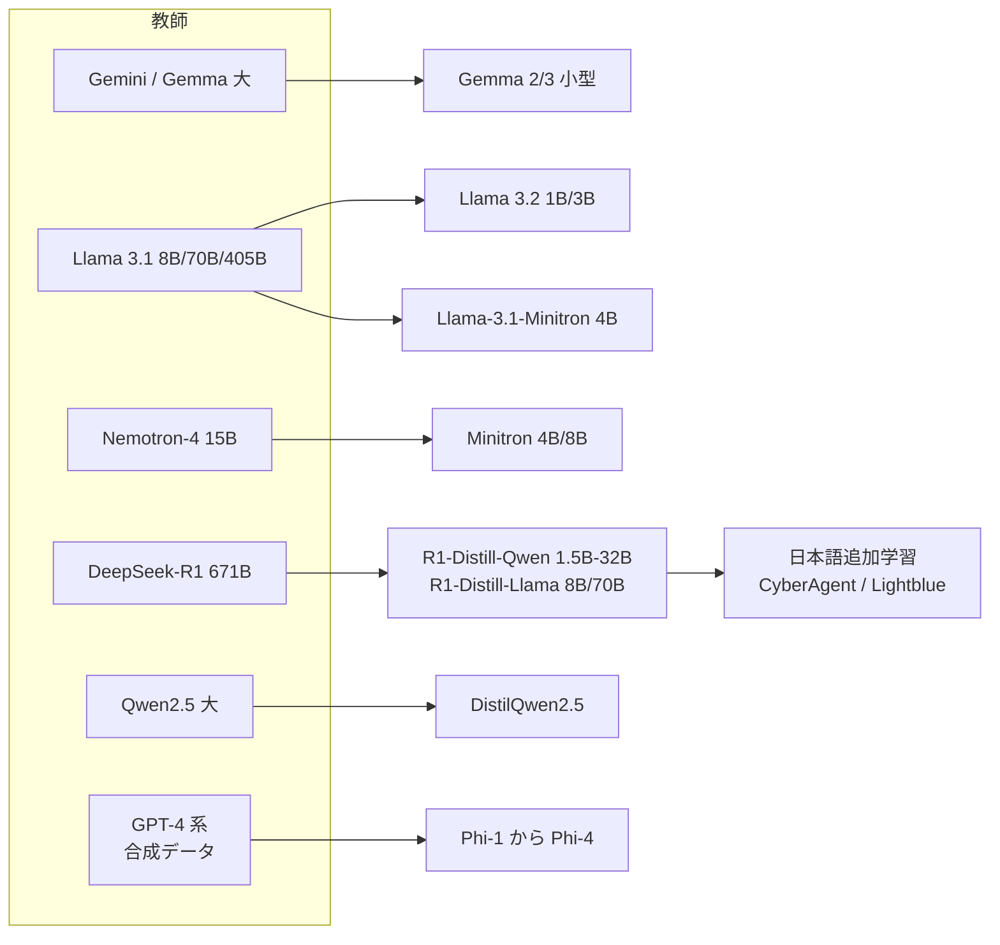

# クラスタ 3: 公開蒸留モデルとエコシステム（`open_distilled_models`）

## 概要

蒸留で作られ、重みが公開されている小型モデル群を扱います。**Gemma 2/3**（大モデルの logit を教師にした事前学習）、**Llama 3.2 1B/3B**（Llama 3.1 の logit を利用）、**NVIDIA Minitron**（剪定 + 蒸留）、**DeepSeek-R1-Distill**（R1 の推論トレースを Qwen / Llama へ蒸留）、**Alibaba DistilQwen**、**Microsoft Phi**（合成データ中心）が代表です。企業はこれらを **生徒モデルの出発点** として使い、さらに自社データで追加の蒸留・fine-tuning を行います。ビジネス観点では **ライセンス**（Apache 2.0 / Llama Community / MIT）と **教師の出所**（規約上の問題がないか、C8）が選定の論点です。

## 系譜

| モデル | 提供元 | 方式 | ライセンス | ビジネス上の位置付け |
|-------|-------|------|-----------|-------------------|
| Gemma 2/3 | Google | logit 蒸留 | Gemma Terms | 端末・オンプレ向け |
| Llama 3.2 1B/3B | Meta | logit 蒸留 + 剪定 | Llama Community | エッジ・モバイル |
| Minitron | NVIDIA | 剪定 + 蒸留 | NVIDIA Open Model | 学習コスト削減の実証 |
| DeepSeek-R1-Distill | DeepSeek | 推論トレース SFT | MIT | 推論モデルの小型化 |
| DistilQwen2.5 | Alibaba | 黒箱 + 白箱 | Apache 2.0 | 産業用軽量モデル |
| Phi シリーズ | Microsoft | 合成データ | MIT | 小型高性能 |

## キーワード

- `DeepSeek-R1-Distill`
- `Gemma 2 distillation`
- `Llama 3.2 1B 3B`
- `Minitron` / `Llama-3.1-Minitron`
- `DistilQwen`
- `Phi-3` / `Phi-4` / `textbooks are all you need`
- `Qwen3 small`
- `SmolLM`
- `open-weight license`
- `model card` / `technical report`
- `reasoning model distillation`
- `s1` / `LIMO`（少量データ推論蒸留）
- `OpenThoughts` / `Bespoke-Stratos`

## 調査戦略

- **クエリ**: `"DeepSeek-R1-Distill enterprise adoption"`, `"Gemma 2 knowledge distillation technical report"`, `"Llama 3.2 1B distillation"`, `"open reasoning distillation dataset"`
- **一次資料**: 各モデルのテクニカルレポート、Hugging Face のモデルカード・ダウンロード数
- **ビジネス観点**: どの企業がどの公開蒸留モデルを本番で使ったか（C5/C6/C7 と接続）を拾う

## 代表的なリソース

| タイトル | 種別 | 年 | 概要 |
|---------|------|----|------|
| DeepSeek-R1 (arXiv 2501.12948) | 論文 | 2025 | 蒸留モデル 6 種を公開 |
| Gemma 2: Improving Open Language Models at a Practical Size | 論文 | 2024 | 小型モデルを蒸留で事前学習 |
| Llama 3.2 発表（Meta） | 公式ブログ | 2024 | 1B/3B を剪定 + 蒸留で作成 |
| Compact Language Models via Pruning and KD (arXiv 2407.14679) | 論文 | 2024 | Minitron |
| How to Prune and Distill Llama-3.1 8B to Minitron 4B（NVIDIA） | 技術ブログ | 2024 | 実装手順 |
| DistilQwen2.5 (arXiv 2504.15027) | 論文 | 2025 | Alibaba の公開蒸留モデル |
| Textbooks Are All You Need (Phi-1) | 論文 | 2023 | 合成データ中心の小型モデル |
| Phi-4 Technical Report | 論文 | 2024 | 合成データで推論強化 |
