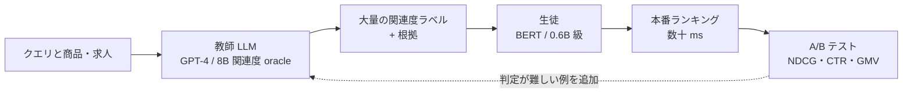

# クラスタ 4: 検索・推薦・広告・EC（`search_recsys`）★★

## 概要

**定量的な本番成果が最も多く公開されている分野** です（仮説 H1）。検索・推薦は 1 リクエストあたりのレイテンシ制約が数十 ms と厳しく、トラフィックも巨大なため、LLM をそのまま使えません。そこで **LLM（教師）に関連度判定やラベルを大量に付けさせ、BERT 系や小型 LLM（生徒）に蒸留して本番配信する** パターンが定着しました。Walmart（EC 検索の関連度）、LinkedIn（多教師蒸留による求人検索、本番 NDCG@10 +7.73%）、Pinterest（検索関連度・Homefeed）、Alibaba / Meituan / Tencent / Amazon / TikTok などが代表例です。企業の論文やエンジニアブログで A/B テストの数値が出ることが多く、他分野の事例と比べて証拠の質が高いのが特徴です。

## 典型アーキテクチャ

| 企業 | 用途 | 教師 → 生徒 | 公開されている成果 | 出典の種類 |
|------|------|------------|------------------|-----------|
| Walmart | EC 検索の関連度 | LLM → BERT 系 | 本番稼働（数値は要確認） | 論文 arXiv 2505.07105 |
| LinkedIn | 求人検索 | 8B 関連度 + 1.7B エンゲージメント → 0.6B | 本番 NDCG@10 +7.73%、DAU +1.2% 超（0.758→0.943 は関連度単独生徒の値） | arXiv + 公式ブログ |
| Pinterest | 検索関連度・Homefeed | GPT-4 → 小型 | 推論コスト大幅減（要確認） | エンジニアブログ |
| Airbnb ※ | 多目的ランキング | 多目的教師（MLP）→ ランカー | KDD 2024 | 論文（LLM 蒸留ではないと retrieval で判明） |
| Alibaba（Taobao 等） | EC 関連度 | LLM → 軽量 | 根拠付き蒸留（COLING Industry 2025） | 論文 |
| Amazon / TikTok | 推薦・検索 | LLM → 軽量 | レビューで言及のみ | 二次 |

## キーワード

- `LLM relevance labeling`
- `search relevance distillation`
- `cross-encoder to bi-encoder distillation`
- `multi-teacher distillation`
- `rationale-guided distillation`
- `LLM-based recommendation distillation`
- `query understanding` / `query rewriting`
- `semantic ID` / `generative retrieval`
- `latency budget`
- `online A/B test` / `NDCG` / `CTR` / `GMV`
- `Walmart` / `LinkedIn` / `Pinterest` / `Airbnb` / `Alibaba` / `Amazon`
- `ads relevance`
- `e-commerce product attribute extraction`

## 調査戦略

- **クエリ**: `"LLM distillation search relevance production"`, `"knowledge distillation e-commerce LLM A/B test"`, `"LinkedIn multi-teacher distillation job search"`, `"Pinterest LLM relevance distillation"`, `"KDD 2024 2025 LLM distillation industry track"`, `"ECサイト 検索 LLM 蒸留"`
- **一次資料**: KDD / SIGIR / WWW / RecSys / CIKM / COLING / EMNLP の Industry Track、各社エンジニアブログ（LinkedIn Engineering, Pinterest Engineering, Airbnb Tech, Walmart Global Tech）
- **集約資料**: `eugeneyan/applied-ml`、`alopatenko/LLMSearchRecommender`、ZenML の LLMOps 事例集
- **国内**: メルカリ・LINEヤフー・楽天・ZOZO などの検索・推薦での蒸留事例を探す（C7 と接続）

## 代表的なリソース

| タイトル | 種別 | 年 | 概要 |
|---------|------|----|------|
| Knowledge Distillation for Enhancing Walmart E-commerce Search Relevance (arXiv 2505.07105) | 論文 | 2025 | LLM 判定を本番ランカーへ |
| Rationale-Guided Distillation for E-Commerce Relevance (COLING 2025 Industry) | 論文 | 2025 | 根拠付き蒸留 |
| How LinkedIn Trains AI Job Search 8x Faster with Multi-Teacher Distillation (InfoQ) | 技術記事 | 2026 | 0.6B 生徒で NDCG@10 0.943 |
| Multi-objective Learning to Rank by Model Distillation (Airbnb, KDD 2024) | 論文 | 2024 | ランキングの蒸留（教師は MLP で LLM 蒸留ではない） |
| Pinterest 検索関連度の LLM 蒸留（Pinterest Engineering） | 技術ブログ | 2024–2025 | GPT-4 で学習データ生成 |
| Deep Learning to Rank in Industrial Search, RecSys, Ads (TOIS) | 論文（総説） | 2026 | 産業での LLM 蒸留を含む |
| A Comprehensive Review on Harnessing LLMs (arXiv 2507.21117) | 論文（総説） | 2025 | TikTok / Amazon / Alibaba の蒸留に言及 |
| LLMOps in Production: 287 More Case Studies (ZenML) | 事例集 | 2025 | 蒸留事例を含む |
| Flipping Knowledge Distillation (ACL 2025) | 論文 | 2025 | 小モデル→LLM の逆蒸留、オンライン稼働 |
