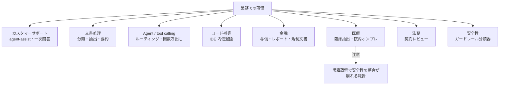

# クラスタ 5: 業務・業界別ユースケース（`enterprise_workflows`）★★

## 概要

検索・推薦以外の **業務ワークフロー** での蒸留活用を扱います。用途としては **カスタマーサポート**（LivePerson の agent-assist 研究）、**文書処理・情報抽出**（経費分類の特許、FLAN-T5 による文書理解）、**ツール呼出し・Agent**（Bedrock の function calling 蒸留、1B が 70B の tool calling 精度の 98% に到達したという NVIDIA の報告）、**コード補完**、**金融**、**医療**（Nature 系誌の合成データ蒸留による臨床情報抽出）、**法務**（Robin AI）が挙がります。このクラスタは **証拠の質のばらつきが最も大きく**、「90% コスト削減」のような出典不明の数値や、蒸留ではなく単なる小型モデルの fine-tuning を蒸留と呼んでいる事例が混ざります（仮説 H3）。各事例を「蒸留か否か」「一次か二次か」で仕分けることが重要です。

## 用途別マップ

| 用途 | 蒸留が効く理由 | 事例・資料 | 証拠の質 |
|------|--------------|-----------|---------|
| カスタマーサポート | 大量・定型・低遅延 | LivePerson（コスト約半減） | 一次（論文） |
| 文書処理 | 狭いタスク・大量処理 | 経費分類特許、FLAN-T5 文書理解 | 一次（特許・論文） |
| Agent / tool calling | 呼出し回数が多い | Bedrock function calling 蒸留、NVIDIA 1B vs 70B | ベンダー |
| 医療 | オンプレ必須 | 合成データ蒸留による臨床抽出（npj Digit Med 2025） | 一次（研究段階） |
| 金融・法務 | 機密データ・規制 | Robin AI（Bedrock 蒸留の顧客） | 名前のみ |
| 汎用 SLM 置換 | — | 「Mistral 7B で 90% 削減」 | 出典不明 ⚠️ |

## キーワード

- `distillation customer service`
- `agent assist`
- `document understanding distillation`
- `information extraction small model`
- `function calling distillation` / `tool use distillation`
- `agent distillation` / `trajectory distillation`
- `router model` / `model cascade`
- `code completion distillation`
- `financial LLM distillation`
- `clinical information extraction synthetic data distillation`
- `on-premise LLM healthcare`
- `legal contract review small model`
- `guardrail classifier distillation`
- `LLM economic trade-offs`
- `cost per request`

## 調査戦略

- **クエリ**: `"distilled model production customer support case study"`, `"agent distillation tool calling small model enterprise"`, `"distillation financial services LLM"`, `"hospital on-premise distilled LLM"`, `"蒸留 社内 業務 LLM 事例 コールセンター"`, `"蒸留モデル 金融 医療 導入"`
- **一次資料**: 企業論文（ACL / EMNLP Industry）、AWS / Azure / Google の顧客事例、ベンダー（Snorkel, Predibase, Arcee, Together）のケーススタディ
- **仕分けルール**: 各事例に `蒸留 / fine-tuning / 量子化` と `一次 / ベンダー / 二次` のタグを付ける
- **安全性**: 医療など規制分野では、黒箱蒸留による安全性劣化の研究（arXiv 2512.09403）も併せて押さえる

## 代表的なリソース

| タイトル | 種別 | 年 | 概要 |
|---------|------|----|------|
| The economic trade-offs of LLMs: A case study (LivePerson, arXiv 2306.07402) | 論文 | 2023 | CS で蒸留によりコストとレイテンシ約半減 |
| Robust documentation understanding using LLM KD and joint training (SAP, US12475175B1 ※2026-10-22 公報で確定) | 特許 | 2025 | 経費分類器を LLM 教師で学習 |
| Synthetic data distillation enables extraction of clinical information at scale (npj Digital Medicine) | 論文 | 2025 | Llama 70B → 小型でオンプレ抽出 |
| Black-Box Behavioral Distillation Breaks Safety Alignment in Medical LLMs (arXiv 2512.09403) | 論文 | 2025 | 蒸留の安全性リスク |
| Bedrock Model Distillation: function calling（AWS） | 技術ブログ | 2025 | tool calling 蒸留 |
| A 1B Model Just Matched the 70B（channel.tel） | 実務ブログ | 2025 | Agent の月額 $4,200 → $84（逸話） |
| Performance Trade-Offs of Optimizing SLMs for E-Commerce (arXiv 2510.21970) | 論文 | 2025 | 量子化との比較（蒸留ではない） |
| How to optimize LLMs for enterprise success（CIO.com） | 記事 | 2026 | 蒸留の企業シナリオ（仮想例を含む） |
| Using Advanced LLMs to Enhance Smaller LLMs: Interpretable KD（Cambridge JBS） | 論文 | 2025 | 解釈可能な蒸留の業務応用 |
