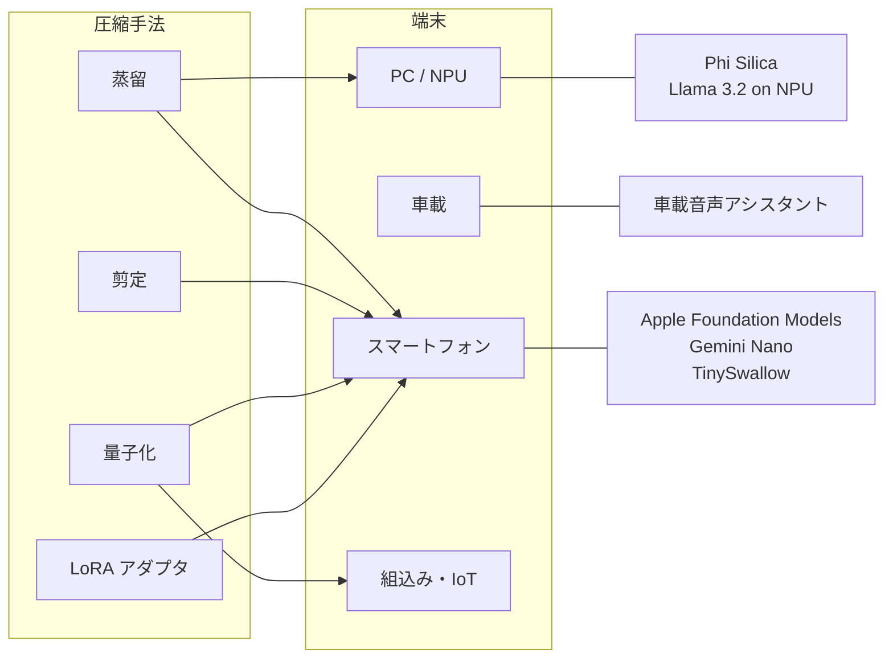

# クラスタ 6: エッジ・オンデバイス（`edge_ondevice`）

## 概要

スマートフォン、PC、車載、家電・組込み機器など **端末上で LLM を動かす** ための蒸留を扱います。端末の制約は通常 **メモリ数 GB・電力・オフライン動作** で、蒸留は量子化・剪定と組み合わせて使われます。**Apple Intelligence** の端末内モデル（2026年3月に Gemini を教師にした蒸留が報じられた）、**Gemini Nano**、**Microsoft Phi Silica**（Copilot+ PC）、**Sakana AI TinySwallow-1.5B**（スマートフォンで完全オフライン動作）、**Llama 3.2 1B/3B**（Qualcomm / MediaTek 向け）が代表例です。ビジネス上の価値は **API 費用ゼロ・プライバシー・オフライン** で、端末メーカー・半導体ベンダーの差別化要因になっています。

## 端末と手法の対応

| 事例 | 端末 | 規模 | 蒸留の役割 | 証拠の質 |
|------|------|------|-----------|---------|
| Apple Foundation Models | iPhone / Mac | 約 3B | 教師から端末内モデルへ（Gemini 教師説は報道） | 公式技術レポート + 報道 |
| Gemini Nano | Pixel / Android | 1.8B / 3.25B | Gemini から蒸留 | 公式 |
| Phi Silica | Copilot+ PC | 3.3B | Phi 系 | 公式 |
| TinySwallow-1.5B | スマートフォン / PC | 1.5B | TAID で 32B → 1.5B | 公式 + 論文 |
| Llama 3.2 1B/3B | モバイル SoC | 1B / 3B | Llama 3.1 から | 公式 |

## キーワード

- `on-device LLM`
- `Apple Foundation Models`
- `Gemini Nano`
- `Phi Silica`
- `Copilot+ PC NPU`
- `TinySwallow`
- `Llama 3.2 mobile`
- `Qualcomm AI Hub`
- `edge AI distillation`
- `automotive LLM`
- `quantization-aware distillation`
- `offline inference privacy`

## 調査戦略

- **クエリ**: `"on-device LLM distillation Apple Foundation Models technical report"`, `"Gemini Nano distillation"`, `"Phi Silica"`, `"automotive in-car LLM distilled"`, `"エッジ LLM 蒸留 車載 家電"`, `"オンデバイス 小型LLM 蒸留 事例"`
- **一次資料**: Apple MLR の技術レポート、Google / Microsoft の公式ブログ、Qualcomm / MediaTek / Arm の発表
- **国内**: 車載（トヨタ・デンソー・ホンダ）、家電（ソニー・パナソニック）、組込み（ルネサス）の動向（C7 と接続）

## 代表的なリソース

| タイトル | 種別 | 年 | 概要 |
|---------|------|----|------|
| Apple Intelligence Foundation Language Models Tech Report | 論文 | 2024–2025 | 端末内モデルの構成 |
| Apple Distills Google Gemini for On-Device iPhone AI（報道まとめ） | 報道 | 2026 | The Information の報道 |
| Apple gets full Gemini access and uses distillation（The Decoder） | 報道 | 2026 | 同上 |
| WWDC 2026 記者向けトーク: AFM 3 を "refined using outputs from Gemini frontier models"（MacRumors / 9to5Mac 経由） | ベンダー申告 | 2026 | Apple 幹部発言で黒箱蒸留相当を確認（※2026-10-22 追記） |
| Gemini: A Family of Highly Capable Multimodal Models（Nano の節） | 論文 | 2023 | Nano の蒸留 |
| 新手法「TAID」を用いた小規模日本語言語モデル「TinySwallow-1.5B」の公開（Sakana AI） | 公式 | 2025 | オフライン動作 |
| Llama 3.2 発表（Meta） | 公式 | 2024 | モバイル向け 1B/3B |
| Phi Silica（Microsoft） | 公式 | 2024 | NPU 向け SLM |
