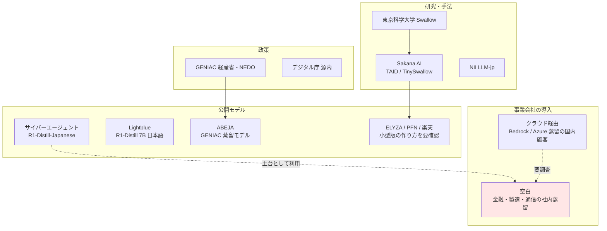

# クラスタ 7: 国内事例（`japan_cases`）★★

## 概要

日本国内の LLM 蒸留の事例を扱います。事前スキャンでは **公開モデル型** が中心でした（仮説 H4）。**Sakana AI** は東京科学大学 Swallow チームと共同で新手法 **TAID**（ICLR 2025）を開発し、32B → 1.5B の **TinySwallow-1.5B** を公開しました。**サイバーエージェント** と **Lightblue** は 2025年1–2月に **DeepSeek-R1-Distill に日本語の追加学習** を施したモデルを公開しました。**ABEJA** は経済産業省・NEDO の **GENIAC** プロジェクトで蒸留による小型 LLM（ABEJA Qwen2.5-7B）を開発しています。**NTT tsuzumi** は軽量 LLM ですが、蒸留を使ったかどうかは未確認です。一方、**事業会社が社内業務で蒸留を使った事例**（金融・製造・通信など）はほとんど見つかっておらず、このクラスタの最大の空白です。AWS ジャパンの「コスト面から蒸留への需要が高まる」という見立てを手掛かりに、クラウド経由の国内事例を探します。

## 国内プレイヤーの位置付け

| 組織 | 発表時期 | 内容 | 蒸留方式 | 種別 |
|------|---------|------|---------|------|
| Sakana AI + Swallow | 2025-01 | TAID、TinySwallow-1.5B | 白箱（中間教師） | 手法 + 公開モデル |
| サイバーエージェント | 2025-01 | DeepSeek-R1-Distill-Qwen-14B/32B-Japanese | R1 蒸留モデルへの追加学習 | 公開モデル |
| Lightblue | 2025-02 | R1-Distill 7B の日本語版 | 同上 | 公開モデル |
| ABEJA | 2025 | GENIAC で ABEJA Qwen2.5-7B を蒸留 | 蒸留パイプライン並列化 | 公開モデル + 技術ブログ |
| NTT tsuzumi / tsuzumi 2 | 2023 / 2025 | 軽量 LLM | 未確認 | 商用 |
| ELYZA / PFN / 楽天 / 富士通 / NEC | 2025–2026 | 国産 LLM の小型版 | 未確認 | 商用・公開 |

## キーワード

- `TAID` / `TinySwallow`
- `Sakana AI`
- `DeepSeek-R1-Distill-Qwen-Japanese`（サイバーエージェント）
- `Lightblue`
- `ABEJA` / `GENIAC`
- `tsuzumi`
- `PLaMo` / `ELYZA` / `Rakuten AI` / `Takane` / `cotomi`
- `LLM-jp`
- `知識蒸留` / `モデル蒸留` / `蒸留モデル`
- `小規模言語モデル (SLM)`
- `オンプレミス LLM`
- `Amazon Bedrock 蒸留 国内事例`
- `GENIAC 成果報告`
- `国内 検索・推薦の蒸留`（メルカリ・LINEヤフー・ZOZO）

## 調査戦略

- **クエリ**: `"蒸留 LLM 導入事例 日本企業"`, `"知識蒸留 社内 LLM 軽量化 事例"`, `"GENIAC 蒸留"`, `"TAID 産業応用"`, `"Bedrock 蒸留 国内"`, `"蒸留 tech blog site:zenn.dev OR site:qiita.com"`, `"メルカリ LLM 蒸留"`, `"LINEヤフー 蒸留"`
- **一次資料**: 各社プレスリリース、技術ブログ（ABEJA, CyberAgent AI Lab, LINEヤフー, メルカリ, Sansan, ELYZA）、NLP 年次大会（言語処理学会）・JSAI の発表、日経クロステック、AWS / Google Cloud の日本語事例ページ
- **英語でも検索**: 日本企業の英語論文（ACL Industry 等）

## 代表的なリソース

| タイトル | 種別 | 年 | 概要 |
|---------|------|----|------|
| 新手法「TAID」を用いた小規模日本語言語モデル「TinySwallow-1.5B」の公開（Sakana AI） | 公式 | 2025 | 32B → 1.5B |
| サイバーエージェント、DeepSeek-R1 に日本語で追加学習を施した LLM を公開（gihyo.jp） | 報道 | 2025 | R1-Distill の日本語版 |
| Lightblue、DeepSeek-R1 の蒸留モデルに日本語で追加学習を施した 7B を公開（IT Leaders） | 報道 | 2025 | 同上 |
| 小型 LLM「ABEJA Qwen2.5-7B Model」学習のための蒸留のパイプライン並列化（ABEJA Tech Blog） | 技術ブログ | 2025 | GENIAC |
| コンパクトで高性能な AI モデルを「蒸留」で生成（日経クロステック） | 報道 | 2025 | TAID 解説、AWS ジャパンの発言 |
| NTT、軽量で日本語処理に特化した純国産 LLM「tsuzumi 2」の提供開始（INTERNET Watch） | 報道 | 2025 | 軽量 LLM |
| 小規模言語モデル（SLM）の紹介（Zenn, EQUES） | 技術記事 | 2025 | 国内の SLM 概観 |
| AI の効率化を実現する蒸留技術（IDNet） | 解説 | 2025 | 国内向け解説 |
