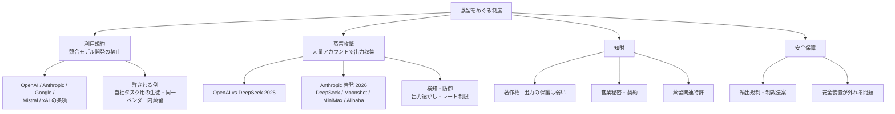

# クラスタ 8: 規約・知財・安全保障・特許（`legal_ip_patents`）★

## 概要

蒸留のビジネス利用を **制約・保護する制度** を扱います。第一に **利用規約**: OpenAI・Anthropic・Google・Mistral・xAI などは、出力を競合モデルの開発に使うことを禁止しています。このため企業が商用 API を教師にする場合、「自社タスク用の生徒なら許されるのか」という線引きが事業上の論点です（仮説 H5）。第二に **蒸留攻撃**: 2025年1月に OpenAI が DeepSeek による規約違反の蒸留を主張し、2026年には Anthropic が DeepSeek・Moonshot・MiniMax（2月、約 24,000 アカウント・1,600 万件超）や Alibaba 系（6月・9月）による大規模な蒸留を告発して、輸出規制や制裁法案の議論に発展しました。第三に **特許**: Google・Salesforce などの蒸留手法特許や、LLM 教師で業務用分類器を学習する応用特許があります。法的には **著作権より契約（規約）が主戦場** とされています。

## 論点の構造

| 論点 | 主な出来事・文書 | 時期 | ビジネスへの影響 |
|------|----------------|------|----------------|
| 規約による禁止 | 各社の利用規約・商用条件 | 継続 | 教師の選択と契約の確認が必須 |
| OpenAI vs DeepSeek | FT 報道、OpenAI の主張 | 2025-01 / 2026-02 | 訴訟には至らず、契約法の問題 |
| Anthropic の告発 | 2026-02 公表、2026-06 議会書簡、2026-09 脅威レポート | 2026 | 制裁・輸出規制の議論 |
| 法的分析 | Winston & Strawn 等 | 2025 | 著作権より契約が有効 |
| 安全性 | 黒箱蒸留で安全性の整合が崩れる研究 | 2025 | 規制分野での蒸留リスク |
| 特許 | US12307750B2（Microsoft）、US11620515B2（Salesforce）等 | 2023–2025 | 手法の権利化 |

## キーワード

- `terms of service distillation`
- `anti-competitive distillation clause`
- `OpenAI DeepSeek distillation`
- `distillation attack` / `model extraction`
- `Anthropic threat intelligence distillation`
- `export controls AI`
- `output watermarking`
- `copyright of model outputs`
- `trade secret AI model`
- `knowledge distillation patent`
- `CPC G06N3/096`
- `JPO 知識蒸留 特許`
- `蒸留 利用規約 禁止`
- `model license (Llama / Gemma) distillation clause`

## 調査戦略

- **クエリ**: `"terms of service prohibit distillation OpenAI Anthropic Google"`, `"distillation attack Anthropic report"`, `"model distillation legal analysis copyright contract"`, `"Llama license distillation clause"`, `"知識蒸留 特許 大規模言語モデル"`, `"蒸留 規約違反 生成AI 法律"`
- **一次資料**: 各社の利用規約・公式発表（Anthropic / OpenAI のブログ・レポート）、法律事務所の分析、Google Patents / J-PlatPat（CPC G06N3/096, G06N3/045）
- **ビジネス観点**: 「企業が合法に蒸留するための教師の選び方」（オープンウェイト教師、同一ベンダー内の蒸留サービス、自社モデル）を整理する

## 代表的なリソース

| タイトル | 種別 | 年 | 概要 |
|---------|------|----|------|
| Is AI Distillation by DeepSeek IP Theft?（Winston & Strawn） | 法律分析 | 2025 | 契約法の観点 |
| OpenAI-DeepSeek AI distillation dispute（law.asia） | 法律分析 | 2025 | アジアの法的視点 |
| OpenAI says DeepSeek used its models illegally（TechRadar） | 報道 | 2025 | 告発の概要 |
| OpenAI accuses China's DeepSeek（GIGAZINE） | 報道 | 2026 | 2026-02 メモ |
| Chinese firms used distillation attacks to copy Claude（Computing） | 報道 | 2026 | Anthropic の 2月公表 |
| Anthropic Exposes Industrial-Scale Distillation Attacks（NYU Shanghai RITS） | 解説 | 2026 | 同上 |
| Anthropic accuses Alibaba（Cyber Security News） | 報道 | 2026 | Alibaba 系の告発 |
| US12307750B2 Scalable knowledge distillation techniques（Microsoft） | 特許 | 2025 | 蒸留手法 |
| US11620515B2 Multi-task knowledge distillation for language model（Salesforce） | 特許 | 2023 | 多タスク蒸留 |
| US12333254B2 KD in NLP models（Genesys Cloud Services） | 特許 | 2025 | 生徒モデル選択 |
| US11900260B2 Integrated teacher-student system | 特許 | 2024 | 教師・生徒一体型 |
| US12475175B1 Robust documentation understanding using LLM KD（SAP）※2026-10-22 公報で確定 | 特許 | 2025 | 業務応用特許 |
