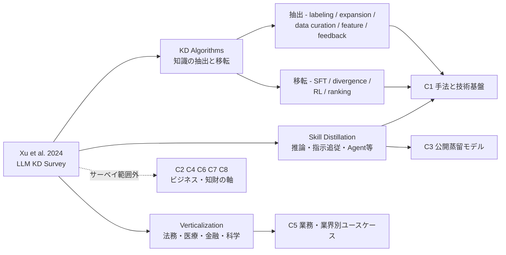
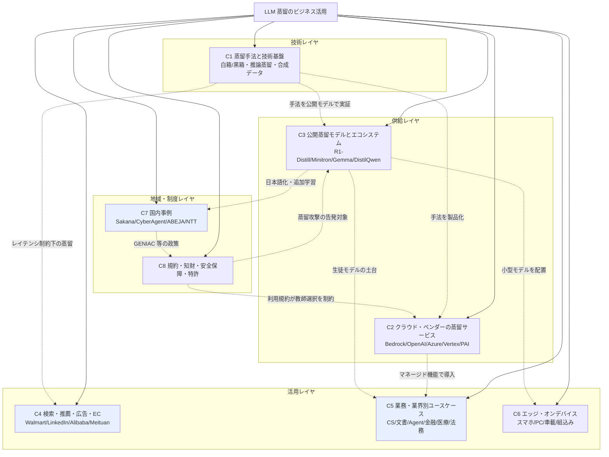
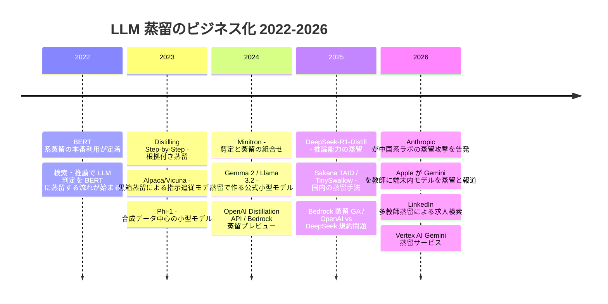
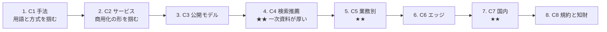
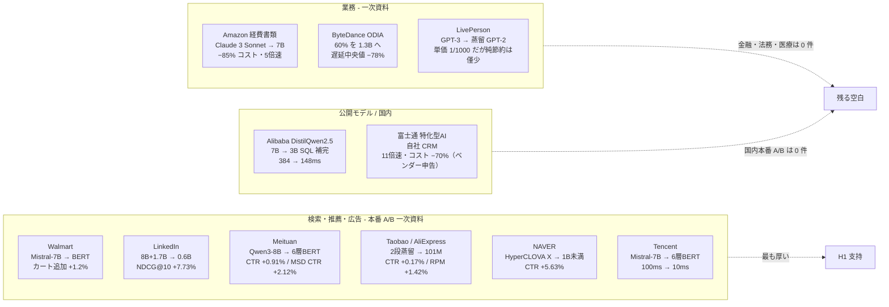

# LLM 蒸留技術のビジネス活用・ユースケース — ドメインマップ

## 調査パラメータ

- **調査タイプ**: ビジネス事例調査 + 技術トレンド分析 + 学術論文サーベイ + 特許調査
- **時間範囲**: 2022 – 2026（ChatGPT 以降の LLM 蒸留〜2026年10月まで）
- **生成日**: 2026-10-21
- **入力キーワード**: LLM, 蒸留, knowledge distillation, model distillation, ビジネス, ユースケース, 事例
- **検索言語**: 英語 + 日本語

## 全体像（Big Picture）

LLM の蒸留（knowledge distillation）は、大きな **教師モデル** の能力をタスク特化した小さな **生徒モデル** へ移す技術です。2023年頃までは研究テーマでしたが、**2024年10月の OpenAI Model Distillation API**、**2024年12月の Amazon Bedrock Model Distillation（2025年5月 GA）**、**Azure AI Foundry / Vertex AI の蒸留サービス** によって、**「クラウドのマネージド機能」として商用化** されました。さらに **2025年1月の DeepSeek-R1-Distill** は、推論（reasoning）能力そのものを蒸留できることを示し、業界全体の転換点になりました。

ビジネス上の価値は次の 3 つに集約されます。

- **コスト・レイテンシ削減**: AWS は「最大 500% 高速・最大 75% 安価・RAG での精度低下 2% 未満」と主張しています（ベンダー値）。
- **オンプレミス・エッジへの配置**: 医療・金融などデータを外に出せない領域や、スマートフォン上で動かす用途。
- **タスク特化による精度向上**: 汎用の大モデルより、狭いタスクに絞った生徒モデルが勝つ場合があります。

一方、**利用規約による蒸留禁止**（OpenAI / Anthropic / Google 等）と、**2025–2026年の「蒸留攻撃」問題**（OpenAI vs DeepSeek、Anthropic による中国系ラボの告発）により、蒸留は **知財・安全保障の争点** にもなっています。

**事前スキャンで見えた情報の偏り**: 蒸留の **定量的なビジネス成果を公開している一次事例は少なく**、主な出所は (a) 検索・推薦分野の企業論文（Walmart / LinkedIn / Pinterest / Alibaba / Meituan）、(b) クラウドベンダーの集計値、(c) 公開モデルのテクニカルレポートです。国内では Sakana AI（TAID）、サイバーエージェント、Lightblue、ABEJA（GENIAC）など **公開モデル型の事例** が中心で、**事業会社の社内導入事例はほぼ見つかっていません**。

## 参考サーベイ・レビュー論文

| タイトル | 年 | 概要 | リンク |
|---------|----|------|-------|
| A Survey on Knowledge Distillation of Large Language Models (Xu et al.) | 2024 | KD アルゴリズム / スキル蒸留 / 垂直領域蒸留 の 3 軸で整理。本ドメインマップの技術軸の土台 | [arXiv 2402.13116](https://arxiv.org/abs/2402.13116) |
| Survey on Knowledge Distillation for Large Language Models: Methods, Evaluation, and Application (Yang et al.) | 2024 | 白箱 / 黒箱 の分類と、評価・応用までを網羅 | [arXiv 2407.01885](https://arxiv.org/abs/2407.01885) |
| Knowledge Distillation and Dataset Distillation of Large Language Models (Fang et al.) | 2025 | 知識蒸留とデータセット蒸留を統合的に整理 | [arXiv 2504.14772](https://arxiv.org/abs/2504.14772) |
| Distilling Wisdom: A Review on Optimizing Learning From Massive Language Models (IEEE Access) | 2025 | 産業・組込み・NLP・マルチモーダル・金融・医療への応用を整理 | [UTS OPUS](https://opus.cloud1.lib.uts.edu.au/bitstream/10453/188896/2/Distilling%20Wisdom%3a%20A%20Review%20on%20Optimizing%20Learning%20From%20Massive%20Language%20Models.pdf) |
| The Rise of Small Language Models in Healthcare: A Comprehensive Survey | 2025 | 医療 SLM（蒸留を含む）の網羅的サーベイ | [arXiv 2504.17119](https://arxiv.org/abs/2504.17119) |
| Deep Learning to Rank in Industrial Search Engines, Recommender Systems, and Online Advertising (TOIS) | 2026 | 産業検索・推薦での LLM 蒸留を含む総説 | [ACM DL](https://dl.acm.org/doi/full/10.1145/3797895) |

### サーベイの分類とクラスタの対応

Xu et al. (2402.13116) の分類を、本ドメインマップのクラスタへ次のように対応付けました。

> サーベイは技術の分類が中心で、**商用サービス（C2）・検索推薦の本番事例（C4）・エッジ配置（C6）・国内事例（C7）・規約と知財（C8）** は扱っていません。これらはビジネス事例調査のために独自に追加した軸です。

## ドメインマップ

> 青色のクラスタ（C4 / C5 / C7）は、**ビジネス事例調査としての中心** です。

### 時間軸

## クラスタ一覧

| # | クラスタ ID | クラスタ名 | キーワード数 | 概要 | 重点 |
|---|------------|-----------|------------|------|------|
| 1 | `kd_methods` | 蒸留手法と技術基盤 | 15 | 白箱/黒箱、推論（CoT）蒸留、合成データ、剪定との組合せ、評価 | |
| 2 | `distillation_platforms` | クラウド・ベンダーの蒸留サービス | 14 | Bedrock / OpenAI / Azure / Vertex / Alibaba PAI / NeMo / Snorkel 等の商用機能と価格 | ★ |
| 3 | `open_distilled_models` | 公開蒸留モデルとエコシステム | 13 | DeepSeek-R1-Distill、Minitron、Gemma、Llama 3.2、DistilQwen、Phi | |
| 4 | `search_recsys` | 検索・推薦・広告・EC | 13 | LLM の判定を軽量ランカーへ蒸留する本番事例（最も一次資料が厚い） | ★★ |
| 5 | `enterprise_workflows` | 業務・業界別ユースケース | 15 | CS・文書処理・ツール呼出し/Agent・金融・医療・法務・コード | ★★ |
| 6 | `edge_ondevice` | エッジ・オンデバイス | 12 | スマートフォン、PC、車載、組込みへの蒸留モデル配置 | |
| 7 | `japan_cases` | 国内事例 | 14 | Sakana AI、サイバーエージェント、Lightblue、ABEJA、NTT、GENIAC | ★★ |
| 8 | `legal_ip_patents` | 規約・知財・安全保障・特許 | 14 | 利用規約の蒸留禁止、蒸留攻撃、輸出規制、蒸留関連特許 | ★ |

★ = ビジネス事例調査としての重要度

## 読む順序

**事例だけを追う場合の最短経路**: C2（サービス）→ C4 → C5 → C7 → C8（使える教師モデルの制約）

## 本 run の主要な仮説（gather / retrieval で検証する）

| # | 仮説 | 根拠（事前スキャン） | 検証クラスタ |
|---|------|---------------------|------------|
| H1 | 定量成果が公開されている本番事例は **検索・推薦分野に集中** している | Walmart / LinkedIn / Pinterest / Alibaba の企業論文 | C4 |
| H2 | クラウドベンダーの数値（500% 高速・75% 安価）は **ベンダー集計で、顧客別の成果は非公開** | Bedrock 蒸留の顧客名（Robin AI）は出るが成果数値は無い | C2, C5 |
| H3 | 「90% コスト削減」等の SLM 事例の多くは **蒸留ではなく小型モデルの fine-tuning** | 出典不明の Mistral 7B 事例 | C5 |
| H4 | 国内は **公開モデル型の事例が中心** で、事業会社の社内導入事例は少ない | Sakana / CyberAgent / Lightblue / ABEJA | C7 |
| H5 | 商用 API を教師にした蒸留は **利用規約で大きく制約** され、教師の選択が事業上の論点になる | OpenAI / Anthropic の規約、蒸留攻撃の告発 | C8 |
| H6 | 推論蒸留（R1-Distill 以降）で **Agent・tool calling 用途** の蒸留が増えている | Bedrock の function calling 蒸留、NVIDIA の 1B vs 70B tool calling 比較 | C1, C5 |

$$
\text{蒸留のビジネス価値} \approx \underbrace{(C_{\text{teacher}} - C_{\text{student}}) \cdot Q}_{\text{推論コスト削減}} - \underbrace{(C_{\text{data}} + C_{\text{train}})}_{\text{初期投資}} - \underbrace{\Delta\text{Acc} \cdot V_{\text{err}}}_{\text{精度低下の損失}}
$$

（$Q$ = 推論リクエスト数、$V_{\text{err}}$ = 誤り 1 件あたりの損失）。**リクエスト数が多く、タスクが狭いほど蒸留は得** になります。各事例はこの式のどの項を報告しているかで整理します。

## 各クラスタの詳細

1. [C1: 蒸留手法と技術基盤](cluster-01-kd-methods.md)
2. [C2: クラウド・ベンダーの蒸留サービス](cluster-02-distillation-platforms.md) ★
3. [C3: 公開蒸留モデルとエコシステム](cluster-03-open-distilled-models.md)
4. [C4: 検索・推薦・広告・EC](cluster-04-search-recsys.md) ★★
5. [C5: 業務・業界別ユースケース](cluster-05-enterprise-workflows.md) ★★
6. [C6: エッジ・オンデバイス](cluster-06-edge-ondevice.md)
7. [C7: 国内事例](cluster-07-japan-cases.md) ★★
8. [C8: 規約・知財・安全保障・特許](cluster-08-legal-ip-patents.md) ★

## gather / retrieval 後の訂正（2026-10-21 同日）

事前スキャン時点の記載のうち、retrieval で一次資料を確認して誤りが判明したものを訂正しました。

| 項目 | 訂正前 | 訂正後 |
|------|-------|-------|
| Bedrock 蒸留の顧客 | Moody's / PwC / Robin AI | 蒸留の顧客は Robin AI のみ。Moody's / PwC は別機能の顧客 |
| Airbnb KDD 2024 | LLM 蒸留の代表例 | 教師は MLP で LLM 蒸留ではない |
| LinkedIn の成果 | NDCG@10 0.758→0.943 | 本番は NDCG@10 +7.73%・DAU +1.2% 超。0.943 は関連度単独生徒の値 |
| US12307750B2 | Google | Microsoft |
| US12333254B2 | Google | Genesys Cloud Services |
| 経費分類の LLM 蒸留特許 | USPTO 12475175 | US12475175B1（SAP）と公報で確定（10-22） |

## クラスタ横断の総括（2026-10-22 追記: gather / retrieval 完了後）

8 クラスタの gather（約 650 件）と retrieval（約 120 本のレポート）を終え、さらに 2026-10-22 に全クラスタを再点検（原典との数値照合・空白の補完）した結果をまとめます。詳細は各クラスタの `retrieval/20261021/<cluster>/index.md` を参照してください。

### 仮説の最終判定

| # | 仮説 | 判定 | 根拠（証拠の質） |
|---|------|------|----------------|
| H1 | 定量成果の公開は検索・推薦に集中 | **支持** | 本番 A/B 付き一次資料は C4 で 11 件（Walmart, LinkedIn, Meituan ×2, Taobao, AliExpress, Tencent, NAVER, JD.com, Apple App Store 等）。C5 は 4 件（LivePerson, ByteDance, Amazon 社内, SAP 特許）、C2/C3 は 1 件（DistilQwen2.5 SQL 補完）のみ |
| H2 | ベンダー数値は自社集計で顧客別成果は非公開 | **強く支持** | Bedrock / OpenAI / Azure / Vertex / NeMo のいずれも第三者顧客の蒸留成果数値は 0 件。Bedrock 蒸留の顧客は Robin AI のみで、その導入事例に蒸留の記述なし |
| H3 | 「SLM で ○% 削減」の多くは蒸留ではない | **部分的に支持** | C5 実務資料 76 件中、非蒸留（fine-tuning / 量子化 / 乗り換え）が 37%。「Mistral 7B で GPT-3.5 を置換し 90% 削減」は一次資料なし（HN のコメントが原典、fine-tuning）。ただし商用「蒸留サービス」の実態も教師出力での SFT であり、定義上の境界は曖昧 |
| H4 | 国内は公開モデル型中心で事業会社の社内事例は少ない | **支持（2026 年に変化の兆し）** | 一次資料で蒸留が確認できた国内モデルは TinySwallow / ABEJA 7B / PLaMo 2.1 / Lightblue / Kotoba-Whisper（すべて公開モデル）。事業会社では富士通（自社 CRM、ベンダー申告）、NLP2026 の NTT 東日本・三菱電機・JDD・ビズリーチ（研究段階）。本番 A/B 付きの国内事例は 0 件 |
| H5 | 商用 API 教師は規約で制約され、教師の選択が事業論点 | **支持し、さらに強まった** | Anthropic AUP（2026-11-12）と OpenAI Usage Policies（2026-11-20）が事前承認制 / 代替モデル向けデータ生成の禁止へ。xAI も同類型。同一ベンダー内の蒸留経路も縮小（Bedrock の Anthropic 蒸留停止、Azure Stored Completions 廃止、OpenAI セルフサーブ FT 終了）。一次論文の教師は Mistral / Llama / Qwen 等のオープンウェイトが大半 |
| H6 | 推論蒸留以降、Agent / tool calling 用途が増加 | **研究・ベンダー実験では支持、本番数値は未確認** | Bedrock function calling 蒸留（405B→3B で BFCL 0.586→0.828）、APIGen/xLAM、Microsoft の Agent 蒸留特許、車載 function calling。名前付きの本番 KPI は 0 件 |

### 事例マップ（本番稼働 × 一次資料に絞ったもの）

### ビジネス価値式から見た示唆

$$
\text{蒸留のビジネス価値} \approx (C_{\text{teacher}} - C_{\text{student}}) \cdot Q - (C_{\text{data}} + C_{\text{train}}) - \Delta\text{Acc} \cdot V_{\text{err}}
$$

- **第 1 項（推論コスト削減）を報告する事例は多い**が、**第 3 項（精度低下の損失）まで金額で出しているのは LivePerson と CONSCENDI の 2 件だけ**です。LivePerson では単価が 1/1000 でもオペレーターの採用率が 69% → 57% に下がり、年間の純節約差は約 3,000 ドルに留まりました。
- **$Q$ が巨大な検索・推薦・広告**で蒸留が最も成功している理由は、この式の第 1 項が圧倒的に大きいからです。逆に $Q$ が小さい業務では、fine-tuning や小型モデルへの乗り換えで十分な場合が多く、「蒸留」と呼ばれる事例の 37% は実際には蒸留ではありませんでした。
- **第 2 項（初期投資）は蒸留が RL より安い**ことが一次資料で示されています（Qwen3: GPU 時間 1,800 vs 17,920、R1: AIME 72.6 vs 47.0）。Apple の Distillation Scaling Laws は「教師が既にある、または生徒を多数作る場合にのみ得」と結論しています。

### 2026-10-22 の再点検で訂正した主な数値・帰属

| クラスタ | 訂正内容 |
|---------|---------|
| C1 | PGKD「25 倍安価」は原文のどの構成とも一致しない（Table 5 では Claude 比 84 倍 / Llama 3 8B 比 13 倍）。Thinking Machines の「1/10」は Qwen3 報告 Table 21 の転載 |
| C2 | DistilQwen2.5 の「1.4 倍」は本文の推論速度、「2.6 倍」は Table 3 のレイテンシ比（別の量）。Bedrock 蒸留は東京リージョン非対応、Anthropic モデルは停止中 |
| C3 | R1-Distill は「SFT のみ、epoch 非記載」。Llama 3.2 の数値出典は Meta ブログではなく HF モデルカード。Gemma 4 Apache 2.0 を一次資料で確認 |
| C4 | LinkedIn「+24.48%」は論文表の転記（再計算は +24.4%）。Etsy の「o3」は二次資料の推定 |
| C5 | Amazon 2411.14957 は WACV 2025 採択。「Mistral 7B 90% 削減」は引用不可と明記 |
| C6 | Apple × Gemini は WWDC 2026 の幹部発言（ベンダー申告）に格上げ。Minitron の速度値は FP8 前提 |
| C7 | PLaMo 2 の表 1 / 表 6 の入れ替わりは**原文側の誤り**。ABEJA は白箱蒸留（logit KL）と確定 |
| C8 | xAI は Anthropic と同じ最厳類型（AUP 2026-08-14）。SAP US12475175B1 を公報で確定。NSA/CISA/FBI 共同勧告 AA26-251A（2026-09-08）を追加 |

### 埋まらなかった空白（次回調査の候補）

| 空白 | 試したこと | 次の手段 |
|------|-----------|---------|
| 金融・法務・医療の「蒸留で小型化した本番モデル」の一次数値 | 英日 60 回超の検索、Robin AI / Abridge / BNY / Nubank 等を個別確認 | ベンダーへの直接ヒアリング、学会 Industry Track の継続監視 |
| 国内事業会社の本番 A/B | 金融 5 社・通信 3 社・SIer 3 社・検索/推薦 5 社を日本語で個別検索 | NLP2027 / JSAI 2027 の予稿、各社テックブログの定期巡回 |
| 日本特許庁の蒸留特許 | Google Patents は 503 でブロック、J-PlatPat は JS アプリで取得不能 | J-PlatPat の手動検索（「知識蒸留」×「言語モデル」、出願人指定） |
| 取得できなかった一次資料 | OpenAI 発表（403）、Gemini 蒸留ページ（404）、富士通 PR（429）、Etsy / DoorDash（403） | ブラウザ経由の手動取得 |

## 次フェーズへの申し送り

| 項目 | 内容 |
|------|------|
| 最優先で埋めるべき空白 | 金融・医療・法務の **本番稼働** 事例 / Bedrock・Azure・Vertex の **顧客別成果** / 国内事業会社の社内蒸留事例 |
| 区別して記録すべきこと | 「蒸留」と「小型モデルの fine-tuning」「量子化」を混同した事例を分けて記録する |
| 証拠の質の表記 | 一次（論文・公式 doc）/ ベンダー申告 / 二次報道 を各事例に明記する |
