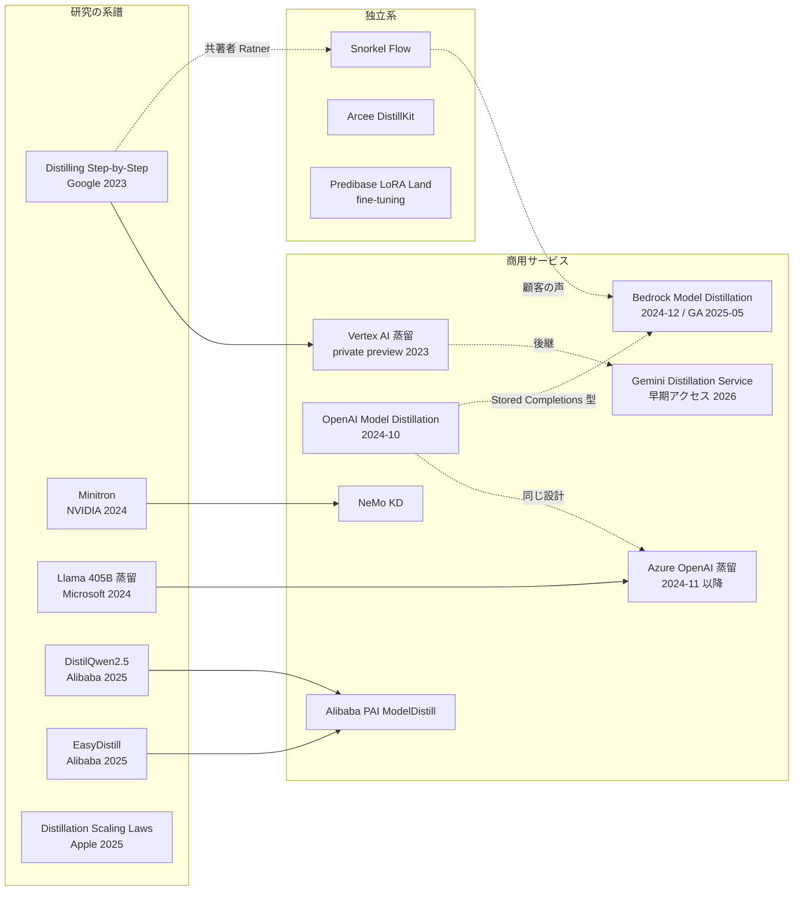
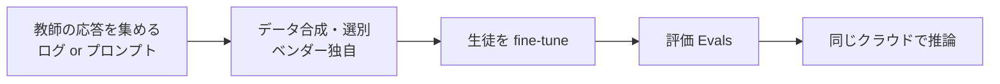

# C2 クラウド・ベンダーの蒸留サービス（distillation_platforms） — リソース収集結果

## 収集パラメータ

- **対象リソース**: 学術論文 / 特許 / 技術情報（公式ドキュメント・技術ブログ・OSS） / ビジネス事例
- **対象期間**: 2022 – 2026
- **収集日**: 2026-10-21
- **入力元**: clustering 結果（[cluster-02-distillation-platforms.md](../../../clustering/20261021/cluster-02-distillation-platforms.md)）
- **検索言語**: 英語 + 日本語
- **実行モード**: 非対話（auto 相当）

> **収集上の制約（重要）**: 収集の途中で、セッション全体で共有している WebSearch の上限（200 回）に達しました。それ以降は、既に得た検索結果の URL と、公式サイト・arXiv の既知 URL を **WebFetch / curl で直接取得して内容を照合したもの** だけを採用しています。このため、件数は skill が定める下限（1 領域 × 1 種別あたり 20 件）に届いていません。特に **特許は 0 件** です。C8（規約・知財・特許）の gather で補完してください。

## 収集サマリ

| 領域 | 論文 | 特許 | 技術情報 | 事例 | 合計 |
|------|------|------|----------|------|------|
| Amazon Bedrock（日本語版 2 件を含む） | 0 | 0 | 12 | 6 | 18 |
| OpenAI | 0 | 0 | 5 | 0 | 5 |
| Azure AI Foundry / Azure OpenAI | 1 | 0 | 9 | 0 | 10 |
| Google Vertex AI / Gemini | 1 | 0 | 4 | 1 | 6 |
| Alibaba Cloud PAI | 2 | 0 | 3 | 0 | 5 |
| NVIDIA NeMo | 2 | 0 | 3 | 0 | 5 |
| 独立系（Snorkel / Predibase / Arcee / Together） | 1 | 0 | 4 | 0 | 5 |
| 横断（サーベイ・スケーリング則・推論蒸留） | 3 | 0 | 0 | 0 | 3 |
| 国内（日本の媒体） | 0 | 0 | 1 | 0 | 1 |
| **合計** | **10** | **0** | **41** | **7** | **58** |

（ビジネス事例 #5 は技術情報 #5 と同じ URL です。URL の重複を除くと 57 件です）

### 2026-10-22 追記: 再調査後の収集サマリ

WebSearch 22 回・WebFetch 約 40 回の追加調査で、技術情報 16 件（#42〜#57）とビジネス事例 2 件（#8〜#9）を追加しました（いずれも本文を取得して照合済み）。特許は引き続き 0 件です。

| 領域 | 論文 | 特許 | 技術情報 | 事例 | 合計 | 追加分 |
|------|------|------|----------|------|------|--------|
| Amazon Bedrock | 0 | 0 | 16 | 8 | 24 | +6（対応表・データ準備・プレビュー解説・Anthropic ブログ・導入事例・AIM391） |
| OpenAI | 0 | 0 | 8 | 0 | 8 | +3（Deprecations・SFT ガイド・Pricing） |
| Azure AI Foundry / Azure OpenAI | 1 | 0 | 10 | 0 | 11 | +1（fine-tuning のコスト管理） |
| Google Vertex AI / Agent Platform | 1 | 0 | 7 | 1 | 9 | +3（オープンモデル蒸留・価格・リリースノート） |
| Alibaba Cloud PAI | 2 | 0 | 3 | 0 | 5 | 0 |
| NVIDIA NeMo | 2 | 0 | 3 | 0 | 5 | 0 |
| 独立系 | 1 | 0 | 5 | 0 | 6 | +1（Fireworks の蒸留チュートリアル） |
| 横断 | 3 | 0 | 0 | 0 | 3 | 0 |
| 国内（日本の媒体） | 0 | 0 | 5 | 0 | 5 | +4（クラスメソッド 3 本・AWS ブログ日本） |
| **合計** | **10** | **0** | **57** | **9** | **76** | **+18** |

```
件数（領域別、2026-10-22 時点）
Bedrock        |████████████████████████ 24
Azure          |███████████ 11
Vertex/Agent   |█████████ 9
OpenAI         |████████ 8
独立系          |██████ 6
Alibaba PAI    |█████ 5
NVIDIA NeMo    |█████ 5
国内媒体        |█████ 5
横断論文        |███ 3
```

年次分布（追加分を含む）: 2026 年 16 件、2025 年 32 件、2024 年 24 件、2023 年 2 件、日付不明 2 件（Fireworks のドキュメント、AWS 導入事例）。

```
件数（領域別）
Bedrock        |██████████████████ 18
Azure          |██████████ 10
Vertex/Gemini  |██████ 6
OpenAI         |█████ 5
Alibaba PAI    |█████ 5
NVIDIA NeMo    |█████ 5
独立系          |█████ 5
横断論文        |███ 3
国内媒体        |█ 1
```

## URL検証結果

| 項目 | 件数 |
|------|------|
| 収集（候補 URL） | 75 |
| 検証済み（取得して内容が一致、URL の重複を除く） | 57 |
| 不一致で除外（取得できたが蒸留と無関係・本文が取れない） | 4 |
| アクセス不可で除外（403 / 404） | 14 |

除外した主な URL と理由:

| URL | 理由 |
|-----|------|
| openai.com/index/api-model-distillation/ | 403。OpenAI 公式の発表記事。内容はコミュニティ告知と Cookbook で代替 |
| docs.cloud.google.com/.../tuning/distillation（Gemini Distillation Service） | 404。2026-10 時点で公開ページが消えている。二次報道（runtimewire）でのみ確認 |
| cloud.google.com/vertex-ai/.../distill-text-models（PaLM 向け蒸留） | 404。旧 PaLM 用ページは削除済み |
| predibase.com の 2 記事 / snorkel.ai の 1 記事 / arcee.ai のブログ | 403 / 404 |
| bigdatawire.com（Bedrock 発表記事） | 403 |
| dev.to「14x Cheaper AI」 | 404（検索結果には出たが取得不可） |
| alibabacloud.com の DistilQwen2.5 ブログ | 本文が取れず内容を照合できない |
| github.com/NVIDIA/NeMo | 取得できたが、トップページに蒸留の記述なし（ドキュメント側で代替） |

（2026-10-22 追記）再調査で取得を試みて除外した URL:

| URL | 理由 |
|-----|------|
| openai.com/index/api-model-distillation/、openai.com/api/pricing/ | 再度 403（curl でも「Enable JavaScript and cookies」）。検索スニペットで特典の記述のみ確認 |
| docs.cloud.google.com/.../tuning/distillation | 再度 404。web.archive.org は本環境から取得不可 |
| docs.aws.amazon.com/nova/.../customize-distill.html（英・日） | JavaScript 描画で本文が取れない（Bedrock ユーザーガイド側で代替） |
| docs.aws.amazon.com/bedrock/.../custom-model-supported.html | 本文が取れない（prerequisites ページで代替） |
| rubrik.com（旧 predibase.com）の「12 best practices for distilling」 | 403 |
| enterprisezine.jp/news/detail/21352 | bot 対策の 403。スニペットのみ |
| snorkel.ai「First cohort … gains up to 54 points」 | URL を特定できず（推測した URL は 404） |
| developersdigest.tech（Bedrock fine-tuning のまとめ） | 404（検索結果には出たが取得不可） |

以下の表には検証済みのものだけを載せています。

## 年次分布

```
年      全体
2026 |███████ 7
2025 |█████████████████████████████ 29
2024 |████████████████████ 20
2023 |██ 2
```

```
年      論文  技術情報  事例
2026 |  0  |   7    |  0
2025 |  4  |  23    |  2
2024 |  5  |  10    |  5
2023 |  1  |   1    |  0
```

- **2024 年後半〜2025 年に集中**しています（OpenAI 2024-10、Azure 2024-11〜2025-05、Bedrock 2024-12 プレビュー / 2025-05 GA）。
- 2026 年は、Bedrock の新しいハンズオン記事、Gemini 蒸留サービスの扱いが不明確になった件、ドキュメントの改訂だけでした。**商用蒸留サービスの話題は 2025 年に山を越え**、ファインチューニング機能の一部に吸収されつつあります（OpenAI の蒸留ガイドは SFT ガイドへ統合済み）。

## リソース関係図



## 全体の傾向



- **方式はほぼ全社共通の「黒箱（応答）蒸留 = 教師出力による SFT」**: OpenAI / Azure / Bedrock / Vertex（Gemini）はいずれも、教師の応答（Gemini は教師の推論過程も使うとされる）を学習データにして生徒をファインチューニングする方式です。ロジットを使う **白箱蒸留をマネージドで提供しているのは NVIDIA NeMo と Alibaba PAI（EasyDistill / DistilQwen）** くらいでした（公式ドキュメントと論文で確認）。
- **教師と生徒は「同じファミリー」に縛られる**: Bedrock は「教師と生徒は同じファミリーでなければならない」と明記しています。OpenAI → GPT-4o mini、Gemini 3.1 Pro → 2.5 Flash も同じベンダー内です（仮説 H5 と関連し、規約に加えて **製品設計でも教師が固定** されています）。
- **名前の出た顧客の成果数値は見つからない**: Bedrock の発表で蒸留を使う顧客として名前が出たのは **Robin AI の 1 社だけ** で、数値はありません。**Moody's はマルチエージェント、PwC は Automated Reasoning checks の顧客** で、蒸留の顧客ではありませんでした（プレスリリースと二次報道 2 件で確認）。clustering 時の「Moody's / PwC / Robin AI」という前提は誤りでした。
- **定量値の多くはベンダー自身の実験**: Bedrock の「最大 500%（= 5 倍）高速・75% 安価・RAG で精度低下 2% 未満」、関数呼び出しの「+45.2%」、動画検索の「コスト 95% 超削減・レイテンシ 50% 減」、Nova Pro の「API 呼び出し精度 +20%」は、どれも AWS 社員による実験です。
- **本番の A/B テストまで公開しているのは Alibaba だけ**: DistilQwen2.5 論文は、社内のビッグデータ基盤の SQL 補完で、7B → 3B の蒸留により **レイテンシ 384 ms → 148 ms、採用率 26.5% → 25.5%** という A/B テストの結果を載せています。
- **国内顧客の事例は 0 件**: 日本語で見つかったのは、AWS ブログの翻訳と @IT の解説記事（会員限定）だけでした。（2026-10-22 追記: クラスメソッドのハンズオン 3 本と AWS ジャパンのイベント報告を追加しましたが、顧客事例は引き続き 0 件です）
- **（2026-10-22 追記）サービスの縮小が一次資料で確定**: OpenAI はセルフサーブ fine-tuning を縮小中（2027-01-06 に新規ジョブ停止、#42）、Azure は Stored Completions を 2026-10-15 に廃止、Bedrock は Anthropic モデルの蒸留を停止中（#45）。Google はオープンモデル向けの蒸留だけが公開（#49）。**東京リージョンで蒸留ジョブを実行できるマネージドサービスは本調査の範囲では 0** でした。

全体としてみると、各社の商用蒸留サービスは「教師ログ → SFT → 評価 → 同じクラウドで推論」という同じ形にそろっています。違いは対応モデル、データ合成の有無、推論の課金方式（Bedrock は当初 Provisioned Throughput 必須、のちに On-Demand に対応）にあります。顧客ごとの成果はほとんど公開されておらず、数値の大半はベンダー自身のデモです。仮説 H2 は「顧客名すら誤って伝わっている」という形で、想定より強く支持されました。

---

## 学術論文

| # | 領域 | タイトル | 著者 | 年 | Venue | 概要 |
|---|------|---------|------|-----|-------|------|
| 1 | Alibaba PAI | [EasyDistill: A Comprehensive Toolkit for Effective Knowledge Distillation of Large Language Models](https://arxiv.org/abs/2505.20888) | Chengyu Wang et al. | 2025 | arXiv（EMNLP 2025 Demo とされる） | 黒箱・白箱の両方に対応する蒸留ツールキット。Alibaba Cloud PAI への統合を説明 |
| 2 | Alibaba PAI | [DistilQwen2.5: Industrial Practices of Training Distilled Open Lightweight Language Models](https://arxiv.org/abs/2504.15027) | Chengyu Wang, Junbing Yan, Yuanhao Yue, Jun Huang | 2025 | arXiv | 複数エージェントでのデータ拡張と top-K ロジット蒸留。社内 SQL 補完での A/B テスト結果あり |
| 3 | 横断 | [Distillation Scaling Laws](https://arxiv.org/abs/2502.08606) | Dan Busbridge et al. | 2025 | ICML 2025 | 計算予算を教師と生徒にどう配分すべきかを示すスケーリング則。「教師が既にある / 生徒が多い」場合に蒸留が有利 |
| 4 | 横断 | [DeepSeek-R1: Incentivizing Reasoning Capability in LLMs via Reinforcement Learning](https://arxiv.org/abs/2501.12948) | DeepSeek-AI | 2025 | arXiv | R1-Distill（Qwen / Llama への推論蒸留）。Bedrock の Custom Model Import の題材にもなった |
| 5 | Azure | [Knowledge Distillation Using Frontier Open-source LLMs: Generalizability and the Role of Synthetic Data](https://arxiv.org/abs/2410.18588) | Anup Shirgaonkar et al.（Microsoft） | 2024 | arXiv | Azure AI 上で Llama-3.1-405B → 8B/70B を蒸留。Azure の価格表で 8B は 18 倍超、70B は 2 倍超安いと試算 |
| 6 | NVIDIA NeMo | [LLM Pruning and Distillation in Practice: The Minitron Approach](https://arxiv.org/abs/2408.11796) | Sharath Turuvekere Sreenivas et al. | 2024 | arXiv | Llama 3.1 8B → 4B、Mistral NeMo 12B → 8B を剪定と蒸留で作る手順 |
| 7 | NVIDIA NeMo | [Compact Language Models via Pruning and Knowledge Distillation](https://arxiv.org/abs/2407.14679) | Saurav Muralidharan et al. | 2024 | arXiv（NeurIPS 2024） | Nemotron-4 15B → 8B / 4B。学習トークンを最大 40 分の 1 に、モデル群の学習計算量を 1.8 倍削減 |
| 8 | 独立系 | [LoRA Land: 310 Fine-tuned LLMs that Rival GPT-4, A Technical Report](https://arxiv.org/abs/2405.00732) | Justin Zhao et al.（Predibase） | 2024 | arXiv | **蒸留ではなく LoRA fine-tuning**。4bit LoRA で平均してベースモデルを 34 ポイント、GPT-4 を 10 ポイント上回る（H3 の対照例） |
| 9 | 横断 | [A Survey on Knowledge Distillation of Large Language Models](https://arxiv.org/abs/2402.13116) | Xiaohan Xu et al. | 2024 | arXiv | LLM 蒸留の代表的なサーベイ（clustering の index でも参照） |
| 10 | Vertex AI | [Distilling Step-by-Step! Outperforming Larger Language Models with Less Training Data and Smaller Model Sizes](https://arxiv.org/abs/2305.02301) | Cheng-Yu Hsieh et al. | 2023 | ACL 2023 Findings | 根拠（rationale）付き蒸留。770M の T5 が 540B の PaLM を上回る。Vertex AI の private preview に組み込まれた |

---

## 特許

**0 件**（WebSearch の上限に達したため、Google Patents / J-PlatPat の検索ができませんでした）。C8 `legal_ip_patents` の gather で、以下のクエリでの補完を推奨します。

| 推奨クエリ | 狙い |
|-----------|------|
| `site:patents.google.com "model distillation" "teacher model" "invocation log"` | Bedrock 型（呼び出しログからの蒸留）の特許 |
| `site:patents.google.com "stored completions" OR "distillation" OpenAI` | OpenAI / Microsoft の出願 |
| `site:patents.google.com "pruning" "knowledge distillation" NVIDIA language model` | Minitron 系 |
| J-PlatPat「蒸留 AND 大規模言語モデル」 | 国内出願 |

---

## 技術情報

| # | 領域 | タイトル | ソース | 年 | 種別 | 概要 |
|---|------|---------|--------|-----|------|------|
| 1 | Bedrock | [Optimize video semantic search intent with Amazon Nova Model Distillation on Amazon Bedrock](https://aws.amazon.com/blogs/machine-learning/optimize-video-semantic-search-intent-with-amazon-nova-model-distillation-on-amazon-bedrock/) | AWS ML Blog | 2026 | ブログ | Nova Premier → Nova Micro。Claude 4.5 Haiku と同じ判定スコア 4.0/5、レイテンシ 1,741 → 833 ms、コスト 95% 超削減 |
| 2 | Bedrock | [sample-video-semantic-search-multimodal-embeddings](https://github.com/aws-samples/sample-video-semantic-search-multimodal-embeddings) | aws-samples | 2026 | OSS | 上記のノートブックとデータ生成スクリプト |
| 3 | Bedrock | [Amazon Bedrock Model Distillation is now generally available](https://aws.amazon.com/about-aws/whats-new/2025/05/amazon-bedrock-model-distillation-generally-available) | AWS What's New | 2025 | 公式発表 | GA。Nova Premier → Nova Pro、Claude 3.5 Sonnet v2、Llama 3.3 70B → 3.2 1B/3B を追加 |
| 4 | Bedrock | [Amazon Bedrock Model Distillation: Boost function calling accuracy while reducing cost and latency](https://aws.amazon.com/blogs/machine-learning/amazon-bedrock-model-distillation-boost-function-calling-accuracy-while-reducing-cost-and-latency/) | AWS ML Blog | 2025 | ブログ | BFCL v2 で Llama 405B → 3B。simple 0.478 → 0.783 → 0.826（データ拡張あり） |
| 5 | Bedrock | [Amazon Nova Premier: Our most capable model for complex tasks and teacher for model distillation](https://aws.amazon.com/blogs/aws/amazon-nova-premier-our-most-capable-model-for-complex-tasks-and-teacher-for-model-distillation/) | AWS News Blog | 2025 | 公式ブログ | 蒸留した Nova Pro の API 呼び出し精度が +20%。投資調査用マルチエージェントの supervisor を Nova Micro に蒸留する例 |
| 6 | Bedrock | [Amazon Nova Premier（日本語版）](https://aws.amazon.com/jp/blogs/news/amazon-nova-premier-our-most-capable-model-for-complex-tasks-and-teacher-for-model-distillation/) | AWS ブログ（日本） | 2025 | 公式ブログ | 上記の日本語訳 |
| 7 | Bedrock | [Customize a model with distillation in Amazon Bedrock](https://docs.aws.amazon.com/bedrock/latest/userguide/model-distillation.html) | AWS ドキュメント | 2025 | 公式ドキュメント | 仕組み・呼び出しログの利用・独自のデータ合成で教師推論費が追加でかかること |
| 8 | Bedrock | [Amazon Bedrock pricing](https://aws.amazon.com/bedrock/pricing/) | AWS | 2026 | 価格 | PEFT で作った蒸留モデルは PT / On-Demand を選べる。価格はベースモデルと同じ |
| 9 | Bedrock | [Amazon Bedrock Model Distillation（製品ページ・日本語）](https://aws.amazon.com/jp/bedrock/model-distillation/) | AWS | 2025 | 製品ページ | 「最大 500% 高速・最大 75% 安価・精度低下 2% 未満」。顧客の声は掲載なし |
| 10 | Bedrock | [Build faster, more cost-efficient, highly accurate models with Amazon Bedrock Model Distillation (preview)](https://aws.amazon.com/blogs/aws/build-faster-more-cost-efficient-highly-accurate-models-with-amazon-bedrock-model-distillation-preview/) | AWS News Blog（Channy Yun） | 2024 | 公式ブログ | プレビューの発表。「最大 5 倍高速」、同じファミリーに限る、PT の購入が必須 |
| 11 | Bedrock / 国内 | [Amazon Bedrock Model Distillation（プレビュー）を使用して…（日本語版）](https://aws.amazon.com/jp/blogs/news/build-faster-more-cost-efficient-highly-accurate-models-with-amazon-bedrock-model-distillation-preview/) | AWS ブログ（日本） | 2024 | 公式ブログ | 上記の日本語訳 |
| 12 | 国内 | [AWSが“民主化”する生成AIトレンド「蒸留」とは](https://atmarkit.itmedia.co.jp/ait/articles/2501/14/news106.html) | @IT（三木泉） | 2025 | 解説記事 | Nova Micro / Lite は生徒、Pro / Premier は教師という位置づけ。後半は会員限定 |
| 13 | OpenAI | [Leveraging model distillation to fine-tune a model](https://cookbook.openai.com/examples/leveraging_model_distillation_to_fine-tune_a_model) | OpenAI Cookbook | 2024 | チュートリアル | gpt-4o → gpt-4o-mini。ワイン品種分類で 64.67% → 79.33%（教師は 79.67%） |
| 14 | OpenAI | [Model Distillation (including Evals and Stored Completions)](https://community.openai.com/t/model-distillation-including-evals-and-stored-completions/964021) | OpenAI Developer Community | 2024 | 公式告知 | DevDay 2024 の告知。GPT-4o / o1-preview の出力で小型モデルを学習 |
| 15 | OpenAI | [Supervised fine-tuning（旧 distillation ガイド）](https://platform.openai.com/docs/guides/distillation) | OpenAI Docs | 2026 | 公式ドキュメント | 蒸留ガイドは SFT ガイドの 1 節「Distilling from a larger model」に統合済み（gpt-4.1 → gpt-4.1-mini） |
| 16 | OpenAI | [5 key updates unveiled at OpenAI's DevDay 2024](https://hackernoon.com/5-key-updates-unveiled-at-openais-devday-2024) | HackerNoon | 2024 | 二次報道 | Stored Completions と Evals（beta）の解説 |
| 17 | OpenAI | [What is Distillation API?](https://www.promptlayer.com/glossary/openai-distillation-api) | PromptLayer | 2025 | 用語解説 | OpenAI の蒸留ワークフローの解説 |
| 18 | Azure | [What's New in Azure AI Foundry Fine-Tuning（Build 2025）](https://techcommunity.microsoft.com/blog/aiplatformblog/-/4413873) | Microsoft Tech Community | 2025 | 公式ブログ | Evaluations と Stored Completions を全 Azure OpenAI リージョンで提供 |
| 19 | Azure | [Unlocking the Power of Model Distillation through Azure AI Foundry](https://techcommunity.microsoft.com/blog/azure-ai-services-blog/-/4411554) | Microsoft Tech Community | 2025 | ブログ | Stored Completions が 10 件以上あれば Distill ボタンが有効になる |
| 20 | Azure | [Introducing Evaluation API on Azure OpenAI Service](https://techcommunity.microsoft.com/blog/aiplatformblog/-/4407280) | Microsoft Tech Community | 2025 | 公式ブログ | Evaluation API によりコードだけで蒸留を完結できる |
| 21 | Azure | [Code First Distillation with Stored Completions in Azure OpenAI Service](https://techcommunity.microsoft.com/blog/azure-ai-services-blog/-/4385333) | Microsoft Tech Community | 2025 | 公式ブログ | Stored Completions API / SDK のパブリックプレビュー |
| 22 | Azure | [Introducing Enhanced Azure OpenAI Distillation and Fine-Tuning Capabilities](https://techcommunity.microsoft.com/blog/azure-ai-services-blog/-/4372173) | Microsoft Tech Community | 2025 | 公式ブログ | o1-preview / o1-mini / GPT-4o-mini を取得元に追加。リージョンを拡大 |
| 23 | Azure | [Introducing New Fine-tuning Techniques and Capabilities in Azure OpenAI Service](https://techcommunity.microsoft.com/blog/azure-ai-services-blog/-/4357961) | Microsoft Tech Community | 2024 | 公式ブログ | Stored Completions のパブリックプレビュー（当初は GPT-4o-0806、Sweden Central のみ） |
| 24 | Azure | [What's new in Azure OpenAI Service fine-tuning](https://techcommunity.microsoft.com/blog/azure-ai-services-blog/-/4298812) | Microsoft Tech Community | 2024 | 公式ブログ | Ignite 2024 で蒸留を予告（データ生成・学習・評価の 3 段階） |
| 25 | Azure | [Introducing Model Distillation in Azure OpenAI Service](https://techcommunity.microsoft.com/blog/azure-ai-services-blog/-/4298627) | Microsoft Tech Community | 2024 | 公式ブログ | ニュース感情分析の架空シナリオで GPT-4o → GPT-4o-mini |
| 26 | Azure | [How to use stored completions & distillation](https://learn.microsoft.com/en-us/azure/ai-foundry/openai/how-to/stored-completions) | Microsoft Learn | 2025 | 公式ドキュメント | Stored Completions の手順書 |
| 27 | Vertex AI | [Distilling step-by-step: Outperforming larger language models with less training data and smaller model sizes](https://research.google/blog/distilling-step-by-step-outperforming-larger-language-models-with-less-training-data-and-smaller-model-sizes/) | Google Research Blog | 2023 | 研究ブログ | 「Vertex AI で private preview 提供中」と明記 |
| 28 | Vertex AI | [Tune Gemini models（Agent Platform のチューニング概要）](https://cloud.google.com/vertex-ai/generative-ai/docs/models/tune-models) | Google Cloud Docs | 2026 | 公式ドキュメント | 目次に「Open models: Supervised and distillation fine-tuning」はあるが、Gemini 蒸留のページは掲載なし |
| 29 | Vertex AI | [Vertex AI（概念解説）](https://dejan.ai/concepts/vertex-ai/) | dejan.ai | 2025 | 解説 | Vertex AI の機能一覧（補足用） |
| 30 | NVIDIA | [How to Prune and Distill Llama-3.1 8B to an NVIDIA Llama-3.1-Minitron 4B Model](https://developer.nvidia.com/blog/how-to-prune-and-distill-llama-3-1-8b-to-an-nvidia-llama-3-1-minitron-4b-model/) | NVIDIA Technical Blog | 2024 | 技術ブログ | 94B トークンで 4B を作成。depth 版はスループット約 2.7 倍 |
| 31 | NVIDIA | [Mistral-NeMo-Minitron 8B Model Delivers Unparalleled Accuracy](https://developer.nvidia.com/blog/mistral-nemo-minitron-8b-foundation-model-delivers-unparalleled-accuracy/) | NVIDIA Technical Blog | 2024 | 技術ブログ | 12B → 8B。380B トークンの蒸留で、ゼロから学習するより計算量が 40 分の 1 超 |
| 32 | NVIDIA | [Distillation — NeMo Framework User Guide](https://docs.nvidia.com/nemo-framework/user-guide/latest/model-optimization/distillation/distillation.html) | NVIDIA Docs | 2025 | 公式ドキュメント | NeMo 2.0 の KD 設定。GPT 系チェックポイントのみ対応 |
| 33 | Alibaba PAI | [EasyDistill（GitHub）](https://github.com/modelscope/easydistill) | ModelScope / Alibaba | 2025 | OSS | PAI-Token / PAI-EAS 用の設定を同梱。agent・検索 agent・動画の蒸留にも対応 |
| 34 | Alibaba PAI | [Platform for AI（PAI）ドキュメント](https://www.alibabacloud.com/help/en/pai/) | Alibaba Cloud | 2025 | 公式ドキュメント | 目次に「Model Distillation（ModelDistill）」 |
| 35 | Alibaba PAI | [alibaba-pai（Hugging Face）](https://huggingface.co/alibaba-pai) | Alibaba PAI | 2025 | モデル配布 | DistilQwen_100k / DistilQwen_1M データセット等 |
| 36 | 独立系 | [LLM distillation demystified: a complete guide](https://snorkel.ai/blog/llm-distillation-demystified-a-complete-guide/) | Snorkel AI | 2025 | ベンダーブログ | 分類蒸留・多信号蒸留・MiniLLM の解説 |
| 37 | 独立系 | [Why enterprises should embrace LLM distillation](https://snorkel.ai/blog/why-enterprises-should-embrace-llm-distillation/) | Snorkel AI（Shane Johnson） | 2025 | ベンダーブログ | 405B は 800GB 超、8B は 16GB。条件次第で 8B は 405B の約 2% のコストで動く |
| 38 | 独立系 | [DistillKit](https://github.com/arcee-ai/DistillKit) | Arcee AI | 2025 | OSS | オンライン / オフライン蒸留、ロジット圧縮。Virtuoso / SuperNova Medius / Blitz の学習に使用 |
| 39 | 独立系 | [Fine-tuning overview](https://docs.together.ai/docs/fine-tuning-overview) | Together AI | 2026 | 公式ドキュメント | **蒸留の専用機能は記載なし**（SFT / DPO のみ）。比較のため掲載 |
| 40 | Bedrock | [Model Distillation via Amazon Bedrock](https://cladiusfernando.com/2025/05/10/model-distillation-via-amazon-bedrock/) | 個人ブログ | 2025 | 個人ブログ | GA 直後の手順メモ |
| 41 | Vertex AI | [Google Cloud page describes Gemini distillation service, but its release status is unclear](https://runtimewire.com/article/google-cloud-page-describes-gemini-distillation-service-but-its-release-status-i) | RuntimeWire（Ryan Merket） | 2026 | 二次報道 | アーカイブされた公式ページによると、allowlist 制・本番利用禁止。gemini-3.1-pro → gemini-2.5-flash |
| 42 | OpenAI（2026-10-22 追記） | [Deprecations — Update to OpenAI's self-serve fine-tuning](https://developers.openai.com/api/docs/deprecations) | OpenAI Docs | 2026 | 公式ドキュメント | 2026-05-07 に通知。新規ユーザー不可、2027-01-06 に既存顧客も新規ジョブ停止。gpt-4.1 / 4o 系は 2027-01-14 停止 |
| 43 | OpenAI（2026-10-22 追記） | [Supervised fine-tuning（Distilling from a larger model）](https://developers.openai.com/api/docs/guides/supervised-fine-tuning) | OpenAI Docs | 2026 | 公式ドキュメント | 「OpenAI is winding down the fine-tuning platform.」旧 distillation ガイドの 301 先。gpt-4.1 → gpt-4.1-mini、Responses API は 30 日保存 |
| 44 | OpenAI（2026-10-22 追記） | [Pricing（Fine-tuning）](https://developers.openai.com/api/docs/pricing) | OpenAI Docs | 2026 | 価格 | gpt-4.1-mini 学習 $5.00・推論 $0.80 / $3.20 per 1M。Stored Completions / Evals の価格記載なし |
| 45 | Bedrock（2026-10-22 追記） | [Prerequisites for model distillation（対応モデルとリージョン）](https://docs.aws.amazon.com/bedrock/latest/userguide/prequisites-model-distillation.html) | AWS ドキュメント | 2026 | 公式ドキュメント | **Anthropic の蒸留は停止中・復旧未定**。Nova は us-east-1、Llama は us-west-2。東京非対応 |
| 46 | Bedrock（2026-10-22 追記） | [Prepare your training datasets for distillation](https://docs.aws.amazon.com/bedrock/latest/userguide/distillation-prepare-datasets.html) | AWS ドキュメント | 2026 | 公式ドキュメント | text-to-text のみ。RAG / エージェント向けのプロンプト例 |
| 47 | Bedrock（2026-10-22 追記） | [A guide to Amazon Bedrock Model Distillation (preview)](https://aws.amazon.com/blogs/machine-learning/a-guide-to-amazon-bedrock-model-distillation-preview) | AWS ML Blog（Yanyan Zhang ほか） | 2024 | ブログ | 手順解説。顧客名・精度の数値なし。合成データ最大 15k 組、PT は時間課金 |
| 48 | Bedrock（2026-10-22 追記） | [Claude 3.5 Haiku on AWS Trainium2 and model distillation in Amazon Bedrock](https://claude.com/blog/trainium2-and-distillation) | Anthropic | 2024 | 公式ブログ | Claude 3.5 Sonnet → Claude 3 Haiku の蒸留をプレビュー発表（2024-12-03）。latency-optimized Haiku は「up to 60% faster」。顧客名なし |
| 49 | Vertex AI（2026-10-22 追記） | [Supervised and distillation fine-tuning for open models](https://docs.cloud.google.com/gemini-enterprise-agent-platform/models/tuning/open-model-tuning) | Google Cloud Docs | 2026 | 公式ドキュメント | 教師 DeepSeek R1 0528 / V3.2・GLM 5.2・Kimi K2 Thinking・Qwen3 Next 80B → 生徒 Qwen 3 4B〜32B / Gemma 3 1B〜27B。教師呼び出しは別課金。東京非対応 |
| 50 | Vertex AI（2026-10-22 追記） | [Agent Platform Pricing（Model Tuning）](https://docs.cloud.google.com/vertex-ai/generative-ai/pricing) | Google Cloud | 2026 | 価格 | Gemini 2.5 Flash SFT $0.005 / 1k、Gemma 3 / Qwen 3 / Llama の 1M 単価。Gemini 3 以降はチューニング済み推論が 1.5 倍 |
| 51 | Vertex AI（2026-10-22 追記） | [Vertex AI release notes（Generative AI）](https://docs.cloud.google.com/vertex-ai/generative-ai/docs/release-notes) | Google Cloud | 2026 | 公式ドキュメント | 2025-08-07 にオープンモデルの SFT。「distillation」を含む項目は Llama 3.1 405B の紹介文のみ |
| 52 | Azure（2026-10-22 追記） | [Manage fine-tuning costs in Microsoft Foundry](https://learn.microsoft.com/en-us/azure/ai-foundry/openai/how-to/fine-tuning-cost-management) | Microsoft Learn | 2026 | 公式ドキュメント | 学習トークン × エポック、時間課金ホスティング、PTU、Developer デプロイ（24 時間）。Fireworks on Foundry を併記 |
| 53 | 独立系（2026-10-22 追記） | [Knowledge distillation（Fireworks AI Docs）](https://docs.fireworks.ai/examples/knowledge-distillation) | Fireworks AI | 不明 | 公式チュートリアル | DeepSeek-V3 → Qwen2.5-7B、GSM8K 52% → 70%（SFT + RFT）。コスト・レイテンシの数値なし |
| 54 | 国内（2026-10-22 追記） | [Amazon Nova で Bedrock Model Distillation を使ってみた](https://dev.classmethod.jp/articles/bedrock-model-distillation-basic/) | クラスメソッド DevelopersIO（森田力） | 2024 | ハンズオン | Nova Pro → Micro / Lite。100 件で 1〜2 時間。データ形式で「結構ハマりました」。PT 最小 1 時間 |
| 55 | 国内（2026-10-22 追記） | [Amazon Bedrock Model Distillation が一般提供開始となりました](https://dev.classmethod.jp/articles/amazon-bedrock-model-distillation-generally-available/) | クラスメソッド DevelopersIO（森田力） | 2025 | 解説記事 | GA で追加された組合せとジョブステータス表示。「時間がかかり、エラーも起こりやすい」 |
| 56 | 国内（2026-10-22 追記） | [「新機能 Bedrock Model Distillation 基礎〜実践まで」クラスメソッド re:Growth 2024 福岡](https://dev.classmethod.jp/articles/bedrock-model-distillation-re-growth-2024-awsreinvent-regrowth-fukuoka) | クラスメソッド DevelopersIO（森田力） | 2024 | 登壇記事 | 登壇の記録。記事本文にスライドの内容はなし |
| 57 | 国内（2026-10-22 追記） | [第 4 回 AWS ジャパン 生成 AI Frontier Meetup 開催報告](https://aws.amazon.com/jp/blogs/news/4th-gen-ai-frontier-meet-up) | AWS ブログ（日本） | 2025 | 公式ブログ | AWS ジャパン金杉有見子氏が Nova について「継続事前学習、ファインチューニング、アラインメント、蒸留といった多様な手法に対応し」と紹介。顧客事例なし |
| 58 | 独立系（2026-10-22 追記） | [DistillKit（arcee-ai/DistillKit）](https://github.com/arcee-ai/DistillKit) | Arcee AI / GitHub | 2024 | OSS | 「production-ready toolkit for knowledge distillation of LLMs」。online / offline、KL / JSD / TVD、hidden-state、Apache 2.0、1.1k stars・42 commits。2026-09 の Series B 発表文には DistillKit の記述なし |
| 59 | 独立系（2026-10-22 追記） | [Train a reasoning model（Kiln Docs）](https://docs.kiln.tech/docs/guide-train-a-reasoning-model) | Kiln | 不明 | 公式ドキュメント | 「fine-tune a smaller model from R1 outputs (this is called distilling a model)」。合成データ → 推論サンプル抽出 → Thinking 学習の 5 手順、「30 分程度」 |
| 60 | 独立系（2026-10-22 追記） | [Bespoke-Stratos-32B モデルカード](https://huggingface.co/bespokelabs/Bespoke-Stratos-32B) | Bespoke Labs / Hugging Face | 2025 | モデルカード | 学習データ Stratos-17k は「DeepSeek-R1 を Sky-T1 のパイプラインで蒸留」。Qwen2.5-32B-Instruct を SFT。AIME24 63.3（R1-Distill-Qwen-32B 66.7）、MATH500 93.0（同 89.8）。Apache 2.0 |
| 61 | 独立系（2026-10-22 追記） | [Two approaches to distill LLMs for better enterprise value](https://snorkel.ai/?p=13335) | Snorkel AI（Jason Fries） | 2023 | ブログ | Distilling step-by-step（Google 共同、学習データ 20〜78.5% 削減）と複数 LLM のプログラマティックラベリング → RoBERTa。製品機能としての蒸留ではない |
| 62 | 独立系（2026-10-22 追記） | [Fine-tuning（Together AI）](https://www.together.ai/fine-tuning) | Together AI | 2026 | 製品ページ | LoRA / 全パラメータ / DPO / RL / speculative decoding 用 draft モデル。**distillation の語なし**。顧客: XY.AI Labs / Slingshot AI / Protege AI |
| 63 | 独立系（2026-10-22 追記） | [LFM2: Liquid Foundation Models v2](https://www.liquid.ai/blog/liquid-foundation-models-v2-our-second-series-of-generative-ai-models) | Liquid AI | 2025 | 公式ブログ | 0.35B / 0.7B / 1.2B を LFM1-7B 教師で 10T トークン知識蒸留。売上 $10M 未満は商用可、以上は商用ライセンス |
| 64 | 独立系（2026-10-22 追記） | [Mistral uses cascade distillation on Mistral 3 to build Ministral family（The Batch）](https://www.deeplearning.ai/the-batch/mistral-uses-cascade-distillation-on-mistral-3-to-build-ministral-family) | DeepLearning.AI | 2026 | 二次解説 | Mistral Small 3.1 24B → 14B → 8B → 3B の剪定 + 蒸留。Apache 2.0。API $0.20 / $0.15 / $0.10 per 1M。Mistral 公式ページは 404 |
| 65 | 横断（2026-10-22 追記） | [Strengthening our defenses against distillation attacks](https://www.anthropic.com/research/distillation-defenses) | Anthropic | 2026 | 公式ブログ | 2026-10-12。蒸留者が得るデータ 90〜99% 減、抽出推論トークン 10〜100 倍以上減、分類器の誤検知率 0.1% 未満。2026-08-31 以降の新規アカウントは preserved thinking 編集不可、2026-09-24 からブロック分にも課金 |
| 66 | 横断（2026-10-22 追記） | [CSA Research Note: LLM Model Extraction at Cloud Scale](https://labs.cloudsecurityalliance.org/research/csa-research-note-llm-model-extraction-cloud-scale-20260308/) | Cloud Security Alliance | 2026 | 研究ノート | 16.55M クエリ・約 24,000 アカウント。横断行動相関・Zero Trust・透かしを推奨。商用の検知製品の推奨なし |
| 67 | 横断（2026-10-22 追記） | [Small Language Model (SLM) Market worth $5.45 billion by 2032](https://prnewswire.co.uk/news-releases/small-language-model-slm-market-worth-5-45-billion-by-2032--exclusive-report-by-marketsandmarkets-302411715.html) | MarketsandMarkets | 2025 | 調査会社プレス | $0.93B（2025）→ $5.45B（2032）、CAGR 28.7%。知識蒸留は圧縮技術として列挙。ベンダー 26 社（Arcee / Lamini / Predibase / Malted.ai / Together / Fireworks ほか） |
| 68 | 横断（2026-10-22 追記） | [Large Model Knowledge Distillation Solution Market](https://www.intelmarketresearch.com/large-model-knowledge-distillation-solution-market-25844) | Intel Market Research | 2026 | 調査会社 | $43.6M（2025）→ $252M（2034）、CAGR 29.7%。WiseGuy の同名カテゴリは $1.47B（2025）で 30 倍以上の差 |

---

## ビジネス事例

| # | 領域 | タイトル | 企業/組織 | 年 | 種別 | 概要 |
|---|------|---------|-----------|-----|------|------|
| 1 | Bedrock | [AWS Strengthens Amazon Bedrock with Industry-First AI Safeguard, New Agent Capability, and Model Customization](https://press.aboutamazon.com/2024/12/aws-strengthens-amazon-bedrock-with-industry-first-ai-safeguard-new-agent-capability-and-model-customization) | Amazon / **Robin AI** | 2024 | プレスリリース | 蒸留の顧客として名前が出たのは Robin AI のみ（契約条項に関する法務 Q&A）。数値なし。Moody's と PwC は別機能の顧客 |
| 2 | Bedrock | [AWS had a hard time fitting in all of Bedrock's innovations at re:Invent 2024](https://analyticsindiamag.com/ai-news-updates/aws-had-a-hard-time-fitting-in-all-of-bedrocks-innovations-at-reinvent-2024/) | Analytics India Magazine | 2024 | 二次報道 | 「Robin AI is already using this to save money」。PwC = Automated Reasoning、Moody's = マルチエージェントと明記 |
| 3 | Bedrock | [AWS introduces Bedrock Model Distillation and automated reasoning checks](https://www.okoone.com/spark/technology-innovation/aws-claims-100-percent-accuracy-in-stopping-ai-hallucinations/) | Okoone | 2024 | 二次報道 | 発表内容の解説。顧客の数値なし |
| 4 | Bedrock | [AWS strengthens Amazon Bedrock with three significant upgrades](https://itwire.com/business-it-news/data/aws-strengthens-amazon-bedrock-with-three-significant-upgrades.html) | iTWire | 2024 | 二次報道 | 「500% faster and 75% less expensive」を引用 |
| 5 | Bedrock | [Nova Premier の「Customer voices」（技術情報 #5 内）](https://aws.amazon.com/blogs/aws/amazon-nova-premier-our-most-capable-model-for-complex-tasks-and-teacher-for-model-distillation/) | **Slack / Robinhood / Snorkel AI** | 2025 | 顧客の声 | Robinhood は「Premier から Micro / Lite / Pro への transfer」に期待するという声。成果の数値なし |
| 6 | Bedrock（対照） | [AWS Field Experience reduced cost and delivered low latency and high performance with Amazon Nova Lite foundation model](https://aws.amazon.com/blogs/machine-learning/aws-field-experience-reduced-cost-and-delivered-low-latency-and-high-performance-with-amazon-nova-lite-foundation-model) | AWS 社内（AFX） | 2025 | 社内事例 | **蒸留ではなくモデルの乗り換え**で推論コスト 90% 削減。H3 の典型例 |
| 7 | Vertex AI | [Here's how Snorkel Flow + Google AI built an enterprise-ready model in a day](https://snorkel.ai/blog/snorkel-and-google-ai-enterprise-ready-model-in-a-day/) | Snorkel AI / Google Cloud / Wayfair | 2024 | ベンダー事例 | 架空の銀行の意図分類（banking77）で PaLM 2 の F1 50 → 69 → 88。Wayfair は商品タグ付けで F1 +20 ポイント（蒸留かどうかは不明） |
| 8 | Bedrock（2026-10-22 追記） | [Robin AI 導入事例（AWS）](https://aws.amazon.com/solutions/case-studies/robin-ai-bedrock/) | AWS / **Robin AI** | 不明 | ベンダー事例 | Claude 3 を Bedrock で利用、「hundreds of pages of contracts in just a few seconds」。**蒸留・Haiku・fine-tuning の記述なし**。蒸留の顧客とする根拠はプレスリリースのみ |
| 9 | Bedrock（2026-10-22 追記） | [re:Invent 2025 AIM391「Mastering model choice」の要約（CoinMarketCap の事例）](https://zenn.dev/kiiwami/articles/b2b6e155f6778173) | Zenn（kiiwami）/ **CoinMarketCap** | 2025 | 二次報道 | 毎日 100 億以上の LLM トークン。蒸留は「2025 年の計画」として言及（実施の成果ではない）。「80% コスト削減」は無名の金融犯罪調査の顧客で蒸留とは書かれていない |
| 10 | 独立系（2026-10-22 追記） | [Rubrik 10-Q FY2025（Predibase 買収）](https://www.sec.gov/Archives/edgar/data/1943896/000194389625000042/rbrk-20250731.htm) | Rubrik / **Predibase** | 2025 | SEC 提出書類 | 取得対価 $109.1M（現金 $14.5M + Class A 株 $94.6M）+ 従業員 RSU $40.4M。2025-07 完了。「open-source AI models の operationalization」と記述、蒸留の語なし |
| 11 | 独立系（2026-10-22 追記） | [CoreWeave To Buy OpenPipe For Reinforcement Learning Platform](https://pulse2.com/coreweave-to-buy-openpipe-for-reinforcement-learning-platform) | CoreWeave / **OpenPipe** | 2025 | 二次報道 | 2025-09-08 発表、条件非開示。RL（ART）とエージェント学習として記述、蒸留の語なし |
| 12 | 独立系（2026-10-22 追記） | [Snorkel AI valued at $3.5 billion（Series E）](https://snorkel.ai/press/snorkel-ai-valued-at-3-5-billion-amid-surging-demand-for-complex-ai-training-data/) | **Snorkel AI** | 2026 | プレスリリース | 2026-09-22、$350M @ $3.5B（Insight Partners / S32）。Series D は 2025-05 に $100M @ $1.3B。蒸留の語なし |
| 13 | 独立系（2026-10-22 追記） | [Malted AI](https://malted.ai/) / [Hoxton Ventures ポートフォリオ](https://hoxtonventures.com/portfolio/malted-ai/) | **Malted AI**（英・エジンバラ） | 2023〜 | ベンダーサイト | 「distillation technology」で金融特化 SLM。「100 倍効率的」（根拠非公開）。顧客: Scottish Building Society / Skipton Building Society / Openwork。調達額非公開 |
| 14 | 独立系（2026-10-22 追記） | [Arcee AI Raises Series B](https://www.arcee.ai/blog/arcee-ai-raises-series-b-to-build-the-future-of-american-open-models) | **Arcee AI** | 2026 | プレスリリース | 2026-09-16、評価額 $1B 超（Vista / Cambium / Emergence）。額は非公表（Fortune 転載では $150M 以上）。蒸留・DistillKit の記述なし。Series A は 2024-07 に $24M |
| 15 | 国内（2026-10-22 追記） | [Sakana AI「Namazu」提供開始（ビジネス+IT）](https://www.sbbit.jp/article/cont1/186402) | **Sakana AI** | 2026 | 二次報道 | 2026-08-03 従量課金 API。Kimi K2.6 に自社データで事後学習（**蒸留ではない**）。$0.95 / $4.00 per 1M。法人向け蒸留サービスは検索で確認できず |

---

## カバレッジのギャップ

| 項目 | 状況 | 次に取る手 |
|------|------|-----------|
| 特許 | 0 件 | C8 の gather で Google Patents / J-PlatPat を検索 |
| OpenAI の顧客事例 | 0 件（公式発表は 403） | OpenAI の「Customer stories」で distillation を検索 |
| Azure の顧客事例 | 0 件 | Microsoft Customer Stories で「distillation」「Stored Completions」を検索 |
| Vertex / Gemini 蒸留の公式ページ | 404（消えた） | Wayback Machine と Google Cloud のリリースノートを確認 |
| Predibase / Together の蒸留事例 | 取得不可 / 蒸留機能なし | Predibase「distillation」記事を検索（403 回避が必要） |
| 国内の顧客事例 | 0 件 | AWS / Google / Microsoft の日本の導入事例ページで「蒸留」を検索 |

```
ギャップの大きさ（検証済み件数 / 下限 20）
特許          |                      0/20
OpenAI事例    |                      0/20
Azure事例     |                      0/20
国内事例      |                      0/20
Bedrock事例   |██████                6/20
技術情報       |████████████████████ 41/20
```

### 2026-10-22 追記: 再調査後の収集状況と空白

| 項目 | 再調査の結果 | 残る空白 |
|------|------------|---------|
| 特許 | 未着手（本クラスタの範囲外、C8 に委譲） | 0 件のまま |
| OpenAI の顧客事例 | 公式発表は再度 403。Deprecations / SFT ガイド / Pricing で **fine-tuning 基盤の縮小（2027-01-06 新規ジョブ停止）** を確認 | 顧客事例 0 件。発表本文は未読 |
| Azure の顧客事例 | 製品ブログ・Learn 以外は検索で出ず。廃止（2026-10-15）を再確認 | 顧客事例 0 件 |
| Vertex / Gemini 蒸留の公式ページ | 引き続き 404。代わりに **オープンモデル向け distillation fine-tuning** の公開ドキュメントと価格を取得 | Gemini 蒸留の仕様は二次報道のまま |
| Bedrock の対応表 | **Anthropic 蒸留は停止中**、Nova = us-east-1、Llama = us-west-2 を確認 | 停止の時期・理由、Nova の学習単価 |
| Bedrock の顧客事例 | Robin AI の導入事例に蒸留の記述なし。CoinMarketCap は計画段階 | 第三者の成果数値 0 件 |
| NVIDIA / 独立系の顧客事例 | KT / JD / UF Health、Juicebox / Decagon / Experian は蒸留ではない。Fireworks はチュートリアルのみ | 蒸留の顧客事例 0 件。Predibase（403）、Snorkel「54 points」（URL 未特定） |
| 国内 | クラスメソッド 3 本、AWS ブログ日本 1 本を追加。Zenn / Qiita / note の「試してみた」は 3 回の検索で 0 件 | 顧客事例 0 件。「蒸留の需要が高まる」発言の出典は未特定（EnterpriseZine は 403） |

```
再調査後の空白（検証済み件数 / 下限 20）
特許            |                      0/20
OpenAI事例      |                      0/20
Azure事例       |                      0/20
Google事例      |█                     1/20（Wayfair、蒸留かどうか不明）
国内事例        |                      0/20（技術情報は 5 件）
Bedrock事例     |████████              8/20（うち蒸留の成果数値は 0）
技術情報        |████████████████████ 57/20
```

## 次のステップ

- **詳細調査**: retrieval で、定量値のある Bedrock 3 記事、Alibaba DistilQwen2.5、Microsoft の Llama 蒸留論文、NVIDIA Minitron、OpenAI Cookbook、Azure 蒸留シリーズ、Snorkel × Google、顧客名の検証（プレスリリース）を深掘りします → [retrieval/20261021/distillation_platforms](../../../retrieval/20261021/distillation_platforms/index.md)
- **検索の上限が回復したら**: 上の「カバレッジのギャップ」の行を追加で収集します
- **（2026-10-22 追記・事業者ランドスケープ）**: 技術情報 #58〜#68 と事例 #10〜#15 を追加し、retrieval に [15](../../../retrieval/20261021/distillation_platforms/15-distillation-business-landscape-japan-vs-overseas.md)（蒸留を事業に組み込む企業の海外 vs 国内一覧）を追加しました。国内 SIer・コンサルの蒸留サービス、国内の防御製品、IDC Japan / 矢野経済研究所の蒸留固有の市場予測は引き続き 0 件です
- **（2026-10-22 追記）再調査の反映先**: retrieval に [11](../../../retrieval/20261021/distillation_platforms/11-openai-fine-tuning-wind-down-pricing.md)（OpenAI の縮小と料金）、[12](../../../retrieval/20261021/distillation_platforms/12-bedrock-distillation-support-matrix-2026.md)（Bedrock の対応表と国内ハンズオン）、[13](../../../retrieval/20261021/distillation_platforms/13-google-agent-platform-open-model-distillation.md)（Google のオープンモデル蒸留）、[14](../../../retrieval/20261021/distillation_platforms/14-customer-cases-expanded-audit.md)（顧客事例の横断検証）を追加し、index に「価格と制約の比較」を追記しました
