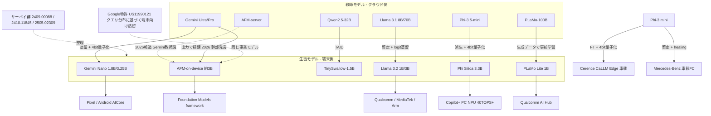
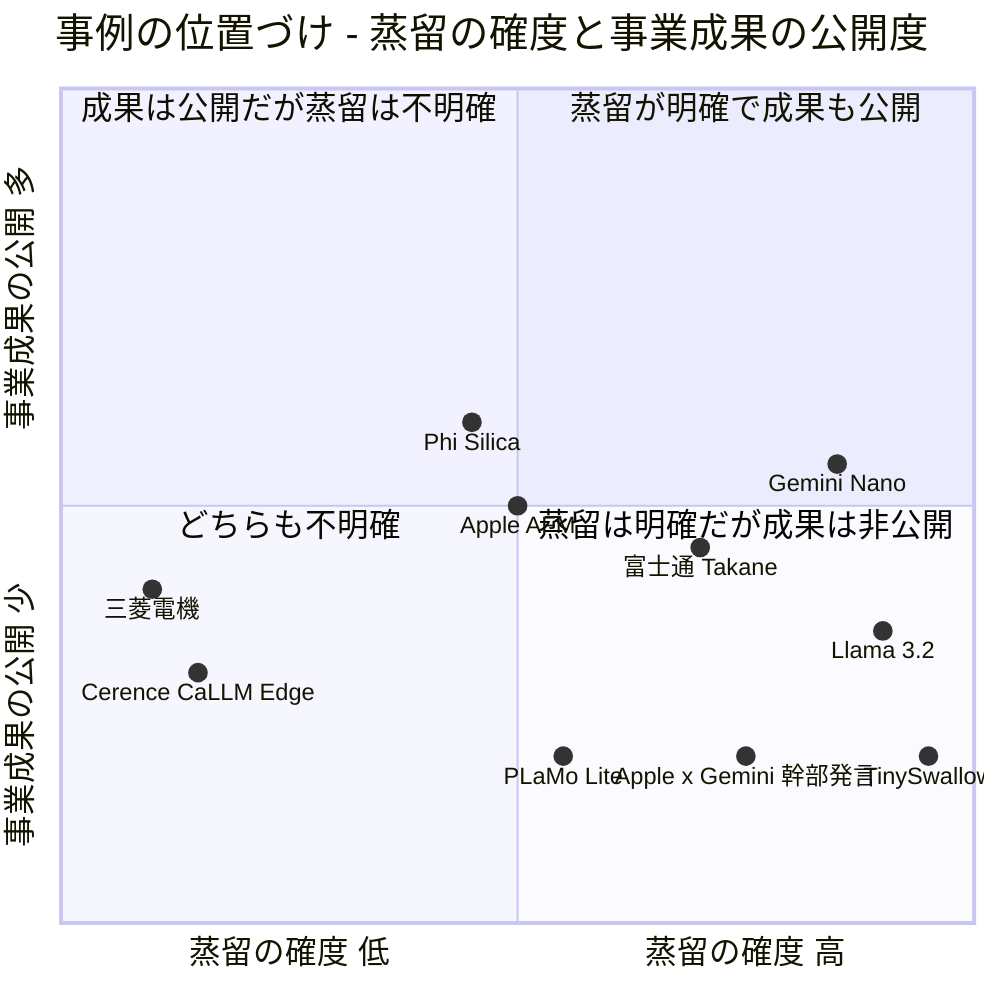

# C6 エッジ・オンデバイス（`edge_ondevice`）— リソース収集結果

## 収集パラメータ

- **対象リソース**: 学術論文 / 特許 / 技術情報（Web サイト・技術ブログ） / ビジネス事例
- **対象期間**: 2022 – 2026
- **収集日**: 2026-10-21
- **入力元**: clustering 結果（[cluster-06-edge-ondevice.md](../../../clustering/20261021/cluster-06-edge-ondevice.md)）
- **検索言語**: 英語 + 日本語
- **対象テーマ**: スマートフォン・PC・車載・家電/組込み機器で LLM を動かすための **蒸留** と、それを使った製品・事業

> **収集上の制約（重要）**: 本 run では、セッション全体で共有される WebSearch の呼び出し上限に途中で達しました。そのため後半は、(a) それまでの検索結果に出た URL、(b) 取得済みページ（Google Patents の被引用・類似文献欄など）に載っていた URL、(c) 既知の arXiv ID を **arXiv / 各サイトから直接取得して題名を照合** する方法で収集しました。特許と国内事例は「1 種別 20 件」の下限に届いていません（下の「カバレッジの空白」を参照）。
>
> **（2026-10-22 追記）**: WebSearch 10 回・WebFetch・Google Patents の検索 API（`patents.google.com/xhr/query`、出願人別）で再収集し、特許 7 件（Samsung 2 / Huawei 3 / Qualcomm 1 / Xiaomi 1）と事例 2 件（Apple 幹部発言の報道、Turing Heron-NVILA）を追加しました（計 101 → 110 件、特許は 14 → 21 件で下限を充足）。富士通プレスリリースは再取得でも HTTP 429 でした。国内特許（J-PlatPat）とトヨタ・ソニー・パナソニック・ルネサスの蒸留事例は引き続き未確認です。

## 収集サマリ

| 領域 | 論文 | 特許 | 技術情報 | 事例 | 合計 |
|------|------|------|----------|------|------|
| スマートフォン（Apple / Google / Samsung / Huawei / vivo / Meta） | 9 | 6 | 12 | 10 | 37 |
| PC・NPU（Microsoft Phi Silica / Qualcomm） | 4 | 3 | 8 | 1 | 16 |
| 車載 | 1 | 2 | 0 | 7 | 10 |
| 組込み・IoT・製造・家電（国内メーカー含む） | 1 | 0 | 1 | 9 | 11 |
| 横断（サーベイ・小型モデル・手法・ベンチマーク） | 22 | 10 | 3 | 1 | 36 |
| **合計** | **37** | **21** | **24** | **28** | **110** |

（2026-10-22 追記で特許 +7、事例 +2。旧値: 特許 14 / 事例 26 / 合計 101）

```
種別ごとの件数
学術論文   |█████████████████████████████████████ 37
ビジネス事例 |████████████████████████████ 28
技術情報   |████████████████████████ 24
特許       |█████████████████████ 21
```

## URL検証結果

| 項目 | 件数 |
|------|------|
| 収集（候補） | 123（旧 114 ＋ 2026-10-22 追記 9） |
| 検証済み（本表に掲載） | 110（旧 101 ＋ 9） |
| 不一致で除外 | 3 |
| アクセス不可で除外 | 10 |

- **検証方法**: arXiv は `citation_title` メタデータを、Google Patents は `<title>` と出願人を、Web ページは HTTP ステータスと `<title>` / `og:title` を取得して照合しました。Cloudflare 等で `curl` が拒否されたページ（blogs.windows.com、venturebeat.com）は WebFetch で本文を確認しました。（2026-10-22 追記）追加の特許 7 件は Google Patents の公報ページを WebFetch で取得し、出願人・優先日・要旨・端末配備の記述を確認しました。追加の事例 2 件（MacRumors、Zenn）は WebFetch で本文を確認しました。AppleInsider の同趣旨記事は HTTP 403 で掲載していません。
- **不一致で除外した例**: 推測で確認した arXiv ID のうち、題名が別論文だったもの 3 件（衛星通信の論文、拡散モデル剪定の論文、物語生成の論文）。
- **アクセス不可で除外した例**: `blog.google` の Gemini Nano 発表ページ（404）、Qualcomm AI Hub の Ministral 3B ページ（404）、Qualcomm × Meta Llama 3.2 プレスリリースの推測 URL（404）、Hugging Face SmolLM2 ブログの推測 URL（404）、Microsoft Research の Phi Silica 推測 URL（403）など。
- **注記付きで掲載したもの**: 富士通のプレスリリース（`global.fujitsu`）は HTTP 429 で本文を取得できませんでした。内容は同日付の二次報道 3 件（マイナビ TECH+ / INTERNET Watch / AIsmiley）で裏付けたうえで、URL を参考として残しています。（2026-10-22 追記）日本語版・英語版（`en-global`）とも再取得で HTTP 429、旧ドメイン `pr.fujitsu.com` はアーカイブサイトへリダイレクトされ 404 でした。証拠区分は「ベンダー申告（二次報道経由）」のままです。

## 年次分布

```
全体（特許は出願年で集計、2026-10-22 追記後）
2026 |█████████████ 13
2025 |█████████████████████████████████████ 37
2024 |████████████████████████████████████████ 40
2023 |█████████ 9
2022 |███ 3
2021 |████ 4   (特許のみ。登録は 2023-2025)
2020 |███ 3    (特許のみ。登録は 2023-2025)
2019 |█ 1      (特許のみ。登録は 2024)
```

```
種別 × 年（論 = 論文 / 特 = 特許 / 技 = 技術情報 / 事 = 事例、2026-10-22 追記後）
        論  特  技  事
2026     2   0   1  10
2025    11   1  12  13
2024    22   5   9   4
2023     2   4   2   1
2022     0   3   0   0
2021     0   4   0   0
2020     0   3   0   0
2019     0   1   0   0
```

- 論文は **2024 年がピーク**（Llama 3.2、Gemma 2、Phi-3、Minitron、MobileLLM、Apple AFM など、蒸留で作る公式小型モデルが集中）。
- 技術情報と事例は **2025 年に最多**、2026 年も事例が 10 件（Apple が Gemini を教師に蒸留との報道と WWDC 2026 での幹部発言、デンソーテン、GM の求人、PFN の VLM など）。研究の段階から製品・調達の段階へ移っていることを示します。
- 特許は出願が 2020–2023 年に集中し、登録は 2023–2025 年です。（2026-10-22 追記）出願人別の再照会で、**2024 年出願の LLM 蒸留特許（Samsung 2 件、Huawei 1 件、Qualcomm 1 件）と 2025 年出願の車載 TTS 蒸留特許（Xiaomi）が 2025–2026 年に公開され始めている** ことを確認しました。「LLM 時代の端末向け蒸留特許はまだ公開前のものが多い」という旧版の推測は、部分的に解消しています。

## リソース関係図



> 実線は一次資料またはベンダー申告で確認できた関係、点線は報道ベースまたは概念上の関係です。（2026-10-22 訂正）「Gemini → AFM-on-device」は、WWDC 2026 で Apple の AI 担当 VP が "refined using outputs from Gemini frontier models" と発言したと報じられた（MacRumors 2026-06-09、下の事例 27）ため、点線「報道」から実線に改めました。対象は第 3 世代 AFM 3 Core / Core Advanced です。

## 全体の傾向



- **蒸留が明記されるのは「プラットフォーム企業の公式小型モデル」**: Gemini Nano（"distilling from larger Gemini models"）、Llama 3.2 1B/3B（8B/70B の logit を使用）、Gemma 2/3、TinySwallow（TAID）。いずれも **基盤モデルを持つ企業が自社の大モデルを教師にしている**（論文 9 件・技術情報 8 件で確認）。
- **端末メーカー・車載・組込みは「蒸留済み小型モデル + fine-tuning + 量子化」型**: Cerence CaLLM Edge（Phi-3 を車載データで fine-tuning、4bit 量子化）、Mercedes-Benz（Phi-3 mini を剪定 + healing）、三菱電機（約 18 億パラメータを領域特化学習 + 量子化）。蒸留そのものは上流の基盤モデル側で済んでいる（事例 6 件）。
- **蒸留は量子化・剪定と必ずセット**: 端末で動く例は 4bit（Nano、Phi Silica、CaLLM Edge）や 2bit QAT（Apple 2025）まで量子化しています。「蒸留だけ」で端末に載った例は見つかりませんでした。
- **事業成果は「機能の提供」で語られ、売上やコストの数値は出ない**: Apple Foundation Models framework（開発者が無料・オフラインで利用）、Phi Silica の Click to Do / Word・Outlook の要約、Pixel の Recorder 要約など、**機能の一覧は公開されるが KPI は非公開**。
- **国内は 2025–2026 年に急増**: 三菱電機（2026 年度製品適用目標）、富士通（1bit 量子化 + 特化型蒸留、OSS 公開）、デンソーテン（車載 RAG の省メモリ化）、PFN（PLaMo Lite、PLaMo 2.1-8B の剪定 + 蒸留）、シャープ（CE-LLM）。ただし **「蒸留」を明記するのは富士通と PFN のみ**。（2026-10-22 追記）Turing の Heron-NVILA（事例 28）は GPT-4o の出力を SFT に使うが「蒸留」とは呼んでおらず、量子化の記述もない。デンソー・Turing の求人票には「蒸留による小型化」「量子化・軽量化」が業務として挙がるが、成果の証拠ではない。
- **（2026-10-22 追記）Apple × Gemini は「報道」から「幹部発言」へ**: WWDC 2026 の記者向けトークで Apple の AI 担当 VP が、端末モデル（AFM 3 Core / Core Advanced）を含む 4 モデルを "refined using outputs from Gemini frontier models" と説明した（MacRumors、9to5Mac 経由）。"distill" の語はないが、**教師出力による精錬＝黒箱蒸留相当** がベンダー申告として確認できる。上の四象限図の位置もこれに合わせて右へ動かした（旧 [0.6, 0.15]）。
- **特許は「クラウドで集めた利用データから端末向けモデルを蒸留する」型が目立つ**: Google の US11990121B2 / US12380879B2 は、クエリの分布に応じて端末向け蒸留モデルを作り配信する仕組みで、Apple×Gemini 報道の事業モデルと構造が同じです。

**総括**: エッジ・オンデバイスの蒸留は、(1) 基盤モデル企業が自社の大モデルから蒸留した小型モデルを **OS や SoC に組み込んで配る**、(2) 端末・車載・組込みメーカーはそれを **fine-tuning と量子化で自社機器に合わせる**、という 2 層構造になっています。蒸留の経済効果は「API 費用ゼロ・データセンター費用の回避・オフライン動作」として語られますが、**定量的な事業成果を出している一次資料はほぼありません**。2026 年の Apple×Gemini は、**他社の大モデルを契約上の権利に基づいて教師にする** という新しい形で、利用規約による蒸留制約（H5）を「契約で解決する」事例として重要です（2026-10-22 追記: 「Gemini 出力で精錬」は幹部発言で確認。契約条件・白箱アクセスは報道のみ）。追加した特許 7 件（Samsung / Huawei / Qualcomm / Xiaomi）は、端末メーカー・SoC ベンダー側も **「サーバで蒸留して端末へ配る」「端末上でユーザタスクに合わせて圧縮する」「投機的デコーディング用ドラフトモデルを蒸留する」** という形で LLM 蒸留の権利化を進めていることを示します。

### カバレッジの空白

| 領域 × 種別 | 件数 | 下限 20 との差 | 空白の理由 |
|------------|------|---------------|-----------|
| 特許（全体） | 21（2026-10-22 追記で 14 → 21） | +1 | 旧 run は検索上限に到達。追記で Google Patents の出願人別照会により 7 件追加し下限を充足。ただし Apple・国内メーカーの該当公報は未発見 |
| 車載 × 論文 | 1 | — | 車載 LLM の蒸留を扱う論文は少ない（Mercedes-Benz のみ確認） |
| 車載 × 特許 | 2（追記で 1 → 2） | — | Waymo の知覚系に加え、Xiaomi（小米汽車）の車載 TTS 蒸留を追加。言語モデル本体の車載蒸留特許は Huawei CN121327497A が「車載機器」を配備先に挙げるのみ |
| 組込み・家電 × 論文 | 1 | — | 家電メーカーの論文は未確認 |
| 国内 × 特許 | 0 | — | J-PlatPat の直接検索は行えず。Google Patents の出願人別照会（Toyota / Denso / Sony）でも言語モデル蒸留の公報は見つからず |
| トヨタ・ホンダ・ソニー・パナソニック・ルネサス | 0 | — | 2026-10-22 の再検索（WebSearch 4 回）でも蒸留を明記した発表を確認できず。パナソニックは Panasonic-LLM-100b（2024-07）で「小型化・高速化技術でエッジ・オンプレに適用範囲を広げる」と述べるが蒸留の記述なし。Turing は Heron-NVILA（事例 28）を追加（GPT-4o 出力で SFT、蒸留とは呼ばず） |

$$
\text{カバレッジ率} = \frac{\text{検証済み件数}}{\text{下限 }(20 \times 4\text{ 種別})} = \frac{110}{80} \approx 1.38 \quad(\text{特許は } 21/20 = 1.05\text{。2026-10-22 追記前は } 101/80 \approx 1.26,\ 14/20 = 0.70)
$$

---

## 学術論文

| # | 領域 | タイトル | 著者 | 年 | Venue | 概要 |
|---|------|---------|------|-----|-------|------|
| 1 | スマートフォン | [Apple Intelligence Foundation Language Models: Tech Report 2025](https://arxiv.org/abs/2507.13575) | Ethan Li, Anders Boesen Lindbo Larsen, Chen Zhang et al. | 2025 | arXiv（Apple） | 約 3B の端末内モデルとサーバモデルの構成。KV キャッシュ共有、2bit 量子化を考慮した学習（QAT）、Foundation Models framework |
| 2 | スマートフォン | [Apple Intelligence Foundation Language Models](https://arxiv.org/abs/2407.21075) | Tom Gunter et al. | 2024 | arXiv（Apple） | AFM-on-device（約 3B）と AFM-server。LoRA アダプタを動的に読み込む構成 |
| 3 | スマートフォン | [Gemini: A Family of Highly Capable Multimodal Models](https://arxiv.org/abs/2312.11805) | Gemini Team | 2023 | arXiv（Google） | Nano-1（1.8B）/ Nano-2（3.25B）を大きな Gemini から蒸留し 4bit 量子化。Pixel 8 Pro に搭載 |
| 4 | スマートフォン | [BlueLM-V-3B: Algorithm and System Co-Design for Multimodal Large Language Models on Mobile Devices](https://arxiv.org/abs/2411.10640) | Xudong Lu, Yinghao Chen, Cheng Chen et al. | 2024 | arXiv（vivo） | スマートフォン向け 3B マルチモーダルモデルのアルゴリズムとシステムの協調設計 |
| 5 | スマートフォン | [MiniCPM-V: A GPT-4V Level MLLM on Your Phone](https://arxiv.org/abs/2408.01800) | Yuan Yao, Tianyu Yu, Ao Zhang et al. | 2024 | arXiv（Nature Communications 2025 掲載） | 8B 級マルチモーダルモデルをスマートフォンで動かす |
| 6 | スマートフォン | [MiniCPM4: Ultra-Efficient LLMs on End Devices](https://arxiv.org/abs/2506.07900) | MiniCPM Team et al. | 2025 | arXiv | 端末向け 0.5B / 8B。学習可能な疎 attention（InfLLM v2）、量子化、投機的デコード |
| 7 | スマートフォン | [MobileLLM: Optimizing Sub-billion Parameter Language Models for On-Device Use Cases](https://arxiv.org/abs/2402.14905) | Zechun Liu, Changsheng Zhao, Forrest Iandola et al. | 2024 | ICML 2024（Meta） | 10 億未満のモデルでは深く細い構造が有効。125M/350M で従来比 +2.7% / +4.3% |
| 8 | スマートフォン | [MobileLLM-R1: Exploring the Limits of Sub-Billion Language Model Reasoners with Open Training Recipes](https://arxiv.org/abs/2509.24945) | Changsheng Zhao, Ernie Chang, Zechun Liu et al. | 2025 | arXiv（Meta） | 10 億未満で推論能力を出すための学習データ選別。DeepSeek 蒸留版との比較 |
| 9 | スマートフォン | [Phi-3 Technical Report: A Highly Capable Language Model Locally on Your Phone](https://arxiv.org/abs/2404.14219) | Microsoft | 2024 | arXiv（Microsoft） | Phi-3-mini（3.8B）をスマートフォンで動作。Phi Silica と CaLLM Edge の土台 |
| 10 | PC・NPU | [Phi-4-Mini Technical Report: Compact yet Powerful Multimodal Language Models via Mixture-of-LoRAs](https://arxiv.org/abs/2503.01743) | Microsoft | 2025 | arXiv（Microsoft） | 3.8B の小型モデルと Mixture-of-LoRAs によるマルチモーダル化 |
| 11 | PC・NPU | [Direct Alignment of Draft Model for Speculative Decoding with Chat-Fine-Tuned LLMs](https://arxiv.org/abs/2403.00858) | Raghavv Goel, Mukul Gagrani, Wonseok Jeon et al. | 2024 | arXiv（Qualcomm AI Research） | Llama 2 Chat の下書きモデル 115M を蒸留で学習し、投機的デコードで最大 2.4 倍高速化 |
| 12 | PC・NPU | [LLM in a flash: Efficient Large Language Model Inference with Limited Memory](https://arxiv.org/abs/2312.11514) | Keivan Alizadeh, Iman Mirzadeh, Dmitry Belenko et al. | 2023 | arXiv（Apple） | DRAM 不足の端末でフラッシュから重みを読み出して推論。蒸留ではないが端末配置の補完技術 |
| 13 | PC・NPU | [Hymba: A Hybrid-head Architecture for Small Language Models](https://arxiv.org/abs/2411.13676) | NVIDIA | 2024 | arXiv | attention と SSM を並列に持つ小型モデル。KV キャッシュの削減 |
| 14 | 車載 | [Optimizing Small Language Models for In-Vehicle Function-Calling](https://arxiv.org/abs/2501.02342) | Yahya Sowti Khiabani, Farris Atif, Chieh Hsu et al. | 2025 | NeurIPS 2024 Workshop（Mercedes-Benz） | Phi-3 mini を剪定・healing・量子化し、車載 CPU で座席ヒーター等を関数呼び出しで制御 |
| 15 | 組込み・IoT | [Efficiently Distilling LLMs for Edge Applications](https://arxiv.org/abs/2404.01353) | Achintya Kundu, Fabian Lim, Aaron Chew et al. | 2024 | NAACL 2024 Industry（IBM） | supernet 学習（MLFS）で多サイズの小型モデルを一定コストで作る。encoder は商用エッジ品質に達する |
| 16 | 横断・手法 | [TAID: Temporally Adaptive Interpolated Distillation for Efficient Knowledge Transfer in Language Models](https://arxiv.org/abs/2501.16937) | Makoto Shing, Kou Misaki, Han Bao et al. | 2025 | ICLR 2025（Sakana AI） | 教師と生徒の分布を時間的に補間する蒸留。TinySwallow-1.5B の学習手法 |
| 17 | 横断・手法 | [Gemma 2: Improving Open Language Models at a Practical Size](https://arxiv.org/abs/2408.00118) | Gemma Team | 2024 | arXiv（Google） | 2B / 9B を次トークン予測ではなく知識蒸留で学習 |
| 18 | 横断・手法 | [Gemma 3 Technical Report](https://arxiv.org/abs/2503.19786) | Gemma Team | 2025 | arXiv（Google） | 1B–27B の全サイズを蒸留で学習。KV キャッシュ削減の構造変更 |
| 19 | 横断・手法 | [Compact Language Models via Pruning and Knowledge Distillation](https://arxiv.org/abs/2407.14679) | NVIDIA | 2024 | arXiv | Minitron。剪定 + 蒸留で学習トークンを大幅に削減 |
| 20 | 横断・手法 | [LLM Pruning and Distillation in Practice: The Minitron Approach](https://arxiv.org/abs/2408.11796) | NVIDIA | 2024 | arXiv | Llama 3.1 8B → 4B、Mistral NeMo 12B → 8B の実践手順 |
| 21 | 横断・手法 | [Llamba: Scaling Distilled Recurrent Models for Efficient Language Processing](https://arxiv.org/abs/2502.14458) | Aviv Bick et al. | 2025 | arXiv（Cartesia） | Llama 3.x から Mamba 構造へ異種構造蒸留（MOHAWK）。学習データ 0.1% 未満。端末向け実装を提供 |
| 22 | 横断・手法 | [DistiLLM: Towards Streamlined Distillation for Large Language Models](https://arxiv.org/abs/2402.03898) | Jongwoo Ko et al. | 2024 | arXiv | skew KL と適応的 off-policy による効率的な LLM 蒸留 |
| 23 | 横断・手法 | [Reasoning-preserved Efficient Distillation of Large Language Models via Activation-aware Initialization](https://arxiv.org/abs/2605.29327) | Junlin He et al. | 2026 | arXiv | 剪定型の効率的蒸留で多段推論能力が崩れる現象（reasoning collapse）を分析し対策 |
| 24 | 横断・手法 | [Small Reasoning Models are Instruction Followers in Function Calling](https://arxiv.org/abs/2608.22472) | Yalda Taheri et al. | 2026 | arXiv | 関数呼び出しを小型モデルへ委譲する IFFC。端末側エージェントの設計に関係 |
| 25 | 横断・小型モデル | [SmolLM2: When Smol Goes Big -- Data-Centric Training of a Small Language Model](https://arxiv.org/abs/2502.02737) | Hugging Face | 2025 | arXiv | 1.7B を約 11T トークンで過学習させるデータ中心の手法（蒸留ではない比較対象） |
| 26 | 横断・小型モデル | [PhoneLM: an Efficient and Capable Small Language Model Family through Principled Pre-training](https://arxiv.org/abs/2411.05046) | Rongjie Yi et al. | 2024 | arXiv | 事前学習の前に端末上の実行効率で構造を探索。0.5B / 1.5B |
| 27 | 横断・小型モデル | [MobiLlama: Towards Accurate and Lightweight Fully Transparent GPT](https://arxiv.org/abs/2402.16840) | Omkar Thawakar et al. | 2024 | arXiv | 端末向け 0.5B の完全公開モデル |
| 28 | 横断・Agent | [TinyAgent: Function Calling at the Edge](https://arxiv.org/abs/2409.00608) | Lutfi Eren Erdogan, Nicholas Lee, Siddharth Jha et al. | 2024 | arXiv（UC Berkeley） | 1.1B / 7B を関数呼び出しデータで学習し MacBook 上で GPT-4-Turbo 並み |
| 29 | 横断・Agent | [Octopus v2: On-device language model for super agent](https://arxiv.org/abs/2404.01744) | Wei Chen et al. | 2024 | arXiv（Nexa AI） | 2B の端末モデルが関数呼び出しで GPT-4 を上回り、文脈長を 95% 削減 |
| 30 | 横断・評価 | [MobileAIBench: Benchmarking LLMs and LMMs for On-Device Use Cases](https://arxiv.org/abs/2406.10290) | Rithesh Murthy, Liangwei Yang, Juntao Tan et al. | 2024 | arXiv（Salesforce） | 量子化が端末上のタスク性能・安全性に与える影響を測るベンチマーク |
| 31 | 横断・評価 | [Empirical Guidelines for Deploying LLMs onto Resource-constrained Edge Devices](https://arxiv.org/abs/2406.03777) | Ruiyang Qin, Dancheng Liu, Chenhui Xu et al. | 2024 | arXiv | エッジでの個人化 LLM の設計選択を実験的に整理 |
| 32 | 横断・サーベイ | [On-Device Language Models: A Comprehensive Review](https://arxiv.org/abs/2409.00088) | Jiajun Xu, Zhiyuan Li, Wei Chen et al. | 2024 | arXiv | 端末内 LM の構造・圧縮（蒸留を含む）・ハードウェア・メーカー事例の総説 |
| 33 | 横断・サーベイ | [A Review on Edge Large Language Models: Design, Execution, and Applications](https://arxiv.org/abs/2410.11845) | Yue Zheng, Yuhao Chen, Bin Qian et al. | 2024 | arXiv | エッジ LLM の設計から実行・応用までの総説 |
| 34 | 横断・サーベイ | [Optimizing LLMs for Resource-Constrained Environments: A Survey of Model Compression Techniques](https://arxiv.org/abs/2505.02309) | Sanjay Surendranath Girija, Shashank Kapoor, Lakshit Arora et al. | 2025 | IEEE COMPSAC 2025 | 蒸留・量子化・剪定を中心としたエッジ向け圧縮の総説 |
| 35 | 横断・サーベイ | [GenAI at the Edge: Comprehensive Survey on Empowering Edge Devices](https://arxiv.org/abs/2502.15816) | Mozhgan Navardi, Romina Aalishah, Yuzhe Fu et al. | 2025 | arXiv | 段階的・多教師の蒸留への流れと、圧縮と性能のトレードオフを整理 |
| 36 | 横断・サーベイ | [Mobile Edge Intelligence for Large Language Models: A Contemporary Survey](https://arxiv.org/abs/2407.18921) | Guanqiao Qu et al. | 2024 | arXiv | 端末とクラウドの中間（エッジサーバ）での LLM 配置の総説 |
| 37 | 横断・サーベイ | [Small Language Models: Survey, Measurements, and Insights](https://arxiv.org/abs/2409.15790) | Zhenyan Lu et al. | 2024 | arXiv | 100M–5B の公開 SLM 70 種を構造・データ・学習の 3 軸で比較、端末上で計測 |

---

## 特許

| # | 領域 | タイトル | 番号 | 出願人 | 年 | 特許庁 | 概要 |
|---|------|---------|------|--------|-----|--------|------|
| 1 | スマートフォン | [Distilling to a target device based on observed query patterns](https://patents.google.com/patent/US12380879B2/en) | US12380879B2 | Google LLC | 2024 出願（2025 登録） | USPTO | 下記の継続出願。端末のメモリ・処理制約に合わせて蒸留モデルの構成を選び、評価後に配信 |
| 2 | スマートフォン | [Distilling to a target device based on observed query patterns](https://patents.google.com/patent/US11990121B2/en) | US11990121B2 | Google LLC | 2021 出願（2024 登録） | USPTO | クラウドのアシスタントへのクエリをカテゴリ別に集計し、閾値を超えたら端末向け蒸留モデルを生成 |
| 3 | PC・NPU | [Techniques for enabling on-device ink stroke processing](https://patents.google.com/patent/US20250148660A1/en) | US20250148660A1 | Microsoft Technology Licensing LLC | 2023 | USPTO | 端末上でのペン入力処理を可能にする技術（端末内モデル配置の関連特許） |
| 4 | PC・NPU | [Scalable knowledge distillation techniques for machine learning](https://patents.google.com/patent/US12307750B2/en) | US12307750B2 | Microsoft Technology Licensing LLC | 2022 | USPTO | スマートフォン等の資源制約を背景とした、拡張性のある知識蒸留手法 |
| 5 | 横断 | [Scalable knowledge distillation techniques for machine learning（公開公報）](https://patents.google.com/patent/US20230401831A1/en) | US20230401831A1 | Microsoft Technology Licensing LLC | 2022 | USPTO | 上記の公開公報 |
| 6 | 横断 | [Neural architecture search of language models using knowledge distillation](https://patents.google.com/patent/US20230259716A1/en) | US20230259716A1 | International Business Machines Corp | 2022 | USPTO | 知識蒸留を用いた言語モデルの構造探索 |
| 7 | 横断 | [Electronic device and control method thereof](https://patents.google.com/patent/US12488281B2/en) | US12488281B2 | Samsung Electronics Co Ltd / Ajou University | 2021 出願 | USPTO | 知識蒸留で AI モデルを圧縮しつつ性能を高める電子機器 |
| 8 | 車載 | [Knowledge distillation for autonomous vehicles](https://patents.google.com/patent/US12221118B2/en) | US12221118B2 | Waymo LLC | 2020 出願（2025 登録） | USPTO | 自動運転向けの知識蒸留（知覚・運転制御系。言語モデルではない） |
| 9 | 横断 | [Extreme language model compression with optimal sub-words and shared projections](https://patents.google.com/patent/US12260340B2/en) | US12260340B2 | Google LLC | 2023 | USPTO | 語彙を大幅に縮小した生徒モデルへ蒸留し、数 MB まで圧縮（継続出願） |
| 10 | 横断 | [Extreme language model compression with optimal sub-words and shared projections](https://patents.google.com/patent/US11797862B2/en) | US11797862B2 | Google LLC | 2020 出願（2023 登録） | USPTO | 上記の親出願 |
| 11 | 横断 | [System and method for knowledge distillation](https://patents.google.com/patent/US12106226B2/en) | US12106226B2 | Samsung Display Co Ltd | 2023 | USPTO | 汎用の知識蒸留システム |
| 12 | 横断 | [Systems and methods relating to knowledge distillation in natural language processing models](https://patents.google.com/patent/US12333254B2/en) | US12333254B2 | Genesys Cloud Services Inc | 2021 出願（2025 登録） | USPTO | コンタクトセンター向け NLP モデルの教師→生徒蒸留（端末向けではない比較対象） |
| 13 | 横断 | [Compression method and platform of pre-training language model based on knowledge distillation](https://patents.google.com/patent/US11341326B2/en) | US11341326B2 | Zhejiang Lab | 2021 出願（2022 登録） | USPTO | 事前学習言語モデルの蒸留圧縮プラットフォーム |
| 14 | 横断 | [Cross data set knowledge distillation for training machine learning models](https://patents.google.com/patent/US11727270B2/en) | US11727270B2 | Microsoft Technology Licensing LLC | 2020 出願（2023 登録） | USPTO | 異なるデータセット間での知識蒸留 |
| 15 | スマートフォン（追記） | [Large language model compression](https://patents.google.com/patent/WO2025258795A1/en) | WO2025258795A1 | Samsung Electronics Co Ltd | 2024 優先（2025 公開） | WIPO | ユーザタスクのキャリブレーションデータで教師 LLM と端末モデルの特徴・重み差分の共分散を取り、行列分解で端末モデルを層単位で圧縮（"dual knowledge distillation"）。"edge devices" に収めることが目的 |
| 16 | スマートフォン（追記） | [Controlled information flow from teacher model to student model for knowledge distillation and transfer](https://patents.google.com/patent/US20250273084A1/en) | US20250273084A1 | Samsung Electronics Co Ltd | 2024 優先（2025 公開） | USPTO | rate-distortion モジュールで教師→生徒の情報量を制御する KD。実施形態「教師 = LLM、生徒 = SLM」、学習済み生徒を端末へ送信、"on-device generative AI" |
| 17 | スマートフォン（追記） | [一种模型蒸馏方法及装置（A model distillation method and apparatus）](https://patents.google.com/patent/CN121327497A/en) | CN121327497A | Huawei Technologies Co Ltd | 2024 出願（2026 公開） | CNIPA | 教師が生徒の応答系列を修正した「目標応答」で LLM を系列レベル蒸留。配備先に携帯電話・タブレット・ウェアラブル・車載機器を列挙 |
| 18 | 横断（追記） | [Methods and systems for transferring knowledge from large language models to small language models using out-of-distribution feedbacks](https://patents.google.com/patent/WO2025123815A1/en) | WO2025123815A1 | Huawei Cloud Computing Technologies Co Ltd | 2023 優先（2025 公開） | WIPO | LLM が学習・検証サンプルを生成し分布外フィードバックで SLM を反復学習。機器は汎用列挙のみで端末専用ではない（クラウド側の蒸留サービス） |
| 19 | スマートフォン（追記） | [Text processing model training method, and text processing method and apparatus](https://patents.google.com/patent/US12182507B2/en) | US12182507B2 | Huawei Technologies Co Ltd | 2019 優先（2024 登録） | USPTO | 事前学習言語モデル（BERT 系）を KD で小型化し「端末に直接配備できる」生徒を得る。LLM 以前の端末向け言語モデル蒸留 |
| 20 | PC・NPU（追記） | [Reinforced total variation distance loss for machine learning models](https://patents.google.com/patent/US20250225374A1/en) | US20250225374A1 | Qualcomm Incorporated | 2024 出願（2025 公開） | USPTO | 分散低減 TVD 損失で生徒（draft モデル）を教師（target LLM）に合わせる KD。投機的デコーディングでスマートフォン上の LLM を高速化。論文 11（arXiv 2403.00858）の特許版 |
| 21 | 車載（追記） | [模型生成方法、语音合成方法、相关设备、介质及产品（Model generation method, speech synthesis method, related device, medium and product）](https://patents.google.com/patent/CN120496494A/en) | CN120496494A | 北京小米移動軟件 / 北京小米松果電子 / 小米汽車科技 | 2025 出願（2025 公開） | CNIPA | 大型 TTS（教師）の生成音声で軽量 TTS（生徒）を学習し、車載機器・組込みでオフライン動作。**言語モデルではなく TTS**。蒸留は明細書のみでクレーム 1 は非限定 |

> 特許の年は出願日（Google Patents の `DC.date`）を基準とし、登録年を括弧で示しました。2022 年より前の出願でも、登録が 2022–2026 年のものは対象に含めています。
>
> （2026-10-22 追記）15–21 は Google Patents の検索 API で出願人（Apple / Qualcomm / Samsung / Huawei / Xiaomi / Sony / Toyota / Denso）別に `"knowledge distillation" "language model"`（優先日 2022 年以降）を照会し、ヒットのうち公報ページで「端末配備」の記述を確認できたものです（詳細は retrieval レポート 11）。Apple・Toyota・Denso・Sony は該当なし。

---

## 技術情報

| # | 領域 | タイトル | ソース | 年 | 種別 | 概要 |
|---|------|---------|--------|-----|------|------|
| 1 | スマートフォン | [Updates to Apple's On-Device and Server Foundation Language Models](https://machinelearning.apple.com/research/apple-foundation-models-2025-updates) | Apple Machine Learning Research | 2025 | blog | 2025 年版の端末内モデル・サーバモデルの更新内容 |
| 2 | スマートフォン | [Apple Intelligence Foundation Language Models Tech Report 2025](https://machinelearning.apple.com/research/apple-foundation-models-tech-report-2025) | Apple Machine Learning Research | 2025 | blog / report | 2025 年技術レポートの紹介ページ |
| 3 | スマートフォン | [Foundation Models（開発者ドキュメント）](https://developer.apple.com/documentation/foundationmodels) | Apple Developer | 2025 | doc | 端末内モデルをアプリから呼び出す Swift フレームワーク |
| 4 | スマートフォン | [Introducing Apple's On-Device and Server Foundation Models](https://machinelearning.apple.com/research/introducing-apple-foundation-models) | Apple Machine Learning Research | 2024 | blog | 約 3B の端末内モデル、LoRA アダプタ（rank 16 で数十 MB） |
| 5 | スマートフォン | [Apple Intelligence Foundation Language Models（紹介ページ）](https://machinelearning.apple.com/research/apple-intelligence-foundation-language-models) | Apple Machine Learning Research | 2024 | report | 2024 年技術レポートの紹介 |
| 6 | スマートフォン | [Introducing Gemma 3n: The developer guide](https://developers.googleblog.com/en/introducing-gemma-3n-developer-guide/) | Google Developers Blog | 2025 | blog | MatFormer（E4B の中に E2B を入れ子で学習）、PLE、MobileNet-V5。端末向け |
| 7 | スマートフォン | [google/gemma-3n-E4B-it](https://huggingface.co/google/gemma-3n-E4B-it) | Hugging Face（Google） | 2025 | model card | Gemma 3n の公式モデルカード |
| 8 | スマートフォン | [Gemini Nano is now available on Android via experimental access](https://android-developers.googleblog.com/2024/10/gemini-nano-experimental-access-available-on-android.html) | Android Developers Blog | 2024 | blog | AI Edge SDK / AICore で開発者に開放。Pixel 9、Talkback、Recorder |
| 9 | スマートフォン | [Introducing quantized Llama models with increased speed and a reduced memory footprint](https://ai.meta.com/blog/meta-llama-quantized-lightweight-models/) | Meta AI | 2024 | blog | Llama 3.2 1B/3B の QAT+LoRA / SpinQuant 量子化版 |
| 10 | スマートフォン | [Llama 3.2: Revolutionizing edge AI and vision with open, customizable models](https://ai.meta.com/blog/llama-3-2-connect-2024-vision-edge-mobile-devices/) | Meta AI | 2024 | blog | 1B/3B を剪定 + 蒸留で作成。Qualcomm / MediaTek / Arm に初日対応 |
| 11 | スマートフォン | [meta-llama/Llama-3.2-1B](https://huggingface.co/meta-llama/Llama-3.2-1B) | Hugging Face（Meta） | 2024 | model card | 学習データ量・蒸留・量子化版の情報 |
| 12 | スマートフォン | [GitHub - facebookresearch/MobileLLM](https://github.com/facebookresearch/MobileLLM) | Meta（GitHub） | 2024 | OSS | MobileLLM の学習コードと公開モデル（cc-by-nc-4.0） |
| 13 | PC・NPU | [Phi Silica task specialization using LoRA in Microsoft Learning Zone: A technical deep dive](https://blogs.windows.com/windowsdeveloper/2025/07/31/phi-silica-task-specialization-using-lora-in-microsoft-learning-zone-a-technical-deep-dive/) | Windows Developer Blog | 2025 | blog | 大モデルを教師にした合成データで Phi Silica の LoRA を学習（教師データ蒸留） |
| 14 | PC・NPU | [Fine-Tune the Phi Silica model using LoRA](https://learn.microsoft.com/windows/ai/apis/phi-silica-lora) | Microsoft Learn | 2025 | doc | Phi Silica の LoRA 微調整手順 |
| 15 | PC・NPU | [Get started with Phi Silica in the Windows App SDK](https://learn.microsoft.com/en-us/windows/ai/apis/phi-silica) | Microsoft Learn | 2025 | doc | Phi Silica API の開発者向け案内 |
| 16 | PC・NPU | [Phi Silica, small but mighty on-device SLM](https://blogs.windows.com/windowsexperience/2024/12/06/phi-silica-small-but-mighty-on-device-slm/) | Windows Experience Blog | 2024 | blog | Phi-3.5-mini 派生。初トークン約 230ms、最大 20 tok/s、4bit 量子化でメモリ約 60% 削減 |
| 17 | PC・NPU | [Snapdragon Summit AI Highlights](https://www.qualcomm.com/news/onq/2024/10/snapdragon-summit-ai-highlights-a-look-at-the-future-of-on-device-ai) | Qualcomm OnQ | 2024 | blog | Snapdragon 8 Elite の Hexagon NPU（前世代比 45% 高速・45% 省電力） |
| 18 | PC・NPU | [Accelerating Generative AI At the Edge](https://www.qualcomm.com/news/onq/2023/11/accelerating-generative-ai-at-the-edge) | Qualcomm OnQ | 2023 | blog | 端末上の Llama 2 / Stable Diffusion の最適化 |
| 19 | PC・NPU | [Fast and Accurate Inference of LLaMA2-Chat 7B on a Smartphone via Quantization Aware Training and Speculative Decoding](https://neurips.cc/virtual/2023/expo-demonstration/78262) | Qualcomm（NeurIPS 2023 Expo） | 2023 | talk / demo | 蒸留で作った 115M の下書きモデル（対象の 2%）で端末上の 7B を高速化 |
| 20 | PC・NPU | [PLaMo-1B - Qualcomm AI Hub](https://aihub.qualcomm.com/models/plamo_1b) | Qualcomm AI Hub | 2025 | model hub | PFN の PLaMo-1B を Snapdragon 向けに最適化 |
| 21 | 組込み・IoT | [Running LLMs on-device with Qualcomm Snapdragon 8 Elite](https://grapeup.com/blog/running-llms-on-device-with-qualcomm-snapdragon-8-elite) | Grape Up | 2026 | blog | Snapdragon 8 Elite 上で複数の LLM を動かした実装記録 |
| 22 | 横断 | [GitHub - SakanaAI/TAID](https://github.com/SakanaAI/TAID) | Sakana AI（GitHub） | 2025 | OSS | TAID の公式実装 |
| 23 | 横断 | [SakanaAI/TinySwallow-1.5B-Instruct](https://huggingface.co/SakanaAI/TinySwallow-1.5B-Instruct) | Hugging Face（Sakana AI） | 2025 | model card | 指示追従版のモデルカード |
| 24 | 横断 | [From LLM to SLM: The Art of Transferring Intelligence On-Device](https://tallysolutions.com/technology/the-art-of-transferring-intelligence-on-device/) | Tally Solutions | 2025 | blog | 業務ソフト企業による LLM → SLM 蒸留の解説 |

---

## ビジネス事例

| # | 領域 | タイトル | 企業/組織 | 年 | 種別 | 概要 |
|---|------|---------|-----------|-----|------|------|
| 1 | スマートフォン | [Apple gets full Gemini access and uses distillation to build lightweight on-device AI](https://the-decoder.com/apple-gets-full-gemini-access-and-uses-distillation-to-build-lightweight-on-device-ai/) | Apple / Google（The Decoder） | 2026 | 二次報道 | The Information の報道を要約。Apple は自社データセンター内で Gemini に完全アクセスし、蒸留で端末向け小型モデルを作れる |
| 2 | スマートフォン | [Apple WWDC AI Push Leans on Gemini Distillation](https://www.implicator.ai/sources-say-gemini-distillation-shapes-apples-wwdc-ai-push/) | Apple / Google（Implicator） | 2026 | 二次報道 | WWDC 2026 に向けた Gemini 蒸留の報道まとめ |
| 3 | スマートフォン | [Apple Can Create Smaller On-Device AI Models From Google's Gemini](https://apple.slashdot.org/story/26/03/25/1948215/apple-can-create-smaller-on-device-ai-models-from-googles-gemini) | Apple / Google（Slashdot） | 2026 | 二次報道 | 2026-03-25 の報道転載 |
| 4 | スマートフォン | [Apple to renew its on-device AI push, leaning on custom silicon and a distilled version of Google's Gemini](https://www.shopifreaks.com/apple-to-renew-its-on-device-ai-push-leaning-on-custom-silicon-and-a-distilled-version-of-googles-gemini-to-avoid-data-center-costs/) | Apple（Shopifreaks） | 2026 | 二次報道 | データセンター費用を避けるため自社シリコン + 蒸留版 Gemini に注力（2026 年 5 月の続報） |
| 5 | スマートフォン | [Apple Distills Google Gemini for On-Device iPhone AI](https://aiweekly.co/alerts/apple-distills-google-gemini-for-on-device-iphone-ai) | Apple（AI Weekly） | 2026 | 二次報道 | 同報道の要約 |
| 6 | スマートフォン | [Apple's Foundation Models framework unlocks new intelligent app experiences](https://www.apple.com/newsroom/2025/09/apples-foundation-models-framework-unlocks-new-intelligent-app-experiences/) | Apple | 2025 | プレスリリース | 端末内モデルを使ったサードパーティアプリの事例紹介 |
| 7 | スマートフォン | [Apple Shares Details on Upcoming AI Foundation Models for iOS 26](https://www.infoq.com/news/2025/07/apple-foundation-models-ios26) | Apple（InfoQ） | 2025 | 二次報道 | 2025 年版モデルの解説 |
| 8 | スマートフォン | [Samsung unveils Gauss2 AI model with an on-device option](https://m.gsmarena.com/samsung_unveils_gauss2_ai_model_with_an_ondevice_option-news-65437.php) | Samsung（GSMArena） | 2024 | 二次報道 | Gauss2 の Compact は端末向け。蒸留の記述はなし |
| 9 | スマートフォン | [Samsung announces 'Gauss' AI ahead of Galaxy S24](https://9to5google.com/2023/11/08/samsung-gauss-ai-galaxy-s24/) | Samsung（9to5Google） | 2023 | 二次報道 | Gauss Language / Code / Image。端末上での要約・文法修正 |
| 10 | PC・NPU | [Microsoft debuts Phi Silica, AI specifically for Copilot+ PCs](https://www.pcworld.com/article/2340495/microsoft-debuts-phi-silica-ai-specifically-for-copilot-pcs.html) | Microsoft（PCWorld） | 2024 | 二次報道 | Build 2024 での発表。3.3B、Copilot+ PC 専用 |
| 11 | 車載 | [Cerence Introduces Pioneering Embedded Small Language Model, Purpose-Built for Automotive](https://investors.cerence.com/news-events/press-releases/detail/114/cerence-introduces-pioneering-embedded-small-language-model-purpose-built-for-automotive) | Cerence | 2024 | プレスリリース | CaLLM Edge。Phi-3 を車載データで fine-tuning、3.8B・4bit 量子化、オフライン / ハイブリッド |
| 12 | 車載 | [Cerence AI and MediaTek Partner to Introduce Multi-Modal Language Models Running on the Edge, Built on NVIDIA](https://investors.cerence.com/news-events/press-releases/detail/98/cerence-ai-and-mediatek-partner-to-introduce-multi-modal-language-models-running-on-the-edge-built-on-nvidia) | Cerence / MediaTek / NVIDIA | 2025 | プレスリリース | MediaTek の車載 SoC 上でマルチモーダル LM を動かす提携 |
| 13 | 車載 | [Cerence AI and SiMa.ai Partner to Power Next-Gen Conversational AI at the Edge](https://sima.ai/press-release/cerence-ai-and-sima-ai-partner-to-power-next-gen-conversational-ai-at-the-edge/) | Cerence / SiMa.ai | 2025 | プレスリリース | CaLLM Edge を SiMa.ai の Modalix で動かす（IAA Mobility 2025） |
| 14 | 車載 | [Staff AI/ML Software Engineer, Model Distillation & Fine-Tuning](https://search-careers.gm.com/en/jobs/jr-202619127/staff-ai-ml-software-engineer-model-distillation-fine-tuning/) | General Motors | 2026 | 求人 | 基盤 VLM / LLM から車両の限られた計算資源向けの小型モデルへ蒸留するパイプラインの構築職（2026-09-14 掲載） |
| 15 | 車載（国内） | [デンソーテン、独自の埋め込みモデル学習技術により車載エッジでRAGを省メモリ化](https://aismiley.co.jp/ai_news/densoten-rag-onboard-hmi-ai/) | デンソーテン | 2026 | 二次報道 | 車載エッジで RAG を動かすため埋め込みモデルとベクトル DB を小型化。メモリ 30–60% 削減 |
| 16 | 車載（国内） | [デンソーテン、RAGを車載エッジで省メモリ稼働する生成AI技術を開発](https://monoist.itmedia.co.jp/mn/spv/2606/30/news098.html) | デンソーテン（MONOist） | 2026 | 二次報道 | 同技術の詳細記事 |
| 17 | 組込み（国内） | [エッジデバイスで動作する製造業向け言語モデルを開発](https://www.mitsubishielectric.co.jp/ja/pr/2025/0618-a/) | 三菱電機 | 2025 | プレスリリース | Maisart。製造業特化の事前学習 + 量子化でエッジ機器に搭載。2026 年度の製品適用を目指す（蒸留の記述なし） |
| 18 | 組込み（国内） | [三菱電機、エッジAI機器で動く"軽い"製造業向け言語モデル　追加学習対応](https://news.mynavi.jp/techplus/article/20250618-3357020/) | 三菱電機（マイナビ TECH+） | 2025 | 二次報道 | 約 18 億パラメータのベースモデル、正答率の改善など |
| 19 | 組込み（国内） | [三菱電機が2つの技術でエッジ動作可能なLLMを高精度化、2026年度にも製品適用へ](https://monoist.itmedia.co.jp/mn/spv/2506/19/news050_2.html) | 三菱電機（MONOist） | 2025 | 二次報道 | 学習データ拡張と量子化の 2 技術 |
| 20 | 組込み（国内） | [富士通、AIの軽量化と省電力に寄与する生成AI再構成技術を開発 - Takaneを強化し提供](https://news.mynavi.jp/techplus/article/20250908-3442664/) | 富士通（マイナビ TECH+） | 2025 | 二次報道 | 1bit 量子化 + 特化型 AI 蒸留。スマートフォンや工場の機械で AI エージェントを動かす狙い（一次資料 [富士通プレスリリース](https://global.fujitsu/ja-JP/pr/news/2025/09/08-01) は 429 で取得不可） |
| 21 | 組込み（国内） | [富士通、LLMの軽量化・省電力化と特定用途への特化を実現する「生成AI再構成技術」を開発](https://internet.watch.impress.co.jp/docs/news/2045649.html) | 富士通（INTERNET Watch） | 2025 | 二次報道 | 同上の詳細記事 |
| 22 | 組込み（国内） | [エッジデバイス向けに10億パラメーターの小規模言語モデルを提供開始](https://monoist.itmedia.co.jp/mn/articles/2409/06/news131.html) | Preferred Networks / Preferred Elements（MONOist） | 2024 | 二次報道 | PLaMo Lite。PLaMo-100B が生成したテキストで事前学習した 1B。自動車・ロボット・製造設備向け |
| 23 | 組込み（国内） | [自律稼働デバイス向けの軽量な大規模視覚言語モデルを開発](https://monoist.itmedia.co.jp/mn/articles/2601/14/news055.html) | Preferred Networks（MONOist） | 2026 | 二次報道 | PLaMo 2.0-31B を剪定 + 蒸留した PLaMo 2.1-8B を土台にした VLM |
| 24 | 家電（国内） | [シャープがエッジAI「CE-LLM」の展開を加速、「B2BとB2Cで四半期に1つ以上投入」](https://monoist.itmedia.co.jp/mn/articles/2506/18/news048.html) | シャープ（MONOist） | 2025 | 二次報道 | CE-LLM はエッジとクラウドを振り分ける仕組み。蒸留の記述なし |
| 25 | 組込み | [「エッジでLLM」を実現するNXPの戦略　鍵はKinara買収とRAG](https://eetimes.itmedia.co.jp/ee/spv/2506/20/news023_2.html) | NXP（EE Times Japan） | 2025 | 二次報道 | 組込み機器上の LLM と RAG。医療機器や自動車への展開 |
| 26 | 横断（国内） | [エッジにも浸透する生成AI、組み込み機器に新たな価値をもたらすか](https://monoist.itmedia.co.jp/mn/articles/2501/08/news097.html) | MONOist | 2025 | 業界動向 | 2025 年の組込み向け生成 AI の展望 |
| 27 | スマートフォン（追記） | [Apple's New AI Models Contain 'None' of Google's Gemini Assistant](https://www.macrumors.com/2026/06/09/apples-new-ai-contains-no-gemini/) | Apple（MacRumors、9to5Mac 経由） | 2026 | 幹部発言の報道（ベンダー申告） | WWDC 2026 記者向けトークで AI 担当 VP Amar Subramanya が AFM Cloud Pro を除く 4 モデル（端末の AFM 3 Core / Core Advanced を含む）を "custom built for Apple Silicon ... refined using outputs from Gemini frontier models" と説明。Federighi は Google 配布モデル・クライアントコードは不使用と発言。"distill" の語は幹部発言にはない |
| 28 | 車載（国内、追記） | [日本語VLM「Heron-NVILA」公開 ─ Qwen2.5-VL-7B・Gemma3-12Bに匹敵する性能](https://zenn.dev/turing_motors/articles/7ac8ebe8756a3e) | Turing（Zenn 技術ブログ） | 2025 | 一次資料（開発者ブログ） | 自動運転向け VLM を 1B / 2B / 15B / 33B で公開。SFT に GPT-4o の出力を使用（**蒸留とは呼んでいない**、量子化の記述なし）。Lite-2B を搭載した iOS アプリを公開予定 |

---

## 次のステップ

- **詳細調査（本 run で実施）**: 重要度の高い 10 件を [retrieval/20261021/edge_ondevice](../../../retrieval/20261021/edge_ondevice/index.md) で詳細レポート化します。
- **追加収集が必要な空白**: J-PlatPat での国内特許、トヨタ・ホンダ・ソニー・パナソニック・ルネサスの車載・家電・組込みでの蒸留、Samsung Gauss / vivo / Xiaomi / Honor の端末内モデルの学習方法（2026-10-22 追記: Samsung・Xiaomi は特許 15・16・21 で蒸留技術の出願を確認したが、製品モデルへの適用は未確認）、9to5Mac の WWDC 2026 記者向けトーク原記事、Apple の 2026 年版技術報告（未公開）。
- **区別して記録すべきこと**: 「蒸留」と「小型基盤モデルの fine-tuning」「量子化」を混同しないこと（Cerence・三菱電機・シャープは後者。Turing・PFN は教師 LLM の生成データを使うが「蒸留」と呼んでいない）。retrieval の index.md に事例別の切り分け表を置いた。
