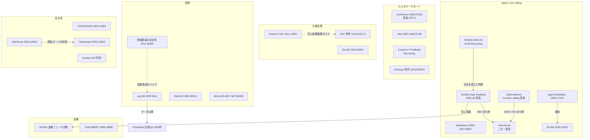
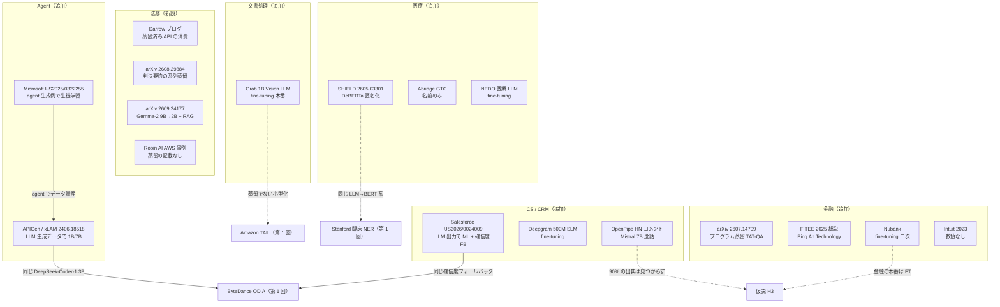
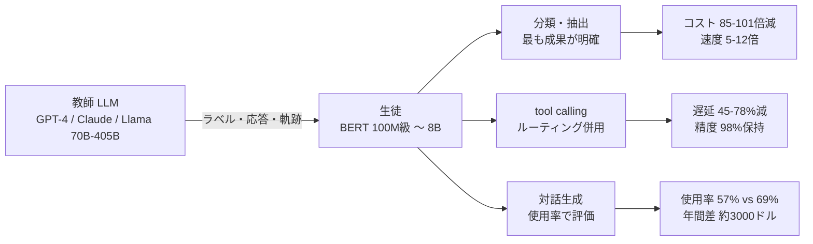

# C5 業務・業界別ユースケース（enterprise_workflows）— リソース収集結果

## 収集パラメータ

- **対象リソース**: 学術論文 / 特許 / 技術情報（Web サイト・技術ブログ）/ ビジネス事例
- **対象期間**: 2022 – 2026（参考として 2019 年出願の基礎特許 1 件を含む）
- **収集日**: 2026-10-21（第 1 回）/ 2026-10-22（第 2 回追記。追加分は表中に「（2026-10-22 追記）」と明記）
- **入力**: [cluster-05-enterprise-workflows.md](../../../clustering/20261021/cluster-05-enterprise-workflows.md)（ドメイン index の仮説 H1–H6 を参照）
- **検索言語**: 英語 + 日本語
- **仕分けタグ**（全件に付与）
  - 手法: `蒸留`（教師モデルの出力・ロジット・軌跡で生徒を学習）/ `fine-tuning`（人手・既存正解ラベルで小型モデルを学習）/ `量子化` / `その他`（ルーティング、プロンプト最適化 等）
  - 証拠: `一次`（論文・特許・公式ドキュメント・企業自身の発表）/ `ベンダー`（製品販売者による自社製品の主張）/ `二次`（報道・ブログ・まとめ）

> **収集上の制約（重要）**: 本 run では、セッション全体で共有する WebSearch の上限（200 回）に途中で到達しました。そのため検索は約 30 クエリで打ち切り、以降は **既に得た URL の WebFetch による検証のみ** を行いました。skill の下限（領域 × 種別あたり 20 件）は **学術論文のみ達成** し、特許・ビジネス事例は未達です。特に **日本語の業務導入事例（金融・医療・製造）の追加検索ができていません**。後続 run での補完対象としています（「カバレッジギャップ」参照）。

> **（2026-10-22 追記）第 2 回収集**: WebSearch 33 回（上限 35）と WebFetch 約 70 回（Google Patents の XHR 検索・USPTO 公報 PDF を含む）で、金融・法務・医療・CS・Agent / コード・IDP・特許の空白を補いました。結果は **22 件追加（学術 7 / 特許 4 / 技術 6 / ビジネス 5）** で、合計 76 件です。要点は次の 3 つです。(1) **金融・法務・医療の「蒸留で小型化した本番モデル」の一次資料は依然として 0 件**。金融は Nubank（fine-tuning・二次）と BNY 講演（議題のみ・取得不可）、法務は Darrow（蒸留済み API モデルの消費・ベンダー）、医療は SHIELD（研究）と Abridge（名前のみ）止まりです。(2) クラスタ定義で「出典不明」とした **「Mistral 7B で GPT-3.5 を置換し 90% コスト削減」は、2 回の検索でも一次資料が見つからず**、辿れた最も近い原典は Hacker News（2024-02-27）での OpenPipe 社員のコメント「fine-tuned Mistral 7B は GPT-3.5 を上回り、コストはごく一部」で、**数値も顧客名も無い逸話** でした。(3) 特許は Google Patents の XHR 検索で Microsoft 3 件・Salesforce 1 件を追加（いずれも USPTO 公報 PDF で確認）。Capital One の LLM 特許 2 件は蒸留ではなく、Intuit / JPMorgan / ServiceNow は該当 0 件、Google の WO2025038091A1 と日立 / NEC / 富士通の JP 検索は Google Patents が 503 を返し未確認です。

## 収集サマリ

| 用途サブ領域 | 学術論文 | 特許 | 技術情報 | ビジネス事例 | 合計 |
|-------------|---------|------|---------|-------------|------|
| カスタマーサポート / コンタクトセンター / CRM | 2 | 1 → 2 | 0 → 1 | 5 → 6 | 8 → 11 |
| 文書処理・情報抽出 | 2 | 2 | 0 → 1 | 2 | 6 → 7 |
| Agent / tool calling | 3 → 4 | 1 → 2 | 7 | 1 | 12 → 14 |
| コード補完 | 4 | 0 | 0 | 0 | 4 |
| 金融 | 3 → 5 | 0 | 2 | 0 → 2 | 5 → 9 |
| 医療 | 5 → 6 | 0 | 1 → 2 | 0 → 1 | 6 → 9 |
| 法務（2026-10-22 追記で新設） | 0 → 2 | 0 | 0 → 1 | 0 → 1 | 0 → 4 |
| 安全性・ガードレール・DLP | 4 | 1 | 0 | 1 | 6 |
| 横断（汎用・政策・解説） | 1 → 2 | 1 → 3 | 4 → 6 | 1 | 7 → 12 |
| **合計** | **24 → 31** | **6 → 10** | **14 → 20** | **10 → 15** | **54 → 76** |

（「A → B」は 2026-10-21 の第 1 回 → 2026-10-22 追記後の件数）

> 注: ビジネス事例 10 件のうち 5 件は、企業自身の論文・特許（LivePerson / ByteDance / Amazon / SAP / Zscaler）を「事業での利用事例」として再掲したものです。（2026-10-22 追記）追加した 5 件のうち、蒸留と明示できるものは 0 件（Robin AI は蒸留の記載なし、Nubank / Intuit / Deepgram / NEDO は fine-tuning）。

### 検証ログ

| 項目 | 件数 |
|------|------|
| 候補として収集 | 60 |
| WebFetch で検証済み（掲載） | 54 |
| 破棄（取得失敗 403 / 404 / 410） | 3（OpenAI 蒸留 API 発表ページ、Snorkel ブログ、Snorkel の Fortune 50 銀行事例） |
| 破棄（内容不一致） | 2（NVIDIA GTC25 通信セッション: 取得ページが別タイトル、CX Today: トップページへ転送） |
| 未検証のため不掲載 | 1（opentrain.ai 経由の arXiv 2606.18875 — 第三者サイトのみで原典未確認） |

$$
\text{検証通過率} = \frac{54}{60} = 90\%
$$

#### （2026-10-22 追記）第 2 回収集の検証ログ

| 項目 | 件数 |
|------|------|
| 候補として収集 | 30 |
| 検証済み（掲載） | 22（Snorkel ブログは今回 WebFetch に成功し掲載） |
| 破棄（取得失敗） | 6（BNY の AI Summit NY 議題ページ 404、Waterloo 修士論文ページ 403、Google WO2025038091A1 と日立 / NEC / 富士通の JP 検索は Google Patents 503、AceAttorney の Springer ページはログイン転送、ODSC 講演ページは一覧へ転送） |
| 破棄（内容不一致） | 2（Capital One US12541363B2「コード要約の二分岐モデル」・US20260147772A1「ペアワイズ再ランキングの遅延最小化」: 公報 1 ページ目を確認したが蒸留ではない） |

$$
\text{累計検証通過率} = \frac{54 + 22}{60 + 30} = \frac{76}{90} \approx 84\%
$$

## 手法タグ × 証拠タグの分布（H3 の検証用）

「小型モデルで業務コストを下げた」という実務寄りの資料（技術情報 14 件 + ビジネス事例 10 件 + 論文 #24 の計 25 件）を、手法タグと証拠タグで分けました。

| 手法タグ | 一次 | ベンダー | 二次 | 合計 |
|---------|------|---------|------|------|
| 蒸留 | 7 | 7 | 4 | 18 |
| fine-tuning（教師モデルを使わない） | 0 | 3 | 1 | 4 |
| 量子化 + fine-tuning | 1 | 0 | 0 | 1 |
| その他（プロンプト最適化） | 0 | 0 | 1 | 1 |
| 不明（手法の記載なし） | 0 | 0 | 1 | 1 |
| **合計** | **8** | **10** | **7** | **25** |

```
蒸留          |██████████████████ 18
fine-tuning   |████ 4
量子化+FT     |█ 1
その他        |█ 1
不明          |█ 1
```

- 手法が判別できる 24 件のうち **6 件（25%）は蒸留ではありません**。いずれも「小型モデルで 10 倍安い」「70 倍小さいモデルで同等」のような、蒸留の文脈で引用されやすい数値を持っています。
- 蒸留 18 件のうち **一次資料は 7 件** で、残り 11 件はベンダーか二次資料です。

$$
\text{非蒸留率} = \frac{4 + 1 + 1}{24} = 25\%, \qquad \text{蒸留事例の一次率} = \frac{7}{18} \approx 39\%
$$

### （2026-10-22 追記）第 2 回収集分を加えた分布

追加した実務寄り資料 11 件（技術情報 6 + ビジネス事例 5）の内訳は、蒸留 4（Darrow / Abridge / Snorkel / AWS 発表 — **すべてベンダー**）、fine-tuning 6（Grab / Nubank / Intuit / Deepgram / NEDO / OpenPipe 逸話）、その他 1（Robin AI: 手法の記載なし）です。

| 手法タグ | 一次 | ベンダー | 二次 | 合計 |
|---------|------|---------|------|------|
| 蒸留 | 7 | 11 | 4 | 22 |
| fine-tuning（教師モデルを使わない） | 2 | 4 | 4 | 10 |
| 量子化 + fine-tuning | 1 | 0 | 0 | 1 |
| その他（プロンプト最適化、記載なし） | 0 | 1 | 1 | 2 |
| 不明（手法の記載なし） | 0 | 0 | 1 | 1 |
| **合計** | **10** | **16** | **10** | **36** |

```
蒸留          |██████████████████████ 22（一次 7）
fine-tuning   |██████████ 10（一次 2）
量子化+FT     |█ 1
その他        |██ 2
不明          |█ 1
```

$$
\text{非蒸留率} = \frac{10 + 1 + 2}{35} \approx 37\%, \qquad \text{蒸留事例の一次率} = \frac{7}{22} \approx 32\%
$$

- 第 2 回で追加した実務資料は **蒸留と明示できるものがすべてベンダー資料** で、一次の蒸留事例は増えませんでした。非蒸留率は 25% → 37% に上がり、「小型モデルの成功例」の 3 分の 1 強が fine-tuning であることになります（H3 の支持がやや強まる）。

## 年別分布

```
2026 |████████████ 12
2025 |███████████████████████ 23
2024 |███████████ 11
2023 |█████ 5
2022 |█ 1
2019 |█ 1（基礎特許・参考）
不明 |█ 1（製品ページ）
```

- **2025 年に集中**しています（54 件中 23 件）。Bedrock 蒸留の GA（2025-04）、NVIDIA Data Flywheel Blueprint（2025-06）、Agent 蒸留論文（NeurIPS 2025）が重なった年です。
- **（2026-10-22 追記）** 追加 22 件の年別は 2026: 5（法務・金融・医療の arXiv 4 件 + NEDO）、2025: 7、2024: 5、2023: 4、不明: 1（Robin AI 事例ページ）。累計では 2026: 17、2025: 30、2024: 16、2023: 9、2022: 1、2019: 1、不明: 2 の 76 件です。特許は出願年で数えています。

## リソース関係図



### （2026-10-22 追記）第 2 回収集分の関係図



## 全体の傾向



- **成果が最も定量的なのは「分類・抽出」**: Stanford（臨床 NER、最大 101 倍安価・12 倍高速）、Amazon（経費書類抽出、約 85% 安価・約 5 倍高速）、npj DM（臨床試験適格性、8B が 70B 教師を上回る）など、一次資料の数値が揃っています。
- **Agent / tool calling は「蒸留 + ルーティング」が実務形**: ByteDance ODIA は簡単な問合せ約 60% だけを 1.3B へ流し、残りは大モデルへ戻します。AWS も NVIDIA も、狭いドメイン（BFCL の entertainment 約 200 件、顧客サービス agent）での結果です。
- **対話生成（CS の応答提案）は「推論単価」より「使用率」が効く**: LivePerson では、蒸留 GPT-2 は GPT-3 より推論単価が約 1/1000 でも、使用率の差（57% vs 69%）により年間純節約額はほぼ同等でした。
- **小型化の成功例の 25% は蒸留ではない（H3 を部分的に支持）**: Convirza（LoRA fine-tuning）、NVIDIA 2025-04 記事（xLAM 正解データでの fine-tuning）、SoftBank（Swallow-70b の fine-tuning）、Tunguz（プロンプト最適化）、e-commerce SLM（QLoRA + 量子化）は、いずれも教師モデルの出力を学習していません。
- **安全性は二面性**: 蒸留ガードレール（CONSCENDI: GPT-4 比で最大約 200 倍安価）は実用的です。一方、黒箱蒸留すると安全性の整合が移らない（危険応答率 66% → 86%）という報告もあります。

総じて、C5 の一次証拠は **「狭いタスク・大量処理・教師ラベルで学習・人手ラベルと比較」** という条件で揃っています。逆に **金融・法務の本番事例は名前だけで数値が無く**（Moody's / PwC / Robin AI は今回の検証範囲で一次資料が見つからない）、NVIDIA の金融ブループリントも教師比の相対 F1 のみです。国内は **蒸留と明示した業務導入事例が見つからず**、コールセンターの事例（SoftBank）も fine-tuning でした。

### （2026-10-22 追記）第 2 回収集で分かったこと

- **「Mistral 7B で GPT-3.5 を置換し 90% コスト削減」には一次資料が無い**: 英語で 2 通りの検索（"Mistral 7B" "GPT-3.5" "90%" + customer support / support tickets）を行いましたが、出てくるのは価格比較サイト（リスト価格で 50〜75% 安い）と G2 のレビュー（約 8 倍安い）だけでした。辿れた最も近い原典は Hacker News「Ask HN: People who switched from GPT to their own models」（2024-02-27）での OpenPipe 社員 kcorbitt のコメント「For most tasks, a fine-tuned Mistral 7B will consistently outperform GPT-3.5 at a fraction of the cost」で、**顧客名も削減率も無く、しかも fine-tuning** です。クラスタ定義の「90%」は **出典不明のまま** とし、引用しないことを推奨します。
- **金融**: 銀行・保険・フィンテック（JPMorgan / Capital One / Morgan Stanley / Bloomberg / Stripe / Klarna / Intuit / Nubank / Ant Group / 招商銀行 / 国内メガバンク・JDD）のいずれも、蒸留で小型化した本番モデルの一次資料は見つかりませんでした。見つかったのは Nubank（GPT-4 mini の fine-tuning、顧客接点の 60% を LLM が一次処理、judge F1 79%）、Intuit（「カスタム金融データで学習」のみ）、BNY の講演予告（議題ページ取得不可）、Ping An Technology の総説（産業事例として Snorkel と Bedrock を挙げるのみ）です。金融の蒸留論文は 2 件増え（TAT-QA のプログラム蒸留で 7B 生徒が 72B 教師を上回る、FITEE 総説）、**研究はあるが本番数値は無い** 構図が続きます。
- **法務**: Darrow のブログが唯一の実務資料で、「蒸留済み API モデル（GPT-4o mini 等）で 5,000 件超・約 50 万語を 3 ドル未満で処理」と述べますが、自社で蒸留したのではなくモデル名・精度も非公開です。Robin AI の AWS 事例は Claude 3 を Bedrock で使う内容で蒸留の記載がなく、Harvey / Thomson Reuters / LexisNexis / Big 4 は該当資料なし。学術では判決要約の系列蒸留（EMNLP 2026）とバングラデシュ法の 9B → 2B 蒸留 + RAG（Pixel 6 で 4〜8 トークン/秒）が追加されました。
- **医療**: 病院・ベンダーの本番蒸留は見つからず。Abridge は CEO が「蒸留・オープンモデル・fine-tuning・post-training が playbook」と述べるのみ。国内の NEDO 医療 LLM（2026-05、さくらインターネット・東大・ABEJA 等）は 355B / 235B / 30B MoE を追加学習したもので蒸留の記載なし。研究では SHIELD（PHI 匿名化、DeBERTa v3 生徒、P/R 0.89 / 0.88、macro 再現率は教師 0.90 vs 生徒 0.81）が加わりました。
- **CS / コンタクトセンター**: Zendesk / Intercom / Sierra / Decagon / Cresta / Verint / NICE / Genesys / Five9 の蒸留の一次資料は見つかりませんでした。Deepgram の 500M SLM（2023 講演）は fine-tuning。特許では Salesforce の公報（LLM の推薦結果で ML モデルを学習し、確信度が閾値未満なら LLM へ戻す）が CRM 文脈の「蒸留 + ルーティング」です。
- **Agent / コード**: Salesforce xLAM の原典 APIGen は DeepSeek-V2-Chat / Mixtral-8x22B が生成し実行検証したデータで 1B / 7B を学習しており、NVIDIA 2025-04 記事が「正解データでの fine-tuning」とした xLAM-60k は **LLM 生成データ** でした（手法タグの境界事例）。Microsoft の公報（Orca の発明者）は agent 群でタスクを量産し教師応答で生徒を学習する構成を権利化。GitHub Copilot / Cursor / Replit / Sourcegraph / Augment / JetBrains / Tabnine の「蒸留」に関する一次資料は 2 回の検索で見つかりませんでした。
- **文書処理**: Grab の約 1B Vision LLM（eKYC、本番）は合成 OCR データと既存小型部品の再構成で、蒸留ではありません。UiPath / ABBYY / Instabase / Rossum と国内の帳票 × 蒸留は該当なし。
- **特許**: Google Patents の XHR 検索で Microsoft 20 件・Google 99 件・Salesforce 5 件・Capital One 5 件・Amazon 3 件・Oracle 2 件がヒットし、題名と公報 1 ページ目から蒸留に該当する Microsoft 3 件・Salesforce 1 件を追加しました。Intuit / JPMorgan / ServiceNow は 0 件。**銀行・保険の「業務応用の蒸留特許」は見つからず**、見つかった業務応用特許は IT ベンダー（Salesforce / SAP / Genesys / Zscaler）のものです。

---

## 学術論文

| # | 領域 | タイトル | 著者 | 年 | Venue | 手法 / 証拠 | 概要 |
|---|------|---------|------|-----|-------|------------|------|
| 1 | CS | [The economic trade-offs of large language models: A case study](https://arxiv.org/abs/2306.07402v1) | Howell et al.（LivePerson） | 2023 | ACL 2023 Industry | 蒸留 / 一次 | agent-assist の応答提案で、プロンプト・fine-tuning・蒸留（GPT-2 12 層→6 層）を ENCS（期待純コスト削減）式で比較 |
| 2 | CS | [Using Advanced LLMs to Enhance Smaller LLMs: An Interpretable Knowledge Distillation Approach](https://arxiv.org/html/2408.07238v3) | Wang, Sudhir（Yale SOM） | 2024–2026 | arXiv | 蒸留（指針ライブラリ型）/ 一次 | GPT-4 教師が場面別の指針を書き、生徒が検索して従う GER。LLaMA-2-7b の対 GPT-4 勝率 3% → 34% |
| 3 | 文書 | [Information Extraction from Heterogeneous Documents without Ground Truth Labels using Synthetic Label Generation and Knowledge Distillation](https://arxiv.org/html/2411.14957) | Bhattacharyya, Tripathi（Amazon） | 2024 | arXiv | 蒸留 / 一次 | 社内経費書類で Claude 3 Sonnet のラベルから LLaVA-Net(7B) を学習。Sonnet 同等以上で約 85% 安価・約 5 倍高速 |
| 4 | 文書 | [DocKD: Knowledge Distillation from LLMs for Open-World Document Understanding Models](https://arxiv.org/abs/2410.03061) | Kim et al.（Amazon 系著者） | 2024 | EMNLP 2024 | 蒸留 / 一次 | 外部文書知識（KV・レイアウト）を与えて LLM 生成データの質を上げ、小型文書理解モデルへ蒸留 |
| 5 | Agent | [ODIA: Oriented Distillation for Inline Acceleration of LLM-based Function Calling](https://arxiv.org/abs/2507.08877) | Zhang et al.（ByteDance） | 2025 | arXiv | 蒸留 + ルーティング / 一次 | 音楽アプリの本番トラフィックから簡単な問合せを抽出し 1.3B へ。期待遅延 45%・中央値 78% 削減、約 60% を小型で処理 |
| 6 | Agent | [Distilling LLM Agent into Small Models with Retrieval and Code Tools](https://arxiv.org/abs/2505.17612) | Kang et al.（KAIST ほか） | 2025 | NeurIPS 2025 Spotlight | 蒸留 / 一次 | reason-act-observe 軌跡を 0.5B–3B に蒸留。CoT 蒸留の 1 段大きいモデルと同等 |
| 7 | Agent | [Student-Centered Distillation Narrows the Agentic Gap Between Small and Large LLMs](https://arxiv.org/abs/2509.14257) | Lyu et al.（Alibaba ほか） | 2025 | ICML 2026 | 蒸留 + RL / 一次 | SCoRe。生徒の軌跡の最初の誤りだけ教師が訂正。7B 生徒が 72B 教師に 12 ベンチで匹敵 |
| 8 | コード | [SynConfRoute: Syntax-Aware Routing for Efficient Code Completion with Small CodeLLMs](https://arxiv.org/abs/2605.04894) | Thangarajah et al. | 2026 | arXiv | その他（ルーティング）/ 一次 | 3B を既定にし構文検証と確信度で 480B へ昇格。ルーチン補完 78.9%、アクセラレータ使用 58% 減 |
| 9 | コード | [Control Models for In-IDE Code Completion](https://arxiv.org/abs/2601.20223) | de Moor et al.（JetBrains） | 2026 | IDE'26 @ ICSE | その他（制御分類器）/ 一次 | LLM 補完の発火・フィルタを軽量分類器で判断。本番 A/B で効率と品質が改善 |
| 10 | コード | [Achieving Productivity Gains with AI-based IDE features: A Journey at Google](https://arxiv.org/abs/2601.19964) | Tabachnyk et al.（Google） | 2026 | LLM4Code '26 | その他 / 一次 | Google 社内の補完・コード変換機能の遅延・品質対策（抄録に蒸留の記述なし） |
| 11 | コード | [Compressing Pre-trained Models of Code into 3 MB](https://arxiv.org/abs/2208.07120) | Shi et al.（SMU） | 2022 | ASE '22 | 蒸留 / 一次 | CodeBERT を GA 探索 + 蒸留で 3MB（約 160 分の 1）、推論 4.31 倍高速 |
| 12 | 金融 | [Distilled ChatGPT Topic & Sentiment Modeling with Applications in Finance](https://arxiv.org/abs/2403.02185) | Gandouet et al. | 2024 | AAAI24 Edge Intelligence WS | 蒸留 / 一次 | ChatGPT から軽量トピック・感情分類器を蒸留し決算説明会データへ適用 |
| 13 | 金融 | [Enhancing TinyBERT for Financial Sentiment Analysis Using GPT-Augmented FinBERT Distillation](https://arxiv.org/abs/2409.18999) | Thomas | 2024 | 修士論文（LJMU） | 蒸留 / 一次（学位論文） | GPT-4o 合成データで FinBERT を強化し TinyFinBERT へ蒸留 |
| 14 | 金融 | [Distilling Fine-grained Sentiment Understanding from Large Language Models](https://arxiv.org/abs/2412.18552) | Zhang et al. | 2024 | arXiv | 蒸留 / 一次 | 220M 生徒が Llama-2-7b を上回り、F1 +6.00% |
| 15 | 医療 | [Synthetic data distillation enables the extraction of clinical information at scale](https://pmc.ncbi.nlm.nih.gov/articles/PMC12065832/) | Woo et al.（U Chicago, Stanford） | 2025 | npj Digital Medicine 8:267 | 蒸留 / 一次 | Llama-3.1-70B が生成した合成 QA で 8B/3B/1B を QLoRA 学習。8B が教師超え（89.1% vs 76.1%） |
| 16 | 医療 | [Distilling Large Language Models for Efficient Clinical Information Extraction](https://arxiv.org/abs/2501.00031v1) | Vedula et al.（Stanford） | 2024 | arXiv | 蒸留 / 一次 | GPT-4o・Gemini 等のラベルで BERT を学習。最大 101 倍安価・12 倍高速 |
| 17 | 医療 | [Distilling Large Language Models for Biomedical Knowledge Extraction: A Case Study on Adverse Drug Events](https://arxiv.org/abs/2307.06439) | Gu et al.（Microsoft Research） | 2023 | arXiv | 蒸留 / 一次 | GPT-3.5 から PubMedBERT へ。1000 倍以上小さく GPT-4 を F1 で 5 点超上回る |
| 18 | 医療（リスク） | [Black-Box Behavioral Distillation Breaks Safety Alignment in Medical LLMs](https://arxiv.org/abs/2512.09403v1) | Jahan, Sun | 2025 | arXiv | 蒸留（攻撃）/ 一次 | Meditron-7B を 2.5 万対で黒箱蒸留。危険応答率 86%（教師 66%）、費用約 12 ドル |
| 19 | 医療（リスク） | [The Forgotten Shield: Safety Grafting in Parameter-Space for Medical MLLMs](https://arxiv.org/abs/2601.04199) | Zhao et al. | 2025 | arXiv | fine-tuning / 一次 | 医療 fine-tuning で安全性整合が失われることを示し、パラメータ空間での移植を提案 |
| 20 | 安全性 | [CONSCENDI: A Contrastive and Scenario-Guided Distillation Approach to Guardrail Models for Virtual Assistants](https://arxiv.org/abs/2304.14364) | Sun et al.（Curai Health） | 2023 | NAACL 2024 | 蒸留 / 一次 | GPT-4 生成の対照データで ada〜davinci を学習。GPT-4 を精度で上回り推論は最大約 200 倍安価 |
| 21 | 安全性 | [ThinkGuard: Deliberative Slow Thinking Leads to Cautious Guardrails](https://arxiv.org/abs/2502.13458) | Wen et al. | 2025 | ACL 2025 | 蒸留 / 一次 | 批評付きガードレールを蒸留。LLaMA Guard 3 比で精度 +16.1%、macro F1 +27.0% |
| 22 | 安全性 | [SafeRoute: Adaptive Model Selection for Efficient and Accurate Safety Guardrails in Large Language Models](https://arxiv.org/abs/2502.12464) | Lee et al.（KAIST ほか） | 2025 | ACL 2025 Findings | 蒸留 + ルーティング / 一次 | 難しい入力だけ大型ガードへ。蒸留ガード単独の弱点を補う |
| 23 | 安全性 | [Safety Through Reasoning: An Empirical Study of Reasoning Guardrail Models](https://arxiv.org/abs/2505.20087) | Sreedhar et al.（NVIDIA） | 2025 | arXiv | 蒸留 / 一次 | 推論型ガードレールのデータ効率・推論予算・遅延を実証分析 |
| 24 | 横断 | [Performance Trade-offs of Optimizing Small Language Models for E-Commerce](https://arxiv.org/abs/2510.21970) | Licardo, Tankovic | 2025 | arXiv | fine-tuning + 量子化 / 一次 | Llama 3.2 1B を QLoRA で意図認識 99%（GPT-4.1 並み）。蒸留ではない（H3 の典型例） |
| 25（2026-10-22 追記） | 法務 | [Improving Argument Saliency Coverage in Small LLMs for Long Legal Opinion Summarization via Sequence-Level Distillation](https://arxiv.org/abs/2608.29884) | Elaraby, Elhady, Litman | 2026 | EMNLP 2026 Main | 蒸留 / 一次 | 長文判決の要約を長文脈教師から系列蒸留。専門家要約での学習を上回り、約 10 件の要約で大半の効果 |
| 26（2026-10-22 追記） | 法務 | [Efficient LLM Distillation for Bangladesh Legal Context: A Smartphone-Compatible Retrieval-Augmented Generation Model](https://arxiv.org/abs/2609.24177) | Kamal et al. | 2026 | arXiv | 蒸留 + RAG / 一次 | Gemma-2 9B → 2B（SFT + top-50 ロジット整合、τ=4.0、QLoRA）。36,029 条文の hybrid 検索。Pixel 6 でオフライン 4〜8 トークン/秒、1.6GB |
| 27（2026-10-22 追記） | 金融 | [Gold-Guided Programmatic Distillation for Financial Reasoning over Hybrid Tables and Text](https://arxiv.org/abs/2607.14709) | Dong, Zhao, Chen | 2026 | arXiv | 蒸留（プログラム）/ 一次 | 教師が生成した Python プログラムを実行検証して蒸留。TAT-QA で 7B 生徒 87.00 EM、72B 教師 78.46 EM |
| 28（2026-10-22 追記） | 金融 | [Knowledge distillation for financial large language models: a systematic review of strategies, applications, and evaluation](https://www.fitee.zjujournals.com/rc-pub/front/front-article/download/135063183/lowqualitypdf/金融大语言模型知识蒸馏：策略、应用与评估的系统综述.pdf) | Shi et al.（Ping An Technology, USTC） | 2025 | FITEE 26(10):1793–1808 | 蒸留 / 一次（総説） | 金融 LLM の蒸留を戦略・応用・評価で整理。産業事例は Snorkel の銀行チャットボットと Bedrock の言及のみで、Ping An 自社の数値は無い |
| 29（2026-10-22 追記） | 医療 | [SHIELD: A Diverse Clinical Note Dataset and Distilled Small Language Models for Enterprise-Scale De-identification](https://arxiv.org/abs/2605.03301) | Posada, Love, Datta, Desai | 2026 | arXiv | 蒸留 / 一次 | 1,381 記録・10,229 PHI スパン。クラウド LLM 教師 → DeBERTa v3。micro P/R 0.89 / 0.88、macro 再現率は教師 0.90 vs 生徒 0.81 |
| 30（2026-10-22 追記） | Agent | [APIGen: Automated Pipeline for Generating Verifiable and Diverse Function-Calling Datasets](https://arxiv.org/abs/2406.18518) | Liu et al.（Salesforce AI Research） | 2024 | arXiv | 蒸留（LLM 生成 + 実行検証データ）/ 一次 | DeepSeek-V2-Chat / Mixtral-8x22B が生成し 3 段階検証した 60k 件で xLAM-1B / 7B を学習。BFCL で 7B 85.65、1B 74.41（GPT-3.5 63.88） |
| 31（2026-10-22 追記） | 横断 | [LlamaDuo: LLMOps Pipeline for Seamless Migration from Service LLMs to Small-Scale Local LLMs](https://aclanthology.org/2025.acl-long.1592/) | Park et al. | 2025 | ACL 2025 | 蒸留 / 一次 | クラウド LLM の合成データで小型モデルを fine-tuning し、不足なら追加生成して反復する移行パイプライン。数値は本文のみ（未転記） |

---

## 特許

| # | 領域 | タイトル | 番号 | 出願人 | 年 | 特許庁 | 概要 |
|---|------|---------|------|--------|-----|--------|------|
| 1 | DLP / 安全性 | [Data loss protection (DLP) utilizing distilled large language models (LLMs)](https://patents.google.com/patent/US12711255) | US12711255B2 | Zscaler, Inc. | 2024 出願 / 2026 登録 | USPTO | 教師が得意なカテゴリで合成データを作り教師ラベルで生徒を学習、本番の DLP 分類に使う |
| 2 | 文書 | [Robust documentation understanding using large language model knowledge distillation and joint training](https://patents.google.com/patent/US12475175) | US12475175B1 | SAP SE | 2024 出願 / 2025 登録 | USPTO | 経費書類で LLM（GPT-4 等）が要約を生成し、T5 系生成モデルを要約 + 分類のマルチタスク・RAG で学習 |
| 3 | Agent / NL2SQL | [Method and device for distilling private data from natural language to structured query language](https://www.goveda.com/patent/CN-121996683-A) | CN121996683A | Shenzhen Neoway Technology | 2025 出願 / 2026 公開 | CNIPA | tool calling 可能な大モデルが社内 DB の質問と SQL を生成し、小型モデルへ蒸留（第三者ミラーで確認） |
| 4 | CS | [Systems and methods relating to knowledge distillation in natural language processing models](https://patents.google.com/patent/US12333254) | US12333254B2 | Genesys Cloud Services | 2021 出願 / 2025 登録 | USPTO | コンタクトセンター向け NLP。教師から層をランダム削除した候補生徒を評価し最良を選ぶ |
| 5 | 横断 | [Multi-task knowledge distillation for language model](https://patents.google.com/patent/US11620515) | US11620515B2 | Salesforce, Inc. | 2019 出願 / 2023 登録 | USPTO | 共有層 + タスク層の教師から多タスクで生徒へロジット蒸留（期間外の基礎特許・参考） |
| 6 | 文書 | （US12475175 の USPTO 公報 PDF） | US12475175 | SAP SE | 2025 | USPTO | [USPTO 公報 PDF](https://image-ppubs.uspto.gov/dirsearch-public/print/downloadPdf/12475175)（#2 と同一。全文確認用） |
| 7（2026-10-22 追記） | Agent | [Training a Student Model Based on Agent-Generated Examples and Direct Application of Preferences](https://image-ppubs.uspto.gov/dirsearch-public/print/downloadPdf/20250322255) | US20250322255A1 | Microsoft Technology Licensing | 2024 出願 / 2025 公開 | USPTO | agent 群でタスクを量産し、教師応答で生徒を学習。教師の改訂過程は生徒に見せず、教師の採点（選好）でナッシュ均衡最適化。発明者は Orca の Mitra / Awadallah |
| 8（2026-10-22 追記） | 横断 | [Producing a Reduced-Size Model by Explanation Tuning](https://image-ppubs.uspto.gov/dirsearch-public/print/downloadPdf/20250094827) | US20250094827A1 | Microsoft Technology Licensing | 2023 出願 / 2025 公開 | USPTO | 教師に「結果 + 導出過程」を答えさせて小型モデルを学習（Orca）。第 1 段の小さな教師 → 第 2 段の大きな教師の 2 段階 |
| 9（2026-10-22 追記） | 横断 | [Knowledge Distillation using Hybrid Loss Function for Different Sample Types](https://image-ppubs.uspto.gov/dirsearch-public/print/downloadPdf/20260203652) | US20260203652A1 | Microsoft Technology Licensing | 2025 出願 / 2026 公開 | USPTO | 教師生成サンプルは順 KL、生徒生成サンプルは逆 KL の対照損失。ハイパーパラメータを学習中に動的更新（C1 と重複） |
| 10（2026-10-22 追記） | CS / CRM | [Machine Learning Model Generated Using Large Language Model (LLM)](https://image-ppubs.uspto.gov/dirsearch-public/print/downloadPdf/20260024009) | US20260024009A1 | Salesforce, Inc. | 2024 出願 / 2026 公開 | USPTO | LLM の推薦結果で ML モデルを学習し、確信度が閾値未満なら LLM / contextual bandit / 既定モデルへ戻して再学習。マルチテナント CRM 基盤での推薦 |

> 特許の下限（20 件）は未達です。検索上限に達したため、J-PlatPat・Espacenet の検索を実施できていません。
>
> （2026-10-22 追記）Google Patents の XHR 検索（`"large language model" distill student` + 出願人、2023 年以降）の結果: Microsoft 20 件、Google 99 件、Salesforce 5 件、Capital One 5 件、Amazon 3 件、Oracle 2 件、Intuit / JPMorgan / ServiceNow 0 件。題名で蒸留に該当する候補のうち USPTO 公報 PDF で内容を確認できた 4 件を追加しました。Google の WO2025038091A1「Specificity aware teacher model and student model based on large language model」（2023-08-17 優先）は Google Patents / WIPO とも取得できず未掲載。Capital One の 2 件（US12541363B2、US20260147772A1）は公報 1 ページ目で蒸留でないことを確認し破棄。日立 / NEC / 富士通の JP 検索は 503 で未実施（J-PlatPat は引き続き未着手）。

---

## 技術情報

| # | 領域 | タイトル | ソース | 年 | 種別 | 手法 / 証拠 | 概要 |
|---|------|---------|--------|-----|------|------------|------|
| 1 | Agent | [Amazon Bedrock Model Distillation: Boost function calling accuracy while reducing cost and latency](https://aws.amazon.com/blogs/machine-learning/amazon-bedrock-model-distillation-boost-function-calling-accuracy-while-reducing-cost-and-latency/) | AWS | 2025 | blog | 蒸留 / ベンダー | Llama 405B→3B、BFCL v2 で simple 0.478→0.826。顧客名・価格の記載なし |
| 2 | Agent | [Amazon Bedrock Model Distillation（製品ページ）](https://aws.amazon.com/bedrock/model-distillation) | AWS | – | 製品ページ | 蒸留 / ベンダー | 「最大 500% 高速・最大 75% 安価・RAG で精度低下 2% 未満」。顧客別数値なし |
| 3 | Agent | [Build Efficient AI Agents Through Model Distillation With the NVIDIA Data Flywheel Blueprint](https://developer.nvidia.com/blog/build-efficient-ai-agents-through-model-distillation-with-nvidias-data-flywheel-blueprint) | NVIDIA | 2025 | blog | 蒸留 / ベンダー | 70B の本番ログのみで 1B を LoRA 学習し tool calling 精度 98%、GPU 2→1 |
| 4 | Agent | [Enhance Your AI Agent with Data Flywheels Using NVIDIA NeMo Microservices](https://developer.nvidia.com/blog/enhance-your-ai-agent-with-data-flywheels-using-nvidia-nemo-microservices/) | NVIDIA | 2025 | blog | fine-tuning / ベンダー | xLAM 約 6 万件の正解データで 1B を学習（関数名精度 12%→92%）。教師は使っていない |
| 5 | Agent | [Teaching Local Models to Call Tools Like Claude](https://tomtunguz.com/distilling-claude-into-local-models/) | Tomasz Tunguz | 2025 | blog | その他（プロンプト最適化）/ 二次 | URL は "distilling" だが実体は DSPy / GEPA。Claude との一致率 12%→93% |
| 6 | Agent | [A 1B Model Just Matched the 70B. Here's How.](https://www.channel.tel/blog/model-distillation-ai-agents-frontier-quality-edge-prices) | Chanl（Dean Grover） | 2026 | blog | 蒸留（逸話）/ 二次 | 月額 4,200 ドル→84 ドルは裏付けの無い一人称の逸話。他の数値はベンダー値の引用 |
| 7 | Agent | [Small Models, Big Power: How Distilled Models like 'Needle' are Changing Tool Calling](https://aiindigo.com/blog/small-model-big-impact-the-rise-of-distilled-tool-calling-models) | AI Indigo | 2026 | blog | 蒸留 / 二次 | 26M の tool calling モデル。数値の出典なし |
| 8 | 金融 | [Build Efficient Financial Data Workflows with AI Model Distillation](https://developer.nvidia.com/blog/build-efficient-financial-data-workflows-with-ai-model-distillation/) | NVIDIA | 2025 | blog | 蒸留 / ベンダー | 70B 教師が金融ニュース見出しを 13 クラス分類、1B/3B/8B に蒸留。教師比 F1 0.29〜0.95 |
| 9 | 金融 | [AI Model Distillation for Financial Data（Blueprint）](https://build.nvidia.com/nvidia/ai-model-distillation-for-financial-data) | NVIDIA | 2025 | blueprint | 蒸留 / ベンダー | 上記の構成要素（NIM 70B/49B/8B/3B/1B、NeMo、Elasticsearch 等）と必要 GPU（2 枚） |
| 10 | 横断 | [How to use Azure OpenAI stored completions & distillation (classic)](https://learn.microsoft.com/en-us/azure/ai-foundry/openai/how-to/stored-completions) | Microsoft Learn | 2026 | 公式 doc | 蒸留 / 一次（仕様） | 最少 10 件、推奨数百〜数千件。保存上限 10GB。**2026-10-15 に stored completions は提供終了** |
| 11 | 医療 | [MIMIC-III-Ext-Synthetic-Clinical-Trial-Questions v1.0.0](https://physionet.org/content/mimic-ext-synth-trial-question/) | PhysioNet（Woo et al.） | 2025 | データセット | 蒸留 / 一次 | 70B 教師生成・人手確認済みの臨床 QA 1,000 件（954 人分） |
| 12 | 横断 | [AI Insights: Model Distillation](https://www.gov.uk/government/publications/ai-insights/ai-insights-model-distillation-html) | GOV.UK | 2026 | 政府ガイド | 蒸留 / 二次（指針） | 教師品質の 80–95%、計算資源 80–95% 減、生徒 1–7B 推奨、シード 2,000–5,000 プロンプト |
| 13 | 横断 | [Distillation for Inference: How Smaller Models Learn From Larger Ones](https://www.generalcompute.com/blog/distillation-for-inference-how-smaller-models-learn-from-larger-ones) | General Compute | 2026 | blog | 蒸留 / ベンダー | 圧縮比 5–20 倍を推奨（5 倍未満なら量子化で十分）。「難しいのはデータと評価」 |
| 14 | 横断 | [How to optimize LLMs for enterprise success](https://www.cio.com/article/4118719/how-to-optimize-llms-for-enterprise-success.html) | CIO.com（Wipro 寄稿） | 2026 | 記事 | 蒸留 / 二次 | 金融・医療・CS・小売の蒸留シナリオは **すべて仮想例**。数値なし |
| 15（2026-10-22 追記） | 法務 | [Distilled LLMs: large-scale legal research at a fraction of the cost](https://darrow.ai/resources/distilled-llms) | Darrow（Aviv Gelfand） | 2025 | 企業ブログ | 蒸留（ベンダーが蒸留した小型 API モデルの利用）/ ベンダー | 5,000 件超・約 50 万語入力を 3 ドル未満、月数十万クエリ。モデル名・精度は非公開。自社で蒸留はしていない |
| 16（2026-10-22 追記） | 医療 | [Abridge on Stage at NVIDIA GTC](https://www.abridge.com/blog/nvidia-gtc-shiv-rao) | Abridge | 2025 | 企業ブログ | 蒸留（名前のみ）/ ベンダー | CEO が「playbook の多くは蒸留・オープンモデル・fine-tuning・post-training」と発言。モデルサイズ・数値なし |
| 17（2026-10-22 追記） | 文書 | [Custom Vision LLM at Grab](https://engineering.grab.com/custom-vision-llm-at-grab) | Grab | 2025 | 企業ブログ | fine-tuning / 一次 | Qwen2-VL 2B を全層 FT（タイ語 +70pp）し、約 1B モデルを部品再構成で構築。2B 比 3pp 以内、eKYC 本番で稼働。**蒸留ではない** |
| 18（2026-10-22 追記） | 横断 | [Two approaches to distill LLMs for better enterprise value](https://snorkel.ai/?p=13335) | Snorkel AI（Jason Fries） | 2023 | ベンダーブログ | 蒸留 / ベンダー | Distilling step-by-step（学習データ 20〜78.5% 減）と、契約条項分類で RoBERTa が fine-tuned GPT-3 と同精度・1% 未満のサイズ。顧客名・金額なし |
| 19（2026-10-22 追記） | CS | [Ask HN: People who switched from GPT to their own models. How was it?](https://news.ycombinator.com/item?id=39519692) | Hacker News（OpenPipe 社員 kcorbitt のコメント） | 2024 | 掲示板 | fine-tuning / 二次（逸話） | 「fine-tuned Mistral 7B は GPT-3.5 を上回りコストはごく一部」。顧客名・削減率なし。**「90% 削減」の出典としては不十分** |
| 20（2026-10-22 追記） | 横断 | [Build faster, more cost-efficient, highly accurate models with Amazon Bedrock Model Distillation (preview)](https://aws.amazon.com/blogs/aws/build-faster-more-cost-efficient-highly-accurate-models-with-amazon-bedrock-model-distillation-preview/) | AWS News Blog（Channy Yun） | 2024 | 公式ブログ | 蒸留 / ベンダー | 「最大 5 倍高速・最大 75% 安価・RAG で精度低下 2% 未満」。**顧客名・顧客の引用は一切なし**（Robin AI / Moody's / PwC の名前は報道側の記述） |

---

## ビジネス事例

| # | 領域 | タイトル | 企業/組織 | 年 | 種別 | 手法 / 証拠 | 概要 |
|---|------|---------|-----------|-----|------|------------|------|
| 1 | CS | [Optimizing Call Center Analytics with Small Language Models and Multi-Adapter Serving](https://zenml.io/llmops-database/optimizing-call-center-analytics-with-small-language-models-and-multi-adapter-serving) | Convirza（Predibase） | 2024 | 講演まとめ | fine-tuning / ベンダー経由 | 60 超の指標を LoRA アダプタ化。OpenAI 比 約 10 倍安価・F1 +8%・スループット +80% |
| 2 | CS | [Multi-LoRA Serving for Agent Performance Analysis at Scale](https://zenml.io/llmops-database/multi-lora-serving-for-agent-performance-analysis-at-scale) | Convirza（Predibase） | 2024 | 事例まとめ | fine-tuning / ベンダー | 旧 Longformer は指標あたり月 500–1,500 ドル。学習サイクル 9–24 時間超を短縮 |
| 3 | CS | [ソフトバンク、コールセンターのLLMを通話要約向けにファインチューニング、新人の要約時間を3割削減](https://it.impress.co.jp/articles/-/27250) | ソフトバンク / アドバンスト・メディア | 2024 | 報道 | fine-tuning / 二次 | Swallow-70b ベースの AOI LLM を fine-tuning。要約時間 約 30% 削減は **見込み値**。蒸留ではない |
| 4 | CS | [TMJ、LLM導入の伴走型支援サービスを提供開始](https://ascii.jp/elem/000/004/174/4174221/) | TMJ（セコムグループ）/ ベネッセ | 2023 | 報道 | 不明 / 二次 | 次世代コンタクトセンター PJ の知見を基にした LLM 導入支援。手法・数値の記載なし |
| 5 | CS | [LivePerson の agent-assist 事例（論文 #1 を再掲）](https://arxiv.org/abs/2306.07402v1) | LivePerson | 2023 | 企業論文 | 蒸留 / 一次 | 蒸留 GPT-2 は A100 で 12ms・0.0011 セント/推論。年間 ENCS 53,653 ドル |
| 6 | Agent | [ByteDance 音楽アプリの function calling（論文 #5 を再掲）](https://arxiv.org/abs/2507.08877) | ByteDance | 2025 | 企業論文 | 蒸留 + ルーティング / 一次 | 本番トラフィック約 60% を 1.3B で処理、中央値遅延 1600ms→350ms |
| 7 | 文書 | [Amazon 社内経費書類の抽出（論文 #3 を再掲）](https://arxiv.org/html/2411.14957) | Amazon | 2024 | 企業論文 | 蒸留 / 一次 | 1 枚 20GB GPU で稼働、過払い 89 件を検出（1 件あたり約 2 ドルのリスク） |
| 8 | 文書 | [SAP の経費分類（特許 #2 を再掲）](https://patents.google.com/patent/US12475175) | SAP SE | 2025 | 特許 | 蒸留 / 一次 | 「ケーキの領収書を External Entertainment と誤分類」する問題を LLM 要約の蒸留で解消 |
| 9 | 安全性 | [Zscaler の DLP 分類（特許 #1 を再掲）](https://patents.google.com/patent/US12711255) | Zscaler | 2026 | 特許 | 蒸留 / 一次 | 蒸留モデルを本番 DLP の入力分類に使用（数値なし） |
| 10 | 横断 | [NVIDIA Data Flywheel の導入企業（技術 #3 内の記載）](https://developer.nvidia.com/blog/build-efficient-ai-agents-through-model-distillation-with-nvidias-data-flywheel-blueprint) | Amdocs / EY / VAST / W&B / Iguazio | 2025 | ベンダー記載 | 蒸留 / ベンダー | 統合・採用企業の名前のみ。成果数値は無い（H2 を支持） |
| 11（2026-10-22 追記） | 法務 | [Robin AI Case Study（AWS）](https://aws.amazon.com/solutions/case-studies/robin-ai-bedrock/) | Robin AI / AWS | 不明（© 2026） | ベンダー事例 | その他（記載なし）/ ベンダー | Claude 3 を Bedrock 経由で利用し「数百ページの契約を数秒で処理」。**蒸留・fine-tuning・小型モデルの記載なし**。名前のみ |
| 12（2026-10-22 追記） | 金融 | [Building an AI Private Banker with Agentic Systems for Customer Service and Financial Operations](https://www.zenml.io/llmops-database/building-an-ai-private-banker-with-agentic-systems-for-customer-service-and-financial-operations) | Nubank（ZenML まとめ） | 2025 | 講演まとめ | fine-tuning / 二次 | 月 850 万接点の 60% を LLM が一次処理、送金 70 秒 → 30 秒未満、judge F1 79%（GPT-4 mini FT → GPT-4）。**蒸留の記載なし**、コスト金額なし |
| 13（2026-10-22 追記） | 金融 | [Intuit Unveils Generative AI Operating System and Finance LLMs](https://voicebot.ai/2023/06/07/intuit-unveils-generative-ai-operating-system-and-finance-llms-for-turbotax-credit-karma-quickbooks-and-mailchimp-developers/) | Intuit（報道） | 2023 | 報道 | fine-tuning（カスタム金融データで学習）/ 二次 | GenOS と金融 LLM の発表。精度・遅延・蒸留・モデルサイズの記載なし（検索要約にあった「精度 +5%・遅延 −50%」は取得記事では未確認） |
| 14（2026-10-22 追記） | CS | [Domain-Specific Small Language Models for Call Center Intelligence](https://zenml.io/llmops-database/domain-specific-small-language-models-for-call-center-intelligence) | Deepgram（ZenML まとめ） | 2023 | 講演まとめ | fine-tuning / ベンダー | 約 500M の SLM をコールセンター書き起こしで適応し要約モデルを構築。精度・コストの数値なし。タグに knowledge_distillation とあるが本文に蒸留の記述なし |
| 15（2026-10-22 追記） | 医療（国内） | [医療特化日本語 LLM の開発（NEDO）](https://www.nedo.go.jp/news/press/AA5_101936.html) | NEDO / さくらインターネット / 東京大学 / ABEJA / 理化学研究所 ほか | 2026 | プレスリリース | fine-tuning / 一次 | 355B / 235B / 30B MoE を医療教材由来データで追加学習。専門医試験（RAG）90.8%（Claude Opus 4.5 91.4%）。**蒸留の記載なし**。オンプレ運用可能とされる |

---

## カバレッジギャップ

| 領域 × 種別 | 収集数 | 下限 20 | ギャップの理由 / 次の手 |
|------------|-------|--------|----------------------|
| 学術論文（全体） | 24 → 31 | 達成 | – |
| 特許 | 6 → 10 | 未達 | 第 1 回は検索上限。（2026-10-22 追記）第 2 回で Google Patents XHR 検索を実施し 4 件追加。Google WO2025038091A1 と日立 / NEC / 富士通の JP 検索は 503 で未確認。J-PlatPat は未着手 |
| 技術情報 | 14 → 20 | 達成 | （2026-10-22 追記）Snorkel を取得。Arcee / Together / Predibase の顧客事例ページは未確認 |
| ビジネス事例 | 10 → 15 | 未達 | （2026-10-22 追記）追加 5 件はすべて非蒸留か名前のみ。**日本語の金融・医療・製造の蒸留導入事例は依然 0 件**（NEDO 医療 LLM も fine-tuning） |
| 法務 | 0 → 4 | – | （2026-10-22 追記）Darrow（ベンダー・蒸留済み API の消費）と学術 2 件。Robin AI は蒸留の記載なし。Harvey / Thomson Reuters / LexisNexis / Big 4 は該当なし |
| 金融の本番数値 | 0 → 0 | – | （2026-10-22 追記）Nubank（fine-tuning・二次）と Intuit（数値なし）のみ。BNY 講演（2025-12-11）は議題ページ取得不可。蒸留の本番数値は **依然 0 件** |
| 医療の本番数値 | 0 → 0 | – | （2026-10-22 追記）SHIELD は研究、Abridge は名前のみ、NEDO は fine-tuning |
| 「Mistral 7B 90% 削減」の出典 | 0 | – | （2026-10-22 追記）2 回の検索で一次資料なし。最も近い原典は HN の OpenPipe コメント（数値なし・fine-tuning）。**引用不可** |
| CS ベンダーの蒸留 | 0 | – | （2026-10-22 追記）Zendesk / Intercom / Sierra / Decagon / Cresta / Verint / NICE / Genesys / Five9 は該当なし（Genesys は第 1 回の特許のみ） |
| コード補完ベンダーの蒸留 | 0 | – | （2026-10-22 追記）GitHub Copilot / Cursor / Replit / Sourcegraph / Augment / JetBrains / Tabnine は該当なし |

## 次のステップ

- **詳細調査**: 本リストのうち定量的な本番証拠を持つ 12 件を research-retrieval で詳細化しました（`retrieval/20261021/enterprise_workflows/`）。（2026-10-22 追記）第 2 回収集分から 7 件（Darrow / Grab / SHIELD / Microsoft 特許 / Salesforce 特許 / APIGen / Nubank）を 13〜19 として追加しました。
- **追加収集（検索枠の回復後）**: 日本語の業務導入事例（「知識蒸留 コンタクトセンター」「蒸留 金融機関 LLM」「医療 LLM 蒸留 オンプレ」）、J-PlatPat の特許、法務（Robin AI / Harvey）の一次資料。（2026-10-22 追記）上記のうち日本語 3 系統・法務ベンダー・CS ベンダー・コード補完ベンダーは第 2 回で検索済みで該当なし。残る手は (1) J-PlatPat 直接検索、(2) Google Patents の回復後に WO2025038091A1 と JP 大手 3 社の再検索、(3) BNY 講演の録画・資料、(4) Predibase / Arcee / Together の顧客事例ページ、(5) ACL / EMNLP Industry Track の 2025–2026 論文の網羅的確認。
- **他クラスタとの接続**: Bedrock / Azure / Vertex の仕様は C2、検索・推薦の本番事例は C4、国内事例は C7 と照合する。（2026-10-22 追記）Microsoft の KD 損失特許（#9）は C1、NEDO 医療 LLM は C7、APIGen のライセンス（CC-BY-NC-4.0）は C8 と共有する。
