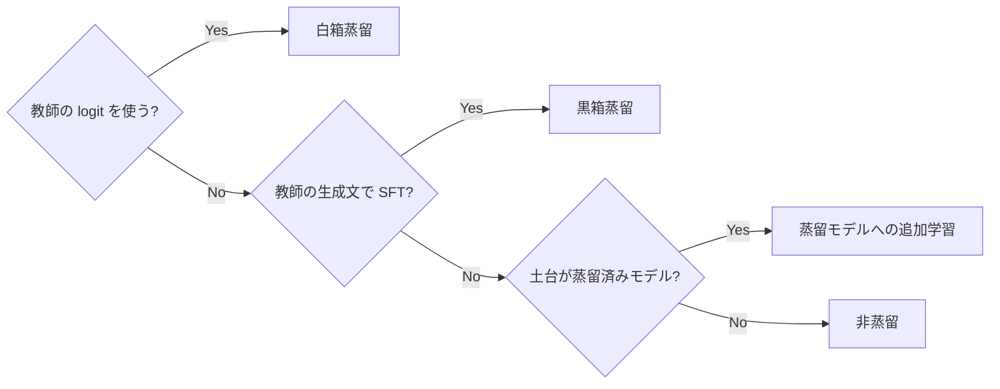
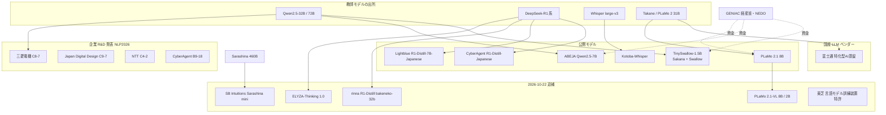
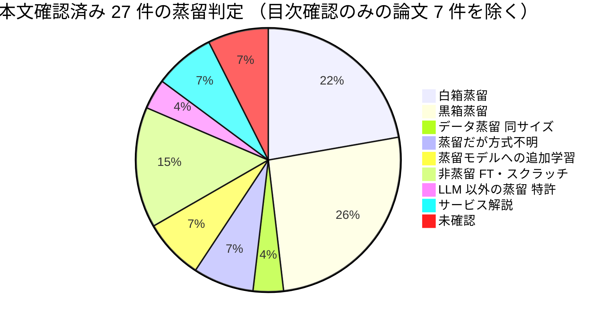
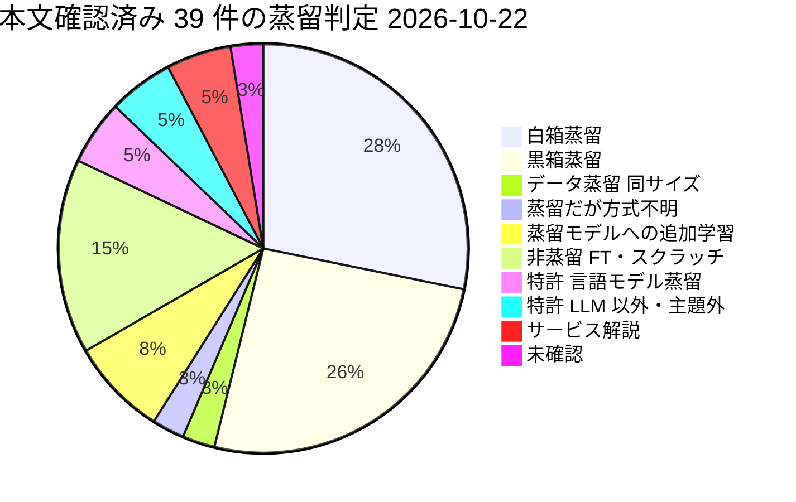

# LLM 蒸留の国内事例（C7 japan_cases） — リソース収集結果

## 収集パラメータ

- **対象リソース**: 学術論文 / 特許 / 技術情報（Web・技術ブログ・モデルカード） / ビジネス事例
- **対象期間**: 2022 – 2026
- **収集日**: 2026-10-21
- **入力元**: clustering 結果（[cluster-07-japan-cases.md](../../../clustering/20261021/cluster-07-japan-cases.md)）
- **検索言語**: 日本語 + 英語
- **実行モード**: 非対話（auto）。リソース種別は 4 種すべてを対象とした

> **収集時の制約（再現性のための記録）**
>
> - セッション全体で共有される WebSearch の上限に途中で達したため、後半は **既知 URL への直接 WebFetch** と **言語処理学会（NLP2024–2026）の予稿集目次ページの全文走査** に切り替えた。
> - 走査後、`anlp.jp` から一時的に接続を拒否された（レート制限とみられる）。時間をおいて再取得し、NLP2026 の企業・大学発表 5 本（C9-7, C4-2, B9-18, P1-4, C8-11）は PDF 本文を確認した。NLP2024/2025 の 6 本と NLP2026 B7-18 は目次確認のみ。
> - 富士通のプレスリリース原文（global.fujitsu）は HTTP 429 で取得できず、同日付の報道 2 本（クラウド Watch・マイナビ）で内容を確認した。
> - **（2026-10-22 追記）** 日本語検索を再開し、WebSearch 36 回・WebFetch 約 25 回を追加した。事業会社（金融・通信・SIer・製造・小売・コールセンター・検索・推薦）、クラウド 3 社の国内顧客事例、学会（NLP2025 / JSAI2025 / IPSJ / IEICE）、企業技術ブログ（ABEJA / CyberAgent / Sansan / Stockmark / rinna / SB Intuitions / PFN / Turing / ELYZA / KDDI）、Google Patents を対象とした。結果は末尾の「収集状況と空白」表に記録した。富士通原文は 6 経路で再試行し失敗（Vercel の JavaScript 検証）。Google Patents は検索 API 1 回分は取得できたが、出願人別の連続クエリと公報ページはブロックされた（HTTP 503 / "Sorry..." ページ）。J-PlatPat は JavaScript アプリケーションのため本環境からは取得できない。

## 収集サマリ

| 領域 | 論文 | 特許 | 技術情報 | 事例 | 合計 |
|------|------|------|----------|------|------|
| 手法・研究（Sakana / PFN / 学会） | 15 | 0 | 1 | 0 | 16 |
| 公開モデル（ABEJA / CyberAgent / Lightblue / Kotoba / ELYZA） | 0 | 0 | 8 | 2 | 10 |
| 国産 LLM ベンダー（富士通 / NTT / 楽天 / NEC） | 0 | 1 | 0 | 3 | 4 |
| 事業会社・クラウド経由（三菱電機 / ソフトバンク / AWS） | 0 | 0 | 2 | 2 | 4 |
| **合計（2026-10-21 時点）** | **15** | **1** | **11** | **7** | **34** |

```
論文     |███████████████ 15
技術情報 |███████████ 11
事例     |███████ 7
特許     |█ 1
```

**（2026-10-22 追記）** 追補で 12 件を追加し、合計 **46 件** になりました。

| 領域 | 論文 | 特許 | 技術情報 | 事例 | 合計 |
|------|------|------|----------|------|------|
| 手法・研究（+ PLaMo 2.1-VL 技術報告） | 16 | 0 | 1 | 0 | 17 |
| 公開モデル（+ ABEJA ブログ 3 本・NVIDIA 記事・rinna・ELYZA モデルカード） | 0 | 0 | 14 | 2 | 16 |
| 国産 LLM ベンダー（+ 東芝特許・SB Intuitions 2 本） | 0 | 2 | 0 | 5 | 7 |
| 事業会社・クラウド経由（+ Google JP 登録特許・ビズリーチ系公報群） | 0 | 2 | 2 | 2 | 6 |
| **合計（2026-10-22 時点）** | **16** | **4** | **17** | **9** | **46** |

```
論文     |████████████████ 16
技術情報 |█████████████████ 17
事例     |█████████ 9
特許     |████ 4
```

## URL検証結果

| 項目 | 件数 |
|------|------|
| 収集 | 40 →（2026-10-22）54 |
| 検証済み（本文を WebFetch / 目次で確認） | 34 →（2026-10-22）46 |
| 不一致で除外 | 0 |
| アクセス不可・検索スニペットのみで本表から除外 | 6 →（2026-10-22）8（末尾「未検証候補」に記載。ABEJA ブログは解決し、東芝公報全文・Sarashina3 資料を追加） |

本表は検証済みの項目だけを載せています。「目次確認」とある論文は、予稿集の目次ページでタイトル・著者・所属を確認したもので、PDF 本文は未読です。

## 蒸留かどうかの判定基準

このクラスタでは「軽量モデル」と「蒸留モデル」が混同されやすいため、各リソースに次の判定を付けました。

| 判定 | 定義 | 例 |
|------|------|----|
| **白箱蒸留** | 教師の logit・確率分布を生徒の損失に使う | TAID、PLaMo 2.1 8B（top-128 logit KL）、（2026-10-22 訂正）ABEJA Qwen2.5-7B（最終層 logit KL、`LogitsKLLoss`） |
| **黒箱蒸留（系列レベル）** | 教師の生成文を正解ラベルにして生徒を SFT する | Lightblue（R1-Distill-Llama-70B の出力で SFT）、三菱電機 NLP2026、（2026-10-22 追記）ELYZA-Thinking（自社呼称は模倣学習）、SB Intuitions Sarashina mini（IR の定義が黒箱） |
| **蒸留モデルへの追加学習** | 他社の蒸留済みモデルを土台に、日本語データで fine-tuning | CyberAgent R1-Distill-Japanese、（2026-10-22 追記）rinna deepseek-r1-distill-qwen2.5-bakeneko-32b（ChatVector + ORPO） |
| **非蒸留（fine-tuning / スクラッチ / 量子化）** | 蒸留の記述がない | tsuzumi 2、Rakuten AI 2.0 mini、ソフトバンク AOI LLM、三菱電機 エッジ LLM、（2026-10-22 追記）PLaMo 2.1-VL の VLM 学習部分 |
| **未確認** | 「蒸留にも挑戦中」等の記述のみ | ABEJA 登壇資料（→ 2026-10-22 に技術ブログで白箱と確定） |



## 年次分布

```
2026 |████████ 8   （NLP2026 の企業・大学発表 7、ABEJA ブログ 1）
2025 |██████████████████ 18  （TAID / TinySwallow / PLaMo 2 / 富士通 / R1-Distill 日本語版 / tsuzumi 2 など）
2024 |███████ 7   （NLP2024 3、Kotoba-Whisper、AWS Bedrock 蒸留、ソフトバンク AOI LLM、Classmethod）
2023 |  0
2022 |█ 1   （NEC 特許の米国公開 2022-12、優先日 2019）
```

種別ごとの内訳です。

| 年 | 論文 | 特許 | 技術情報 | 事例 |
|----|------|------|----------|------|
| 2026 | 7 | 0 | 1 | 0 |
| 2025 | 5 | 0 | 7 | 6 |
| 2024 | 3 | 0 | 3 | 1 |
| 2022 | 0 | 1 | 0 | 0 |

> 2025 年 1–2 月（TAID と DeepSeek-R1 ショック）に公開モデル型の事例が集中し、2026 年 3 月の NLP2026 で **企業の研究発表（三菱電機・NTT・CyberAgent・デンソーテン・Japan Digital Design）** が一気に増えています。蒸留は「公開モデルの話題」から「企業 R&D の題材」へ移りつつあります。
>
> **（2026-10-22 追記）** 追加 12 件の年次は 2026: 1（PLaMo 2.1-VL 技術報告）、2025: 9（ABEJA ブログ 3・NVIDIA・rinna・ELYZA モデルカード・SB Intuitions 2・Google JP 登録）、2024: 1（東芝公報の公開）、ビズリーチ系公報群は 2024–2026 に分散。上の分布の傾向（2025 年の公開モデル集中）は変わりません。

## リソース関係図



## 全体の傾向



**（2026-10-22 追記）** 追補後は本文確認済み 39 件。ABEJA の 2 件（モデルカード・登壇資料）は「方式不明」「未確認」から **白箱** へ移し、追加分は白箱 +3（ABEJA ブログ 2・NVIDIA）、黒箱 +3（ELYZA モデルカード・SB Intuitions 2）、蒸留モデルへの追加学習 +1（rinna）、非蒸留 +1（PLaMo 2.1-VL）、特許 +3（東芝 = 言語モデルの白箱蒸留、Google JP = LLM 蒸留クレーム、ビズリーチ系 = 蒸留は主題でない）、32B 事後学習ブログ（非蒸留）+1。



- **公開モデル型が中心（H4 を支持）**: 本文確認済み 27 件のうち、蒸留を使ったと一次資料で確認できた国内モデルは TinySwallow、ABEJA Qwen2.5-7B、PLaMo 2.1 8B、Lightblue、Kotoba-Whisper の 5 系統で、すべて **Hugging Face で公開されたモデル** です。
- **社内導入の一次事例は 1 件のみ**: 富士通が **自社 CRM データ（OneCRM）の商談勝敗予測** で「推論 11 倍速・精度 43% 向上」を発表しています（ベンダー申告）。他社の事業会社が蒸留モデルを本番投入した一次資料は見つかりませんでした。
- **「軽量 LLM」の多くは蒸留ではない（H3 を支持）**: tsuzumi 2（スクラッチ）、Rakuten AI 2.0 mini（スクラッチ）、ソフトバンクのコールセンター要約（Swallow-70b の fine-tuning）、三菱電機のエッジ LLM（継続事前学習 + タスク特化学習）は、いずれも蒸留の記述がありません。
- **GENIAC が国内蒸留の主な資金源**: TAID / TinySwallow、ABEJA、PLaMo 2 のいずれも NEDO 事業（JPNP20017 等）の成果として公表されています。
- **企業 R&D は 2026 年に急増**: NLP2026 では、金融（MUFG 系の Japan Digital Design）・自動車（デンソーテン）・通信（NTT 東日本）・広告（CyberAgent）・製造（三菱電機）が蒸留を題材に発表しています。NTT 東日本は **5 年分の実業務画像**、Japan Digital Design は **実務の金融市場レポート** を使っており、社内業務データでの検証まで進んでいます。ただし、いずれも本番導入の成果ではなく研究段階です。
- **「蒸留」の意味が広がっている**: Japan Digital Design の「蒸留」は、70B の生成を Judge で選別して **同じ 70B に再学習** するデータ蒸留で、モデルは小さくなりません。国内の企業発表では「蒸留＝小型化」と読まない注意が必要です。

国内では「蒸留」が **公開モデルの作り方** として先に普及し、事業会社の業務適用は 2026 年時点でも **研究発表または PoC の段階** にとどまっています。唯一の例外である富士通の数値も、社内データを使ったベンダー自身の検証です。クラウド経由（Bedrock 蒸留等）の国内顧客事例は一次資料が見つからず、H2 の「顧客別成果は非公開」が国内でも当てはまります。

---

## 学術論文

| # | 領域 | タイトル | 著者 | 年 | Venue | 概要 |
|---|------|---------|------|-----|-------|------|
| 1 | 手法・研究 | [大きなモデルは小さなモデルの良い教師となり得るか? —日本語算術タスクにおける検証—](https://www.anlp.jp/proceedings/annual_meeting/2026/pdf_dir/C8-7.pdf) | 山下修平, 内出隼人, 斉藤辰彦（三菱電機） | 2026 | NLP2026 C8-7 | Qwen2.5-7B〜72B を教師に GSM8K 和訳で推論過程を蒸留。7B 教師が 72B 教師より平均 3.16pt 高い（本文確認） |
| 2 | 手法・研究 | [金融市場翻訳に特化したLLMに対するLLM-as-a-Judgeベース蒸留学習](https://www.anlp.jp/proceedings/annual_meeting/2026/pdf_dir/C9-7.pdf) | 井本稔也, 伊藤敬彦, 川原一修（Japan Digital Design） | 2026 | NLP2026 C9-7 | Llama 3.3 Swallow 70B の 50 候補訳を DeepSeek-V3.1 で採点・後編集し、同じ 70B に再 SFT する「データ蒸留」。Judge の Overall 平均 +0.178、分散約 1/18（本文確認）。**小型化ではない** |
| 3 | 手法・研究 | [構造化知識蒸留とVisual Attention最適化によるドメイン特化型VLMの構築](https://www.anlp.jp/proceedings/annual_meeting/2026/pdf_dir/C4-2.pdf) | 柴田高志 ほか（NTT 東日本） | 2026 | NLP2026 C4-2 | 通信設備保守の 5 年分 4,567 画像に Qwen3-VL-235B で VQA を合成し Qwen3-VL-8B を LoRA 学習。Accuracy 8.24→8.65、危険予知 8.04→8.65（本文確認） |
| 4 | 手法・研究 | [実用的観点から見たCoT蒸留における教師–生徒能力差の影響](https://www.anlp.jp/proceedings/annual_meeting/2026/pdf_dir/B9-18.pdf) | 梶塚時央（東大）, 本多右京, 高瀬翔（サイバーエージェント） | 2026 | NLP2026 B9-18 | 先行研究の設定では蒸留後に蒸留前を下回ると指摘。「蒸留後の改善を確認」「候補教師の性能差が大きければ高性能教師を優先」を提言（本文確認） |
| 5 | 手法・研究 | [Matryoshka表現学習を考慮した埋め込みモデル蒸留](https://www.anlp.jp/proceedings/annual_meeting/2026/pdf_dir/P1-4.pdf) | 小島幹, 岩﨑雄介, 山本昌輝（デンソーテン） | 2026 | NLP2026 P1-4 | 車載器・スマホの RAG 向けに ruri-v3-130m → ruri-v3-70m（100M 以下）を蒸留。JMTEB 検索平均 66.38→最大 67.73（本文確認） |
| 6 | 手法・研究 | [蒸留による日英推論型大規模言語モデル構築戦略の探索](https://www.anlp.jp/proceedings/annual_meeting/2026/pdf_dir/C8-11.pdf) | 水木栄 ほか（科学大 / 産総研 / ホットリンク / NII） | 2026 | NLP2026 C8-11 | gpt-oss-120b 等の推論型教師で〈指示・推論・応答〉を合成し SFT。英語データだけで日本語にも深い推論が発現（本文確認） |
| 7 | 手法・研究 | アンサンブル蒸留と学習ベース集計を用いた数学的推論プロセスの検証と性能分析 | 榎本倫太郎（早大）, 栗田修平（NII）, 河原大輔（早大） | 2026 | NLP2026 B7-18 | 目次確認のみ |
| 8 | 手法・研究 | [PLaMo 2 Technical Report](https://arxiv.org/abs/2509.04897) | Preferred Networks（Hirokawa, Imajo ほか） | 2025 | arXiv | 31B → 8B を Minitron 方式の剪定 + 蒸留（top-128 logit KL、500B トークン）で作成 |
| 9 | 手法・研究 | [TAID: Temporally Adaptive Interpolated Distillation](https://arxiv.org/abs/2501.16937) | Makoto Shing, Kou Misaki, Han Bao, Sho Yokoi, Takuya Akiba | 2025 | ICLR 2025 Spotlight | 生徒→教師へ補間する中間教師で能力差を緩和。TinySwallow の基盤 |
| 10 | 手法・研究 | LoRAを活用した言語モデルの中間層蒸留 | 鈴木偉士, 山田寛章, 徳永健伸（科学大） | 2025 | NLP2025 Q4-7 | 目次確認のみ |
| 11 | 手法・研究 | 記号的知識蒸留における敵対的学習の利用とその評価 | 日浦隆博 ほか（NAIST / 理研） | 2025 | NLP2025 P6-3 | 目次確認のみ |
| 12 | 手法・研究 | コーパスの逆蒸留 | 盧慧敏 ほか（東大） | 2025 | NLP2025 A4-5 | 目次確認のみ |
| 13 | 手法・研究 | 日本語GPTの蒸留における損失関数の比較 | 西村稜真, 狩野芳伸（静岡大） | 2024 | NLP2024 P11-14 | rinna japanese-gpt2-small を 12→6 層に蒸留し損失を比較（目次確認、検索スニペットで要旨確認） |
| 14 | 手法・研究 | 敵対的生成ネットワークを用いた記号的知識蒸留 | 日浦隆博 ほか（NAIST / 理研） | 2024 | NLP2024 P10-22 | 目次確認のみ |
| 15 | 手法・研究 | テキスト生成モデルを利用したデータセット蒸留 | 前川在 ほか（東工大） | 2024 | NLP2024 P11-11 | 目次確認のみ |
| 16 | 手法・研究（2026-10-22 追記） | [PLaMo 2.1-VL Technical Report](https://arxiv.org/abs/2604.19324) | Tommi Kerola, Yuya Masuda, Takashi Masuko, Toshiki Nakanishi, Daisuke Nishino, Kuniyuki Takahashi, Hanqin Wang, Yoshihiro Yamada（Preferred Networks） | 2026 | arXiv 2604.19324 | 剪定 + 蒸留で作った PLaMo 2.1-8B（と 2B）を基盤にしたエッジ向け VLM。VLM 学習は LLaVA 型 2 段階で蒸留ではない。2B の作り方は記載なし。JA-VG-VQA-500 ROUGE-L 61.5（8B）/ 60.7（2B）、Ref-L4 日本語 85.2 / 82.4（本文確認） |

---

## 特許

| # | 領域 | タイトル | 番号 | 出願人 | 年 | 特許庁 | 概要 |
|---|------|---------|------|--------|-----|--------|------|
| 1 | 国産ベンダー | [Information processing device, learning method, and recording medium](https://patents.google.com/patent/US12283092B2/en) | US12283092B2（JP7405148B2 ファミリ） | NEC | 2022 公開 / 2025 登録 | USPTO / JPO | 教師の未学習データから疑似データを生成して蒸留する手法。**画像分類が対象で LLM ではない** |
| 2 | 国産ベンダー（2026-10-22 追記） | [言語モデル訓練装置、方法及びプログラム](https://patents.google.com/patent/JP2024099474A/ja) | JP2024099474A | 株式会社東芝 | 優先日 2023-01-12 / 公開 2024-07-25 | JPO | 教師モデル・学生モデルにそれぞれ異なるトークン系列を適用し、位置情報・特徴量・推論結果で学生を更新。高頻度の **新規単語** を抽出する従属項あり。**言語モデルの白箱蒸留に関する国内大手の出願**（請求項は検索結果スニペットのみ。公報ページは HTTP 503 で未取得。LLM 規模かは不明） |
| 3 | 事業会社・クラウド（2026-10-22 追記） | [大規模言語モデルを使用したコンテンツ作成及び編集のための会話型インタフェース](https://patents.google.com/patent/JP7746629B2/ja) | JP7746629B2 | グーグル エルエルシー | 優先日 2022-10-18 / 登録 2025-09-30 | JPO（EP・US・CN・KR も活性） | 請求項 1 に「知識蒸留を使用して…生徒モデル…コンテンツを生成するためにチューニングされた大規模言語モデルが親モデル」「品質スコアを閾値品質スコアと比較」を含む。**LLM 蒸留のクレームが日本で登録された例**（国内企業ではない） |
| 4 | 事業会社（2026-10-22 追記） | 情報処理システム、情報処理方法及びプログラム（求人・求職マッチング等）ほか | JP7799133B1 など 26 件 + 株式会社アシュアード 8 件 | 株式会社ビズリーチ / 株式会社アシュアード | 2024–2026 公開 | JPO | 「知識蒸留 × 言語モデル」検索でヒット数の 68% を占めるが、請求項スニペットは LLM の利用（求職者情報からの質問生成等）で、**蒸留は明細書の一般論とみられ主題ではない** |

> **特許の空白**: 国内企業による「LLM の蒸留」そのものの特許は、今回の範囲では確認できませんでした（J-PlatPat は検索上限のため未走査）。NEC の 1 件は 2019 年優先の画像分類向けで、LLM 蒸留の権利化はまだ表に出ていないとみられます。C8（規約・知財・特許）クラスタでの追加調査が必要です。
>
> **（2026-10-22 追記）** Google Patents の検索 API（`q=("知識蒸留" OR "蒸留") ("言語モデル")`、JP、優先日 2022-01-01 以降）で **110 件** がヒットし、1 ページ目 50 件を精査しました。国内企業で言語モデルの蒸留を主題にした公報は **東芝 1 件** のみで、残りはビズリーチ系の列挙（34 件）、LG（5 件）、Google（2 件）などです。出願人別クエリ（NTT・富士通・NEC・日立・東芝・ソニー・PFN・LINE ヤフー・楽天・KDDI・サイバーエージェント・三菱電機・パナソニック・NTT データ）は連続アクセスでブロックされ実行できず、2〜3 ページ目（60 件）も未精査です。J-PlatPat は JavaScript アプリケーションのため本環境からは取得できません。詳細は [retrieval 13](../../../retrieval/20261021/japan_cases/13-japan-llm-distillation-patent-scan.md)。

---

## 技術情報

| # | 領域 | タイトル | ソース | 年 | 種別 | 概要 |
|---|------|---------|--------|-----|------|------|
| 1 | 公開モデル | [ABEJA Tech Blog トップ](https://tech-blog.abeja.asia/) | ABEJA | 2026 | 技術ブログ | 2026-08〜10 の記事は SFT・ロボット系が中心で、蒸留記事は見当たらない |
| 2 | 手法・研究 | [新手法「TAID」を用いた小規模日本語言語モデル「TinySwallow-1.5B」の公開](https://sakana.ai/taid-jp/) | Sakana AI | 2025 | 公式ブログ | 32B → 1.5B。iPhone 上の動作、オフライン ChatUI。顧客・価格の記述なし |
| 3 | 公開モデル | [TinySwallow-1.5B-Instruct](https://huggingface.co/SakanaAI/TinySwallow-1.5B-Instruct) | Sakana AI / Swallow | 2025 | モデルカード | 教師 Qwen2.5-32B-Instruct。「研究開発目的の実験的プロトタイプ、商用・ミッションクリティカル用途を意図しない」と明記 |
| 4 | 公開モデル | [ABEJA-Qwen2.5-7b-Japanese-v0.1](https://huggingface.co/abeja/ABEJA-Qwen2.5-7b-Japanese-v0.1) | ABEJA | 2025 | モデルカード | 32B（自社）を教師に「通常の継続事前学習ではなく蒸留」で学習。ChatVector 併用。Apache-2.0 |
| 5 | 公開モデル | [GENIAC2期におけるABEJAの取り組み](https://speakerdeck.com/ryo1443/zhu-shi-hui-she-abeja-geniac2qi-niokeruabejanoqu-rizu-mi) | ABEJA（真鍋知樹） | 2025 | 登壇資料 | 100B トークン、H100×64、NeMo。「蒸留にも挑戦中」のみ |
| 6 | 公開モデル | [lightblue/DeepSeek-R1-Distill-Qwen-7B-Japanese](https://huggingface.co/lightblue/DeepSeek-R1-Distill-Qwen-7B-Japanese) | Lightblue | 2025 | モデルカード | R1-Distill-Llama-70B の生成文で SFT（黒箱蒸留）。8×L20 で 10 分未満。gsm8k-ja 70% |
| 7 | 公開モデル | [cyberagent/DeepSeek-R1-Distill-Qwen-14B-Japanese](https://huggingface.co/cyberagent/DeepSeek-R1-Distill-Qwen-14B-Japanese) | CyberAgent | 2025 | モデルカード | 「Japanese finetune」のみで手法・データの記載なし。MIT |
| 8 | 公開モデル | [ELYZA-Thinking-1.0: MCTS を用いた推論パス探索と模倣学習](https://zenn.dev/elyza/articles/bc68f53fc0a83b) | ELYZA | 2025 | 技術ブログ | 約 15 万件の合成推論データで 32B を SFT。自社では「蒸留」と呼ばず「模倣学習」 |
| 9 | 公開モデル | [kotoba-whisper-v2.0](https://huggingface.co/kotoba-tech/kotoba-whisper-v2.0) | Kotoba Technologies / Asahi Ushio | 2024 | モデルカード | Whisper large-v3 を教師に 2 層デコーダへ蒸留。6.3 倍高速、ReazonSpeech で CER 11.6（教師 14.9） |
| 10 | クラウド経由 | [Amazon Bedrock Model Distillation（プレビュー）](https://aws.amazon.com/jp/blogs/news/build-faster-more-cost-efficient-highly-accurate-models-with-amazon-bedrock-model-distillation-preview) | AWS Japan | 2024 | 公式ブログ（日本語） | 最大 5 倍高速・最大 75% 低コスト・RAG で精度低下 2% 未満（ベンダー値）。顧客名なし |
| 11 | クラウド経由 | [Bedrock Model Distillation 基礎〜実践まで 登壇](https://dev.classmethod.jp/articles/bedrock-model-distillation-re-growth-2024-awsreinvent-regrowth-fukuoka) | クラスメソッド | 2024 | 技術ブログ | 登壇告知のみで実践結果の記述はない |
| 12 | 公開モデル（2026-10-22 追記） | [ABEJA Qwen2.5 32B-Japanese より更に軽量な ABEJA Qwen2.5 7B-Japanese v0.1 の公開](https://tech-blog.abeja.asia/entry/geniac2-qwen25-7b-v0.1) | ABEJA（真鍋知樹） | 2025-04-22 | 技術ブログ | 教師 ABEJA Qwen2.5 32B-Japanese v0.1 → 生徒 Qwen2.5-7B-Instruct の **白箱蒸留**。同条件の CPT 版と比較し Japanese-MT-Bench 7.26 vs 7.21（元の 7B-Instruct 6.86）。H100×64。トークン数非公開 |
| 13 | 公開モデル（2026-10-22 追記） | [小型LLM「ABEJA Qwen2.5-7B Model」学習のための蒸留のパイプライン並列化](https://tech-blog.abeja.asia/entry/geniac2-distillation-pipeline-parallel) | ABEJA（藤本敬介） | 2025-05-19 | 技術ブログ | NeMo の蒸留がパイプライン並列非対応だったため Megatron-Core のスケジューラを書き換え。損失は `LogitsKLLoss`（最終層）。global batch 64 以上で OOM していた実装を 1024 まで動作させた（2×V100、1.5B → 0.5B の代替実験） |
| 14 | 公開モデル（2026-10-22 追記） | [Spotlight: NVIDIA NeMo を使用した小型 LLM「ABEJA Qwen2.5-7B Model」学習のための蒸留のパイプライン並列化](https://developer.nvidia.com/ja-jp/blog/spotlight-pipeline-parallelism-of-the-distillation-for-abeja-qwen-2-5-7b-using-nvidia-nemo/) | NVIDIA（藤田敦典）+ ABEJA | 2025-05-29 | 公式技術ブログ | 上記 13 の NVIDIA 版。nvidia-modelopt の `mtd.convert`（`kd_loss`）、NeMo PR #13065（2025-05-10）で本家が対応したことを追記 |
| 15 | 公開モデル（2026-10-22 追記） | [ABEJA Qwen2.5 32B-Japanese v1.0（事後学習）](https://tech-blog.abeja.asia/entry/geniac2-qwen25-32b-v1.0) | ABEJA | 2025-05 | 技術ブログ | SFT + DPO 各 2 万件弱（Qwen2.5-72B-Instruct で合成 + 人手）。Japanese MT-Bench 8.278 → 8.335。**蒸留の記述なし**（教師側の事後学習） |
| 16 | 公開モデル（2026-10-22 追記） | [rinna/deepseek-r1-distill-qwen2.5-bakeneko-32b](https://huggingface.co/rinna/deepseek-r1-distill-qwen2.5-bakeneko-32b) | rinna（Xinqi Chen, Toshiaki Wakatsuki, Kei Sawada） | 2025-02-13 | モデルカード | R1-Distill-Qwen-32B の ChatVector を日本語 CPT 済み bakeneko-32b に加算し、DeepSeek-R1 生成 1.2k 件で ORPO。Japanese MT-Bench 1st 8.58 / multi 8.19（土台 7.39 / 6.88）。**蒸留モデルへの追加学習** |
| 17 | 公開モデル（2026-10-22 追記） | [elyza/ELYZA-Thinking-1.0-Qwen-32B](https://huggingface.co/elyza/ELYZA-Thinking-1.0-Qwen-32B) | ELYZA | 2025 | モデルカード | MCTS で生成した長い CoT の合成データで Qwen2.5-32B-Instruct を模倣学習。ベンチマーク表はモデルカードになし（Zenn 記事の画像から読み取り。[retrieval 12](../../../retrieval/20261021/japan_cases/12-elyza-rinna-r1-japanese-reasoning-models.md)） |

---

## ビジネス事例

| # | 領域 | タイトル | 企業/組織 | 年 | 種別 | 概要 |
|---|------|---------|-----------|-----|------|------|
| 1 | 国産ベンダー | [富士通、生成AI再構成技術を開発（クラウド Watch）](https://cloud.watch.impress.co.jp/docs/news/2045596.html) / [マイナビ](https://news.mynavi.jp/techplus/article/20250908-3442664/) | 富士通 | 2025 | 報道（プレスリリース準拠） | NAS + 蒸留の「特化型AI蒸留」。社内 CRM の商談勝敗予測で推論 11 倍速・精度 43% 向上、1/100 パラメータで教師超え、GPU メモリ・運用コスト各 70% 削減（ベンダー申告） |
| 2 | 国産ベンダー | [NTT、tsuzumi 2 提供開始](https://group.ntt/jp/newsrelease/2025/10/20/251020a.html) | NTT | 2025 | プレスリリース | 1 GPU で動作。**蒸留の記述なし**（初代はフルスクラッチ）。東京通信大学がオンプレ導入を決定 |
| 3 | 国産ベンダー | [Rakuten AI 2.0 / 2.0 mini 公開](https://global.rakuten.com/corp/news/press/2025/0212_02.html) | 楽天グループ | 2025 | プレスリリース | mini 1.5B は **スクラッチ学習**（蒸留ではない）。日本語 MT-Bench 4.91 |
| 4 | 公開モデル | [サイバーエージェント、DeepSeek-R1 の日本語追加学習モデル（GIGAZINE）](https://gigazine.net/news/20250128-cyberagent-deepseek-r1-japanese) | CyberAgent | 2025 | 報道 | 2025-01-27 公開。14B / 32B |
| 5 | 公開モデル | [Lightblue、DeepSeek-R1 蒸留モデルに日本語追加学習（IT Leaders）](https://it.impress.co.jp/articles/-/27417) | Lightblue | 2025 | 報道 | 2025-02-03 発表。ローカル PC で動作 |
| 6 | 事業会社 | [三菱電機、エッジデバイスで動作する製造業向け言語モデル](https://www.mitsubishielectric.co.jp/ja/pr/2025/0618-a/index.html) | 三菱電機 | 2025 | プレスリリース | 継続事前学習 + 独自データ拡張によるタスク特化学習。**蒸留の記述なし**。AWS ジャパン生成AI実用化推進プログラムの支援 |
| 7 | 事業会社 | [ソフトバンク、コールセンター通話要約に AOI LLM（IT Leaders）](https://it.impress.co.jp/articles/-/27250) | ソフトバンク / アドバンスト・メディア | 2024 | 報道 | Swallow-70b を fine-tuning。新人の要約時間を約 30% 削減見込み。**蒸留ではない** |
| 8 | 国産ベンダー（2026-10-22 追記） | [統合報告書 2025 国産生成AI開発責任者インタビュー](https://www.softbank.jp/corp/ir/documents/integrated_reports/fy2025/tamba/) | ソフトバンク / SB Intuitions（丹波廣寅 CEO） | 2025 | IR 文書 | 「先生」役の大規模 AI から「生徒」役の軽量 AI を作る方針。「『Sarashina mini』は…『蒸留』※などの技術を用いて…最適化」。脚注の蒸留の定義は黒箱型。サイズ・数値なし |
| 9 | 国産ベンダー（2026-10-22 追記） | [Sarashina mini に API で接続する「Sarashina API」を法人向けに提供開始](https://www.softbank.jp/corp/news/press/sbkk/2025/20251105_01) | ソフトバンク / SB Intuitions | 2025-11-05 | プレスリリース | 460B の Sarashina で「培った知見を基に開発された軽量モデル」。**蒸留の語なし**。2025-11-28 提供開始、Chat Completion / Embeddings API。想定用途はコールセンター自動応答・営業支援。価格・パラメータ・ベンチマーク非公開 |

---

## 未検証候補（本表から除外）

検索スニペットでは存在を確認しましたが、本文を取得していない、または蒸留との関係が確認できなかったものです。

| 候補 | 理由 | 次の確認先 |
|------|------|-----------|
| LLM-jp（arXiv 2407.03963） | 本文未取得。蒸留の記述は未確認 | arXiv 本文 |
| NEC cotomi Light / Fast | 「パラメータを抑えて高速化」との報道のみ。蒸留の記述なし | NEC 技術論文 |
| 日立「業務特化型 LLM 構築・運用サービス」 | 報道では fine-tuning + RAG。蒸留の記述なし | 日立の技術資料 |
| PFN PLaMo-fin / 金融機関向けカスタム | 追加学習の記述のみ | PFN 技術ブログ |
| ABEJA「蒸留のパイプライン並列化」技術ブログ | クラスタ定義に記載があるが URL を特定できず → **（2026-10-22 解決）** 技術情報 #13・#14 に収録 | ABEJA Tech Blog のアーカイブ |
| 日経クロステック「蒸留で生成」（AWS ジャパンの発言） | 会員記事・検索上限で未取得（2026-10-22 の再検索でもヒットせず） | 日経クロステック |
| 東芝 JP2024099474A の公報全文（2026-10-22 追加） | Google Patents が HTTP 503。請求項はスニペットのみ | J-PlatPat（手動）/ 時間をおいて Google Patents |
| SB Intuitions Sarashina3（mini / nano 等 5 モデル、2026-06-30 提供開始とされる）（2026-10-22 追加） | 個人サイトの二次情報のみ。公式資料未確認 | SB Intuitions 公式発表 |
| NEDO 成果概要（ABEJA、800036434.pdf）の再確認（2026-10-22 追加） | 検索スニペットでは「蒸留」の有無を確認できず（retrieval 04 では取得済み） | — |

## 収集状況と空白（2026-10-22 追記）

事業会社・業種ごとに「蒸留」を日本語で検索した結果です。**該当なし** は、検索結果が一般解説記事・無関係ページ・非蒸留の事例のみだったことを意味します（存在しないことの証明ではありません）。

| 領域 | 対象（検索語に含めた固有名詞） | 検索回数 | 結果 | 空白の判定 |
|------|------------------------------|---------|------|-----------|
| 検索・推薦 | メルカリ、LINE ヤフー、ZOZO、リクルート、楽天、ビズリーチ | 7 | メルカリは NLP2024 の検索研究（蒸留なし）と Google Cloud ベクトル検索事例。LINE ヤフーは量子化のインターン報告のみ。ZOZO・リクルートは一般解説のみ。楽天は Rakuten AI 2.0 / 3.0 の報道のみ。ビズリーチは特許公報で「言語モデル」を列挙 | **空白**（H1 の国内検証は不可） |
| 金融 | 三菱UFJ、SMBC、みずほ、野村、日本生命、Japan Digital Design | 2 | JDD は NLP2026 C9-7（収録済み）以外に蒸留の公開情報なし。他 5 社は無関係 | **空白**（研究発表 1 件のみ） |
| 通信 | NTT ドコモ、KDDI、ソフトバンク、NTT 研究所 | 3 | tsuzumi 2 の報道（非蒸留）、KDDI の ELYZA 子会社化、SB Intuitions の IR 文書（蒸留方針のみ） | **ほぼ空白**（SB Intuitions の方針表明のみ） |
| SIer | NTT データ、日立、NEC、富士通 | 2 | NEC cotomi 13B（2023、非蒸留）。日立・NTT データは該当なし。富士通は収録済み | **空白**（富士通を除く） |
| 製造・小売 | トヨタ、デンソー、パナソニック、セブン、イオン、東芝、日立 | 2 | 一般解説のみ。東芝は特許出願のみ（収録） | **空白**（三菱電機・デンソーテンの研究発表を除く） |
| コールセンター | — | 1 | ソフトバンク AOI LLM（FT、収録済み）、tsuzumi | **空白** |
| クラウド経由 | AWS Bedrock、Azure OpenAI、Google Cloud、AWS Summit Japan 2025 | 4 | Bedrock 蒸留は 2025-05 GA（クラスメソッド）。国内顧客事例・セッションは該当なし。日経クロステック記事も未発見 | **空白** |
| 学会 | NLP2025、JSAI2025、IPSJ、IEICE | 3 | 大会概要・スポンサー情報のみ。蒸留発表は検索では特定できず（NLP2024–2026 は初回に目次走査済み） | 未確定（J-STAGE・IPSJ 電子図書館の直接検索が必要） |
| 企業技術ブログ | ABEJA、CyberAgent、Sansan、Stockmark、rinna、SB Intuitions、PFN、Turing、ELYZA、KDDI | 8 | **ABEJA 3 本 + NVIDIA 1 本を発見**。rinna は HF モデルカード経由で収録。PFN は PLaMo 2.1-VL を発見。CyberAgent・Sansan・Stockmark・Turing は該当なし | 一部解消 |
| 特許 | Google Patents（JP、知識蒸留 × 言語モデル） | 2 + API 1 | 110 件中 50 件精査。東芝 1 件、Google JP 登録 1 件 | 一部解消（出願人別・2〜3 ページ目は未走査） |
| 富士通原文 | global.fujitsu / pr.fujitsu.com / fujitsu.com / Web Archive | WebFetch 6 | すべて失敗（429・Vercel 検証・404） | **空白**（報道 3 本で代替） |

```
検索した 10 領域の結果
一次資料を発見          |████ 4（技術ブログ、特許、PFN、SB Intuitions IR）
研究発表のみ            |██ 2（金融 JDD、製造 三菱電機・デンソーテン）
該当なし                |██████ 6（検索・推薦、SIer、コールセンター、クラウド、学会、富士通原文）
```

## 次のステップ

- **詳細調査**: 本リストから重要な資料を research-retrieval で 10 本のレポートにまとめました（`retrieval/20261021/japan_cases/`）。**（2026-10-22 追記）** 11（ABEJA × NVIDIA 蒸留実装）、12（ELYZA / rinna 定量評価）、13（特許走査）を追加し、02・03・04・05・10 と index を訂正・追記しました。
- **NLP2024–2025 の大学発表**: 目次確認のみの 7 本（NLP2026 B7-18 を含む）は、必要に応じて予稿 PDF を取得します。
- **特許**: J-PlatPat で「知識蒸留 AND 言語モデル」（IPC G06N 3/08, G06F 40）を 2022–2026 で走査する必要があります。**（2026-10-22 追記）** Google Patents で 1 ページ目を走査済み。残り 60 件と出願人別走査、東芝公報の全文が未了です。
- **本番事例の追跡**: 富士通 Takane 特化型モデルのトライアル顧客、Japan Digital Design・NTT 東日本の運用化を継続して確認します。
