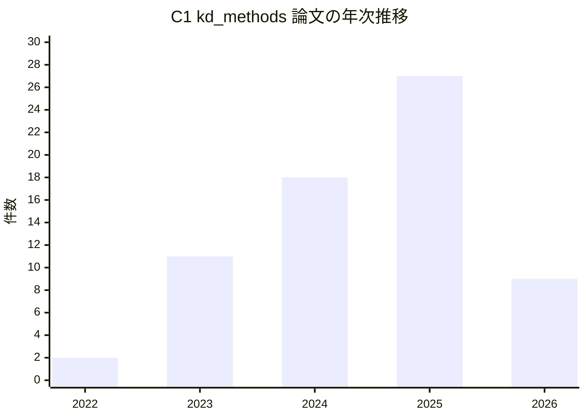
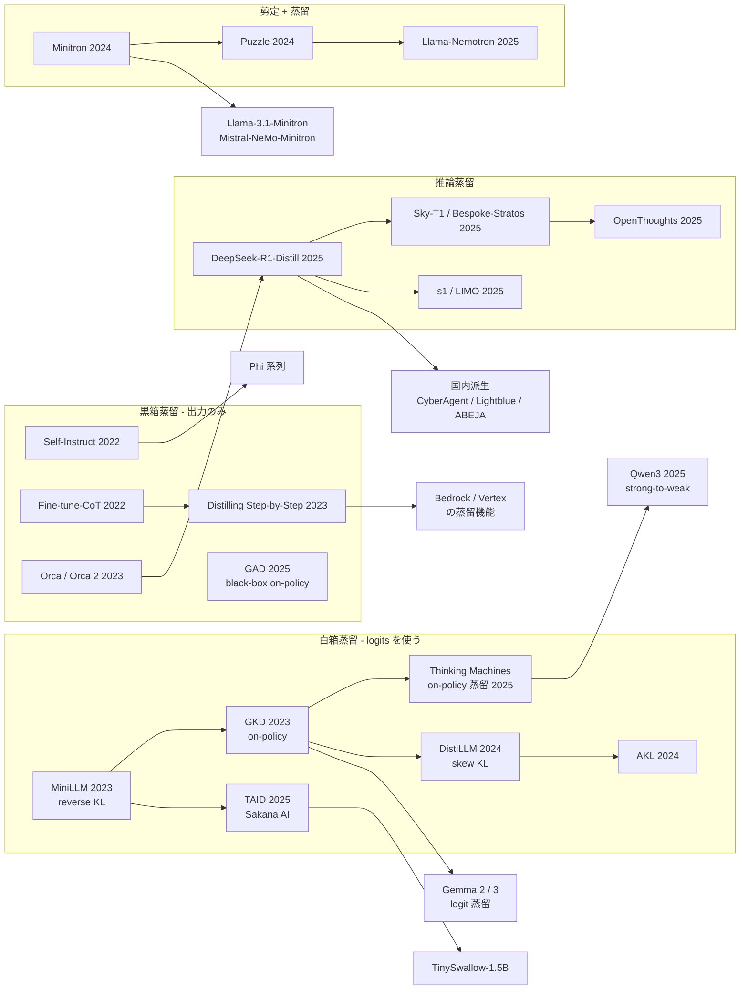
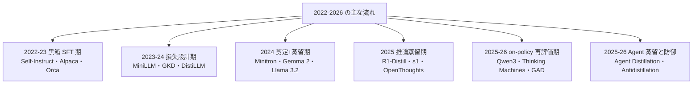
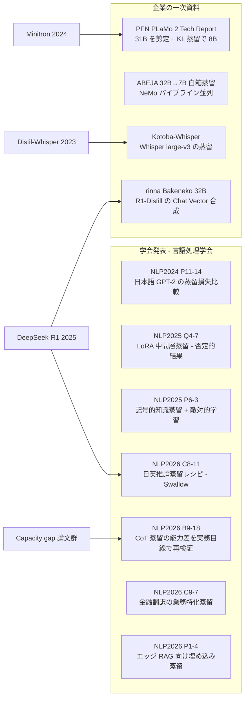

# C1 蒸留手法と技術基盤（kd_methods） — リソース収集結果

## 収集パラメータ

- **対象リソース**: 学術論文 / 特許 / 技術情報（Web サイト・技術ブログ・OSS） / ビジネス事例
- **対象期間**: 2022 – 2026（特許は優先日が 2022 年より前でも、2022 年以降に公開・登録されたものを含む）
- **収集日**: 2026-10-21
- **入力元**: clustering 結果 `runs/llm_distillation/clustering/20261021/cluster-01-kd-methods.md`
- **検索言語**: 英語 + 日本語
- **観点**: 純粋な理論より、**ビジネス導入に効く手法**（学習コスト・必要データ量・黒箱/白箱教師の制約・推論/Agent 蒸留）を優先

> **収集上の制約（重要）**: 本 run では、セッション全体で共有している WebSearch の上限（200 回）に途中で到達しました。そのため後半の収集は **検索ではなく、URL を直接取得する方法** で行いました。具体的には (1) arXiv API による ID と題名の一括照合、(2) Google Patents の個別ページにある「Similar documents / Cited by」からの芋づる式収集、(3) 公式ブログ・ドキュメント・Hugging Face・Zenn トピックページの直接取得です。**日本語の論文・特許（J-PlatPat）はほとんど拾えていません**。この点はカバレッジの空白として下表に明記します。
>
> **（2026-10-22 追記）** 上記の空白のうち **日本語の手法論文・技術資料** について、追加の検索枠（WebSearch 11 回）と原典の直接取得（言語処理学会 年次大会の発表論文集 PDF、arXiv、Hugging Face、企業テックブログ）で補完し、本ファイル末尾に「日本語の手法論文・技術資料」節（13 件）を追加しました。国内特許（J-PlatPat）は引き続き未調査です。あわせて、Thinking Machines の数値の帰属と Amazon PGKD の「130 倍 / 25 倍」の表現を原典で再確認し、該当箇所に訂正を入れました。

## 収集サマリ

| 領域 | 論文 | 特許 | 技術情報 | 事例 | 合計 |
|------|------|------|----------|------|------|
| サーベイ | 7 | 0 | 2 | 0 | 9 |
| 白箱蒸留・損失設計（KL / on-policy） | 11 | 3 | 4 | 3 | 21 |
| 黒箱蒸留（API 教師） | 7 | 2 | 0 | 1 | 10 |
| 根拠付き・推論（CoT）蒸留 | 12 | 2 | 10 | 5 | 29 |
| 合成データ蒸留 | 7 | 2 | 1 | 1 | 11 |
| 剪定 + 蒸留 / アーキテクチャ変換 | 5 | 3 | 5 | 2 | 15 |
| 基盤モデル開発での蒸留 | 4 | 0 | 1 | 4 | 9 |
| Agent・ツール呼出し蒸留 | 4 | 0 | 0 | 1 | 5 |
| 推論高速化（投機的デコーディング） | 2 | 0 | 0 | 0 | 2 |
| 経済性・本番運用 | 4 | 5 | 3 | 4 | 16 |
| 業務特化蒸留（垂直領域） | 0 | 7 | 1 | 0 | 8 |
| 蒸留の検出・防御・副作用 | 4 | 0 | 2 | 0 | 6 |
| 汎用ツール・解説（日本語含む） | 0 | 0 | 9 | 0 | 9 |
| 日本語の手法論文・技術資料（2026-10-22 追記） | 8 | 0 | 3 | 2 | 13 |
| **合計** | **75**（当初 67） | **24** | **41**（当初 38） | **23**（当初 21） | **163**（当初 150） |

> （2026-10-22 追記）「日本語の手法論文・技術資料」行は 10-22 の補完分です。以下の「種別ごとの件数」「URL検証結果」「年次分布」の図表は **当初の 150 件のまま** で、追加 13 件は末尾の節に内訳（年: 2024 年 2 / 2025 年 7 / 2026 年 4、検証はすべて原典 PDF・モデルカード・ブログ本文の直接取得）を記しています。

### 種別ごとの件数

```
論文     |██████████████████████████████████ 67
技術情報 |███████████████████ 38
特許     |████████████ 24
事例     |██████████ 21
```

## URL検証結果

| 項目 | 件数 |
|------|------|
| 収集 | 156 |
| 検証済み | 150 |
| 不一致で除外 | 0（`2502.14305` は検索結果の題名「Efficient AI in Practice」と arXiv 上の現行題名が違ったため、**現行題名「Scaling Down, Serving Fast」に直して採用**） |
| アクセス不可で除外 | 6（`openai.com/index/api-model-distillation/`〔403〕、Vertex AI の蒸留ドキュメント〔404〕、Gemma 2 の Developers Blog〔404〕、NVIDIA 日本語ブログ〔404〕、`sakana.ai/tinyswallow/`〔404〕、USPTO 12475175〔Google Patents 404〕） |

検証方法は次のとおりです。

- **論文**: arXiv API（`export.arxiv.org/api/query?id_list=...`）で ID・題名・第一著者・投稿日を一括取得し、収集した題名と照合しました（67 件すべて一致）。
- **特許**: Google Patents の個別ページを取得し、公報番号・題名・出願人・優先日を確認しました。
- **技術情報・事例**: 各 URL を取得し、HTTP 200 と、ページ題名が収集題名と一致することを確認しました。

以下の表には **検証済みのエントリのみ** を載せています。

## 年次分布

全 150 件（特許は優先日の年で集計。2022 年より前の優先日は「〜2021」にまとめた）。

```
〜2021 |█████ 5        （特許のみ。登録・公開は 2023〜2026 年）
2022   |████ 4
2023   |███████████████████████ 23
2024   |█████████████████████████████████████ 37
2025   |███████████████████████████████████████████████████████████ 59
2026   |██████████████████████ 22   （10 月時点）
```

種別ごとの内訳です。

| 年 | 論文 | 特許 | 技術情報 | 事例 | 計 |
|----|------|------|----------|------|----|
| 〜2021 | 0 | 5 | 0 | 0 | 5 |
| 2022 | 2 | 2 | 0 | 0 | 4 |
| 2023 | 11 | 7 | 4 | 1 | 23 |
| 2024 | 18 | 6 | 7 | 6 | 37 |
| 2025 | 27 | 3 | 18 | 11 | 59 |
| 2026 | 9 | 1 | 9 | 3 | 22 |

> 2026 年の技術情報 9 件のうち 5 件は、日付が明記されていない OSS・ドキュメント・記事一覧を「取得時点（2026 年）」で数えたものです。事例の 2026 年 3 件のうち 2 件も同様（Bedrock / Azure の docs）です。



## リソース関係図

手法の系譜と、それを使った公開モデル・商用サービスの関係です。



## 全体の傾向



- **論文の重心が「損失関数」から「データの作り方」へ移った**: 2023–24 年は KL の向きや on-policy 化など損失設計の論文が中心でした（白箱 11 件のうち 7 件が 2023–24 年）。2025 年の推論蒸留 7 件のうち 6 件が「どの問題を選び、どの教師の推論を、どう絞り込むか」というデータレシピの論文です（s1、LIMO、OpenThoughts、Small Models Struggle 等）。
- **on-policy 蒸留が 2025 年後半から急増**: 2026 年の論文 9 件のうち 7 件が on-policy 系です（サーベイ 2 件、黒箱の半 on-policy 1 件を含む）。Qwen3 の小型モデル、Thinking Machines の報告が引き金です。（2026-10-22 訂正）「RL 比で GPU 時間 約 1/10」は **Qwen3 Technical Report の Table 21（RL 17,920 GPU 時間 vs on-policy 蒸留 1,800 GPU 時間、一次資料）** の数値で、Thinking Machines はそれを転載しています。Thinking Machines 自身の実験値は「SFT の外挿比で計算量 9〜30 倍（GPU 時間では約 18 倍）」と「RL で作った方策の再蒸留で勾配ステップ 7〜10 倍・計算量 50〜100 倍少ない」です（詳細は retrieval レポート 04）。
- **コストを数値で示す一次資料は手法系にも少数ある**: Minitron（スクラッチ比で学習トークン最大 40 分の 1）、Sky-T1（学習費 450 ドル未満）、Amazon PGKD（推論で最大 130 倍高速・25 倍安価）、Distillation Scaling Laws（いつ蒸留が教師付き学習より得か）など。（2026-10-22 訂正）PGKD の「130 倍 / 25 倍」は **同一構成で同時に成り立つ数字ではありません**。原典 Table 5（64 件バッチ）から計算すると、遅延は GPU 推論で Claude 3 Sonnet 比 約 132 倍速い一方、コストは CPU 推論で Claude 比 約 84 倍・LLaMA 3 8B 比 約 13 倍安く、本文の「CPU で 25 倍高い」は表のどの組合せとも一致しません（retrieval レポート 05 に詳述）。
- **黒箱 / 白箱の区別がビジネス上の分岐点**: 商用 API を教師にできるのは黒箱方式だけです（Bedrock・Azure・OpenAI の蒸留機能はすべて「教師の出力で SFT」型）。白箱方式（logits・剪定）は Gemma・Llama・Nemotron など **重みを持つ側** が自社モデル群を作るときに使われています。
- **特許は「業務特化蒸留」と「蒸留パイプライン」が中心**: 優先日 2023 年以降の特許 17 件のうち 6 件が業務特化型（チャート解説・要約・マネロン対策・障害解析など）で、OpenAI の検索応答エンジン蒸留特許（US12619603B2）が目立ちます。
- **日本語圏の資料は「公開モデル」と「解説記事」に偏る**: Sakana AI（TAID / TinySwallow）、CyberAgent・Lightblue・ABEJA の R1 系日本語化モデル、Zenn の解説記事が中心で、手法の日本語論文・国内特許は今回ほぼ取得できていません。（2026-10-22 追記）補完の結果、言語処理学会 年次大会（NLP2024〜2026）に蒸留の発表が毎年あり、特に NLP2026 では **推論蒸留の日英レシピ（東京科学大 Swallow チーム）・CoT 蒸留の能力差の実務的再検証（東大 / サイバーエージェント）・金融翻訳の業務特化蒸留（Japan Digital Design）** が出ています。また PFN（PLaMo 2.1 8B の剪定 + 蒸留）と ABEJA（32B→7B の白箱蒸留）は **国内で白箱蒸留を実機で回した一次資料** です。末尾の節を参照してください。

総合すると、C1 の手法群は 2025 年を境に「教師のトークン分布をどう真似るか」から「**教師にどんなデータを作らせ、生徒自身の出力でどう補正するか**」へ重心が移っています。ビジネス上は、(1) 商用 API を教師にする黒箱 SFT（規約に注意）、(2) 自社で重みを持つ教師からの白箱 / 剪定蒸留、(3) 推論・Agent の軌跡蒸留、の 3 系統に整理できます。コスト削減の数値はベンダー申告と論文内の自己計測が大半で、**第三者が検証した本番の ROI はほとんど見つかりません**。

### カバレッジの空白

| 観点 | 状況 | 空白の理由 / 対応 |
|------|------|------------------|
| 日本語の手法論文 | △ 8 件（2026-10-22 追記。当初は ✗） | NLP2024〜2026 の年次大会発表 7 件 + PLaMo 2 Technical Report を追加。J-STAGE 論文誌・LLM-jp の蒸留関連資料・PFN テックブログ本文は未確認 |
| 日本語の実装解説（Zenn / Qiita） | △ | Zenn 検索「オンポリシー蒸留」は 0 件、Qiita「知識蒸留 LLM」上位は入門記事中心で、on-policy / Minitron 級の実装解説は未発見（2026-10-22 追記） |
| 国内特許（J-PlatPat） | ✗ 無し（東芝の米国出願 1 件のみ） | 特許は Google Patents の関連文献を辿ったため、米中に偏った |
| Agent 蒸留の本番事例 | △ 1 件（Bedrock の function calling 蒸留、ベンダー値） | 論文は増えているが、本番の数値は少ない |
| 黒箱蒸留の規約リスクを扱う技術論文 | △ 防御側の論文 4 件のみ | 法務側の分析は C8 で扱う |
| 量子化との比較 | △ | 蒸留と量子化を同じ条件で比べた一次資料は少ない |

---

## 学術論文

| # | 領域 | タイトル | 著者 | 年 | Venue | 概要 |
|---|------|---------|------|-----|-------|------|
| 1 | サーベイ | [Test-Time Scaling in Reasoning LLMs: Inference Regimes, Evaluation, and Reproducibility](https://arxiv.org/abs/2608.04001) | Hariri et al. | 2026 | arXiv | 推論時スケーリングのサーベイ。Bespoke-Stratos を「データ整備としての推論蒸留」と位置付ける |
| 2 | サーベイ | [A Formula-Driven Survey and Research Agenda for On-Policy Distillation](https://arxiv.org/abs/2606.22793) | Zhang | 2026 | arXiv | on-policy 蒸留を数式で統一的に整理し、Qwen3 等の実装の曖昧さも指摘 |
| 3 | サーベイ | [A Survey of On-Policy Distillation for Large Language Models](https://arxiv.org/abs/2604.00626) | Song et al. | 2026 | arXiv | on-policy 蒸留の初の専用サーベイ。白箱・黒箱・教師なしの 3 系統で分類 |
| 4 | サーベイ | [Knowledge Distillation and Dataset Distillation of Large Language Models: Emerging Trends, Challenges, and Future Directions](https://arxiv.org/abs/2504.14772) | Fang et al. | 2025 | arXiv | 知識蒸留とデータセット蒸留を統合して整理。根拠付き学習・多教師を含む |
| 5 | サーベイ | [Feature Alignment and Representation Transfer in Knowledge Distillation for Large Language Models](https://arxiv.org/abs/2504.13825) | Yang et al. | 2025 | arXiv | 中間表現（特徴）整合型の蒸留を中心に整理 |
| 6 | サーベイ | [Survey on Knowledge Distillation for Large Language Models: Methods, Evaluation, and Application](https://arxiv.org/abs/2407.01885) | Yang et al. | 2024 | arXiv | 白箱 / 黒箱の分類と評価・応用を網羅 |
| 7 | サーベイ | [A Survey on Knowledge Distillation of Large Language Models](https://arxiv.org/abs/2402.13116) | Xu et al. | 2024 | arXiv | GPT-4 等の商用モデルからオープンモデルへの移転を、アルゴリズム / スキル / 垂直領域の 3 軸で整理 |
| 8 | 白箱蒸留・損失設計 | [Rethinking On-Policy Distillation of Large Language Models: Phenomenology, Mechanism, and Recipe](https://arxiv.org/abs/2604.13016) | Li et al. | 2026 | arXiv | on-policy 蒸留がなぜ効くかの現象・仕組み・実務レシピを分析 |
| 9 | 白箱蒸留・損失設計 | [Entropy-Aware On-Policy Distillation of Language Models](https://arxiv.org/abs/2603.07079) | Jin et al. | 2026 | arXiv | reverse KL で多様性が崩れる問題（高エントロピー token 保持 6.8% vs 教師 18.5%）を、forward KL の混合で緩和 |
| 10 | 白箱蒸留・損失設計 | [On-Policy Context Distillation for Language Models](https://arxiv.org/abs/2602.12275) | Ye et al. | 2026 | arXiv | システムプロンプトや経験知を、on-policy でモデルの重みに焼き込む |
| 11 | 白箱蒸留・損失設計 | [TAID: Temporally Adaptive Interpolated Distillation for Efficient Knowledge Transfer in Language Models](https://arxiv.org/abs/2501.16937) | Shing et al.（Sakana AI） | 2025 | ICLR 2025 | 生徒と教師の中間分布を時間とともに教師側へ移し、能力差（capacity gap）とモード崩壊に対処 |
| 12 | 白箱蒸留・損失設計 | [MiniPLM: Knowledge Distillation for Pre-Training Language Models](https://arxiv.org/abs/2410.17215) | Gu et al. | 2024 | arXiv | 事前学習段階の蒸留を、教師によるデータ再サンプリングで低コスト化 |
| 13 | 白箱蒸留・損失設計 | [Speculative Knowledge Distillation: Bridging the Teacher-Student Gap Through Interleaved Sampling](https://arxiv.org/abs/2410.11325) | Xu et al. | 2024 | arXiv | 生徒が出した token を教師が差し替える交互サンプリングで、on/off-policy の欠点を補う |
| 14 | 白箱蒸留・損失設計 | [Rethinking Kullback-Leibler Divergence in Knowledge Distillation for Large Language Models](https://arxiv.org/abs/2404.02657) | Wu et al. | 2024 | COLING 2025 | 「reverse KL = mode-seeking」の通説を否定し、FKL と RKL を適応的に混ぜる AKL を提案 |
| 15 | 白箱蒸留・損失設計 | [DistiLLM: Towards Streamlined Distillation for Large Language Models](https://arxiv.org/abs/2402.03898) | Ko et al. | 2024 | ICML 2024 | skew KL と適応的 off-policy 化で、既存手法比 最大 4.3 倍の学習高速化 |
| 16 | 白箱蒸留・損失設計 | [Towards the Law of Capacity Gap in Distilling Language Models](https://arxiv.org/abs/2311.07052) | Zhang et al. | 2023 | arXiv | 教師が大きすぎると生徒が伸びない「能力差」の法則を定式化し、最適な教師サイズを示す |
| 17 | 白箱蒸留・損失設計 | [MiniLLM: On-Policy Distillation of Large Language Models](https://arxiv.org/abs/2306.08543) | Gu et al. | 2023 | ICLR 2024 | 生成モデル蒸留に reverse KL を導入し、方策勾配で最適化。120M〜13B で有効 |
| 18 | 白箱蒸留・損失設計 | [On-Policy Distillation of Language Models: Learning from Self-Generated Mistakes](https://arxiv.org/abs/2306.13649) | Agarwal et al.（Google） | 2023 | ICLR 2024 | GKD。生徒自身の出力に教師が token 単位でフィードバックし、学習と推論のずれを解消 |
| 19 | 黒箱蒸留 | [SODA: Semi On-Policy Black-Box Distillation for Large Language Models](https://arxiv.org/abs/2604.03873) | Chen et al. | 2026 | arXiv | 教師の出力テキストしか使えない条件で、半 on-policy 化して系列 SFT を上回る |
| 20 | 黒箱蒸留 | [OVD: On-policy Verbal Distillation](https://arxiv.org/abs/2601.21968) | Xiong et al. | 2026 | arXiv | token 確率の代わりに教師の「言語による採点」で軌跡単位に学習し、メモリを削減 |
| 21 | 黒箱蒸留 | [BRIDGE: Budget-aware Reasoning via Intermediate Distillation with Guided Examples](https://arxiv.org/abs/2512.20403) | Le et al. | 2025 | arXiv | API 課金の上限下で、中型の「助手教師」に根拠を作らせ、高価な教師への問い合わせを減らす |
| 22 | 黒箱蒸留 | [Black-Box On-Policy Distillation of Large Language Models](https://arxiv.org/abs/2511.10643) | Ye et al.（Microsoft Research） | 2025 | arXiv | GAD。判別器を報酬にした黒箱 on-policy 蒸留で、Qwen2.5-14B 生徒が GPT-5-Chat に近づく |
| 23 | 黒箱蒸留 | [Online Knowledge Distillation with Reward Guidance](https://arxiv.org/abs/2505.18952) | Jia | 2025 | arXiv | GPT-4 を黒箱教師、LLaMA2-7B を生徒にし、報酬モデルで誘導するオンライン蒸留 |
| 24 | 黒箱蒸留 | [Knowledge Distillation of Black-Box Large Language Models](https://arxiv.org/abs/2401.07013) | Chen et al. | 2024 | arXiv | 出力のみの教師から、代理モデルを介して分布情報を推定して蒸留 |
| 25 | 黒箱蒸留 | [Lion: Adversarial Distillation of Proprietary Large Language Models](https://arxiv.org/abs/2305.12870) | Jiang et al. | 2023 | EMNLP 2023 | 商用 LLM を教師に、生徒が苦手な「難しい指示」を教師に生成させる敵対的蒸留 |
| 26 | 推論蒸留 | [OpenThoughts: Data Recipes for Reasoning Models](https://arxiv.org/abs/2506.04178) | Guha et al. | 2025 | ICLR 2026 (oral) | 1,000 回超の統制実験で、推論蒸留データの作り方（問題選び・教師選び・絞り込み）を体系化 |
| 27 | 推論蒸留 | [Marco-o1 v2: Towards Widening The Distillation Bottleneck for Reasoning Models](https://arxiv.org/abs/2503.01461) | Yin et al.（Alibaba） | 2025 | arXiv | 長い CoT の蒸留は小型モデルに「考えすぎ」を移すと指摘。MCTS で木構造の CoT を作る |
| 28 | 推論蒸留 | [Unveiling the Key Factors for Distilling Chain-of-Thought Reasoning](https://arxiv.org/abs/2502.18001) | Chen et al. | 2025 | arXiv | CoT の粒度・形式・教師の選び方が小型モデルへの蒸留に与える影響を分析 |
| 29 | 推論蒸留 | [Small Models Struggle to Learn from Strong Reasoners](https://arxiv.org/abs/2502.12143) | Li et al. | 2025 | arXiv | 3B 以下は長い CoT や大きな教師から学びにくい（learnability gap）。長短を混ぜる Mix Distillation を提案 |
| 30 | 推論蒸留 | [LIMO: Less is More for Reasoning](https://arxiv.org/abs/2502.03387) | Ye et al. | 2025 | arXiv | 少数の精選例の SFT で AIME24 63.3%・MATH500 95.6%。従来の 1% のデータ量 |
| 31 | 推論蒸留 | [s1: Simple test-time scaling](https://arxiv.org/abs/2501.19393) | Muennighoff et al. | 2025 | arXiv | 1,000 問の精選推論トレースで Qwen2.5-32B を SFT し、o1-preview を上回る。budget forcing を提案 |
| 32 | 推論蒸留 | [DeepSeek-R1: Incentivizing Reasoning Capability in LLMs via Reinforcement Learning](https://arxiv.org/abs/2501.12948) | DeepSeek-AI | 2025 | arXiv | R1 の推論トレースで Qwen / Llama の 1.5B〜70B を蒸留。小型モデルでは RL より蒸留が有効と報告 |
| 33 | 推論蒸留 | [Orca 2: Teaching Small Language Models How to Reason](https://arxiv.org/abs/2311.11045) | Mitra et al.（Microsoft） | 2023 | arXiv | タスクごとに解法戦略を選ぶよう教え、5〜10 倍大きいモデルに並ぶ |
| 34 | 推論蒸留 | [Orca: Progressive Learning from Complex Explanation Traces of GPT-4](https://arxiv.org/abs/2306.02707) | Mukherjee et al.（Microsoft） | 2023 | arXiv | GPT-4 の説明付き出力（explanation traces）で 13B を学習する黒箱蒸留 |
| 35 | 推論蒸留 | [Distilling Step-by-Step! Outperforming Larger Language Models with Less Training Data and Smaller Model Sizes](https://arxiv.org/abs/2305.02301) | Hsieh et al.（Google） | 2023 | Findings of ACL 2023 | 教師の根拠をマルチタスクで学ばせ、770M T5 が 540B PaLM を上回る。必要データは平均 50% 超減 |
| 36 | 推論蒸留 | [Specializing Smaller Language Models towards Multi-Step Reasoning](https://arxiv.org/abs/2301.12726) | Fu et al. | 2023 | ICML 2023 | 汎用能力を犠牲に数学推論へ特化させる蒸留。特化と汎用性のトレードオフを示す |
| 37 | 推論蒸留 | [Large Language Models Are Reasoning Teachers](https://arxiv.org/abs/2212.10071) | Ho et al.（KAIST） | 2022 | ACL 2023 | Fine-tune-CoT。教師の zero-shot CoT を正解で絞り込み、多様な根拠で生徒を学習 |
| 38 | 合成データ | [Phi-4 Technical Report](https://arxiv.org/abs/2412.08905) | Abdin et al.（Microsoft） | 2024 | arXiv | 合成データを学習全体に組み込み、STEM 系 QA で教師の GPT-4 を上回る 14B |
| 39 | 合成データ | [Learning with Less: Knowledge Distillation from Large Language Models via Unlabeled Data](https://arxiv.org/abs/2411.08028) | Li et al. | 2024 | arXiv | LLKD。教師が自信を持ち生徒が迷うサンプルだけを選び、必要データ量を減らす |
| 40 | 合成データ | [Knowledge Distillation Using Frontier Open-source LLMs: Generalizability and the Role of Synthetic Data](https://arxiv.org/abs/2410.18588) | Shirgaonkar et al.（Microsoft） | 2024 | arXiv | Llama-3.1-405B を教師に 8B / 70B へ蒸留。合成データと推論プロンプトの寄与を評価 |
| 41 | 合成データ | [Phi-3 Technical Report: A Highly Capable Language Model Locally on Your Phone](https://arxiv.org/abs/2404.14219) | Abdin et al.（Microsoft） | 2024 | arXiv | 濾過した Web データと合成データで、スマートフォン上で動く 3.8B を作る |
| 42 | 合成データ | [Textbooks Are All You Need II: phi-1.5 technical report](https://arxiv.org/abs/2309.05463) | Li et al.（Microsoft） | 2023 | arXiv | 合成教科書データで 1.3B が Llama2-7B 等に匹敵 |
| 43 | 合成データ | [Textbooks Are All You Need](https://arxiv.org/abs/2306.11644) | Gunasekar et al.（Microsoft） | 2023 | arXiv | phi-1。GPT-3.5 生成の教科書・演習データでコード生成 1.3B を学習 |
| 44 | 合成データ | [Self-Instruct: Aligning Language Models with Self-Generated Instructions](https://arxiv.org/abs/2212.10560) | Wang et al. | 2022 | ACL 2023 | モデル自身に指示データを作らせ濾過して学習。Alpaca 等の黒箱蒸留の土台 |
| 45 | 剪定 + 蒸留 | [Llama-Nemotron: Efficient Reasoning Models](https://arxiv.org/abs/2505.00949) | Bercovich et al.（NVIDIA） | 2025 | ICML 2025 | NAS + 蒸留 + 継続事前学習 + RL で 8B / 49B / 253B を作る。Ultra は 8×H100 1 ノードに収まる |
| 46 | 剪定 + 蒸留 | [Puzzle: Distillation-Based NAS for Inference-Optimized LLMs](https://arxiv.org/abs/2411.19146) | Bercovich et al.（NVIDIA） | 2024 | arXiv | ブロック単位の局所蒸留で構造探索。推論スループット 2.17 倍、精度 98.4% 維持、H100 1 枚に収まる |
| 47 | 剪定 + 蒸留 | [The Mamba in the Llama: Distilling and Accelerating Hybrid Models](https://arxiv.org/abs/2408.15237) | Wang et al. | 2024 | NeurIPS 2024 | Transformer を Mamba 混成構造へ蒸留で変換し、推論を高速化 |
| 48 | 剪定 + 蒸留 | [LLM Pruning and Distillation in Practice: The Minitron Approach](https://arxiv.org/abs/2408.11796) | Sreenivas et al.（NVIDIA） | 2024 | arXiv | 元の事前学習データが無い場合の「教師補正」を追加し、Llama 3.1 8B→4B、Mistral NeMo 12B→8B |
| 49 | 剪定 + 蒸留 | [Compact Language Models via Pruning and Knowledge Distillation](https://arxiv.org/abs/2407.14679) | Muralidharan et al.（NVIDIA） | 2024 | NeurIPS 2024 | 15B から 8B / 4B を剪定 + 蒸留で作成。スクラッチ比で学習トークン最大 40 分の 1、MMLU 最大 16% 改善 |
| 50 | 基盤モデル開発 | [Qwen3 Technical Report](https://arxiv.org/abs/2505.09388) | Yang et al.（Alibaba） | 2025 | arXiv | 0.6B〜14B と 30B-A3B を「strong-to-weak 蒸留」（off-policy → on-policy の 2 段階）で作る |
| 51 | 基盤モデル開発 | [DistilQwen2.5: Industrial Practices of Training Distilled Open Lightweight Language Models](https://arxiv.org/abs/2504.15027) | Wang et al.（Alibaba Cloud） | 2025 | ACL 2025 Industry | 商用 LLM を多教師として指示データを選別・書き換えし、さらにモデル融合で隠れた知識を移す |
| 52 | 基盤モデル開発 | [Gemma 3 Technical Report](https://arxiv.org/abs/2503.19786) | Gemma Team（Google DeepMind） | 2025 | arXiv | 全サイズを知識蒸留で事前学習し、蒸留を軸に事後学習も行う |
| 53 | 基盤モデル開発 | [Gemma 2: Improving Open Language Models at a Practical Size](https://arxiv.org/abs/2408.00118) | Gemma Team（Google DeepMind） | 2024 | arXiv | 2B / 9B を次 token 予測ではなく知識蒸留で学習し、2〜3 倍大きいモデルに匹敵 |
| 54 | Agent 蒸留 | [AgentDistill: Training-Free Agent Distillation with Generalizable MCP Boxes](https://arxiv.org/abs/2506.14728) | Qiu et al. | 2025 | arXiv | 教師 Agent が作った再利用可能な MCP モジュールを、学習なしで小型 Agent に渡す |
| 55 | Agent 蒸留 | [Distilling LLM Agent into Small Models with Retrieval and Code Tools](https://arxiv.org/abs/2505.17612) | Kang et al.（KAIST / KRAFTON） | 2025 | arXiv | 推論だけでなく、検索・コード実行を含む Agent の軌跡を 0.5B〜3B に蒸留 |
| 56 | Agent 蒸留 | [Structured Agent Distillation for Large Language Model](https://arxiv.org/abs/2505.13820) | Liu et al. | 2025 | arXiv | ReAct 型軌跡を「推論」と「行動」に分け、区間ごとに損失をかける |
| 57 | Agent 蒸留 | [ToolACE: Winning the Points of LLM Function Calling](https://arxiv.org/abs/2409.00920) | Liu et al. | 2024 | ICLR 2025 | 26,507 個の API から合成した tool calling データで、8B が BFCL で GPT-4 系に匹敵 |
| 58 | 推論高速化 | [AdaSPEC: Selective Knowledge Distillation for Efficient Speculative Decoders](https://arxiv.org/abs/2510.19779) | Hu et al. | 2025 | arXiv | 学びやすい token に絞った蒸留で、ドラフトモデルの受理率を DistillSpec より最大 15% 改善 |
| 59 | 推論高速化 | [DistillSpec: Improving Speculative Decoding via Knowledge Distillation](https://arxiv.org/abs/2310.08461) | Zhou et al.（Google） | 2023 | ICLR 2024 | ドラフトモデルを本体に蒸留で寄せ、投機的デコーディングを 10〜45% 高速化 |
| 60 | 経済性・本番 | [Stratos: An End-to-End Distillation Pipeline for Customized LLMs under Distributed Cloud Environments](https://arxiv.org/abs/2510.15992) | Dai et al. | 2025 | arXiv | 遅延・精度の制約下で、教師・生徒・配信サーバの組合せを自動選択する蒸留パイプライン |
| 61 | 経済性・本番 | [Distillation Scaling Laws](https://arxiv.org/abs/2502.08606) | Busbridge et al.（Apple） | 2025 | ICML 2025 | 計算予算の教師 / 生徒への配分から蒸留後の性能を予測。教師が既にあるか、多数の生徒を作るときだけ蒸留が得 |
| 62 | 経済性・本番 | [Scaling Down, Serving Fast: Compressing and Deploying Efficient LLMs for Recommendation Systems](https://arxiv.org/abs/2502.14305) | Behdin et al.（LinkedIn） | 2025 | EMNLP 2025 Industry | 蒸留・量子化・剪定で小型モデルを作り、推薦システムに配置した教訓を共有 |
| 63 | 経済性・本番 | [Performance-Guided LLM Knowledge Distillation for Efficient Text Classification at Scale](https://arxiv.org/abs/2411.05045) | Di Palo et al.（Amazon） | 2024 | EMNLP 2024（arXiv の記載） | 生徒の検証誤りを LLM に返して追加データを作る能動学習型蒸留。Abstract は「最大 130 倍高速・25 倍安価」だが（2026-10-22 訂正）これは異なる構成の最良値の組合せで、Table 5 では GPU 推論の遅延が Claude 比 約 132 倍、CPU 推論のコストが Claude 比 約 84 倍・LLaMA 3 8B 比 約 13 倍 |
| 64 | 検出・防御・副作用 | [Towards Distillation-Resistant Large Language Models: An Information-Theoretic Perspective](https://arxiv.org/abs/2602.03396) | Fang et al. | 2026 | arXiv | logit を使った抽出も含め、API 出力を蒸留されにくくする防御を情報理論で設計 |
| 65 | 検出・防御・副作用 | [Subliminal Learning: Language models transmit behavioral traits via hidden signals in data](https://arxiv.org/abs/2507.14805) | Cloud et al. | 2025 | arXiv | 無関係に見える蒸留データ経由でも教師の性質が生徒に移る現象を報告 |
| 66 | 検出・防御・副作用 | [Antidistillation Sampling](https://arxiv.org/abs/2504.13146) | Savani et al. | 2025 | arXiv | 推論トレースを出力しても蒸留に使われにくくするサンプリング方法 |
| 67 | 検出・防御・副作用 | [Quantification of Large Language Model Distillation](https://arxiv.org/abs/2501.12619) | Lee et al. | 2025 | arXiv | モデルがどの程度ほかのモデルから蒸留されたかを定量化する評価枠組み |

---

## 特許

年は **優先日** の年です。「区分」は、LLM を教師にする蒸留（LLM-KD）か、LLM 以前から続く言語モデル蒸留（LM-KD）かを示します。

| # | 領域 | タイトル | 番号 | 出願人 | 年 | 特許庁 | 概要 |
|---|------|---------|------|--------|-----|--------|------|
| 1 | 業務特化蒸留 | [Root cause positioning method of micro-service system based on knowledge distillation of large language model](https://patents.google.com/patent/CN122044942A/en) | CN122044942A | 安徽大学 | 2026 | CNIPA | LLM-KD。マイクロサービス障害の原因特定を、LLM から軽量モデルへ蒸留して行う |
| 2 | 業務特化蒸留 | [Knowledge distillation-based field large model lightweight self-adaptive method and system](https://patents.google.com/patent/CN120832915B/en) | CN120832915B | 飞诺门阵（北京）科技 | 2025 | CNIPA | LLM-KD。蒸留パラメータと生徒性能の非線形関係を学習し、領域特化大規模モデルの軽量化設定を自動最適化 |
| 3 | 白箱蒸留・損失設計 | [High-efficiency large model training optimization method based on dynamic resource allocation and knowledge distillation](https://patents.google.com/patent/CN119849594A/en) | CN119849594A | 山东亚微软件 | 2025 | CNIPA | LLM-KD。生徒の「知識ボトルネック層」で注意分布の KL を測り、計算資源を動的に配分 |
| 4 | 経済性・本番 | [System and method for secure knowledge distillation using homomorphic encryption in machine learning environments](https://patents.google.com/patent/US12506589B1/en) | US12506589B1 | Chain Reaction, Ltd. | 2025 | USPTO | LLM-KD。社内のローカルモデルで処理できない問い合わせだけ準同型暗号で外部 LLM に出し、その知識をローカルへ移す |
| 5 | 業務特化蒸留 | [Systems and methods for performing tasks using lightweight models trained using distillation methods](https://patents.google.com/patent/US20260111751A1/en) | US20260111751A1 | Naver Corporation | 2024 | USPTO | LLM-KD。大きな事前学習モデルにタスク頭を付けた教師と、タスク損失 + 蒸留損失で学ぶ軽量生徒 |
| 6 | 推論蒸留 | [Generating a distilled generative response engine trained on distillation data generated with a language model program](https://patents.google.com/patent/US12619603B2/en) | US12619603B2 | OpenAI Opco, LLC | 2024 | USPTO | LLM-KD。多段プロンプトの「言語モデルプログラム」で検索応答データを作り、単一の蒸留応答エンジンを学習 |
| 7 | 剪定 + 蒸留 | [Methods and apparatus to construct and train large language models using adversarial knowledge distillation and a neural architecture search](https://patents.google.com/patent/WO2025227273A1/en) | WO2025227273A1 | Intel Corporation | 2024 | WIPO | LLM-KD。LoRA で作った教師から、敵対的蒸留 + NAS で小型 LLM を構成 |
| 8 | 業務特化蒸留 | [An intelligence summarization method and system based on large language model distillation](https://patents.google.com/patent/CN119397008A/en) | CN119397008A | 中国人民解放军军事科学院系统工程研究院 | 2024 | CNIPA | LLM-KD。LLM で情報文書に知識ラベルを付けて事前要約し、要約モデルへ蒸留 |
| 9 | 推論蒸留 | [Text abstract generation model training method, system and storage medium based on knowledge distillation](https://patents.google.com/patent/CN118394927A/en) | CN118394927A | 山东浪潮科学研究院 | 2024 | CNIPA | LLM-KD。教師の推論過程とラベルの両方で要約生徒を学習（根拠付き蒸留の業務応用） |
| 10 | 業務特化蒸留 | [Method, system, equipment and medium for processing money-back service based on distillation learning and automatic learning](https://patents.google.com/patent/CN117787922B/en) | CN117787922B | 东亚银行（中国） | 2024 | CNIPA | 蒸留学習と AutoML を組み合わせたマネーロンダリング対策の警報処理（金融機関の出願） |
| 11 | 黒箱蒸留 | [Knowledge distillation and prompt engineering-based model generation method and system](https://patents.google.com/patent/CN117933360A/en) | CN117933360A | 中国科学院信息工程研究所 | 2023 | CNIPA | LLM-KD。領域特化大規模モデルを教師にし、プロンプト設計と組み合わせて小型モデルを生成 |
| 12 | 経済性・本番 | [Distillation optimization method, device, medium and equipment for ultra-large-scale models](https://patents.google.com/patent/CN116663678A/en) | CN116663678A | 北京智谱华章科技（Zhipu AI） | 2023 | CNIPA | LLM-KD。要件から蒸留タスク設定ファイルを作り、超大規模モデルの蒸留を自動化・最適化 |
| 13 | 合成データ | [Generating small language model via two-phase training](https://patents.google.com/patent/US20250086471A1/en) | US20250086471A1 | Microsoft | 2023 | USPTO | 品質分類器でデータを採点・選別し 2 段階で小型 LM を学習（Phi 系に近い。厳密には蒸留ではなくデータ選別） |
| 14 | 合成データ | [Generating natural language model insights for data charts using light language models distilled from large language models](https://patents.google.com/patent/US12626056B2/en) | US12626056B2 | Adobe Inc. | 2023 | USPTO | LLM-KD。テンプレートで LLM に図表の解説文を書かせ、軽量 LM に蒸留 |
| 15 | 業務特化蒸留 | [Multilingual semantic search utilizing meta-distillation learning](https://patents.google.com/patent/US20250068924A1/en) | US20250068924A1 | Adobe Inc. | 2023 | USPTO | LM-KD。メタ学習 + 蒸留で単言語→多言語の意味検索モデルを作る |
| 16 | 黒箱蒸留 | [Computer network monitoring and control using a fine-tuned language model](https://patents.google.com/patent/US12705265B2/en) | US12705265B2 | Cisco Technology | 2023 | USPTO | LLM-KD。運用 LM の誤回答を教師 LM が修正し、その修正で運用 LM を更新（誤り駆動の蒸留） |
| 17 | 白箱蒸留・損失設計 | [Language model training apparatus, language model training method, and storage medium](https://patents.google.com/patent/US12675648B2/en) | US12675648B2 | 東芝 | 2023 | USPTO | LM-KD。未知語を含む文で教師用・生徒用に別の token 列を作り、語彙拡張時の蒸留を行う |
| 18 | 経済性・本番 | [Scalable knowledge distillation techniques for machine learning](https://patents.google.com/patent/US12307750B2/en) | US12307750B2 | Microsoft | 2022 | USPTO | LM-KD。バッチ単位で教師と生徒を同時にメモリへ載せる反復的な動的蒸留（clustering 時の「Google」表記は誤りで、出願人は Microsoft） |
| 19 | 剪定 + 蒸留 | [Neural architecture search of language models using knowledge distillation](https://patents.google.com/patent/US20230259716A1/en) | US20230259716A1 | IBM | 2022 | USPTO | LM-KD。蒸留を使った NAS でコーパスに最適な言語モデルを選ぶ |
| 20 | 剪定 + 蒸留 | [Systems and methods relating to knowledge distillation in natural language processing models](https://patents.google.com/patent/US12333254B2/en) | US12333254B2 | Genesys Cloud Services | 2021 | USPTO | LM-KD。教師の層をランダムに抜いた候補生徒を複数作り、最良の生徒を選ぶ（コンタクトセンター企業） |
| 21 | 経済性・本番 | [Systems and methods relating to knowledge distillation in natural language processing models](https://patents.google.com/patent/US12524622B2/en) | US12524622B2 | Genesys Cloud Services | 2021 | USPTO | LM-KD。同じモデルの 2 つの実体を教師 / 生徒にして部分データで学習する派生出願 |
| 22 | 業務特化蒸留 | [Distilling transformers for neural cross-domain search](https://patents.google.com/patent/US12614066B2/en) | US12614066B2 | Microsoft | 2021 | USPTO | LM-KD。seq2seq 教師が生成した拡張データで bi-encoder を学習（コード検索等） |
| 23 | 経済性・本番 | [Machine learning ranking distillation](https://patents.google.com/patent/US20250077934A1/en) | US20250077934A1 | Google | 2021 | USPTO | ランキングモデルの蒸留（C4 検索推薦と接続） |
| 24 | 白箱蒸留・損失設計 | [Multi-task knowledge distillation for language model](https://patents.google.com/patent/US11620515B2/en) | US11620515B2 | Salesforce | 2019 | USPTO | LM-KD。共有層 + タスク層を持つ教師・生徒でのマルチタスク蒸留（2023 年登録） |

---

## 技術情報

| # | 領域 | タイトル | ソース | 年 | 種別 | 概要 |
|---|------|---------|--------|-----|------|------|
| 1 | 白箱蒸留・損失設計 | [On-Policy Distillation](https://thinkingmachines.ai/blog/on-policy-distillation/) | Thinking Machines Lab | 2025 | blog | on-policy 蒸留を RL・SFT とコスト比較。（2026-10-22 訂正）「RL 比 GPU 時間 約 1/10」は Qwen3 Technical Report Table 21 の転載。同社自身の実験値は SFT 外挿比 9〜30 倍（GPU 時間で約 18 倍）、RL 方策の再蒸留で 50〜100 倍 |
| 2 | 白箱蒸留・損失設計 | [SakanaAI/TAID](https://github.com/SakanaAI/TAID) | Sakana AI | 2025 | OSS | TAID の公式実装 |
| 3 | 白箱蒸留・損失設計 | [LMOps/minillm](https://github.com/microsoft/LMOps/tree/main/minillm) | Microsoft | 2023 | OSS | MiniLLM の公式コード・データ・チェックポイント |
| 4 | 白箱蒸留・損失設計 | [Distilling Llama3.1 8B into Llama3.2 1B using Knowledge Distillation](https://pytorch.org/torchtune/stable/tutorials/llama_kd_tutorial.html) | PyTorch torchtune | 2024 | tutorial | 白箱 logit 蒸留の手順。8B→1B の実装例 |
| 5 | 推論蒸留 | [Sky-T1: Train your own O1 preview model within $450](https://novasky-ai.github.io/posts/sky-t1/) | NovaSky（UC Berkeley） | 2025 | blog | QwQ の推論トレース 17K 件で 32B を学習し、学習費 450 ドル未満と報告 |
| 6 | 推論蒸留 | [NovaSky-AI/SkyThought](https://github.com/NovaSky-AI/SkyThought) | NovaSky | 2025 | OSS | Sky-T1 のデータ生成・学習・評価コード |
| 7 | 推論蒸留 | [Bespoke-Stratos: The unreasonable effectiveness of reasoning distillation](https://www.bespokelabs.ai/blog/bespoke-stratos-the-unreasonable-effectiveness-of-reasoning-distillation) | Bespoke Labs | 2025 | blog | R1 を教師に 17K 件で 32B / 7B を蒸留。Sky-T1 比でデータ効率の高さを報告 |
| 8 | 推論蒸留 | [open-thoughts/open-thoughts](https://github.com/open-thoughts/open-thoughts) | OpenThoughts | 2025 | OSS | 推論蒸留データの公開キュレーション |
| 9 | 推論蒸留 | [simplescaling/s1](https://github.com/simplescaling/s1) | Stanford ほか | 2025 | OSS | s1K データと budget forcing の実装 |
| 10 | 推論蒸留 | [huggingface/open-r1](https://github.com/huggingface/open-r1) | Hugging Face | 2025 | OSS | DeepSeek-R1 の完全オープン再現（蒸留データ・レシピを含む） |
| 11 | 推論蒸留 | [Open-R1: a fully open reproduction of DeepSeek-R1](https://huggingface.co/blog/open-r1) | Hugging Face | 2025 | blog | R1 の蒸留パイプラインを再現する計画と手順 |
| 12 | 推論蒸留 | [google-research/distilling-step-by-step](https://github.com/google-research/distilling-step-by-step) | Google Research | 2023 | OSS | Distilling Step-by-Step の公式実装 |
| 13 | 推論蒸留 | [Distilling step-by-step: Outperforming larger language models with less training data and smaller model sizes](https://research.google/blog/distilling-step-by-step-outperforming-larger-language-models-with-less-training-data-and-smaller-model-sizes/) | Google Research | 2023 | blog | 論文の解説。Vertex AI での提供に言及 |
| 14 | 推論蒸留 | [itsnamgyu/reasoning-teacher](https://github.com/itsnamgyu/reasoning-teacher) | KAIST | 2023 | OSS | Fine-tune-CoT の公式実装 |
| 15 | 合成データ | [modelscope/easydistill](https://github.com/modelscope/easydistill) | Alibaba（ModelScope） | 2025 | OSS | 黒箱 / 白箱の両方に対応した LLM 蒸留ツールキット（DistilQwen 系のレシピ） |
| 16 | 剪定 + 蒸留 | [How to Prune and Distill Llama-3.1 8B to an NVIDIA Llama-3.1-Minitron 4B Model](https://developer.nvidia.com/blog/how-to-prune-and-distill-llama-3-1-8b-to-an-nvidia-llama-3-1-minitron-4b-model/) | NVIDIA | 2024 | blog | 剪定 + 蒸留の実務手順とベストプラクティス |
| 17 | 剪定 + 蒸留 | [LLM Model Pruning and Knowledge Distillation with NVIDIA NeMo Framework](https://developer.nvidia.com/blog/llm-model-pruning-and-knowledge-distillation-with-nvidia-nemo-framework/) | NVIDIA | 2025 | blog | NeMo での剪定・蒸留のハンズオン |
| 18 | 剪定 + 蒸留 | [Distillation — NVIDIA NeMo Framework User Guide](https://docs.nvidia.com/nemo-framework/user-guide/latest/model-optimization/distillation/distillation.html) | NVIDIA | 2026 | docs | NeMo の蒸留機能の公式ドキュメント |
| 19 | 剪定 + 蒸留 | [NVIDIA/Model-Optimizer](https://github.com/NVIDIA/TensorRT-Model-Optimizer) | NVIDIA | 2026 | OSS | 量子化・剪定・蒸留をまとめた最適化ライブラリ |
| 20 | 剪定 + 蒸留 | [NVIDIA/NeMo-Aligner](https://github.com/NVIDIA/NeMo-Aligner) | NVIDIA | 2026 | OSS | 整合・蒸留を含む学習ツールキット |
| 21 | 基盤モデル開発 | [Distillation Scaling Laws（Apple MLR 紹介ページ）](https://machinelearning.apple.com/research/distillation-scaling-laws) | Apple | 2025 | research page | 論文の要旨と計算最適な蒸留レシピ |
| 22 | 経済性・本番 | [arcee-ai/DistillKit](https://github.com/arcee-ai/DistillKit) | Arcee AI | 2024 | OSS | logit 蒸留・隠れ状態蒸留に対応した実務向け OSS |
| 23 | 経済性・本番 | [What Is LLM Distillation? A Complete Guide](https://snorkel.ai/blog/llm-distillation-demystified-a-complete-guide/) | Snorkel AI | 2024 | blog | 業務データでの蒸留の進め方（ベンダー視点） |
| 24 | 経済性・本番 | [What is Model Distillation?](https://labelbox.com/guides/model-distillation/) | Labelbox | 2024 | guide | ラベル付け・データ作成の観点からの蒸留解説 |
| 25 | 業務特化蒸留 | [中国語が混ざる4Bモデルを、27Bからの蒸留で日本語化した（混入18%→0%、数学は落ちず）](https://zenn.dev/pdfractal/articles/0cd042cd238860) | Zenn（個人） | 2026 | blog（日本語） | 27B 教師から 4B 生徒への蒸留で中国語混入を 18%→0% にした実践報告 |
| 26 | サーベイ | [Awesome-Knowledge-Distillation-of-LLMs](https://github.com/Tebmer/Awesome-Knowledge-Distillation-of-LLMs) | Xu et al. | 2024 | OSS（論文リスト） | サーベイ 2402.13116 の論文リスト |
| 27 | サーベイ | [Everything You Need to Know about Knowledge Distillation](https://huggingface.co/blog/Kseniase/kd) | Hugging Face（コミュニティ） | 2025 | blog | 蒸留の歴史と主要手法の解説 |
| 28 | 汎用解説 | [What is Knowledge distillation?](https://www.ibm.com/think/topics/knowledge-distillation) | IBM | 2024 | explainer | 白箱 / 黒箱、応答型 / 特徴型 / 関係型の分類 |
| 29 | 汎用解説 | [LLMの蒸留とは~概要から手段まで~](https://zenn.dev/asap/articles/34237ad87f8511) | Zenn（個人） | 2025 | blog（日本語） | LLM 蒸留の概要と手段の整理 |
| 30 | 汎用解説 | [子供でもわかる！蒸留・転移学習・ファインチューニングの違い](https://zenn.dev/geniee/articles/0a0eebe34e4b9f) | Zenn（ジーニー） | 2025 | blog（日本語） | 蒸留と fine-tuning・転移学習の区別 |
| 31 | 汎用解説 | [DeepSeek-R1の論文読んだ？【勉強になるよ】](https://zenn.dev/geniee/articles/f59659bb60f808) | Zenn（ジーニー） | 2025 | blog（日本語） | R1 論文の解説（蒸留節を含む） |
| 32 | 汎用解説 | [蒸留モデルって何？ - DeepSeek R1の登場から1年の節目に振り返る](https://zenn.dev/zenn_mita/articles/6b9d119ee307b7) | Zenn（個人） | 2025 | blog（日本語） | R1-Distill 以降の蒸留モデルの振り返り |
| 33 | 汎用解説 | [現実環境において高性能AIを作成する手法：蒸留【論文要約】](https://zenn.dev/kotakotahiro/articles/89721de1b6b72f) | Zenn（個人） | 2026 | blog（日本語） | 蒸留論文の要約 |
| 34 | 検出・防御・副作用 | [蒸留データから隠れた特徴が転移する！ ─ 生成AIに「意図しない特性」が感染するサブリミナル・ラーニング](https://zenn.dev/blue_sunset_ai/articles/27cf4c33a28667) | Zenn（個人） | 2026 | blog（日本語） | Subliminal Learning 論文の日本語解説 |
| 35 | 検出・防御・副作用 | [ニューラルネットワークの蒸留で、教師モデルの明示されない隠れた特性が生徒モデルに伝播するのか？](https://zenn.dev/eques/articles/9cce5fae1d54a7) | Zenn（Eques） | 2025 | blog（日本語） | 隠れた特性の伝播を検証した記事 |
| 36 | 汎用解説 | [複数の教師から蒸留されたAIは、複数の「世界観」を獲得するのか？](https://zenn.dev/atemoya/articles/bd05a6a7d3f535) | Zenn（個人） | 2026 | blog（日本語） | 多教師蒸留についての考察（筆者自身が「未検証の仮説」と明記） |
| 37 | 汎用解説 | [LLM 蒸留の記事一覧（Zenn トピック「蒸留」）](https://zenn.dev/topics/蒸留) | Zenn | 2026 | 記事一覧 | 日本語の実践記事の入口 |
| 38 | 汎用解説 | [知識蒸留（Qiita タグ）](https://qiita.com/tags/知識蒸留) | Qiita | 2026 | 記事一覧 | 日本語の実装記事の入口 |

---

## ビジネス事例

| # | 領域 | タイトル | 企業/組織 | 年 | 種別 | 概要 |
|---|------|---------|-----------|-----|------|------|
| 1 | 黒箱蒸留 | [Detecting and preventing distillation attacks](https://www.anthropic.com/news/detecting-and-preventing-distillation-attacks) | Anthropic | 2026 | 公式発表 | 規約違反の大規模蒸留の検出と対策。商用 API 教師の制約（C8 と接続） |
| 2 | Agent 蒸留 | [Amazon Bedrock Model Distillation: Boost function calling accuracy while reducing cost and latency](https://aws.amazon.com/blogs/machine-learning/amazon-bedrock-model-distillation-boost-function-calling-accuracy-while-reducing-cost-and-latency/) | AWS | 2025 | ベンダー blog | tool calling（function calling）の蒸留。GA 時の機能拡張（ベンダー値） |
| 3 | 推論蒸留 | [cyberagent/DeepSeek-R1-Distill-Qwen-32B-Japanese](https://huggingface.co/cyberagent/DeepSeek-R1-Distill-Qwen-32B-Japanese) | サイバーエージェント | 2025 | 公開モデル | R1-Distill-Qwen-32B を日本語データで追加学習（蒸留モデルの二次加工） |
| 4 | 推論蒸留 | [lightblue/DeepSeek-R1-Distill-Qwen-7B-Japanese](https://huggingface.co/lightblue/DeepSeek-R1-Distill-Qwen-7B-Japanese) | Lightblue | 2025 | 公開モデル | R1-Distill-Qwen-7B を日本語で推論するよう追加学習 |
| 5 | 推論蒸留 | [abeja/ABEJA-QwQ32b-Reasoning-Japanese-v1.0](https://huggingface.co/abeja/ABEJA-QwQ32b-Reasoning-Japanese-v1.0) | ABEJA | 2025 | 公開モデル | 日本語の推論モデル（推論能力の移植） |
| 6 | 推論蒸留 | [deepseek-ai/DeepSeek-R1-Distill-Qwen-32B](https://huggingface.co/deepseek-ai/DeepSeek-R1-Distill-Qwen-32B) | DeepSeek | 2025 | 公開モデル | R1 の学習パイプライン（途中 checkpoint と DeepSeek-V3）が作った約 80 万件のサンプルで Qwen を SFT した蒸留モデル |
| 7 | 推論蒸留 | [bespokelabs/Bespoke-Stratos-32B](https://huggingface.co/bespokelabs/Bespoke-Stratos-32B) | Bespoke Labs | 2025 | 公開モデル | 推論蒸留のスタートアップによる公開モデル |
| 8 | 白箱蒸留・損失設計 | [新手法「TAID」を用いた小規模日本語言語モデル「TinySwallow-1.5B」の公開](https://sakana.ai/taid-jp/) | Sakana AI | 2025 | 公式発表（日本語） | TAID で 32B 教師から 1.5B 日本語モデルを作り、端末内で動かす |
| 9 | 白箱蒸留・損失設計 | [TAID: A Novel Method for Efficient Knowledge Transfer from Large Language Models to Small Language Models](https://sakana.ai/taid/) | Sakana AI | 2025 | 公式発表 | TAID の英語版解説 |
| 10 | 白箱蒸留・損失設計 | [SakanaAI/TinySwallow-1.5B-Instruct](https://huggingface.co/SakanaAI/TinySwallow-1.5B-Instruct) | Sakana AI | 2025 | 公開モデル | TinySwallow のモデルカード |
| 11 | 基盤モデル開発 | [Llama 3.2: Revolutionizing edge AI and vision with open, customizable models](https://ai.meta.com/blog/llama-3-2-connect-2024-vision-edge-mobile-devices/) | Meta | 2024 | 公式発表 | 1B / 3B を剪定と、8B / 70B の logits を使った蒸留で作成 |
| 12 | 基盤モデル開発 | [Google launches Gemma 2, its next generation of open models](https://blog.google/technology/developers/google-gemma-2/) | Google | 2024 | 公式発表 | Gemma 2（9B / 27B）の発表。2B / 9B の蒸留の詳細は技術報告（論文 #53）側に記載 |
| 13 | 基盤モデル開発 | [Apple Intelligence Foundation Language Models Tech Report 2025](https://machinelearning.apple.com/research/apple-foundation-models-tech-report-2025) | Apple | 2025 | 技術報告 | 端末内 / サーバ基盤モデルの学習手法の技術報告（蒸留の扱いは C6 で確認） |
| 14 | 基盤モデル開発 | [Qwen/Qwen3-0.6B](https://huggingface.co/Qwen/Qwen3-0.6B) | Alibaba | 2025 | 公開モデル | strong-to-weak 蒸留で作られた最小モデル |
| 15 | 剪定 + 蒸留 | [Mistral-NeMo-Minitron 8B Model Delivers Unparalleled Accuracy](https://developer.nvidia.com/blog/mistral-nemo-minitron-8b-foundation-model-delivers-unparalleled-accuracy/) | NVIDIA | 2024 | 公式発表 | 12B を剪定 + 蒸留した 8B の公開 |
| 16 | 剪定 + 蒸留 | [nvidia/Llama-3.1-Minitron-4B-Width-Base](https://huggingface.co/nvidia/Llama-3.1-Minitron-4B-Width-Base) | NVIDIA | 2024 | 公開モデル | 8B を幅方向に剪定 + 蒸留した 4B |
| 17 | 合成データ | [Orca 2: Teaching Small Language Models How to Reason](https://www.microsoft.com/en-us/research/blog/orca-2-teaching-small-language-models-how-to-reason/) | Microsoft Research | 2023 | 公式 blog | 推論戦略の黒箱蒸留 |
| 18 | 経済性・本番 | [Build faster, more cost-efficient, highly accurate models with Amazon Bedrock Model Distillation (preview)](https://aws.amazon.com/blogs/aws/build-faster-more-cost-efficient-highly-accurate-models-with-amazon-bedrock-model-distillation-preview/) | AWS | 2024 | ベンダー blog | 「最大 500% 高速・最大 75% 安価・RAG での精度低下 2% 未満」（ベンダー値） |
| 19 | 経済性・本番 | [Amazon Bedrock Model Distillation (プレビュー) を使用して、より高速でコスト効率が高く、高精度なモデルを構築する](https://aws.amazon.com/jp/blogs/news/build-faster-more-cost-efficient-highly-accurate-models-with-amazon-bedrock-model-distillation-preview/) | AWS（日本語） | 2024 | ベンダー blog | 上記の日本語版 |
| 20 | 経済性・本番 | [Customize a model with distillation in Amazon Bedrock](https://docs.aws.amazon.com/bedrock/latest/userguide/model-distillation.html)（[日本語版](https://docs.aws.amazon.com/ja_jp/bedrock/latest/userguide/model-distillation.html)） | AWS | 2026 | 公式 docs | 教師・生徒の組合せ、データ要件、料金体系 |
| 21 | 経済性・本番 | [Azure OpenAI stored completions & distillation](https://learn.microsoft.com/en-us/azure/ai-foundry/concepts/concept-model-distillation)（[日本語版](https://learn.microsoft.com/ja-jp/azure/ai-foundry/concepts/concept-model-distillation)） | Microsoft | 2026 | 公式 docs | 本番の入出力ログ（stored completions）を蒸留データにする仕組み |

> 補足: OpenAI の蒸留機能（`platform.openai.com/docs/guides/distillation`）は取得時に「Supervised fine-tuning」ページへ転送されました。機能が SFT 文書に統合されたと見られますが、詳細は C2 で確認してください。Bedrock の製品ページ（[英語](https://aws.amazon.com/bedrock/model-distillation/) / [日本語](https://aws.amazon.com/jp/bedrock/model-distillation/)）も到達を確認済みです。

---

## 日本語の手法論文・技術資料（2026-10-22 追記）

当初の収集で空白だった日本語資料を補完したものです。**検証方法**: 言語処理学会 年次大会は発表論文集の目次ページ（`anlp.jp/proceedings/annual_meeting/<年>/`）で題名に「蒸留」を含む発表を抽出し、各 PDF を直接取得して題名・著者・概要を確認しました（NLP2025 は目次の約 93%、NLP2026 は約 90% を確認。残りは著者索引のため未確認）。企業資料は Hugging Face モデルカード・テックブログ本文・arXiv HTML を直接取得しました。**証拠の質** 列は、一次資料（査読付き）/ 一次資料（査読なし・自己計測）/ ベンダー申告 で区別しています。



### 学術論文・学会発表（8 件）

| # | 領域 | タイトル | 著者 / 所属 | 年 | Venue | 概要 | 証拠の質 |
|---|------|---------|-----------|-----|-------|------|---------|
| J1 | 剪定 + 蒸留 / 基盤モデル開発 | [PLaMo 2 Technical Report](https://arxiv.org/abs/2509.04897) | Preferred Networks | 2025 | arXiv（2025-09-05） | PLaMo 2.1 8B は PLaMo 2 31B から **Minitron 系の構造化剪定 + 標準 KL 蒸留**（教師 = 剪定前の 31B）で再学習（Table 6: 500B token）。語彙 10 万のため **教師 logits を上位 128 token に制限** し、性能低下は小さいと報告。JMMLU 5-shot は 8B 0.635 / 31B 0.672 / 旧 100B 0.575（Table 1。ただし Table 6 では 8B と 31B の値が入れ替わっており報告内で不一致） | 一次資料（査読なし・自社計測） |
| J2 | 推論蒸留 | [蒸留による日英推論型大規模言語モデル構築戦略の探索](https://www.anlp.jp/proceedings/annual_meeting/2026/pdf_dir/C8-11.pdf) | 水木栄ほか（東京科学大 Swallow チーム / 産総研 / ホットリンク / NII LLMC） | 2026 | NLP2026 C8-11 | 推論型教師（DeepSeek-R1-0528、gpt-oss-120b）から〈指示・推論過程・応答〉を合成し、Qwen3-8B-Base に SFT。言語・ドメイン・教師・推論過程の有無を 10 条件で分離。(i) **英語データのみで日本語入力にも深い推論が発現**、(ii) 教師の違いは性能と推論の安定性に影響、(iii) 推論過程なしの日本語対話データを混ぜると日本語での推論発現が抑制され得る | 一次資料（査読なし） |
| J3 | 推論蒸留 | [実用的観点から見た CoT 蒸留における教師–生徒能力差の影響](https://www.anlp.jp/proceedings/annual_meeting/2026/pdf_dir/B9-18.pdf) | 梶塚時央（東大）・本多右京・高瀬翔（サイバーエージェント） | 2026 | NLP2026 B9-18 | 「教師が強すぎると蒸留が不調」という既存報告を実運用設定で再検証。既存設定では **蒸留後にむしろ性能が低下** していたことを示し、是正後は能力差の影響はタスク横断で一貫せず、候補教師間の性能差が大きい場合は高性能教師を優先してよいと結論。実務指針: (1) 蒸留後に改善することを必ず確認、(2) 教師間の差が大きければ強い教師を選ぶ | 一次資料（査読なし） |
| J4 | 業務特化蒸留 | [金融市場翻訳に特化した LLM に対する LLM-as-a-Judge ベース蒸留学習](https://www.anlp.jp/proceedings/annual_meeting/2026/pdf_dir/C9-7.pdf) | 井本稔也・伊藤敬彦・川原一修（Japan Digital Design） | 2026 | NLP2026 C9-7 | 金融市場レポート翻訳で、LLM-as-a-Judge と LLM ポストエディットで高品質な合成対訳を作り、金融特化 LLM を **黒箱蒸留**。翻訳品質の平均だけでなく分散（安定性）を Judge 評価 + 統計検定で分析 | 一次資料（査読なし） |
| J5 | 業務特化蒸留 / エッジ | [Matryoshka 表現学習を考慮した埋め込みモデル蒸留](https://www.anlp.jp/proceedings/annual_meeting/2026/pdf_dir/P1-4.pdf) | 小島幹・岩﨑雄介・山本昌輝（デンソーテン） | 2026 | NLP2026 P1-4 | スマートフォン・車載器などエッジでの RAG 向けに、次元別ランク整合フィルタリングに基づく蒸留で、次元削減しても検索精度の低下を抑えた小規模埋め込みモデルを作成（C4・C6 と接続） | 一次資料（査読なし） |
| J6 | 白箱蒸留・損失設計 | [LoRA を活用した言語モデルの中間層蒸留](https://www.anlp.jp/proceedings/annual_meeting/2025/pdf_dir/Q4-7.pdf) | 鈴木偉士・山田寛章・徳永健伸（東京科学大） | 2025 | NLP2025 Q4-7 | 中間層蒸留の線形写像を LoRA アダプタで置き換え、推論時にも残る写像にした LoRAILD を提案。結果は **中間層蒸留の効果に否定的**（negative result）。Minitron 付録の「中間状態損失は深さを大きく削る場合のみ有効」と整合する | 一次資料（査読なし） |
| J7 | 合成データ / 知識移転 | [記号的知識蒸留における敵対的学習の利用とその評価](https://www.anlp.jp/proceedings/annual_meeting/2025/pdf_dir/P6-3.pdf) | 日浦隆博・河野誠也・Angel Garcia Contreras・吉野幸一郎（NAIST / 理研 / 東京科学大） | 2025 | NLP2025 P6-3 | LLM から知識トリプルを生成させて小型モデルに移す記号的知識蒸留（symbolic KD）に、敵対的学習を組み込んで評価 | 一次資料（査読なし） |
| J8 | 白箱蒸留・損失設計 | [日本語 GPT の蒸留における損失関数の比較](https://www.anlp.jp/proceedings/annual_meeting/2024/pdf_dir/P11-14.pdf) | 西村稜真・狩野芳伸（静岡大） | 2024 | NLP2024 P11-14 | 日本語 GPT-2 を蒸留で小型化し、損失の混合率・対象層を比較。small 比 68% のサイズで PPL が改善、生成文の主観評価では未達。生徒の初期化に rinna の japanese-gpt2-small を使用 | 一次資料（査読なし） |

### 技術情報（3 件）

| # | 領域 | タイトル | ソース | 年 | 種別 | 概要 | 証拠の質 |
|---|------|---------|--------|-----|------|------|---------|
| JT1 | 白箱蒸留 / 基盤モデル開発 | [ABEJA Qwen2.5 32B-Japaneseより更に軽量なABEJA Qwen2.5 7B-Japanese v0.1の公開](https://tech-blog.abeja.asia/entry/geniac2-qwen25-7b-v0.1) | ABEJA Tech Blog（真鍋） | 2025-04-22 | blog（日本語） | ABEJA-Qwen2.5-32b-Japanese を教師に Qwen2.5-7B-Instruct へ **白箱蒸留**（NVIDIA NeMo / NeMo-Aligner、H100×8 を 8 ノード）。同条件の継続事前学習版より蒸留版が良く（Japanese MT-Bench 7.26 vs 7.21、GPT-4o 採点・3 回平均）、指示追従は ChatVector で付与。学習時間・費用・token 数は非開示。GENIAC 支援 | ベンダー申告（自社計測） |
| JT2 | 白箱蒸留 / 実装 | [小型LLM「ABEJA Qwen2.5-7B Model」学習のための蒸留のパイプライン並列化](https://tech-blog.abeja.asia/entry/geniac2-distillation-pipeline-parallel) | ABEJA Tech Blog（藤本） | 2025-05-19 | blog（日本語） | NeMo（Megatron-Core + nvidia-modelopt）の蒸留がパイプライン並列で教師の中間出力をグローバルバッチ分キャッシュし OOM になる問題を、マイクロバッチ単位で教師 forward → 生徒 forward → 損失 → backward を交互に回すスケジュールに書き換えて解消。V100×2・教師 1.5B / 生徒 0.5B の検証で、元実装は global batch 64 で OOM、改修版は 1024 まで動作。**国内で白箱蒸留の実装課題を公開した希少な資料** | 一次資料（実装報告・査読なし） |
| JT3 | 系列蒸留（音声） | [kotoba-tech/kotoba-whisper-v1.0（モデルカード）](https://huggingface.co/kotoba-tech/kotoba-whisper-v1.0) | Kotoba Technologies × Asahi Ushio | 2024 | 公開モデル + README | Distil-Whisper 方式で Whisper large-v3 を教師に、エンコーダ全層 + デコーダ 2 層（756M vs 1,550M）の生徒を ReazonSpeech 約 1,253 時間で学習。**6.3 倍高速**。CER は CommonVoice 8 で 9.4 vs 8.5、JSUT で 8.5 vs 7.1 と教師に劣るが、学習ドメインの ReazonSpeech では 12.2 vs 14.9 と教師超え。LLM ではないが国内の系列蒸留の代表例で、「学習ドメイン内では教師超え・ドメイン外では劣化」の典型 | ベンダー申告（自己計測） |

### ビジネス事例（公開モデル、2 件）

| # | 領域 | タイトル | 企業/組織 | 年 | 種別 | 概要 | 証拠の質 |
|---|------|---------|-----------|-----|------|------|---------|
| JB1 | 白箱蒸留 | [abeja/ABEJA-Qwen2.5-7b-Japanese-v0.1](https://huggingface.co/abeja/ABEJA-Qwen2.5-7b-Japanese-v0.1) | ABEJA | 2025 | 公開モデル（Apache 2.0） | JT1 の成果物。モデルカードは「通常の継続事前学習ではなく 32B をベースに蒸留学習」と明記。ベンチマーク数値はブログ側のみ。中国語混入の既知問題あり | ベンダー申告 |
| JB2 | 推論蒸留（二次加工） | [rinna/deepseek-r1-distill-qwen2.5-bakeneko-32b](https://huggingface.co/rinna/deepseek-r1-distill-qwen2.5-bakeneko-32b) | rinna | 2025-02-13 | 公開モデル（Apache 2.0） | 名称に「distill」を含むが、**実態は R1-Distill-Qwen-32B と Qwen2.5-32B の差分（Chat Vector）を日本語継続事前学習モデルにマージし、R1 生成 約 1.2k 件で ORPO** したもの。蒸留データでの SFT は行っていない。JA MT-Bench 8.58（1 ターン）/ 8.19（複数ターン）、R1-Distill-Qwen-32B は 7.39 / 6.88 | ベンダー申告（自社計測） |

### 補完で分かったこと

- **国内の白箱蒸留は「重みを持つ側」が Minitron 系の手順で実施している**: PFN（31B→8B、剪定 + KL、上位 128 logits 保存）と ABEJA（32B→7B、NeMo）はいずれも Minitron / NeMo の系譜で、海外の手法をそのまま日本語モデルに適用した例です。Sakana AI の TAID（事例 #8）とあわせ、国内の白箱蒸留は 3 系統が揃いました。
- **黒箱の推論蒸留は学術側で「レシピの要因分離」に進んでいる**: NLP2026 C8-11 は日本語での推論発現条件、B9-18 は教師選びの実務指針を扱い、海外の OpenThoughts / Small Models Struggle と同じ問いを日本語で検証しています。
- **「distill」を名乗る公開モデルでも中身は蒸留ではないものがある**: rinna Bakeneko は Chat Vector マージ + ORPO で、H3（蒸留と fine-tuning / マージの混同）の国内例です。
- **残る空白**: PFN テックブログの蒸留記事本文（ブログ一覧の 1 ページ目のみ確認）、LLM-jp の蒸留関連資料（検索で該当なし）、J-STAGE 論文誌、国内特許（J-PlatPat）、on-policy 蒸留や Minitron の日本語実装解説（Zenn「オンポリシー蒸留」0 件、Qiita 上位は入門記事）。

---

## 次フェーズ（retrieval）への申し送り

C1 の retrieval では、**ビジネス上の定量的な根拠** を持つ次の 10 件を優先します。

| 優先 | リソース | 理由 |
|------|---------|------|
| 1 | Distilling Step-by-Step（論文 #35） | データ量・モデルサイズの削減を数値で示した。Vertex AI の蒸留機能の元 |
| 2 | Minitron（論文 #49 / #48） | 学習トークン 40 分の 1 などのコスト数値。白箱蒸留の代表 |
| 3 | DeepSeek-R1 の蒸留節（論文 #32） | 推論蒸留 vs RL の比較。R1-Distill はその後の派生モデルの土台 |
| 4 | Thinking Machines の on-policy 蒸留（技術 #1） | RL・SFT との計算コスト比較 |
| 5 | Amazon PGKD（論文 #63） | 本番分類タスクでの推論コスト・遅延の数値 |
| 6 | Bedrock の function calling 蒸留（事例 #2） | Agent / tool calling 蒸留（H6）の商用事例 |
| 7 | Distillation Scaling Laws（論文 #61） | 蒸留が得になる条件（経済性の理論） |
| 8 | Agent Distillation（論文 #55） | Agent 軌跡の蒸留（H6） |
| 9 | TAID / TinySwallow（論文 #11・事例 #8） | 国内発の白箱蒸留手法と公開モデル |
| 10 | Sky-T1 / Bespoke-Stratos（技術 #5・#7） | 推論蒸留の学習費 450 ドル未満という低コストの根拠 |
| 11（2026-10-22 追記） | 日本語の手法論文・技術資料（J1〜J3・JT1〜JT3・JB2） | 国内の白箱蒸留（PFN・ABEJA）と推論蒸留レシピ（Swallow・CA）の一次資料。retrieval レポート 11 として作成済み |
