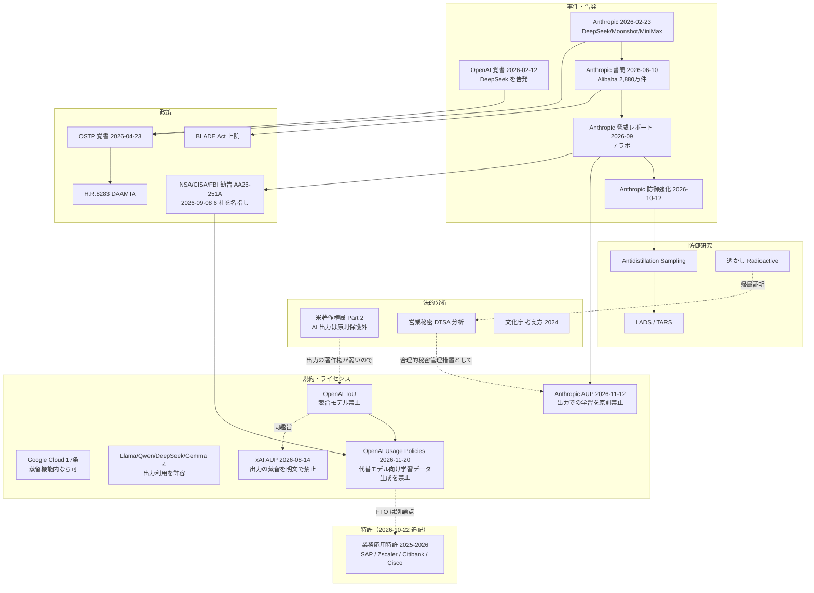
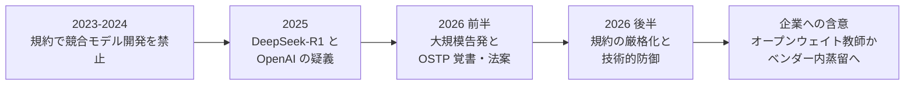

# C8 規約・知財・安全保障・特許（legal_ip_patents） — リソース収集結果

> **注意**: 本資料はリサーチ成果物であり、法的助言ではありません。規約・ライセンスは頻繁に改定されるため、実際の利用判断の前に必ず最新の原文と専門家の確認を行ってください。

## 収集パラメータ

- **対象リソース**: 学術論文 / 特許 / 技術情報（規約・ライセンス原文、一次ブログ、法律分析、政策文書） / ビジネス事例（報道・クラウド蒸留サービスの提供状況）
- **対象期間**: 2022 – 2026（背景として 2020 年初出の論文 1 件を含む）
- **収集日**: 2026-10-21
- **入力元**: clustering 結果（`research/runs/llm_distillation/clustering/20261021/cluster-08-legal-ip-patents.md`）
- **検索言語**: 英語 + 日本語
- **実行モード**: `--auto` 相当（非対話）

## 収集サマリ

| 領域 | 論文 | 特許 | 技術情報 | 事例 | 合計 |
|------|------|------|----------|------|------|
| C8 規約・知財・安全保障・特許 | 19 | 19 | 46 | 11 | 95 |
| **合計** | **19** | **19** | **46** | **11** | **95** |

（2026-10-22 訂正）旧値は 特許 11 / 技術情報 32 / 合計 73。特許は USPTO 公報 PDF で第 1 頁を確認した 8 件を追加（公報未確認の「検索結果レベル」約 30 件は本表に数えず、[特許（検索結果レベル）](#特許検索結果レベル2026-10-22-追記) に別掲）。技術情報は規約原文（OpenAI 3 件・xAI 3 件）、Gemma 4 公式発表、H.R.8283 条文、日本法一次資料 4 件、NSA/CISA/FBI 勧告、EPO 審決の 14 件を追加。

```
技術情報 |██████████████████████████████████████████████ 46
学術論文 |███████████████████ 19
特許     |███████████████████ 19
事例     |███████████ 11
```

### 下限（20 件/種別）に届かなかった種別とその理由

| 種別 | 件数 | 下限 20 との差 | 理由 |
|------|------|---------------|------|
| 学術論文 | 19 | -1 | 法律・規約そのものを扱う査読論文は少なく、防御（透かし・antidistillation）と抽出攻撃の論文が中心 |
| 特許 | 11 → 19（2026-10-22 訂正） | -1 | 旧: WebSearch 予算枯渇で追加検索不可。**追補**: USPTO 公報 PDF で 8 件を確認（うち 2023 年以降優先の業務応用 4 件）。JPO は Google Patents 検索 API で 11 件（東芝・Google・LivePerson・之江実験室 等）を検索結果レベルで確認したが、**J-PlatPat は 403 で自動取得を拒否**し公報本文は未確認。CN 8 件・EP/WO 6 件も検索結果レベル |
| ビジネス事例 | 11 | -9 | 同上。加えて「規約に沿って合法に蒸留した」と明言する企業事例はほぼ公開されていない |

$$
\text{検証通過率} = \frac{\text{検証済み}}{\text{収集}} = \frac{95}{112} \approx 85\%
$$

（2026-10-22 訂正）旧値は $73/90 \approx 81\%$。追補で収集 22 件（検証済み 22 件）を加え、旧「アクセス不可」のうち OpenAI 規約・xAI 規約・congress.gov（H.R.8283）の 4 件をブラウザ経由・API 経由で検証済みに繰り入れた。

## URL検証結果

| 項目 | 件数 |
|------|------|
| 収集 | 112（旧 90） |
| 検証済み | 95（旧 73） |
| 不一致で除外 | 5（旧 1。2026-10-22 追記: 被引用リストから蒸留特許でないと判明した 4 件を加算） |
| アクセス不可で除外 | 12（旧 16。2026-10-22 訂正: OpenAI 規約 2 件・xAI 規約 1 件・congress.gov 1 件を検証済みへ） |

除外・注記の内訳:

| 区分（2026-10-22 追記・訂正） | 対象 | 状況 |
|------|------|------|
| **訂正（取得成功）** | openai.com Terms of Use / Services Agreement / Usage Policies | agent-browser（headed）で原文取得。ToU・Services Agreement は 2026-01-01 発効、Usage Policies は 2026-11-20 施行 |
| **訂正（取得成功）** | x.ai Consumer ToS / AUP / Enterprise ToS | 同上。Cloudflare の確認を headed ブラウザで通過。AUP 2026-08-14 発効、Consumer ToS 2026-10-12 更新 |
| **訂正（取得成功）** | congress.gov H.R.8283 | api.congress.gov（DEMO_KEY）と条文 HTML（BILLS-119hr8283ih.htm）で取得 |
| **訂正（番号確定）** | US12475175 | USPTO 公報 PDF で **US12475175B1（SAP SE、2025-11-18 登録）** と確定し特許表に追加 |
| 不一致で除外（追加） | US12530540B2（Optum）/ US12346314B1（SAP）/ US12547848B2（Google）/ US12530749B2（高麗大） | Adobe・Huawei 特許の被引用として表示されたが、公報第 1 頁を確認した結果、蒸留特許でない（または言語モデルでない） |
| アクセス不可（継続） | Google Patents（14:50 JST 以降 503）、J-PlatPat（403）、Lens（CAPTCHA）、PATENTSCOPE（403）、Espacenet、FreePatentsOnline、Justia、CBO（62480）、経産省 AI 事業者ガイドライン 1.2 版 PDF、web.archive.org | 特許は USPTO 公報 PDF で代替。1.2 版は 1.1 版本編で代替 |

（旧表）

| 区分 | 対象 | 状況 |
|------|------|------|
| アクセス不可（403） | openai.com の Terms of Use（row / EU 2025-04-29）、OpenAI Services Agreement | 一次ページは取得不可。代わりに **2024-12-11 版のアーカイブ（Wind River ライセンス一覧）** を検証済みとして採用 |
| アクセス不可（403） | x.ai の Terms of Service（Consumer / previous-2025-01-02）、Acceptable Use Policy、Enterprise ToS | **xAI の条項は検索スニペットでのみ確認**。表には載せず、下の「未検証メモ」に分離 |
| アクセス不可（403） | law.asia（OpenAI-DeepSeek 分析）、malaymail（Alibaba 書簡報道）、congress.gov（H.R.8283）、hagerty.senate.gov、law-ai.org | 代替ソース（IAPS、letsdatascience 等）で補完 |
| アクセス不可（404） | patents.google.com US12475175B2、Vertex AI distillation doc、anthropic.com/news/bedrock-model-distillation、dev.meta.ai Llama 3.1 license、Anthropic AUP 版履歴 | US12475175 は番号を確定できず除外 |
| 不一致で除外 | US20250328770A1（Microsoft） | 蒸留特許の類似文献として表示されたが、内容はコード生成用 few-shot 例選択で蒸留ではない |
| **clustering 記載の訂正** | US12307750B2 / US12333254B2 | clustering では「Google」とされていたが、検証の結果 **US12307750B2 は Microsoft、US12333254B2 は Genesys Cloud Services** |

### 未検証メモ（表に含めない）

- **xAI**: 検索スニペットでは、Consumer ToS（2025-01-02 版以降）に「Using the Service or any Output, to develop models or services that compete with xAI」、AUP（2026-06-26 版）に競合モデル開発と「distilling model data or Outputs」の禁止があると表示された。原文取得は 403 で失敗したため **未検証**。
  - （2026-10-22 訂正）**検証済み**。現行 AUP（Effective: August 14, 2026）に "Using the Service or any Output to develop (or assist anyone in developing) machine learning models or any products or services that compete with SpaceXSI, whether directly or indirectly" と "Scraping, harvesting or reselling any Input or Output, or distilling model data or Outputs" を確認。Consumer ToS（Last Updated: October 12, 2026）自体には競合条項がなく AUP を参照、Enterprise ToS（2026-08-14）は AUP を参照により組み込む。原文の事業者名は "SpaceXAI LLC（SpaceXSI）"。技術情報 #36–#38 に収録。
- **Mistral の画像出力条項**: ConductAtlas 経由でも確認されたが、一次の Commercial Terms（技術情報 #20）で検証済み。

## 年次分布

```
全種別（2026-10-22 訂正後）
2026 |███████████████████████████████████████████████ 47
2025 |███████████████████ 19
2024 |█████████████████ 17
2023 |██████████ 10
2022 |██ 2
```

| 年 | 論文 | 特許 | 技術情報 | 事例 | 計 |
|----|------|------|----------|------|----|
| 2026 | 3 | 6 | 28 | 10 | 47 |
| 2025 | 3 | 7 | 9 | 0 | 19 |
| 2024 | 6 | 2 | 8 | 1 | 17 |
| 2023 | 6 | 3 | 1 | 0 | 10 |
| 2022 | 1 | 1 | 0 | 0 | 2 |

（2026-10-22 訂正）旧表: 2026 = 34（特許 2・技術情報 19）、2025 = 13（特許 4・技術情報 6）、2024 = 14（特許 1・技術情報 6）。特許は登録年、法令は現行条文の確認年（2025 年施行版）で集計。

- 規約・政策・事件は **2026 年に急増**（Anthropic の 3 回の公表、OSTP 覚書、下院 H.R.8283、各社規約改定）。
- 特許は **2019–2022 年優先日の BERT 系蒸留特許が 2023–2026 年に登録** されている段階で、生成 LLM を教師とする業務応用特許（Adobe, 2023 優先）はまだ少数。

## リソース関係図



## 全体の傾向



- **規約の主戦場は「契約」**: 法律分析・公的文書 5 件（技術情報 #23〜#26, #29）がそろって、AI 出力の著作権保護は弱く（米著作権局は「prompts alone」では著作者にならないと結論）、**契約（利用規約）違反が最も現実的な手段** と整理している。
- **クローズドモデルの規約は 2026 年に一段と厳格化**: Anthropic の AUP（2026-11-12 施行）は「競合」に限らず **出力で AI モデルを学習すること自体を事前承認なしに禁止**。Google Cloud は 17 条で「類似モデルの作成・改良」を禁止しつつ、**蒸留・ファインチューニング機能を通じた Google モデルの改変は明示的に許可**。
- **同一ベンダー内の蒸留サービスは縮小傾向**: Bedrock では **Anthropic モデルの蒸留が停止**（再開時期未定）、OpenAI はセルフサーブ fine-tuning を縮小（新規受付停止、既存顧客も 2027-01-06 まで）、Azure の stored completions は 2026-10-15 に退役。
- **オープンウェイトは寛容化**: Llama 3.1 以降は出力での他モデル改良を許容（条件: 「Llama」名の付与・Built with Llama 表示）、Qwen は「Built with Qwen」表示、DeepSeek-R1 は MIT で「distillation for training other LLMs」を明記、**Gemma 4 は Apache 2.0 へ移行**。
- **安全保障化**: 2026 年は告発 → OSTP 覚書（4/23）→ H.R.8283（下院外交委 43-0）→ 上院 BLADE Act 案、と **輸出規制・制裁の文脈** に移った。
- **特許**: 検証できた 11 件はいずれも **蒸留の「手法」特許**（多タスク蒸留、メモリ内並列蒸留、層削除による生徒選択、NAS など）で、出願人は Microsoft / Google / IBM / Salesforce / Genesys / Huawei / Adobe / Zhejiang Lab。生成 LLM → 小型 LM の **業務応用特許は Adobe（US12626056B2）** が代表例。
  - （2026-10-22 訂正）USPTO 公報で追加確認した 8 件のうち、**2023 年以降優先の業務応用特許が 4 件**（SAP 文書理解 US12475175B1、Zscaler DLP US12711255B2、Citibank 銀行階層蒸留 US12664433B1、Cisco ネットワーク運用 US12705265B2）あり、Adobe を含めると 2023–2025 年優先の 6 件中 5 件が業務応用。蒸留の権利化は「手法」から「蒸留モデルを組み込む業務パイプライン」に移った。JPO は検索結果レベルで東芝 JP2024099474A（2023 優先）等 11 件を確認したが、J-PlatPat の自動取得拒否により公報本文は未確認。
- （2026-10-22 追記）**OpenAI も出力の学習利用を絞った**: 2026-10-21 改定・2026-11-20 施行の Usage Policies は「OpenAI モデルの代替・置換を意図したモデル」向けの学習データ生成・ラベル付け・選別・RL 環境構築を禁止し、保護された推論の抽出禁止とモデルアクセス仲介業者の事前承認制を導入。一方 Services Agreement（2026-01-01）は **非配布の分類器・埋め込み（Permitted Exception）を明示的に許容** しており、社内分類器用途は文言上は可。
- （2026-10-22 追記）**xAI は AUP で蒸留を名指しで禁止**（"distilling model data or Outputs"、2026-08-14 発効）。クローズド 5 社のうち、出力の蒸留を文言で名指しするのは Anthropic と xAI の 2 社。
- （2026-10-22 追記）**安全保障化は政府勧告に至った**: NSA / CISA / FBI 共同勧告 AA26-251A（2026-09-08）が DeepSeek・Moonshot AI・Alibaba・MiniMax・StepFun・Z.AI を名指しし、「蒸留は正当な技術」と断ったうえで、不正アカウント・プロキシ・規約違反による「産業規模」の蒸留を問題とし、AI 提供者に検知・応答劣化・情報共有を推奨した。

総括すると、2026 年 10 月時点で「商用クローズド API を教師にした蒸留」は、規約上ほぼ **ベンダー提供の蒸留機能の内側に限定** され、その機能自体も縮小しつつある。一方でオープンウェイト（Llama / Qwen / DeepSeek / Gemma 4 / NVIDIA）は出力利用を許容する方向で、**企業が合法に蒸留する主経路はオープンウェイト教師（または自社モデル）** に移っている（仮説 H5 を支持）。法的には著作権より契約と営業秘密が争点で、日本法では著作権法 30 条の 4 が学習段階の利用を広く許容するものの、契約による制限（オーバーライド）の有効性は個別判断とされる。

---

## 学術論文

| # | 領域 | タイトル | 著者 | 年 | Venue | 概要 |
|---|------|---------|------|-----|-------|------|
| 1 | 抽出攻撃 | [Stealing Reasoning Traces from Proprietary LLM APIs](https://arxiv.org/abs/2608.09867) | Panfilov et al. | 2026 | arXiv | 暗号化された推論ブロックがセッション・ユーザ・同一ベンダーのモデル間で互換であることを突き、弱いモデルに他モデルの推論を復号させる攻撃。315,320 ブロックから PII 367 件・認証情報 182 件を発見。Anthropic の 2026-10 投稿が引用 |
| 2 | 防御 | [Lossless Anti-Distillation Sampling](https://arxiv.org/abs/2605.18829) | Diao et al. | 2026 | arXiv | アカウント間で乱数を結合し、各ユーザの出力分布は不変のまま、多アカウントで収集した蒸留データに依存性を生じさせて生徒を弱める（LADS） |
| 3 | 防御 | [Hiding in Plain Sight: Detectability-Aware Antidistillation of Reasoning Models](https://arxiv.org/abs/2604.23238) | Hartman et al. | 2026 | arXiv | 推論トレース中の「thought anchor」を検出されにくい形で除去（TARS）し、教師精度を落とさず蒸留を阻害 |
| 4 | 防御 | [Antidistillation Sampling](https://arxiv.org/abs/2504.13146) | Savani et al.（CMU, Kolter） | 2025 | arXiv | 代理生徒の損失勾配を使って教師のサンプリング分布を歪め、推論トレースの蒸留価値を下げる。教師精度 -1pt で生徒 65%→56% |
| 5 | 防御の限界 | [Can LLM Watermarks Robustly Prevent Unauthorized Knowledge Distillation?](https://arxiv.org/abs/2502.11598) | Pan et al. | 2025 | ACL 2025 | 透かしの「放射能性」は標的型言い換えや推論時中和で除去できると示す |
| 6 | 背景 | [DeepSeek-R1: Incentivizing Reasoning Capability in LLMs via Reinforcement Learning](https://arxiv.org/abs/2501.12948) | DeepSeek-AI | 2025 | arXiv | R1 と蒸留モデル群。MIT ライセンスで「distillation for training other LLMs」を許容（HF モデルカード） |
| 7 | 帰属証明 | [Watermarking Makes Language Models Radioactive](https://arxiv.org/abs/2402.14904) | Sander et al. | 2024 | NeurIPS 2024 Spotlight | 透かし付き出力で学習したモデルを統計的に検出。透かしテキストが 5% でも高信頼で検出（オープンウェイトの場合） |
| 8 | サーベイ | [A Survey on Knowledge Distillation of Large Language Models](https://arxiv.org/abs/2402.13116) | Xu et al. | 2024 | arXiv | LLM 蒸留サーベイ。著者らは「LLM の利用を規律する法的条件の遵守」を明示的に提唱 |
| 9 | 抽出攻撃 | [Stealing Part of a Production Language Model](https://arxiv.org/abs/2403.06634) | Carlini et al. | 2024 | arXiv | API 経由で埋め込み射影層を復元。Ada/Babbage で 20 ドル未満 |
| 10 | 抽出攻撃 | [Logits of API-Protected LLMs Leak Proprietary Information](https://arxiv.org/abs/2403.09539) | Finlayson et al. | 2024 | arXiv | softmax bottleneck を利用し API モデルの隠れ次元（gpt-3.5-turbo 約 4096）等を推定 |
| 11 | 帰属証明 | [Instructional Fingerprinting of Large Language Models](https://arxiv.org/abs/2401.12255) | Xu et al. | 2024 | arXiv | 秘密鍵を軽量バックドアとして埋め込み、所有権証明とライセンス遵守確認に使う |
| 12 | ライセンス | [The Model Openness Framework](https://arxiv.org/abs/2403.13784) | White et al. | 2024 | arXiv | 「オープン」を名乗るモデルの多くが制限的ライセンスであると指摘し 3 段階の評価枠組みを提案 |
| 13 | 黒箱蒸留の限界 | [The False Promise of Imitating Proprietary LLMs](https://arxiv.org/abs/2305.15717) | Gudibande et al. | 2023 | arXiv | ChatGPT 出力での模倣はスタイルを真似るが事実能力は伸びにくい |
| 14 | 手法 | [Distilling Step-by-Step!](https://arxiv.org/abs/2305.02301) | Hsieh et al.（Google） | 2023 | ACL 2023 Findings | LLM の根拠（rationale）を追加教師にした小型タスク特化モデル学習 |
| 15 | 帰属証明 | [Are You Copying My Model? Protecting the Copyright of LLMs for EaaS via Backdoor Watermark](https://arxiv.org/abs/2305.10036) | Peng et al. | 2023 | arXiv | 埋め込み API の模倣を検出する EmbMarker |
| 16 | 帰属証明 | [Protecting Language Generation Models via Invisible Watermarking](https://arxiv.org/abs/2302.03162) | Zhao et al. | 2023 | arXiv | 出力確率に隠れ信号を埋め、蒸留で複製されたモデルを検出（GINSEW） |
| 17 | 帰属証明 | [A Watermark for Large Language Models](https://arxiv.org/abs/2301.10226) | Kirchenbauer et al. | 2023 | arXiv | green list 方式の LLM 透かし。後続の radioactivity 研究の基盤 |
| 18 | ライセンス | [The Data Provenance Initiative](https://arxiv.org/abs/2310.16787) | Longpre et al. | 2023 | arXiv | 1,800 超のテキストデータセットのライセンス監査。ホスティングサイトのライセンス表示の誤りが多い |
| 19 | ライセンス | [Behavioral Use Licensing for Responsible AI](https://arxiv.org/abs/2011.03116) | Contractor et al. | 2022（v2） | arXiv | 利用目的制限付きライセンス（RAIL 系）の理論的基盤。Gemma・DeepSeek License の利用制限条項の源流 |

---

## 特許

| # | 領域 | タイトル | 番号 | 出願人 | 年 | 特許庁 | 概要 |
|---|------|---------|------|--------|-----|--------|------|
| 1 | 業務応用 | [Generating natural language model insights for data charts using light language models distilled from large language models](https://patents.google.com/patent/US12626056B2/en) | US12626056B2 | Adobe Inc. | 2026（登録）/ 2023 優先 | USPTO | LLM が生成したチャート要約を軽量 LM に蒸留し、データチャートの自然言語インサイトを生成。CPC G06N3/096 |
| 2 | 手法 | [Systems and methods relating to knowledge distillation in natural language processing models](https://patents.google.com/patent/US12524622B2/en) | US12524622B2 | Genesys Cloud Services | 2026（登録）/ 2021 優先 | USPTO | 小データで学習したコピーと教師の層重みを比較し、変化の小さい層を削除して生徒を作る |
| 3 | 手法 | [Neural architecture search of language models using knowledge distillation](https://patents.google.com/patent/US12346665B2/en) | US12346665B2 | IBM | 2025（登録）/ 2022 優先 | USPTO | 蒸留で誘導した NAS で言語モデルを選択。CPC G06N3/096 |
| 4 | 手法 | [Systems and methods relating to knowledge distillation in natural language processing models](https://patents.google.com/patent/US12333254B2/en) | US12333254B2 | Genesys Cloud Services | 2025（登録）/ 2021 優先 | USPTO | 教師の層をランダム削除した候補生徒を評価し最良を選択（コンタクトセンター用途） |
| 5 | 手法 | [Scalable knowledge distillation techniques for machine learning](https://patents.google.com/patent/US12307750B2/en) | US12307750B2 | Microsoft Technology Licensing | 2025（登録）/ 2022 優先 | USPTO（WO/EP 系属あり） | 教師・生徒を同時にメモリ保持しバッチ単位で並列蒸留、logits の永続化を不要に。CPC G06N3/096 |
| 6 | 手法 | [Extreme language model compression with optimal sub-words and shared projections](https://patents.google.com/patent/US12260340B2/en) | US12260340B2 | Google LLC | 2025（登録）/ 2020 優先 | USPTO | 語彙縮小と共有射影による BERT 蒸留（7MB 未満）。US11797862B2 の継続 |
| 7 | 手法 | [Methods, devices and media providing an integrated teacher-student system](https://patents.google.com/patent/US11900260B2/en) | US11900260B2 | Huawei Technologies | 2024（登録）/ 2020 優先 | USPTO（CN/WO 系属あり） | 教師の一部を共有する生徒サブネットワーク群を一体学習 |
| 8 | 手法 | [Extreme language model compression with optimal sub-words and shared projections](https://patents.google.com/patent/US11797862B2/en) | US11797862B2 | Google LLC | 2023（登録）/ 2020 優先 | USPTO | #6 の親出願 |
| 9 | 手法 | [Cross data set knowledge distillation for training machine learning models](https://patents.google.com/patent/US11727270B2/en) | US11727270B2 | Microsoft Technology Licensing | 2023（登録）/ 2020 優先 | USPTO | 第 1 モデルでラベル付けした第 2 データセットで推薦モデルを学習。CPC G06N3/096 |
| 10 | 手法 | [Multi-task knowledge distillation for language model](https://patents.google.com/patent/US11620515B2/en) | US11620515B2 | Salesforce | 2023（登録）/ 2019 優先 | USPTO | 共有層＋タスク層を持つ教師・生徒の多タスク蒸留（被引用 7） |
| 11 | 手法 | [Compression method and platform of pre-training language model based on knowledge distillation](https://patents.google.com/patent/US11341326B2/en) | US11341326B2 | Zhejiang Lab | 2022（登録）/ 2020 優先 | USPTO | BERT 教師の特徴写像蒸留＋自己注意の交差蒸留＋圧縮プラットフォーム |
| 12 | **業務応用**（2026-10-22 追記） | [Robust documentation understanding using large language model knowledge distillation and joint training](https://image-ppubs.uspto.gov/dirsearch-public/print/downloadPdf/12475175) | US12475175B1 | SAP SE | 2025（登録 11-18）/ 2024-12-16 出願 | USPTO | LLM の知識蒸留で学習データを作り、マルチタスク学習と RAG 学習で文書理解モデルを学習。CPC G06F16/93, G06N3/0475, G06N3/096。clustering の「番号未確定」を確定 |
| 13 | **業務応用**（2026-10-22 追記） | [Data loss protection (DLP) utilizing distilled large language models (LLMs)](https://image-ppubs.uspto.gov/dirsearch-public/print/downloadPdf/12711255) | US12711255B2 | Zscaler, Inc. | 2026（登録 08-18）/ 2024-01-10 IN 優先 | USPTO | 教師 LLM の強みに基づく合成データで生徒 LLM を蒸留し DLP の分類に使用。CPC G06F21/62 |
| 14 | **業務応用**（2026-10-22 追記） | [Hierarchical multi-level model distillation](https://image-ppubs.uspto.gov/dirsearch-public/print/downloadPdf/12664433) | US12664433B1 | Citibank, N.A. | 2026（登録 06-23）/ 2025-10-29 出願 | USPTO | LLM からカテゴリ・複雑度別の特化モデル（7B→1B→350M→20M）を階層的に蒸留・枝刈り・量子化し配置。CPC G06N3/082, G06N3/0475 |
| 15 | **業務応用**（2026-10-22 追記） | [Computer network monitoring and control using a fine-tuned language model](https://image-ppubs.uspto.gov/dirsearch-public/print/downloadPdf/12705265) | US12705265B2 | Cisco Technology | 2026（登録 08-11）/ 2023-09-11 出願 | USPTO | 第 1 言語モデルの誤応答を教師言語モデルの解決策で更新。CPC G06F16/3329, G06F40/253 |
| 16 | 手法＋応用（2026-10-22 追記） | [Distilling transformers for neural cross-domain search](https://image-ppubs.uspto.gov/dirsearch-public/print/downloadPdf/12614066) | US12614066B2 | Microsoft Technology Licensing | 2026（登録 04-28）/ 2021-07-22 出願 | USPTO | 教師 seq2seq Transformer が生成した拡張データで bi-encoder を学習（コード検索）。CPC G06N3/08 ほか |
| 17 | 手法（2026-10-22 追記） | [Information processing device, learning method, and recording medium](https://image-ppubs.uspto.gov/dirsearch-public/print/downloadPdf/12283092) | US12283092B2 | NEC Corporation | 2025（登録 04-22）/ 2019-11-13 PCT | USPTO（WO2021/095160） | 教師が未学習の未知データに任意ラベルを付けて生成データを作り生徒を蒸留。**日本企業の米国登録** |
| 18 | 手法＋応用（2026-10-22 追記） | [Systems and methods for distilled BERT-based training model for text classification](https://image-ppubs.uspto.gov/dirsearch-public/print/downloadPdf/11922303) | US11922303B2 | Salesforce, Inc. | 2024（登録 03-05）/ 2019-11-18 仮出願 | USPTO | BERT 教師と同じ入力・教師出力で小型生徒を学習（インテント分類・OOD） |
| 19 | 手法（2026-10-22 追記） | [Methods, devices and media for improving knowledge distillation using intermediate representations](https://image-ppubs.uspto.gov/dirsearch-public/print/downloadPdf/12505351) | US12505351B2 | Huawei Technologies | 2025（登録 12-23）/ 2021-04-16 出願 | USPTO（WO2022217853A1） | Dropout-KD: 教師中間層をエポックごとにランダム選択して蒸留 |

### 特許（検索結果レベル、2026-10-22 追記）

番号・名称・出願人・日付のみを Google Patents 検索結果・被引用リスト・WebSearch から転記したもので、**公報本文は未確認**（Google Patents は 14:50 JST 以降遮断、J-PlatPat は 403）。詳細は [retrieval 12](../../../retrieval/20261021/legal_ip_patents/12-patent-landscape.md) の表 3–5。

| 庁 | 番号 | 出願人 | 優先 / 公開 | 名称・要旨 |
|----|------|-------|-----------|-----------|
| JPO | JP2024099474A | 株式会社東芝 | 2023-01-12 / 2024-07-25 | 言語モデル学習装置（US20240242039A1 と同一ファミリーと推定） |
| JPO | JP7735419B2 | Google LLC | 2021-03-26 / 2025-09-08 | 自己適応型蒸留 |
| JPO | JP7735420B2 | LivePerson | 2021-04-02 / 2025-09-08 | 知識蒸留による NLP エンコーダのドメイン適応 |
| JPO | JP7283835B2 / JP7381813B2 / JP7381814B2 | 之江実験室 | 2020 / 2023 | 事前学習言語モデルの知識蒸留圧縮（3 件） |
| JPO | JP7190146B2 | ソウル大学校産学協力団 | 2020-08-25 / 2022-12-15 | テキスト事前学習モデルによる音声言語理解の蒸留 |
| JPO | JP7633758B2 | IBM | 2020-04-03 / 2025-02-20 | 系列データ処理モデルの学習（蒸留との関係未確認） |
| JPO | JP2023026202A | 日本電信電話 | 2021-08-13 / 2023-02-24 | 同時機械翻訳（蒸留との関係未確認） |
| JPO | JP2023033202A | Hyperconnect | 2021-08-25 / 2023-03-09 | 対話モデル学習（未確認） |
| JPO | JP2025023822A | 三菱電機 | 2023-08-04 / 2025-02-17 | 学習ベース合成支援（未確認） |
| JPO | JP7799133B1 ほか約 20 件 | ビズリーチ / アシュアード | 2024–2026 | 情報処理システム（採用支援。ヒット理由未確認） |
| CNIPA | CN117573908A | 卓世智星（天津）科技 | 2024 | 対照学習に基づく大規模言語モデル蒸留方法 |
| CNIPA | CN116611424A | 北京澜舟科技 | 2023-07-18 / 2023-08-18 | 文章作成支援モデル構築 |
| CNIPA | CN117787922B | 東亜銀行（中国） | 2024-02-27 / 2024-05-31 | 蒸留学習に基づく返金業務処理（銀行の業務応用） |
| CNIPA | CN119167982B | 深圳前海微衆銀行 | 不明 | 遠隔の大モデルから小モデルを知識蒸留 |
| CNIPA | CN122021734A | 三六零数字安全科技集団 | 公開 2026-05-12 | 大モデル蒸留関連（名称未取得） |
| CNIPA | CN118349673A | 華為技術 | 2019-09-12 / 2024-07-16 | テキスト処理モデルの学習方法 |
| CNIPA | CN114818902A / CN112699678A | 不明 | 2021–2022 | 知識蒸留によるテキスト分類 / ALBERT 蒸留 |
| EPO | EP4505353A1 | 未確認 | 2025 頃 | Calibrated distillation |
| EPO / WIPO | EP4537261A1 / WO2023239481A1 | Microsoft | 2023–2025 | US12307750B2 のファミリー |
| WIPO / CNIPA | WO2021175064A1 / CN115210720A | Huawei | 2021–2022 | US11900260B2 のファミリー |
| WIPO | WO2023122146A1 | Genesys | 2023-06-29 | US12333254B2 のファミリー |
| EPO（審決） | T 1425/21（EP19173347.6） | Google LLC | 2024-02-07 | 「Training distilled machine learning models」。進歩性なしとして審判棄却 |
| USPTO（公開） | US20240242039A1 / US20250005453A1 / US20240290332A1 / US20240419923 | 東芝 / Google / Qualcomm / 不明 | 2023–2025 | 言語モデル学習 / PCA 係数蒸留 / ストリーミング蒸留 / LLM 要約で第 2 モデル学習 |

Alibaba / Tencent / Baidu / ByteDance を出願人とする LLM 蒸留特許は、本調査の検索では特定できなかった（出願人フィルタが実行できなかったため、不存在の証明ではない）。

---

## 技術情報

（規約・ライセンス原文、一次の企業公表、法律分析、政策文書。「証拠」列は 一次資料 / ベンダー申告 / 二次報道 / 法律論評）

| # | 領域 | タイトル | ソース | 年 | 種別 | 概要 |
|---|------|---------|--------|-----|------|------|
| 1 | 規約 | [Usage Policy（AUP）](https://www.anthropic.com/legal/aup) | Anthropic | 2026 | 規約原文（一次） | 2026-11-12 施行版。「Use outputs to train an AI model (e.g., "model scraping" or "model distillation") without prior authorization from Anthropic」を禁止。消費者・API・クラウド経由すべてに適用 |
| 2 | 規約 | [Commercial Terms of Service](https://www.anthropic.com/legal/commercial-terms) | Anthropic | 2026 | 規約原文（一次） | D.4: 競合製品構築（競合 AI モデルの学習を含む）・リバースエンジニアリング・再販を禁止。出力は顧客所有 |
| 3 | 事件 | [Detecting and preventing distillation attacks](https://www.anthropic.com/news/detecting-and-preventing-distillation-attacks) | Anthropic | 2026 | 一次ブログ（ベンダー申告） | 2026-02-23。DeepSeek/Moonshot/MiniMax が約 24,000 不正アカウントで 1,600 万件超 |
| 4 | 事件 | [Detecting and countering misuse of AI: September 2026（§07 Illicit distillation）](https://www.anthropic.com/threat-intelligence-report-september-2026) | Anthropic | 2026 | 脅威レポート（ベンダー申告） | 2 月以降 7 つの中国系ラボを追加で阻止。Alibaba（GTG-16005）1.51 億件超など事例別の件数 |
| 5 | 防御 | [Strengthening our defenses against distillation attacks](https://www.anthropic.com/news/distillation-defenses) | Anthropic | 2026 | 一次ブログ（ベンダー申告） | 2026-10-12。蒸留データ取得量を約 90–99% 削減、分類器の偽陽性 0.1% 未満、preserved thinking |
| 6 | 規約 | [OpenAI Terms of Use（2024-12-11 版アーカイブ）](https://open.windriver.com/info/uni-license-list/licenses/openai-tou-20241211.html) | Wind River（OpenAI 規約の写し） | 2024 | 規約原文の写し | 「Use Output to develop models that compete with OpenAI」「Automatically or programmatically extract data or Output」を禁止。出力はユーザ所有 |
| 7 | サービス | [Supervised fine-tuning — Distilling from a larger model](https://developers.openai.com/api/docs/guides/supervised-fine-tuning) | OpenAI | 2026 | 公式ドキュメント（一次） | 大モデル（gpt-4.1）出力で小モデル（gpt-4.1-mini）を学習する手順。fine-tuning 基盤は縮小中と明記 |
| 8 | サービス | [Deprecations — Update to OpenAI's self-serve fine-tuning](https://developers.openai.com/api/docs/deprecations) | OpenAI | 2026 | 公式ドキュメント（一次） | 2026-05-07 通知。新規組織は不可、2027-01-06 に既存顧客も新規ジョブ作成不可 |
| 9 | 規約 | [Gemini API Additional Terms of Service](https://ai.google.dev/gemini-api/terms) | Google | 2026 | 規約原文（一次） | 「You may not use the Services to develop models that compete with the Services」。2026-04-28 更新 |
| 10 | 規約 | [Google Cloud Service Specific Terms（§17 AI/ML Services）](https://cloud.google.com/terms/service-terms) | Google Cloud | 2026 | 規約原文（一次） | 17(b): 出力で Google モデルの代替・類似モデル作成を禁止。ただし蒸留/FT 機能経由の Modified Google Model は可 |
| 11 | ライセンス | [Gemma Terms of Use](https://ai.google.dev/gemma/terms) | Google | 2026 | ライセンス原文（一次） | Model Derivatives に「distillation methods」「synthetic data Outputs」で学習したモデルを含め、利用制限の継承を要求（Gemma 1〜3n） |
| 12 | ライセンス | [Google releases Gemma 4 under Apache 2.0, dropping its custom AI license](https://www.implicator.ai/google-releases-gemma-4-under-apache-2-0-dropping-its-custom-ai-license/) | Implicator | 2026 | 二次報道 | 2026-04-02、Gemma 4 は Apache 2.0。独自 ToU と Prohibited Use Policy の継承義務がなくなった |
| 13 | ライセンス | [Llama 3.1 Community License（HF）](https://huggingface.co/meta-llama/Llama-3.1-8B-Instruct/blob/main/LICENSE) | Meta | 2024 | ライセンス原文（一次） | 出力で AI モデルを作成・改良し配布する場合、モデル名の先頭に「Llama」。7 億 MAU 超は別許諾 |
| 14 | ライセンス | [Llama 4 Community License（HF）](https://huggingface.co/meta-llama/Llama-4-Scout-17B-16E-Instruct/blob/main/LICENSE) | Meta | 2025 | ライセンス原文（一次） | 2025-04-05 発効。1.b.i の命名・表示義務と 7 億 MAU 条項を継承 |
| 15 | ライセンス | [Llama 3 versus Llama 3.1 License](https://writing.kemitchell.com/2024/07/24/Llama-3-versus-Llama-3-1-License) | Kyle E. Mitchell（弁護士） | 2024 | 法律論評 | Llama 3 の「improve any other large language model」禁止条項が 3.1 で削除されたことを redline で確認 |
| 16 | ライセンス | [Qwen LICENSE AGREEMENT（Qwen2.5-72B）](https://huggingface.co/Qwen/Qwen2.5-72B-Instruct/blob/main/LICENSE) | Alibaba Cloud | 2024 | ライセンス原文（一次） | 出力で AI モデルを作成・改良する場合「Built with Qwen」等の表示。1 億 MAU 超は別許諾 |
| 17 | ライセンス | [Qwen3-235B-A22B（Apache 2.0）](https://huggingface.co/Qwen/Qwen3-235B-A22B) | Alibaba Cloud | 2025 | モデルカード（一次） | Qwen3 は Apache 2.0 |
| 18 | ライセンス | [DeepSeek-R1（MIT）](https://huggingface.co/deepseek-ai/DeepSeek-R1) | DeepSeek | 2025 | モデルカード（一次） | 「including, but not limited to, distillation for training other LLMs」を明示許諾。R1-Distill は基盤（Qwen=Apache / Llama=Llama License）を継承 |
| 19 | ライセンス | [DEEPSEEK LICENSE AGREEMENT v1.0](https://github.com/deepseek-ai/DeepSeek-V3/blob/main/LICENSE-MODEL) | DeepSeek | 2023 | ライセンス原文（一次） | V3 等。蒸留・合成データで学習したモデルも Derivatives とし、Attachment A の利用制限を継承 |
| 20 | 規約 | [Mistral AI Commercial Terms of Service](https://legal.mistral.ai/terms/commercial-terms-of-service) | Mistral AI | 2026 | 規約原文（一次） | 2026-09-25 発効。競合禁止は **画像出力のみ**（3.3）。2.2(g)「use any method to extract any content」禁止。出力は顧客所有 |
| 21 | 規約 | [Mistral AI Usage Policy](https://legal.mistral.ai/terms/usage-policy) | Mistral AI | 2026 | 規約原文（一次） | 2026-06-11 発効。蒸留・出力学習への言及なし |
| 22 | ライセンス | [NVIDIA Open Model License](https://www.nvidia.com/en-us/agreements/enterprise-software/nvidia-open-model-license/) | NVIDIA | 2025 | ライセンス原文（一次） | 「An output is not a Derivative Model」。出力の所有権を主張せず、商用利用可 |
| 23 | 法律分析 | [Is AI Distillation By DeepSeek IP Theft?](https://www.winstontaylor.com/insights/is-ai-distillation-by-deepseek-ip-theft) | Winston & Strawn（Law360 転載） | 2025 | 法律論評 | 著作権・特許・営業秘密は弱く、契約法が最も有利と結論 |
| 24 | 法律分析 | [Understanding AI Distillation In The Trade Secret Context](https://webiis08.mondaq.com/unitedstates/trade-secrets/1788790/understanding-ai-distillation-in-the-trade-secret-context) | Sarah Tishler（Beck Reed Riden）/ Mondaq | 2026 | 法律論評 | DTSA の要件（合理的秘密管理・不正手段・リバースエンジニアリング例外）で蒸留を検討。Compulife 判決を引用 |
| 25 | 法律分析 | [Michael Ng featured in IAM Magazine on AI Distillation and Trade Secret Law](https://kobrekim.com/insights/publications/michael-ng-featured-iam-magazine-ai-distillation-trade-secret-law) | Kobre & Kim | 2026 | 法律論評 | 「technical feasibility alone does not make distillation lawful」。規約で蒸留を明示禁止して合理的措置を補強せよ |
| 26 | 法律分析 | [Is AI distillation a chink in the armour of American innovation?](https://www.saul.com/sites/default/files/documents/2026-04/ArtiIs%20AI%20distillation%20a%20chink%20in%20the%20armour%20of%20American%20innovation%C2%A0%20-%20IAM%20Trade%20Secrets.pdf) | IAM（Maia Biermann）/ Saul Ewing 掲載 | 2026 | 業界誌記事 | 2026-04-22 上院司法委公聴会と OSTP 覚書。Kohel（Saul Ewing）は営業秘密法の「structural gap」を指摘 |
| 27 | 政策 | [AI Distillation Attacks: Executive and Congressional Action Can Go Further](https://www.iaps.ai/research/ai-distillation-attacks-executive-and-congressional-action-can-go-further) | IAPS（Theo Bearman） | 2026 | 政策メモ | OSTP NSTM（2026-04-23）と H.R.8283（43-0 で委員会可決）の内容と追加提言 |
| 28 | 政策 | [TNW 2026-04-23 記事: White House と AI model distillation](https://thenextweb.com/news/us-white-house-ai-model-distillation-china-theft) | The Next Web | 2026 | 二次報道 | OSTP（Kratsios）覚書の報道。情報共有・防御支援・責任追及策の検討 |
| 29 | 法律 | [Copyright and Artificial Intelligence, Part 2: Copyrightability](https://www.copyright.gov/ai/Copyright-and-Artificial-Intelligence-Part-2-Copyrightability-Report.pdf) | U.S. Copyright Office | 2025 | 公的報告書（一次） | 純粋な AI 生成物は保護外、「prompts do not alone provide sufficient control」 |
| 30 | 日本法 | [AIと著作権に関する考え方について](https://www.bunka.go.jp/seisaku/bunkashingikai/chosakuken/pdf/94037901_01.pdf) | 文化審議会著作権分科会法制度小委員会 | 2024 | 公的文書（一次） | 30 条の 4 の非享受目的・享受目的の併存、AI 生成物の著作物性（創作的寄与） |
| 31 | 日本法 | [生成AIの開発時に注意すべき法的リスクとは？](https://www.businesslawyers.jp/articles/1315) | 松下外 弁護士（西村あさひ）/ BUSINESS LAWYERS | 2024 | 法律論評 | 30 条の 4、オーバーライド問題（規約で権利制限を契約上制限できるか）、不競法（営業秘密・限定提供データ） |
| 32 | 安全保障 | [CAISI's Assessment of Z.ai's GLM-5.3 Cyber Capabilities](https://www.nist.gov/news-events/news/2026/09/caisis-assessment-zais-glm-53-cyber-capabilities) | NIST CAISI | 2026 | 政府評価（一次） | GLM-5.3 を「most cyber-capable open-weight model」と評価。Anthropic は同モデルの開発で Claude の蒸留を主張 |
| 33 | 規約（2026-10-22 追記） | [OpenAI Terms of Use](https://openai.com/policies/terms-of-use/) | OpenAI | 2026 | 規約原文（一次、ブラウザ取得） | Effective: January 1, 2026。"Use Output to develop models that compete with OpenAI." / "Automatically or programmatically extract data or Output (defined below)." / 出力はユーザ所有。#6 の写しを原文で置換 |
| 34 | 規約（2026-10-22 追記） | [OpenAI Services Agreement（旧 Business Terms）](https://openai.com/policies/services-agreement/) | OpenAI | 2026 | 規約原文（一次、ブラウザ取得） | Updated 2025-12-01 / Effective 2026-01-01。3.3(e) "except for a Permitted Exception, use Output to develop artificial intelligence models that compete with OpenAI's products and services"。**Permitted Exception** = 非配布の分類器・埋め込み、OpenAI の FT サービス。"Reverse Engineer" に "model extraction or stealing attacks" を含む |
| 35 | 規約（2026-10-22 追記） | [OpenAI Usage Policies](https://openai.com/policies/usage-policies/) | OpenAI | 2026 | 規約原文（一次、ブラウザ取得） | Effective: November 20, 2026（2026-10-21 改定告知）。"You must not use OpenAI models or their outputs to generate, prepare, select, or supply training material or signals for models that are intended as alternatives to or substitutes for OpenAI models or services." 推論抽出の禁止、モデルアクセス仲介業者の事前承認 |
| 36 | 規約（2026-10-22 追記） | [xAI Terms of Service - Consumer](https://x.ai/legal/terms-of-service) | xAI（原文表記 SpaceXAI LLC / SpaceXSI） | 2026 | 規約原文（一次、ブラウザ取得） | Last Updated: October 12, 2026。出力はユーザ所有。競合・蒸留条項は本文になく AUP を参照 |
| 37 | 規約（2026-10-22 追記） | [xAI Acceptable Use Policy](https://x.ai/legal/acceptable-use-policy) | xAI（同上） | 2026 | 規約原文（一次、ブラウザ取得） | Effective: August 14, 2026。"Using the Service or any Output to develop (or assist anyone in developing) machine learning models or any products or services that compete with SpaceXSI, whether directly or indirectly" / "Scraping, harvesting or reselling any Input or Output, or distilling model data or Outputs" |
| 38 | 規約（2026-10-22 追記） | [xAI Terms of Service - Enterprise](https://x.ai/legal/terms-of-service-enterprise) | xAI（同上） | 2026 | 規約原文（一次、ブラウザ取得） | Last Updated: August 14, 2026。AUP を参照により組み込み。顧客は出力の権利を永続的に保有 |
| 39 | ライセンス（2026-10-22 追記） | [Gemma 4: Byte for byte, the most capable open models](https://blog.google/innovation-and-ai/technology/developers-tools/gemma-4/) | Google | 2026 | 公式ブログ（一次） | 2026-04-02。"Gemma 4 is released under a commercially permissive Apache 2.0 license." E2B / E4B / 26B MoE / 31B。#12 の二次報道を一次で裏付け |
| 40 | 政策（2026-10-22 追記） | [H.R.8283 Deterring American AI Model Theft Act of 2026（条文）](https://www.congress.gov/119/bills/hr8283/BILLS-119hr8283ih.htm) | 米下院（Huizenga 提出） | 2026 | 法案条文（一次） | 2026-04-15 提出、04-22 外交委 43-0 で報告決定。"model extraction attack" を定義し、ToS 準拠の学習は除外。Entity List 追加検討と IEEPA 制裁 |
| 41 | 政策（2026-10-22 追記） | [AA26-251A: China-Based AI Companies Conducting Industrial-Scale Distillation Campaigns Against U.S. AI Companies](https://www.cisa.gov/news-events/cybersecurity-advisories/aa26-251a) | NSA / CISA / FBI | 2026 | 政府勧告（一次） | 2026-09-08。DeepSeek・Moonshot AI・Alibaba・MiniMax・StepFun・Z.AI を名指し。"distillation is recognized as a legitimate and useful technique"。提供者向けに検知・応答劣化・情報共有を推奨 |
| 42 | 日本法（2026-10-22 追記） | [著作権法 第 30 条の 4（e-Gov 法令 API）](https://laws.e-gov.go.jp/law/345AC0000000048) | e-Gov | 2025（現行） | 条文（一次） | 「著作物に表現された思想又は感情の享受を目的としない利用」。本文・但書・第 2 号（情報解析）を逐語取得 |
| 43 | 日本法（2026-10-22 追記） | [不正競争防止法 第 2 条（e-Gov 法令 API）](https://laws.e-gov.go.jp/law/405AC0000000047) | e-Gov | 2025（現行） | 条文（一次） | 第 6 項「営業秘密」、第 7 項「限定提供データ」、第 1 項第 4 号・第 11 号（不正取得）を逐語取得 |
| 44 | 日本法（2026-10-22 追記） | [AIと著作権に関するチェックリスト＆ガイダンス](https://www.bunka.go.jp/seisaku/chosakuken/pdf/94097701_01.pdf) | 文化庁著作権課 | 2024 | 公的文書（一次） | 2024-07-31。1-1-3「技術的措置を尊重」、2-1-5 相当「AI サービスの利用規約等を確認し、これに従って利用することが必要」 |
| 45 | 日本法（2026-10-22 追記） | [AI 事業者ガイドライン（第 1.1 版）本編](https://www.soumu.go.jp/main_content/001002576.pdf) | 総務省・経済産業省 | 2025 | 公的文書（一次） | 2025-03-28。脚注 13「法令で定められていなくともステークホルダー間の契約関係において、利用が禁止される場合が存在することにも留意すべき」。第 1.2 版（2026-03-31）は PDF が 403 で未取得 |
| 46 | 特許制度（2026-10-22 追記） | [EPO 審決 T 1425/21（Training distilled machine learning models / Google）](https://www.epo.org/en/boards-of-appeal/decisions/t211425eu1) | EPO 審判部 3.5.06 | 2024 | 審決（一次、書誌のみ） | 2024-02-07。進歩性なし（効果がクレーム全範囲で信用できない）として審判棄却 |

---

## ビジネス事例

| # | 領域 | タイトル | 企業/組織 | 年 | 種別 | 概要 |
|---|------|---------|-----------|-----|------|------|
| 1 | 事件 | [OpenAI says China's DeepSeek trained its AI by distilling US models, memo shows](https://finance.yahoo.com/news/openai-accuses-deepseek-distilling-us-221629899.html) | Reuters（Yahoo Finance 転載） | 2026 | 報道（二次） | 2026-02-12 の下院中国特別委への覚書。「obfuscated third-party routers」 |
| 2 | 事件 | [Rest of World 2026-02-13 記事: OpenAI–DeepSeek distillation dispute](https://restofworld.org/2026/openai-deepseek-distillation-dispute-us-china/) | Rest of World | 2026 | 報道（二次） | 覚書の内容と、業界は「recursive learning」で発展してきたという反論 |
| 3 | 事件 | [GIGAZINE 2026-02-13 記事: OpenAI による DeepSeek 非難](https://gigazine.net/news/20260213-openai-accuses-china-deepseek) | GIGAZINE | 2026 | 報道（二次・日本語） | 覚書の日本語報道。中国のほかロシアと結びつく活動にも言及 |
| 4 | 事件 | [GIGAZINE 2026-02-24 記事: Anthropic による DeepSeek・Moonshot・MiniMax 非難](https://gigazine.net/news/20260224-anthropic-deepseek-moonshot-minimax) | GIGAZINE | 2026 | 報道（二次・日本語） | Anthropic 2 月公表の日本語報道 |
| 5 | 事件 | [Elon Musk testifies that xAI trained Grok on OpenAI models](https://techcrunch.com/2026/04/30/elon-musk-testifies-that-xai-trained-grok-on-openai-models) | TechCrunch | 2026 | 報道（二次） | Musk v. OpenAI 公判で xAI の OpenAI モデル蒸留を「Partly」と証言。米国ラボ同士でも蒸留が行われていた |
| 6 | 事件 | [Anthropic Accuses Alibaba of a 28.8 Million-Exchange Claude Distillation Campaign](https://letsdatascience.com/news/anthropic-accuses-alibaba-of-distilling-claude-d0593c90) | Let's Data Science（Reuters ベース） | 2026 | 報道（二次） | 2026-06-10 上院銀行委への書簡。2026-04-22〜06-05 に約 25,000 アカウント・2,880 万件超 |
| 7 | 合法蒸留 | [Amazon Bedrock Model Distillation](https://aws.amazon.com/bedrock/model-distillation/) | AWS | 2026（閲覧時点） | 製品ページ（ベンダー申告） | 最大 500% 高速・75% 安価・RAG で精度低下 2% 未満（ベンダー値） |
| 8 | 合法蒸留 | [Customize a model with distillation in Amazon Bedrock](https://docs.aws.amazon.com/bedrock/latest/userguide/model-distillation.html) | AWS | 2026 | 公式ドキュメント（一次） | 蒸留モデルは顧客のみアクセス可、データを他モデル学習に使わない |
| 9 | 合法蒸留 | [Prerequisites for model distillation](https://docs.aws.amazon.com/bedrock/latest/userguide/prequisites-model-distillation.html) | AWS | 2026 | 公式ドキュメント（一次） | **「Distillation is not currently available for Anthropic models on Amazon Bedrock」**。対応は Nova と Llama のみ |
| 10 | 合法蒸留 | [Claude 3.5 Haiku on AWS Trainium2 and model distillation in Amazon Bedrock](https://claude.com/blog/trainium2-and-distillation) | Anthropic | 2024 | 一次ブログ（ベンダー申告） | 2024-12-03。Claude 3.5 Sonnet → Claude 3 Haiku の同一ベンダー内蒸留（プレビュー） |
| 11 | 合法蒸留 | [Azure OpenAI stored completions & distillation (classic)](https://learn.microsoft.com/en-us/azure/ai-foundry/openai/how-to/stored-completions) | Microsoft | 2026 | 公式ドキュメント（一次） | 蒸留用データは外部エクスポート不可。stored completions は 2026-10-15 退役 |

---

## 次のステップ

- **詳細調査**: research-retrieval で、規約原文・告発一次資料・法律分析・特許の詳細レポートを作成（`retrieval/20261021/legal_ip_patents/`）
- **特許の追補**: 検索予算回復後に J-PlatPat（FI G06N3/096、「蒸留」「生徒モデル」）と Google Patents（CPC G06N3/096 AND "large language model"）で LLM 世代の出願を追加
  - （2026-10-22 追記）USPTO 公報 8 件を追加し、JP / CN / EP は検索結果レベルで追加した。**残る空白**: J-PlatPat の手動検索（自動取得は 403）、東芝 JP2024099474A・NTT JP2023026202A の公報本文、日本企業の出願人絞り込み、Alibaba / Tencent / Baidu / ByteDance の CN 出願、EP4505353A1 の出願人、公報の請求項全文
- **xAI 規約の一次確認**: 403 で取得できなかった Enterprise ToS / AUP の原文確認
  - （2026-10-22 訂正）完了（技術情報 #36–#38）
- （2026-10-22 追記）**残る未取得**: OpenAI の下院覚書原文、BLADE Act 条文、Vertex AI の Gemini 蒸留ドキュメント、AI 事業者ガイドライン第 1.2 版本文、蒸留と利用規約を正面から扱う日本の弁護士解説（5 回の検索で発見できず）、EPO T 1425/21 の理由本文
