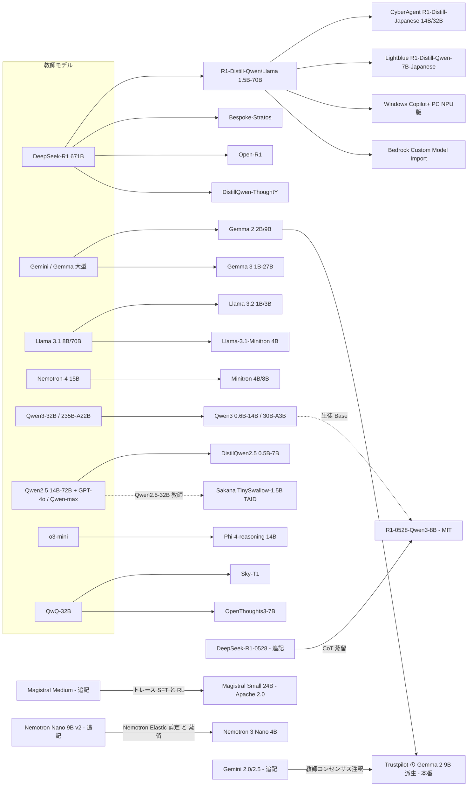
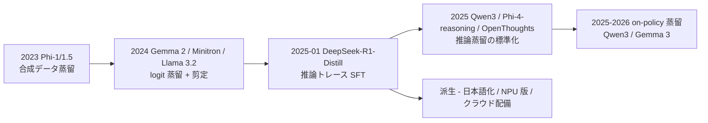

# C3 公開蒸留モデルとエコシステム（`open_distilled_models`）— リソース収集結果

## 収集パラメータ

- **対象リソース**: 学術論文 / 特許 / 技術情報（Webサイト・技術ブログ・モデルカード・ライセンス文書）/ ビジネス事例
- **対象期間**: 2022 – 2026
- **収集日**: 2026-10-21
- **入力元**: clustering 結果（[cluster-03-open-distilled-models.md](../../../clustering/20261021/cluster-03-open-distilled-models.md)、[index.md](../../../clustering/20261021/index.md)）
- **検索言語**: 英語 + 日本語
- **重点観点**: (1) 各公開モデルの作り方（教師・方式・トークン数/コスト）、(2) ライセンスと蒸留条項、(3) 事業会社による本番採用の証拠

> **収集上の制約（重要）**: 本 run の途中でセッション全体の WebSearch 予算（200 回、全エージェント共有）が枯渇しました。以降は **既知の一次資料 URL を WebFetch で直接取得・検証** する方式に切り替えています。このため **特許検索は実施できず 0 件**、ビジネス事例は 16 件で 20 件の下限に届いていません（下記「カバレッジギャップ」）。特許は C8（`legal_ip_patents`）での補完を推奨します。
>
> **（2026-10-22 追記）レビュー・追加収集**: WebSearch 12 回 + WebFetch で再検証と補完を実施。論文 +2（Magistral、Gemma 4 Technical Report）、特許 +1（Huawei WO2025123815A1。CN111767711A / WO2025221495A1 は Google Patents の HTTP 503 で本文未確認のため表に含めず）、技術情報 +14（Gemma 4 一次資料、R1-0528-Qwen3-8B、Llama 4、Nemotron 3 Nano 4B、HF 配布統計）、事例 +6（Trustpilot、Google スタートアップ事例、Gemma 4 builders、Azure Phi-3 顧客、Aitomatic、Cerebras）。合計 62 → 85 件。事例は 22 件で下限 20 を満たしたが、**R1-Distill / Qwen 小型の名前付き本番成果は依然 0 件**。主要数値の訂正は retrieval 側の各レポート（「2026-10-22 訂正」）を参照。

## 収集サマリ

| 領域 | 論文 | 特許 | 技術情報 | 事例 | 合計 |
|------|------|------|----------|------|------|
| C3 公開蒸留モデルとエコシステム（初版 2026-10-21） | 20 | 0 | 26 | 16 | 62 |
| C3 追加分（2026-10-22 追記） | 2 | 1 | 14 | 6 | 23 |
| **合計** | **22** | **1** | **40** | **22** | **85** |

```
論文     |██████████████████████ 22
特許     |█ 1   ← Google Patents 503 のため本文確認 1 件のみ（C8 で補完）
技術情報 |████████████████████████████████████████ 40
事例     |██████████████████████ 22  ← 下限 20 を充足（ただし名前付き本番成果は依然薄い）
```

## URL検証結果

| 項目 | 件数 |
|------|------|
| 収集（候補） | 70（初版）+ 27（2026-10-22 追記） |
| 検証済み（WebFetch で題名・内容を確認） | 62（初版）+ 23（追記）= 85 |
| 不一致で除外 | 1（DeepSeek API docs の R1 リリースノート URL が別内容に差し替わっていた → deepseek.com 版で代替） |
| アクセス不可で除外 | 2（Couchbase Capella AI Services ブログ: HTTP 403 / CodeZine 記事: HTTP 403）+ 3（追記: Google Patents CN111767711A / WO2025221495A1 / US20150356461A1 が HTTP 503、PatentScope・FreePatentsOnline・Justia も 403） |
| 未取得のため除外 | 5（Gcore・Petronella・Elementera のベンダー記事、ITC ポータル記事、alphaxiv 等の要約サイト）+ 1（追記: US20210265018A1 は base caller 向けで言語モデル外のため対象外） |

以下の表は **検証済みエントリのみ** です。

## 年次分布

```
2026 |██████████████ 14   （初版 4 → 追記後 14）
2025 |████████████████████████████████████████████████████ 52   （42 → 52）
2024 |█████████████████ 17   （14 → 17）
2023 |██ 2
2022 |  0
```

種別別（2026-10-22 追記後。括弧は初版値）:

```
           論文     特許   技術      事例
2023        2 (2)    0      0 (0)     0 (0)
2024        5 (5)    0      8 (7)     4 (2)
2025       14 (13)   1     22 (15)   15 (14)
2026        1 (0)    0     10 (4)     3 (0)
```

- 2025 年に 42 件（68%）が集中。**DeepSeek-R1-Distill（2025-01）を起点に「推論蒸留モデル」が爆発的に増えた** ことが分布からも読み取れます。
- 2022 年は 0 件。公開 LLM の蒸留は Gemma 2 / Minitron / Llama 3.2（2024 年後半）で本格化しました。
- （2026-10-22 追記）2026 年分が 4 → 14 件に増加。内訳は **Gemma 4（Apache 2.0、2026-04）関連の一次資料 5 件、Nemotron 3 Nano 4B 2 件、Gemma を使った事業事例 3 件、Gemma 4 Technical Report**。2026 年の新規公開「蒸留モデル」として一次資料で確認できたのは Nemotron 3 Nano 4B のみで、Gemma 4 には蒸留の記述が無い。

## リソース関係図



## 全体の傾向



- **方式の二極化**: 公式小型モデルは **白箱（logit）蒸留** を事前学習段階で使う（Gemma 2/3、Llama 3.2、Minitron、Qwen3 on-policy）一方、R1-Distill・Sky-T1・Bespoke-Stratos・Phi-4-reasoning・OpenThoughts は **黒箱（教師出力の SFT）** です（20 論文中、白箱系 8 / 黒箱系 10 / 合成データ・データ中心 2）。
- **コストの桁が落ちた**: Minitron は from scratch 比 **最大 40 倍少ないトークン**、Sky-T1 は **$450 未満（8×H100 で 19 時間）**、Lightblue の日本語版は **8×L20 で 10 分未満**、Qwen3 の on-policy 蒸留は RL の **約 1/10 の GPU 時間（1,800 vs 17,920）**。
- **ライセンスは「蒸留可」へ収束**: DeepSeek-R1（MIT・蒸留明示許可）、Qwen3（Apache 2.0）、Phi（MIT）、Gemma 4（Apache 2.0 ページへ移行）。一方で **Gemma 3 以前の Gemma Terms は Gemma 出力による合成データ学習を「Model Derivatives」と定義** し、利用制限の継承を求めます。Llama 3.1+ は出力利用を解禁したが **モデル名先頭に "Llama" を付ける義務** があります。
- **ビジネス採用の証拠は薄い**: 名前付き顧客で **定量成果** まで出ているのは DistilQwen2.5 の SQL 補完（Alibaba 自社、A/B テスト）と Gemma 3 4B の SK Telecom（定性）程度。多くは **プラットフォームへの搭載発表**（Windows Copilot+ PC、Bedrock、Together、Azure）で、顧客別の成果は非公開です。
- **国内は派生モデル型**: サイバーエージェント・Lightblue・ABEJA・Sakana AI がいずれも公開蒸留モデルを土台に日本語追加学習・再蒸留を行い Hugging Face で公開（H4 と整合）。ただし ABEJA の推論モデルは **蒸留ではなく ChatVector マージ** であり、混同に注意が必要です。
- **（2026-10-22 追記）Gemma 4 の Apache 2.0 化は一次資料で確認、蒸留の記述は無し**: Google 公式ブログ（2026-04-02）「released under a commercially permissive Apache 2.0 license」、Gemma 4 Technical Report（arXiv 2607.02770）「We release the Gemma 4 models under an Apache 2.0 license」、HF モデルカードの license タグ。Gemma Terms（2026-04-01 改定）の Appendix は Gemma 1〜3n のみを列挙。初版の「リンク先が Apache 2.0 ページ」という間接根拠から格上げ。一方、Gemma 4 の資料に「distillation」は出てこない。
- **（2026-10-22 追記）2025 後半〜2026 の新規公開蒸留モデル**: R1-0528-Qwen3-8B（R1-0528 の CoT を Qwen3-8B Base に蒸留、MIT、AIME24 86.0）、Magistral Small 24B（Magistral Medium のトレースで SFT 4 epoch + RL、Apache 2.0、AIME24 70.7）、Nemotron 3 Nano 4B（Nano 9B v2 を 63B + 150B トークンで剪定・蒸留、2026-03）、Llama 4 Maverick（Behemoth から codistillation、大型）。Qwen3.5 小型・DeepSeek-V3.2 蒸留版・小型 Llama 4 は一次資料を確認できず未収録。
- **（2026-10-22 追記）事業採用の証拠は 16 → 22 件、質は依然ベンダー掲載中心**: 唯一「顧客側で教師出力を使って蒸留し本番投入」した名前付き事例は **Trustpilot**（Gemini 2.0/2.5 教師 → Gemma 2 9B、1 日数百万件、精度「教師コンセンサスより数ポイント低い」、定性）。定量値があるのは Cue（Gemma 4 E4B、レイテンシ 876→488 ms）と HubX（Gemma 4 E2B 4bit、サーバ費 $0）の 2 件のみで、いずれも追加学習なしの配備。Phi-3 の Khan Academy / Epic は 2024-05 時点で「試用・計画」。

総じて、C3 の公開蒸留モデルは「**誰でも生徒モデルの出発点にできる土台**」として急速に普及しました（例: Qwen3-0.6B は月間 2,822 万 DL、Llama-3.2-1B-Instruct は派生 finetune 1,840 件）。しかし、**事業会社が「どの蒸留モデルを本番に入れ、何がどれだけ改善したか」を公開した一次資料は極めて少なく**、多くはクラウド/PC ベンダーの配備告知に留まります。ライセンスは蒸留を許容する方向へ収束していますが、**派生の派生（Gemma データで学習した TinySwallow、GPT-4o を教師にした DistilQwen2.5 など）で条項が積み重なる** 点が実務上の論点です。

### カバレッジギャップ

| 種別 | 件数 | 下限 20 との差 | 原因 | 補完先 |
|------|------|--------------|------|--------|
| 学術論文 | 20 | 0 | — | — |
| 特許 | 0 | -20 | WebSearch 予算枯渇により Google Patents / J-PlatPat を検索できず | C8 `legal_ip_patents` |
| 技術情報 | 26 | +6 | — | — |
| ビジネス事例 | 16 | -4 | 同上。加えて **名前付き顧客の定量事例自体が希少** | C5 / C6 / C7 |

（2026-10-22 追記）追加収集後:

| 種別 | 件数（追記後） | 下限 20 との差 | 残る空白 | 補完先 |
|------|------|--------------|------|--------|
| 学術論文 | 22 | +2 | — | — |
| 特許 | 1（+ 題名のみ 2） | -19 | Google Patents が HTTP 503（WIPO / FPO / Justia も 403）で、提供元（NVIDIA / Google / Alibaba / Meta）名義の剪定・蒸留特許は未確認 | C8 `legal_ip_patents` |
| 技術情報 | 40 | +20 | Qwen3.5 小型・DeepSeek-V3.2 蒸留版・小型 Llama 4・Gemma 3n の蒸留有無 | C3 次回 run |
| ビジネス事例 | 22 | +2 | 全件ベンダー掲載。**R1-Distill / Qwen 小型の名前付き本番成果 0 件**、国内追加 0 件、顧客自身の発表なし | C5 / C6 / C7 |

---

## 学術論文

| # | 領域 | タイトル | 著者 | 年 | Venue | 概要 |
|---|------|---------|------|-----|-------|------|
| 1 | C3 | [Phi-4-reasoning Technical Report](https://arxiv.org/abs/2504.21318) | Abdin et al. (Microsoft, 23名) | 2025 | arXiv | Phi-4(14B) を o3-mini 生成の 140 万超・8.3B トークンの推論デモで SFT。R1-Distill-Llama-70B を上回る（一次資料） |
| 2 | C3 | [Phi-4-Mini-Reasoning: Exploring the Limits of Small Reasoning Language Models in Math](https://arxiv.org/abs/2504.21233) | Xu et al. (Microsoft) | 2025 | arXiv | 3.8B に蒸留 long-CoT の mid-training→SFT→Rollout DPO→RLVR。Math-500 で R1-Distill-Qwen-7B を +3.2pt |
| 3 | C3 | [DeepSeek-R1: Incentivizing Reasoning Capability in LLMs via Reinforcement Learning](https://arxiv.org/abs/2501.12948) | DeepSeek-AI (200名) | 2025 | Nature 645 | R1 の約 80 万サンプルで Qwen2.5 / Llama3 の 6 モデルを 2 epoch SFT 蒸留。蒸留 > 小型モデルへの直接 RL を示す |
| 4 | C3 | [Gemma 3 Technical Report](https://arxiv.org/abs/2503.19786) | Gemma Team (Google DeepMind) | 2025 | arXiv | 全サイズ（1B-27B）を KD で事前学習（教師分布から 256 logit をサンプル）。事後学習も大型 IT 教師からの KD + RL |
| 5 | C3 | [Qwen3 Technical Report](https://arxiv.org/abs/2505.09388) | Qwen Team | 2025 | arXiv | 0.6B-14B と 30B-A3B を Qwen3-32B/235B-A22B から off-policy→on-policy の Strong-to-Weak 蒸留。RL の約 1/10 の GPU 時間 |
| 6 | C3 | [DistilQwen2.5: Industrial Practices of Training Distilled Open Lightweight Language Models](https://arxiv.org/abs/2504.15027) | Wang et al. (Alibaba Cloud) | 2025 | ACL 2025 Industry | 多エージェント黒箱 KD + top-10 logit 白箱 KD。SQL 補完の本番 A/B で 3B が 7B 教師に迫る |
| 7 | C3 | [NVIDIA Nemotron Nano 2: An Accurate and Efficient Hybrid Mamba-Transformer Reasoning Model](https://arxiv.org/abs/2508.14444) | NVIDIA | 2025 | arXiv | 12B（20T トークン）を Minitron 方式で 9B に圧縮・蒸留。Qwen3-8B 比 最大 6 倍スループット |
| 8 | C3 | [Llama-Nemotron: Efficient Reasoning Models](https://arxiv.org/abs/2505.00949) | Bercovich et al. (NVIDIA, 136名) | 2025 | arXiv | Llama 3 から NAS → KD → 継続事前学習 → 推論 SFT/RL で Nano/Super/Ultra を構築。NVIDIA Open Model License |
| 9 | C3 | [OpenThoughts: Data Recipes for Reasoning Models](https://arxiv.org/abs/2506.04178) | Guha et al. | 2025 | ICLR 2026 | 1,000 超のアブレーションで推論蒸留データを設計。QwQ-32B 教師・120 万例で OpenThoughts3-7B（AIME25 53%） |
| 10 | C3 | [s1: Simple test-time scaling](https://arxiv.org/abs/2501.19393) | Muennighoff et al. | 2025 | EMNLP 2025 | 1,000 例の s1K で Qwen2.5-32B を SFT + budget forcing。o1-preview を MATH/AIME24 で最大 27% 上回る |
| 11 | C3 | [LIMO: Less is More for Reasoning](https://arxiv.org/abs/2502.03387) | Ye et al. (SJTU) | 2025 | COLM 2025 | 従来の約 1% のデータで AIME24 63.3% / MATH500 95.6%。少量推論蒸留の根拠 |
| 12 | C3 | [SmolLM2: When Smol Goes Big -- Data-Centric Training of a Small Language Model](https://arxiv.org/abs/2502.02737) | Ben Allal et al. (Hugging Face) | 2025 | arXiv | 1.7B を 11T トークンで過学習。蒸留ではなくデータ中心（比較対照として収録） |
| 13 | C3 | [TAID: Temporally Adaptive Interpolated Distillation for Efficient Knowledge Transfer in Language Models](https://arxiv.org/abs/2501.16937) | Shing et al. (Sakana AI) | 2025 | ICLR 2025 Spotlight | 中間分布を時間的に補間する蒸留。TinySwallow-1.5B の基盤手法 |
| 14 | C3 | [Phi-4 Technical Report](https://arxiv.org/abs/2412.08905) | Abdin et al. (Microsoft) | 2024 | arXiv | 14B。合成データ中心の事前学習で、教師 GPT-4 を STEM QA で上回る（単純な蒸留を超える） |
| 15 | C3 | [LLM Pruning and Distillation in Practice: The Minitron Approach](https://arxiv.org/abs/2408.11796) | Sreenivas et al. (NVIDIA) | 2024 | arXiv | Llama 3.1 8B→4B（94B トークン）、Mistral NeMo 12B→8B（380B トークン）。教師補正（約 100B トークン） |
| 16 | C3 | [Gemma 2: Improving Open Language Models at a Practical Size](https://arxiv.org/abs/2408.00118) | Gemma Team (Google DeepMind) | 2024 | arXiv | 2B/9B を次トークン予測でなく KD で学習（計算最適の 50 倍超トークン）。2B で 60.3→67.7 |
| 17 | C3 | [Compact Language Models via Pruning and Knowledge Distillation](https://arxiv.org/abs/2407.14679) | Muralidharan et al. (NVIDIA) | 2024 | NeurIPS 2024 | Nemotron-4 15B を剪定 + KD で 8B/4B に。最大 40 倍少ないトークン、ファミリーで 1.8 倍計算削減 |
| 18 | C3 | [Phi-3 Technical Report: A Highly Capable Language Model Locally on Your Phone](https://arxiv.org/abs/2404.14219) | Abdin et al. (Microsoft) | 2024 | arXiv | 3.8B・3.3T トークン（フィルタ Web + 合成データ）で MMLU 69% |
| 19 | C3 | [Textbooks Are All You Need II: phi-1.5 technical report](https://arxiv.org/abs/2309.05463) | Li et al. (Microsoft) | 2023 | arXiv | 1.3B を教科書風合成データで学習し常識推論を強化 |
| 20 | C3 | [Textbooks Are All You Need](https://arxiv.org/abs/2306.11644) | Gunasekar et al. (Microsoft) | 2023 | arXiv | phi-1 1.3B。GPT-3.5 生成の合成教科書 1B トークン + Web 6B、8×A100 で 4 日、HumanEval 50.6% |
| 21 | C3（追記） | [Gemma 4 Technical Report](https://arxiv.org/abs/2607.02770) | Gemma Team (Google DeepMind, 322名) | 2026 | arXiv | E2B〜31B。「We release the Gemma 4 models under an Apache 2.0 license」。**蒸留の記述なし**。AIME 2026 no-tools 31B 89.2（2026-10-22 追記） |
| 22 | C3（追記） | [Magistral](https://arxiv.org/abs/2506.10910) | Mistral-AI (Rastogi et al., 99名) | 2025 | arXiv | Magistral Small 24B（Apache 2.0）は Magistral Medium（RL のみ）の正解トレースで SFT 4 epoch → RL。AIME'24 SFT 65.4 / RL 65.8 / SFT+RL 70.7（2026-10-22 追記） |

---

## 特許

検索予算枯渇のため **未収集（0 件）**。公開蒸留モデル固有の特許は、モデル提供企業（NVIDIA の剪定 + 蒸留、Google の蒸留事前学習、Alibaba の top-K logit 蒸留など）の出願として存在する可能性が高く、**C8 `legal_ip_patents` での Google Patents / J-PlatPat 検索で補完** してください。推奨クエリ:

- `site:patents.google.com "knowledge distillation" "pruning" "language model" NVIDIA`
- `site:patents.google.com "distillation" "teacher logits" "top-k" language model Alibaba`
- J-PlatPat: `知識蒸留 AND 言語モデル AND 枝刈り`

（2026-10-22 追記）WebSearch 2 回（patents.google.com 限定）+ WebFetch で最小限の補完を実施。本文を確認できたのは 1 件。

| # | 領域 | タイトル | 番号 | 出願人 | 年 | 特許庁 | 概要 |
|---|------|---------|------|--------|-----|--------|------|
| 1 | C3（追記） | [Methods and systems for transferring knowledge from large language models to small language models using out-of-distribution feedbacks](https://patents.google.com/patent/WO2025123815A1/en) | WO2025123815A1（優先 US 18/536,435） | Huawei Cloud Computing Technologies | 2025（公開 06-19、優先 2023-12-12） | WIPO | LLM が生成した分布外検証サンプルで SLM の弱点を検出し、次反復の合成データ生成へフィードバックする黒箱蒸留ループ。Pending |

題名・番号のみ確認（本文は Google Patents の HTTP 503 で未取得のため表に含めず）: CN111767711A「基于知识蒸馏的预训练语言模型的压缩方法及平台」（Granted、先行技術日 2020-09-02、出願人未確認）、WO2025221495A1「Distillation de processus d'échantillonnage de préférences multi-échantillons pour modèles de traitement de séquence」（先行技術日 2024-04-15、Best-of-N 蒸留、出願人未確認）。US20150356461A1（Google、KD 基本特許と推定）は未検証。公開蒸留モデル提供元名義の剪定 + 蒸留特許は検索で発見できず。詳細は retrieval [14](../../../retrieval/20261021/open_distilled_models/14-patents-open-model-distillation.md)。

---

## 技術情報

| # | 領域 | タイトル | ソース | 年 | 種別 | 概要 |
|---|------|---------|--------|-----|------|------|
| 1 | C3 | [Gemma Terms of Use（現行）](https://ai.google.dev/gemma/terms) | Google | 2026 | ライセンス | 2026-04-01 改定。「Model Derivatives」に **蒸留・Gemma 出力の合成データでの学習** を含む。Outputs 自体は派生物でない |
| 2 | C3 | [Gemma 4 license (Apache License 2.0)](https://ai.google.dev/gemma/apache_2) | Google | 2026 | ライセンス | Gemma 4 のライセンスリンク先が Apache 2.0 ページ（Gemma 4 から Gemma Terms を離れたと読める） |
| 3 | C3 | [Gemma models overview (Gemma 4)](https://ai.google.dev/gemma/docs/core) | Google | 2026 | 公式 doc | Gemma 4: E2B/E4B、31B dense、26B A4B MoE、12B unified |
| 4 | C3 | [The DeepSeek Model Lineup: V3.2, R1, and Distilled Variants Mapped to Production Workloads](https://fireworks.ai/blog/deepseek-models) | Fireworks AI | 2026 | ベンダーブログ | 蒸留版の用途整理。蒸留版の tool calling は「パース問題あり」と注記（ベンダー申告） |
| 5 | C3 | [DeepSeek-R1-Distill-Qwen-32B model card](https://huggingface.co/deepseek-ai/DeepSeek-R1-Distill-Qwen-32B) | DeepSeek / Hugging Face | 2025 | モデルカード | 6 蒸留モデルのベース・ライセンス・評価表。MIT、蒸留による派生を明示許可。月間 36 万 DL |
| 6 | C3 | [DeepSeek-R1-Distill-Qwen-1.5B model card](https://huggingface.co/deepseek-ai/DeepSeek-R1-Distill-Qwen-1.5B) | DeepSeek / Hugging Face | 2025 | モデルカード | 月間 132 万 DL、finetune 699・量子化 277 件の派生 |
| 7 | C3 | [DeepSeek-R1 Release（News）](https://deepseek.com/en/news/deepseek-r1/) | DeepSeek | 2025 | 公式発表 | MIT 化、API 出力の fine-tuning・蒸留利用を許可、6 蒸留モデル公開、32B/70B は o1-mini 同等と主張 |
| 8 | C3 | [Qwen3: Think Deeper, Act Faster](https://qwenlm.github.io/blog/qwen3/) | Qwen Team | 2025 | 公式ブログ | 2025-04-29 公開、36T トークン・119 言語、Qwen3-4B が Qwen2.5-72B-Instruct に匹敵と主張 |
| 9 | C3 | [Qwen3-0.6B model card](https://huggingface.co/Qwen/Qwen3-0.6B) | Qwen / Hugging Face | 2025 | モデルカード | 月間 2,823 万 DL、finetune 1,367 件、Apache 2.0 |
| 10 | C3 | [DistillQwen-ThoughtY-32B model card](https://huggingface.co/alibaba-pai/DistillQwen-ThoughtY-32B) | Alibaba PAI | 2025 | モデルカード | R1/R1-0528/QwQ を教師に OmniThought-0528（36.5 万 CoT）で蒸留。AIME24 90.0 |
| 11 | C3 | [Phi-4-reasoning Technical Report（MSR）](https://www.microsoft.com/en-us/research/blog/phi-4-reasoning/) | Microsoft Research | 2025 | 公式ページ | o3-mini 教師、140 万超の STEM/コード問題、Azure AI Foundry / HF で配布 |
| 12 | C3 | [Phi-4-mini-instruct model card](https://huggingface.co/microsoft/Phi-4-mini-instruct) | Microsoft / Hugging Face | 2025 | モデルカード | 約 5T トークン（教科書風合成データ含む）、MIT、月間 37 万 DL |
| 13 | C3 | [gemma-3-1b-it model card](https://huggingface.co/google/gemma-3-1b-it) | Google / Hugging Face | 2025 | モデルカード | 月間 140 万 DL、finetune 571・量子化 485 件、Gemma ライセンス |
| 14 | C3 | [NVIDIA Nemotron Nano 2](https://research.nvidia.com/labs/adlr/NVIDIA-Nemotron-Nano-2/) | NVIDIA ADLR | 2025 | 研究ページ | 12B を Minitron で 9B に。A10G で Qwen3-8B 比 最大 6 倍スループット |
| 15 | C3 | [Sky-T1: Train your own O1 preview model within $450](https://novasky-ai.github.io/posts/sky-t1/) | NovaSky (UC Berkeley) | 2025 | 技術ブログ | QwQ-32B-Preview 教師・17K 例・8×H100 で 19 時間・$450 未満 |
| 16 | C3 | [Bespoke-Stratos: The unreasonable effectiveness of reasoning distillation](https://www.bespokelabs.ai/blog/bespoke-stratos-the-unreasonable-effectiveness-of-reasoning-distillation) | Bespoke Labs | 2025 | 技術ブログ | R1 教師・17K 例。32B で AIME24 63.3、データ生成は R1 で約 1.5 時間 |
| 17 | C3 | [Open-R1: a fully open reproduction of DeepSeek-R1](https://huggingface.co/blog/open-r1) | Hugging Face | 2025 | 技術ブログ | R1-Distill の再現（R1 から推論データを蒸留）を Step 1 に掲げた OSS 計画 |
| 18 | C3 | [Distilling Llama3.1 8B into 1B in torchtune](https://pytorch.org/blog/llama-into-torchtune/) | PyTorch | 2025 | 技術ブログ | 単一 A100 で 8B→1B の KD レシピ。KD 比・学習率・教師の事前 LoRA の効果を表で提示 |
| 19 | C3 | [Introducing Mistral 3](https://mistral.ai/news/mistral-3) | Mistral AI | 2025 | 公式発表 | Ministral 3（3B/8B/14B）Apache 2.0。蒸留の有無はページに記載なし（比較対照） |
| 20 | C3 | [Llama 3.2: Revolutionizing edge AI and vision with open, customizable models](https://ai.meta.com/blog/llama-3-2-connect-2024-vision-edge-mobile-devices/) | Meta | 2024 | 公式ブログ | 1B/3B を Llama 3.1 8B から単発構造化剪定 → 8B/70B logit で KD |
| 21 | C3 | [Llama-3.2-1B model card](https://huggingface.co/meta-llama/Llama-3.2-1B) | Meta / Hugging Face | 2024 | モデルカード | 最大 9T トークン、1B は 370k H100 時間、logit 生成 86k 時間、量子化版の端末性能表 |
| 22 | C3 | [Llama-3.2-1B-Instruct model card](https://huggingface.co/meta-llama/Llama-3.2-1B-Instruct) | Meta / Hugging Face | 2024 | モデルカード | 月間 463 万 DL、finetune 1,840 件 |
| 23 | C3 | [How to Prune and Distill Llama-3.1 8B to an NVIDIA Llama-3.1-Minitron 4B Model](https://developer.nvidia.com/blog/how-to-prune-and-distill-llama-3-1-8b-to-an-nvidia-llama-3-1-minitron-4b-model/) | NVIDIA | 2024 | 技術ブログ | 教師補正→深さ/幅剪定→KD の手順。深さ剪定版 2.7 倍・幅剪定版 1.8 倍スループット |
| 24 | C3 | [Mistral-NeMo-Minitron 8B](https://blogs.nvidia.com/blog/mistral-nemo-minitron-8b-small-language-model/) | NVIDIA | 2024 | 公式ブログ | Mistral NeMo 12B を剪定 + 蒸留で 8B に。NIM / RTX ワークステーション向け |
| 25 | C3 | [Llama 3 versus Llama 3.1 License Terms](https://writing.kemitchell.com/2024/07/24/Llama-3-versus-Llama-3-1-License) | Kyle E. Mitchell | 2024 | ライセンス解説 | 3.1 で「他 LLM 改善への出力利用禁止」条項を削除、命名・700M MAU 条項は存続 |
| 26 | C3 | [Gemma Terms of Use（2024-04-01 版アーカイブ）](https://ai.google.dev/gemma/terms-archive/terms_04_01_24) | Google | 2024 | ライセンス | 蒸留・合成データ学習を Model Derivatives に含む定義が 2024 年から存在 |
| 27 | C3（追記） | [Gemma 4: Byte for byte, the most capable open models](https://blog.google/innovation-and-ai/technology/developers-tools/gemma-4/) | Google | 2026 | 公式発表 | 2026-04-02。「Gemma 4 is released under a commercially permissive Apache 2.0 license」。E2B / E4B / 26B MoE / 31B Dense。蒸留の記述なし |
| 28 | C3（追記） | [Gemma 4 model card](https://ai.google.dev/gemma/docs/core/model_card_4) | Google | 2026 | モデルカード | License: Apache 2.0。E2B 2.3B 実効（5.1B）、E4B 4.5B（8B）、12B 11.95B、26B A4B（25.2B / 3.8B active）、31B 30.7B。技術報告書 arXiv 2607.02770 へリンク。蒸留・教師の記述なし |
| 29 | C3（追記） | [google/gemma-4-31B-it model card](https://huggingface.co/google/gemma-4-31b-it) | Google / Hugging Face | 2026 | モデルカード | license タグ apache-2.0、256K 文脈、月間 DL 8,827,508（2026-10-22）。蒸留の記述なし |
| 30 | C3（追記） | [google/gemma-4-E4B-it model card](https://huggingface.co/google/gemma-4-E4B-it) | Google / Hugging Face | 2026 | モデルカード | license タグ apache-2.0、月間 DL 4,076,573（2026-10-22）。学習データカットオフ 2025-01 |
| 31 | C3（追記） | [Nemotron 3 Nano 4B: A Compact Hybrid Model for Efficient Local AI](https://huggingface.co/blog/nvidia/nemotron-3-nano-4b) | NVIDIA / Hugging Face | 2026 | 技術ブログ | 2026-03-17。Nemotron Nano 9B v2 を Nemotron Elastic で剪定・蒸留（8K 文脈 63B + 49K 文脈 150B トークン）。Jetson Orin Nano で 18 tok/s（9B 比 最大 2 倍） |
| 32 | C3（追記） | [nvidia/NVIDIA-Nemotron-3-Nano-4B-BF16 model card](https://huggingface.co/nvidia/NVIDIA-Nemotron-3-Nano-4B-BF16) | NVIDIA / Hugging Face | 2026 | モデルカード | NVIDIA Nemotron Open Model License、2026-03-16 公開。AIME25 78.5 / MATH500 95.4 / BFCL v3 61.1。月間 DL 2,250,433。「trained from scratch」と「compressed from Nano 9B v2」の両記述あり |
| 33 | C3（追記） | [deepseek-ai/DeepSeek-R1-0528-Qwen3-8B model card](https://huggingface.co/deepseek-ai/DeepSeek-R1-0528-Qwen3-8B) | DeepSeek / Hugging Face | 2025 | モデルカード | R1-0528 の CoT を Qwen3-8B Base に蒸留。MIT（商用・蒸留可）。AIME24 86.0 / AIME25 76.3（Qwen3-8B 76.0 / 67.3）。月間 DL 405,169（2026-10-22） |
| 34 | C3（追記） | [The Llama 4 herd: The beginning of a new era of natively multimodal AI innovation](https://ai.meta.com/blog/llama-4-multimodal-intelligence/) | Meta | 2025 | 公式ブログ | 2025-04-05。Maverick（400B 総 / 17B active）を Behemoth から **codistillation**（soft/hard 目標を動的重み付けする新損失、事前学習中に教師 forward）。小型変種なし |
| 35 | C3（追記） | [meta-llama/Llama-4-Maverick-17B-128E-Instruct model card](https://huggingface.co/meta-llama/Llama-4-Maverick-17B-128E-Instruct) | Meta / Hugging Face | 2025 | モデルカード | Llama 4 Community License（タグ llama4）。Scout 5.0M / Maverick 2.38M H100 時間。出力による他モデル改善（蒸留）を許容と記載。月間 DL 9,487 |
| 36 | C3（追記） | [microsoft/Phi-4-reasoning model card](https://huggingface.co/microsoft/Phi-4-reasoning) | Microsoft / Hugging Face | 2025 | モデルカード | 32×H100-80G、2.5 日、16B トークン（約 8.3B unique）、学習期間 2025-01〜04、MIT、月間 DL 26,476。o3-mini は比較表のみで教師としての記述なし（論文との粒度差） |
| 37 | C3（追記） | [Qwen/Qwen3-4B model card](https://huggingface.co/Qwen/Qwen3-4B) | Qwen / Hugging Face | 2025 | モデルカード | 月間 DL 11,600,540、finetunes 1,226 / adapters 1,206 / quantizations 360（2026-10-22）、Apache 2.0 |
| 38 | C3（追記） | [meta-llama/Llama-3.2-3B-Instruct model card](https://huggingface.co/meta-llama/Llama-3.2-3B-Instruct) | Meta / Hugging Face | 2024 | モデルカード | 月間 DL 1,110,545、finetunes 2,030 / adapters 871 / quantizations 542（2026-10-22）、llama3.2 |
| 39 | C3（追記） | [google/gemma-3-4b-it model card](https://huggingface.co/google/gemma-3-4b-it) | Google / Hugging Face | 2025 | モデルカード | 月間 DL 1,059,693、finetunes 842 / adapters 503 / quantizations 492（2026-10-22）、gemma ライセンス |
| 40 | C3（追記） | [deepseek-ai/DeepSeek-R1-Distill-Qwen-7B model card](https://huggingface.co/deepseek-ai/DeepSeek-R1-Distill-Qwen-7B) | DeepSeek / Hugging Face | 2025 | モデルカード | 月間 DL 386,503、finetunes 314 / adapters 162 / quantizations 202 / merges 64（2026-10-22）、MIT |

---

## ビジネス事例

| # | 領域 | タイトル | 企業/組織 | 年 | 種別 | 概要 |
|---|------|---------|-----------|-----|------|------|
| 1 | C3 | [Available today: DeepSeek R1 7B & 14B distilled models for Copilot+ PCs via Azure AI Foundry](https://blogs.windows.com/windowsdeveloper/2025/03/03/available-today-deepseek-r1-7b-14b-distilled-models-for-copilot-pcs-via-azure-ai-foundry-further-expanding-ai-on-the-edge/) | Microsoft | 2025 | 製品発表 | 14B を NPU で約 8 tok/s。int4 + QuaRot、Phi Silica のツールチェーンを再利用（ベンダー申告） |
| 2 | C3 | [Running Distilled DeepSeek R1 models locally on Copilot+ PCs](https://blogs.windows.com/windowsdeveloper/2025/01/29/running-distilled-deepseek-r1-models-locally-on-copilot-pcs-powered-by-windows-copilot-runtime/) | Microsoft | 2025 | 製品発表 | 1.5B: TTFT 130ms→70ms 未満、16→約 40 tok/s（ベンダー申告） |
| 3 | C3 | [Deploy DeepSeek-R1 distilled Llama models with Amazon Bedrock Custom Model Import](https://aws.amazon.com/blogs/machine-learning/deploy-deepseek-r1-distilled-llama-models-in-amazon-bedrock/) | AWS | 2025 | 技術/製品ブログ | 8B/70B を CMI で取込。8B は 2 CMU・$0.1570/分。顧客名なし |
| 4 | C3 | [How to deploy DeepSeek-R1 and distilled models securely on Together AI](https://together.ai/blog/deploy-deepseek-r1-and-distilled-models-securely-on-together-ai) | Together AI | 2025 | 製品ブログ | 70B/14B/1.5B 蒸留版をサーバレス提供、DeepSeek へデータ非共有を訴求 |
| 5 | C3 | [Introducing Gemma 3 270M](https://developers.googleblog.com/en/introducing-gemma-3-270m/) | Google（Adaptive ML / SK Telecom） | 2025 | 製品発表 + 事例 | SK Telecom の多言語コンテンツモデレーションで Gemma 3 4B の fine-tune 版が大型商用モデル以上（定性・ベンダー申告） |
| 6 | C3 | [ServiceNow and NVIDIA advance agentic AI](https://newsroom.servicenow.com/press-releases/details/2025/ServiceNow-and-NVIDIA-advance-agentic-AI-to-redefine-enterprise-intelligence-03-18-2025-traffic/default.aspx) | ServiceNow / NVIDIA | 2025 | プレスリリース | Llama Nemotron 推論モデル（NAS + KD 由来）を ServiceNow Platform に統合。数値なし |
| 7 | C3 | [DeepSeek-R1-Distill-Qwen-32B-Japanese](https://huggingface.co/cyberagent/DeepSeek-R1-Distill-Qwen-32B-Japanese) | サイバーエージェント | 2025 | 公開モデル | R1-Distill-Qwen-32B を日本語 fine-tune、MIT |
| 8 | C3 | [サイバーエージェントが DeepSeek-R1 の日本語版を公開（GIGAZINE）](https://gigazine.net/news/20250128-cyberagent-deepseek-r1-japanese) | サイバーエージェント | 2025 | 二次報道 | 2025-01-27 に 14B/32B 日本語版を HF で公開 |
| 9 | C3 | [lightblue/DeepSeek-R1-Distill-Qwen-7B-Japanese](https://huggingface.co/lightblue/DeepSeek-R1-Distill-Qwen-7B-Japanese) | Lightblue | 2025 | 公開モデル | R1-Distill-Llama-70B で生成した日本語推論データで 7B を SFT。8×L20 で 10 分未満、GSM8K-ja 60→70% |
| 10 | C3 | [Lightblue、DeepSeek-R1 の蒸留モデルに日本語で追加学習を施した 7B の軽量 LLM を公開](https://it.impress.co.jp/articles/-/27417) | Lightblue（IT Leaders） | 2025 | 二次報道 | ローカル PC で動作可能な日本語推論モデルとして紹介 |
| 11 | C3 | [ABEJA-Qwen2.5-7b-Japanese-v0.1](https://huggingface.co/abeja/ABEJA-Qwen2.5-7b-Japanese-v0.1) | ABEJA | 2025 | 公開モデル | 自社 32B 日本語モデルから 7B へ蒸留 + ChatVector。Apache 2.0 |
| 12 | C3 | [ABEJA-QwQ32b-Reasoning-Japanese-v1.0](https://huggingface.co/abeja/ABEJA-QwQ32b-Reasoning-Japanese-v1.0) | ABEJA | 2025 | 公開モデル | **蒸留ではなく** QwQ-32B の ChatVector マージ + 追加学習（区別のための対照例） |
| 13 | C3 | [TAID / TinySwallow-1.5B（Sakana AI）](https://sakana.ai/taid-jp/) | Sakana AI / Swallow チーム | 2025 | 公式発表 | 32B 教師→1.5B。ブラウザ・iPhone でオフライン動作、社内文書アシスタント等の用途を提示 |
| 14 | C3 | [SakanaAI/TinySwallow-1.5B-Instruct](https://huggingface.co/SakanaAI/TinySwallow-1.5B-Instruct) | Sakana AI | 2025 | 公開モデル | 教師 Qwen2.5-32B-Instruct、Gemma 生成データを含む学習。Apache 2.0 だが「研究開発目的」と併記 |
| 15 | C3 | [Introducing Phi-3: Redefining what's possible with SLMs](https://azure.microsoft.com/en-us/blog/introducing-phi-3-redefining-whats-possible-with-slms/) | Microsoft（ITC） | 2024 | 製品発表 + 事例 | ITC の農業アプリ Krishi Mitra（100 万人超の農家）が Phi-3 を fine-tune 利用。成果数値なし |
| 16 | C3 | [With 10x growth since 2023, Llama is the leading engine of AI innovation](https://ai.meta.com/blog/llama-usage-doubled-may-through-july-2024/) | Meta（AT&T 等） | 2024 | 公式ブログ | AT&T は fine-tune した Llama で検索系応答を約 33% 改善。**蒸留ではなく fine-tuning**（H3 の対照例） |
| 17 | C3（追記） | [How Trustpilot built a real-time architecture for data enrichment using Gemma](https://cloud.google.com/blog/topics/customers/how-trustpilot-built-a-real-time-architecture-for-data-enrichment-using-gemma) | Trustpilot（Google Cloud 掲載） | 2026 | 顧客事例 | 2026-06-02。Gemini 2.0/2.5 Pro/Flash の「教師モデル」コンセンサス注釈で学習データを生成し gemma-2-9b を fine-tune（**黒箱蒸留**）。1 日数百万件、vLLM / A100。精度「教師コンセンサスより数ポイント低い」、コスト「fraction of the cost」（定性） |
| 18 | C3（追記） | [Why your startup needs open models alongside frontier APIs](https://cloud.google.com/blog/topics/startups/why-your-startup-needs-open-models-alongside-frontier-apis) | Cue / HubX / Latitude / K-Dense（Google Cloud 掲載） | 2026 | 顧客事例 | 2026-09-29。Cue: Gemma 4 E4B を Ollama でローカル実行、**レイテンシ 876→488 ms（-44%）**。HubX: Gemma 4 E2B 4bit（約 2.9 GB）オンデバイス、**サーバ費 $0**。Latitude: AI Dungeon で継続率改善（数値なし）。K-Dense: DGX Spark でエアギャップ運用。いずれも追加学習なしの配備 |
| 19 | C3（追記） | [See what 3 builders are making with Gemma 4](https://blog.google/innovation-and-ai/technology/developers-tools/gemma-4-builders/) | HubX ほか（Google 掲載） | 2026 | 事例紹介 | 2026-06-09。HubX BetterSpeak が Google 配布の 4bit 量子化 Gemma 4 E2B をオフライン英会話チューターに搭載。数値なし。蒸留・fine-tune なし |
| 20 | C3（追記） | [New models added to the Phi-3 family, available on Microsoft Azure](https://azure.microsoft.com/en-us/blog/new-models-added-to-the-phi-3-family-available-on-microsoft-azure/) | Khan Academy / Epic / Digital Green / ITC（Microsoft 掲載） | 2024 | 製品発表 + 事例 | 2024-05-21。Khan Academy は数学指導で Phi-3 を「experimenting」、Epic は患者履歴要約に「looking to use」、Digital Green は Farmer.Chat に動画導入、ITC は農家向け copilot。いずれも数値なし |
| 21 | C3（追記） | [Scaling semiconductor expertise with Llama-powered Domain-Expert Agents](https://ai.meta.com/blog/aitomatic-built-with-llama/) | Aitomatic（Meta 掲載） | 2024 | 事例紹介 | 2024-12-04。Llama 3.2 1B/3B を IoT データ・技術文書への軽量アクセスに、Llama 3.1 70B を fine-tune した SemiKong を中核に使用。time-to-market 20〜30% 短縮等は **見込み値**。顧客名なし、蒸留の記述なし |
| 22 | C3（追記） | [Cerebras Launches World's Fastest DeepSeek R1 Llama-70B Inference](https://www.cerebras.ai/blog/cerebras-launches-worlds-fastest-deepseek-r1-llama-70b-inference) | Cerebras | 2025 | 製品発表 | 2025-01-29。R1-Distill-Llama-70B を 1,500 tok/s 超、GPU 比 57 倍、o1-mini 比 15 倍（1.5 秒 vs 22 秒）、米国内インフラ 100%（ベンダー申告、顧客名なし） |

---

## 次のステップ

- **詳細調査**: 本リストから 11 件を retrieval で深掘り（`retrieval/20261021/open_distilled_models/`）。（2026-10-22 追記）12〜14 を追加（新規公開蒸留モデル / 事業採用の証拠 / 特許）
- **特許の補完**: C8 で NVIDIA / Google / Alibaba / Microsoft の蒸留・剪定関連特許を検索。（2026-10-22 追記）Google Patents が復旧次第、CN111767711A / WO2025221495A1 / US20150356461A1 の本文確認と assignee 検索（NVIDIA Corporation / Google LLC）を実施
- **事例の補完**: C5（業務別）・C6（エッジ）・C7（国内）で「公開蒸留モデルを本番投入した事業会社」の一次資料を追加探索。（2026-10-22 追記）特に **R1-Distill / Qwen 小型の名前付き本番成果** と、Trustpilot のような顧客自身の技術ブログを対象にする
- **（2026-10-22 追記）新規モデルの追跡**: Qwen3.5 系小型、DeepSeek-V3.2 系蒸留版、小型 Llama 4、Gemma 3n の蒸留有無を次回 run で一次資料確認
