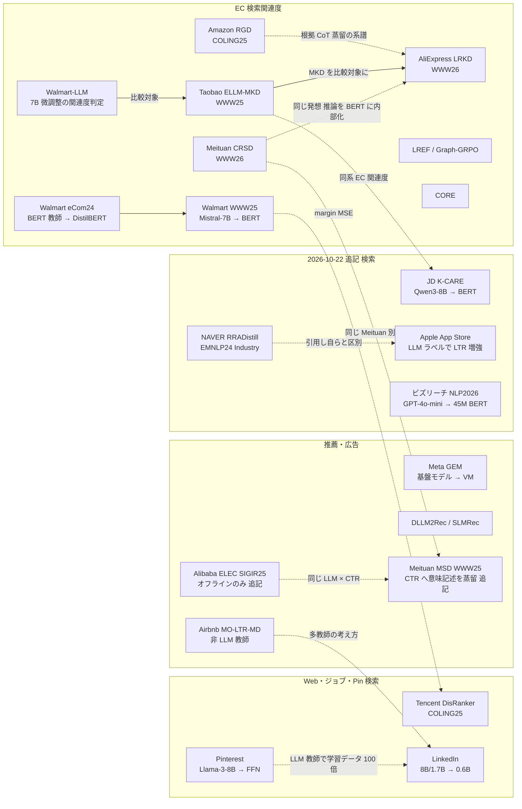

# C4 検索・推薦・広告・EC における LLM 蒸留 — リソース収集結果

## 収集パラメータ

- **対象リソース**: 学術論文 / 特許 / 技術情報（Web サイト・技術ブログ） / ビジネス事例
- **対象期間**: 2022 – 2026
- **収集日**: 2026-10-21
- **入力元**: clustering 結果（`research/runs/llm_distillation/clustering/20261021/cluster-04-search-recsys.md`）
- **検索言語**: 英語 + 日本語
- **実行モード**: 非対話（auto 相当）。リソース種別は 4 種すべて（auto 既定の「論文 + 特許」を上書き）

> **収集上の制約（重要）**: 本 run では、セッション全体で共有している WebSearch の上限（200 回）に途中で達しました。そのため、収集の後半は **既に得た URL の WebFetch による検証と、取得した資料の参照文献・リンクをたどる方法** に切り替えています。各種別 20 件以上という目標には届いておらず、とくに **特許（2 件）と日本企業の事例（一次資料 0 件）が大きく不足** しています。不足は「カバレッジのギャップ」節に明記しました。
>
> **（2026-10-22 追記）補完 pass**: WebSearch 20 回の追加予算で、(1) 国内事例（ビズリーチ NLP2026 論文を PDF 取得、LINEヤフーの技術ブログ 2 本）、(2) 主要プレイヤー（NAVER、JD.com、Meituan の CTR 蒸留、Apple App Store、Alibaba ELEC、Kuaishou OneSearch-V2）、(3) 一般的な蒸留特許 2 件を追加し、Etsy・DoorDash の一次ブログ再取得（失敗）と 01〜07 の数値再検証を行いました。追加分は各表の末尾に「（2026-10-22 追記）」付きで載せ、集計は「追記後」の表を別に設けています。

## 収集サマリ

| 領域 | 論文 | 特許 | 技術情報 | 事例 | 合計 |
|------|------|------|----------|------|------|
| 検索関連度の蒸留（EC・Web 検索） | 13 | 0 | 6 | 5 | 24 |
| 推薦・ランキングの蒸留 | 7 | 1 | 2 | 0 | 10 |
| 広告（検索広告・広告推薦） | 1 | 0 | 2 | 3 | 6 |
| ランキング蒸留の基盤特許 | 0 | 1 | 0 | 0 | 1 |
| 国内（日本語資料） | 0 | 0 | 1 | 0 | 1 |
| **合計** | **21** | **2** | **11** | **8** | **42** |

> 1 つのリソースが複数の領域にまたがる場合は、主な用途の領域に 1 回だけ数えています。検索広告の関連度（Taobao / Meituan / AliExpress）は「検索関連度の蒸留」に数えました。

### 収集サマリ（2026-10-22 追記後）

| 領域 | 論文 | 特許 | 技術情報 | 事例 | 合計 |
|------|------|------|----------|------|------|
| 検索関連度の蒸留（EC・Web 検索・アプリ検索） | 17 | 0 | 6 | 5 | 28 |
| 推薦・ランキングの蒸留 | 7 | 1 | 2 | 0 | 10 |
| 広告（検索広告・広告推薦・CTR） | 3 | 0 | 2 | 3 | 8 |
| ランキング蒸留の基盤特許 | 0 | 1 | 0 | 0 | 1 |
| 一般的な LLM / NLP 蒸留特許（検索・推薦に非特化） | 0 | 2 | 0 | 0 | 2 |
| 国内（日本語資料） | 1 | 0 | 3 | 0 | 4 |
| **合計** | **28** | **4** | **13** | **8** | **53** |

> 追加 11 件の内訳: 論文 7（NAVER RRADistill、JD K-CARE、Apple App Store、Kuaishou OneSearch-V2、Meituan MSD、Alibaba ELEC、ビズリーチ）、特許 2（Genesys、Huawei）、技術情報 2（LINEヤフー 2 本）。Kuaishou OneSearch-V2 は自己蒸留（LLM → 小型ではない）、Apple は著者が蒸留と呼ばない、LINEヤフーは蒸留不採用の参考例として数えています。

## URL検証結果

| 項目 | 件数 |
|------|------|
| 収集（候補） | 52 |
| 検証済み（本表に掲載） | 42 |
| うち「一次 URL は 403 で取得不可・二次資料と転載で存在を確認」 | 2（Etsy、DoorDash の公式ブログ） |
| 不一致・対象外で除外 | 6 |
| アクセス不可で除外 | 4 |

除外した主なもの:

| 候補 | 除外理由 |
|------|---------|
| A Comprehensive Review on Harnessing LLMs (arXiv 2507.21117) | 要旨に蒸留・TikTok / Amazon / Alibaba への言及がなく、clustering 段階の記述を確認できなかった |
| Distilling Lexical Product Associations into Deep Transformers (arXiv 2609.26921) | 教師が TF-IDF で、LLM 蒸留ではない |
| Advertiser Content Understanding via LLMs for Google Ads Safety (arXiv 2409.15343) | LLM の直接利用で、蒸留を含まない |
| Large Recommender Models: Adapting Gemini for YouTube（ZenML 要約 / 講演） | 小型 Gemini と事前計算による 95% 超のコスト削減で、教師→生徒の蒸留ではない |
| Deep Learning to Rank in Industrial Search, RecSys, Ads（ACM TOIS, DOI 10.1145/3797895） | 403 で取得不可 |
| 人材領域特化の LLM 教師付き長文 BERT 埋め込みモデルの構築（ビズリーチ, 言語処理学会 2026） | 接続拒否で取得不可（後述「未検証の候補」に記載） |
| Pinterest Engineering ブログ（Medium）/ Instacart 公式ブログ（tech.instacart.com） | 403。ただし同内容を ZenML 要約・company.instacart.com で確認 |

以下の表には検証済みのエントリのみを掲載します（URL はすべて WebFetch で到達とタイトル一致を確認済み。例外は表中に明記）。

**（2026-10-22 追記）URL 再検証**:

| 項目 | 結果 |
|------|------|
| ビズリーチ NLP2026 C7-6（anlp.jp） | **取得成功**（PDF をテキスト抽出し本文を確認）。「未検証の候補」から論文表へ移動 |
| Etsy 公式ブログ | 再度 403。r.jina.ai 経由も 403、転載候補（scour.ing / thenote.app）は要約のみ、web.archive.org は本環境から到達不可 |
| DoorDash 公式ブログ | 再度 403。`careersatdoordash.com/?p=16312` も 403、r.jina.ai 経由は Cloudflare の人間確認ページ |
| 追加 11 件 | すべて WebFetch で到達・内容一致を確認（arXiv は abs と HTML/PDF、特許は patents.google.com、LINEヤフーは techblog.lycorp.co.jp） |

## 年次分布

```
全体（42 件）
2026 |████████████████ 16
2025 |██████████████████ 18
2024 |███████ 7
2023 |█ 1
2022 |  0
```

種別ごとの内訳:

| 年 | 論文 | 特許 | 技術情報 | 事例 | 計 |
|----|------|------|----------|------|----|
| 2026 | 7 | 0 | 6 | 3 | 16 |
| 2025 | 8 | 1 | 5 | 4 | 18 |
| 2024 | 5 | 1 | 0 | 1 | 7 |
| 2023 | 1 | 0 | 0 | 0 | 1 |
| 2022 | 0 | 0 | 0 | 0 | 0 |

> 特許は公開・登録年で数えました（2 件とも出願は 2022 年）。2025–2026 年に件数が集中しており、**WWW 2025 / WWW 2026 の Industry 系論文と、各社エンジニアブログが同時期に増えている** ことが分かります。

**（2026-10-22 追記後）**:

| 年 | 論文 | 特許 | 技術情報 | 事例 | 計 |
|----|------|------|----------|------|----|
| 2026 | 11 | 0 | 7 | 3 | 21 |
| 2025 | 10 | 3 | 5 | 4 | 22 |
| 2024 | 6 | 1 | 0 | 1 | 8 |
| 2023 | 1 | 0 | 0 | 0 | 1 |
| 2022 | 0 | 0 | 0 | 0 | 0 |

> 追加分の年: 2026 = JD K-CARE、Apple、Kuaishou、ビズリーチ（論文）+ LINEヤフー Moegi（技術情報）。2025 = Meituan MSD、Alibaba ELEC（論文）+ Genesys 登録・Huawei 公開（特許）+ LINEヤフー StaticEmbedding（技術情報）。2024 = NAVER RRADistill（論文）。

## リソース関係図



> 太い流れは **「LLM 教師 → 大量の疑似ラベル → BERT 系生徒」** です。Taobao は Walmart 系の LLM 関連度手法を比較対象に、AliExpress の LRKD は Taobao の MKD を比較対象に置いており、2025–2026 年に **EC 関連度の蒸留が 1 つの研究系譜として確立した** ことが分かります。

## 全体の傾向

```
本番 A/B テストの数値を公開している事例（一次資料・LLM 教師に限る）
Walmart    |████ ATC/visitor +1.2%
Pinterest  |████ fulfillment 非US +2.0%
Taobao     |██ CTR +0.17% / Goodrate +0.89%
Meituan    |████ CTR +0.91% / CVR +1.06%
AliExpress |█████ RPM +1.42%
Tencent    |████ dwell +1.2%
LinkedIn   |██████ NDCG@10 +7.73% / DAU +1.2%
Instacart  |██████ 不満 -50%（ブログ）
--- 2026-10-22 追記 ---
NAVER      |██████████ CTR +5.63% / dwell +7.97%（ロングテール限定）
JD.com     |██████ Bad Case 率 12.10→11.3%（相対 -5.87%）
Meituan MSD|█████ CTR +2.12% / CPM +2.59%（スポンサー検索）
Apple      |█ CVR +0.24%（LLM ラベリング、蒸留と自称せず）
```

- **一次資料の厚さ**: 本番 A/B の具体的数値を一次資料で公開している LLM 蒸留事例が **8 社**（Walmart / Pinterest / Taobao / Meituan / AliExpress / Tencent / LinkedIn / Instacart）見つかりました。他分野と比べて圧倒的に多いです。
- **型の収束**: 8 社のうち 7 社が「7B–14B の LLM 教師 → 0.1B–0.6B の BERT 系 / SLM 生徒」という同じ構図です（教師 Mistral-7B / Qwen2-7B / Qwen3-8B / Qwen3-14B / Llama-3-8B / 8B）。
- **効果の大きさ**: オンライン効果は **CTR・CVR で +0.2〜+1.4% 程度** が中心で、ビジネス KPI の改善は小さいものの、巨大トラフィックに掛かるため正当化されています。
- **根拠（CoT）蒸留の台頭**: 2025–2026 年は、CoT を BERT に「内部化」する手法（Taobao MKD、Meituan CRSD、AliExpress LRKD、Amazon RGD）が主流になりました（4 件）。
- **「蒸留」の看板に注意**: Airbnb（KDD 2024）は **教師が MLP で LLM ではない**、Walmart eCom'24 は **BERT-base を「LLM」と呼んでいる**、Meta GEM は **LLM ではなく推薦用の基盤モデル** です。clustering 段階で「LLM 蒸留の代表例」とした事例の一部は、厳密には LLM 蒸留ではありません。
- **国内の空白**: 日本企業（メルカリ・LINEヤフー・楽天・ZOZO・リクルート）の検索・推薦での LLM 蒸留は、一次資料を 1 件も確認できませんでした（検索上限に達したことも一因）。
- **（2026-10-22 訂正）国内の一次資料は 1 件**: ビズリーチの NLP2026 論文（GPT-4o-mini の STS スコア 8 万ペア → 12M / 30M / 45M の BERT 埋め込み。OpenAI Embedding API と同等、本番 A/B なし）を取得・確認しました。LINEヤフーは「Transformer の蒸留・量子化では CPU 要件に届かず静的埋め込みを採用」（LLM 蒸留ではない）と、サービス特化 BERT の社内共有「Moegi」（蒸留なし）を公開しています。メルカリ・ZOZO（JSAI2026 参加報告を含む）・楽天・リクルート・DeNA・CyberAgent・Yahoo! 広告は、追加の日本語検索 9 回でも該当事例がヒットしませんでした。
- **（2026-10-22 追記）追加の海外事例**: NAVER（EMNLP 2024 Industry、HyperCLOVA X のリストワイズ判定 → 1B 未満の生徒、ロングテールで CTR +5.63%）、JD.com（Qwen3-8B 教師 → BERT、Bad Case 率 −5.87% 相対）、Meituan の CTR 蒸留 MSD（WWW 2025、CTR +2.12% / CPM +2.59%）、Apple App Store（微調整 3B LLM のラベルで LTR 増強、CVR +0.24%。著者は蒸留と呼ばない）。これで一次資料で本番数値を公開した LLM 蒸留事例は 11〜12 社になります。効果が大きいのは NAVER（ロングテール限定）と Meituan MSD（CTR 直結）で、関連度を全体導入した事例（+0.2〜1.4%）とは条件が異なります。
- **（2026-10-22 追記）Amazon・Google の本番 A/B は引き続き未確認**: Amazon Science には検索・広告の LLM 蒸留 × 本番 A/B の論文は見つからず（分類タスクの「Performance-guided LLM knowledge distillation」のみ）、Google / YouTube は蒸留ではない。Kuaishou OneSearch-V2 は自己蒸留（教師 = 生徒）で item CTR +3.98% だが LLM → 小型の蒸留ではない。

検索・推薦分野は、LLM を「オフラインの教師・ラベラー」に限定し、本番は小型モデルで配信するという **役割分担が業界標準になった** 分野です。教師は 7–14B のオープンモデルを自社データで微調整するのが主流で、商用 API（GPT-4 等）を教師にする例は少数派です（LinkedIn の評価系、Etsy の o3 アノテータ程度）。これは利用規約（C8）と、日々数百万〜数千万件のラベル付けにかかるコストの両方が理由と考えられます。効果は CTR・CVR で 1% 前後と控えめですが、Walmart の「ロングテールクエリ」、Pinterest の「非英語圏」、Taobao の「ロングテール +1.96%」のように、**人手ラベルが足りない領域で効果が大きい** という共通点があります。

### カバレッジのギャップ

| 領域・種別 | 件数 | 目標 | ギャップの理由 |
|-----------|------|------|--------------|
| 特許（LLM 蒸留 × 検索推薦） | 0 | 20 | 検索上限で J-PlatPat・USPTO を十分に検索できなかった。見つかった 2 件は LLM に限らない一般的なランキング蒸留 |
| 国内企業の一次資料 | 0 | 5+ | 日本語検索でメルカリ・LINEヤフー・楽天・ZOZO の蒸留事例がヒットせず、ビズリーチの学会論文は取得不可 |
| Amazon 本体の本番 A/B | 0 | — | Amazon RGD はオフライン評価のみで「本番分布ではない」と明記 |
| Google / YouTube | 0 | — | YouTube は小型 Gemini と事前計算で、蒸留ではない |
| Spotify / Netflix / eBay / Shopify | 1（eBay LLM-PKG） | — | 蒸留の本番事例は見つからなかった |

**（2026-10-22 追記後のギャップ）**:

| 領域・種別 | 件数（追記後） | 状態 |
|-----------|---------------|------|
| 特許（LLM 蒸留 × 検索推薦） | 0（一般的な蒸留特許は +2 で計 4） | Google Patents 対象の検索 2 回で、LLM 教師 × 検索関連度に特化した特許は見つからず。Genesys（層削除の順列評価）と Huawei（LLM → SLM に分布外フィードバック）は検索・推薦に言及なし。Amazon / Walmart / Alibaba / eBay / Pinterest / LinkedIn / Microsoft の出願人指定検索は本環境の検索ツールでは実質できず、**J-PlatPat・USPTO の直接検索が引き続き必要** |
| 国内企業の一次資料 | **1（ビズリーチ）** + 参考 2（LINEヤフー、蒸留ではない） | ビズリーチはオフラインのみ。本番 A/B を伴う国内事例は 0 件のまま |
| Amazon 本体の本番 A/B | 0 | Amazon Science の再検索でも該当なし |
| Google / YouTube | 0 | 変化なし |
| Spotify / Zalando / Booking / Expedia / Shopee / Baidu / Xiaohongshu | 0 | 1 回の検索ではヒットなし（予算の都合で個別検索は未実施） |
| Etsy / DoorDash の一次本文 | 0 | 再取得失敗（403）。二次資料のまま |

---

## 学術論文

| # | 領域 | タイトル | 著者 | 年 | Venue | 概要 |
|---|------|---------|------|-----|-------|------|
| 1 | 検索関連度 | [Semantic Search At LinkedIn](https://arxiv.org/abs/2602.07309v1) | Fedor Borisyuk et al.（LinkedIn） | 2026 | arXiv preprint | 8B 関連度 oracle・1.7B エンゲージメント教師 → 0.6B（剪定後 375M）SLM。NDCG@10 0.7583→0.9432（オフライン）、本番で NDCG@10 +7.73%、DAU +1.2% 超、スループット 75 倍超 |
| 2 | 検索関連度 | [From Reasoning LLMs to BERT: A Two-Stage Distillation Framework for Search Relevance](https://arxiv.org/abs/2510.11056v3) | Runze Xia et al.（Meituan） | 2026 | WWW 2026 | Qwen3-8B を CPT→SFT→GRPO で教師化し、6 層 BERT に CRSD で推論を内部化。広告 CTR +0.91%、CVR +1.06%、GTV +0.40% |
| 3 | 検索関連度 | [Thinking Broad, Acting Fast: Latent Reasoning Distillation from Multi-Perspective Chain-of-Thought for E-Commerce Relevance](https://arxiv.org/abs/2601.21611v1) | Baopu Qiu et al.（Alibaba International） | 2026 | WWW 2026 | Qwen3-14B の多視点 CoT を 168M BERT の潜在推論ベクトルへ蒸留。AliExpress 検索広告で RPM +1.42%、CTR +0.48% |
| 4 | 検索関連度 | [CORE: A Unified Cascaded Ordinal Relevance Estimation Framework for E-commerce Search](https://arxiv.org/abs/2607.24417) | Zhi Jin et al. | 2026 | arXiv preprint | 関連度を順序付き二値判定に分解し、LLM の能力をオンライン BERT へ蒸留。本番の bad case 率 −15.94% |
| 5 | 検索関連度 | [Graph-GRPO: Dependency-Aware Credit Assignment for Generative E-commerce Search Relevance](https://arxiv.org/abs/2605.31003) | Jiarui Che et al. | 2026 | arXiv（CIKM 2026 投稿） | CoT の段階間依存を考慮した GRPO と、グラフノード単位の多ヘッド蒸留。大手 EC で A/B 改善（数値は要旨になし） |
| 6 | 検索関連度 | [Scaling and Stabilizing Large-Scale Embedding-Based Retrieval](https://arxiv.org/abs/2607.10096) | Zhen Yang et al.（Walmart） | 2026 | arXiv preprint | DistilBERT から GTE-base への Warm-Start 蒸留（LLM 教師ではない）。NDCG@5 +7.34%、売上 +0.50%（p=0.03） |
| 7 | 検索関連度 | [Knowledge Distillation for Enhancing Walmart E-commerce Search Relevance Using Large Language Models](https://arxiv.org/abs/2505.07105) | Hongwei Shang, Nguyen Vo et al.（Walmart） | 2025 | WWW 2025 Companion | Mistral-7B 教師 → BERT-Base 生徒（約 110M）を拡張 Margin-MSE で学習。1.7 億件の LLM ラベル。ATC 率/visitor +1.2% |
| 8 | 検索関連度 | [Explainable LLM-driven Multi-dimensional Distillation for E-Commerce Relevance Learning](https://arxiv.org/abs/2411.13045) | Gang Zhao et al.（Taobao & Tmall） | 2025 | WWW 2025（oral） | Qwen2-7B の CoT 関連度モデルから、スコア分布（KL）と CoT（系列タグ付け）の 2 軸で 101M 生徒へ蒸留。CTR +0.17%、Goodrate +0.89%、全トラフィック稼働 |
| 9 | 検索関連度 | [Rationale-Guided Distillation for E-Commerce Relevance Classification](https://aclanthology.org/2025.coling-industry.12.pdf) | Sanjay Agrawal, Faizan Ahemad, Vivek Sembium（Amazon India） | 2025 | COLING 2025 Industry | Mixtral 8x7B の根拠文を補助タスクに 110M BERT を学習。7B LLM と ROC-AUC 差 1% 未満で 50 倍高速（オフラインのみ） |
| 10 | 検索関連度 | [Best Practices for Distilling Large Language Models into BERT for Web Search Ranking](https://arxiv.org/abs/2411.04539v1) | Dezhi Ye et al.（Tencent） | 2025 | COLING 2025 Industry | Mistral-7B を CPT+ランキング SFT し、6 層 BERT へ point-wise + margin MSE で蒸留。2024 年 2 月から商用 Web 検索で稼働。dwell +1.2% |
| 11 | 検索関連度 | [LREF: A Novel LLM-based Relevance Framework for E-commerce](https://arxiv.org/abs/2503.09223) | Tian Tang et al.（検索結果の要約では JD とされる。所属は abs ページに記載なし） | 2025 | arXiv（ACM DOI 付き） | SFT・Multi-CoT・DPO の 3 段階で LLM 関連度モデルを構築し本番 A/B。蒸留の詳細は要旨になく本文確認が必要 |
| 12 | 検索関連度 | [Improving Pinterest Search Relevance Using Large Language Models](https://arxiv.org/abs/2410.17152) | Han Wang et al.（Pinterest） | 2024 | CIKM 2024 IRS Workshop | Llama-3-8B 教師 → 特徴量ベース FFN 生徒。3,000 万件の蒸留ラベル。nDCG@20 +2.18%、非 US の fulfillment +2.0% |
| 13 | 検索関連度 | [Knowledge Distillation for Efficient and Effective Relevance Search on E-commerce](https://ceur-ws.org/Vol-3843/paper_16.pdf) | Nguyen Vo, Hongwei Shang et al.（Walmart） | 2024 | SIGIR eCom'24 | BERT-base 交差エンコーダ（論文中で「LLM」と呼称）→ DistilBERT 双塔。NDCG@5 +1.30%、クリックありセッション +0.214% |
| 14 | 推薦 | [Pre-trained LLMs Meet Sequential Recommenders: Efficient User-Centric Knowledge Distillation](https://arxiv.org/abs/2604.21536) | Nikita Severin et al. | 2026 | ECIR 2026 | LLM が生成したユーザープロファイルを系列推薦モデルへ蒸留し、推論時に LLM 不要 |
| 15 | 推薦 | [LEARN: Knowledge Adaptation from Large Language Model to Recommendation for Practical Industrial Application](https://arxiv.org/abs/2405.03988) | Jian Jia et al.（Kuaishou） | 2025 | AAAI 2025 | 凍結 LLM をアイテムエンコーダにし双塔で推薦へ適応。厳密には蒸留ではなく「知識適応」。オンライン A/B あり |
| 16 | 推薦 | [SLMRec: Distilling Large Language Models into Small for Sequential Recommendation](https://arxiv.org/abs/2405.17890) | Wujiang Xu et al. | 2025 | ICLR 2025 | 中間層の冗長性に着目し、パラメータ約 13% の小型モデルへ蒸留。学習 6.6 倍・推論 8.0 倍高速 |
| 17 | 推薦 | [Bidirectional Knowledge Distillation for Enhancing Sequential Recommendation with Large Language Models](https://arxiv.org/abs/2505.18120) | Jiongran Wu et al. | 2025 | arXiv（査読中） | LLM 推薦と従来モデルの相互蒸留 LLMD4Rec |
| 18 | 推薦 | [Multi-objective Learning to Rank by Model Distillation](https://arxiv.org/abs/2407.07181v1) | Jie Tang et al.（Airbnb） | 2024 | KDD 2024 | 単目的の MLP 教師群 → MLP 生徒（**LLM 教師ではない**）。予約 CVR +0.37%、レイテンシ −1.6% |
| 19 | 推薦 | [Distillation Matters: Empowering Sequential Recommenders to Match the Performance of Large Language Model](https://arxiv.org/abs/2405.00338) | Yu Cui et al. | 2024 | arXiv | LLM 推薦（BIGRec 等）→ 従来の系列推薦モデル。平均 +47.97% |
| 20 | 推薦 | [Enabling Explainable Recommendation in E-commerce with LLM-powered Product Knowledge Graph](https://arxiv.org/abs/2412.01837) | Menghan Wang et al.（eBay） | 2024 | IJCAI 2024 Workshop | LLM の知識を商品知識グラフへ「蒸留」して説明可能推薦。スニーカーで A/B 改善 |
| 21 | 広告・ランキング | [Instruction Distillation Makes Large Language Models Efficient Zero-shot Rankers](https://arxiv.org/abs/2311.01555) | Weiwei Sun et al. | 2023 | arXiv | ペアワイズ LLM ランカーをポイントワイズへ蒸留し 10〜100 倍効率化 |
| 22 | 検索関連度（2026-10-22 追記） | [RRADistill: Distilling LLMs' Passage Ranking Ability for Long-Tail Queries Document Re-Ranking on a Search Engine](https://arxiv.org/abs/2410.18097) | Nayoung Choi et al.（NAVER） | 2024 | EMNLP 2024 Industry | HyperCLOVA X Large のリストワイズ判定（7,000 クエリ × 20 文書）→ 1B 未満の RRA-BERT / RRA-GPT。NAVER 検索のロングテールで A/B 7 日: CTR +5.63%、滞在時間 +7.97% |
| 23 | 検索関連度（2026-10-22 追記） | [K-CARE: Knowledge-driven Symmetrical Contextual Anchoring and Analogical Prototype Reasoning for E-commerce Relevance](https://arxiv.org/abs/2604.25683) | Chen Yifei et al.（JD.COM） | 2026 | arXiv preprint | Qwen3-8B に行動ログ由来の文脈と専門家プロトタイプを注入した教師（GPT-5.2 で学習軌跡を合成）→ 小型 BERT を SFT。本番 Bad Case 率 12.10% → 11.3%（相対 −5.87%） |
| 24 | 検索関連度（2026-10-22 追記） | [Scaling Search Relevance: Augmenting App Store Ranking with LLM-Generated Judgments](https://arxiv.org/abs/2602.23234) | Evangelia Christakopoulou et al.（Apple） | 2026 | arXiv preprint | 人手判定で微調整した 3B 社内 LLM（F1 0.800。事前学習 30B は 0.382）が数百万件のラベルを生成し多目的 LTR を増強。全世界 A/B で CVR +0.24%。**著者は蒸留と呼ばない** |
| 25 | 検索関連度（2026-10-22 追記） | [OneSearch-V2: The Latent Reasoning Enhanced Self-distillation Generative Search Framework](https://arxiv.org/abs/2603.24422) | Ben Chen et al.（Kuaishou と推定。所属は abs に記載なし） | 2026 | arXiv preprint | 生成検索の推論内在化を **自己蒸留**（教師と生徒が同一重み）で学習。A/B で item CTR +3.98%、購入者 +2.07%、注文 +2.11%。**LLM → 小型の蒸留ではない参考例** |
| 26 | 広告・CTR（2026-10-22 追記） | [Balancing Efficiency and Effectiveness: An LLM-Infused Approach for Optimized CTR Prediction](https://arxiv.org/abs/2412.06860) | Guoxiao Zhang et al.（Meituan） | 2025 | WWW 2025 | LLM が生成したユーザ・アイテムの多層意味情報を小型生徒へ系列蒸留し CTR モデルへ注入（MSD）。Meituan スポンサー検索の A/B（2024-10-20〜30）で CTR +2.12%、CPM +2.59%、推論 35 → 37.2ms |
| 27 | 広告・CTR（2026-10-22 追記） | [ELEC: Efficient Large Language Model-Empowered Click-Through Rate Prediction](https://arxiv.org/abs/2509.07594) | Rui Dong, Wentao Ouyang, Xiangzheng Liu（Alibaba Group） | 2025 | SIGIR 2025 | gte-Qwen2-7B-instruct の表現を注入した gain network から、表形式入力のみの vanilla network へスコア・表現の 2 段階で蒸留。Amazon / 社内広告データで AUC 0.8015（DCNv2 0.7946）。**オンライン A/B なし** |
| 28 | 国内・推薦（2026-10-22 追記） | [人材領域特化の LLM 教師付き長文 BERT 埋め込みモデルの構築](https://www.anlp.jp/proceedings/annual_meeting/2026/pdf_dir/C7-6.pdf) | 原 龍昊, 長谷川 崇, Dat P.T. Nguyen（ビズリーチ） | 2026 | 言語処理学会 NLP2026（C7-6, 査読なし） | GPT-4o-mini が求人文書 8 万ペアに STS スコアを付与し、自社事前学習の 12M / 30M / 45M BERT を Sentence-BERT 方式で学習。総合 68.88 で OpenAI text-embedding-3-large（68.58）と同等。**国内唯一の一次資料。本番 A/B なし** |

---

## 特許

| # | 領域 | タイトル | 番号 | 出願人 | 年 | 特許庁 | 概要 |
|---|------|---------|------|--------|-----|--------|------|
| 1 | ランキング蒸留の基盤 | [Machine learning ranking distillation](https://patents.google.com/patent/EP4298566) | EP4298566A1 | Google LLC | 2024（公開。出願 2022） | EPO | 項目集合の文脈を考慮した教師スコアから蒸留モデルを学習し、推薦の順位付けに使う。**教師は LLM に限定されない** |
| 2 | 推薦 | [Scalable knowledge distillation techniques for machine learning](https://patents.google.com/patent/US12307750) | US12307750B2 | Microsoft Technology Licensing | 2025（登録。出願 2022） | USPTO | 多言語 NLP モデルによるコンテンツ推薦で、教師と生徒をバッチごとに同時にメモリへ載せ反復蒸留し I/O を削減。**LLM への明示的言及はない** |
| 3 | 一般的な NLP 蒸留（2026-10-22 追記） | [Systems and methods relating to knowledge distillation in natural language processing models](https://patents.google.com/patent/US12333254B2/en) | US12333254B2 | Genesys Cloud Services | 2025（登録 2025-06-17。出願 2021-12-21） | USPTO | 教師の層をランダムに除去した候補生徒群を評価基準で採点し最良の生徒を選ぶ。BERT 系を想定。**LLM・検索・関連度・推薦への言及なし**（コンタクトセンター用途） |
| 4 | 一般的な LLM → SLM 蒸留（2026-10-22 追記） | [Methods and systems for transferring knowledge from large language models to small language models using out-of-distribution feedbacks](https://patents.google.com/patent/WO2025123815A1/en) | WO2025123815A1 | Huawei Cloud Computing Technologies | 2025（公開 2025-06-19。優先日 2023-12-12） | WIPO | LLM が分布内の学習サンプルと分布外の検証サンプルを生成し、SLM が苦手な検証サンプルを次反復の学習データに加えて SLM を LLM の代替にする。用途例は感情分類・翻訳で、**検索・推薦・広告への言及なし** |

> 特許は大きく不足しています（「カバレッジのギャップ」参照）。LLM 教師 × 検索関連度の蒸留に特化した特許は、本 run では確認できませんでした。
>
> **（2026-10-22 追記）** Google Patents を対象に「large language model」「relevance」「distillation」「student」の組合せで 2 回検索したが、検索・推薦に特化した LLM 蒸留特許は見つからず、上記 3・4 の一般的な蒸留特許のみ追加した。検索ツールが特許全文を十分に索引していないため、出願人（Amazon / Walmart / Alibaba / eBay / Pinterest / LinkedIn / Microsoft / Google）を指定した調査は **Google Patents の詳細検索または J-PlatPat・USPTO で直接行う必要がある**。なお、検索中に見つかった US12222992B1「Using intent-based rankings to generate large language model responses」は LLM 応答生成の順位付けであり蒸留ではないため除外した。

---

## 技術情報

| # | 領域 | タイトル | ソース | 年 | 種別 | 概要 |
|---|------|---------|--------|-----|------|------|
| 1 | 検索関連度 | [How LinkedIn Trains AI Job Search 8x Faster with Multi-Teacher Distillation](https://infoq.com/news/2026/09/linkedin-ai-multi-teacher) | InfoQ（Claudio Masolo） | 2026 | 技術ニュース | LinkedIn の一次ブログ 2 本の要約。0.6B 生徒、8B / 1.7B 教師、NDCG@10 0.7583→0.9432 |
| 2 | 検索関連度 | [The Training Infrastructure Behind AI-Powered Job Search: 8X Faster Multi-Teacher Distillation](https://www.linkedin.com/blog/engineering/infrastructure/the-training-infrastructure-behind-ai-powered-job-search-eight-x-faster-multi-teacher-distillation) | LinkedIn Engineering | 2026 | 技術ブログ | 蒸留パイプライン 約 45 時間 → 5 時間未満（オフライン蒸留）、教師推論のキャッシュ化 |
| 3 | 検索関連度 | [Reimagining LinkedIn's search tech stack](https://www.linkedin.com/blog/engineering/search/reimagining-linkedins-search-stack) | LinkedIn Engineering | 2026 | 技術ブログ | 7B 方針教師 → 1.7B 教師 → 0.6B SLM の段階蒸留。教師 NDCG@10 0.9484、生徒 0.9239 |
| 4 | 検索関連度 | [How Etsy Uses LLMs to Improve Search Relevance](https://www.etsy.com/codeascraft/how-etsy-uses-llms-to-improve-search-relevance) | Etsy Code as Craft | 2026 | 技術ブログ | **本文は 403 で取得不可**。転載・ZenML 要約で存在と内容を確認。o3 アノテータ → Qwen 3 VL 4B 教師 → BERT 双塔生徒（追加レイテンシ 10ms 未満） |
| 5 | 広告 | [Small Language Models to Serve More Relevant DoorDash Search Ads](https://careersatdoordash.com/blog/small-language-models-to-serve-more-relevant-doordash-search-ads/) | DoorDash Engineering | 2026 | 技術ブログ | **本文は 403 で取得不可**。ZenML 要約で内容を確認。LLM ラベラー → DistilBERT 双塔（64 次元） |
| 6 | 検索関連度 | [推論LLMからBERTへ：検索関連性のための2段階蒸留フレームワーク](https://www.alphaxiv.org/ja/abs/2510.11056) | alphaXiv（日本語ページ） | 2026 | 論文紹介（日本語） | Meituan 論文の日本語解説ページ。国内向けに参照できる数少ない日本語資料 |
| 7 | 広告・推薦 | [Meta's Generative Ads Model (GEM): The Central Brain Accelerating Ads Recommendation AI Innovation](https://engineering.fb.com/2025/11/10/ml-applications/metas-generative-ads-model-gem-the-central-brain-accelerating-ads-recommendation-ai-innovation/) | Engineering at Meta | 2025 | 技術ブログ | 「LLM に着想を得た」広告基盤モデルを教師に数百の垂直モデルへ知識移転。標準 KD の 2 倍の効果、Instagram 広告 CV +5% |
| 8 | 検索関連度 | [Building The Intent Engine: How Instacart is Revamping Query Understanding with LLMs](https://company.instacart.com/tech-innovation/building-the-intent-engine-how-instacart-is-revamping-query-understanding-with-llms) | Instacart | 2025 | 技術ブログ | フロンティア LLM の出力で Llama-3-8B を LoRA 学習（黒箱蒸留）。ロングテール検索の不満 −50% |
| 9 | 検索関連度 | [What We Learned from Using LLMs in Pinterest](https://ai.engineer/talks/what-we-learned-from-using-llms-in-pinterest) | AI Engineer World's Fair 2025 | 2025 | 講演 | Pinterest の論文の講演版。教師ラベルで学習データを約 100 倍に拡張、多言語に汎化 |
| 10 | 推薦・検索 | [Improving Recommendation Systems & Search in the Age of LLMs](https://eugeneyan.com/writing/recsys-llm/) | Eugene Yan | 2025 | 技術ブログ（事例集） | Bing・Indeed・Yelp・Amazon Music・Best Buy などの「LLM → 小型モデル」事例を整理 |
| 11 | 推薦 | [Large Recommender Models: Adapting Gemini for YouTube Video Recommendations](https://www.zenml.io/llmops-database/large-recommender-models-adapting-gemini-for-youtube-video-recommendations) | ZenML（講演要約） | 2025 | 講演要約 | **蒸留ではない参考例**。小型 Gemini と事前計算で配信コスト 95% 超削減 |
| 12 | 国内・検索（2026-10-22 追記） | [StaticEmbedding を用いた高速な検索クエリ埋め込み](https://techblog.lycorp.co.jp/ja/20250804a) | LINEヤフー Tech Blog（平子 潤） | 2025 | 技術ブログ | Yahoo! 検索のクエリ埋め込み。DistilBERT 系 UBIQUE（NAACL 2025 Industry）は **蒸留・量子化でも CPU 要件に届かず**、クリックログの対照学習で静的埋め込みを学習。UBIQUE の 97% 超の精度で CPU 18.8 → 1.8ms。**LLM 蒸留ではない（蒸留不採用の国内一次資料）** |
| 13 | 国内・検索/推薦（2026-10-22 追記） | [大規模テキストデータを活用したサービス特化型言語モデルの社内共有プロジェクト：Moegi](https://techblog.lycorp.co.jp/ja/20261015a) | LINEヤフー Tech Blog（伊奈 拓郎ほか） | 2026 | 技術ブログ | Yahoo! ショッピング・検索・知恵袋などサービス特化の事前学習 BERT（110M）を社内共有。クエリ/商品カテゴリ分類で gpt-5.6-sol（推論コスト 901〜1,741 倍）とほぼ同精度（0.895 対 0.909 など）。**蒸留は行っていない**（LLM との比較のみ）。本番 A/B なし |

---

## ビジネス事例

| # | 領域 | タイトル | 企業/組織 | 年 | 種別 | 概要 |
|---|------|---------|-----------|-----|------|------|
| 1 | 広告 | [Small Language Models for Real-Time Ad Relevance Prediction](https://www.zenml.io/llmops-database/small-language-models-for-real-time-ad-relevance-prediction) | DoorDash（ZenML 集約） | 2026 | 事例要約 | 人手ラベル約 70 万件で LLM を微調整しラベラー化。生徒は検証精度 97%、Precision@2 +5.2%（対 GBDT） |
| 2 | 検索関連度 | [Semantic Relevance Evaluation and Enhancement Framework for E-commerce Search](https://www.zenml.io/llmops-database/semantic-relevance-evaluation-and-enhancement-framework-for-e-commerce-search) | Etsy（ZenML 集約） | 2026 | 事例要約 | 完全に関連する出品の割合 58%（2025/8）→ 62%（2025/10） |
| 3 | 検索関連度 | [Why LinkedIn says prompting was a non-starter, and small models was the breakthrough](https://venturebeat.com/infrastructure/why-linkedin-says-prompting-was-a-non-starter-and-small-models-was-the) | LinkedIn（VentureBeat） | 2026 | 報道 | 7B 方針教師 → 1.7B → 数億パラメータへの段階蒸留。「プロンプトでは無理だった」 |
| 4 | 検索関連度 | [Large Language Models for Search Relevance via Knowledge Distillation](https://www.zenml.io/llmops-database/large-language-models-for-search-relevance-via-knowledge-distillation) | Pinterest（ZenML 集約） | 2025 | 事例要約 | ブログ版の国別 fulfillment（US +1.7%、FR +2.4%、MX +2.5%、JP +2.4%） |
| 5 | 検索関連度 | [AI-Powered Semantic Job Search at Scale](https://www.zenml.io/llmops-database/ai-powered-semantic-job-search-at-scale) | LinkedIn（ZenML 集約） | 2025 | 事例要約 | 教師の全 logits を使う生徒学習、日次で数千万件の LLM 採点 |
| 6 | 検索関連度 | [Rebuilding Query Understanding for E-Commerce Search with LLMs](https://www.zenml.io/llmops-database/rebuilding-query-understanding-for-e-commerce-search-with-llms) | Instacart（ZenML 集約） | 2025 | 事例要約 | クエリ書き換えカバレッジ 50% → 95% 超 |
| 7 | 広告 | [How Meta Built a New AI-Powered Ads Model for 5% Better Conversions](https://blog.bytebytego.com/p/how-meta-built-a-new-ai-powered-ads) | Meta（ByteByteGo） | 2025 | 解説記事 | GEM を「マスター教師」とする階層的知識移転の解説 |
| 8 | 広告 | [CDAO Fall 2024 DoorDash（講演スライド PDF）](https://cdao-fall.coriniumintelligence.com/hubfs/1124-24%20-%20CDAO%20Fall%20Ops/Final%20Presentations/CDAO%20Fall%202024%20DoorDash.pdf?hsLang=en) | DoorDash | 2024 | 講演資料 | LLM によるテールクエリのラベル付けと、「LLM を生徒モデルへ蒸留・量子化してオンライン推論」を今後の方針として提示 |

---

## 未検証の候補（参考）

検索結果には出たものの、URL へ到達できず検証できなかった候補です。上の集計には含めていません。

| タイトル | 組織 | 年 | 状態 |
|---------|------|-----|------|
| 人材領域特化の LLM 教師付き長文 BERT 埋め込みモデルの構築（言語処理学会 第 32 回年次大会 C7-6） | ビズリーチ | 2026 | anlp.jp への接続が拒否され取得不可。検索結果の要約では「LLM を教師とした知識蒸留で人材マッチング特化の BERT 埋め込みを構築」とされる。**国内事業会社の検索・推薦向け LLM 蒸留として唯一の手がかり**。**（2026-10-22 訂正）PDF の取得に成功し、学術論文表の #28 へ移動（検証済み）** |
| Deep Learning to Rank in Industrial Search Engines, Recommender Systems, and Online Advertising（ACM TOIS） | — | 2026 | 403 で取得不可 |
| Matryoshka 表現学習を考慮した埋め込みモデル蒸留（NLP2026 P1-4）（2026-10-22 追記） | DTEN | 2026 | NLP2026 プログラムで発表を確認したが、検索・推薦の事業会社事例ではないため本文未取得 |
| Towards More Relevant Product Search Ranking Via Large Language Models: An Empirical Study（arXiv 2409.17460）（2026-10-22 追記） | — | 2024 | Etsy・DoorDash の再検索で複数回ヒット。LLM による商品検索ランキングの実証研究だが、蒸留を含むか未確認（予算の都合で未取得） |
| Automating Search Relevance Assessment at Scale with LLM-as-a-Judge（Allegro Tech Blog, 2026-08）（2026-10-22 追記） | Allegro | 2026 | LLM-as-a-Judge による関連度評価の自動化。蒸留の有無は未確認 |

---

## 次のステップ

- **詳細調査**: 本リストの上位資料を `retrieval/20261021/search_recsys/` で詳細レポート化しています。
- **国内事例の補完**: 検索上限の回復後に、メルカリ・LINEヤフー・楽天・ZOZO・リクルート・ビズリーチの技術ブログと、言語処理学会・人工知能学会の発表を「蒸留」「教師モデル」「関連度」で再検索することを推奨します（C7 と連携）。
  - **（2026-10-22 追記）** 上記を実施（日本語検索 9 回）。ビズリーチは取得済み（14 番）、LINEヤフーは蒸留ではない 2 本を記録。メルカリ・ZOZO・楽天・リクルート・DeNA・CyberAgent・Yahoo! 広告は該当なし。残る手段は、各社の技術ブログの全文検索（サイト内検索）と、WebDB Forum / 情報処理学会 / JSAI の予稿を直接当たること。
- **特許の補完**: Google Patents / J-PlatPat で「relevance label」「teacher model」「large language model」「search ranking」を組み合わせた検索が必要です。
  - **（2026-10-22 追記）** Google Patents 対象の検索 2 回では一般的な蒸留特許 2 件（Genesys、Huawei）しか得られず。出願人指定の調査は未達。
- **（2026-10-22 追記）残る空白**: Etsy・DoorDash の一次本文（403 継続）、Amazon 本体の本番 A/B、Spotify / Zalando / Booking / Expedia / Shopee / Baidu / Xiaohongshu（個別検索は未実施）、Indeed eBadMatch と Bing GPT-4 → Mistral-7B の一次資料。
