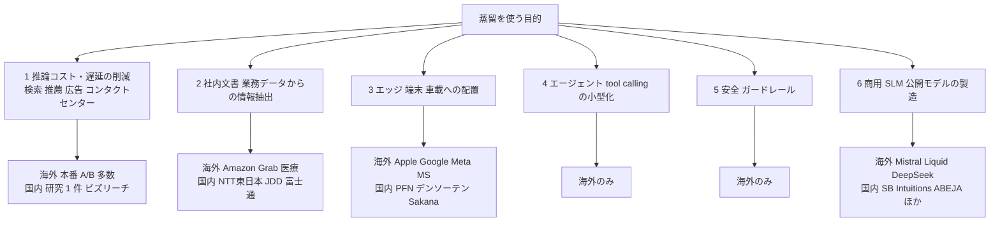

# 蒸留技術の事業者別ユースケース — 目的別の国内外比較

- **Type**: 横断整理（Cross-cluster synthesis）
- **Generated on**: 2026-11-04（追補レポート。8 クラスタの retrieval 結果から「蒸留を使う側」の事例を目的別に再編）
- **対象**: 事業者が蒸留技術を **何の目的で** 使い、**どの業務に** 適用しているか。蒸留を「売る側」の一覧は [distillation_platforms/15](../distillation_platforms/15-distillation-business-landscape-japan-vs-overseas.md) を参照
- **エビデンス品質の凡例**: 一次資料 = 論文・技術ブログ・モデルカード・公報 / ベンダー申告 = 開発元の主張で第三者検証なし / 二次報道 = メディア・第三者まとめ
- **数値の出典**: すべて各クラスタの詳細レポート（リンク先）で原典照合済み。本ページで新たに集計した数値はありません

## 結論（先に要点）



1. **海外の主目的は「大量トラフィックの推論コスト削減」** で、検索・推薦・広告の本番 A/B 一次資料が最も厚い（Walmart、LinkedIn、Tencent、Taobao、Meituan、NAVER など）。
2. **国内の主目的は「オンプレ・エッジ・データ外部送信の回避」** で、NTT 東日本・ビズリーチ・デンソーテン・PFN がこの型。本番の効果額を公表した国内事例は 0 件。
3. **tool calling とガードレールの蒸留は海外のみ**。国内は 0 件。
4. 国内の「軽量 LLM」の多くは蒸留ではない（NTT tsuzumi 2、楽天 AI 2.0 mini、ソフトバンク、三菱電機エッジ LLM）。LINE ヤフーは蒸留を試して採用しなかった。

## 目的 1: 推論コスト・レイテンシの削減（本番の大量処理を小型モデルに置き換える）

| 地域 | 事業者・用途 | 教師 → 生徒 | 成果 | 段階 | エビデンス | 資料 | 詳細レポート |
|---|---|---|---|---|---|---|---|
| 海外 | Walmart: EC 検索の関連度判定 | Mistral-7B → BERT-Base（LLM ラベル 1.7 億件） | カート追加率 +1.2% | 本番 | 一次資料 | [arXiv 2505.07105](https://arxiv.org/abs/2505.07105) | [search_recsys/01](../search_recsys/01-walmart-search-relevance-kd.md) |
| 海外 | LinkedIn: 求人・人物検索 | 8B oracle・1.7B 教師 → 0.6B | NDCG@10 +7.73%、DAU +1.2% 超、スループット 75 倍超 | 本番 | 一次資料 | [arXiv 2602.07309](https://arxiv.org/abs/2602.07309v1) | [search_recsys/02](../search_recsys/02-linkedin-semantic-search-multi-teacher.md) |
| 海外 | Tencent: Web 検索ランキング | Mistral-7B → 6 層 BERT | 100ms → 10ms、滞在時間 +1.2% | 本番 | 一次資料 | [arXiv 2411.04539](https://arxiv.org/abs/2411.04539v1) | [search_recsys/07](../search_recsys/07-tencent-disranker-web-search.md) |
| 海外 | Taobao（Alibaba）: EC 検索関連度 | 70B 級 → 7B → 101M の 2 段蒸留 | CTR +0.17%、全トラフィック稼働 | 本番 | 一次資料 | [arXiv 2411.13045](https://arxiv.org/abs/2411.13045) | [search_recsys/04](../search_recsys/04-taobao-ellm-multidim-distillation.md) |
| 海外 | AliExpress: EC 検索関連度 | Qwen3-14B の多視点 CoT → 168M BERT | RPM +1.42% | 本番 | 一次資料 | [arXiv 2601.21611](https://arxiv.org/abs/2601.21611v1) | [search_recsys/06](../search_recsys/06-aliexpress-latent-reasoning-distillation.md) |
| 海外 | Meituan: 検索広告の関連度・CTR 予測 | Qwen3-8B → 6 層 BERT | 広告 CTR +0.91%、CVR +1.06%（MSD: CTR +2.12%） | 本番 | 一次資料 | [arXiv 2510.11056](https://arxiv.org/abs/2510.11056v3) / [arXiv 2412.06860](https://arxiv.org/abs/2412.06860) | [search_recsys/05](../search_recsys/05-meituan-reasoning-llm-to-bert.md) / [17](../search_recsys/17-meituan-msd-llm-infused-ctr.md) |
| 海外 | NAVER: ロングテール検索の再ランキング | HyperCLOVA X → 1B 未満 | CTR +5.63%、滞在時間 +7.97% | 本番 | 一次資料 | [arXiv 2410.18097](https://arxiv.org/abs/2410.18097) | [search_recsys/15](../search_recsys/15-naver-rradistill-long-tail-reranking.md) |
| 海外 | JD.com: EC 検索関連度 | Qwen3-8B + 知識注入 → 小型 BERT | Bad Case 率 12.10% → 11.3% | 本番 | 一次資料 | [arXiv 2604.25683](https://arxiv.org/abs/2604.25683) | [search_recsys/16](../search_recsys/16-jd-kcare-relevance-distillation.md) |
| 海外 | Pinterest: 検索関連度 | Llama-3-8B → 特徴量 FFN | nDCG@20 +2.18%、45 以上の言語 | 本番 | 一次資料 | [arXiv 2410.17152](https://arxiv.org/abs/2410.17152) | [search_recsys/03](../search_recsys/03-pinterest-search-relevance-llm.md) |
| 海外 | Etsy: 検索関連度 | o3 → Qwen3 VL 4B → BERT 双塔（3 段カスケード） | 完全関連の割合 58 → 62%、追加遅延 10ms 未満 | 本番 | 二次資料（一次は 403） | [Etsy Code as Craft](https://www.etsy.com/codeascraft/how-etsy-uses-llms-to-improve-search-relevance) | [search_recsys/13](../search_recsys/13-etsy-semantic-relevance-cascade.md) |
| 海外 | DoorDash: 検索広告の関連度 | 微調整 LLM → DistilBERT 双塔 | Precision@2 +5.2%、追加遅延ほぼゼロ | 本番 | 二次資料（一次は 403） | [DoorDash Blog](https://careersatdoordash.com/blog/small-language-models-to-serve-more-relevant-doordash-search-ads/) | [search_recsys/12](../search_recsys/12-doordash-slm-ad-relevance.md) |
| 海外 | Amazon: EC 関連度分類（研究） | Mixtral 8x7B の根拠 → 110M BERT | 7B と ROC-AUC 差 1% 未満、50 倍高速 | オフライン評価 | 一次資料 | [COLING 2025 Industry](https://aclanthology.org/2025.coling-industry.12.pdf) | [search_recsys/08](../search_recsys/08-amazon-rationale-guided-distillation.md) |
| 海外 | ByteDance: 音楽アプリの function calling | 大型 LLM → 1.3B（簡単な問合せ約 60% を振り分け） | 中央値遅延 −78% | 本番 | 一次資料 | [arXiv 2507.08877](https://arxiv.org/abs/2507.08877) | [enterprise_workflows/02](../enterprise_workflows/02-bytedance-odia-function-calling.md) |
| 海外 | LivePerson: コンタクトセンターの agent-assist | GPT-3 → 蒸留 GPT-2 | 単価約 1/1000、ただし年間純節約差は約 3,000 ドル | 本番 | 一次資料 | [arXiv 2306.07402](https://arxiv.org/abs/2306.07402v1) | [enterprise_workflows/01](../enterprise_workflows/01-liveperson-economic-tradeoffs.md) |
| 海外 | Convirza: コールセンター通話分析 | GPT-4 → 小型モデル + マルチアダプタ | コスト削減（金額非公開） | 本番 | 二次資料 | [ZenML](https://zenml.io/llmops-database/optimizing-call-center-analytics-with-small-language-models-and-multi-adapter-serving) | [enterprise_workflows/10](../enterprise_workflows/10-convirza-predibase-call-analytics.md) |
| 海外 | Darrow: 法務リサーチの大量文書処理 | 蒸留済み API モデルを利用 | 業務利用（数値なし） | 本番 | 企業ブログ | [Darrow](https://darrow.ai/resources/distilled-llms) | [enterprise_workflows/13](../enterprise_workflows/13-darrow-legal-distilled-llms.md) |
| 国内 | 富士通: 自社 CRM の商談勝敗予測 | Takane → 約 1/100 規模 | 11 倍速、精度 +43%、GPU・運用コスト −70% | 社内実証、トライアル | ベンダー申告（報道経由） | [富士通 PR](https://global.fujitsu/ja-jp/pr/news/2025/09/08-01)（取得不可）/ [クラウド Watch](https://cloud.watch.impress.co.jp/docs/news/2045596.html) | [japan_cases/03](../japan_cases/03-fujitsu-takane-specialized-distillation.md) |
| 国内 | LINE ヤフー: 検索クエリ埋め込み（**蒸留を試して不採用**） | DistilBERT の蒸留・量子化 → 静的埋め込みに置換 | CPU 推論 18.8ms → 1.8ms | 本番 | 一次資料 | [LY Tech Blog](https://techblog.lycorp.co.jp/ja/20250804a) | [search_recsys/18](../search_recsys/18-ly-static-embedding-query.md) |

## 目的 2: 社内文書・業務データからの情報抽出（ラベルなしデータの自動処理）

| 地域 | 事業者・用途 | 教師 → 生徒 | 成果 | 段階 | エビデンス | 資料 | 詳細レポート |
|---|---|---|---|---|---|---|---|
| 海外 | Amazon: 社内経費書類の情報抽出 | Claude 3 Sonnet → 7B | 約 85% 安価、5 倍高速、教師超え | 社内運用 | 一次資料 | [arXiv 2411.14957](https://arxiv.org/html/2411.14957) | [enterprise_workflows/03](../enterprise_workflows/03-amazon-tail-expense-documents.md) |
| 海外 | Grab: 本人確認書類の読取り | 自社 Vision LLM 約 1B | 本番トラフィックで稼働 | 本番 | 一次資料 | [Grab Engineering](https://engineering.grab.com/custom-vision-llm-at-grab) | [enterprise_workflows/14](../enterprise_workflows/14-grab-custom-vision-llm-document-processing.md) |
| 海外 | 医療機関（npj Digital Medicine）: 臨床情報の抽出 | Llama 70B → 8B | 精度 89.1% vs 76.1%、推論費 約 77% 減 | 研究 | 一次資料 | [PMC12065832](https://pmc.ncbi.nlm.nih.gov/articles/PMC12065832/) | [enterprise_workflows/05](../enterprise_workflows/05-npj-synthetic-data-distillation-clinical.md) |
| 海外 | Stanford: 臨床 NER | LLM ラベル → BERT | 最大 101 倍安価、12 倍高速 | 研究 | 一次資料 | [arXiv 2501.00031](https://arxiv.org/abs/2501.00031v1) | [enterprise_workflows/06](../enterprise_workflows/06-stanford-clinical-ner-distillation.md) |
| 海外 | SHIELD: 臨床ノートの匿名化 | LLM → 蒸留 SLM | 企業規模の匿名化 | 研究 | 一次資料 | [arXiv 2605.03301](https://arxiv.org/abs/2605.03301) | [enterprise_workflows/15](../enterprise_workflows/15-shield-clinical-deidentification-distillation.md) |
| 海外 | SAP: 業務文書理解（特許） | LLM → 小型モデルの共同学習 | 登録特許 | 特許 | 一次資料（公報） | [US12475175](https://patents.google.com/patent/US12475175) | [enterprise_workflows/04](../enterprise_workflows/04-sap-patent-document-understanding-kd.md) |
| 国内 | NTT 東日本: 通信設備保守の危険予知（現場写真） | Qwen3-VL-235B → 8B | 危険予知スコア 8.04 → 8.65 | 研究（実データ 4,567 枚） | 一次資料 | [NLP2026 C4-2](https://www.anlp.jp/proceedings/annual_meeting/2026/pdf_dir/C4-2.pdf) | [japan_cases/09](../japan_cases/09-ntt-east-facility-maintenance-vlm.md) |
| 国内 | ビズリーチ: 求人・レジュメのマッチング埋め込み | GPT-4o-mini の採点 → 12M〜45M BERT | OpenAI Embedding API と同等以上（68.88 vs 68.58）。外部送信の回避も動機 | 社内研究（オフライン評価） | 一次資料 | [NLP2026 C7-6](https://www.anlp.jp/proceedings/annual_meeting/2026/pdf_dir/C7-6.pdf) | [search_recsys/14](../search_recsys/14-bizreach-llm-teacher-job-embedding.md) |
| 国内 | Japan Digital Design（MUFG 系）: 金融市場レポートの日英翻訳 | 70B → 70B（データ蒸留、小型化なし） | Judge Overall +0.178、品質の分散 1/18 | 研究（実務レポート） | 一次資料 | [NLP2026 C9-7](https://www.anlp.jp/proceedings/annual_meeting/2026/pdf_dir/C9-7.pdf) | [japan_cases/08](../japan_cases/08-jdd-financial-translation-distillation.md) |

## 目的 3: エッジ・端末・車載への配置（クラウド不可・オフライン）

| 地域 | 事業者・用途 | 教師 → 生徒 | 成果 | 段階 | エビデンス | 資料 | 詳細レポート |
|---|---|---|---|---|---|---|---|
| 海外 | Apple: iPhone / Mac の端末内モデル | 社内 MoE → 約 3B | 教師学習コスト 90% 減、KV メモリ約 37.5% 減 | 製品 | 一次資料 | [arXiv 2507.13575](https://arxiv.org/abs/2507.13575) | [edge_ondevice/01](../edge_ondevice/01-apple-foundation-models-2025.md) |
| 海外 | Apple × Google: Gemini からの蒸留 | Gemini → AFM 3 | 利用料 年約 10 億ドル（報道） | 製品 | ベンダー申告 + 二次報道 | [The Decoder](https://the-decoder.com/apple-gets-full-gemini-access-and-uses-distillation-to-build-lightweight-on-device-ai/) | [edge_ondevice/02](../edge_ondevice/02-apple-gemini-distillation-reports.md) |
| 海外 | Google: Pixel / Android の Gemini Nano | 大型 Gemini → 1.8B / 3.25B | 製品搭載（Pro 比 Factuality 0.71 / 0.81） | 製品 | 一次資料 | [arXiv 2312.11805](https://arxiv.org/abs/2312.11805) | [edge_ondevice/03](../edge_ondevice/03-gemini-nano.md) |
| 海外 | Microsoft: Copilot+ PC の Phi Silica（LoRA 部分） | GPT-4o の合成データ → LoRA | 拒否率 75% 減、選好 4.6 倍 | 製品 | ベンダー申告 | [Windows Blog](https://blogs.windows.com/windowsdeveloper/2025/07/31/phi-silica-task-specialization-using-lora-in-microsoft-learning-zone-a-technical-deep-dive/) | [edge_ondevice/04](../edge_ondevice/04-phi-silica.md) |
| 海外 | Meta: Llama 3.2 1B/3B モバイル向け | Llama 3.1 8B / 70B → 1B / 3B | デコード 19.2 → 50.2 tok/s（量子化後） | 公開モデル | 一次資料 | [Meta AI Blog](https://ai.meta.com/blog/llama-3-2-connect-2024-vision-edge-mobile-devices/) | [edge_ondevice/05](../edge_ondevice/05-llama-3-2-edge.md) |
| 海外 | Google: 端末制約に応じた蒸留（特許） | クラウド ASR/NLU/TTS → 端末モデル | 教師との精度差 1% 以内で配備（実施例） | 特許 | 一次資料（公報） | [US11990121B2](https://patents.google.com/patent/US11990121B2) | [edge_ondevice/10](../edge_ondevice/10-google-patent-distilling-to-target-device.md) |
| 国内 | PFN: 自律稼働デバイス向け VLM の基盤 | PLaMo 2 31B → 8B（剪定 + 蒸留） | 学習計算量 1/5、PLaMo 2.1-VL の土台 | 製品 | 一次資料 | [arXiv 2509.04897](https://arxiv.org/abs/2509.04897) | [japan_cases/02](../japan_cases/02-pfn-plamo2-pruning-distillation.md) |
| 国内 | デンソーテン: 車載器・スマホの RAG 検索 | ruri-v3-130m → 70m | nDCG@10 66.38 → 67.73 | 研究 | 一次資料 | [NLP2026 P1-4](https://www.anlp.jp/proceedings/annual_meeting/2026/pdf_dir/P1-4.pdf) | [japan_cases/index](../japan_cases/index.md) |
| 国内 | Sakana AI: スマホで動く日本語 SLM | Qwen2.5-32B → 1.5B（TAID） | iPhone で 19.89 tok/s | 公開（実験的） | 一次資料 | [arXiv 2501.16937](https://arxiv.org/abs/2501.16937) / [Sakana](https://sakana.ai/taid-jp/) | [japan_cases/01](../japan_cases/01-sakana-taid-tinyswallow.md) |
| 国内 | 富士通: スマホ・工場機械向け（1bit 量子化と併用） | Takane → 約 1/100 | メモリ最大 94% 減、精度維持率 89% | 社内実証 | ベンダー申告 | [EE Times Japan](https://eetimes.itmedia.co.jp/ee/articles/2509/10/news027.html) | [edge_ondevice/09](../edge_ondevice/09-fujitsu-takane-quantization-distillation.md) |

## 目的 4: AI エージェント・tool calling の小型化（海外のみ）

| 事業者・用途 | 内容 | 段階 | エビデンス | 資料 | 詳細レポート |
|---|---|---|---|---|---|
| AWS Bedrock Model Distillation | function calling の精度向上とコスト・遅延削減（405B → 3B で BFCL 0.586 → 0.828） | ベンダー実験 | ベンダー申告 | [AWS Blog](https://aws.amazon.com/blogs/machine-learning/amazon-bedrock-model-distillation-boost-function-calling-accuracy-while-reducing-cost-and-latency/) | [enterprise_workflows/07](../enterprise_workflows/07-aws-bedrock-function-calling-distillation.md) |
| NVIDIA Data Flywheel | 本番ログから tool calling を小型モデルへ蒸留するリファレンス | リファレンス実装 | ベンダー申告 | [NVIDIA Blog](https://developer.nvidia.com/blog/build-efficient-ai-agents-through-model-distillation-with-nvidias-data-flywheel-blueprint) | [enterprise_workflows/08](../enterprise_workflows/08-nvidia-data-flywheel-tool-calling.md) |
| NVIDIA 金融ワークフロー | 金融データ処理の蒸留リファレンス | リファレンス実装 | ベンダー申告 | [NVIDIA Blog](https://developer.nvidia.com/blog/build-efficient-financial-data-workflows-with-ai-model-distillation/) | [enterprise_workflows/09](../enterprise_workflows/09-nvidia-financial-distillation.md) |
| Salesforce xLAM（APIGen） | 1B / 7B の function calling モデル。Agentforce で言及 | 公開モデル | 一次資料 | [arXiv 2406.18518](https://arxiv.org/abs/2406.18518) | [enterprise_workflows/18](../enterprise_workflows/18-apigen-xlam-function-calling-data.md) |
| Instacart: クエリ理解 | フロンティア LLM → Llama-3-8B。ロングテール不満 −50%、700 → 300ms | 本番 | 一次資料 | [Instacart](https://company.instacart.com/tech-innovation/building-the-intent-engine-how-instacart-is-revamping-query-understanding-with-llms) | [search_recsys/09](../search_recsys/09-instacart-intent-engine.md) |
| Microsoft: エージェント生成例で生徒を学習（特許） | 出願公開 | 特許 | 一次資料（公報） | [US20250322255A1](https://patents.google.com/patent/US20250322255A1) | [enterprise_workflows/16](../enterprise_workflows/16-microsoft-patent-agent-generated-student-training.md) |

> 国内では tool calling 向けの蒸留事例は確認できませんでした（[japan_cases/index](../japan_cases/index.md) の仮説 H6）。

## 目的 5: 安全・ガードレール（海外のみ）

| 事業者・用途 | 内容 | エビデンス | 資料 | 詳細レポート |
|---|---|---|---|---|
| CONSCENDI: バーチャルアシスタントのガードレール | GPT-4 生成の対照データで小型モデル。GPT-4 を精度で上回り推論 86 倍以上安価 | 一次資料 | [arXiv 2304.14364](https://arxiv.org/abs/2304.14364) | [enterprise_workflows/11](../enterprise_workflows/11-conscendi-guardrail-distillation.md) |
| 医療 LLM の黒箱蒸留リスク | 約 12 ドルの蒸留で安全整合が壊れる（危険応答 66% → 86%） | 一次資料 | [arXiv 2512.09403](https://arxiv.org/abs/2512.09403v1) | [enterprise_workflows/12](../enterprise_workflows/12-blackbox-distillation-medical-safety.md) |

## 目的 6: 商用 SLM・公開モデルの製造（モデル提供者側）

| 地域 | 事業者 | 内容 | 段階 | エビデンス | 資料 | 詳細レポート |
|---|---|---|---|---|---|---|
| 海外 | Mistral / Liquid AI / DeepSeek / Google Gemma / Meta | 蒸留で作った小型モデルを API・ライセンスで収益化 | 商用 | 一次資料 | — | [distillation_platforms/15](../distillation_platforms/15-distillation-business-landscape-japan-vs-overseas.md) / [open_distilled_models/index](../open_distilled_models/index.md) |
| 海外 | Alibaba DistilQwen2.5 | 7B → 3B の SQL 補完で 384 → 148ms | 社内製品 | 一次資料 | — | [distillation_platforms/08](../distillation_platforms/08-distilqwen25-alibaba-pai.md) |
| 国内 | SB Intuitions: Sarashina mini | コールセンター自動応答・営業支援向け API（2025-11-28〜）。数値なし | 商用 API | ベンダー申告（IR） | — | [japan_cases/10](../japan_cases/10-non-distillation-lightweight-llms.md) |
| 国内 | ABEJA | 32B → 7B の白箱蒸留。Japanese MT-Bench 7.26。Platform 搭載予定 | 公開モデル | 一次資料 | [Hugging Face](https://huggingface.co/abeja/ABEJA-Qwen2.5-7b-Japanese-v0.1) / [技術ブログ](https://tech-blog.abeja.asia/entry/geniac2-distillation-pipeline-parallel) | [japan_cases/04](../japan_cases/04-abeja-geniac-qwen25-7b-distillation.md) / [11](../japan_cases/11-abeja-nemo-distillation-pipeline-parallel.md) |
| 国内 | サイバーエージェント / Lightblue / ELYZA / rinna | DeepSeek-R1 系の日本語推論モデルを公開 | 公開モデル | 一次資料 | [CA](https://huggingface.co/cyberagent/DeepSeek-R1-Distill-Qwen-14B-Japanese) / [Lightblue](https://huggingface.co/lightblue/DeepSeek-R1-Distill-Qwen-7B-Japanese) | [japan_cases/05](../japan_cases/05-cyberagent-lightblue-r1-distill-japanese.md) / [12](../japan_cases/12-elyza-rinna-r1-japanese-reasoning-models.md) |
| 国内 | Kotoba Technologies: 日本語音声認識 | Whisper large-v3 → 756M。6.3 倍速、CER 14.9 → 11.6。コールセンター・議事録向け | OSS 公開 | 一次資料 | [Hugging Face](https://huggingface.co/kotoba-tech/kotoba-whisper-v2.0) | [japan_cases/06](../japan_cases/06-kotoba-whisper-speech-distillation.md) |

## 海外と国内の違い

| 観点 | 海外 | 国内 |
|---|---|---|
| 最も厚い用途 | 検索・推薦・広告の本番 A/B（11 件以上） | 研究発表・公開モデル。検索・推薦はビズリーチの研究 1 件 |
| 主な動機 | 大量トラフィックの推論コスト削減 | オンプレ・エッジ・データ外部送信の回避 |
| tool calling / ガードレール | 成立（ベンダー実験・研究） | 0 件 |
| 教師モデル | オープンウェイト中心。商用 API も一部（Claude 3 Sonnet、o3、GPT-4） | Qwen / DeepSeek / 自社モデル。商用 API 教師はビズリーチのみ |
| 効果の金額化 | LivePerson と CONSCENDI の 2 件のみ | 0 件 |

```text
目的別の事例数（本ページ掲載分。研究・特許を含む）

目的 1 コスト削減    海外 ████████████████ 16   国内 ██ 2（うち 1 件は不採用）
目的 2 情報抽出      海外 ██████ 6             国内 ███ 3
目的 3 エッジ        海外 ██████ 6             国内 ████ 4
目的 4 tool calling  海外 ██████ 6             国内 0
目的 5 安全          海外 ██ 2                 国内 0
目的 6 モデル製造    海外 ██ 2 系統            国内 █████ 5 系統
```

## 限界

- 本ページは既存 8 クラスタの retrieval 結果の再編であり、新規の検索は行っていません。各クラスタの index にある「取得できなかった資料」の制約をそのまま引き継ぎます。
- Etsy と DoorDash の一次ブログは取得時に 403 で、ZenML の二次資料で確認しています。Apple × Gemini は有料報道が原典です。
- 「蒸留」の定義は各レポートの判定（白箱 / 黒箱 / データ蒸留 / 非蒸留）に従い、非蒸留の事例は明示した場合のみ掲載しています。
