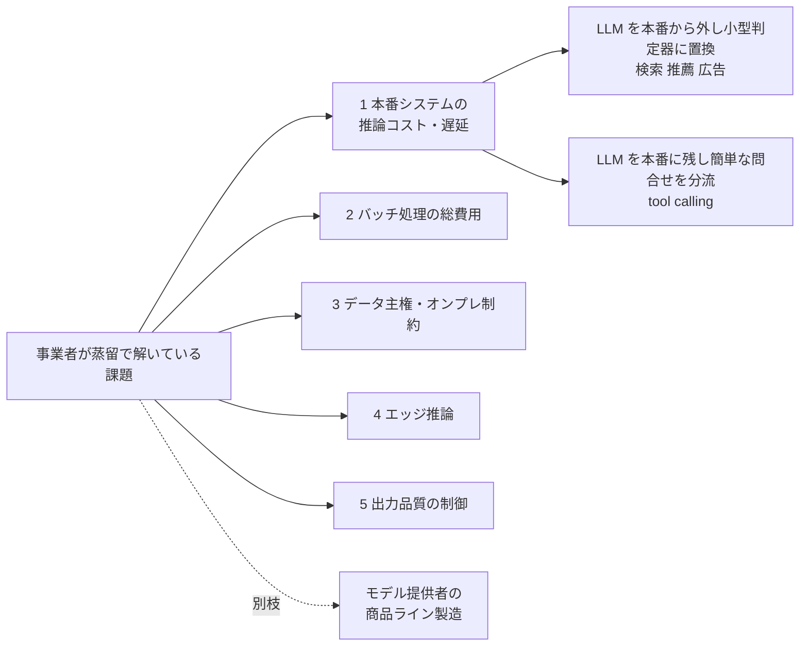

# 蒸留技術の事業者別ユースケース — 解いている課題による 5 分類

- **Type**: 横断整理（Cross-cluster synthesis）
- **Generated on**: 2026-11-11（[01](01-distillation-use-cases-by-purpose.md) の 6 目的分類を「事業者が解いている課題」で 5 分類に再編し、列を組み替えた版）
- **列の方針**: 教師 → 生徒はモデル名とパラメータ数の変化を分かる範囲で記載。成果は評価指標に加えて実行時間（遅延・スループット・学習時間）の変化を併記。段階・エビデンス品質の列は省略（詳細レポート側に記載）
- **対象外**: 蒸留と判定されなかった事例（Grab、Convirza、Mercedes-Benz、Cerence、LINE ヤフー）と、攻撃研究（医療 LLM の黒箱蒸留）は本表に含めない。モデル提供者の商品ライン製造は末尾に別枝として置く
- **数値の出典**: すべて詳細レポート（リンク先）で原典照合済み。「記載なし」は原典に数値がないことを示す

## 分類

| # | 解いている課題 | 内容 | 海外 | 国内 |
|---|---|---|---|---|
| 1 | 本番システムの推論コスト・遅延 | 大量リクエストを処理するシステムに LLM を直接置けない。小型モデルに置換するか、簡単な問合せだけ分流する | 18 | 1 |
| 2 | バッチ処理の総費用 | 大量文書を LLM で全件処理する費用と時間 | 5 | 0 |
| 3 | データ主権・オンプレ制約 | 社内データを外部 API に送れない、限られた GPU で動かす | 0 | 2 |
| 4 | エッジ推論 | 端末・車載・工場機械でオフライン動作させる。DRAM・電力の制約 | 5 | 4 |
| 5 | 出力品質の制御 | ばらつき・用語不統一・拒否率・安全判定。小型化が目的ではない | 3 | 1 |

> 複数の課題にまたがる事例は主目的で 1 つに割り当て、副目的は備考列に記載しています。

## 1. 本番システムの推論コスト・遅延

| 地域 | 事業者・用途 | 教師 → 生徒（モデル / パラメータ） | 成果（指標 / 実行時間） | 備考 | 資料 | 詳細レポート |
|---|---|---|---|---|---|---|
| 海外 | Walmart: EC 検索の関連度判定 | Mistral-7B（7B、LoRA 分類器）→ BERT-Base（約 110M） | カート追加率 +1.2% / 実行時間の数値なし（7B はリアルタイム不可と記述） | LLM ラベル 1.7 億件 | [arXiv 2505.07105](https://arxiv.org/abs/2505.07105) | [search_recsys/01](../search_recsys/01-walmart-search-relevance-kd.md) |
| 海外 | LinkedIn: 求人・人物検索の最終ランキング | 関連度 oracle 8B + エンゲージメント教師 1.7B → SLM 0.6B → 剪定後 375M | NDCG@10 +7.73%、DAU +1.2% 超 / 500ms 予算・H100 1 枚で 290 → 22,000 items/s、蒸留パイプライン 約 45 時間 → 5 時間未満 | 多教師蒸留 | [arXiv 2602.07309](https://arxiv.org/abs/2602.07309v1) | [search_recsys/02](../search_recsys/02-linkedin-semantic-search-multi-teacher.md) |
| 海外 | Tencent: Web 検索ランキング | Mistral-7B（7B）→ 6 層 BERT（0.1B） | nDCG@5 0.8536、PageCTR +0.47%、滞在時間 +1.2% / 約 100ms → 約 10ms（A10、batch 48） | — | [arXiv 2411.04539](https://arxiv.org/abs/2411.04539v1) | [search_recsys/07](../search_recsys/07-tencent-disranker-web-search.md) |
| 海外 | Taobao（Alibaba）: EC 検索関連度 | Qwen2-72B / Llama3-70B → Qwen2-7B → 101.2M（2 段蒸留） | CTR +0.17%、全トラフィック稼働 / 7B は 1,000 ペア 84〜432 秒でオンライン不可、生徒の絶対値は記載なし | — | [arXiv 2411.13045](https://arxiv.org/abs/2411.13045) | [search_recsys/04](../search_recsys/04-taobao-ellm-multidim-distillation.md) |
| 海外 | AliExpress: EC 検索関連度 | Qwen3-14B（14B、LoRA）→ BERT-multilingual-base（168M） | RPM +1.42% / 100 件バッチ 46.8 秒 → 132〜149ms（約 350 倍） | 潜在推論ベクトルの蒸留 | [arXiv 2601.21611](https://arxiv.org/abs/2601.21611v1) | [search_recsys/06](../search_recsys/06-aliexpress-latent-reasoning-distillation.md) |
| 海外 | Meituan: 検索の関連度予測 | Qwen3-8B（CPT + SFT + GRPO）→ 6 層 BERT（パラメータ数記載なし） | 広告 CTR +0.91%、CVR +1.06% / 実行時間の数値なし | — | [arXiv 2510.11056](https://arxiv.org/abs/2510.11056v3) | [search_recsys/05](../search_recsys/05-meituan-reasoning-llm-to-bert.md) |
| 海外 | Meituan: スポンサー検索の CTR 予測 | LLM（名称・サイズ非公開）→ 小型生徒 → CTR モデルへ注入 | CTR +2.12%、CPM +2.59% / 35ms → 37.2ms（+2.2ms） | 教師をオンラインから除去 | [arXiv 2412.06860](https://arxiv.org/abs/2412.06860) | [search_recsys/17](../search_recsys/17-meituan-msd-llm-infused-ctr.md) |
| 海外 | NAVER: ロングテール検索の再ランキング | HyperCLOVA X Large（非公開）→ RRA-BERT / RRA-GPT（1B 未満） | CTR +5.63%、滞在時間 +7.97% / 推論時間 −5.58%（学習専用層の除去）、bfloat16 で QPS +18% | 7 日間 A/B | [arXiv 2410.18097](https://arxiv.org/abs/2410.18097) | [search_recsys/15](../search_recsys/15-naver-rradistill-long-tail-reranking.md) |
| 海外 | JD.com: EC 検索関連度 | Qwen3-8B + 知識注入（8B）→ 小型 BERT（非公開） | Bad Case 率 12.10% → 11.3% / 推論遅延を 1 桁削減（絶対値非公開） | 軌跡合成に GPT-5.2 | [arXiv 2604.25683](https://arxiv.org/abs/2604.25683) | [search_recsys/16](../search_recsys/16-jd-kcare-relevance-distillation.md) |
| 海外 | Pinterest: 検索関連度 | Llama-3-8B（8B、qLoRA）→ 特徴量ベース FFN（非公開） | nDCG@20 +2.18%、非 US fulfillment +2.0% / 実行時間の数値なし | 45 以上の言語 | [arXiv 2410.17152](https://arxiv.org/abs/2410.17152) | [search_recsys/03](../search_recsys/03-pinterest-search-relevance-llm.md) |
| 海外 | Etsy: 検索関連度 | 推論 LLM（o3 と推定）→ Qwen3 VL 4B → BERT 双塔（3 段カスケード） | 完全関連の割合 58 → 62% / 追加遅延 10ms 未満 | 一次は 403、二次資料 | [Etsy Code as Craft](https://www.etsy.com/codeascraft/how-etsy-uses-llms-to-improve-search-relevance) | [search_recsys/13](../search_recsys/13-etsy-semantic-relevance-cascade.md) |
| 海外 | DoorDash: 検索広告の関連度 | 微調整 LLM（非公開、人手 70 万件）→ DistilBERT 双塔（64 次元） | Precision@2 +5.2% / 追加遅延ほぼゼロ（埋め込みを事前計算） | 一次は 403、二次資料 | [DoorDash Blog](https://careersatdoordash.com/blog/small-language-models-to-serve-more-relevant-doordash-search-ads/) | [search_recsys/12](../search_recsys/12-doordash-slm-ad-relevance.md) |
| 海外 | Amazon: EC 関連度分類 | Mixtral 8x7B（根拠生成）→ BERT-base（110M） | 微調整 7B と ROC-AUC 差 1% 未満 / 50 倍高速（オフライン評価） | 本番 A/B なし | [COLING 2025 Industry](https://aclanthology.org/2025.coling-industry.12.pdf) | [search_recsys/08](../search_recsys/08-amazon-rationale-guided-distillation.md) |
| 海外 | Instacart: クエリ理解（ロングテール） | フロンティア LLM（非公開、RAG 強化）→ Llama-3-8B（LoRA） | ロングテールの不満 −50% / 約 700ms（A100）→ 約 300ms（LoRA 統合 + H100） | 副目的: 自社配信できる開放モデルへの置換 | [Instacart](https://company.instacart.com/tech-innovation/building-the-intent-engine-how-instacart-is-revamping-query-understanding-with-llms) | [search_recsys/09](../search_recsys/09-instacart-intent-engine.md) |
| 海外 | ByteDance: 音楽アプリの function calling | 大型 LLM（非公開）→ deepseek-coder-1.3B | 簡単な問合せ約 60% を小型で処理、精度低下はごくわずか / 中央値遅延 −78%、期待遅延 約 1.6 秒 → 870ms（−45%） | 分流型（ルーティング 50ms 未満） | [arXiv 2507.08877](https://arxiv.org/abs/2507.08877) | [enterprise_workflows/02](../enterprise_workflows/02-bytedance-odia-function-calling.md) |
| 海外 | AWS Bedrock: function calling の蒸留 | Llama 3.1 405B → Llama 3.2 3B | BFCL multiple 0.586 → 0.828、simple 0.478 → 0.826 / 遅延 −72%（Artificial Analysis の数値を引用） | ベンダー実験 | [AWS Blog](https://aws.amazon.com/blogs/machine-learning/amazon-bedrock-model-distillation-boost-function-calling-accuracy-while-reducing-cost-and-latency/) | [enterprise_workflows/07](../enterprise_workflows/07-aws-bedrock-function-calling-distillation.md) |
| 海外 | NVIDIA Data Flywheel: エージェントの tool calling | Llama-3.3-70B-Instruct → Llama-3.2-1B-Instruct | 70B の tool calling 精度の 98% / 推論 GPU 2 枚 → 1 枚、遅延の数値なし | 教師の本番ログのみで学習 | [NVIDIA Blog](https://developer.nvidia.com/blog/build-efficient-ai-agents-through-model-distillation-with-nvidias-data-flywheel-blueprint) | [enterprise_workflows/08](../enterprise_workflows/08-nvidia-data-flywheel-tool-calling.md) |
| 海外 | LivePerson: コンタクトセンターの agent-assist | GPT-3（text-davinci-003）→ GPT-2 12 層 → 6 層（81M） | 応答の採用率 69% → 57%、年間純節約 53,653 vs 50,920 ドル（差 約 3,000 ドル） / 12ms・0.0011 セント/推論（A100）、単価約 1/1000 | 精度低下の損失まで金額化 | [arXiv 2306.07402](https://arxiv.org/abs/2306.07402v1) | [enterprise_workflows/01](../enterprise_workflows/01-liveperson-economic-tradeoffs.md) |
| 海外 | Alibaba PAI: SQL 補完（DistilQwen2.5） | Qwen2.5-7B（int4）→ Qwen2.5-3B | 採用率 26.5% → 25.5% / 384ms → 148ms（本文は推論速度 1.4 倍と記述） | 社内製品 | [arXiv 2504.15027](https://arxiv.org/abs/2504.15027) | [distillation_platforms/08](../distillation_platforms/08-distilqwen25-alibaba-pai.md) |
| 国内 | ビズリーチ: 求人・レジュメのマッチング埋め込み | GPT-4o-mini（採点のみ）→ 自社 BERT 12M / 30M / 45M | 総合 68.88（OpenAI Embedding API 68.58、ruri-small 42.54） / 実行時間の数値なし | 副目的: 外部送信の回避（課題 3） | [NLP2026 C7-6](https://www.anlp.jp/proceedings/annual_meeting/2026/pdf_dir/C7-6.pdf) | [search_recsys/14](../search_recsys/14-bizreach-llm-teacher-job-embedding.md) |

## 2. バッチ処理の総費用

| 地域 | 事業者・用途 | 教師 → 生徒（モデル / パラメータ） | 成果（指標 / 実行時間） | 備考 | 資料 | 詳細レポート |
|---|---|---|---|---|---|---|
| 海外 | Amazon: 社内経費書類の情報抽出 | Claude 3 Sonnet → LLaVA-Net 7B（テキスト部 Mistral 7B、LoRA） | 教師と同等以上、約 85% 安価、拒否 0 件 / 0.3 → 1.5 docs/s（約 5 倍）、学習 8 GPU 約 10 時間 | 単一 20GB GPU で稼働 | [arXiv 2411.14957](https://arxiv.org/html/2411.14957) | [enterprise_workflows/03](../enterprise_workflows/03-amazon-tail-expense-documents.md) |
| 海外 | シカゴ大・Stanford: 臨床情報の抽出 | Llama-3.1-70B-Instruct → Llama 8B / 3B / 1B（QLoRA） | 8B が 89.1%（教師 76.1%）、1 万人 × 23 問で 4,066 → 929 ドル / 2.34 秒 → 0.535 秒/例、学習 8 GPU 12 時間未満 | 副目的: 院内で動く（課題 3） | [PMC12065832](https://pmc.ncbi.nlm.nih.gov/articles/PMC12065832/) | [enterprise_workflows/05](../enterprise_workflows/05-npj-synthetic-data-distillation-clinical.md) |
| 海外 | Stanford: 臨床 NER | LLM + オントロジーのラベル → BERT（LLM の約 1/1000） | NER 性能は同程度、最大 101 倍安価 / 12 倍高速 | — | [arXiv 2501.00031](https://arxiv.org/abs/2501.00031v1) | [enterprise_workflows/06](../enterprise_workflows/06-stanford-clinical-ner-distillation.md) |
| 海外 | SHIELD: 臨床ノートの匿名化 | LLM → 蒸留 SLM（詳細は abs のみ取得） | 企業規模の匿名化 / 実行時間の数値未取得 | 本文未取得 | [arXiv 2605.03301](https://arxiv.org/abs/2605.03301) | [enterprise_workflows/15](../enterprise_workflows/15-shield-clinical-deidentification-distillation.md) |
| 海外 | Darrow: 法務リサーチの大量文書処理 | 蒸留済み API モデルを利用（教師・生徒・サイズ非公開） | 業務利用の記述のみ / GPT-4o mini は GPT-3.5 Turbo の 2.5 倍高速（第三者レポートの引用） | 自社実測なし | [Darrow](https://darrow.ai/resources/distilled-llms) | [enterprise_workflows/13](../enterprise_workflows/13-darrow-legal-distilled-llms.md) |

## 3. データ主権・オンプレ制約

| 地域 | 事業者・用途 | 教師 → 生徒（モデル / パラメータ） | 成果（指標 / 実行時間） | 備考 | 資料 | 詳細レポート |
|---|---|---|---|---|---|---|
| 国内 | NTT 東日本: 通信設備保守の危険予知（現場写真） | Qwen3-VL-235B-A22B → Qwen3-VL-8B（LoRA r16） | 危険予知 8.04 → 8.65（+7.6%）、Accuracy +4.4〜5.0% / 実行時間の数値なし | 現場写真 4,567 枚。オンプレ等の限られた計算資源で運用する前提 | [NLP2026 C4-2](https://www.anlp.jp/proceedings/annual_meeting/2026/pdf_dir/C4-2.pdf) | [japan_cases/09](../japan_cases/09-ntt-east-facility-maintenance-vlm.md) |
| 国内 | 富士通: 自社 CRM の商談勝敗予測 | Takane（サイズ非公開）→ 約 1/100 規模（NAS で探索） | 精度 +43%、GPU メモリ・運用コスト各 −70% / 推論 11 倍速 | ベンダー申告（報道経由）。副目的: エッジ展開（課題 4） | [クラウド Watch](https://cloud.watch.impress.co.jp/docs/news/2045596.html)（[富士通 PR](https://global.fujitsu/ja-jp/pr/news/2025/09/08-01) は取得不可） | [japan_cases/03](../japan_cases/03-fujitsu-takane-specialized-distillation.md) |

> 海外でこの課題を主目的に掲げた事例はなく、Instacart・シカゴ大・ビズリーチが副目的として挙げています。

## 4. エッジ推論

| 地域 | 事業者・用途 | 教師 → 生徒（モデル / パラメータ） | 成果（指標 / 実行時間） | 備考 | 資料 | 詳細レポート |
|---|---|---|---|---|---|---|
| 海外 | Apple: iPhone / Mac の端末内モデル | 社内 MoE（密 3B を 64 エキスパートに upcycle）→ 密 約 3B（非埋め込み 2.58B + 埋め込み 0.15B） | 2bit QAT で MMLU 67.8 → 64.4、KV メモリ −37.5% / TTFT 約 −37.5%、教師の学習コスト −90% | logit 蒸留は学習の最後の約 10% | [arXiv 2507.13575](https://arxiv.org/abs/2507.13575) | [edge_ondevice/01](../edge_ondevice/01-apple-foundation-models-2025.md) |
| 海外 | Google: Pixel / Android の Gemini Nano | 大型 Gemini（サイズ非公開）→ Nano-1 1.8B / Nano-2 3.25B | Pro 比 Factuality 0.71 / 0.81、MBPP 0.33 / 0.45 / 実行時間の数値なし | 4bit 量子化 | [arXiv 2312.11805](https://arxiv.org/abs/2312.11805) | [edge_ondevice/03](../edge_ondevice/03-gemini-nano.md) |
| 海外 | Microsoft: Copilot+ PC の Phi Silica | 本体は Phi-3.5-mini 派生 3.3B（非蒸留）。LoRA 部分のみ GPT-4o → LoRA | メモリ約 60% 減 / 初トークン 230ms、最大 20 tok/s（NPU） | LoRA の品質効果は課題 5 に記載 | [Windows Blog](https://blogs.windows.com/windowsexperience/2024/12/06/phi-silica-small-but-mighty-on-device-slm/) | [edge_ondevice/04](../edge_ondevice/04-phi-silica.md) |
| 海外 | Meta: Llama 3.2 モバイル向け | Llama 3.1 8B / 70B → Llama 3.2 1B / 3B（剪定で初期化 + logit 蒸留） | 公開モデル / 1B デコード 19.2 → 50.2 tok/s（SpinQuant）、教師 logit 生成 86k H100 時間（学習全体の約 10%） | — | [Meta AI Blog](https://ai.meta.com/blog/llama-3-2-connect-2024-vision-edge-mobile-devices/) | [edge_ondevice/05](../edge_ondevice/05-llama-3-2-edge.md) |
| 海外 | Google: 端末制約に応じた蒸留（特許） | クラウドの ASR / NLU / TTS → 端末制約に応じて選んだ生徒 | 教師との精度差 1% 以内で配備（実施例） / 遅延・帯域の改善を効果として記載、数値なし | 登録特許 | [US11990121B2](https://patents.google.com/patent/US11990121B2) | [edge_ondevice/10](../edge_ondevice/10-google-patent-distilling-to-target-device.md) |
| 国内 | PFN: 自律稼働デバイス向け VLM の基盤 | PLaMo 2 31B → PLaMo 2.1 8B（剪定 + top-128 logit KL、500B トークン） | JMMLU 0.572（スクラッチ 8B）→ 0.635、PLaMo 2.1-VL の土台 / 学習計算量 約 1/5、推論時間の数値なし | 製品 | [arXiv 2509.04897](https://arxiv.org/abs/2509.04897) | [japan_cases/02](../japan_cases/02-pfn-plamo2-pruning-distillation.md) |
| 国内 | デンソーテン: 車載器・スマホの RAG 検索 | ruri-v3-130m → ruri-v3-70m（100M 以下） | JMTEB 検索 nDCG@10 66.38 → 67.73 / 実行時間の数値なし | 白箱（類似度分布の KL） | [NLP2026 P1-4](https://www.anlp.jp/proceedings/annual_meeting/2026/pdf_dir/P1-4.pdf) | [japan_cases/index](../japan_cases/index.md) |
| 国内 | Sakana AI: スマホで動く日本語 SLM | Qwen2.5-32B-Instruct → Qwen2.5-1.5B（TAID、約 1/20） | 日本語平均 0.402（Qwen2.5-1.5B 0.372） / iPhone Q5 で 19.89 tok/s | 「商用を意図しない実験的プロトタイプ」 | [arXiv 2501.16937](https://arxiv.org/abs/2501.16937) / [Sakana](https://sakana.ai/taid-jp/) | [japan_cases/01](../japan_cases/01-sakana-taid-tinyswallow.md) |
| 国内 | 富士通: スマホ・工場機械向け（1bit 量子化と併用） | Takane → 約 1/100 規模 | メモリ最大 −94%、精度維持率 89% / 推論 11 倍速 | ベンダー申告（報道経由） | [EE Times Japan](https://eetimes.itmedia.co.jp/ee/articles/2509/10/news027.html) | [edge_ondevice/09](../edge_ondevice/09-fujitsu-takane-quantization-distillation.md) |

## 5. 出力品質の制御

| 地域 | 事業者・用途 | 教師 → 生徒（モデル / パラメータ） | 成果（指標 / 実行時間） | 備考 | 資料 | 詳細レポート |
|---|---|---|---|---|---|---|
| 海外 | Microsoft: Phi Silica の Learning Zone 向け LoRA | GPT-4o（合成データ）→ Phi Silica 3.3B 上の LoRA | 拒否率 −75%、選好 4.6 倍 / LoRA 学習ジョブ 平均 45〜60 分、推論は本体と同じ | システムプロンプト短縮で体感遅延も改善 | [Windows Blog](https://blogs.windows.com/windowsdeveloper/2025/07/31/phi-silica-task-specialization-using-lora-in-microsoft-learning-zone-a-technical-deep-dive/) | [edge_ondevice/04](../edge_ondevice/04-phi-silica.md) |
| 海外 | CONSCENDI: バーチャルアシスタントのガードレール | GPT-4（対照データ生成）→ ada〜davinci / llama-2-70b-chat | GPT-4 を精度で上回る、1 リクエスト 0.0086 → 0.0001 ドル（86 倍安価） / 2.94 秒 → 0.11 秒（約 27 倍） | — | [arXiv 2304.14364](https://arxiv.org/abs/2304.14364) | [enterprise_workflows/11](../enterprise_workflows/11-conscendi-guardrail-distillation.md) |
| 海外 | Apple: App Store 検索のテキスト関連度ラベル | 社内 LLM 微調整 FT-3B（PT-30B より F1 0.800 vs 0.382）→ 本番 LTR ランカーの学習データ | 全世界 A/B で CVR +0.24% / 実行時間の数値なし | 著者は「蒸留」と呼ばない | [arXiv 2602.23234](https://arxiv.org/abs/2602.23234) | [search_recsys/19](../search_recsys/19-apple-app-store-llm-judgments.md) |
| 国内 | Japan Digital Design（MUFG 系）: 金融市場レポートの日英翻訳 | Llama 3.3 Swallow 70B → 同じ 70B（DeepSeek-V3.1 が候補 50 本を選別・編集） | Judge Overall +0.178、品質の分散 約 1/18、BLEU は低下 / 推論コスト・時間は変わらず（同サイズ） | データ蒸留 | [NLP2026 C9-7](https://www.anlp.jp/proceedings/annual_meeting/2026/pdf_dir/C9-7.pdf) | [japan_cases/08](../japan_cases/08-jdd-financial-translation-distillation.md) |

## 別枝: モデル提供者の商品ライン製造

事業者の課題解決ではなく、大モデルの学習資産からサイズ別の商品を派生させる目的です。

| 地域 | 事業者 | 教師 → 生徒（モデル / パラメータ） | 成果（指標 / 実行時間） | 資料 | 詳細レポート |
|---|---|---|---|---|---|
| 海外 | Mistral / Liquid AI / DeepSeek / Google Gemma / Meta | 各社の大モデル → 1〜14B 級 | API・ライセンス収益化（Ministral 3 は $0.10〜0.20/1M） | — | [distillation_platforms/15](../distillation_platforms/15-distillation-business-landscape-japan-vs-overseas.md) / [open_distilled_models/index](../open_distilled_models/index.md) |
| 国内 | SB Intuitions: Sarashina mini | Sarashina 460B → サイズ非公開（黒箱） | 商用 API（2025-11-28〜）。数値なし | — | [japan_cases/10](../japan_cases/10-non-distillation-lightweight-llms.md) |
| 国内 | ABEJA | ABEJA Qwen2.5-32B → Qwen2.5-7B（白箱、64 H100） | Japanese MT-Bench 7.26（同条件 CPT 7.21） / 学習時間非公開 | [Hugging Face](https://huggingface.co/abeja/ABEJA-Qwen2.5-7b-Japanese-v0.1) | [japan_cases/04](../japan_cases/04-abeja-geniac-qwen25-7b-distillation.md) / [11](../japan_cases/11-abeja-nemo-distillation-pipeline-parallel.md) |
| 国内 | Lightblue / サイバーエージェント / ELYZA / rinna | R1-Distill-Llama-70B → R1-Distill-Qwen-7B ほか | Lightblue: gsm8k-ja 62% → 70% / 8×L20 で学習 10 分未満。ELYZA-Thinking-32B: MATH-500 0.8515 | [Lightblue](https://huggingface.co/lightblue/DeepSeek-R1-Distill-Qwen-7B-Japanese) / [CA](https://huggingface.co/cyberagent/DeepSeek-R1-Distill-Qwen-14B-Japanese) | [japan_cases/05](../japan_cases/05-cyberagent-lightblue-r1-distill-japanese.md) / [12](../japan_cases/12-elyza-rinna-r1-japanese-reasoning-models.md) |
| 国内 | Kotoba Technologies: 日本語音声認識 | Whisper large-v3（1,550M）→ kotoba-whisper（756M） | CER 14.9 → 11.6（ドメイン内） / 6.3 倍速 | [Hugging Face](https://huggingface.co/kotoba-tech/kotoba-whisper-v2.0) | [japan_cases/06](../japan_cases/06-kotoba-whisper-speech-distillation.md) |

## 限界

- 既存 8 クラスタの再編であり、新規検索は行っていません。
- 実行時間は原典の測定条件（GPU、バッチ、系列長）が異なるため、事例間で直接比較できません。
- 「記載なし」の多くは論文が本番 KPI のみを報告し、レイテンシを公開していないケースです。
