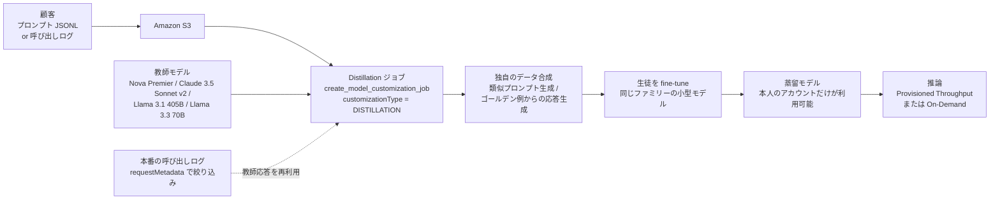

# Amazon Bedrock Model Distillation — サービスの仕組み・対応モデル・価格（プレビュー〜GA）

- **Source**: Amazon Web Services（AWS News Blog: Channy Yun / AWS What's New / Amazon Bedrock User Guide / 価格ページ / 製品ページ）
- **Date**: 2024-12-03（プレビュー発表）、2025-05-01（GA）、ドキュメントと価格は 2026-10 時点
- **Link**:
  - プレビュー発表: <https://aws.amazon.com/blogs/aws/build-faster-more-cost-efficient-highly-accurate-models-with-amazon-bedrock-model-distillation-preview/>
  - 同・日本語版: <https://aws.amazon.com/jp/blogs/news/build-faster-more-cost-efficient-highly-accurate-models-with-amazon-bedrock-model-distillation-preview/>
  - GA 発表: <https://aws.amazon.com/about-aws/whats-new/2025/05/amazon-bedrock-model-distillation-generally-available>
  - ユーザーガイド: <https://docs.aws.amazon.com/bedrock/latest/userguide/model-distillation.html>
  - 価格: <https://aws.amazon.com/bedrock/pricing/>
  - 製品ページ（日本語）: <https://aws.amazon.com/jp/bedrock/model-distillation/>
- **Type**: Technical Article（公式ドキュメント・公式ブログ）
- **取得状況**: 上記 6 ページはすべて取得して本文を確認済み（2026-10-21）
- **証拠の質**: すべて **ベンダー申告**（AWS 自身の記述）

## Overview

Amazon Bedrock Model Distillation は、**教師モデルの応答を自動で生成し、独自のデータ合成で増やし、生徒モデルをファインチューニングするまでを 1 つのジョブにまとめた** マネージド機能です。2024 年 12 月の re:Invent でプレビューとして発表され、2025 年 5 月 1 日に GA になりました。

AWS が繰り返し掲げる数字は「蒸留モデルは元のモデルより **最大 500% 高速・最大 75% 安価**、RAG などで **精度低下は 2% 未満**」です。プレビュー発表のブログでは同じ数字が「**up to five times faster**」と書かれており、「500%」は「5 倍」の意味です。条件は「a certain use case（特定のユースケースでは）」と限定されており、どのタスク・どのモデルの組合せで測ったかは公開されていません。

本サービスは技術的には **黒箱（応答ベース）蒸留** です。生徒が学ぶのは教師の出力テキストで、ロジットは使いません。これは「教師の出力による SFT」と同じですが、AWS は (1) 人手の正解が要らない（プロンプトだけでよい）、(2) 独自のデータ合成（似たプロンプトの生成、ゴールデン例からの応答生成）を加える、という 2 点で通常のファインチューニングと区別しています。

## Key Technical Content

### Architecture / Design



### Implementation Steps（ユーザーガイドとプレビュー発表から）

1. **教師と生徒を選ぶ**: 教師は「ユースケースで目標とする精度を出せるモデル」、生徒は「レイテンシ要件を満たすモデル」。**教師と生徒は同じファミリーでなければならない**（例: Llama 3.1 405B を教師にすると、生徒は Llama 3.1 70B か 8B だけ）。
2. **学習データを用意する**: `.jsonl` のプロンプト集（`schemaVersion: bedrock-conversation-2024`）。assistant の応答は任意（ゴールデン例として使われる）。
3. **または本番ログを使う**: model invocation logging を S3 に出力し、`requestMetadata` を付けておけば `requestMetadataFilters` で必要なログだけ選べる。**ログのモデルと教師モデルが同じ場合だけ**、教師応答の再生成を省略できる（教師推論の費用を節約）。
4. **ジョブを作る**: 応答の最大長（Max response length）、入力 S3、出力 S3、IAM ロールを指定。
5. **独自のデータ合成**: ユースケースに応じて Bedrock が自動で適用。「似たプロンプトを生成して学習データを増やす」「顧客のプロンプトと応答の組をゴールデン例として高品質な応答を作る」の 2 種類が例示されている。
6. **デプロイ**: プレビューでは **Provisioned Throughput の購入が必須**。現在は PEFT で作った蒸留モデルなら On-Demand も選べる。
7. **評価**: Bedrock Model Evaluation 等で教師・ベース生徒と比較する。

### AWS が示す推奨事項（プレビュー発表の Things to know）

- 蒸留の前に、複数の教師候補をユースケースで評価し、精度が許容できる教師を選ぶ
- 教師で精度が出るようにプロンプトを最適化してから、そのプロンプトを蒸留の入力にする
- 生徒の候補ごとにレイテンシを評価する。**蒸留モデルのレイテンシは選んだ生徒と同じ**になる
- **生徒がそのままでも十分な性能なら、蒸留せずに生徒を使うことを推奨**

### Key Formulas / Metrics

| Metric | Value | Context | 証拠の質 |
|--------|-------|---------|---------|
| 速度 | 最大 500%（= 5 倍）高速 | 「特定のユースケース」で元の大型モデルと比較 | ベンダー申告（条件非公開） |
| コスト | 最大 75% 安価 | 同上 | ベンダー申告 |
| 精度 | 低下 2% 未満 | RAG などのユースケース | ベンダー申告 |
| 合成データの上限 | 最大 15,000 組 | 動画検索ブログ（[03](03-bedrock-nova-video-search-distillation.md)）での記載 | ベンダー申告 |
| 合成データのサンプル開示 | 最大 50 件（Anthropic は 25 件） | GA で追加。コンプライアンス確認用 | ベンダー申告 |

「最大 75% 安価」をコスト式に当てはめると、次のように読めます。

$$
\frac{C_{\text{student}}}{C_{\text{teacher}}} \geq 0.25 \quad\Longrightarrow\quad \text{推論単価の削減} \leq 75\%
$$

一方、同じ AWS の動画検索の例（[03](03-bedrock-nova-video-search-distillation.md)）では「95% 超の削減」と報告されています。**「最大 75%」は上限ではなく代表値として使われている** ことになり、数字の定義は一貫していません。

## Figures & Tables

### 表 1: 対応モデルの変遷

| 時期 | 教師 | 生徒 | 出典 |
|------|------|------|------|
| プレビュー（2024-12） | Anthropic / Meta / Amazon の各モデル（例: Llama 3.1 405B Instruct） | 同じファミリー（例: Llama 3.1 70B / 8B Instruct） | プレビュー発表 |
| GA（2025-05）で追加 | Amazon Nova Premier | Nova Pro（GA 発表）/ Nova Pro・Lite・Micro（Nova Premier 発表） | GA 発表・Nova Premier ブログ |
| GA で追加 | Claude 3.5 Sonnet v2 | Claude Haiku | GA 発表・関数呼び出しブログ |
| GA で追加 | Llama 3.3 70B | Llama 3.2 1B / 3B | GA 発表 |

> GA 発表本文の生徒は「Nova Pro」だけですが、同じ日の Nova Premier 発表では「Nova Pro、Lite、Micro」となっています。最新の対応表は AWS のモデル一覧で確認する必要があります。

### 表 2: 課金の構造（プレビュー発表と価格ページ）

| 段階 | 課金対象 | 備考 |
|------|---------|------|
| 合成データの生成 | 教師モデルの推論（オンデマンド単価） | 独自のデータ合成を使うと、教師推論の追加料金が発生（ユーザーガイドの注記） |
| 生徒の学習 | 生徒モデルのファインチューニング料金 | |
| 保管 | 蒸留モデルの月額保管料 | |
| 推論（プレビュー当時） | Provisioned Throughput（1 時間 × モデルユニット） | 常時稼働の固定費 |
| 推論（現在） | PEFT 製のカスタムモデルは PT か On-Demand を選べ、**価格はベースモデルと同じ** | 価格ページ |
| 本番ログを再利用した場合 | 教師応答の再生成を省略できる | ログのモデル = 教師のときだけ |

### 表 3: 通常のファインチューニングとの違い（製品ページ・日本語版）

| 観点 | 通常の fine-tuning | Bedrock Model Distillation |
|------|-------------------|---------------------------|
| 顧客が用意するもの | プロンプト + 応答（正解） | プロンプトだけ（応答は任意） |
| 応答の作り手 | 人 | 教師モデル + 独自のデータ合成 |
| 本番ログの利用 | 自前で整形 | 呼び出しログをメタデータで絞り込んで直接利用 |
| 教師と生徒の組合せ | — | 同じファミリーに限る |
| 学習方式 | SFT | SFT（教師出力による黒箱蒸留） |

### 図: 製品ページの価値の主張（ASCII で再現）

```
        元の大型モデル           蒸留モデル（同じファミリーの小型）
速度    |█                     |█████  最大 5 倍
費用    |████████████████████  |█████  最大 75% 減
精度    |████████████████████  |███████████████████▌ 低下 2% 未満（RAG）
```

## Practical Takeaways

1. **教師の選択肢がファミリー内に閉じている**。Claude の生徒は Claude Haiku、Llama の生徒は Llama だけです。異なるベンダー間の蒸留（例: Claude → Llama）はこの機能ではできません。利用規約の制約（仮説 H5）に加えて、**製品設計でも教師が固定されています**。
2. **本番ログを持っている場合が一番安い**。呼び出しログに `requestMetadata` を付けておけば、教師の再推論なしで蒸留できます。「教師で本番を回しながらログを貯め、あとで蒸留する」という運用が前提になっています。
3. **推論課金が PT 必須から On-Demand へ緩和された点は重要です**。PT 必須だった頃は、トラフィックが少ないと固定費で蒸留の利点が消えていました。
4. **AWS 自身が「生徒がそのままで十分なら蒸留しない」ことを勧めています**。まずベースの生徒をそのまま評価するべきです。
5. **「500% / 75% / 2%」は条件が非公開のベンダー値**です。社内の稟議では、[02](02-bedrock-function-calling-distillation.md) や [03](03-bedrock-nova-video-search-distillation.md) のように、タスクを特定した測定値を使う方が安全です。

## Notes

- **蒸留かどうかの区別**: 本サービスは「教師出力による SFT」に独自のデータ拡張を加えたもので、ロジットを使う古典的な蒸留ではありません。ただし教師の出力を生徒が学ぶため、本調査の定義では **蒸留に該当** します（量子化や単なる小型モデルへの乗り換えとは異なります）。
- **国内の情報**: 日本語では、AWS ブログの翻訳と @IT の解説記事（[AWSが“民主化”する生成AIトレンド「蒸留」とは](https://atmarkit.itmedia.co.jp/ait/articles/2501/14/news106.html)、2025-01-14、後半は会員限定）しか見つかりませんでした。@IT は、Nova Micro / Lite を生徒、Pro / Premier を教師として位置づけた AWS の説明を紹介しています。**国内の顧客事例は見つかっていません**。
- 関連レポート: 顧客名の検証は [04](04-bedrock-named-customers-audit.md)、関数呼び出しの定量評価は [02](02-bedrock-function-calling-distillation.md)、Nova での実例は [03](03-bedrock-nova-video-search-distillation.md)。

## 2026-10-22 追記・訂正（対応モデル・リージョン・課金の再確認）

ユーザーガイドの「Prerequisites for model distillation」（<https://docs.aws.amazon.com/bedrock/latest/userguide/prequisites-model-distillation.html>）を 2026-10-22 に取得して確認しました。詳細は [12](12-bedrock-distillation-support-matrix-2026.md) にまとめています。本レポートの記述に対する訂正・補足は次のとおりです。

- **（2026-10-22 訂正）Anthropic モデルの蒸留は現在停止中**。ガイドの原文: 「Distillation is not currently available for Anthropic models on Amazon Bedrock. There is no confirmed timeline for when Anthropic distillation will be restored.」表 1 の「Claude 3.5 Sonnet v2 → Claude Haiku」は GA 時点の記録であり、2026-10 時点では使えません。
- **（2026-10-22 追記）現在の対応表**: Nova Pro → Nova Lite / Micro、Nova Premier → Nova Lite / Micro / Pro（いずれも **US East (N. Virginia)**）、Llama 3.1 405B → 3.1 8B / 3.1 70B / 3.2 1B / 3.3 70B、Llama 3.1 70B → 3.1 8B / 3.2 1B / 3.2 3B、Llama 3.3 70B → 3.1 8B / 3.2 1B / 3.2 3B（いずれも **US West (Oregon)**）。**東京リージョンは非対応**。
- **（2026-10-22 追記）モダリティ**: 「support only the text-to-text modality」（学習データの準備ページ）。
- **（2026-10-22 追記）推論課金の原文**（価格ページ）: 「For custom models developed with parameter-efficient training techniques (available for Fine-Tuning, Preference Optimization and Distillation), customers may choose between Provisioned Throughput (PT) or On Demand (OD) pricing options. … The prices are the same for custom models as base models.」表 2 の記述と一致。ただし **Nova の学習単価（1,000 トークンあたり）は価格ページが JavaScript で描画するため取得できず**、数値は本調査では未確認です。
- **（2026-10-22 追記）国内資料**: クラスメソッドのハンズオン 3 本（2024-12 〜 2025-05）と AWS ブログ（日本）の生成 AI Frontier Meetup 報告（2025-09-04）を追加で確認しました。いずれも顧客事例はありません（[12](12-bedrock-distillation-support-matrix-2026.md)、[14](14-customer-cases-expanded-audit.md)）。
