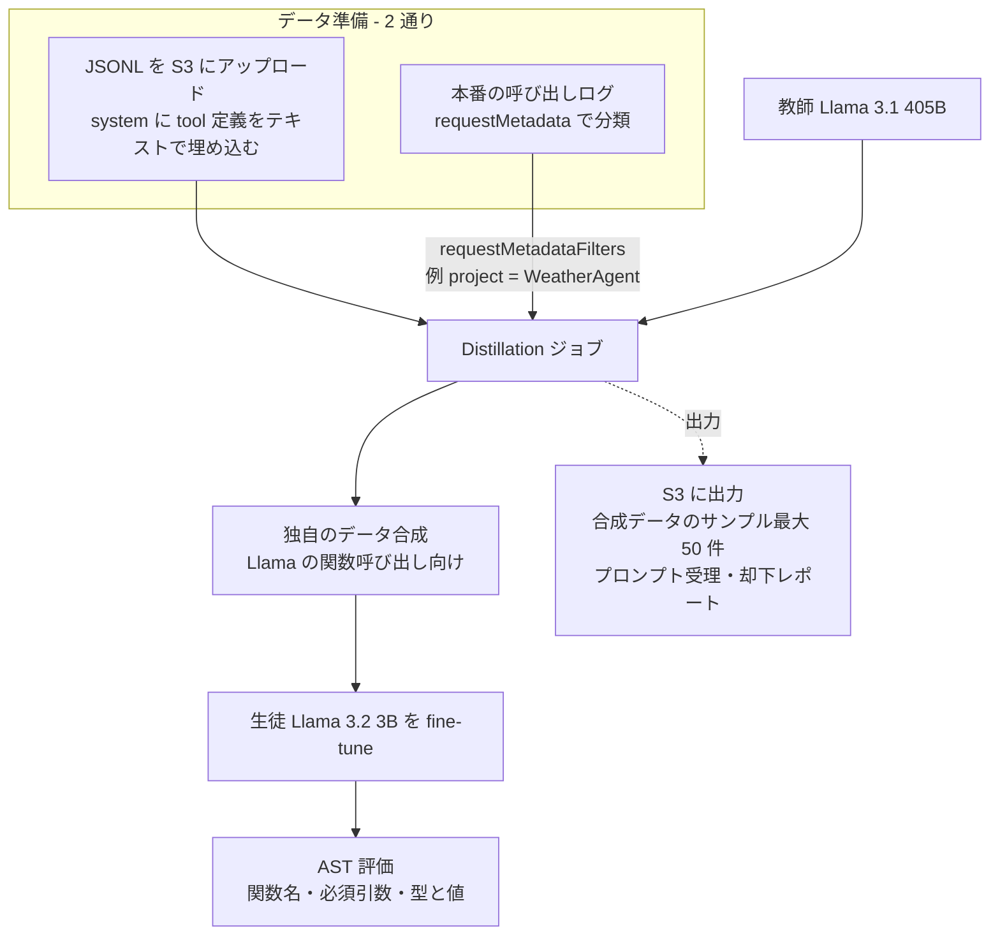

# Amazon Bedrock Model Distillation: Boost function calling accuracy while reducing cost and latency

- **Source**: AWS Machine Learning Blog（Yanyan Zhang, Ishan Singh, David Yan, Shreeya Sharma, Panpan Xu, Yawei Wang, Yijun Tian）
- **Date**: 2025-04-30
- **Link**: <https://aws.amazon.com/blogs/machine-learning/amazon-bedrock-model-distillation-boost-function-calling-accuracy-while-reducing-cost-and-latency/>
- **Type**: Technical Article（GA に合わせた技術解説と実験報告）
- **取得状況**: 本文を取得して確認済み（2026-10-21）。図 1〜5 は画像で、教師（Llama 405B）のスコアとコスト・レイテンシの絶対値は本文になく、画像の中だけにあります
- **証拠の質**: **ベンダー申告**（AWS 社員による実験。データは公開ベンチマーク BFCL v2 の一部）

## Overview

Bedrock Model Distillation の GA に合わせて、**エージェントの関数呼び出し（tool calling）を小型モデルへ蒸留する** 効果を示した記事です。Meta Llama ファミリーで、教師 **Llama 3.1 405B** から生徒 **Llama 3.2 3B** へ蒸留し、BFCL v2 のエンターテインメント領域（学習 約 200 件、テスト 約 200 件）で評価しました。

主な結果は次のとおりです。

- 単純な蒸留（vanilla）で、ベースの生徒から **平均 +45.2%（相対）**
- Bedrock 独自のデータ拡張を加えると、そこから **さらに平均 +5.8%（相対）**
- Llama 3.2 3B は Llama 3.1 405B に比べ、**レイテンシ 72% 減・出力速度 140% 増**（Artificial Analysis のデータ、2025-04-04 時点）

仮説 H6（推論蒸留以降、Agent / tool calling 用途の蒸留が増えている）を、**ベンダー自身が重点用途として打ち出している** という形で支持する資料です。

## Key Technical Content

### Architecture / Design



### Implementation Steps

1. **前提**: AWS アカウント、教師・生徒のモデルアクセス、入出力用の S3、IAM（Bedrock が assume できる信頼関係、S3 と呼び出しログへのアクセス、inference profile 使用時の推論権限）。
2. **tool 定義の書き方**: tool の仕様は **system または user メッセージ内にテキストで埋め込む**（Llama の関数呼び出し形式）。推論時も学習時と同じ形式にすることが推奨されている。
3. **JSONL の形式**:

```json
{
  "schemaVersion": "bedrock-conversation-2024",
  "system": [{"text": "You are an expert in composing functions. ... [ {\"name\": \"lookup_weather\", ...} ]"}],
  "messages": [
    {"role": "user", "content": [{"text": "What's the weather tomorrow?"}]},
    {"role": "assistant", "content": [{"text": "[lookup_weather(location=\"san francisco\", date=\"tomorrow\")]"}]}
  ]
}
```

   user は必須、assistant は任意です。

4. **ログを使う場合**: invocation logging を S3 に出力し、呼び出し時に `requestMetadata`（例: `"project": "WeatherAgent", "intent": "LocationQuery", "priority": "High"`）を付けておき、ジョブで `requestMetadataFilters: {"equals": {"project": "WeatherAgent"}}` のように絞り込む。
5. **GA で追加された見える化**:
   - 合成データのサンプル出力（多くのモデルで最大 50 件、Anthropic は最大 25 件）
   - プロンプト受理・却下のレポート（却下の理由つき）
   - より細かいジョブ状態の表示

### 評価方法（AST 評価、Gorilla 論文の方式）

1. **Function matching**: 予測した関数名が正解候補のどれかと一致するか
2. **Required parameter matching**: AST から引数を取り出し、必須引数がすべて正解に存在し完全一致するか
3. **Parameter type and value matching**: 引数の値と型が正しいか

$$
\text{Score} = \frac{1}{N}\sum_{i=1}^{N} \mathbb{1}\left[\text{name}_i \wedge \text{req\_params}_i \wedge \text{type\_value}_i\right]
$$

（$N$ = テスト件数。3 条件をすべて満たした場合だけ正解。ブログは式を示していないため、本レポートで記述を式にしたもの）

### 「vanilla 蒸留」の定義

ブログの定義では、vanilla 蒸留とは「入力データに教師の応答を直接付けて、生徒を SFT すること」です。Bedrock の「augmented 蒸留」は、それに **独自のデータ合成（追加の学習例の生成）** を加えたものです。

## Figures & Tables

### 表 1: BFCL v2（エンターテインメント領域）の AST スコア

| カテゴリ | ベース生徒 Llama 3.2 3B | vanilla 蒸留 | augmented 蒸留 | vanilla の相対改善 | augmented の vanilla からの相対改善 |
|---------|------------------------|--------------|----------------|-------------------|----------------------------------|
| simple | 0.478 | 0.783 | 0.826 | +63.8% | +5.5% |
| multiple | 0.586 | 0.742 | 0.828 | +26.6% | +11.6% |
| **平均** | 0.532 | 0.763 | 0.827 | **+45.2%** | **+5.8%**（ブログの記載） |

> 「+5.5%」「+11.6%」は本文の数値から本レポートで計算したものです。この 2 つを平均すると約 8.5% になり、ブログの「5.8%」と合いません。ブログは計算方法を「各カテゴリの相対改善の平均」と書いていますが、記載の数値からは 5.8% を再現できませんでした（誤記の可能性があります）。教師（405B）のスコアは図にだけあり、本文にはありません。

```
simple   ベース   |████████████████████████ 0.478
         vanilla  |███████████████████████████████████████ 0.783
         augment  |█████████████████████████████████████████ 0.826
multiple ベース   |█████████████████████████████ 0.586
         vanilla  |█████████████████████████████████████ 0.742
         augment  |█████████████████████████████████████████ 0.828
```

### 表 2: レイテンシ・出力速度・コスト（Artificial Analysis、2025-04-04）

| 比較 | 値 | 備考 |
|------|----|------|
| Llama 3.2 3B 対 Llama 3.1 405B のレイテンシ | **72% 減** | 本文の記載 |
| 同・出力速度 | **140% 増** | 本文の記載 |
| 最も出力速度が速いモデル | Llama 3.1 8B | 図 4 |
| 100 万トークンあたりのコスト | 3B / 8B は大幅に安い。70B / 405B は急に上がる | 図 5。本文に金額はない |

### 図（原文の画像）

- 
- 
- 
- 
- 

（図の番号と内容の対応は、本文での登場順から推定しています）

### 表 3: GA で拡張された対応モデル（本記事の記載）

| ファミリー | 教師 | 生徒 |
|-----------|------|------|
| Amazon Nova | Nova Premier | Nova Pro / Lite / Micro |
| Anthropic | Claude 3.5 Sonnet v2 | Claude Haiku |
| Meta | Llama 3.3 70B | Llama 3.2 1B / 3B |
| Meta（プレビューから） | Llama 3.1 405B | Llama 3.1 70B / 8B、本実験では Llama 3.2 3B |

## Practical Takeaways

1. **関数呼び出しは蒸留の効果が大きいタスク**です。3B のベースモデルは関数名や引数の形式で間違えやすく、教師の出力を学ぶだけで大きく改善します（simple で +63.8%）。
2. **データ量は少なくてよい**。約 200 件の学習データで効果が出ています。ただしテストも約 200 件で、ドメインもエンターテインメントの 1 つだけです。本番の多様な tool セットで同じ結果が出る保証はありません。
3. **tool 定義の書式を、学習と推論でそろえる**ことが必須です。
4. **本番ログ + メタデータでの絞り込み**は、エージェントの tool 呼び出しを集めるのに向いています。
5. **データ拡張の追加効果は +5.8% と控えめ**です。効果の大半は「教師の出力で SFT する」という基本部分から来ています。

## Notes

- **評価上の注意**: 教師のスコアが本文にないため、「生徒が教師にどこまで近づいたか」は本文からはわかりません。ベンダーの記事では、改善幅を「ベース生徒との比較」で示すことが多い点に注意が必要です。
- **コスト式との対応**: 本記事は、index の価値式のうち **精度の項（ΔAcc）** と、外部データに頼った **推論コストの項** だけを報告しています。学習コスト（$C_{\text{train}}$）と教師推論コスト（$C_{\text{data}}$）の金額はありません。
- 関連: NVIDIA の「1B と 70B の tool calling 比較」（C5 で扱う）、[01](01-bedrock-model-distillation-service.md)（サービス全体）、[03](03-bedrock-nova-video-search-distillation.md)（Nova で JSON ルーティングを蒸留する例）。
