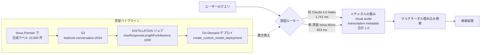

# Optimize video semantic search intent with Amazon Nova Model Distillation on Amazon Bedrock

- **Source**: AWS Machine Learning Blog（Amit Kalawat, Bimal Gajjar, James Wu — いずれも AWS の Solutions Architect）
- **Date**: 2026-04-17（2 回連載の Part 2）
- **Link**: <https://aws.amazon.com/blogs/machine-learning/optimize-video-semantic-search-intent-with-amazon-nova-model-distillation-on-amazon-bedrock/>
- **Code**: <https://github.com/aws-samples/sample-video-semantic-search-multimodal-embeddings>
- **Type**: Technical Article / 参照実装（顧客名なし）
- **取得状況**: 本文と GitHub を取得して確認済み（2026-10-21）
- **証拠の質**: **ベンダー申告**（AWS 社員による参照実装。特定の顧客の本番データではない）

## Overview

マルチモーダル動画検索で、ユーザーのクエリを「映像・音声・文字起こし・メタデータ」の 4 チャネルの重みに振り分ける **意図ルーター** を、Claude Haiku から **蒸留した Amazon Nova Micro** に置き換えた事例です。

- 教師: **Amazon Nova Premier**（`us.amazon.nova-premier-v1:0`）
- 生徒: **Amazon Nova Micro**（`amazon.nova-micro-v1:0:128k`）
- 比較対象: 元のルーターである **Claude 4.5 Haiku**

結果は、**LLM-as-judge のスコアは同じ 4.0 / 5** のまま、**平均レイテンシが 1,741 ms → 833 ms（約 52% 減）**、**推論コストが 95% 超削減** でした。

本調査で見つかった中で、**教師・生徒・データ量・評価方法・レイテンシ・単価のすべてが公開されている、数少ないマネージド蒸留の例** です。ただし顧客の本番事例ではなく、AWS の参照実装です。また評価データも教師が作っています（後述）。

## Problem & Context

- Part 1 では、意図ルーターに Claude Haiku を使っていました。Haiku は精度は高いものの、検索全体の時間が **2〜4 秒** になり、そのうち **75% をルーターが占めていました**。
- 企業のメタデータは例の 5 項目（title、caption、people、genre、timestamp）より複雑です。カメラアングル、ムードや感情、ライセンスの期間などを入れるとプロンプトが長くなり、遅く高くなります。
- 「速いが単純すぎるモデル」か「正確だが高く遅いモデル」かの二択を、蒸留で解消するのが狙いです。

## Solution

### Architecture / Design



### Implementation Steps

1. **学習データの準備**: Nova Premier で **10,000 件の合成ラベル付きデータ** を作成。映像・音声・文字起こし・メタデータ寄りのクエリが均等になるようにし、難易度やエッジケースも含める。形式は `bedrock-conversation-2024`（user は必須、assistant は任意）。Bedrock のデータ合成では最大 15,000 組まで作られる。
2. **蒸留ジョブの実行**: `create_model_customization_job(customizationType="DISTILLATION", ...)` に教師 ID、`maxResponseLengthForInference=1000` を指定。クラスタの準備やハイパーパラメータ調整は不要。10,000 件・Nova Micro で **数時間以内** に終わる。
3. **デプロイ**: `create_custom_model_deployment` で **On-Demand 推論**（エンドポイントの準備・時間単位の契約・最低利用量がない）。Provisioned Throughput も選べる。
4. **評価**: Bedrock Model Evaluation で、**Nova Premier が作った 100 件の保留データ** に対し、Claude Sonnet が独自の OverallQuality 基準で 1〜5 点を付ける。

### 評価の基準（OverallQuality、Claude Sonnet が採点）

| 点 | 定義（原文の要約） |
|----|------------------|
| 5 | 重みが正解から 0.05 以内。推論の説明が具体的で一貫 |
| 4 | 重みが 0.10 以内。説明が明確でおおむね一貫 |
| 3 | 主チャネルは一致。平均誤差 0.15 未満。説明は一般的 |
| 2 | 主チャネルが違う、または平均誤差 0.15 超 |
| 1 | JSON として読めない、キーの欠落、誤差 0.30 超 |

平均誤差の定義を式にすると、次のようになります（本レポートでの整理）。

$$
\bar{e} = \frac{1}{4}\sum_{c \in \{v,a,t,m\}} \left| w_c^{\text{pred}} - w_c^{\text{ref}} \right|, \qquad \sum_c w_c = 1
$$

## Results & Impact

### 表 1: 原文の比較表

| Metric | 蒸留 Nova Micro | Claude 4.5 Haiku |
|--------|----------------|------------------|
| LLM-as-judge スコア | 4.0 / 5 | 4.0 / 5 |
| 平均レイテンシ | 833 ms | 1,741 ms |
| 入力トークン単価 | $0.000035 / 1K | $0.80–$1.00 / 1K（原文の表記のまま） |
| 出力トークン単価 | $0.000140 / 1K | $4.00–$5.00 / 1K（原文の表記のまま） |
| 出力形式 | 一貫した JSON | 不安定 |

> **単位の誤記の可能性**: Haiku の単価は通常 100 万トークンあたりの値で表記されます。原文の「/ 1K」をそのまま比べると 2 万倍以上の差になってしまい、不自然です。100 万トークンあたりに直すと Nova Micro は入力 $0.035・出力 $0.14 で、Haiku の $0.80〜1.00・$4.00〜5.00 と比べて **約 23〜36 倍の差（コスト 95% 超の削減）** となり、本文の「over 95%」と一致します。

```
平均レイテンシ（ms）
Claude 4.5 Haiku |██████████████████████████████████ 1,741
蒸留 Nova Micro  |████████████████ 833

入力単価（$ / 100 万トークン、換算）
Claude 4.5 Haiku |████████████████████████████ 0.80-1.00
蒸留 Nova Micro  |█ 0.035
```

### 表 2: 蒸留前後の Nova Micro の出力（原文の例）

| クエリ | 蒸留 Nova Micro | ベース Nova Micro |
|--------|----------------|------------------|
| "CEO discussing quarterly earnings" | `{"visual": 0.2, "audio": 0.3, "transcription": 0.4, "metadata": 0.1, "reasoning": ...}` | 前置きの文章 + 入れ子の別スキーマ（`"video": {...}`） |
| "sunset over mountains" | `{"visual": 0.8, "audio": 0.0, "transcription": 0.0, "metadata": 0.2, ...}` | `"results": [{"video_id": "123456", ...}]` という無関係な構造 |

ベースの Nova Micro は、自由文、不完全な JSON、数値でない重みを返しました。蒸留後は、4 つの数値の合計が 1.0 になる JSON を毎回返しました。**蒸留の効果の多くは「出力形式の順守」から来ている** ことがわかります。

### 図（原文）

- 
- 
- 

## Figures & Tables

上記の表 1・表 2・評価基準の表・図 1〜3 に加え、価値式への当てはめを示します。

| index の価値式の項 | 本事例で報告されている内容 |
|------------------|------------------------|
| $(C_{\text{teacher}} - C_{\text{student}}) \cdot Q$ | 単価は約 95% 減（比較相手は教師ではなく旧ルーターの Haiku）。$Q$（クエリ数）は非公開 |
| $C_{\text{data}}$ | Nova Premier で 10,000 件を生成。金額は非公開 |
| $C_{\text{train}}$ | 「数時間」。金額は非公開 |
| $\Delta\text{Acc} \cdot V_{\text{err}}$ | 判定スコアは 4.0 で同点（ΔAcc ≈ 0）。100 件・LLM 判定のみ |

## Lessons Learned

1. **ルーターや分類器のような「狭い構造化出力」は蒸留に向いています**。出力の形式を守らせるだけでも、ベースの小型モデルから大きく改善します。
2. **比較の相手は「教師」ではなく「旧来の本番モデル」**です。Haiku → 蒸留 Micro の比較は、現場の意思決定としては正しい比較です。ただし、蒸留そのものの効果（教師にどこまで近づいたか）は示されていません。
3. **評価の自己参照に注意**: 学習データも評価データも **教師の Nova Premier が作っています**。蒸留モデルは教師の判断を真似るよう学習しているので、教師が作った正解では有利になります。一方 Haiku はその分不利になる可能性があります。人が付けた正解での評価はありません。
4. **評価は 100 件、LLM 判定だけ、しかも非決定的**（原文も注記しています）。
5. **On-Demand 推論**が使えるため、トラフィックの少ない段階でも固定費が発生しません。

## Notes

- **顧客事例ではない**: 本記事に顧客名は出てきません。仮説 H2 の観点では「AWS が自分で作った例」に分類されます。
- **蒸留の分類**: 教師出力による SFT（黒箱蒸留）+ Bedrock のデータ合成。ロジットは使っていません。
- 関連: [01](01-bedrock-model-distillation-service.md)（サービス全体）、[02](02-bedrock-function-calling-distillation.md)（関数呼び出し）、Nova Premier 発表の「蒸留した Nova Pro の API 呼び出し精度 +20%」（[04](04-bedrock-named-customers-audit.md) で扱う）。
- **（2026-10-22 追記）数値の再照合**: 原文（キャッシュ済み本文）と照合しました。「over 95%」「4.0 out of 5」「1,741 ms → 833 ms」「10,000 labeled examples」は原文どおりです。「約 52% 減」は本レポートが 1,741 → 833 から計算した値で、**原文の表現は「reduces latency by 50%」「cut preprocessing latency in half」** です。引用時は原文の「50%」を使ってください。
- **（2026-10-22 追記）比較対象の Haiku**: 原文は「Claude 4.5 Haiku」と比較しています。なお Bedrock での Claude の蒸留は 2026-10 時点で停止中のため（[12](12-bedrock-distillation-support-matrix-2026.md)）、「Haiku を蒸留する」選択肢は現在ありません。
