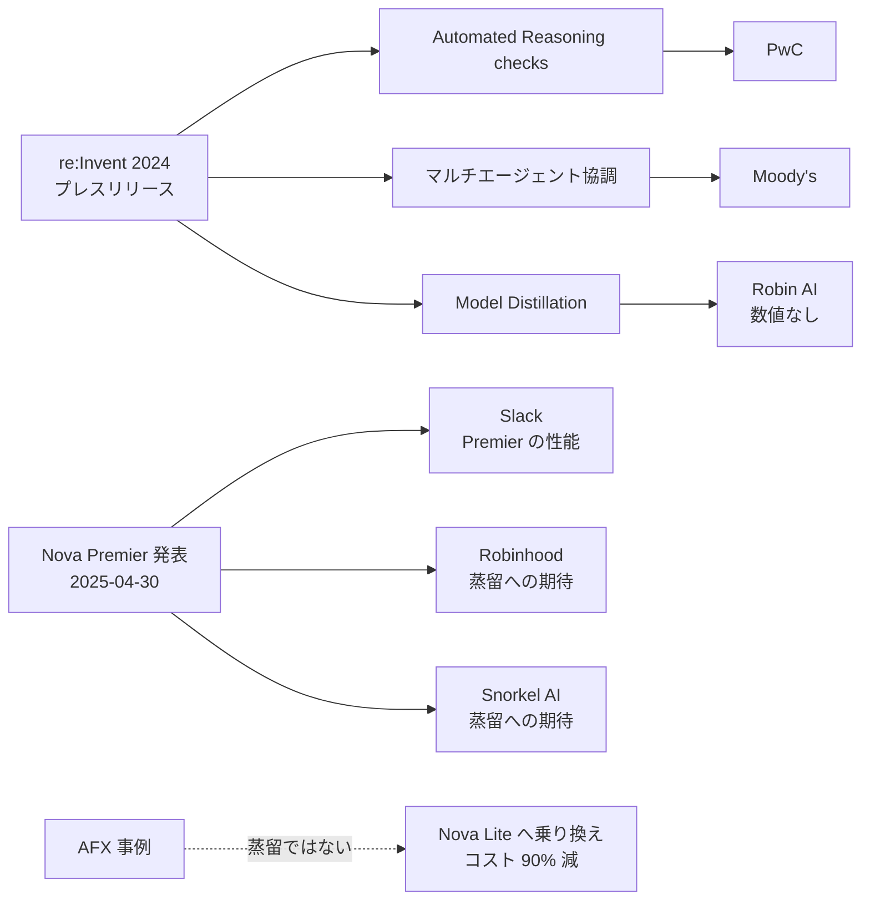

# Bedrock 蒸留の「名前の出た顧客」を検証する — re:Invent 2024 プレスリリースと周辺資料

- **Company/Organization**: Amazon Web Services（顧客として名前が出た企業: Robin AI / Moody's / PwC / Slack / Robinhood / Snorkel AI / AWS Field Experience）
- **Industry**: 法務・金融・コンサルティング・SaaS（各社）
- **Date**: 2024-12-03（プレスリリース）〜 2025-04-30（Nova Premier 発表）
- **Link**（主資料）: <https://press.aboutamazon.com/2024/12/aws-strengthens-amazon-bedrock-with-industry-first-ai-safeguard-new-agent-capability-and-model-customization>
- **Link**（照合に使った資料）:
  - Analytics India Magazine: <https://analyticsindiamag.com/ai-news-updates/aws-had-a-hard-time-fitting-in-all-of-bedrocks-innovations-at-reinvent-2024/>
  - iTWire: <https://itwire.com/business-it-news/data/aws-strengthens-amazon-bedrock-with-three-significant-upgrades.html>
  - Okoone: <https://www.okoone.com/spark/technology-innovation/aws-claims-100-percent-accuracy-in-stopping-ai-hallucinations/>
  - Nova Premier 発表（Customer voices）: <https://aws.amazon.com/blogs/aws/amazon-nova-premier-our-most-capable-model-for-complex-tasks-and-teacher-for-model-distillation/>
  - AFX の Nova Lite 事例: <https://aws.amazon.com/blogs/machine-learning/aws-field-experience-reduced-cost-and-delivered-low-latency-and-high-performance-with-amazon-nova-lite-foundation-model>
  - Bedrock 製品ページ: <https://aws.amazon.com/bedrock/model-distillation/>
- **Type**: Business Case（顧客の主張の検証）
- **取得状況**: すべて取得して本文を確認済み。BigDataWire の記事は 403 で取得できなかった
- **証拠の質**: プレスリリースと AWS ブログは **ベンダー申告**、AIM / iTWire / Okoone は **二次報道**

## Overview

clustering の段階では「Bedrock 蒸留の顧客として Moody's / PwC / Robin AI の名前は出るが、成果の数値はない」と整理していました（仮説 H2）。一次資料を読み直すと、次のことがわかりました。

- **蒸留の顧客として名前が出たのは Robin AI の 1 社だけ** で、成果の数値はありません。
- **Moody's はマルチエージェント機能、PwC は Automated Reasoning checks の顧客** で、蒸留とは別の機能です。同じプレスリリースで発表された 3 機能の顧客名が、二次的なまとめで混ざって伝わっていたと考えられます。
- 2025 年の Nova Premier 発表に出る **Slack / Robinhood / Snorkel AI の声** は、Nova Premier の性能や蒸留への **期待** を述べたもので、蒸留の成果ではありません。
- 「コスト 90% 削減」で知られる **AWS Field Experience（AFX）の事例は、蒸留ではなく Nova Lite への乗り換え** です。

H2 は、「顧客別の成果が非公開」という想定以上に、**「顧客名すら別機能のものが混ざっていた」** という形で強く支持されます。

## Problem & Context

re:Invent 2024 で、AWS は Bedrock に次の 3 機能を同時に発表しました。

1. **Automated Reasoning checks**（ハルシネーション対策の安全機能）
2. **マルチエージェント協調**（Agents）
3. **Model Distillation**（モデルのカスタマイズ）

プレスリリースは 3 機能それぞれに顧客の例を付けています。どの顧客がどの機能に対応するかを照合しました。

## Solution（照合の結果）

### 表 1: 顧客名と機能の対応（一次資料による照合）

| 顧客 | 資料に書かれた用途 | 対応する機能 | 蒸留の成果の数値 | 出典 | 証拠の質 |
|------|-----------------|------------|----------------|------|---------|
| **Robin AI** | 数百万件の契約条項にまたがる、高品質な法務 Q&A。コスト削減と応答の高速化 | **Model Distillation** | **なし** | プレスリリース、AIM（「Robin AI is already using this to save money while providing quick, accurate answers for legal questions」） | ベンダー申告 / 二次報道 |
| Moody's | 各エージェントが個別タスクを担うリスク分析 | **マルチエージェント協調** | 対象外 | プレスリリース、AIM | ベンダー申告 / 二次報道 |
| PwC | 正確で信頼できる AI アシスタント・エージェントの構築 | **Automated Reasoning checks** | 対象外 | プレスリリース、AIM | ベンダー申告 / 二次報道 |
| Slack | 「Nova Premier は対話的な分析ワークフローで優れ、他の主要モデルより速く、コストはほぼ半分」 | Nova Premier（モデルそのもの） | 対象外 | Nova Premier 発表 | 顧客の声（ベンダー掲載） |
| Robinhood | 「Premier の知能を Micro / Lite / Pro に transfer できることが、マルチエージェント協調を手頃な価格と速度で可能にする」 | 蒸留への **期待** | なし | Nova Premier 発表 | 顧客の声（ベンダー掲載） |
| Snorkel AI | 「Bedrock Model Distillation と Nova Premier が、企業顧客の本番 AI 構築を加速する可能性がある」 | 蒸留への **期待**（パートナー） | なし | Nova Premier 発表 | 顧客の声（ベンダー掲載） |
| AWS Field Experience（AFX） | 営業向けアカウントサマリー。Nova Lite に統合して推論コスト 90% 削減 | **蒸留ではない**（モデル乗り換え） | 対象外 | AWS ML Blog（2025-04-24） | ベンダー申告（社内事例） |



### Bedrock 製品ページの「顧客の声」

製品ページ（英語・日本語とも）には「Testimonials」へのリンクがありますが、**蒸留について顧客の声や事例は掲載されていませんでした**（2026-10-21 時点）。

## Results & Impact

### 表 2: 蒸留について AWS が公開している定量値の出どころ

| 数値 | 主体 | 顧客の本番か | 出典 |
|------|------|------------|------|
| 最大 500% 高速・最大 75% 安価・精度低下 2% 未満 | AWS | 不明（条件非公開） | プレスリリース、製品ページ、GA 発表 |
| 関数呼び出し +45.2%（vanilla）/ +5.8%（拡張） | AWS 社員 | いいえ（BFCL v2） | [02](02-bedrock-function-calling-distillation.md) |
| 蒸留した Nova Pro の API 呼び出し精度 +20% | AWS | いいえ（社内実験） | Nova Premier 発表 |
| 動画検索: レイテンシ 52% 減・コスト 95% 超減 | AWS 社員 | いいえ（参照実装） | [03](03-bedrock-nova-video-search-distillation.md) |
| Robin AI のコスト削減 | Robin AI | はい（とされる） | **数値なし** |

```
蒸留の定量値の出どころ（件数）
AWS 自身の実験・デモ |████ 4
顧客の本番（数値あり）|  0
顧客の本番（数値なし）|█ 1  Robin AI
```

### AFX 事例の数値（蒸留ではない比較対象として）

| 指標 | 値 |
|------|----|
| 推論コスト | **90% 削減**（Nova Lite への統合後） |
| 生成されたサマリー | 15,600 件以上（3,600 人の営業担当） |
| 好評価率 | 72% |
| 1 件あたりの節約時間 | 平均 35 分 |
| 作成された商談の金額 | +4.9% |

この事例は「小さく安いモデルへの乗り換え」だけで 90% のコスト削減を達成しています。**蒸留しなくても、乗り換えで大幅なコスト削減が起きうる** ことを示しています。蒸留の効果を主張するには、「ベースの小型モデルとの比較」が欠かせません（仮説 H3 の典型例）。

## Figures & Tables

上記の表 1・表 2・関係図・ASCII 図・AFX の表のとおりです。

### 表 3: Nova Premier 発表にある「蒸留の手順」（投資調査のマルチエージェントの例）

| 手順 | 内容 |
|------|------|
| 1 | 複数の金融商品について Nova Premier を実行し、入出力を合成学習データとして取得 |
| 2 | そのデータで Nova Micro をカスタマイズ |
| 3 | カスタマイズした Micro のレイテンシと性能の差を評価 |
| 4 | Micro を supervisor エージェントとして本番にデプロイ |

（この例の評価結果の数値は掲載されていません）

## Lessons Learned

1. **顧客名は機能ごとに照合する**: 同じプレスリリースで複数の機能が発表されると、二次報道やまとめ記事で顧客名が混ざります。本調査の clustering もその影響を受けていました。
2. **「顧客の声」と「成果」を分ける**: Robinhood と Snorkel AI の発言は期待の表明で、成果ではありません。
3. **蒸留と乗り換えを分ける**: AFX の 90% 削減は蒸留ではありません。「Nova を使ってコスト 90% 削減」という見出しだけを見ると、蒸留の事例と誤解しやすいので注意が必要です。
4. **Robin AI の扱い**: 唯一の蒸留顧客ですが、数値はなく、追跡情報も見つかりませんでした（WebSearch の上限のため、その後の Robin AI の動向は未確認）。

## Notes

- **未確認事項**: BigDataWire の記事（403）は取得できませんでした。re:Invent 2024 のセッション動画で、Robin AI が登壇して数値を話している可能性があります（未確認）。
- **国内顧客**: 日本の AWS 導入事例ページで蒸留の事例は見つかりませんでした（日本語での検索は 2 回だけ実施。検索の上限のため追加検索はできていません）。
- 関連: [01](01-bedrock-model-distillation-service.md)、[02](02-bedrock-function-calling-distillation.md)、[03](03-bedrock-nova-video-search-distillation.md)

## 2026-10-22 追記（追加調査の結果）

横断的な再調査は [14](14-customer-cases-expanded-audit.md) にまとめました。本レポートに関係する点は次のとおりです。

- **（2026-10-22 追記）Robin AI の AWS 導入事例ページ**（<https://aws.amazon.com/solutions/case-studies/robin-ai-bedrock/>）を取得しました。Claude 3 を Bedrock 経由で使うことと「process hundreds of pages of contracts in just a few seconds」（CTO James Clough）が書かれているだけで、**蒸留・Haiku・fine-tuning のいずれにも言及がありません**。Robin AI を「蒸留の顧客」とする根拠は、re:Invent 2024 のプレスリリース 1 本と、それを引用した二次報道に限られます。
- **（2026-10-22 追記）re:Invent 2025（AIM391「Mastering model choice」）**: CoinMarketCap（Bryan Koh）が登壇し、毎日 100 億以上の LLM トークンを消費すると述べていますが、蒸留は **「2025 年の計画」** として挙げられたもので、実施した成果ではありません。同セッションで John Liu が述べた「80% のコスト削減（5 億 → 50 億リクエスト）」は無名の金融犯罪調査の顧客の話で、蒸留とは書かれていません（Zenn の要約記事 <https://zenn.dev/kiiwami/articles/b2b6e155f6778173> による二次情報。動画本体は未確認）。
- **（2026-10-22 追記）Anthropic の公式ブログ**（2024-12-03、<https://claude.com/blog/trainium2-and-distillation>）は Claude 3.5 Sonnet → Claude 3 Haiku の蒸留をプレビューとして発表していますが、顧客名はありません。なお、この Claude の蒸留は 2026-10 時点で停止中です（[12](12-bedrock-distillation-support-matrix-2026.md)）。
- **（2026-10-22 追記）国内**: 追加で 5 回の日本語検索を行いましたが、国内の顧客事例は引き続き 0 件です。
