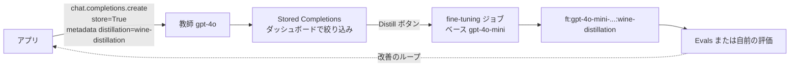

# OpenAI Model Distillation — Stored Completions・Evals・Cookbook の実験

- **Source**: OpenAI（Developer Community の告知 / Cookbook: Pierre-Antoine Porte / Supervised fine-tuning ガイド）
- **Date**: 2024-10-01（DevDay 2024 で発表）、Cookbook は 2024-10-16、ガイドは 2026-10 時点
- **Link**:
  - 告知（Developer Community）: <https://community.openai.com/t/model-distillation-including-evals-and-stored-completions/964021>
  - Cookbook: <https://cookbook.openai.com/examples/leveraging_model_distillation_to_fine-tune_a_model>
  - ガイド（旧 distillation、現在は SFT ガイド）: <https://platform.openai.com/docs/guides/distillation>
  - 公式発表（**取得不可・403**）: <https://openai.com/index/api-model-distillation/>
  - 二次報道: <https://hackernoon.com/5-key-updates-unveiled-at-openais-devday-2024>
- **Type**: Technical Article（公式チュートリアル + 公式告知）
- **取得状況**: openai.com の公式発表は 403 で取得できなかった。告知・Cookbook・ガイド・二次報道は取得して確認済み
- **証拠の質**: **ベンダー申告**（OpenAI 社員による実験）。**顧客事例は 0 件**

## Overview

OpenAI は 2024 年 10 月の DevDay で、蒸留を API の中で完結させる 3 点セットを発表しました。

1. **Stored Completions**: `store=True` を付けた呼び出しの入出力を OpenAI 側に保存し、メタデータで絞り込んで学習データにする
2. **Evals（beta）**: 独自の評価を作って実行する
3. **Fine-tuning**: 保存した教師（GPT-4o / o1-preview）の出力で、小さいモデル（GPT-4o mini）を学習する

告知の文面は「Use outputs from larger models like GPT-4 or o1-preview to train smaller, cost-efficient models that deliver similar performance on specific tasks at a lower cost」です。

2026 年 10 月時点では、`platform.openai.com/docs/guides/distillation` は **Supervised fine-tuning ガイドに統合** されています。蒸留は「Distilling from a larger model」という 1 節になり、例も gpt-4.1 → gpt-4.1-mini に更新されています。Cookbook も「archived（アーカイブ済み）」と表示されています。**蒸留は独立した製品ではなく、SFT の使い方の 1 つという位置づけに変わった** と読めます。

## Key Technical Content

### Architecture / Design



### Implementation Steps（Cookbook）

1. **データ**: Kaggle の Wine Reviews（winemag-data-130k-v2）から **フランスのワインだけ** を抽出。出現が 5 件未満のブドウ品種を除外し、**500 行** を無作為に抽出。
2. **タスク**: レビュー文・産地・価格などから **ブドウ品種を当てる分類**。Structured Outputs の enum で、品種のリストから選ばせる。
3. **費用の見積もり**: tiktoken でトークン数と推論費を事前に見積もる（fine-tuning の費用は含まない）。
4. **教師の出力を保存**: `store=True` と `metadata={"distillation": "wine-distillation"}` を付けて gpt-4o で 500 件を処理。
5. **比較**: 同じ 500 件を gpt-4o-mini でも処理し、正解率を比べる。
6. **蒸留**: ダッシュボードで「gpt-4o」と「metadata: wine-distillation」で絞り込み、「Distill」ボタンで gpt-4o-mini の fine-tuning を作成（ハイパーパラメータは既定値）。
7. **別の 300 件で評価**: 教師・ベース生徒・蒸留生徒の正解率を比べる。

### Key Formulas / Metrics

$$
\text{相対改善} = \frac{\text{Acc}_{\text{distilled}} - \text{Acc}_{\text{base}}}{\text{Acc}_{\text{base}}} = \frac{79.33 - 64.67}{64.67} \approx 22.7\%
$$

$$
\text{教師との差} = \text{Acc}_{\text{teacher}} - \text{Acc}_{\text{distilled}} = 79.67 - 79.33 = 0.34 \text{ ポイント}
$$

## Figures & Tables

### 表 1: 学習に使った 500 件での正解率（蒸留前）

| モデル | 正解率 |
|--------|--------|
| gpt-4o | 81.80% |
| gpt-4o-mini | 69.00% |

### 表 2: 別の 300 件での正解率（蒸留後）

| モデル | 正解率 | ベース mini からの相対改善 |
|--------|--------|------------------------|
| gpt-4o（教師） | 79.67% | — |
| gpt-4o-mini（ベース生徒） | 64.67% | — |
| ft:gpt-4o-mini（蒸留生徒） | **79.33%** | 約 +22%（原文「almost a 22% relative improvement」） |

```
正解率（300 件）
gpt-4o（教師）     |████████████████████████████████████████ 79.67
蒸留 gpt-4o-mini   |███████████████████████████████████████▋ 79.33
gpt-4o-mini        |████████████████████████████████▍ 64.67
```

### 表 3: サービスの構成要素（告知・二次報道・ガイド）

| 要素 | 2024-10 時点 | 2026-10 時点 |
|------|-------------|-------------|
| 教師の出力の保存 | Stored Completions（`store=True`）。二次報道は「永続的に保存」と記載 | Responses API は応答を **既定で 30 日** 保存 |
| 評価 | Evals（beta）。コミュニティでは「Evaluation は無料ではない」というスレッドがある | Evals |
| 学習 | fine-tuning（GPT-4o mini など） | SFT（gpt-4.1-mini など） |
| ガイド | 独立した distillation ガイド | SFT ガイドの 1 節に統合 |
| 教師の例 | GPT-4o、o1-preview | gpt-4.1 |

### 表 4: ガイドが示す「蒸留の流れ」（2026-10 時点の SFT ガイド）

| 手順 | 内容 |
|------|------|
| 1 | 大きいモデル（gpt-4.1 など）でプロンプトを調整し、評価基準で高い性能を出す |
| 2 | そのモデルの出力を取得する（Responses API は 30 日間保存） |
| 3 | 基準を満たす出力でデータセットを作る |
| 4 | 小さいモデル（gpt-4.1-mini など）をそのデータで学習する |

### 表 5: コミュニティの反応（告知スレッドから）

| 要望・指摘 | 内容 |
|-----------|------|
| 保存した completion の検索 API | 「キャッシュ（Redis 等）が不要になる」との要望 |
| 手動での選択・個別削除 | メタデータが同じでも、失敗した出力を除外したい |
| 複数プロジェクトの横断 | 同じ処理に関する別プロジェクトの出力をまとめて蒸留したい |
| 不具合 | 「Stored Completions がダッシュボードに表示されない」スレッド |

## Practical Takeaways

1. **狭い分類タスクでは、蒸留でほぼ教師並みになる**: 300 件の評価で教師との差は 0.34 ポイントでした。ただし評価は 1 タスク・300 件だけです。
2. **蒸留は「同じ OpenAI の中」で閉じる**: 教師も生徒も OpenAI のモデルです。OpenAI の利用規約には、出力を競合モデルの開発に使うことを禁じる条項があるとされます（本調査では規約の本文を取得していません。C8 で確認します）。マネージド機能は、この規約に沿う唯一の公式ルートでもあります（H5）。
3. **製品としての独立性は弱まっている**: ガイドの統合と Cookbook のアーカイブから見て、「蒸留」は SFT の一用法に戻りつつあります。
4. **顧客事例は見つからない**: OpenAI の公式発表（403）も含め、本調査では **OpenAI の蒸留機能を使った顧客名・成果は 1 件も見つかりませんでした**（H2 を支持）。

## Notes

- **蒸留の分類**: 教師出力による SFT（黒箱蒸留）。OpenAI はロジットを提供しないため、白箱蒸留はできません（Snorkel のブログも同じ点を指摘しています）。
- **Azure との関係**: Azure OpenAI は同じ 3 点セット（Stored Completions・Evaluation・Fine-tuning）を、1〜数か月遅れで提供しました（[06](06-azure-openai-foundry-distillation.md)）。
- **未確認**: openai.com の公式発表の本文（料金の特典などが載っている可能性）は 403 で確認できませんでした。

## 2026-10-22 追記・訂正

詳細は [11](11-openai-fine-tuning-wind-down-pricing.md) にまとめました。本レポートの記述に対する訂正・補足は次のとおりです。

- **（2026-10-22 訂正）「蒸留は SFT の一用法に戻った」は不十分な表現でした**。SFT ガイド（`developers.openai.com/api/docs/guides/supervised-fine-tuning`。`platform.openai.com/docs/guides/distillation` はここへ 301 リダイレクト）の冒頭に「OpenAI is winding down the fine-tuning platform.」「The platform is no longer accessible to new users.」とあり、Deprecations ページは **2026-05-07 に通知、2027-01-06 以降は既存顧客も新規の fine-tuning ジョブを作れない** と明記しています。生徒の例に挙がる gpt-4.1-mini も 2027-01-14 に停止します。つまり OpenAI 上のマネージド蒸留は 2027 年 1 月で事実上終了します。
- **（2026-10-22 追記）公式発表の内容（検索スニペット）**: 本文は引き続き 403（curl でも「Enable JavaScript and cookies」）ですが、検索エンジンのスニペットで「offering 2M free training tokens per day on GPT‑4o mini and 1M free training tokens per day on GPT‑4o until October 31」（2024 年）という特典の記述を確認しました。
- **（2026-10-22 追記）料金**（Pricing ページ、1M トークンあたり）: gpt-4.1 学習 $25.00・推論 $3.00 / $12.00、gpt-4.1-mini 学習 $5.00・推論 $0.80 / $3.20、gpt-4o-mini 学習 $3.00・推論 $0.30 / $1.20。Stored Completions と Evals の料金は記載なし。
- **（2026-10-22 追記）表 3 の「Responses API は既定で 30 日保存」** は SFT ガイドの原文「stores model responses for 30 days by default」で再確認しました。
