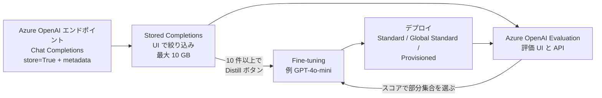
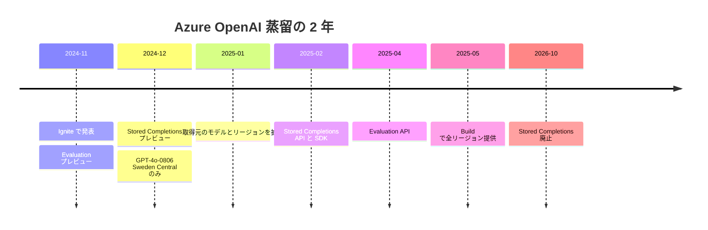

# Azure OpenAI / Azure AI Foundry の蒸留 — 2024-11 の発表から 2026-10 の廃止まで

- **Source**: Microsoft（Tech Community の公式ブログ 8 本 / Microsoft Learn）
- **Date**: 2024-11-19（発表）〜 2025-05-19（Build 2025）、Learn は 2026-10 時点
- **Link**:
  - Introducing Model Distillation in Azure OpenAI Service（2024-11-19）: <https://techcommunity.microsoft.com/blog/azure-ai-services-blog/-/4298627>
  - What's new in Azure OpenAI Service fine-tuning（2024-11-19）: <https://techcommunity.microsoft.com/blog/azure-ai-services-blog/-/4298812>
  - Introducing New Fine-tuning Techniques and Capabilities（2024-12-17）: <https://techcommunity.microsoft.com/blog/azure-ai-services-blog/-/4357961>
  - Introducing Enhanced Azure OpenAI Distillation and Fine-Tuning Capabilities（2025-01-30）: <https://techcommunity.microsoft.com/blog/azure-ai-services-blog/-/4372173>
  - Code First Distillation with Stored Completions（2025-02-25）: <https://techcommunity.microsoft.com/blog/azure-ai-services-blog/-/4385333>
  - Introducing Evaluation API on Azure OpenAI Service（2025-04-24）: <https://techcommunity.microsoft.com/blog/aiplatformblog/-/4407280>
  - Unlocking the Power of Model Distillation through Azure AI Foundry（2025-05-07）: <https://techcommunity.microsoft.com/blog/azure-ai-services-blog/-/4411554>
  - What's New in Azure AI Foundry Fine-Tuning, Build 2025（2025-05-19）: <https://techcommunity.microsoft.com/blog/aiplatformblog/-/4413873>
  - Microsoft Learn: Azure OpenAI stored completions and distillation (deprecated): <https://learn.microsoft.com/en-us/azure/ai-foundry/openai/how-to/stored-completions>
- **Type**: Technical Article（公式ブログ群と公式ドキュメント）
- **取得状況**: 9 ページすべて取得して確認済み（2026-10-21）。日付は各ページの投稿日時のメタデータから取得
- **証拠の質**: すべて **ベンダー申告**。**顧客事例は 0 件**

## Overview

Azure OpenAI の蒸留は、OpenAI の 3 点セット（Stored Completions・Evals・Fine-tuning）を Azure に持ち込んだものです。2024 年 11 月の Ignite で発表され、半年かけてモデル・リージョン・API を広げ、2025 年 5 月の Build で **全リージョン** で使えるようになりました。

ところが、2026 年 10 月時点の Microsoft Learn では、このページの題名が **「Azure OpenAI stored completions and distillation (deprecated)」** に変わっています。冒頭には **「Stored completions retire on October 15, 2026」** と警告があり、Responses API と Agent Traces への移行が案内されています。対象も「Foundry (classic) portal」だけで、新しい Foundry portal にはこの記事がありません。

**つまり、Azure のマネージド蒸留は約 2 年で廃止されました。** 本調査の期間中に見つけた、商用蒸留サービスの廃止・統合の例の中で最も明確なものです。OpenAI 側のガイドの SFT への統合（[05](05-openai-model-distillation.md)）、Gemini 蒸留サービスのページの消失（[10](10-google-vertex-snorkel-distillation.md)）と合わせて、2026 年の傾向を示しています。

## Key Technical Content

### Architecture / Design

### Implementation Steps（Microsoft の説明する流れ）

1. **本番トラフィックを集める**: Chat Completions API で `store=True` を付け、`metadata` で用途を記録する。
2. **絞り込む**: Stored Completions の UI（または API の `GET /chat/completions` と metadata フィルタ）で部分集合を作る。
3. **評価する**: Evaluation UI / API で評価基準（testing criteria）を選んで品質を採点する。
4. **学習する**: 採点結果に基づいて選んだデータで小型モデルを fine-tune。最低 **10 件** から可能だが、**数百〜数千件が推奨**。
5. **比較する**: 蒸留モデルと本番の教師モデルを Evaluation で比較する。

### 発表時の例（2024-11-19 のブログ、架空のシナリオ）

- ブランドや製品に関するニュースを GPT-4o で監視し、感情を分析している企業を想定。
- GPT-4o の本番の応答を Stored Completions で集め、**GPT-4o-mini に蒸留** して、「a fraction of the cost」で高品質な応答を得る。
- **具体的な数値はありません**。

## Figures & Tables

### 表 1: 機能の変遷（タイムライン）

| 日付 | 出来事 | 出典 |
|------|-------|------|
| 2024-11-19 | Ignite で蒸留を発表。Evaluation をパブリックプレビュー、Stored Completions は「coming soon」 | 4298627 / 4298812 |
| 2024-12-17 | Stored Completions をパブリックプレビュー。**GPT-4o-0806・Sweden Central のみ** | 4357961 |
| 2025-01-30 | 取得元に o1-preview・o1-mini・GPT-4o-mini・GPT-4o-0513 を追加（Sweden Central）。North Central US・East US2 を追加。評価の比較機能 | 4372173 |
| 2025-02-25 | Stored Completions API / SDK をパブリックプレビュー（取得・一覧・更新・削除） | 4385333 |
| 2025-04-24 | Evaluation API。コードだけで蒸留を完結できるように | 4407280 |
| 2025-05-07 | AI Foundry の手順を解説（10 件以上で Distill ボタン） | 4411554 |
| 2025-05-19 | Build 2025。Evaluations と Stored Completions を **全 Azure OpenAI リージョン** で提供 | 4413873 |
| 2026-10-15 | **Stored Completions が廃止**。Responses API と Agent Traces へ移行 | Microsoft Learn |

### 表 2: Microsoft Learn に書かれた運用上の制約（2026-10 時点）

| 項目 | 内容 |
|------|------|
| 対応モデル・リージョン | Chat Completions API を使う限り、全 Azure OpenAI モデル・全リージョン（global のみのリージョンを含む） |
| 蒸留の最低件数 | 10 件（数百〜数千件を推奨） |
| 学習ファイル | 蒸留の学習ファイルは **直接アクセスもエクスポートもダウンロードもできない** |
| 保存容量 | 最大 10 GB |
| データの削除 | リソースごと削除するか、サポートへの問い合わせが必要 |
| 無効化 | Azure OpenAI リソースはポータルで無効化できる。Foundry リソースはサポートに問い合わせ |
| 権限 | `stored-completions/read` と `stored-completions/action` の DataActions |
| 廃止 | 2026-10-15。Responses API と Agent Traces へ移行 |

### 表 3: 同時に発表されたファインチューニング関連の機能（2024-12-17 のブログ）

| 機能 | 内容 |
|------|------|
| ファインチューニングでのプロンプトキャッシュ | GPT-4o-0806 と GPT-4o-mini。Standard デプロイで入力トークンが 50% 割引 |
| Global Standard デプロイ（プレビュー） | GPT-4o-0806 と GPT-4o-mini から。モデルの重みが選んだ地域の外に保存されることがある |
| o1-mini のファインチューニング、DPO | 同時に発表 |

### 表 4: OpenAI 本家との比較

| 観点 | OpenAI | Azure OpenAI |
|------|--------|-------------|
| 発表 | 2024-10-01 | 2024-11-19（約 7 週間後） |
| 構成 | Stored Completions + Evals + FT | 同じ |
| 当初の取得元モデル | GPT-4o、o1-preview | GPT-4o-0806（Sweden Central のみ） |
| 2026-10 の状態 | 蒸留ガイドを SFT ガイドに統合 | Stored Completions を廃止 |
| 公開された顧客事例 | 0 | 0 |

## Practical Takeaways

1. **マネージド蒸留の機能は、2 年もたずに廃止されることがある**。Stored Completions に依存した蒸留パイプラインは、2026-10-15 以降は Responses API などへの作り直しが必要です。データの持ち出しも制限されていた（学習ファイルはエクスポート不可）ため、**ベンダーへのロックインの度合い** が高い機能でした。
2. **データの保管と削除の運用が重い**: 削除にはサポートへの問い合わせが必要で、Foundry リソースでの無効化もサポート経由でした。規制業種では、導入前にこの点を確認する必要がありました。
3. **Azure 上で別の系統の蒸留もある**: Microsoft の研究者は、Azure AI 上の Llama-3.1-405B → 8B / 70B の蒸留を論文にしています（[07](07-microsoft-llama-405b-distillation-paper.md)）。こちらは Azure の Model-as-a-Service の fine-tuning API を使い、Azure Marketplace の価格でコストを試算しています。

## Notes

- **顧客事例**: 8 本のブログに顧客名は 1 社も出てきません。Microsoft Customer Stories は検索の上限のため確認できていません。
- **蒸留の分類**: 教師出力による SFT（黒箱蒸留）。
- **H2 との関係**: ベンダーの定量値すらありません（Bedrock には少なくとも AWS 自身の実験値がありました）。

## 2026-10-22 追記（再確認）

- **（2026-10-22 追記）廃止の再確認**: Microsoft Learn のページを curl で再取得し、題名「Azure OpenAI stored completions and distillation (deprecated)」と警告文「Stored completions retire on October 15, 2026. For migration guidance, see Migrate from stored completions to Responses API and Agent Traces.」「Applies only to: Foundry (classic) portal.」を確認しました。表 1・表 2 の記述に変更はありません。
- **（2026-10-22 追記）顧客事例の追加検索**: 「Azure OpenAI distillation customer story / stored completions」で検索しましたが、Microsoft の製品ブログと Learn 以外は見つからず、**顧客事例は引き続き 0 件** です。日本語の解説・ハンズオン記事も 1 回の検索では見つかりませんでした（[14](14-customer-cases-expanded-audit.md)）。
- **（2026-10-22 追記）課金の構造**（Microsoft Learn「Manage fine-tuning costs in Microsoft Foundry」、ms.date 2026-10-05、<https://learn.microsoft.com/en-us/azure/ai-foundry/openai/how-to/fine-tuning-cost-management>）: SFT は「学習トークン数 × エポック数 × 単価」、fine-tune 済みモデルのホスティングは **時間課金**（Standard / Global Standard）、または PTU。Developer デプロイはホスティング無料だが 24 時間で削除。蒸留固有の価格項目はなく、Stored Completions の料金記述もありません。同ページは「Fireworks on Foundry」（Fireworks のモデルを Foundry で提供）を新たに挙げており、Azure OpenAI 以外の蒸留経路が Foundry 内に入り始めています。
- **（2026-10-22 追記）OpenAI 本家の動向**: OpenAI も 2026-05-07 にセルフサーブ fine-tuning の縮小を通知し、2027-01-06 に新規ジョブを停止します（[11](11-openai-fine-tuning-wind-down-pricing.md)）。表 4 の「2026-10 の状態」は「蒸留ガイドを SFT ガイドに統合」から「fine-tuning 基盤を縮小中」に読み替えてください。
